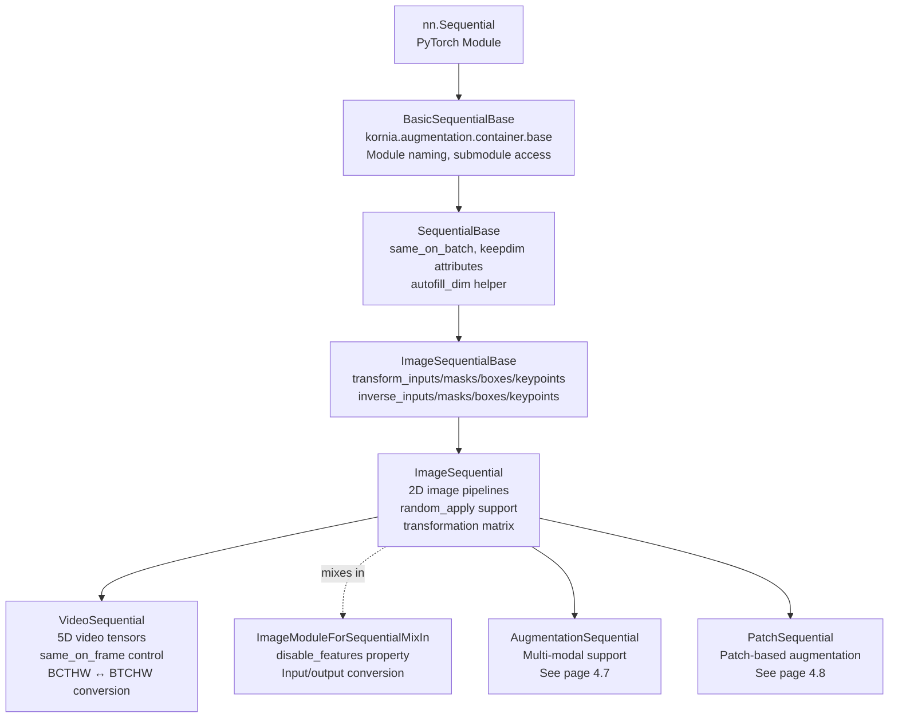
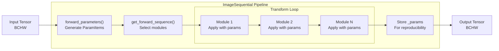
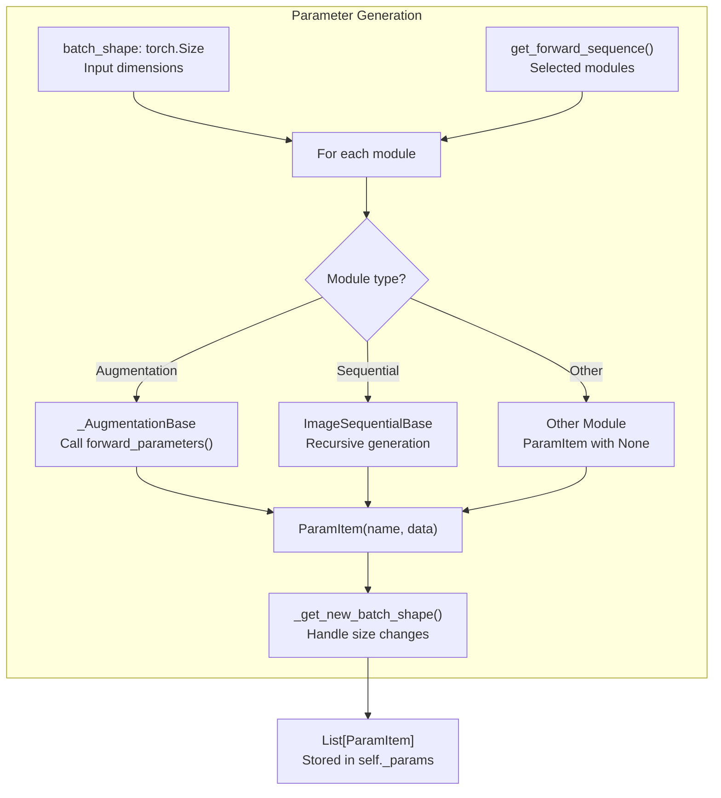
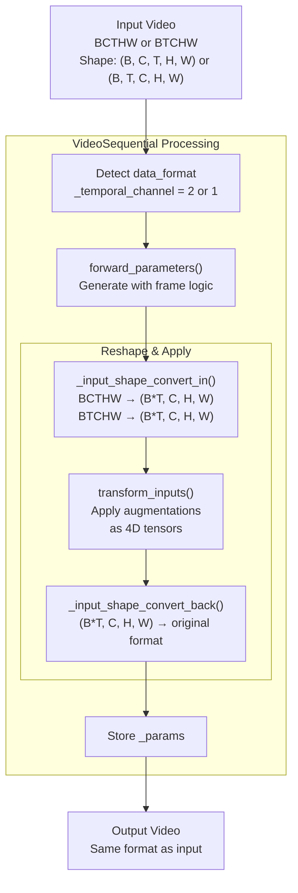
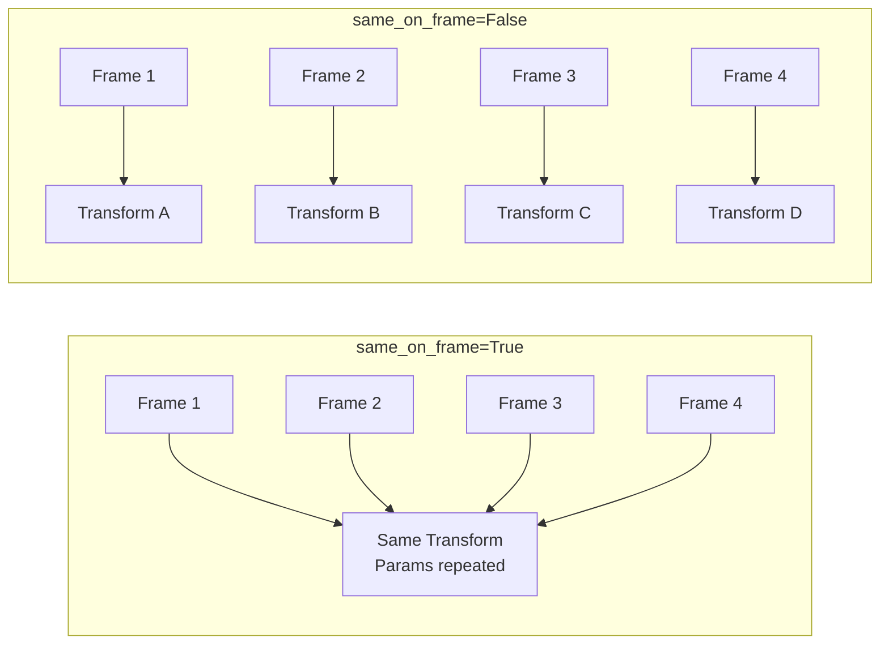
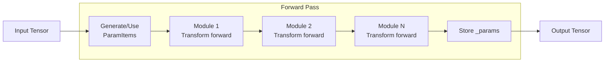
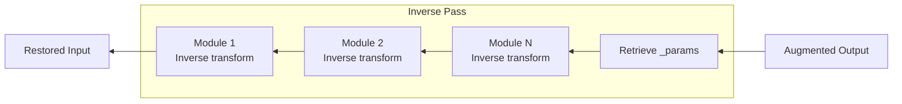

<!-- source: DeepWiki mcp.deepwiki.com · repo kornia/kornia · page 4.6 ImageSequential and VideoSequential Containers · fetched 2026-10-21 -->

# ImageSequential and VideoSequential Containers

<details>
<summary>Relevant source files</summary>

The following files were used as context for generating this wiki page:

- [kornia/augmentation/container/augment.py](kornia/augmentation/container/augment.py)
- [kornia/augmentation/container/base.py](kornia/augmentation/container/base.py)
- [kornia/augmentation/container/image.py](kornia/augmentation/container/image.py)
- [kornia/augmentation/container/ops.py](kornia/augmentation/container/ops.py)
- [kornia/augmentation/container/patch.py](kornia/augmentation/container/patch.py)
- [kornia/augmentation/container/video.py](kornia/augmentation/container/video.py)
- [tests/augmentation/container/test_video_sequential.py](tests/augmentation/container/test_video_sequential.py)

</details>


## Purpose and Scope

`ImageSequential` and `VideoSequential` are container classes for building sequential augmentation and image processing pipelines in Kornia. `ImageSequential` handles 2D image tensors (BCHW format), while `VideoSequential` extends this functionality to 5D video tensors (BCTHW or BTCHW format) with temporal consistency controls.

These containers support standard image augmentations and processing operations from `kornia.augmentation`, `kornia.color`, `kornia.filters`, and `kornia.enhance`. For synchronized multi-modal augmentation (images + masks + bounding boxes + keypoints), see [AugmentationSequential](#4.7). For patch-based augmentation, see [PatchSequential](#4.8).

**Sources:** [kornia/augmentation/container/image.py:52-114](), [kornia/augmentation/container/video.py:35-116]()

---

## Class Hierarchy and Architecture



**Diagram: Class hierarchy showing inheritance relationships**

The inheritance chain provides progressively more specialized functionality:
- `BasicSequentialBase` handles module storage and naming via `nn.Sequential`
- `SequentialBase` adds `same_on_batch` and `keepdim` attribute management
- `ImageSequentialBase` defines abstract interfaces for transform/inverse operations
- `ImageSequential` implements concrete 2D image pipeline behavior
- `VideoSequential` extends to 5D video with temporal dimension handling

**Sources:** [kornia/augmentation/container/base.py:37-184](), [kornia/augmentation/container/image.py:35-52](), [kornia/augmentation/container/video.py:35-116]()

---

## ImageSequential: 2D Image Pipelines

### Core Functionality

`ImageSequential` creates a pipeline for 2D image augmentation with support for:
- Sequential application of augmentations and image operations
- Random selection and ordering of transformations (`random_apply`)
- Batch-level consistency control (`same_on_batch`)
- Shape preservation (`keepdim`)
- Parameter storage for reproducibility
- Transformation matrix computation for geometric operations
- Forward and inverse transformations



**Diagram: ImageSequential forward pass flow**

**Sources:** [kornia/augmentation/container/image.py:52-368]()

### Constructor Parameters

| Parameter | Type | Description |
|-----------|------|-------------|
| `*args` | `Module` | Sequence of augmentation/processing modules |
| `same_on_batch` | `Optional[bool]` | Apply same transformation across batch. Overrides module settings if not None |
| `keepdim` | `Optional[bool]` | Keep output shape same as input. Overrides module settings if not None |
| `random_apply` | `Union[int, bool, Tuple[int, int]]` | Random selection mode (see table below) |
| `random_apply_weights` | `Optional[List[float]]` | Selection weights for each module |

**Random Apply Modes:**

| Value | Behavior |
|-------|----------|
| `False` | Apply all modules in original order |
| `True` | Apply all modules in random order |
| `int` (e.g., `3`) | Select exactly 3 random modules |
| `(a,)` (e.g., `(2,)`) | Select between `a` and `len(args)` modules |
| `(a, b)` (e.g., `(1, 4)`) | Select between `a` and `b` modules |

**Sources:** [kornia/augmentation/container/image.py:116-141]()

### Parameter Management System



**Diagram: Parameter generation flow showing how ParamItems are created**

The `ParamItem` structure stores:
- `name`: Module identifier (e.g., `"ColorJiggle_0"`)
- `data`: Either a `Dict[str, Tensor]` of parameters or `List[ParamItem]` for nested sequentials

**Sources:** [kornia/augmentation/container/image.py:235-248](), [kornia/augmentation/container/params.py]()

### Transformation Matrix Computation

For geometric augmentations, `ImageSequential` computes a combined transformation matrix:

```python
# From kornia/augmentation/container/image.py:250-309
def get_transformation_matrix(
    self,
    input: Tensor,
    params: Optional[List[ParamItem]] = None,
    recompute: bool = False,
    extra_args: Optional[Dict[str, Any]] = None,
) -> Optional[Tensor]:
```

The matrix is computed by chaining individual transformation matrices:
- Only `GeometricAugmentationBase2D` modules contribute matrices
- Non-geometric modules are skipped
- Result is matrix product: `M_final = M_n @ ... @ M_2 @ M_1`

**Sources:** [kornia/augmentation/container/image.py:254-309]()

### Example Usage

**Basic pipeline:**

```python
import kornia.augmentation as K
import torch

input = torch.randn(2, 3, 256, 256)

aug_pipeline = K.ImageSequential(
    K.ColorJiggle(0.1, 0.1, 0.1, 0.1, p=1.0),
    K.RandomAffine(360, p=1.0),
    K.RandomGaussianBlur((3, 3), (0.1, 2.0), p=0.5),
    same_on_batch=False,
    keepdim=True
)

output = aug_pipeline(input)
```

**Reproducible augmentation:**

```python
# Generate and store parameters
output1 = aug_pipeline(input)
stored_params = aug_pipeline._params

# Reproduce exact same transformation
output2 = aug_pipeline(input, params=stored_params)
# output1 == output2
```

**Random selection (OneOf behavior):**

```python
# Select exactly 1 augmentation randomly
aug_pipeline = K.ImageSequential(
    K.RandomHorizontalFlip(p=1.0),
    K.RandomVerticalFlip(p=1.0),
    K.RandomRotation(90, p=1.0),
    random_apply=1,  # Pick one
    random_apply_weights=[0.5, 0.3, 0.2]  # Selection probabilities
)
```

**Sources:** [kornia/augmentation/container/image.py:76-113]()

### Intensity-Only Detection

The `is_intensity_only()` method checks if all transformations are intensity-based (no geometric changes):

```python
# From kornia/augmentation/container/image.py:312-334
def is_intensity_only(self, strict: bool = True) -> bool:
```

This is used by `PatchSequential` and `AugmentationSequential` to determine if masks/boxes/keypoints can be safely transformed.

**Sources:** [kornia/augmentation/container/image.py:312-334]()

---

## VideoSequential: Temporal Consistency for Video

### Overview

`VideoSequential` extends `ImageSequential` to handle 5D video tensors with temporal dimension control. It provides:
- Support for `BCTHW` (Batch, Channel, Time, Height, Width) format
- Support for `BTCHW` (Batch, Time, Channel, Height, Width) format
- `same_on_frame` control for temporal consistency
- Automatic reshaping between 5D and 4D for compatibility with 2D augmentations



**Diagram: VideoSequential processing flow showing 5D→4D→5D conversion**

**Sources:** [kornia/augmentation/container/video.py:174-193](), [kornia/augmentation/container/video.py:384-397]()

### Constructor Parameters

| Parameter | Type | Default | Description |
|-----------|------|---------|-------------|
| `*args` | `Module` | - | Augmentation modules |
| `data_format` | `str` | `"BTCHW"` | Either `"BCTHW"` or `"BTCHW"` |
| `same_on_frame` | `bool` | `True` | Apply same transformation across temporal dimension |
| `random_apply` | `Union[int, bool, Tuple[int, int]]` | `False` | Random selection mode |
| `random_apply_weights` | `Optional[List[float]]` | `None` | Selection weights |

**Sources:** [kornia/augmentation/container/video.py:119-143]()

### same_on_frame Behavior

The `same_on_frame` parameter controls temporal consistency:

**When `same_on_frame=True`:**
- Each batch item gets one set of parameters
- Parameters are broadcasted across all frames
- Result: Identical transformation applied to all frames in each video

**When `same_on_frame=False`:**
- Each frame gets independent parameters
- Different transformations per frame
- Result: Frame-by-frame variation within videos



**Diagram: Temporal consistency modes**

**Sources:** [kornia/augmentation/container/video.py:148-172]()

### Parameter Broadcasting

The `__broadcast_param__()` method handles parameter distribution across batch and temporal dimensions:

| `same_on_frame` | `same_on_batch` | Behavior |
|-----------------|-----------------|----------|
| `True` | `True` | Single param repeated for all batches and frames |
| `True` | `False` | B different params, each repeated across T frames |
| `False` | `True` | T different params, each repeated across B batches |
| `False` | `False` | B*T unique parameters |

```python
# From kornia/augmentation/container/video.py:160-172
def __broadcast_param__(
    self, v: Tensor, batch_shape: torch.Size, frame_num: int, 
    same_on_frame: bool, same_on_batch: bool
) -> Tensor:
    if same_on_frame and same_on_batch:
        return v.repeat(batch_shape[0] * frame_num, *([1] * (v.ndim - 1)))
    elif same_on_frame:
        return self.__repeat_param_across_channels__(v, frame_num)
    # ... other cases
```

**Sources:** [kornia/augmentation/container/video.py:160-172]()

### Data Format Conversion

`VideoSequential` internally converts to a canonical format for processing:

**BCTHW → Processing:**
1. Transpose to BTCHW: `input.transpose(1, 2)`
2. Reshape to 4D: `input.reshape(-1, *input.shape[2:])`
3. Apply augmentations as 2D operations
4. Reshape back to 5D: `input.view(-1, frame_num, *input.shape[1:])`
5. Transpose to BCTHW: `input.transpose(1, 2)`

**BTCHW → Processing:**
1. Reshape to 4D: `input.reshape(-1, *input.shape[2:])`
2. Apply augmentations
3. Reshape back to 5D: `input.view(-1, frame_num, *input.shape[1:])`

**Sources:** [kornia/augmentation/container/video.py:174-193]()

### Example Usage

**Basic video augmentation with temporal consistency:**

```python
import kornia.augmentation as K
import torch

# Video input: (Batch=2, Time=8, Channel=3, Height=224, Width=224)
video = torch.randn(2, 8, 3, 224, 224)

aug = K.VideoSequential(
    K.ColorJiggle(0.1, 0.1, 0.1, 0.1, p=1.0),
    K.RandomAffine(360, p=1.0),
    K.RandomGaussianBlur((3, 3), (0.1, 2.0), p=0.5),
    data_format="BTCHW",
    same_on_frame=True  # Same augmentation across all frames
)

output = aug(video)  # (2, 8, 3, 224, 224)

# Verify temporal consistency
assert torch.allclose(output[0, 0], output[0, 1])  # Frame 0 == Frame 1
assert torch.allclose(output[0, 1], output[0, 2])  # Frame 1 == Frame 2
```

**Frame-independent augmentation:**

```python
aug = K.VideoSequential(
    K.ColorJiggle(0.1, 0.1, 0.1, 0.1, p=1.0),
    K.RandomAffine(360, p=1.0),
    data_format="BTCHW",
    same_on_frame=False  # Different augmentation per frame
)

output = aug(video)

# Frames will have different transformations
assert not torch.allclose(output[0, 0], output[0, 1])
```

**BCTHW format:**

```python
# Video input: (Batch=2, Channel=3, Time=8, Height=224, Width=224)
video_bcthw = torch.randn(2, 3, 8, 224, 224)

aug = K.VideoSequential(
    K.RandomHorizontalFlip(p=1.0),
    K.RandomVerticalFlip(p=1.0),
    data_format="BCTHW",
    same_on_frame=True
)

output = aug(video_bcthw)  # (2, 3, 8, 224, 224)
```

**Sources:** [kornia/augmentation/container/video.py:58-97]()

### Multi-Modal Video Support

`VideoSequential` supports masks, boxes, and keypoints through the parent class methods. However, direct multi-modal support requires wrapping in `AugmentationSequential`:

```python
import kornia.augmentation as K

# Video with masks and boxes
video = torch.randn(1, 8, 3, 224, 224)  # BTCHW
mask = torch.ones(1, 8, 1, 224, 224)
bbox = torch.tensor([[[[50, 50], [150, 50], [150, 150], [50, 150]]]]).expand(1, 8, -1, -1, -1)

# Wrap VideoSequential in AugmentationSequential for multi-modal support
aug = K.AugmentationSequential(
    K.VideoSequential(
        K.ColorJiggle(0.1, 0.1, 0.1, 0.1, p=1.0),
        K.RandomAffine(360, p=1.0),
        data_format="BTCHW",
        same_on_frame=True
    ),
    data_keys=["input", "mask", "bbox"]
)

out_video, out_mask, out_bbox = aug(video, mask, bbox)
```

**Sources:** [kornia/augmentation/container/augment.py:122-143]()

---

## Forward and Inverse Transformations

Both `ImageSequential` and `VideoSequential` support inverse operations for geometric augmentations:

### Forward Pass



**Diagram: Forward pass with parameter storage**

### Inverse Pass



**Diagram: Inverse pass using stored parameters in reverse order**

### Example

```python
import kornia.augmentation as K
import torch

input = torch.randn(2, 3, 256, 256)

aug = K.ImageSequential(
    K.RandomAffine(360, p=1.0),
    K.RandomPerspective(0.5, p=1.0),
)

# Forward
output = aug(input)

# Inverse (only works for geometric augmentations)
restored = aug.inverse(output)

# For VideoSequential
video = torch.randn(2, 8, 3, 256, 256)
aug_video = K.VideoSequential(
    K.RandomAffine(360, p=1.0),
    data_format="BTCHW",
    same_on_frame=True
)

output_video = aug_video(video)
restored_video = aug_video.inverse(output_video)
```

**Notes:**
- Inverse only works for geometric augmentations
- Intensity augmentations cannot be inverted
- `is_intensity_only()` can check if a pipeline is invertible

**Sources:** [kornia/augmentation/container/base.py:276-294](), [kornia/augmentation/container/video.py:368-382]()

---

## Integration with Container Ecosystem

### Nesting Sequential Containers

`ImageSequential` and `VideoSequential` can be nested for complex pipelines:

```python
import kornia.augmentation as K

# Nested ImageSequential
aug = K.ImageSequential(
    K.ImageSequential(
        K.ColorJiggle(0.1, 0.1, 0.1, 0.1, p=1.0),
        K.RandomGaussianBlur((3, 3), (0.1, 2.0), p=0.5),
    ),
    K.RandomAffine(360, p=1.0),
    K.ImageSequential(
        K.RandomHorizontalFlip(p=0.5),
        K.RandomVerticalFlip(p=0.5),
    )
)
```

### Usage in AugmentationSequential

`VideoSequential` is commonly wrapped in `AugmentationSequential` for multi-modal support:

```python
import kornia.augmentation as K

aug = K.AugmentationSequential(
    K.VideoSequential(
        K.ColorJiggle(0.1, 0.1, 0.1, 0.1, p=1.0),
        K.RandomAffine(360, p=1.0),
        data_format="BTCHW",
        same_on_frame=True
    ),
    data_keys=["input", "mask", "bbox", "keypoints"]
)
```

**Sources:** [kornia/augmentation/container/augment.py:134-143]()

### Usage in PatchSequential

`ImageSequential` can be used inside `PatchSequential` for location-specific augmentations:

```python
import kornia.augmentation as K

aug = K.PatchSequential(
    K.ImageSequential(
        K.ColorJiggle(0.1, 0.1, 0.1, 0.1, p=0.5),
        K.RandomPerspective(0.2, p=0.5),
    ),
    K.ImageSequential(
        K.RandomAffine(360, p=1.0),
        K.RandomSolarize(0.1, 0.1, p=0.5),
    ),
    grid_size=(2, 2),
    patchwise_apply=True
)
```

**Sources:** [kornia/augmentation/container/patch.py:82-105]()

---

## Module Name Resolution

Both containers use a naming convention for child modules:

```python
# From kornia/augmentation/container/base.py:46-52
for idx, mod in enumerate(args):
    _args.update({f"{mod.__class__.__name__}_{idx}": mod})
```

Module names follow the pattern `{ClassName}_{index}`, e.g.:
- `ColorJiggle_0`
- `RandomAffine_1`
- `ImageSequential_2`

This naming is used in `ParamItem.name` for module lookup via `get_submodule()`.

**Sources:** [kornia/augmentation/container/base.py:46-52]()

---

## Key Differences Summary

| Feature | ImageSequential | VideoSequential |
|---------|-----------------|-----------------|
| Input Shape | 2D-4D tensors (auto-expanded to BCHW) | Exactly 5D tensors (BCTHW or BTCHW) |
| Temporal Control | N/A | `same_on_frame` parameter |
| Data Format | Implicit BCHW | Explicit `data_format` selection |
| Base Class | `ImageSequentialBase` | `ImageSequential` |
| Parameter Broadcasting | Batch-only | Batch + temporal dimensions |
| Internal Processing | Direct 2D/3D/4D | Converts 5D→4D→5D |
| Use Case | Standard image augmentation | Video frame consistency |

**Sources:** [kornia/augmentation/container/image.py:52-114](), [kornia/augmentation/container/video.py:35-116]()

---

## Implementation Details

### Random Apply Implementation

The `get_random_forward_sequence()` method handles random selection:

```python
# From kornia/augmentation/container/image.py:172-207
def get_random_forward_sequence(self, with_mix: bool = True) -> Tuple[Iterator[Tuple[str, Module]], bool]:
    num_samples = int(torch.randint(*self.random_apply, (1,)).item())
    
    multinomial_weights = self.random_apply_weights.clone()
    # Mix augmentations can only be applied once
    mix_indices = self.get_mix_augmentation_indices(self.named_children())
    multinomial_weights[mix_indices] = 0
    
    indices = torch.multinomial(multinomial_weights, num_samples, replacement=...)
    # ...
```

Special handling for mix augmentations (e.g., `RandomMixUpV2`) ensures they're only applied once per forward pass.

**Sources:** [kornia/augmentation/container/image.py:172-207]()

### Shape Update Tracking

The `_get_new_batch_shape()` function tracks shape changes through the pipeline:

```python
# From kornia/augmentation/container/image.py:370-404
def _get_new_batch_shape(param: ParamItem, batch_shape: torch.Size) -> torch.Size:
    data = param.data
    if data is None:
        return batch_shape
    
    # Check for output_size parameter
    if "output_size" in data:
        batch_prob = data.get("batch_prob", None)
        if batch_prob is not None and batch_prob.item() <= 0.5:
            return batch_shape  # Augmentation not applied
        
        new_batch_shape = list(batch_shape)
        new_batch_shape[-2:] = data["output_size"][0]
        return torch.Size(new_batch_shape)
    
    return batch_shape
```

This is critical for augmentations like `RandomCrop` that change spatial dimensions.

**Sources:** [kornia/augmentation/container/image.py:370-404]()

---

## Sources Summary

- Class definitions: [kornia/augmentation/container/image.py:52-368](), [kornia/augmentation/container/video.py:35-398]()
- Base classes: [kornia/augmentation/container/base.py:37-365]()
- Parameter system: [kornia/augmentation/container/params.py]()
- Operations dispatch: [kornia/augmentation/container/ops.py:202-240]()
- Test examples: [tests/augmentation/container/test_video_sequential.py:27-215]()

---

