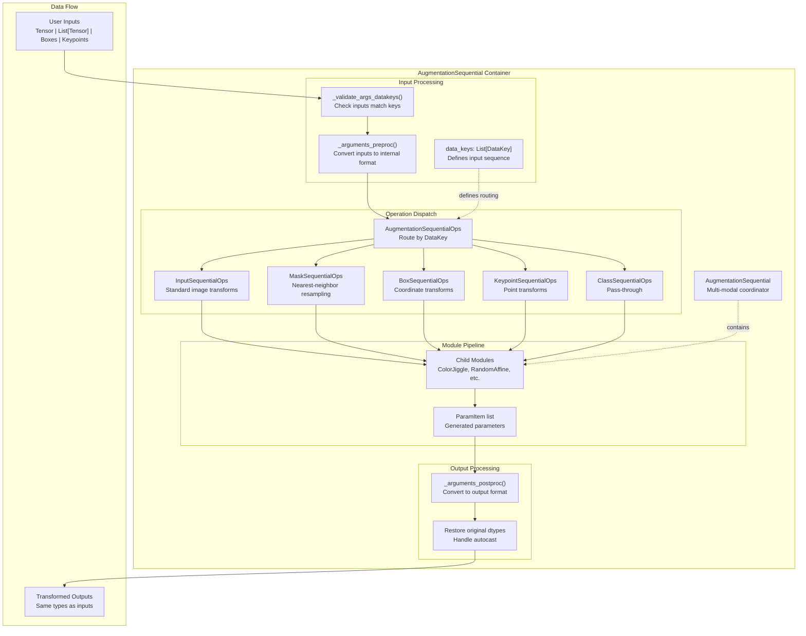
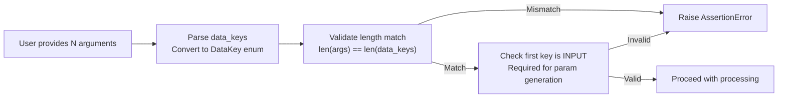
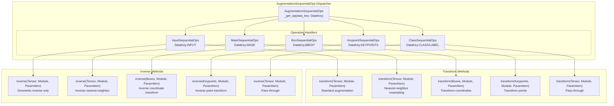
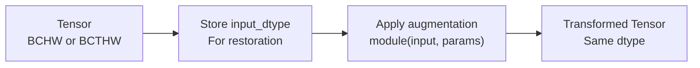
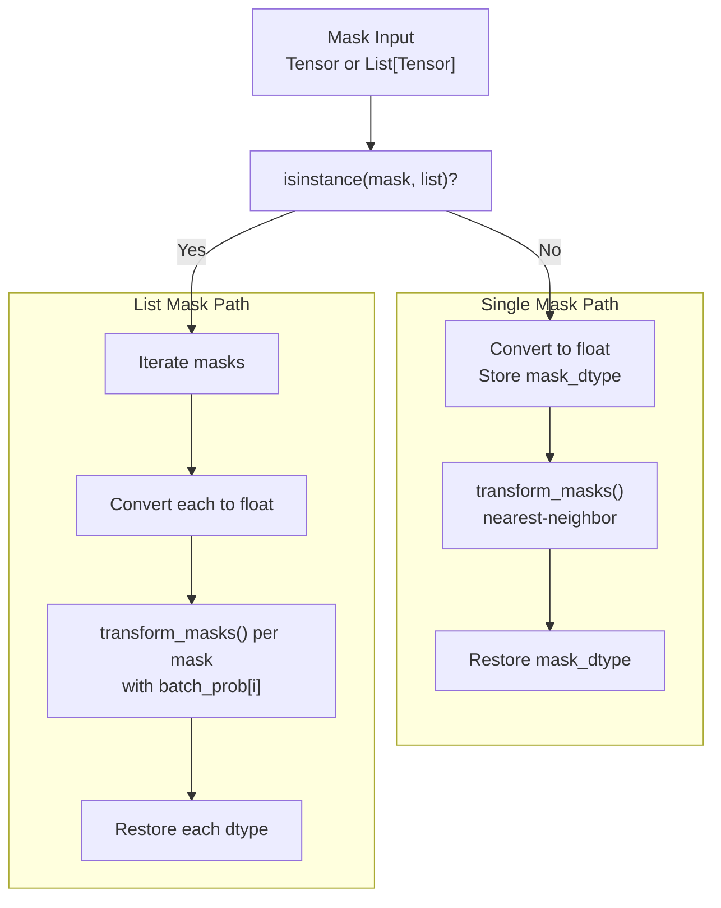
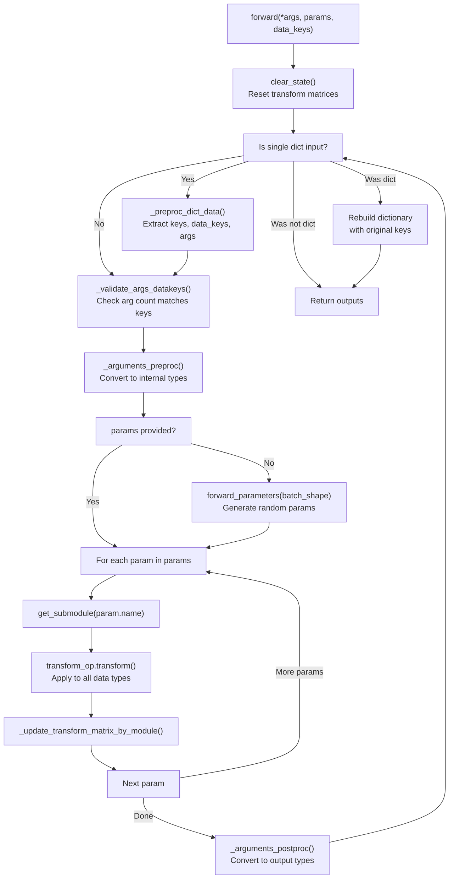
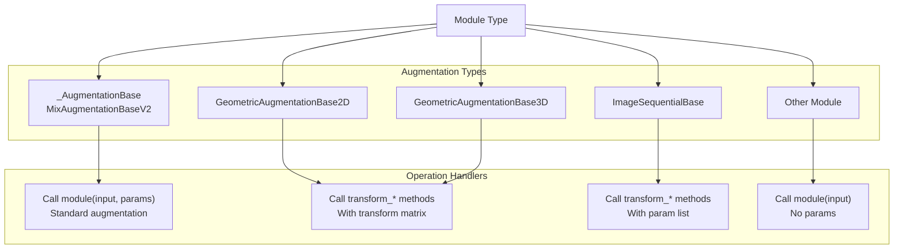

<!-- source: DeepWiki mcp.deepwiki.com · repo kornia/kornia · page 4.7 AugmentationSequential for Multi-Modal Data · fetched 2026-10-21 -->

# AugmentationSequential for Multi-Modal Data

<details>
<summary>Relevant source files</summary>

The following files were used as context for generating this wiki page:

- [kornia/augmentation/container/augment.py](kornia/augmentation/container/augment.py)
- [kornia/augmentation/container/base.py](kornia/augmentation/container/base.py)
- [kornia/augmentation/container/image.py](kornia/augmentation/container/image.py)
- [kornia/augmentation/container/ops.py](kornia/augmentation/container/ops.py)
- [kornia/augmentation/container/patch.py](kornia/augmentation/container/patch.py)
- [kornia/augmentation/container/video.py](kornia/augmentation/container/video.py)
- [tests/augmentation/container/test_video_sequential.py](tests/augmentation/container/test_video_sequential.py)

</details>


## Purpose and Scope

`AugmentationSequential` is a specialized container in Kornia's augmentation system that enables synchronized transformation of multiple data modalities simultaneously. It applies the same augmentation pipeline to images, masks, bounding boxes, keypoints, and class labels while maintaining spatial and semantic consistency across all inputs.

This document covers the multi-modal capabilities of `AugmentationSequential`. For basic sequential augmentation pipelines on images only, see [ImageSequential and VideoSequential Containers](#4.6). For parameter management and reproducibility features, see [Parameter Management and Inverse Transformations](#4.9).

**Sources:** [kornia/augmentation/container/augment.py:50-221]()

---

## Core Concepts

### Data Keys

`AugmentationSequential` uses the `DataKey` enum to identify and route different input types through appropriate transformation paths. Each input tensor is tagged with a data key that determines how it will be processed:

| DataKey | Purpose | Example Use Case |
|---------|---------|------------------|
| `INPUT` / `IMAGE` | Primary image tensor | RGB images, grayscale images |
| `MASK` | Segmentation masks | Semantic segmentation, instance masks |
| `BBOX` / `BBOX_XYXY` / `BBOX_XYWH` | Bounding boxes | Object detection boxes in various formats |
| `KEYPOINTS` | Point annotations | Pose estimation keypoints, landmarks |
| `CLASS` / `LABEL` | Class labels | Classification labels (pass-through) |

**Sources:** [kornia/augmentation/container/augment.py:41-45](), [kornia/constants.py]()

### Multi-Modal Synchronization

The key feature of `AugmentationSequential` is that it ensures all data types experience the same geometric transformations. When an augmentation applies a rotation to an image, the same rotation matrix is applied to:
- Masks (using nearest-neighbor interpolation to preserve discrete labels)
- Bounding boxes (transforming corner coordinates)
- Keypoints (transforming point coordinates)
- Class labels (passed through unchanged)

**Sources:** [kornia/augmentation/container/augment.py:427-488]()

---

## Architecture Overview



**Architecture**: `AugmentationSequential` inherits from `ImageSequential` and adds multi-modal routing capabilities. The `AugmentationSequentialOps` dispatcher routes each input through type-specific operation handlers that apply transformations consistently across modalities.

**Sources:** [kornia/augmentation/container/augment.py:50-288](), [kornia/augmentation/container/ops.py:89-177]()

---

## Data Key System

### Initialization

The `data_keys` parameter defines the order and type of inputs expected by the container:

```python
# Example initialization
aug = AugmentationSequential(
    K.ColorJiggle(0.1, 0.1, 0.1, 0.1, p=1.0),
    K.RandomAffine(360, p=1.0),
    data_keys=["input", "mask", "bbox", "keypoints"]  # Can use strings, ints, or DataKey enums
)
```

The first data key must always be `INPUT` (or its alias `IMAGE`). This is enforced at initialization.

**Sources:** [kornia/augmentation/container/augment.py:226-268]()

### Data Key Validation



**Sources:** [kornia/augmentation/container/augment.py:356-361](), [kornia/augmentation/container/augment.py:266-267]()

### Dictionary Input Mode

When `data_keys=None`, `AugmentationSequential` accepts a dictionary input where keys are automatically parsed to determine data types:

```python
aug = AugmentationSequential(
    K.ColorJiggle(0.1, 0.1, 0.1, 0.1, p=1.0),
    K.RandomAffine(360, p=1.0),
    data_keys=None  # Enable dictionary mode
)

data = {
    'image': img,           # Detected as INPUT
    'mask': mask,           # Detected as MASK
    'mask-b': mask2,        # Also detected as MASK (prefix matching)
    'bbox': boxes,          # Detected as BBOX
    'bbox-other': boxes2    # Also detected as BBOX
}

output = aug(data)  # Returns dictionary with same keys
```

Keys are matched by prefix: if a dictionary key starts with a valid `DataKey` name (case-insensitive), it's routed to the appropriate handler.

**Sources:** [kornia/augmentation/container/augment.py:195-220](), [kornia/augmentation/container/augment.py:544-584]()

---

## Operation Dispatch System

### Dispatcher Architecture



**Sources:** [kornia/augmentation/container/ops.py:89-177](), [kornia/augmentation/container/ops.py:112-124]()

### Operation Interface

Each operation handler implements the `SequentialOpsInterface` protocol with two core methods:

| Method | Purpose | Return Type |
|--------|---------|-------------|
| `transform(input, module, param, extra_args)` | Apply transformation | Same as input type |
| `inverse(input, module, param, extra_args)` | Reverse transformation | Same as input type |

The `extra_args` parameter allows per-data-key control of transformation behavior (e.g., interpolation mode).

**Sources:** [kornia/augmentation/container/ops.py:41-87]()

---

## Data Type Handling

### Image Inputs (INPUT DataKey)



**Implementation**: Images follow the standard augmentation path. The input dtype is stored during preprocessing and restored during postprocessing to handle autocast scenarios.

**Sources:** [kornia/augmentation/container/augment.py:363-386](), [kornia/augmentation/container/ops.py:202-240]()

### Mask Inputs (MASK DataKey)

Masks require special handling to preserve discrete label values:

**Key Features**:
- **Nearest-neighbor interpolation**: Prevents label interpolation during geometric transforms
- **List support**: Can handle multiple masks with different shapes per batch item
- **Dtype preservation**: Converts to float for processing, restores original dtype after

**Extra Args**: By default, masks use `{"resample": Resample.NEAREST, "align_corners": None}`. This can be overridden via the `extra_args` parameter.



**Sources:** [kornia/augmentation/container/augment.py:586-608](), [kornia/augmentation/container/ops.py:262-377](), [kornia/augmentation/container/augment.py:284]()

### Bounding Box Inputs (BBOX DataKey)

Bounding boxes are converted to the internal `Boxes` representation for processing:

**Coordinate Formats**:
- `BBOX`: Vertices format with 4 corners, shape `(B, N, 4, 2)`
- `BBOX_XYXY`: Top-left and bottom-right corners, shape `(B, N, 2, 2)` internally
- `BBOX_XYWH`: Top-left corner + width/height

**Processing Flow**:
1. Convert input tensor to `Boxes` object using specified mode
2. Transform box coordinates via geometric transformation matrix
3. Convert back to original tensor format

**VideoSequential Integration**: When used with `VideoSequential`, boxes are converted to `VideoBoxes` to handle temporal dimension.

**Sources:** [kornia/augmentation/container/augment.py:610-644](), [kornia/augmentation/container/ops.py:421-515]()

### Keypoint Inputs (KEYPOINTS DataKey)

Keypoints are 2D points with shape `(B, N, 2)`:

**Processing**:
1. Convert to `Keypoints` object (or `VideoKeypoints` for video)
2. Apply transformation matrix to point coordinates
3. Convert back to tensor format

**Dtype Handling**: If input keypoints are integer type, they are converted to float for transformation, then restored to original dtype.

**Sources:** [kornia/augmentation/container/augment.py:646-679](), [kornia/augmentation/container/ops.py:518-615]()

### Class Label Inputs (CLASS DataKey)

Class labels are passed through unchanged by all augmentations:

**Limitation**: Mix augmentations (e.g., `RandomMixUp`, `RandomCutMix`) that modify class labels are not currently supported with the `CLASS` data key.

**Sources:** [kornia/augmentation/container/ops.py:242-260]()

---

## Forward and Inverse Operations

### Forward Pass



**Sources:** [kornia/augmentation/container/augment.py:427-488]()

### Inverse Pass

The `inverse()` method reverses geometric transformations applied during the forward pass:

**Key Points**:
- Only geometric augmentations are reversed (intensity augmentations are not invertible)
- Requires stored parameters from forward pass or explicit `params` argument
- Processes modules in reverse order
- Uses computed inverse transformation matrices

**Sources:** [kornia/augmentation/container/augment.py:300-354]()

---

## Extra Arguments System

The `extra_args` parameter allows fine-grained control over transformation behavior for specific data types:

```python
aug = AugmentationSequential(
    K.RandomAffine(360, p=1.0),
    data_keys=["input", "mask", "bbox"],
    extra_args={
        DataKey.MASK: {
            "resample": Resample.BILINEAR,  # Override default NEAREST
            "align_corners": False
        }
    }
)
```

**Default Extra Args**:
```python
{DataKey.MASK: {"resample": Resample.NEAREST, "align_corners": None}}
```

These arguments are passed through to the underlying transformation methods (`transform_masks`, `transform_boxes`, etc.).

**Sources:** [kornia/augmentation/container/augment.py:284](), [kornia/augmentation/container/ops.py:126-158]()

---

## Integration with Other Containers

### VideoSequential Integration

`AugmentationSequential` automatically detects and handles `VideoSequential` children:

```python
aug = AugmentationSequential(
    VideoSequential(
        K.ColorJiggle(0.1, 0.1, 0.1, 0.1, p=1.0),
        K.RandomAffine(360, p=1.0)
    ),
    data_keys=["input", "mask", "bbox", "keypoints"]
)

# Input: 5D tensors (B, T, C, H, W) or (B, C, T, H, W)
video_input = torch.randn(1, 2, 3, 5, 6)  # B=1, T=2, C=3, H=5, W=6
video_mask = torch.ones(1, 2, 1, 5, 6)
video_bbox = torch.tensor([...])  # Shape: (1, 2, N, 4, 2)
video_kpts = torch.tensor([...])  # Shape: (1, 2, N, 2)

output = aug(video_input, video_mask, video_bbox, video_kpts)
```

**Detection**: The `contains_video_sequential` flag is set during initialization if any child is a `VideoSequential`.

**Box/Keypoint Handling**: When video is detected:
- Boxes are converted to `VideoBoxes` type
- Keypoints are converted to `VideoKeypoints` type
- Temporal dimension is preserved through transformations

**Sources:** [kornia/augmentation/container/augment.py:271-283](), [kornia/augmentation/container/augment.py:621-628](), [kornia/augmentation/container/augment.py:649-659]()

### PatchSequential Warning

`PatchSequential` with geometric transformations inside `AugmentationSequential` will trigger a warning, as patch-based geometric transforms can break spatial consistency for masks and boxes:

**Sources:** [kornia/augmentation/container/augment.py:274-277]()

---

## Transformation Matrix Computation

`AugmentationSequential` can compute a combined transformation matrix for all geometric augmentations:

### Computation Modes

| Mode | Behavior |
|------|----------|
| `silent` | Compute matrix, ignore non-rigid augmentations |
| `rigid` | Compute matrix, raise error on non-rigid augmentations |
| `skip` | Don't compute transformation matrix at all |

```python
aug = AugmentationSequential(
    K.RandomAffine(360, p=1.0),
    K.RandomPerspective(p=1.0),
    data_keys=["input", "mask"],
    transformation_matrix_mode="rigid"  # Fail if non-rigid op encountered
)
```

**Valid Operations**: Only `RigidAffineAugmentationBase2D`, `RigidAffineAugmentationBase3D`, and nested `AugmentationSequential` are considered for matrix computation.

**Access**: The combined matrix is available via `aug.transform_matrix` property.

**Sources:** [kornia/augmentation/container/augment.py:226-255](), [kornia/augmentation/container/base.py:312-365]()

---

## List Input Support

### Mask Lists

Multiple masks with different numbers of channels can be processed together:

```python
mask_list = [
    torch.ones(1, 3, 256, 256),  # 3 channel mask
    torch.ones(1, 2, 256, 256)   # 2 channel mask
]

aug = AugmentationSequential(
    K.RandomHorizontalFlip(p=1.0),
    data_keys=["input", "mask"]
)

input_img = torch.randn(2, 3, 256, 256)
output_img, output_masks = aug(input_img, mask_list)
# output_masks is still a list with same structure
```

**Implementation**: When a list of tensors is detected for the MASK data key:
1. Each mask is converted to float independently
2. Transformations are applied per-mask with appropriate `batch_prob` indexing
3. Original dtypes are restored per-mask

**Sources:** [kornia/augmentation/container/augment.py:173-193](), [kornia/augmentation/container/ops.py:315-377]()

### Bounding Box Lists

Similar support exists for lists of `Boxes` objects:

```python
bbox_list = [
    Boxes.from_tensor(torch.tensor([[28., 53., 143., 164.]])),
    Boxes.from_tensor(torch.tensor([[254., 158., 364., 290.]]))
]
```

**Sources:** [kornia/augmentation/container/augment.py:178-182]()

---

## Complete Usage Example

### Basic Multi-Modal Pipeline

```python
import kornia.augmentation as K
import torch

# Create augmentation pipeline
aug = K.AugmentationSequential(
    K.ColorJiggle(0.1, 0.1, 0.1, 0.1, p=1.0),
    K.RandomAffine(360, p=1.0),
    K.RandomHorizontalFlip(p=0.5),
    data_keys=["input", "mask", "bbox", "keypoints"],
    same_on_batch=False
)

# Prepare inputs
input_img = torch.randn(2, 3, 5, 6)
mask = torch.ones(2, 3, 5, 6)
bbox = torch.tensor([[
    [1., 1.],
    [2., 1.],
    [2., 2.],
    [1., 2.],
]]).expand(2, 1, -1, -1)
keypoints = torch.tensor([[[1., 1.]]]).expand(2, -1, -1)

# Apply augmentation
out_img, out_mask, out_bbox, out_kpts = aug(input_img, mask, bbox, keypoints)

# Reproduce with saved parameters
out_rep = aug(input_img, mask, bbox, keypoints, params=aug._params)

# Inverse transformation
inv_img, inv_mask, inv_bbox, inv_kpts = aug.inverse(out_img, out_mask, out_bbox, out_kpts)
```

**Sources:** [kornia/augmentation/container/augment.py:92-121]()

### Dictionary Input Mode

```python
# Create augmentation with dictionary mode
aug = K.AugmentationSequential(
    K.ColorJiggle(0.1, 0.1, 0.1, 0.1, p=1.0),
    K.RandomHorizontalFlip(p=1.0),
    data_keys=None  # Enable dictionary mode
)

# Prepare dictionary input
data = {
    'image': torch.randn(1, 3, 256, 256),
    'mask': torch.ones(1, 3, 256, 256),
    'mask-secondary': torch.ones(1, 2, 256, 256),
    'bbox': torch.tensor([[28., 53., 143., 164.]]),
    'bbox-proposals': torch.tensor([[254., 158., 364., 290.]]),
    'metadata': {'scene': 'outdoor'}  # Non-DataKey items pass through
}

# Apply augmentation
output = aug(data)

# Output is a dictionary with same keys
assert output.keys() == data.keys()
```

**Sources:** [kornia/augmentation/container/augment.py:195-220]()

### Video with Multi-Modal Data

```python
# Create video augmentation pipeline
aug = K.AugmentationSequential(
    K.VideoSequential(
        K.ColorJiggle(0.1, 0.1, 0.1, 0.1, p=1.0),
        K.RandomAffine(360, p=1.0),
        data_format="BTCHW",
        same_on_frame=True
    ),
    data_keys=["input", "mask", "bbox", "keypoints"]
)

# Prepare 5D inputs
video = torch.randn(2, 3, 3, 5, 6)  # (B, T, C, H, W)
video_mask = torch.ones(2, 3, 1, 5, 6)
video_bbox = torch.tensor([[...]]).expand(2, 3, 1, 4, 2)
video_kpts = torch.tensor([[...]]).expand(2, 3, 1, 2)

out = aug(video, video_mask, video_bbox, video_kpts)
```

**Sources:** [kornia/augmentation/container/augment.py:122-143]()

---

## Key Implementation Details

### Type Conversion Table

| Input Type | Internal Type | Preprocessing | Postprocessing |
|------------|---------------|---------------|----------------|
| Image `Tensor` | `Tensor` | Store dtype | Restore dtype |
| Mask `Tensor` | `Tensor` (float) | Convert to float | Restore original dtype |
| Mask `List[Tensor]` | `List[Tensor]` (float) | Convert each to float | Restore each dtype |
| Box `Tensor` | `Boxes` object | Create from tensor | Convert back to tensor |
| Box `Boxes` | `Boxes` object | Pass through | Return as `Boxes` |
| Keypoint `Tensor` | `Keypoints` object | Create from tensor | Convert back to tensor |
| Keypoint `Keypoints` | `Keypoints` object | Pass through | Return as `Keypoints` |
| Class `Tensor` | `Tensor` | Pass through | Pass through |

**Sources:** [kornia/augmentation/container/augment.py:363-425]()

### Module Type Dispatch



Different module types are handled through type checking in the operation classes, enabling proper parameter passing and method invocation.

**Sources:** [kornia/augmentation/container/ops.py:202-240](), [kornia/augmentation/container/ops.py:264-312]()

---

## Limitations and Constraints

### Mix Augmentations

Mix augmentations (`RandomMixUp`, `RandomCutMix`, `RandomMosaic`) only work with `INPUT`/`IMAGE` data keys. The semantic meaning of mixing masks, boxes, and keypoints is not well-defined.

**Sources:** [kornia/augmentation/container/augment.py:85-87]()

### 3D Support

3D augmentations (`AugmentationBase3D`) are only supported for images. Masks, boxes, and keypoints in 3D are not yet implemented:

```python
# This will raise NotImplementedError for non-image data keys
aug = AugmentationSequential(
    K.RandomRotation3D(degrees=45, p=1.0),
    data_keys=["input", "mask"]  # mask will fail
)
```

**Sources:** [kornia/augmentation/container/augment.py:281-282](), [kornia/augmentation/container/ops.py:290-293]()

### First DataKey Requirement

The first element of `data_keys` must be `INPUT` for parameter generation, as the image dimensions determine batch shapes for augmentation:

```python
# This will raise NotImplementedError
aug = AugmentationSequential(
    K.RandomAffine(360, p=1.0),
    data_keys=["mask", "input"]  # Wrong order
)
```

**Sources:** [kornia/augmentation/container/augment.py:266-267]()

---

## Performance Considerations

### Autocast Support

`AugmentationSequential` handles PyTorch autocast by preserving dtypes:

1. Input dtypes are stored during preprocessing
2. Transformations may use lower precision
3. Outputs are restored to original dtypes

This ensures consistency when using mixed precision training.

**Sources:** [kornia/augmentation/container/augment.py:403-417]()

### Parameter Storage

The `_params` attribute stores generated parameters for reproducibility. For large batch sizes or long sequences, this can consume significant memory. Parameters can be explicitly cleared:

```python
aug = AugmentationSequential(...)
out = aug(input, mask, bbox)
# Parameters stored in aug._params
aug.clear_state()  # Free memory
```

**Sources:** [kornia/augmentation/container/augment.py:286-288]()

---

