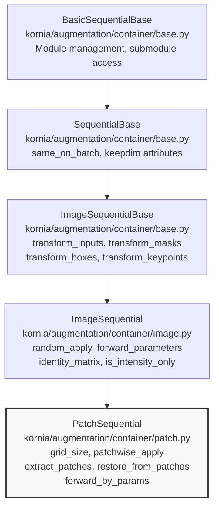
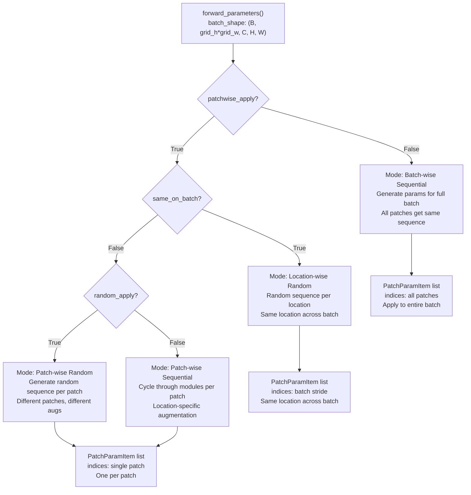
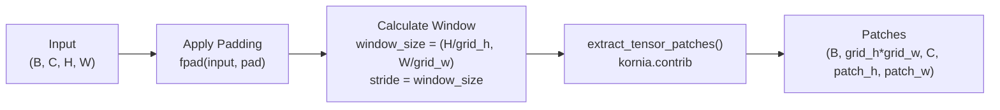
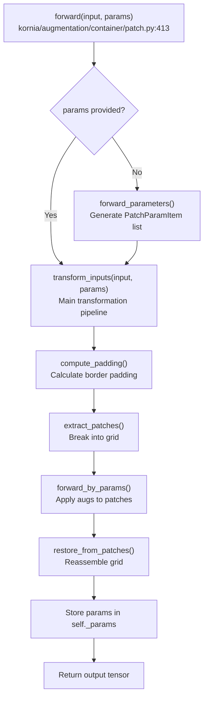
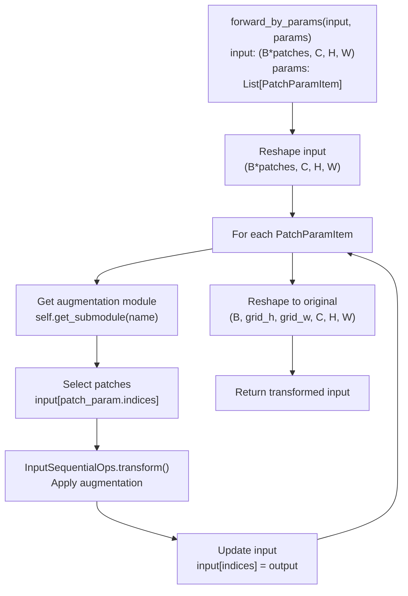
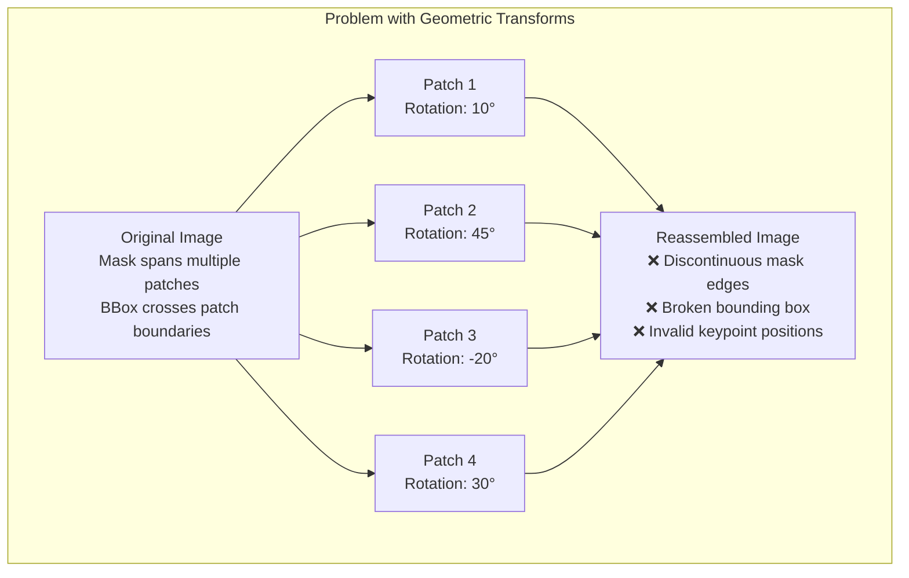
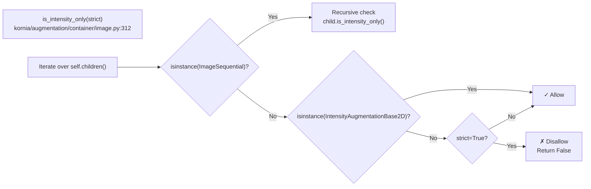
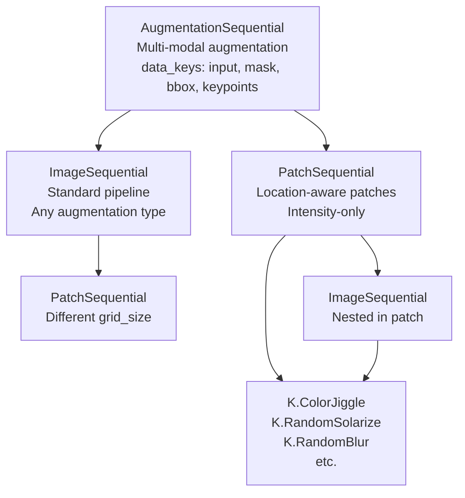

<!-- source: DeepWiki mcp.deepwiki.com · repo kornia/kornia · page 4.8 PatchSequential for Location-Aware Augmentation · fetched 2026-10-21 -->

# PatchSequential for Location-Aware Augmentation

<details>
<summary>Relevant source files</summary>

The following files were used as context for generating this wiki page:

- [kornia/augmentation/container/augment.py](kornia/augmentation/container/augment.py)
- [kornia/augmentation/container/base.py](kornia/augmentation/container/base.py)
- [kornia/augmentation/container/image.py](kornia/augmentation/container/image.py)
- [kornia/augmentation/container/ops.py](kornia/augmentation/container/ops.py)
- [kornia/augmentation/container/patch.py](kornia/augmentation/container/patch.py)
- [kornia/augmentation/container/video.py](kornia/augmentation/container/video.py)
- [tests/augmentation/container/test_video_sequential.py](tests/augmentation/container/test_video_sequential.py)

</details>


## Purpose and Scope

`PatchSequential` is a specialized augmentation container that enables location-aware data augmentation by dividing input images into a grid of patches and applying transformations independently to each patch region. This approach allows different parts of an image to receive different augmentations, following the methodology described in [lin2021patch].

**Key distinction**: Unlike `ImageSequential` (page [4.6](#4.6)) which applies augmentations uniformly across entire images, and `AugmentationSequential` (page [4.7](#4.7)) which synchronizes transformations across multiple data types, `PatchSequential` enables spatial variation within a single image by operating on patch-level regions. For temporal consistency in video data, see `VideoSequential` documentation (page [4.6](#4.6)).

**Important limitation**: `PatchSequential` only supports intensity-based augmentations. Geometric transformations would break the spatial continuity of masks, bounding boxes, and keypoints, making them incompatible with patch-based processing.

---

## Architecture and Class Hierarchy

`PatchSequential` inherits from `ImageSequential` and extends it with grid-based patch extraction and restoration capabilities. The class implements specialized parameter generation to support location-specific or patch-specific augmentation modes.

### Inheritance Structure



**Sources**: [kornia/augmentation/container/patch.py:39-128](), [kornia/augmentation/container/image.py:52-114](), [kornia/augmentation/container/base.py:118-184]()

---

## Grid-Based Patch Processing

`PatchSequential` divides input images into a regular grid and processes each patch independently. The grid size, padding strategy, and augmentation assignment determine how patches are extracted, transformed, and restored.

### Patch Extraction and Restoration Flow

```mermaid
graph LR
    Input["Input Tensor<br/>(B, C, H, W)"]
    Pad["Compute Padding<br/>compute_padding()<br/>same or valid"]
    Extract["Extract Patches<br/>extract_patches()<br/>Uses extract_tensor_patches"]
    Patches["Patch Tensor<br/>(B*grid_h*grid_w, 1, C, patch_h, patch_w)"]
    
    Reshape["Reshape<br/>(B*patches, C, patch_h, patch_w)"]
    Transform["Apply Augmentations<br/>forward_by_params()<br/>Per-patch or sequential"]
    Augmented["Augmented Patches<br/>(B*patches, C, patch_h, patch_w)"]
    
    Restore["Restore from Patches<br/>restore_from_patches()<br/>Concatenate chunks"]
    Unpad["Remove Padding<br/>if applied"]
    Output["Output Tensor<br/>(B, C, H, W)"]
    
    Input --> Pad
    Pad --> Extract
    Extract --> Patches
    Patches --> Reshape
    Reshape --> Transform
    Transform --> Augmented
    Augmented --> Restore
    Restore --> Unpad
    Unpad --> Output
```



**Sources**: [kornia/augmentation/container/patch.py:186-257](), [kornia/augmentation/container/patch.py:334-342]()

### Padding Computation

The `compute_padding` method handles images whose dimensions are not evenly divisible by the grid size:

| Padding Mode | Behavior | Use Case |
|--------------|----------|----------|
| `"same"` | Pad image to include all pixels | Preserve all input data |
| `"valid"` | Crop image to discard border pixels | Ensure uniform patch sizes |

**Implementation**: The padding is computed as (left, right, top, bottom) in pixels:
- **Same padding**: Adds minimal padding to make dimensions divisible by grid size
- **Valid padding**: Removes excess pixels from borders

**Sources**: [kornia/augmentation/container/patch.py:172-184]()

---

## Parameter Generation Modes

`PatchSequential` supports multiple parameter generation modes controlled by `patchwise_apply`, `same_on_batch`, and `random_apply` settings. These modes determine how augmentation parameters are assigned to patches.

### Parameter Generation Decision Tree



**Sources**: [kornia/augmentation/container/patch.py:259-275](), [kornia/augmentation/container/patch.py:277-319]()

### Parameter Generation Modes

The `generate_parameters` method returns an iterator of `(ParamItem, patch_index)` tuples based on the configuration:

| Mode | `patchwise_apply` | `same_on_batch` | `random_apply` | Behavior |
|------|-------------------|-----------------|----------------|----------|
| Batch-wise Sequential | `False` | N/A | N/A | Same augmentation sequence for all patches |
| Patch-wise Random | `True` | `False` | `True` | Random augmentation per patch |
| Patch-wise Sequential | `True` | `False` | `False` | Cycle through modules for each patch |
| Location-wise Random | `True` | `True` | `True` | Random aug per location, same across batch |
| Location-wise Sequential | `True` | `True` | `False` | Cycle modules per location, same across batch |

**Implementation details**:
- **Patch-wise**: Each patch in the batch gets its own parameter generation
- **Location-wise**: Same grid position across batch gets same augmentation (e.g., top-left patch of all images gets same transform)
- **Sequential**: Uses `itertools.cycle` and `islice` to cycle through child modules

**Sources**: [kornia/augmentation/container/patch.py:277-319]()

---

## Patch Extraction and Restoration Implementation

### Extract Patches Method

The `extract_patches` method breaks an image into a grid of non-overlapping patches using `extract_tensor_patches` from `kornia.contrib`:



**Method signature**: `extract_patches(input, grid_size, pad)`

**Key implementation**:
1. Apply padding if specified
2. Compute window size: `(H // grid_h, W // grid_w)`
3. Set stride equal to window size (non-overlapping)
4. Use `extract_tensor_patches` for efficient extraction

**Sources**: [kornia/augmentation/container/patch.py:186-231]()

### Restore from Patches Method

The `restore_from_patches` method reassembles patches into a single image:

```mermaid
graph LR
    Patches["Patches<br/>(B*patches, C, patch_h, patch_w)"]
    Reshape["Reshape<br/>(B, grid_h, grid_w, C, patch_h, patch_w)"]
    ChunkH["Chunk by grid_h<br/>torch.chunk(., grid_h, 1)"]
    ConcatH["Concatenate on H<br/>concatenate(., -2)"]
    ChunkW["Chunk by grid_w<br/>torch.chunk(., grid_w, 1)"]
    ConcatW["Concatenate on W<br/>concatenate(., -1)"]
    Unpad["Remove Padding<br/>fpad(., [-i for i in pad])"]
    Output["Output<br/>(B, C, H, W)"]
    
    Patches --> Reshape
    Reshape --> ChunkH
    ChunkH --> ConcatH
    ConcatH --> ChunkW
    ChunkW --> ConcatW
    ConcatW --> Unpad
    Unpad --> Output
```



**Method signature**: `restore_from_patches(patches, grid_size, pad)`

**Key implementation**:
1. Reshape patches to grid structure
2. Concatenate horizontally (across grid rows)
3. Concatenate vertically (across grid columns)
4. Remove padding if it was applied

**Sources**: [kornia/augmentation/container/patch.py:233-257]()

---

## Forward Pass and Transform Application

The forward pass orchestrates patch extraction, parameter generation, augmentation application, and restoration.

### Forward Pass Workflow



**Sources**: [kornia/augmentation/container/patch.py:413-426](), [kornia/augmentation/container/patch.py:334-342]()

### Augmentation Application: forward_by_params

The `forward_by_params` method applies augmentations to specific patches according to the `PatchParamItem` list:



**Key aspects**:
- Each `PatchParamItem` contains:
  - `indices`: List of patch indices to apply this augmentation to
  - `param`: `ParamItem` with augmentation parameters
- Uses `InputSequentialOps.transform` to apply the module with given parameters
- Updates only selected patches in-place

**Sources**: [kornia/augmentation/container/patch.py:321-332](), [kornia/augmentation/container/ops.py:202-219]()

---

## Limitations and Intensity-Only Restriction

`PatchSequential` enforces a critical constraint: only intensity-based augmentations are supported. Geometric transformations are incompatible with patch-based processing.

### Why Geometric Transforms Break Patch Processing



### Intensity-Only Validation

The `is_intensity_only()` method from `ImageSequential` is used throughout `PatchSequential` to validate that only safe operations are performed:



**Enforced in multiple methods**:
- `transform_masks()`: Returns NotImplementedError if not intensity-only
- `transform_boxes()`: Returns NotImplementedError if not intensity-only  
- `transform_keypoints()`: Returns NotImplementedError if not intensity-only
- `inverse()`: Returns NotImplementedError if not intensity-only

**Warning in AugmentationSequential**: When `PatchSequential` with geometric transforms is detected, a warning is issued that it will break bbox/mask processing.

**Sources**: [kornia/augmentation/container/patch.py:347-398](), [kornia/augmentation/container/patch.py:400-411](), [kornia/augmentation/container/image.py:312-334](), [kornia/augmentation/container/augment.py:274-277]()

---

## Usage Patterns and Examples

### Basic Patch-Wise Augmentation

Apply different augmentation sequences to each patch in a 2×2 grid:

```python
import kornia.augmentation as K

seq = PatchSequential(
    ImageSequential(
        K.ColorJiggle(0.1, 0.1, 0.1, 0.1, p=0.5),
        K.RandomPerspective(0.2, p=0.5),
        K.RandomSolarize(0.1, 0.1, p=0.5),
    ),
    K.RandomAffine(360, p=1.0),
    ImageSequential(
        K.ColorJiggle(0.1, 0.1, 0.1, 0.1, p=0.5),
        K.RandomPerspective(0.2, p=0.5),
        K.RandomSolarize(0.1, 0.1, p=0.5),
    ),
    K.RandomSolarize(0.1, 0.1, p=0.1),
    grid_size=(2, 2),
    patchwise_apply=True,
    same_on_batch=True,
    random_apply=False,
)

input = torch.randn(2, 3, 224, 224)
output = seq(input)  # Shape: (2, 3, 224, 224)
```

**Configuration**:
- `grid_size=(2, 2)`: 4 patches total
- `patchwise_apply=True`: Each of 4 modules applies to one patch location
- `same_on_batch=True`: Same augmentation per location across batch
- `random_apply=False`: Deterministic module-to-patch assignment

**Sources**: [kornia/augmentation/container/patch.py:79-105]()

### OneOf with PatchSequential

Randomly select one augmentation to apply across all patches:

```python
seq = PatchSequential(
    ImageSequential(
        K.ColorJiggle(0.1, 0.1, 0.1, 0.1, p=0.5),
        K.RandomPerspective(0.2, p=0.5),
        K.RandomSolarize(0.1, 0.1, p=0.5),
    ),
    K.RandomAffine(360, p=1.0),
    K.RandomSolarize(0.1, 0.1, p=0.1),
    grid_size=(2, 2),
    patchwise_apply=False,
    random_apply=1,
    random_apply_weights=[0.5, 0.3, 0.8]
)

output = seq(input)
```

**Configuration**:
- `patchwise_apply=False`: All patches get same augmentation sequence
- `random_apply=1`: Select exactly 1 augmentation from the list
- `random_apply_weights`: Sampling probabilities for each module

**Sources**: [kornia/augmentation/container/patch.py:107-126]()

### Parameter Storage

The `PatchParamItem` data structure stores parameters with patch indices:

```python
# Internal structure after forward pass
class PatchParamItem:
    indices: List[int]  # Which patches this applies to
    param: ParamItem    # Augmentation parameters
    
# Example: Apply ColorJiggle to patches [0, 4, 8] (top-left across batch)
# PatchParamItem(
#     indices=[0, 4, 8],
#     param=ParamItem(name="ColorJiggle_0", data={...})
# )
```

**Sources**: [kornia/augmentation/container/params.py]() (referenced), [kornia/augmentation/container/patch.py:34]()

---

## Integration with Container System

`PatchSequential` integrates seamlessly with other containers through shared base classes and interfaces.

### Container Composition



**Important**: When using `PatchSequential` inside `AugmentationSequential`:
- Geometric transforms in `PatchSequential` will trigger a warning
- Masks, bboxes, and keypoints will not be transformed correctly if geometric augmentations are used
- Only the `INPUT` data key should be used with `PatchSequential` containing geometric operations

**Warning message**: "Geometric transformation detected in PatchSequential, which would break bbox, mask."

**Sources**: [kornia/augmentation/container/augment.py:274-277]()

---

## PatchParamItem Data Structure

The `PatchParamItem` extends the parameter system to track which patches receive which augmentations:

| Field | Type | Description |
|-------|------|-------------|
| `indices` | `List[int]` | Patch indices that receive this augmentation (in flattened batch*patches space) |
| `param` | `ParamItem` | Standard parameter item containing module name and augmentation parameters |

**Example flow**:
1. Forward parameters generates multiple `PatchParamItem` objects
2. Each maps a set of patches to an augmentation with specific parameters
3. During forward pass, patches are indexed and augmented according to these items
4. Same structure is stored in `self._params` for reproducibility

**Sources**: [kornia/augmentation/container/patch.py:170](), [kornia/augmentation/container/patch.py:259-275]()

---

## Performance Considerations

### Memory Layout

Patch extraction creates a tensor of shape `(B * grid_h * grid_w, C, patch_h, patch_w)`, which can be memory-intensive for large grids:

| Grid Size | Batch Size | Image Size | Patches | Memory Multiplier |
|-----------|------------|------------|---------|-------------------|
| (2, 2) | 8 | 256×256 | 32 | ~1.0× (manageable) |
| (4, 4) | 8 | 512×512 | 128 | ~1.0× (manageable) |
| (8, 8) | 8 | 1024×1024 | 512 | ~1.0× (high memory) |

**Optimization**: The reshape operations are in-place when possible, minimizing memory overhead.

### Computational Overhead

The overhead of `PatchSequential` compared to standard augmentation:

1. **Padding computation**: Negligible (simple arithmetic)
2. **Patch extraction**: `extract_tensor_patches` is efficient (uses unfold/view operations)
3. **Patch restoration**: Concatenation operations are optimized in PyTorch
4. **Parameter generation**: Slightly higher due to per-patch parameter computation

**Trade-off**: The ability to apply location-specific augmentations typically outweighs the small overhead for use cases requiring spatial variation.

**Sources**: [kornia/augmentation/container/patch.py:172-184](), [kornia/augmentation/container/patch.py:186-231](), [kornia/augmentation/container/patch.py:233-257]()

---

## Key Methods Reference

| Method | Signature | Purpose |
|--------|-----------|---------|
| `__init__` | `(*args, grid_size, padding, same_on_batch, keepdim, patchwise_apply, random_apply, random_apply_weights)` | Initialize with modules and configuration |
| `compute_padding` | `(input, padding, grid_size) -> Tuple[int, int, int, int]` | Calculate border padding for grid alignment |
| `extract_patches` | `(input, grid_size, pad) -> Tensor` | Extract non-overlapping patches from input |
| `restore_from_patches` | `(patches, grid_size, pad) -> Tensor` | Reassemble patches back into image |
| `forward_parameters` | `(batch_shape) -> List[PatchParamItem]` | Generate augmentation parameters for patches |
| `generate_parameters` | `(batch_shape) -> Iterator[Tuple[ParamItem, int]]` | Iterator over parameters with patch indices |
| `forward_by_params` | `(input, params) -> Tensor` | Apply augmentations to patches using parameters |
| `transform_inputs` | `(input, params, extra_args) -> Tensor` | Main transformation pipeline |
| `inverse` | `(input, params, extra_args) -> Tensor` | Returns input unchanged or raises error |
| `is_intensity_only` | `(strict) -> bool` | Inherited from `ImageSequential` - checks augmentation types |

**Sources**: [kornia/augmentation/container/patch.py:130-426]()

---

