<!-- source: DeepWiki mcp.deepwiki.com · repo kornia/kornia · page 4.9 Parameter Management and Inverse Transformations · fetched 2026-10-21 -->

# Parameter Management and Inverse Transformations

<details>
<summary>Relevant source files</summary>

The following files were used as context for generating this wiki page:

- [kornia/augmentation/container/augment.py](kornia/augmentation/container/augment.py)
- [kornia/augmentation/container/base.py](kornia/augmentation/container/base.py)
- [kornia/augmentation/container/image.py](kornia/augmentation/container/image.py)
- [kornia/augmentation/container/ops.py](kornia/augmentation/container/ops.py)
- [kornia/augmentation/container/patch.py](kornia/augmentation/container/patch.py)
- [kornia/augmentation/container/video.py](kornia/augmentation/container/video.py)
- [tests/augmentation/container/test_video_sequential.py](tests/augmentation/container/test_video_sequential.py)

</details>


This document describes how Kornia's augmentation containers manage transformation parameters and enable inverse operations. Parameter management ensures reproducibility by storing generated random values, while inverse transformations allow reversing geometric augmentations applied to images and associated data.

For information about the overall augmentation container architecture, see [4.1](#4.1). For multi-modal data handling, see [4.7](#4.7).

## Parameter Generation System

The augmentation containers use a parameter generation system to create and store all random values needed for transformations. This enables reproducible augmentations and inverse transformations.

### ParamItem Structure

The `ParamItem` class encapsulates parameters for a single augmentation module within a sequential pipeline:

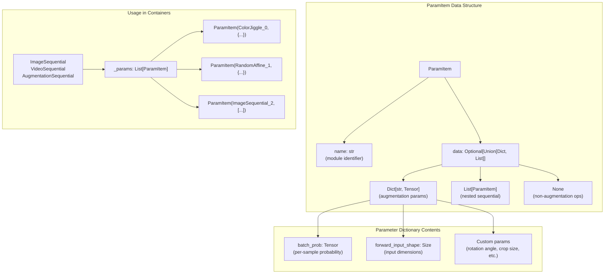

**Sources:** [kornia/augmentation/container/params.py](), [kornia/augmentation/container/base.py:32-35]()

### Forward Parameters Generation

The `forward_parameters()` method generates parameters for all augmentations in a container based on the input batch shape:

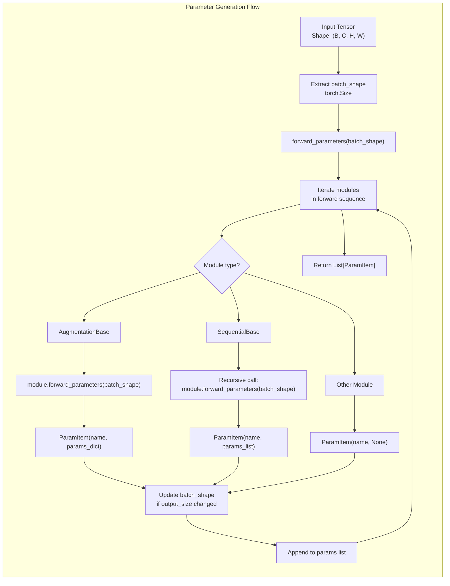

**Key implementation in ImageSequential:**

[kornia/augmentation/container/image.py:235-248]()

The method processes each module in the forward sequence, generating parameters according to the module type. For augmentations, it calls `module.forward_parameters(batch_shape)` to generate random parameters. For nested sequential containers, it recursively generates parameters for all sub-modules.

**Sources:** [kornia/augmentation/container/image.py:235-248](), [kornia/augmentation/container/base.py:98-99]()

### Batch Shape Tracking

The parameter generation system tracks how batch shape changes through the pipeline. Augmentations that modify image dimensions (e.g., crop, resize) update the batch shape for subsequent modules:

| Augmentation Type | Batch Shape Impact | Example |
|-------------------|-------------------|---------|
| Intensity augmentations | No change | `ColorJiggle`, `GaussianBlur` |
| Geometric (shape-preserving) | No change | `RandomAffine`, `RandomRotation` |
| Geometric (shape-changing) | Updates last 2 dims | `RandomCrop`, `CenterCrop`, `Resize` |

The helper function `_get_new_batch_shape()` updates the batch shape when an augmentation provides an `output_size` parameter.

**Sources:** [kornia/augmentation/container/image.py:370-404]()

## Parameter Storage and Reproducibility

All augmentation containers store generated parameters in the `_params` attribute after a forward pass. This enables two critical features: reproducibility and inverse transformations.

### Parameter Storage Lifecycle

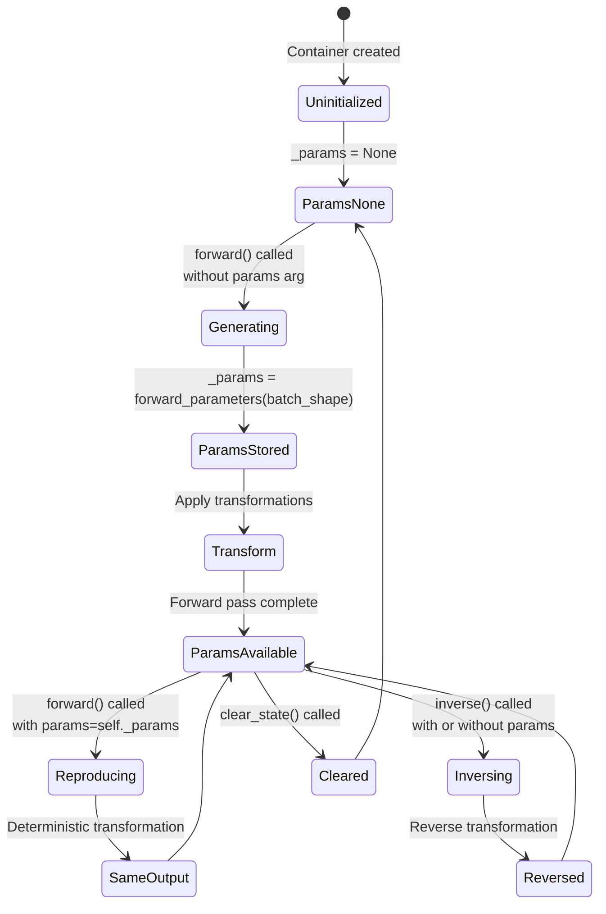

**Sources:** [kornia/augmentation/container/base.py:93-95](), [kornia/augmentation/container/augment.py:433-488]()

### Reproducible Augmentation Example

The stored parameters can be passed to subsequent forward calls to reproduce the exact same transformation:

```python
# Example pattern from tests
aug_list = K.ImageSequential(
    K.ColorJiggle(0.1, 0.1, 0.1, 0.1, p=1.0),
    K.RandomAffine(360, p=1.0),
)

# First forward pass - parameters generated and stored
output = aug_list(input)

# Reproduce with stored parameters
output_repeat = aug_list(input, params=aug_list._params)

# Outputs are identical
assert torch.equal(output, output_repeat)
```

**Implementation locations:**
- ImageSequential: [kornia/augmentation/container/image.py:296-309]()
- AugmentationSequential: [kornia/augmentation/container/augment.py:427-488]()
- VideoSequential: [kornia/augmentation/container/video.py:384-397]()

**Sources:** [kornia/augmentation/container/image.py:89-96](), [kornia/augmentation/container/augment.py:113-116]()

## Inverse Transformation System

Kornia's augmentation containers support inverse transformations, allowing users to reverse geometric augmentations applied to images and associated data. This is crucial for tasks like visualization, debugging, and certain training workflows.

### Inverse Operation Architecture

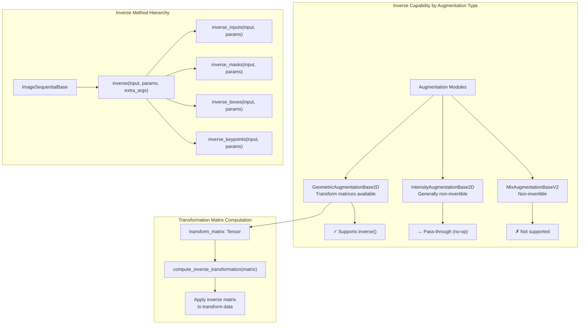

**Sources:** [kornia/augmentation/container/base.py:276-294](), [kornia/augmentation/container/ops.py:221-239]()

### Inverse Implementation in Sequential Ops

The `SequentialOpsInterface` defines the contract for applying and inversing transformations for different data types:

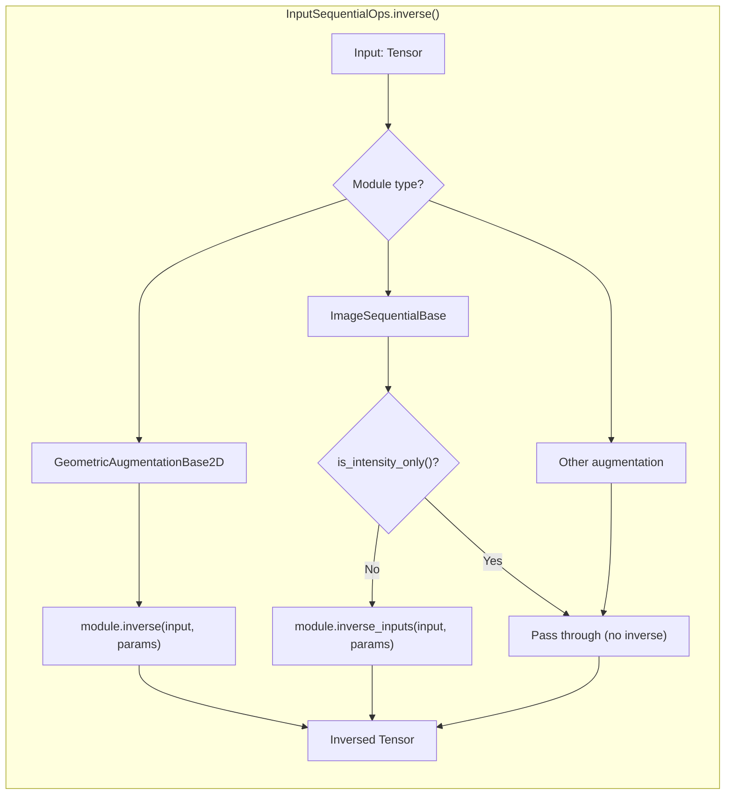

**Key operations:**
1. **Geometric augmentations**: Compute inverse transformation matrix and apply
2. **Nested sequential containers**: Recursively call inverse on sub-modules in reverse order
3. **Intensity augmentations**: Skip (cannot be meaningfully inverted)

**Sources:** [kornia/augmentation/container/ops.py:221-239](), [kornia/augmentation/container/base.py:224-229]()

### Inverse Order Processing

Inverse transformations are applied in reverse order compared to the forward pass:

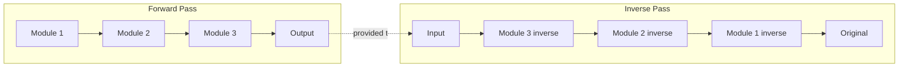

**Implementation:** [kornia/augmentation/container/base.py:227-229]() uses `zip_longest(list(self.get_forward_sequence(params))[::-1], params[::-1])` to reverse the sequence.

**Sources:** [kornia/augmentation/container/base.py:224-229](), [kornia/augmentation/container/augment.py:334-338]()

## Data Type Specific Inverse Operations

Different data types require specialized inverse operations to maintain semantic correctness.

### Inverse Operations by Data Type

| Data Type | Operation Class | Interpolation Strategy | Key Considerations |
|-----------|----------------|------------------------|-------------------|
| Input (images) | `InputSequentialOps` | Bilinear (default) | Standard tensor transformation |
| Masks | `MaskSequentialOps` | Nearest neighbor | Preserve discrete labels |
| Bounding boxes | `BoxSequentialOps` | Coordinate transformation | Transform box corners, clip to bounds |
| Keypoints | `KeypointSequentialOps` | Coordinate transformation | Transform point locations |
| Class labels | `ClassSequentialOps` | Pass-through | No geometric transformation |

### Mask Inverse Operations

Masks use nearest-neighbor resampling to preserve discrete label values during geometric transformations:

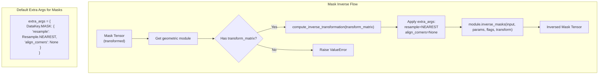

**Configuration:** [kornia/augmentation/container/augment.py:284]() sets default `extra_args` for mask processing.

**Sources:** [kornia/augmentation/container/ops.py:379-418](), [kornia/augmentation/container/augment.py:284]()

### Bounding Box and Keypoint Inverse

Boxes and keypoints use coordinate transformation via the inverse transformation matrix:

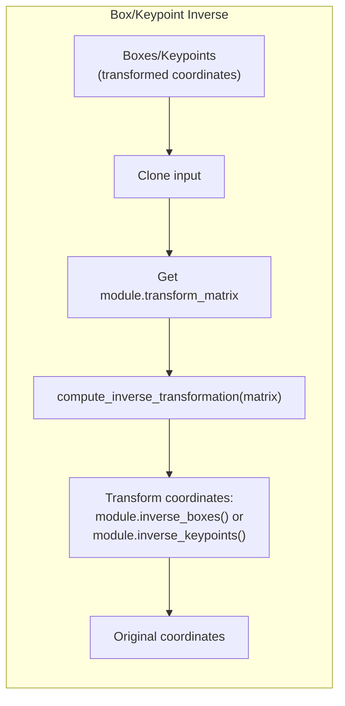

**Key methods:**
- Boxes: [kornia/augmentation/container/ops.py:473-515]()
- Keypoints: [kornia/augmentation/container/ops.py:571-615]()

**Sources:** [kornia/augmentation/container/ops.py:421-515](), [kornia/augmentation/container/ops.py:518-615]()

## AugmentationSequential Inverse for Multi-Modal Data

`AugmentationSequential` extends inverse capabilities to handle multiple synchronized data types (images, masks, boxes, keypoints) simultaneously:

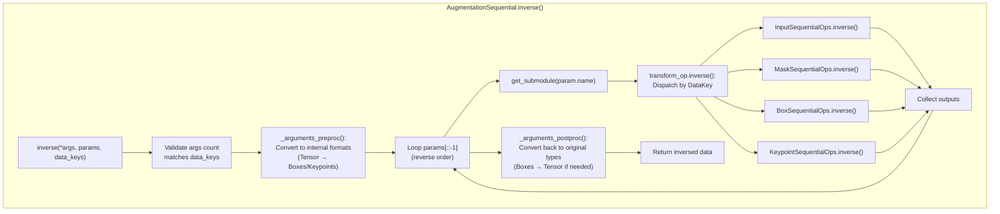

**Implementation:** [kornia/augmentation/container/augment.py:300-354]()

**Example usage pattern:**

```python
aug_list = K.AugmentationSequential(
    K.ColorJiggle(0.1, 0.1, 0.1, 0.1, p=1.0),
    K.RandomAffine(360, p=1.0),
    data_keys=["input", "mask", "bbox", "keypoints"],
)

# Forward pass
out_img, out_mask, out_bbox, out_kpts = aug_list(input, mask, bbox, keypoints)

# Inverse pass - reverses transformations
inv_img, inv_mask, inv_bbox, inv_kpts = aug_list.inverse(
    out_img, out_mask, out_bbox, out_kpts
)
```

**Sources:** [kornia/augmentation/container/augment.py:300-354](), [kornia/augmentation/container/augment.py:117-120]()

## VideoSequential Parameter Broadcasting

`VideoSequential` implements specialized parameter generation to handle temporal consistency through the `same_on_frame` option:

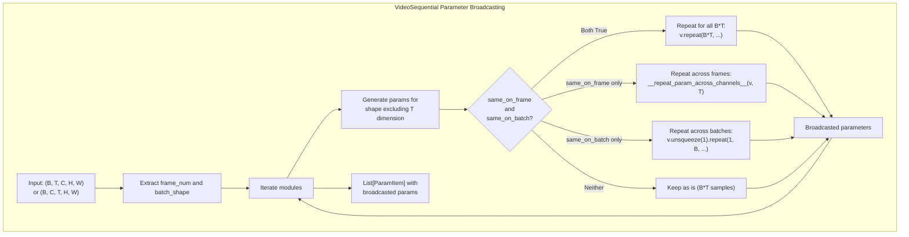

**Key method:** [kornia/augmentation/container/video.py:194-242]()

The `__repeat_param_across_channels__` helper ensures that when `same_on_frame=True`, identical parameters are used for all frames, maintaining temporal consistency.

**Sources:** [kornia/augmentation/container/video.py:148-158](), [kornia/augmentation/container/video.py:194-242]()

## PatchSequential Parameter Management

`PatchSequential` generates parameters differently depending on `patchwise_apply` and `same_on_batch` settings:

### Patch Parameter Generation Modes

| Mode | `patchwise_apply` | `same_on_batch` | Behavior |
|------|-------------------|-----------------|----------|
| Batch-wise | `False` | any | All patches in batch use same sequence |
| Patch-wise (diff batch) | `True` | `False` | Each patch gets independent augmentation |
| Patch-wise (same batch) | `True` | `True` | Same patch across batch uses same augmentation |

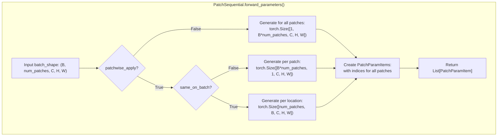

**PatchParamItem structure:** Contains `indices` (list of patch indices) and `param` (ParamItem for the augmentation).

**Implementation:** [kornia/augmentation/container/patch.py:259-275]()

**Sources:** [kornia/augmentation/container/patch.py:259-320](), [kornia/augmentation/container/params.py]()

## Limitations and Special Cases

### Intensity-Only Checks

Containers provide `is_intensity_only()` method to determine if all augmentations are intensity-based (no geometric transformations):

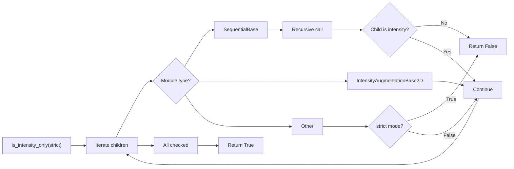

**Usage:** PatchSequential checks this to determine if geometric operations would break bbox/mask continuity across patches.

**Sources:** [kornia/augmentation/container/image.py:312-334](), [kornia/augmentation/container/patch.py:347-410]()

### Non-Invertible Operations

Certain augmentations cannot be meaningfully inverted:

- **Mix augmentations** (MixUp, CutMix, Mosaic): Combine multiple images, cannot recover originals
- **Intensity augmentations**: Information-losing operations (e.g., quantization in Posterize)
- **Random erasing**: Replaced regions cannot be recovered
- **PatchSequential with geometric transforms**: Cannot reliably inverse across patch boundaries

When inverse is called on non-invertible operations, the system either:
1. Passes through unchanged (intensity augmentations)
2. Raises `NotImplementedError` (mix augmentations, patch sequential with geometry)

**Sources:** [kornia/augmentation/container/ops.py:242-259](), [kornia/augmentation/container/patch.py:400-411]()

## Transform Matrix Computation

For geometric augmentations, containers maintain cumulative transformation matrices:

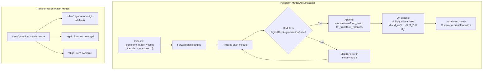

**Configuration:** Set via `transformation_matrix_mode` parameter in `AugmentationSequential`.

**Sources:** [kornia/augmentation/container/base.py:312-364](), [kornia/augmentation/container/augment.py:74-80](), [kornia/augmentation/container/augment.py:290-292]()

---

