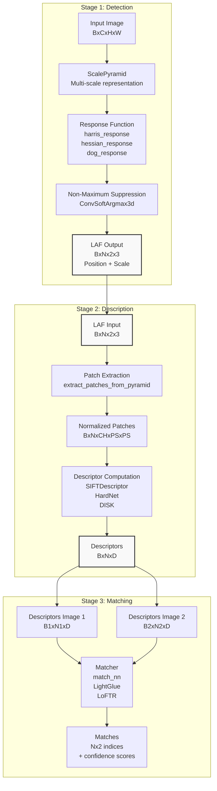
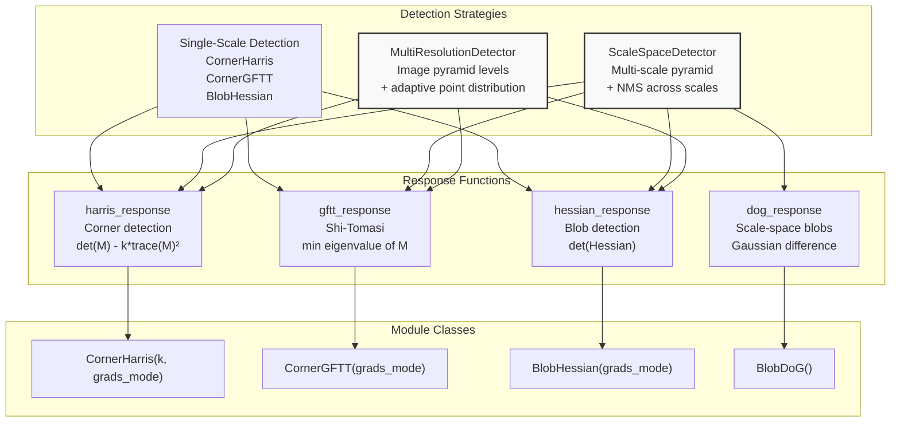
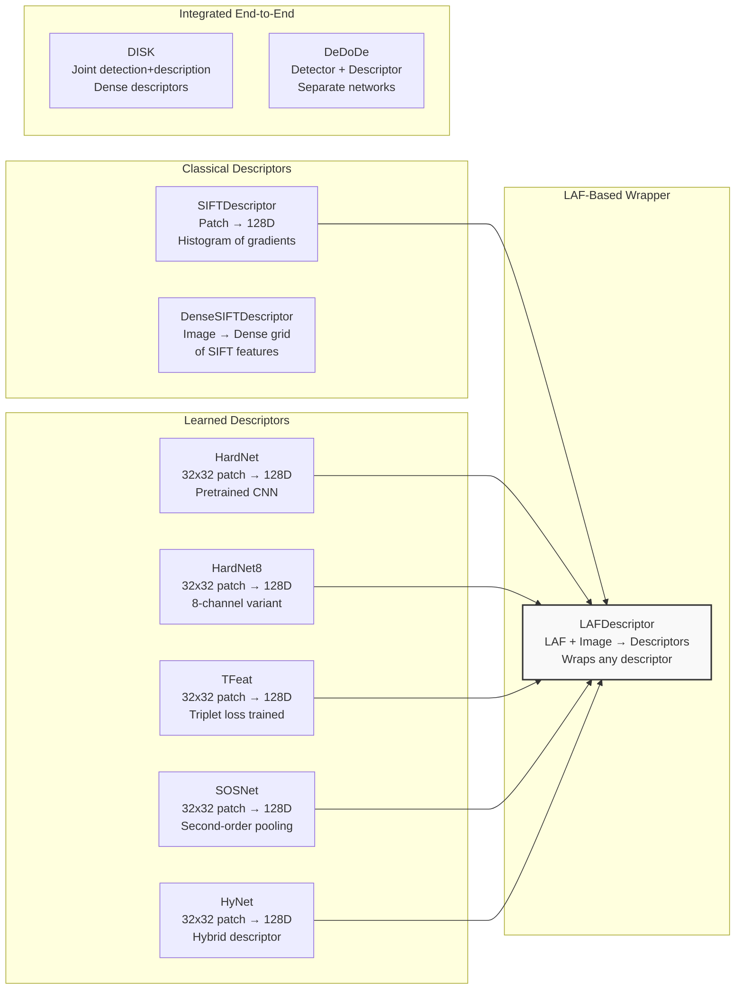
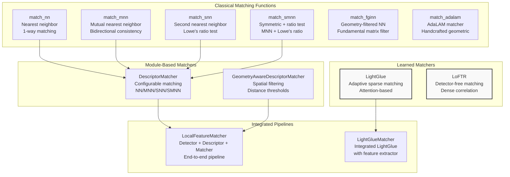
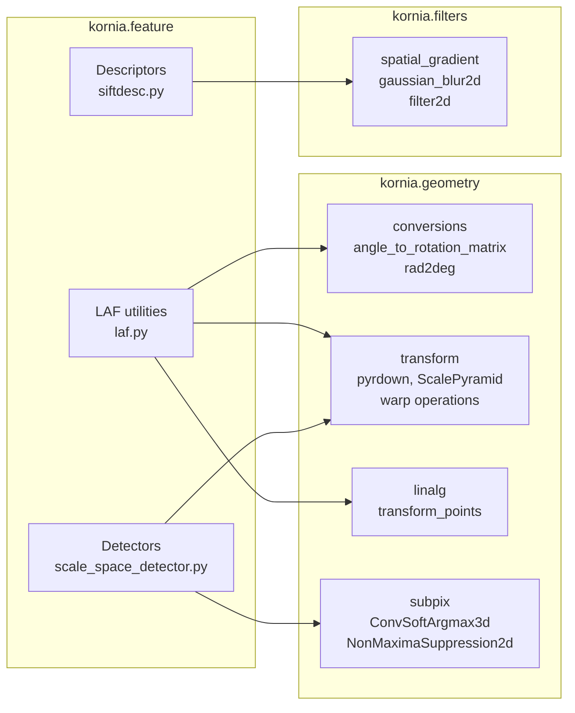

<!-- source: DeepWiki mcp.deepwiki.com · repo kornia/kornia · page 5 Feature Detection and Matching · fetched 2026-10-21 -->

# Feature Detection and Matching

<details>
<summary>Relevant source files</summary>

The following files were used as context for generating this wiki page:

- [docs/source/feature.rst](docs/source/feature.rst)
- [kornia/feature/__init__.py](kornia/feature/__init__.py)
- [kornia/feature/laf.py](kornia/feature/laf.py)
- [kornia/feature/responses.py](kornia/feature/responses.py)
- [kornia/feature/scale_space_detector.py](kornia/feature/scale_space_detector.py)
- [kornia/feature/siftdesc.py](kornia/feature/siftdesc.py)
- [kornia/geometry/transform/pyramid.py](kornia/geometry/transform/pyramid.py)

</details>


## Purpose and Scope

The `kornia.feature` module provides differentiable implementations of local feature detection, description, and matching for PyTorch. This module enables classical computer vision tasks such as image alignment, 3D reconstruction, and visual odometry within end-to-end trainable pipelines. All operations are GPU-accelerated and support batched processing.

This page provides an overview of the feature detection and matching system architecture. For detailed information about specific components:
- Local Affine Frames (LAF) data structure and utilities: see [5.1](#5.1)
- Scale-space and multi-resolution detection strategies: see [5.2](#5.2)
- Response functions and classical detectors: see [5.3](#5.3)
- SIFT and learned descriptors: see [5.4](#5.4)
- Matching algorithms and geometric filtering: see [5.5](#5.5)

**Sources**: [kornia/feature/__init__.py:18-21](), [docs/source/feature.rst:1-32]()

## Three-Stage Pipeline Architecture

The feature detection and matching workflow follows a three-stage pipeline design:

1. **Detection**: Identifies keypoint locations and scales in images
2. **Description**: Extracts feature descriptors from regions around detected keypoints
3. **Matching**: Establishes correspondences between descriptors across images

The stages are connected through the **Local Affine Frame (LAF)** data structure, which encodes keypoint position, scale, and orientation in a unified geometric representation.



**Sources**: [kornia/feature/scale_space_detector.py:72-263](), [kornia/feature/laf.py:404-489](), [docs/source/feature.rst:8-28]()

## Local Affine Frames (LAF): The Central Data Structure

LAF is the core representation used throughout the feature pipeline. Each LAF encodes a keypoint's geometric properties as a 2x3 affine transformation matrix:

```
LAF shape: (B, N, 2, 3)

For each keypoint:
[a11  a12  x]
[a21  a22  y]

Where:
- (x, y): keypoint center position
- [a11 a12; a21 a22]: affine shape matrix encoding scale, rotation, and shear
```

The affine matrix transforms a unit circle centered at origin to an elliptical region around the keypoint. This representation naturally handles:
- **Scale**: Encoded in the singular values of the affine matrix
- **Orientation**: Encoded in the rotation component
- **Affine Shape**: Can represent elliptical (anisotropic) regions

### LAF Manipulation Functions

The `kornia.feature.laf` module provides utilities for LAF manipulation:

| Function | Purpose | Input/Output |
|----------|---------|--------------|
| `laf_from_center_scale_ori` | Create LAF from keypoint center, scale, orientation | (B,N,2), (B,N,1,1), (B,N,1) → (B,N,2,3) |
| `get_laf_center` | Extract keypoint centers | (B,N,2,3) → (B,N,2) |
| `get_laf_scale` | Extract scale values | (B,N,2,3) → (B,N,1,1) |
| `get_laf_orientation` | Extract orientation in degrees | (B,N,2,3) → (B,N,1) |
| `normalize_laf` | Normalize to [0,1] coordinates | LAF, image → normalized LAF |
| `denormalize_laf` | Convert to pixel coordinates | LAF, image → pixel LAF |
| `perspective_transform_lafs` | Apply homography to LAFs | (B,3,3), LAF → transformed LAF |
| `extract_patches_from_pyramid` | Extract normalized patches | LAF, image → (B,N,CH,PS,PS) |

**Sources**: [kornia/feature/laf.py:31-616](), [kornia/feature/__init__.py:43-63]()

## Detection Components



**Sources**: [kornia/feature/responses.py:39-413](), [kornia/feature/scale_space_detector.py:72-433]()

### ScaleSpaceDetector Architecture

The `ScaleSpaceDetector` class implements classical scale-space feature detection similar to SIFT and SURF:

**Key Components**:
- **scale_pyr_module**: `ScalePyramid` generates Gaussian scale pyramid
- **resp_module**: Response function (e.g., `BlobHessian`, `CornerHarris`)
- **nms_module**: `ConvSoftArgmax3d` for differentiable non-maximum suppression across scale space
- **ori_module**: Orientation estimator (e.g., `LAFOrienter`, `OriNet`)
- **aff_module**: Affine shape estimator (e.g., `LAFAffineShapeEstimator`)

**Workflow** ([kornia/feature/scale_space_detector.py:151-242]()):
1. Build scale pyramid with `ScalePyramid` ([kornia/geometry/transform/pyramid.py:123-247]())
2. Compute response at each scale
3. Apply 3D NMS (spatial + scale) to find local maxima
4. Convert scale indices to actual scale values
5. Create LAFs from detected keypoints
6. Refine orientation and affine shape

**Sources**: [kornia/feature/scale_space_detector.py:72-263](), [kornia/geometry/transform/pyramid.py:123-247]()

### MultiResolutionDetector Architecture

The `MultiResolutionDetector` uses an image pyramid approach with adaptive point distribution:

**Configuration Parameters** ([kornia/feature/scale_space_detector.py:436-443]()):
- `nms_size`: Non-maximum suppression window size
- `pyramid_levels`: Number of downsampled levels
- `up_levels`: Number of upsampled levels
- `scale_factor_levels`: Scale factor between levels (typically √2)
- `s_mult`: Scale multiplier for LAF creation

**Workflow** ([kornia/feature/scale_space_detector.py:354-410]()):
1. Distribute target feature count across pyramid levels based on scale factor
2. Process upsampled levels for finer detail
3. Process downsampled pyramid levels
4. Detect features at each level with `detect_features_on_single_level`
5. Aggregate and select top features across all scales

**Sources**: [kornia/feature/scale_space_detector.py:279-433]()

## Descriptor Components



**Sources**: [kornia/feature/siftdesc.py:93-348](), [kornia/feature/__init__.py:27-42]()

### SIFT Descriptor Implementation

The `SIFTDescriptor` class implements the classic SIFT descriptor:

**Algorithm** ([kornia/feature/siftdesc.py:166-201]()):
1. Compute spatial gradients with `spatial_gradient`
2. Calculate gradient magnitude and orientation
3. Apply Gaussian weighting with `get_gaussian_kernel2d`
4. Bin gradients into orientation histograms (8 bins default)
5. Apply spatial pooling to create 4x4 grid (16 spatial bins default)
6. Normalize and clip for illumination invariance
7. Optional RootSIFT: L1 normalize then sqrt for better matching

**Parameters**:
- `patch_size`: Input patch size (typically 41 pixels)
- `num_ang_bins`: Angular bins per spatial bin (8)
- `num_spatial_bins`: Spatial grid size (4x4 = 16 cells)
- `clipval`: Clipping threshold for descriptor normalization (0.2)
- `rootsift`: Enable RootSIFT transformation (True)

**Output**: Descriptor vector of size `num_ang_bins * num_spatial_bins²` (default: 8×16 = 128D)

**Sources**: [kornia/feature/siftdesc.py:93-217]()

### LAFDescriptor Wrapper

The `LAFDescriptor` class ([kornia/feature/integrated.py]()) provides a unified interface for computing descriptors from LAFs. It handles:
1. Patch extraction from LAFs using `extract_patches_from_pyramid`
2. Patch normalization
3. Descriptor computation with any descriptor module
4. Batch processing

**Sources**: [kornia/feature/__init__.py:34-43](), [docs/source/feature.rst:141-148]()

## Matching Components



**Sources**: [kornia/feature/__init__.py:67-76](), [docs/source/feature.rst:191-227]()

### Classical Matching Functions

| Function | Description | Output |
|----------|-------------|--------|
| `match_nn` | Nearest neighbor in descriptor space | Indices (N,2) |
| `match_mnn` | Mutual nearest neighbors (bidirectional) | Indices (M,2), M ≤ N |
| `match_snn` | Ratio test (Lowe's criterion) | Indices filtered by ratio |
| `match_smnn` | MNN + ratio test combined | High-quality matches |
| `match_fginn` | NN + fundamental matrix filtering | Geometrically consistent |
| `match_adalam` | AdaLAM robust geometric matcher | Inlier matches |

**Matching Strategy Comparison**:
- **NN**: Fast but many false positives
- **MNN**: More reliable, fewer matches
- **SNN**: Filters ambiguous matches (ratio < 0.8)
- **SMNN**: Best balance of quality and quantity
- **Geometric**: Slowest but most robust

**Sources**: [kornia/feature/__init__.py:67-76]()

### LightGlue: Adaptive Learned Matching

`LightGlue` is a modern learned matcher using self-attention and cross-attention mechanisms. Key features:

**Architecture**:
- Processes feature descriptors and keypoint positions
- Self-attention within each image
- Cross-attention between images
- Adaptive early termination based on convergence
- Differentiable matching with optimal transport

**Advantages**:
- Higher accuracy than classical methods
- Adapts computation to scene difficulty
- Handles large viewpoint changes
- Works with DISK, SIFT, or custom descriptors

**Sources**: [docs/source/feature.rst:48-67](), [kornia/feature/__init__.py:64]()

### LoFTR: Detector-Free Matching

`LoFTR` (Local Feature Transformer) performs dense matching without explicit detection:

**Approach**:
1. Extract dense CNN features from both images
2. Apply coarse-to-fine matching with Transformers
3. Generate semi-dense correspondences directly
4. No explicit keypoint detection required

**Use Cases**:
- Indoor scenes (strongest performance)
- Low-texture regions
- When detector might miss features
- Dense reconstruction tasks

**Sources**: [docs/source/feature.rst:53-57](), [docs/source/feature.rst:216-223]()

## Patch Extraction and Normalization

A critical operation connecting detection to description is anti-aliased patch extraction:

### extract_patches_from_pyramid

The `extract_patches_from_pyramid` function ([kornia/feature/laf.py:440-489]()) extracts image patches at the appropriate pyramid level to minimize aliasing:

**Algorithm**:
1. Normalize LAFs to [0,1] coordinate system
2. Compute scale of each LAF
3. Determine appropriate pyramid level: `level = log₂(scale * 2 / patch_size)`
4. Extract patches from corresponding pyramid level using `F.grid_sample`
5. Continue with remaining pyramid levels until minimum size reached

**Advantages over Simple Extraction**:
- Reduces aliasing artifacts for large-scale features
- Better descriptor quality for multi-scale detection
- Handles arbitrary scales gracefully

**Alternative**: `extract_patches_simple` ([kornia/feature/laf.py:404-437]()) extracts directly from original image (faster but with aliasing).

**Sources**: [kornia/feature/laf.py:404-489](), [kornia/feature/__init__.py:47-48]()

## Integration with Geometry Module

The feature module heavily depends on `kornia.geometry` for geometric operations:



**Key Dependencies**:
- **LAF transformations**: Use `angle_to_rotation_matrix` for orientation ([kornia/feature/laf.py:106]())
- **Coordinate transformations**: Use `transform_points` for homographies ([kornia/feature/laf.py:611]())
- **Scale pyramid**: Use `ScalePyramid` and `pyrdown` ([kornia/feature/scale_space_detector.py:118]())
- **Differentiable NMS**: Use `ConvSoftArgmax3d` ([kornia/feature/scale_space_detector.py:124-126]())
- **Gradient computation**: Use `spatial_gradient` for descriptors ([kornia/feature/siftdesc.py:171]())

**Sources**: [kornia/feature/laf.py:26-28](), [kornia/feature/scale_space_detector.py:27-28](), [kornia/feature/siftdesc.py:26]()

## Integrated Feature Pipelines

The module provides high-level classes that combine detection, description, and matching:

### LocalFeature Classes

These classes provide complete detector + descriptor pipelines:

| Class | Components | Description |
|-------|------------|-------------|
| `SIFTFeature` | DoG + SIFT + Orientation | Classical SIFT pipeline |
| `SIFTFeatureScaleSpace` | ScaleSpace + SIFT | Scale-space SIFT variant |
| `GFTTAffNetHardNet` | GFTT + AffNet + HardNet | Corner detection + learned descriptor |
| `HesAffNetHardNet` | Hessian + AffNet + HardNet | Blob detection + learned descriptor |
| `KeyNetAffNetHardNet` | KeyNet + AffNet + HardNet | Learned detector + descriptor |
| `KeyNetHardNet` | KeyNet + HardNet | KeyNet with HardNet descriptor |

**Usage Pattern**:
```
feature_extractor = GFTTAffNetHardNet(num_features=2048)
lafs, responses, descriptors = feature_extractor(image)
# Returns:
# - lafs: (B, N, 2, 3) - detected keypoints as LAFs
# - responses: (B, N) - detection confidence scores
# - descriptors: (B, N, 128) - feature descriptors
```

**Sources**: [kornia/feature/__init__.py:29-40](), [docs/source/feature.rst:152-189]()

### DISK and DeDoDe: End-to-End Learned Features

Modern learned approaches jointly optimize detection and description:

**DISK** ([docs/source/feature.rst:165-170]()):
- Single CNN produces heatmap + dense descriptors simultaneously
- Learned to maximize matching performance
- Better performance on outdoor scenes

**DeDoDe** ([docs/source/feature.rst:162-164]()):
- Separate detector and descriptor networks
- Flexible - can use detector independently
- State-of-art performance on benchmarks

**Sources**: [docs/source/feature.rst:162-170](), [kornia/feature/__init__.py:24-25]()

## Benchmarks and Model Selection

According to IMC2021 benchmark results ([docs/source/feature.rst:36-102]()):

**Best Overall (8000 features)**:
1. DISK + LightGlue: 0.618 (stereo), 0.774 (multiview) on PhotoTourism
2. LoFTR: Excellent on indoor scenes (0.755 on PragueParks)
3. OpenCV-DoG + HardNet + LightGlue: Good balance

**For Different Use Cases**:
- **Outdoor scenes**: DISK + LightGlue or DeDoDe + LightGlue
- **Indoor scenes**: LoFTR (detector-free)
- **Medical/Remote sensing**: SIFT or SIFT + HardNet + LightGlue
- **Real-time**: KeyNet + HardNet
- **Maximum accuracy**: DeDoDe + LightGlue

**Sources**: [docs/source/feature.rst:33-103]()

## Complete Example Workflow

A typical feature matching workflow:

```
# 1. Detection Stage
detector = ScaleSpaceDetector(
    num_features=2048,
    resp_module=CornerHarris(k=0.04),
    ori_module=LAFOrienter(angle_detector=PatchDominantGradientOrientation()),
)
lafs1, responses1 = detector(image1)
lafs2, responses2 = detector(image2)

# 2. Description Stage  
descriptor = LAFDescriptor(
    SIFTDescriptor(patch_size=41),
    patch_size=41,
)
desc1 = get_laf_descriptors(image1, lafs1, descriptor)
desc2 = get_laf_descriptors(image2, lafs2, descriptor)

# 3. Matching Stage
matches = match_smnn(desc1, desc2, ratio_thresh=0.8)

# Or use integrated pipeline
feature_matcher = LocalFeatureMatcher(
    detector=detector,
    descriptor=descriptor,
    matcher=DescriptorMatcher('smnn', 0.8)
)
lafs1, lafs2, matches = feature_matcher(image1, image2)
```

**Sources**: [docs/source/feature.rst:8-28](), [kornia/feature/__init__.py:29-76]()

---

