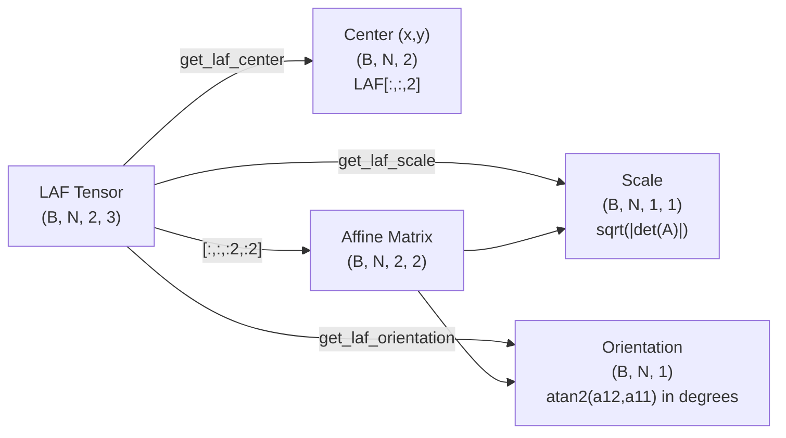
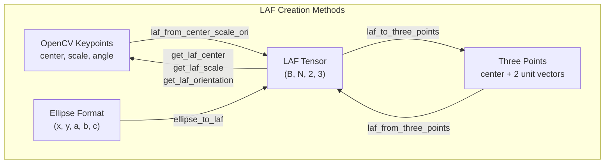
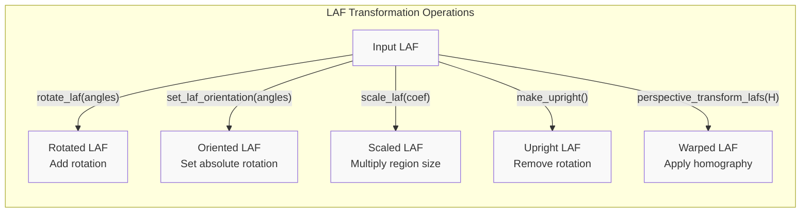
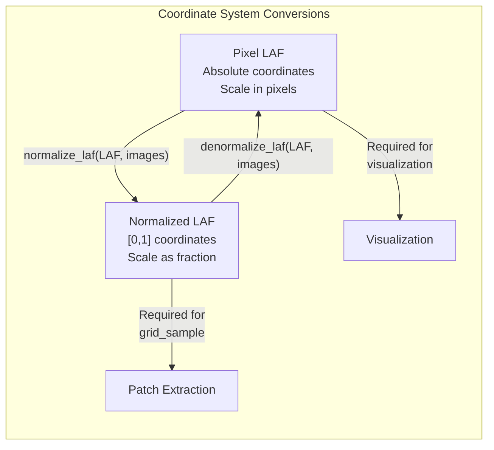
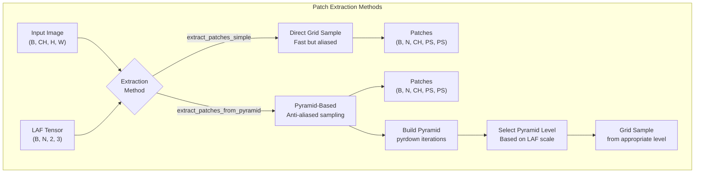
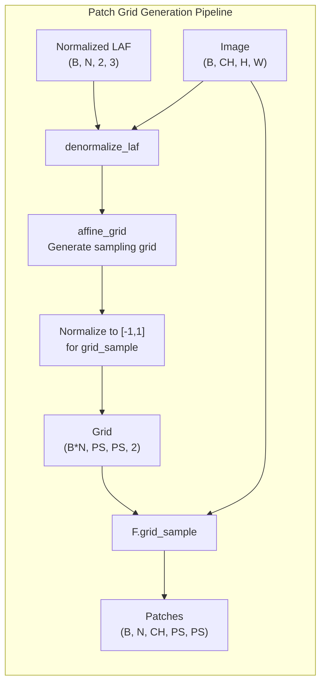
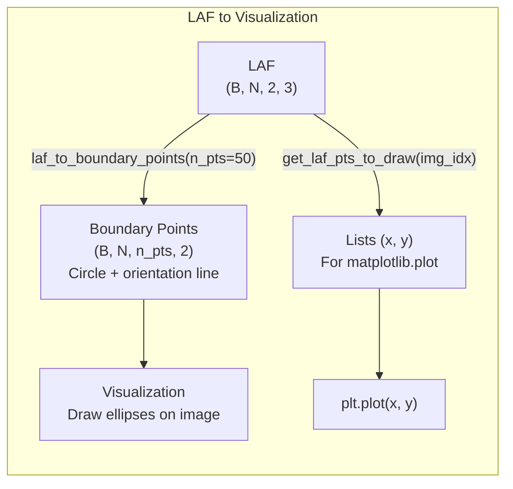
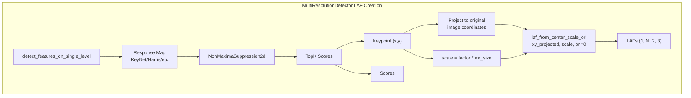
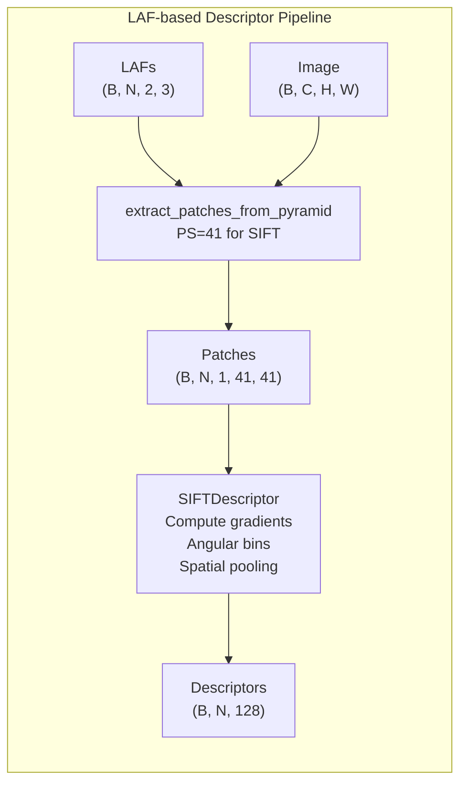

<!-- source: DeepWiki mcp.deepwiki.com · repo kornia/kornia · page 5.1 Local Affine Frames (LAF) System · fetched 2026-10-21 -->

# Local Affine Frames (LAF) System

<details>
<summary>Relevant source files</summary>

The following files were used as context for generating this wiki page:

- [docs/source/feature.rst](docs/source/feature.rst)
- [kornia/feature/__init__.py](kornia/feature/__init__.py)
- [kornia/feature/laf.py](kornia/feature/laf.py)
- [kornia/feature/responses.py](kornia/feature/responses.py)
- [kornia/feature/scale_space_detector.py](kornia/feature/scale_space_detector.py)
- [kornia/feature/siftdesc.py](kornia/feature/siftdesc.py)
- [kornia/geometry/transform/pyramid.py](kornia/geometry/transform/pyramid.py)

</details>


The Local Affine Frames (LAF) system provides a unified representation for local image features (keypoints) with associated geometric information including position, scale, and orientation. LAFs enable scale and rotation invariant feature extraction, patch normalization, and geometric transformations essential for classical computer vision tasks.

For feature detection using LAFs, see [Scale-Space and Multi-Resolution Detection](#5.2). For descriptor computation on LAF patches, see [Feature Descriptors (SIFT and Learned)](#5.4).

## Purpose and Scope

The LAF system serves as the geometric foundation for local feature processing in Kornia. It provides:

- **Unified representation**: A single tensor format `(B, N, 2, 3)` encoding position, scale, orientation, and affine shape
- **Scale-invariant patch extraction**: Anti-aliased sampling from image pyramids at appropriate scales
- **Coordinate transformations**: Conversion between pixel coordinates and normalized coordinates
- **Geometric operations**: Rotation, scaling, perspective transformation of feature frames
- **Visualization support**: Conversion to boundary points for drawing feature ellipses

The LAF representation is compatible with OpenCV keypoint formats and can be converted from ellipse representations used in other feature detectors.

**Sources**: [kornia/feature/laf.py:1-616]()

## LAF Data Structure and Representation

### Mathematical Definition

A Local Affine Frame is encoded as a 2×3 affine transformation matrix:

```
LAF = [a11  a12  x]
      [a21  a22  y]
```

Where:
- `(x, y)` is the keypoint center position
- The 2×2 submatrix `[[a11, a12], [a21, a22]]` encodes scale, rotation, and affine shape
- Scale is computed as `sqrt(|det([[a11, a12], [a21, a22]])|)`
- Orientation is `atan2(a12, a11)` in radians

### Tensor Format

```
Shape: (B, N, 2, 3)
- B: batch size
- N: number of keypoints per image
- 2: rows of affine matrix
- 3: columns of affine matrix (2 for transformation + 1 for translation)
```

### LAF Components Extraction



**Sources**: [kornia/feature/laf.py:31-89]()

## Core LAF Operations

### Creation and Construction

The system provides multiple methods to create LAF tensors from different representations:

| Function | Input | Output | Purpose |
|----------|-------|--------|---------|
| `laf_from_center_scale_ori` | xy, scale, orientation | LAF (B,N,2,3) | Create LAF from keypoint parameters |
| `ellipse_to_laf` | ellipses (B,N,5) | LAF (B,N,2,3) | Convert Oxford ellipse format [x,y,a,b,c] |
| `laf_from_three_points` | three_pts (B,N,2,3) | LAF (B,N,2,3) | Convert from three-point representation |



**Sources**: [kornia/feature/laf.py:129-156](), [kornia/feature/laf.py:216-256](), [kornia/feature/laf.py:516-546]()

### Geometric Transformations



#### Key Transformation Functions

- **`rotate_laf(LAF, angles_degrees)`**: Adds rotation to existing LAF orientation. The final rotation is original + angles_degrees.
- **`set_laf_orientation(LAF, angles_degrees)`**: Sets absolute orientation, overriding existing rotation.
- **`scale_laf(laf, scale_coef)`**: Multiplies the 2×2 affine submatrix by scale coefficient, preserving center and orientation but changing region size.
- **`make_upright(laf)`**: Removes rotation component via SVD-like decomposition, creating axis-aligned ellipse.
- **`perspective_transform_lafs(trans_01, lafs_1)`**: Applies perspective transformation (homography) by converting LAF to three points, transforming them, and reconstructing LAF.

**Sources**: [kornia/feature/laf.py:91-127](), [kornia/feature/laf.py:158-181](), [kornia/feature/laf.py:183-214](), [kornia/feature/laf.py:548-616]()

## Coordinate System Normalization

LAFs can be represented in two coordinate systems: pixel coordinates and normalized coordinates [0,1]. The normalization convention is that the center of a 5-pixel image (coordinates 0 to 4) is 2, not 2.5.

### Normalization Transform

```
Pixel coordinates → Normalized coordinates:
MIN_SIZE = min(H-1, W-1)
[a11  a12  x]     [a11/MIN_SIZE  a12/MIN_SIZE  x/(W-1)]
[a21  a22  y]  →  [a21/MIN_SIZE  a22/MIN_SIZE  y/(H-1)]
```



### Implementation Details

- **`normalize_laf(LAF, images)`**: Converts from pixel scale to [0,1] scale. Required before using LAF with `F.grid_sample` or patch extraction functions.
- **`denormalize_laf(LAF, images)`**: Converts from normalized scale to pixel scale. Used internally in patch extraction and for visualization.
- The minimum dimension `min(H-1, W-1)` is used for the affine matrix to maintain aspect ratio, while x and y use their respective dimensions.

**Sources**: [kornia/feature/laf.py:315-376]()

## Patch Extraction from LAFs

The LAF system provides two methods for extracting image patches centered on features:

### Extraction Pipeline



### Method Comparison

| Method | Function | Anti-aliasing | Speed | Use Case |
|--------|----------|---------------|-------|----------|
| Simple | `extract_patches_simple` | No | Fast | Testing, non-critical applications |
| Pyramid | `extract_patches_from_pyramid` | Yes | Slower | Production, descriptor extraction |

### Pyramid-Based Extraction Algorithm

The `extract_patches_from_pyramid` function implements proper scale-space sampling:

1. **Scale Calculation**: `scale = 2.0 * get_laf_scale(denormalized_laf) / PS`
2. **Pyramid Level Selection**: `pyr_idx = scale.log2().clamp(0, max_level-1)`
3. **Hierarchical Sampling**: 
   - Build Gaussian pyramid by iteratively applying `pyrdown`
   - For each LAF, extract patch from pyramid level matching its scale
   - Use `F.grid_sample` with appropriate grid for each level

This approach prevents aliasing artifacts when extracting patches from features detected at various scales.

**Sources**: [kornia/feature/laf.py:378-490]()

### Grid Generation



The `generate_patch_grid_from_normalized_LAF` function creates affine grids compatible with PyTorch's `F.grid_sample`:
- Takes normalized LAF and denormalizes it to pixel coordinates
- Uses `F.affine_grid` to generate sampling coordinates
- Renormalizes grid coordinates to [-1, 1] range required by `grid_sample`

**Sources**: [kornia/feature/laf.py:378-402]()

## LAF Validation and Utilities

### Boundary Checking

The `laf_is_inside_image` function checks if LAF regions are fully contained within image bounds:

```python
# Returns boolean mask (B, N) indicating valid LAFs
good_lafs_mask = laf_is_inside_image(laf, images, border=0)
```

The function:
1. Converts LAF to 12 boundary points via `laf_to_boundary_points(laf, 12)`
2. Checks if all points satisfy: `border <= x <= W-border` and `border <= y <= H-border`
3. Returns mask where True indicates LAF is fully inside image

This is used in `ScaleSpaceDetector` to zero out responses for features touching boundaries.

**Sources**: [kornia/feature/laf.py:492-514]()

### Visualization Support



**Visualization Functions**:
- **`laf_to_boundary_points(LAF, n_pts=50)`**: Generates points along ellipse boundary plus center-to-boundary line showing orientation
- **`get_laf_pts_to_draw(LAF, img_idx=0)`**: Returns lists of x,y coordinates for matplotlib plotting

The boundary points are computed by:
1. Generating unit circle points: `sin(θ), cos(θ)` for θ in [0, 2π]
2. Transforming to homogeneous coordinates with 1.0
3. Applying affine transformation via matrix multiplication
4. Converting back from homogeneous coordinates

**Sources**: [kornia/feature/laf.py:258-313]()

## Integration with Feature Detection Pipeline

### LAF in Scale-Space Detection

```mermaid
graph TB
    subgraph "Scale-Space Detector LAF Pipeline"
        INPUT["Input Image<br/>(B, C, H, W)"]
        
        INPUT --> PYRAMID["ScalePyramid<br/>Build scale space"]
        PYRAMID --> RESP["Response Function<br/>Harris/Hessian/DoG"]
        
        RESP --> NMS["ConvSoftArgmax3d<br/>Find maxima (x,y,scale)"]
        
        NMS --> CREATE["laf_from_center_scale_ori<br/>Create initial LAFs"]
        CREATE --> CHECK["laf_is_inside_image<br/>Filter boundary LAFs"]
        
        CHECK --> NORM["normalize_laf<br/>Convert to [0,1] scale"]
        
        NORM --> AFF["LAFAffineShapeEstimator<br/>Refine affine shape"]
        AFF --> ORI["LAFOrienter<br/>Estimate orientation"]
        
        ORI --> FINAL["Final LAFs<br/>(B, N, 2, 3)"]
        
        FINAL --> DESC["Extract patches<br/>Compute descriptors"]
    end
```



The `ScaleSpaceDetector.detect` method demonstrates LAF creation workflow:

1. **Detection**: Find response maxima in scale-space pyramid
2. **Scale Conversion**: Convert scale index to actual sigma value via `_scale_index_to_scale`
3. **LAF Construction**: Build LAF with rotation matrix and scale/position
4. **Validation**: Apply `laf_is_inside_image` to filter boundary detections
5. **Normalization**: Convert to normalized coordinates for downstream processing

**Sources**: [kornia/feature/scale_space_detector.py:151-242]()

### LAF in Multi-Resolution Detection



The `MultiResolutionDetector` detects features across multiple pyramid levels and creates LAFs accounting for scale factors:
- Each pyramid level has a scale factor relative to input image
- LAF scale is set to `0.5 * (factor_x + factor_y) * mr_size`
- The `mr_size` parameter (default 22.0) controls region size relative to detection scale

**Sources**: [kornia/feature/scale_space_detector.py:334-353]()

## LAF Descriptor Extraction Integration

### SIFT Descriptor with LAFs



The integration with descriptors follows this pattern:

1. **Patch Size Selection**: SIFT uses 41×41 pixels, other descriptors may use 32×32
2. **Extraction**: Call `extract_patches_from_pyramid(img, laf, PS, normalize_lafs_before_extraction=True)`
3. **Descriptor Computation**: Pass extracted patches to descriptor network/algorithm
4. **Output**: Feature descriptors ready for matching

For learned descriptors like HardNet, the process is identical but with different patch sizes (typically 32×32).

**Sources**: [kornia/feature/siftdesc.py:93-202](), [kornia/feature/laf.py:440-490]()

## Alternative LAF Representations

### Three-Point Representation

LAFs can be converted to/from a three-point representation useful for geometric reasoning:

```python
# LAF → Three Points: (center+x_unit, center+y_unit, center)
three_pts = laf_to_three_points(laf)  # (B, N, 2, 3)

# Three Points → LAF
laf = laf_from_three_points(three_pts)  # (B, N, 2, 3)
```

This representation is used internally by `perspective_transform_lafs` because:
- Points transform simply under perspective projection
- Three points uniquely define the affine frame
- Order: x-axis point, y-axis point, center point

**Sources**: [kornia/feature/laf.py:516-546]()

### Ellipse Representation

The `ellipse_to_laf` function converts Oxford ellipse format `(x, y, a, b, c)` to LAF:

```
Ellipse equation: a*x^2 + 2*b*x*y + c*y^2 = 1
Covariance matrix: [a  b]
                   [b  c]
LAF affine matrix = inverse_matrix_sqrt([a, b; b, c])
```

The implementation uses the closed-form 2×2 matrix square root formula rather than Cholesky decomposition (which was incorrect in previous versions):

```
For matrix M = [A  0]
              [C  D]
sqrt(M) = [sqrt(A)              0         ]
          [C/(sqrt(A)+sqrt(D))  sqrt(D)   ]
```

**Sources**: [kornia/feature/laf.py:216-256]()

## Function Reference Summary

### Core Creation and Getters

| Function | Input Shape | Output Shape | Description |
|----------|-------------|--------------|-------------|
| `laf_from_center_scale_ori` | xy:(B,N,2), scale:(B,N,1,1), ori:(B,N,1) | (B,N,2,3) | Create LAF from components |
| `get_laf_center` | (B,N,2,3) | (B,N,2) | Extract center coordinates |
| `get_laf_scale` | (B,N,2,3) | (B,N,1,1) | Extract scale (sqrt of determinant) |
| `get_laf_orientation` | (B,N,2,3) | (B,N,1) | Extract orientation in degrees |

### Transformations

| Function | Input | Output | Description |
|----------|-------|--------|-------------|
| `rotate_laf` | LAF, angles_degrees | LAF | Add rotation to orientation |
| `set_laf_orientation` | LAF, angles_degrees | LAF | Set absolute orientation |
| `scale_laf` | LAF, scale_coef | LAF | Multiply region size |
| `make_upright` | LAF | LAF | Remove rotation (axis-aligned) |
| `perspective_transform_lafs` | H:(B,3,3), LAF | LAF | Apply homography |

### Coordinate Conversion

| Function | Input | Output | Description |
|----------|-------|--------|-------------|
| `normalize_laf` | LAF, images | LAF | Pixel → [0,1] normalized |
| `denormalize_laf` | LAF, images | LAF | Normalized → pixel coordinates |
| `ellipse_to_laf` | ellipses:(B,N,5) | LAF | Oxford ellipse → LAF |
| `laf_to_three_points` | LAF | (B,N,2,3) | LAF → 3 points |
| `laf_from_three_points` | points:(B,N,2,3) | LAF | 3 points → LAF |

### Patch Extraction

| Function | Input | Output | Description |
|----------|-------|--------|-------------|
| `extract_patches_simple` | img, laf, PS | (B,N,CH,PS,PS) | Fast extraction, aliased |
| `extract_patches_from_pyramid` | img, laf, PS | (B,N,CH,PS,PS) | Anti-aliased, multi-scale |
| `generate_patch_grid_from_normalized_LAF` | img, LAF, PS | (B*N,PS,PS,2) | Affine grid for sampling |

### Utilities

| Function | Input | Output | Description |
|----------|-------|--------|-------------|
| `laf_is_inside_image` | LAF, images, border | (B,N) | Boolean mask for valid LAFs |
| `laf_to_boundary_points` | LAF, n_pts | (B,N,n_pts,2) | Ellipse points for drawing |
| `get_laf_pts_to_draw` | LAF, img_idx | (List, List) | x,y lists for matplotlib |

**Sources**: [kornia/feature/laf.py:1-616](), [kornia/feature/__init__.py:43-63]()

---

