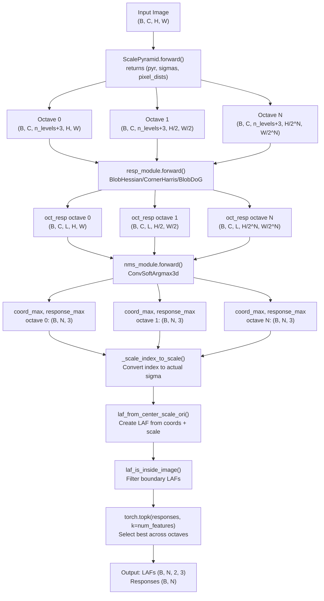
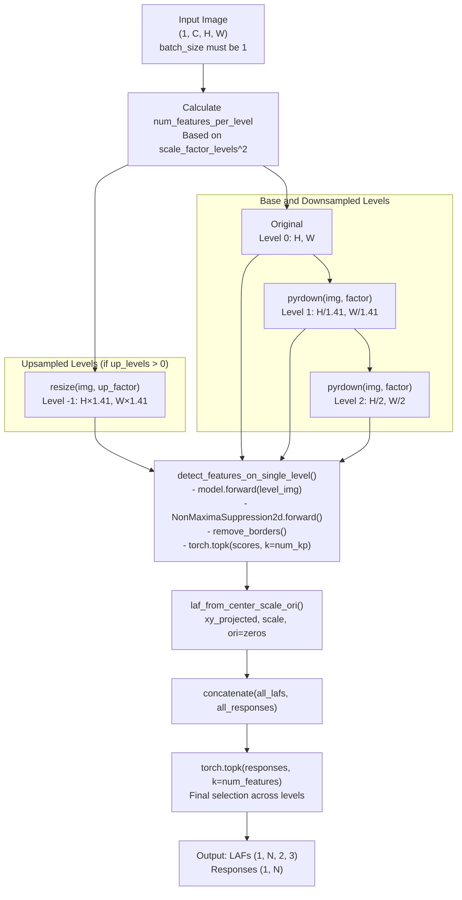
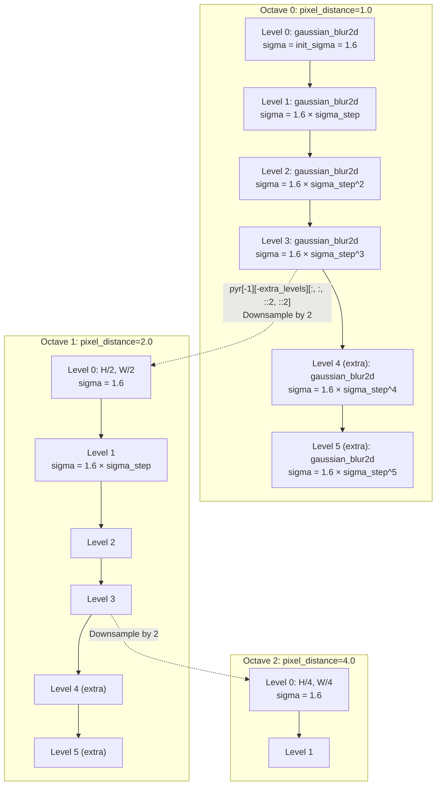
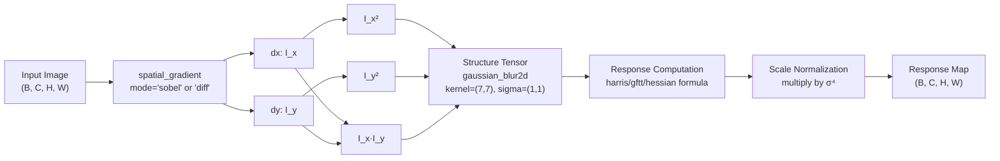
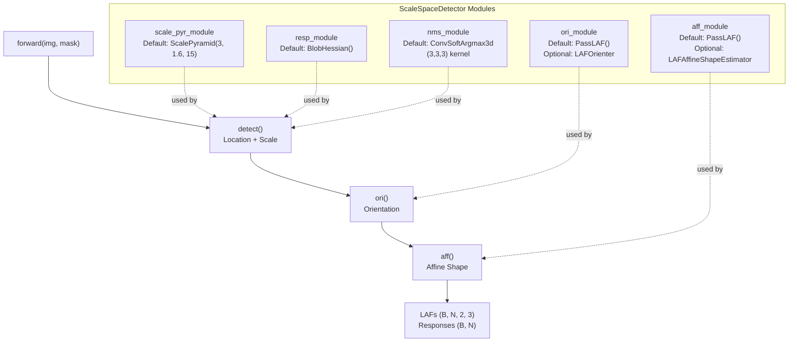
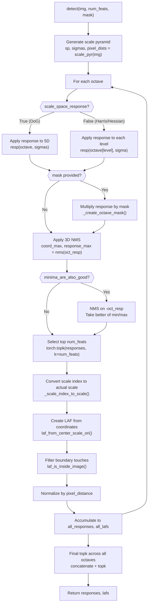
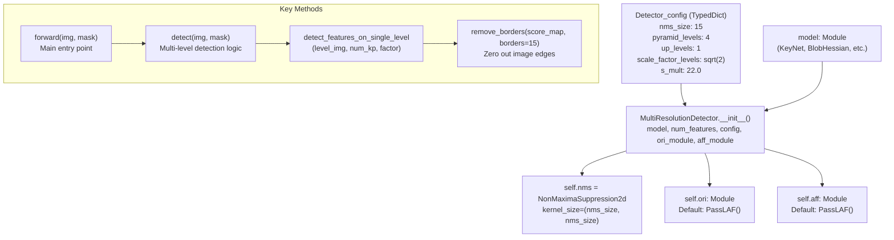
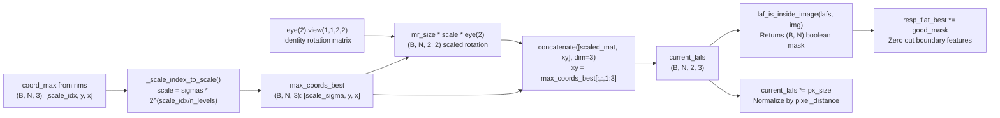
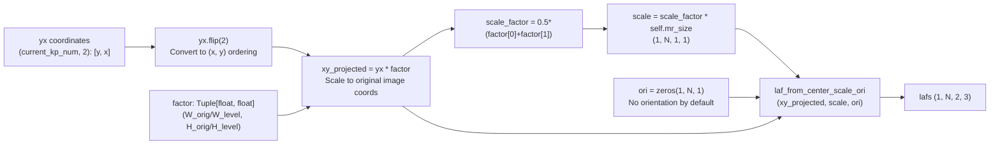

<!-- source: DeepWiki mcp.deepwiki.com · repo kornia/kornia · page 5.2 Scale-Space and Multi-Resolution Detection · fetched 2026-10-21 -->

# Scale-Space and Multi-Resolution Detection

<details>
<summary>Relevant source files</summary>

The following files were used as context for generating this wiki page:

- [docs/source/feature.rst](docs/source/feature.rst)
- [kornia/feature/__init__.py](kornia/feature/__init__.py)
- [kornia/feature/laf.py](kornia/feature/laf.py)
- [kornia/feature/responses.py](kornia/feature/responses.py)
- [kornia/feature/scale_space_detector.py](kornia/feature/scale_space_detector.py)
- [kornia/feature/siftdesc.py](kornia/feature/siftdesc.py)
- [kornia/geometry/transform/pyramid.py](kornia/geometry/transform/pyramid.py)

</details>


## Purpose and Scope

This page documents Kornia's two complementary approaches for detecting local features (keypoints) at multiple scales in images. Multi-scale detection is fundamental for building robust feature detectors that identify salient image structures regardless of their size or image resolution.

Kornia provides two distinct multi-scale detection architectures:

1. **ScaleSpaceDetector** - Classical scale-space approach using Gaussian pyramids with 3D non-maximum suppression across scale-space (x, y, σ)
2. **MultiResolutionDetector** - Resolution-based approach using image pyramids with per-level 2D NMS and quota-based feature distribution

Both detectors work with pluggable response functions (`CornerHarris`, `CornerGFTT`, `BlobHessian`, `BlobDoG`) and output features as Local Affine Frames (LAF). The choice between architectures depends on computational constraints, batch processing needs, and desired feature distribution characteristics.

For LAF manipulation and utilities, see page 5.1. For response function details, see page 5.3. For integrated detection+description pipelines, see page 5.4.

---

## Multi-Scale Detection Theory

Multi-scale detection addresses the fundamental problem that meaningful features exist at different scales in images. A corner prominent at one resolution may disappear when the image is scaled. Multi-scale approaches create multiple representations of the same image at different scales and detect features that are stable across these representations.

Both detection architectures implement the same conceptual pipeline but with different technical approaches:

1. **Scale/Resolution Pyramid Generation** - Create multi-scale image representation
2. **Response Computation** - Apply "cornerness" or "blobness" function at each scale/level
3. **Non-Maximum Suppression (NMS)** - Select local maxima (3D for scale-space, 2D per level for multi-resolution)
4. **Feature Aggregation** - Combine detections across scales into final LAF set

The key difference lies in how scales are represented (Gaussian blur vs. image resolution) and how features are selected (joint 3D NMS vs. per-level quotas).

### ScaleSpaceDetector Pipeline

**Diagram: ScaleSpaceDetector processing flow with code entity names**



**Sources:** [kornia/feature/scale_space_detector.py:72-263](), [kornia/feature/scale_space_detector.py:151-241]()

### MultiResolutionDetector Pipeline

**Diagram: MultiResolutionDetector processing flow with code entity names**



**Sources:** [kornia/feature/scale_space_detector.py:279-433](), [kornia/feature/scale_space_detector.py:334-410]()

---

## Scale-Space Representation: ScalePyramid

The `ScalePyramid` class (used by `ScaleSpaceDetector`) generates a Gaussian scale-space representation by creating octaves (levels of 2× downsampling) and scale levels within each octave (Gaussian blur at progressively larger sigmas).

### ScalePyramid Parameters

| Parameter | Type | Default | Description |
|-----------|------|---------|-------------|
| `n_levels` | int | 3 | Number of scale levels per octave (controls scale sampling density) |
| `init_sigma` | float | 1.6 | Initial Gaussian blur sigma (base smoothing level) |
| `min_size` | int | 15 | Minimum octave size in pixels (stops pyramid when reached) |
| `double_image` | bool | False | Upscale input 2× before processing (for detecting smaller features) |
| `extra_levels` | int | 3 | Additional levels per octave (required for DoG computation) |

### Gaussian Scale-Space Structure

**Diagram: ScalePyramid octave and level structure**



where `sigma_step = 2^(1/n_levels) ≈ 1.26` for `n_levels=3`.

**Key Methods in ScalePyramid:**

- `get_first_level()` - Initializes base with optional `upscale_double()` if `double_image=True`
- `get_kernel_size(sigma)` - Returns `int(2.0 * 4.0 * sigma + 1.0) | 1` (ensures odd)
- `forward(x)` - Returns `(pyr: List[Tensor], sigmas: List[Tensor], pixel_dists: List[Tensor])`

**Output Format:**
- `pyr[octave_idx]` has shape `(B, C, n_levels + extra_levels, H_oct, W_oct)` stacked along dim 2
- `sigmas[octave_idx]` has shape `(B, n_levels + extra_levels)` 
- `pixel_dists[octave_idx]` has shape `(B, n_levels + extra_levels)`

**Sources:** [kornia/geometry/transform/pyramid.py:123-248](), [kornia/geometry/transform/pyramid.py:176-205](), [kornia/geometry/transform/pyramid.py:207-247]()

---

## Response Functions

Response functions compute per-pixel "cornerness" or "blobness" measures that indicate the presence of interest points. Kornia provides four main response types:

### Response Function Comparison

| Response Class | Function | Use Case | Output Characteristics |
|----------------|----------|----------|------------------------|
| `CornerHarris` | `harris_response()` | Corner detection | Maxima at corners, based on structure tensor eigenvalues |
| `CornerGFTT` | `gftt_response()` | Good Features to Track | Minimum eigenvalue of structure tensor |
| `BlobHessian` | `hessian_response()` | Blob detection | Determinant of Hessian matrix |
| `BlobDoG` | `dog_response()` | Scale-space blobs | Difference between adjacent Gaussian-smoothed scales |

### Response Function Mathematics

#### Harris Corner Response

```
M = Σ [ I_x²    I_x·I_y ]
      [ I_x·I_y  I_y²   ]

R = det(M) - k·trace(M)²
  = (I_x²·I_y² - I_xy²) - k·(I_x² + I_y²)²
```

#### GFTT Response

```
R = min(eigenvalues(M))
  = 0.5 * (trace(M) - √(trace(M)² - 4·det(M)))
```

#### Hessian Response

```
H = [ I_xx  I_xy ]
    [ I_xy  I_yy ]

R = det(H) = I_xx·I_yy - I_xy²
```

#### Difference-of-Gaussians (DoG)

```
R(x, y, σ) = G(x, y, k·σ) - G(x, y, σ)

where G(x, y, σ) = I * gaussian_kernel(σ)
```

### Response Function Pipeline



**Scale Normalization:** Response functions are multiplied by `σ⁴` (where σ is the blur sigma) to enable fair comparison across scales. This normalization compensates for the amplitude reduction that occurs at larger scales.

**Sources:** [kornia/feature/responses.py:39-275](), [kornia/feature/responses.py:315-413]()

---

## ScaleSpaceDetector Architecture

The `ScaleSpaceDetector` class is the primary differentiable local feature detector that follows the classical scale-space detection pipeline. It can be customized with different response functions, orientation estimators, and affine shape estimators.

### ScaleSpaceDetector Components



### Constructor Parameters

```python
ScaleSpaceDetector(
    num_features=500,        # Number of features to detect
    mr_size=6.0,            # Multiplier for local feature scale (6.0 matches OpenCV SIFT 12.0)
    scale_pyr_module=None,  # Custom scale pyramid (default: ScalePyramid(3, 1.6, 15))
    resp_module=None,       # Custom response function (default: BlobHessian())
    nms_module=None,        # Custom NMS (default: ConvSoftArgmax3d)
    ori_module=None,        # Orientation estimator (default: PassLAF)
    aff_module=None,        # Affine shape estimator (default: PassLAF)
    minima_are_also_good=False,  # Detect both maxima and minima
    scale_space_response=False   # True for DoG, False for Harris/Hessian/GFTT
)
```

**Sources:** [kornia/feature/scale_space_detector.py:72-138]()

### Detection Process (detect method)

The `detect()` method implements the core scale-space detection algorithm:



**Sources:** [kornia/feature/scale_space_detector.py:151-241]()

---

## Non-Maximum Suppression

Non-Maximum Suppression (NMS) selects local maxima in the 3D response volume (x, y, scale). Kornia uses `ConvSoftArgmax3d` for differentiable NMS.

### ConvSoftArgmax3d Operation

The `ConvSoftArgmax3d` module performs soft (differentiable) argmax operation:

1. Applies a 3D convolution with learned or fixed weights to identify local maxima regions
2. Uses softmax weighting to compute sub-pixel/sub-scale accurate positions
3. Returns both coordinates `(B, N, 3)` where dimension 0 is scale, 1 is y, 2 is x
4. Also returns response values at those locations

**Default configuration:** `(3, 3, 3)` kernel, stride `(1, 1, 1)`, no normalization

### Scale Index to Scale Conversion

The detected scale coordinate is an index in `[0, n_levels]`. It must be converted to actual scale using:

```python
def _scale_index_to_scale(max_coords, sigmas, num_levels):
    scale_coords = max_coords[:, :, 0]  # Extract scale dimension
    actual_scale = sigmas[0, 0] * (2.0 ** (scale_coords / num_levels))
    return concatenate([actual_scale.view(B, N, 1), max_coords[:, :, 1:]], dim=2)
```

This interpolates the sigma values stored in the pyramid's `sigmas` tensor using the fractional scale index.

**Sources:** [kornia/feature/scale_space_detector.py:35-62]()

---

## Multi-Resolution Representation: Image Pyramids

The `MultiResolutionDetector` uses a simpler resolution-based pyramid approach inspired by KeyNet. Instead of Gaussian scale-space, it creates multiple resolution levels through image downsampling/upsampling with `pyrdown()` and `resize()`.

### MultiResolutionDetector vs ScaleSpaceDetector Comparison

| Aspect | ScaleSpaceDetector | MultiResolutionDetector |
|--------|-------------------|------------------------|
| **Scale Representation** | Gaussian blur within octaves + downsampling | Resolution levels via `resize()` and `pyrdown()` |
| **NMS Approach** | 3D soft NMS via `ConvSoftArgmax3d` across (x, y, σ) | 2D hard NMS via `NonMaximaSuppression2d` per level |
| **Feature Distribution** | Natural from response values, global `topk` | Quota-based per level, then global `topk` |
| **Upsampling** | Optional `double_image` (2× only) | Configurable `up_levels` with `scale_factor_levels` |
| **Batch Processing** | Full batched operation | Single image only (`KORNIA_CHECK_SHAPE(img, ["1", "C", "H", "W"])`) |
| **Response Application** | Can be scale-space aware (DoG) or per-level | Always per-level on 4D tensors |
| **Computational Cost** | Higher (Gaussian blurring + 3D NMS) | Lower (simple resize + 2D NMS) |
| **Use Case** | Classical CV pipelines, SIFT-like detectors | Real-time applications, KeyNet-based detection |

### MultiResolutionDetector Architecture and Configuration

**Diagram: MultiResolutionDetector internal structure**



**Sources:** [kornia/feature/scale_space_detector.py:279-327](), [kornia/feature/scale_space_detector.py:265-276](), [kornia/feature/scale_space_detector.py:436-443]()

### Feature Quota Distribution Algorithm

The `MultiResolutionDetector.detect()` method distributes the `num_features` budget across pyramid levels using a power-law formula that allocates more features to finer scales:

```python
# In detect() method
factor_points = self.scale_factor_levels ** 2  # e.g., 2.0 for scale_factor=√2
levels = self.num_pyramid_levels + self.num_upscale_levels + 1  # Total levels

# Calculate unnormalized quota per level
num_features_per_level = []
for idx_level in range(levels):
    nf = self.num_features * factor_points ** (-(idx_level - self.num_upscale_levels))
    num_features_per_level.append(nf)

# Normalize so sum equals self.num_features
tmp = sum(num_features_per_level)
num_features_per_level = [int(x / tmp) for x in num_features_per_level]
```

**Example:** For `num_features=1000`, `scale_factor_levels=√2`, `pyramid_levels=4`, `up_levels=1`:
- Level -1 (upsample): ~283 features (higher density for smaller scales)
- Level 0 (base): ~200 features
- Level 1: ~141 features
- Level 2: ~100 features
- Level 3: ~71 features
- Level 4: ~50 features

This ensures **scale-invariant feature density** by compensating for the reduced spatial resolution at coarser levels.

**Sources:** [kornia/feature/scale_space_detector.py:354-364]()

### Per-Level Detection: detect_features_on_single_level()

The `detect_features_on_single_level()` method processes one pyramid level:

**Diagram: Single-level detection flow**

```mermaid
graph LR
    LevelImg["level_img<br/>(1, C, H_level, W_level)"]
    
    Model["self.model.forward(level_img)<br/>Response: (1, 1, H_level, W_level)"]
    
    RemoveBorders["self.remove_borders(det_map)<br/>Mask out border pixels"]
    
    NMS["self.nms.forward(det_map)<br/>NonMaximaSuppression2d"]
    
    Nonzero["det_map.nonzero()[:, 2:].t()<br/>Get (y, x) coordinates"]
    
    GetScores["scores = det_map[0, 0, yx[0], yx[1]]"]
    
    Sort["torch.sort(scores, descending=True)"]
    
    TopK["indices[:num_kp]<br/>Keep top k features"]
    
    ProjectCoords["xy_projected = yx.flip(2) * factor<br/>Scale coordinates to original image"]
    
    ComputeScale["scale = 0.5*(factor[0]+factor[1]) * self.mr_size"]
    
    CreateLAF["laf_from_center_scale_ori<br/>(xy_projected, scale, ori=zeros)"]
    
    Return["return scores_sorted[:num_kp], lafs"]
    
    LevelImg --> Model
    Model --> RemoveBorders
    RemoveBorders --> NMS
    NMS --> Nonzero
    Nonzero --> GetScores
    GetScores --> Sort
    Sort --> TopK
    TopK --> ProjectCoords
    ProjectCoords --> ComputeScale
    ComputeScale --> CreateLAF
    CreateLAF --> Return
```



**Key Operations:**
- `model(level_img)` produces dense response map
- `remove_borders()` zeros out `borders=15` pixels from edges
- `NonMaximaSuppression2d` finds local maxima with kernel size `(nms_size, nms_size)`
- Coordinates are projected back to original image space using `factor: Tuple[float, float]`
- Scale is computed as `0.5 * (factor[0] + factor[1]) * self.mr_size` where `mr_size=22.0` by default

**Sources:** [kornia/feature/scale_space_detector.py:334-352]()

---

## LAF Construction from Detections

Both detectors produce keypoints as Local Affine Frames (LAF), which encode position, scale, and orientation in a 2×3 matrix:

```
LAF = [ a11  a12  x ]
      [ a21  a22  y ]
```

Where:
- `(x, y)` - Keypoint center in image coordinates
- `[a11, a12; a21, a22]` - Affine transformation matrix (scale + rotation)
- Scale extracted via `get_laf_scale(LAF) = √|det(A)| = √|a11*a22 - a12*a21|`

### ScaleSpaceDetector LAF Creation

**Diagram: LAF construction in ScaleSpaceDetector.detect()**



**Key Parameters:**
- `mr_size` (default 6.0) - Multiplier for patch extraction scale, matching OpenCV SIFT radius convention
- `px_size` - Pixel distance (1.0 for base octave, 2.0 for octave 1, etc.)

**Sources:** [kornia/feature/scale_space_detector.py:213-231]()

### MultiResolutionDetector LAF Creation

**Diagram: LAF construction in MultiResolutionDetector.detect_features_on_single_level()**



**Key Difference:** `MultiResolutionDetector` computes scale from the resolution pyramid level's downsampling factor, while `ScaleSpaceDetector` computes it from the Gaussian blur sigma.

**Sources:** [kornia/feature/scale_space_detector.py:347-352](), [kornia/feature/laf.py:129-155]()

### Boundary Filtering: laf_is_inside_image()

Both detectors use `laf_is_inside_image()` to filter keypoints that touch image boundaries:

```python
# In ScaleSpaceDetector.detect()
good_mask = laf_is_inside_image(current_lafs, octave[:, 0])
resp_flat_best = resp_flat_best * good_mask.to(dev, dtype)
```

The function:
1. Calls `laf_to_boundary_points(laf, 12)` to sample 12 points on LAF ellipse boundary
2. Checks all points satisfy: `border ≤ x < W - border` and `border ≤ y < H - border`
3. Returns `(B, N)` boolean mask via `good_lafs_mask.min(dim=2)[0]`

**Sources:** [kornia/feature/laf.py:492-513](), [kornia/feature/scale_space_detector.py:226-227]()

---

## Usage Examples and Common Patterns

### Example 1: Basic Harris Corner Detection

```python
import torch
from kornia.feature import ScaleSpaceDetector
from kornia.feature.responses import CornerHarris
from kornia.geometry.transform import ScalePyramid

# Create detector with Harris response
detector = ScaleSpaceDetector(
    num_features=1000,
    resp_module=CornerHarris(k=0.04),
    scale_pyr_module=ScalePyramid(n_levels=3, init_sigma=1.6, min_size=15)
)

# Detect features
img = torch.rand(1, 1, 512, 512)
lafs, responses = detector(img)

# lafs shape: (1, 1000, 2, 3)
# responses shape: (1, 1000)
```

### Example 2: DoG Blob Detection

```python
from kornia.feature import ScaleSpaceDetector
from kornia.feature.responses import BlobDoG
from kornia.geometry.transform import ScalePyramid

# DoG requires scale_space_response=True
detector = ScaleSpaceDetector(
    num_features=500,
    resp_module=BlobDoG(),
    scale_pyr_module=ScalePyramid(n_levels=3, init_sigma=1.6, min_size=15),
    minima_are_also_good=True,  # DoG detects both dark and bright blobs
    scale_space_response=True   # DoG operates on scale pyramid directly
)

lafs, responses = detector(img)
```

### Example 3: Multi-Resolution Detection with KeyNet Model

```python
from kornia.feature import MultiResolutionDetector, KeyNet
from kornia.feature.orientation import LAFOrienter

# KeyNet is the intended model for MultiResolutionDetector
keynet = KeyNet(pretrained=True)

# Create detector with orientation estimation
detector = MultiResolutionDetector(
    model=keynet,
    num_features=2048,
    ori_module=LAFOrienter(19),  # 19x19 patch for orientation
    config=None  # Uses default config
)

# Single image only (batch size 1)
img = torch.rand(1, 1, 800, 600)
lafs, responses = detector(img)
# lafs shape: (1, N, 2, 3) where N ≤ 2048
# responses shape: (1, N)
```

### Example 4: Using Masks for Region-of-Interest Detection

```python
detector = ScaleSpaceDetector(num_features=500)

# Create mask (1.0 = detect, 0.0 = ignore)
mask = torch.zeros(1, 1, 512, 512)
mask[:, :, 100:400, 100:400] = 1.0  # Only detect in center region

lafs, responses = detector(img, mask=mask)
```

### Example 5: Extracting Patches from Detected LAFs

```python
from kornia.feature import extract_patches_from_pyramid, normalize_laf

detector = ScaleSpaceDetector(num_features=100)
lafs, responses = detector(img)

# Normalize LAFs to [0, 1] range
normalized_lafs = normalize_laf(lafs, img)

# Extract 32x32 patches at appropriate scales
patches = extract_patches_from_pyramid(img, normalized_lafs, PS=32)
# patches shape: (1, 100, 1, 32, 32)
```

**Sources:** [kornia/feature/scale_space_detector.py:72-263](), [kornia/feature/scale_space_detector.py:279-433]()

---

## Key Implementation Details

### Scale Normalization

Response functions use scale normalization (`σ⁴` multiplication) to ensure fair comparison across scales. This is implemented in the response functions:

```python
if sigmas is not None:
    scores = scores * sigmas.pow(4).view(-1, 1, 1, 1)
```

### Gradient Mode Selection

Response functions support two gradient modes:
- `grads_mode='sobel'` - For standalone use with Sobel filters
- `grads_mode='diff'` - For use with Gaussian pyramid (pre-smoothed images)

The difference mode uses simple finite differences, which is appropriate when images are already smoothed.

### Double Image Upsampling

Setting `double_image=True` in `ScalePyramid` upscales the input 2× before processing, matching OpenCV SIFT behavior. This:
- Increases spatial resolution for detecting small features
- Changes `pixel_distance` from 1.0 to 0.5
- Doubles computational cost

### Extra Pyramid Levels

The pyramid includes `extra_levels=3` beyond `n_levels` to support DoG computation, which requires differences between adjacent levels:

```python
# DoG needs L+1 levels to produce L difference maps
oct_resp = self.resp(octave, sigmas)  # Input: (B, C, L+3, H, W)
# Output after DoG: (B, C, L+2, H, W)
oct_resp = oct_resp[:, :, :-1]  # Trim to (B, C, L+1, H, W)
```

**Sources:** [kornia/feature/responses.py:39-124](), [kornia/geometry/transform/pyramid.py:156-162](), [kornia/geometry/transform/pyramid.py:187-205]()

---

## System Configuration Table

### ScaleSpaceDetector Default Configuration

| Component | Default Type | Default Parameters | Customization Points |
|-----------|--------------|-------------------|---------------------|
| Scale Pyramid | `ScalePyramid` | n_levels=3, init_sigma=1.6, min_size=15 | n_levels, sigma, double_image |
| Response | `BlobHessian` | grads_mode='sobel' | Harris, GFTT, DoG |
| NMS | `ConvSoftArgmax3d` | kernel=(3,3,3), stride=(1,1,1) | kernel_size, temperature |
| Orientation | `PassLAF` | No-op | `LAFOrienter`, `PatchDominantGradientOrientation` |
| Affine Shape | `PassLAF` | No-op | `LAFAffineShapeEstimator` |

### MultiResolutionDetector Default Configuration

| Parameter | Default Value | Description |
|-----------|---------------|-------------|
| `nms_size` | 15 | NMS kernel size |
| `pyramid_levels` | 4 | Number of downsampling levels |
| `up_levels` | 1 | Number of upsampling levels |
| `scale_factor_levels` | √2 | Scale factor between levels |
| `s_mult` | 22.0 | Scale multiplier for LAF creation |

**Sources:** [kornia/feature/scale_space_detector.py:102-133](), [kornia/feature/scale_space_detector.py:436-443]()

---

