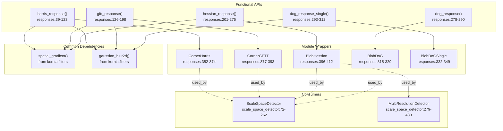
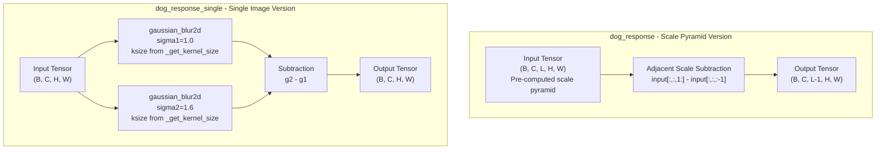
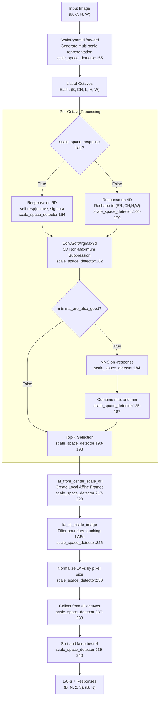
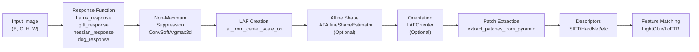

<!-- source: DeepWiki mcp.deepwiki.com · repo kornia/kornia · page 5.3 Response Functions and Classical Detectors · fetched 2026-10-21 -->

# Response Functions and Classical Detectors

<details>
<summary>Relevant source files</summary>

The following files were used as context for generating this wiki page:

- [docs/source/feature.rst](docs/source/feature.rst)
- [kornia/feature/__init__.py](kornia/feature/__init__.py)
- [kornia/feature/laf.py](kornia/feature/laf.py)
- [kornia/feature/responses.py](kornia/feature/responses.py)
- [kornia/feature/scale_space_detector.py](kornia/feature/scale_space_detector.py)
- [kornia/feature/siftdesc.py](kornia/feature/siftdesc.py)
- [kornia/geometry/transform/pyramid.py](kornia/geometry/transform/pyramid.py)

</details>


## Purpose and Scope

This page documents the response functions and classical feature detectors in Kornia. Response functions compute "cornerness" or "blobness" measures for each pixel in an image, which are then used by detectors to find interest points. For information about how these response functions are integrated into scale-space detection pipelines, see [Scale-Space and Multi-Resolution Detection](#5.2). For working with detected features as Local Affine Frames, see [Local Affine Frames (LAF) System](#5.1). For descriptor computation on detected features, see [Feature Descriptors (SIFT and Learned)](#5.4).

Kornia provides both functional APIs and PyTorch module wrappers for four classical response functions:

1. **Harris Corner Response** - detects corners using the structure tensor
2. **GFTT (Good Features to Track)** - Shi-Tomasi corner detector  
3. **Hessian Blob Response** - detects blob-like structures
4. **Difference-of-Gaussians (DoG)** - SIFT-style blob detector

## System Architecture

**Diagram 1: Response Function System Organization**



Sources: [kornia/feature/responses.py:1-413](), [kornia/feature/scale_space_detector.py:72-433]()

## Harris Corner Response

The Harris corner detector identifies corner points by analyzing the structure tensor (second moment matrix) of the image. A corner is detected where both eigenvalues of the structure tensor are large.

### Mathematical Foundation

The Harris response is computed as:

$$R = \det(M) - k \cdot \text{trace}(M)^2$$

where the structure tensor $M$ is:

$$M = \sum_{(x,y) \in W} \begin{bmatrix} I_x^2 & I_x I_y \\ I_x I_y & I_y^2 \end{bmatrix}$$

The parameter $k$ is empirically set to 0.04-0.06.

### Implementation Details

The `harris_response()` function [kornia/feature/responses.py:39-123]() computes this response:

| Parameter | Type | Description |
|-----------|------|-------------|
| `input` | `Tensor` | Image of shape `(B, C, H, W)` |
| `k` | `Union[Tensor, float]` | Harris free parameter (default: 0.04) |
| `grads_mode` | `str` | `'sobel'` for standalone or `'diff'` for pyramid |
| `sigmas` | `Optional[Tensor]` | Scale coefficients `(B)` for normalization |

**Algorithm:**
1. Compute spatial gradients using `spatial_gradient()` [responses.py:104]()
2. Compute structure tensor elements with Gaussian smoothing (7×7 kernel, σ=1.0):
   - $I_x^2$ [responses.py:110]()
   - $I_y^2$ [responses.py:111]()
   - $I_x I_y$ [responses.py:112]()
3. Calculate determinant: $\det(M) = I_x^2 \cdot I_y^2 - (I_x I_y)^2$ [responses.py:114]()
4. Calculate trace: $\text{trace}(M) = I_x^2 + I_y^2$ [responses.py:115]()
5. Apply Harris formula: $R = \det(M) - k \cdot \text{trace}(M)^2$ [responses.py:118]()
6. Scale normalization (if sigmas provided): $R \leftarrow R \cdot \sigma^4$ [responses.py:120-121]()

The `CornerHarris` module [responses.py:352-374]() provides a stateful wrapper with `k` stored as a buffer.

Sources: [kornia/feature/responses.py:39-123](), [kornia/feature/responses.py:352-374]()

## GFTT (Good Features to Track)

GFTT, also known as the Shi-Tomasi corner detector, uses the minimum eigenvalue of the structure tensor. This provides more stable corner detection for tracking applications.

### Mathematical Foundation

The GFTT response is:

$$R = \min(\lambda_1, \lambda_2)$$

where $\lambda_1, \lambda_2$ are eigenvalues of the structure tensor $M$. Eigenvalues are computed using:

$$\lambda_1 = \frac{\text{trace}(M) + \sqrt{\text{trace}(M)^2 - 4\det(M)}}{2}$$
$$\lambda_2 = \frac{\text{trace}(M) - \sqrt{\text{trace}(M)^2 - 4\det(M)}}{2}$$

### Implementation Details

The `gftt_response()` function [kornia/feature/responses.py:126-198]():

**Algorithm:**
1. Compute spatial gradients [responses.py:179]()
2. Build structure tensor elements with Gaussian smoothing:
   - $I_x^2$ [responses.py:183]()
   - $I_y^2$ [responses.py:184]()
   - $I_x I_y$ [responses.py:185]()
3. Calculate determinant and trace [responses.py:187-188]()
4. Compute eigenvalues explicitly using quadratic formula [responses.py:190-191]()
5. Take minimum eigenvalue: $R = \min(\lambda_1, \lambda_2)$ [responses.py:193]()
6. Apply scale normalization if sigmas provided [responses.py:195-196]()

The `CornerGFTT` module [responses.py:377-393]() provides the module wrapper.

Sources: [kornia/feature/responses.py:126-198](), [kornia/feature/responses.py:377-393]()

## Hessian Blob Response

The Hessian detector finds blob-like structures by computing the determinant of the Hessian matrix (matrix of second derivatives). This is efficient and commonly used as the default response in `ScaleSpaceDetector`.

### Mathematical Foundation

The Hessian response is:

$$R = \det(H) = I_{xx} \cdot I_{yy} - I_{xy}^2$$

where $H$ is the Hessian matrix:

$$H = \begin{bmatrix} I_{xx} & I_{xy} \\ I_{xy} & I_{yy} \end{bmatrix}$$

### Implementation Details

The `hessian_response()` function [kornia/feature/responses.py:201-275]():

**Algorithm:**
1. Compute second-order spatial gradients using `spatial_gradient()` with `order=2` [responses.py:265]()
2. Extract second derivatives: $I_{xx}$, $I_{xy}$, $I_{yy}$ [responses.py:266-268]()
3. Compute determinant: $R = I_{xx} \cdot I_{yy} - I_{xy}^2$ [responses.py:270]()
4. Apply scale normalization: $R \leftarrow R \cdot \sigma^4$ [responses.py:272-273]()

The `BlobHessian` module [responses.py:396-412]() is the default response function in `ScaleSpaceDetector` [scale_space_detector.py:121]().

Sources: [kornia/feature/responses.py:201-275](), [kornia/feature/responses.py:396-412](), [kornia/feature/scale_space_detector.py:119-122]()

## Difference-of-Gaussians (DoG)

DoG is the blob detector used in the SIFT algorithm. It approximates the Laplacian-of-Gaussian by computing the difference between images blurred at different scales.

### Two Variants

**Diagram 2: DoG Function Variants**



Sources: [kornia/feature/responses.py:278-312]()

### dog_response() - Scale Pyramid Version

The `dog_response()` function [responses.py:278-290]() works on pre-computed scale pyramids:

| Parameter | Shape | Description |
|-----------|-------|-------------|
| `input` | `(B, C, L, H, W)` | Scale pyramid where L is number of levels |
| Returns | `(B, C, L-1, H, W)` | Differences between adjacent scales |

**Implementation:** Simple subtraction `input[:, :, 1:] - input[:, :, :-1]` [responses.py:290]()

This is used with `ScaleSpaceDetector` when `scale_space_response=True` [scale_space_detector.py:137]().

### dog_response_single() - Single Image Version

The `dog_response_single()` function [responses.py:293-312]() works on single images:

| Parameter | Type | Default | Description |
|-----------|------|---------|-------------|
| `input` | `Tensor` | - | Image `(B, C, H, W)` |
| `sigma1` | `float` | 1.0 | Smaller Gaussian sigma |
| `sigma2` | `float` | 1.6 | Larger Gaussian sigma |

**Algorithm:**
1. Compute kernel sizes using `_get_kernel_size()` [responses.py:308-309]()
2. Apply Gaussian blur with sigma1 [responses.py:310]()
3. Apply Gaussian blur with sigma2 [responses.py:311]()
4. Return difference: `g2 - g1` [responses.py:312]()

The `BlobDoG` and `BlobDoGSingle` modules [responses.py:315-349]() provide module wrappers.

Sources: [kornia/feature/responses.py:278-312](), [kornia/feature/responses.py:315-349]()

## Module Wrappers

All response functions have corresponding `torch.nn.Module` wrappers that are plug-compatible with `ScaleSpaceDetector`:

| Functional API | Module Wrapper | Configuration Parameters | Lines |
|----------------|----------------|-------------------------|-------|
| `harris_response()` | `CornerHarris` | `k: Union[float, Tensor]`, `grads_mode: str` | [352-374]() |
| `gftt_response()` | `CornerGFTT` | `grads_mode: str` | [377-393]() |
| `hessian_response()` | `BlobHessian` | `grads_mode: str` | [396-412]() |
| `dog_response()` | `BlobDoG` | None | [315-329]() |
| `dog_response_single()` | `BlobDoGSingle` | `sigma1: float`, `sigma2: float` | [332-349]() |

**Common Interface:** All modules implement `forward(input: Tensor, sigmas: Optional[Tensor] = None) -> Tensor`

**Usage with ScaleSpaceDetector:**
```python
resp_module = BlobHessian()  # or any other response module
detector = ScaleSpaceDetector(num_features=500, resp_module=resp_module)
```

Sources: [kornia/feature/responses.py:315-412]()

## Integration with Scale-Space Detection

**Diagram 3: Response Function Integration in ScaleSpaceDetector**



Sources: [kornia/feature/scale_space_detector.py:151-241]()

### Response Function Invocation Modes

The `ScaleSpaceDetector` calls response functions differently based on the `scale_space_response` flag [scale_space_detector.py:137]():

**For scale-space responses (DoG):** [scale_space_detector.py:163-164]()
```python
if self.scale_space_response:
    oct_resp = self.resp(octave, sigmas_oct.view(-1))
```
- Input shape: `(B, CH, L, H, W)` where L is scale levels
- Response computed across scale dimension
- Used for `BlobDoG` which operates on scale pyramids

**For per-image responses (Harris, GFTT, Hessian):** [scale_space_detector.py:166-170]()
```python
oct_resp = self.resp(
    octave.permute(0, 2, 1, 3, 4).reshape(B * L, CH, H, W),
    sigmas_oct.view(-1)
).view(B, L, CH, H, W)
```
- Reshapes to process each scale level as separate batch element
- Response computed per image
- Results reordered to `(B, CH, L, H, W)` for 3D NMS

### Scale Normalization

All response functions (except DoG variants) support scale normalization through the `sigmas` parameter:

**Scale normalization formula:** Applied in [responses.py:120-121](), [responses.py:195-196](), [responses.py:272-273]()
```python
scores = scores * sigmas.pow(4).view(-1, 1, 1, 1)
```

This multiplies the response by $\sigma^4$ to achieve scale normalization, following the VLFeat library convention. This ensures that features detected at different scales have comparable response magnitudes, enabling fair comparison during top-k selection across octaves.

Sources: [kornia/feature/responses.py:39-275](), [kornia/feature/scale_space_detector.py:151-242]()

## Gradient Computation Modes

Response functions support two gradient computation modes via the `grads_mode` parameter:

| Mode | Use Case | Description | Overhead |
|------|----------|-------------|----------|
| `'sobel'` | Standalone use | Sobel operator for robust gradient estimation | Higher (3×3 convolution) |
| `'diff'` | Gaussian pyramid | Simple finite differences on pre-smoothed images | Lower (element-wise ops) |

The `'diff'` mode is more efficient when working with scale pyramids since images are already Gaussian-smoothed. The `'sobel'` mode provides better noise robustness for single-scale processing.

**Example:**
```python
# For standalone detection
response = harris_response(img, k=0.04, grads_mode='sobel')

# For use in scale pyramid
response = harris_response(smoothed_img, k=0.04, grads_mode='diff')
```

Sources: [kornia/feature/responses.py:39-275]()

## Minima Detection

The `ScaleSpaceDetector` supports detecting both maxima and minima of response functions through the `minima_are_also_good` parameter [scale_space_detector.py:134]():

**Algorithm:** [scale_space_detector.py:183-187]()
```python
if self.minima_are_also_good:
    coord_min, response_min = self.nms(-oct_resp)
    take_min_mask = (response_min > response_max).to(response_max.dtype)
    response_max = response_min * take_min_mask + (1 - take_min_mask) * response_max
    coord_max = coord_min * take_min_mask.unsqueeze(2) + (1 - take_min_mask.unsqueeze(2)) * coord_max
```

This runs NMS on both the original and negated response map, then selects points with stronger absolute responses. This is useful for symmetric response functions:

- **DoG:** Both positive (bright blobs) and negative (dark blobs) responses indicate features
- **Hessian:** Both positive and negative responses can indicate blob structures

**Not useful for:** Harris and GFTT, which are designed to detect only positive responses (corners).

Sources: [kornia/feature/scale_space_detector.py:183-187]()

## Helper Functions

### _get_kernel_size()

The `_get_kernel_size()` function [responses.py:27-36]() computes Gaussian kernel sizes from sigma values:

**Formula:** `ksize = int(2.0 * 4.0 * sigma + 1.0)`

This ensures the kernel covers approximately 4 standard deviations on each side (99.99% of the Gaussian distribution). The function enforces odd kernel sizes for symmetric filtering.

**OpenCV Compatibility:** The formula matches OpenCV's convention. However, PyTorch doesn't allow padding larger than the original image size, so the scale pyramid generation clamps kernel sizes [pyramid.py:224]():
```python
ksize = min(ksize, cur_level.size(2), cur_level.size(3))
```

Sources: [kornia/feature/responses.py:27-36](), [kornia/geometry/transform/pyramid.py:224]()

## Performance Characteristics

### Computational Complexity

Response function costs per pixel:

| Response Function | Gradient Order | Gaussian Blurs | Operations | Relative Cost |
|------------------|----------------|----------------|------------|---------------|
| Harris | 1st | 3 (7×7 kernel) | Structure tensor + formula | Medium |
| GFTT | 1st | 3 (7×7 kernel) | Structure tensor + eigenvalues | Medium-High |
| Hessian | 2nd | 0 | Direct second derivatives | Low |
| DoG (single) | 0 | 2 (variable size) | Two Gaussian blurs + subtraction | Medium |
| DoG (pyramid) | 0 | 0 (pre-computed) | Single subtraction | Very Low |

**Fastest for single-scale:** Hessian, as it computes second derivatives directly without additional smoothing

**Fastest for scale-space:** DoG on pre-computed pyramids, as it only performs subtraction

### Memory Requirements

| Method | Input Shape | Memory Overhead | Notes |
|--------|-------------|-----------------|-------|
| Harris/GFTT/Hessian | `(B, C, H, W)` | Intermediate gradients | ~3× input size |
| DoG (single) | `(B, C, H, W)` | Two Gaussian blurred images | ~3× input size |
| DoG (pyramid) | `(B, C, L, H, W)` | None (in-place) | Pre-computed pyramid required |

For memory-constrained scenarios, prefer Hessian for single-scale or DoG for scale-space (if pyramid is already computed).

Sources: [kornia/feature/responses.py:1-413]()

## Feature Detection Pipeline

**Diagram 4: Response Functions in Complete Pipeline**



**Pipeline stages:**
1. **Response computation** (this page) - Identify interest points
2. **NMS and LAF creation** - See [Local Affine Frames (LAF) System](#5.1)
3. **Scale-space integration** - See [Scale-Space and Multi-Resolution Detection](#5.2)
4. **Descriptor extraction** - See [Feature Descriptors (SIFT and Learned)](#5.4)
5. **Feature matching** - See [Feature Matching and Geometric Filtering](#5.5)

Sources: [kornia/feature/responses.py:1-413](), [kornia/feature/scale_space_detector.py:1-444]()

## Usage Examples

### Basic Corner Detection

```python
from kornia.feature import harris_response, CornerHarris, gftt_response
import torch

img = torch.rand(1, 1, 256, 256)

# Functional API - Harris
harris_resp = harris_response(img, k=0.04, grads_mode='sobel')

# Module API - Harris
harris_detector = CornerHarris(k=0.04, grads_mode='sobel')
harris_resp = harris_detector(img)

# GFTT
gftt_resp = gftt_response(img, grads_mode='sobel')
```

### Scale-Space Hessian Detection

```python
from kornia.feature import ScaleSpaceDetector, BlobHessian
from kornia.geometry.transform import ScalePyramid

# Create detector with Hessian response
detector = ScaleSpaceDetector(
    num_features=500,
    resp_module=BlobHessian(grads_mode='diff'),
    scale_pyr_module=ScalePyramid(3, 1.6, 15),
    mr_size=6.0
)

lafs, responses = detector(img)
# lafs shape: (1, 500, 2, 3)
# responses shape: (1, 500)
```

### DoG Detection with Minima

```python
from kornia.feature import ScaleSpaceDetector, BlobDoG
from kornia.geometry.transform import ScalePyramid

# Detect both bright and dark blobs
detector = ScaleSpaceDetector(
    num_features=1000,
    resp_module=BlobDoG(),
    scale_pyr_module=ScalePyramid(3, 1.6, 15),
    minima_are_also_good=True,  # Detect both maxima and minima
    scale_space_response=True   # Required for DoG
)

lafs, responses = detector(img)
```

### Multi-Resolution Detection

```python
from kornia.feature import MultiResolutionDetector, BlobHessian

# Works with any response function
detector = MultiResolutionDetector(
    model=BlobHessian(),
    num_features=2048,
    config={
        'nms_size': 15,
        'pyramid_levels': 4,
        'up_levels': 1,
        'scale_factor_levels': 1.414,  # sqrt(2)
        's_mult': 22.0
    }
)

lafs, responses = detector(img)
```

Sources: [kornia/feature/scale_space_detector.py:72-433]()

## Exported API

All response functions and modules are exported from `kornia.feature`:

```python
from kornia.feature import (
    # Functional APIs
    harris_response,
    gftt_response,
    hessian_response,
    dog_response,
    dog_response_single,
    
    # Module Wrappers
    CornerHarris,
    CornerGFTT,
    BlobHessian,
    BlobDoG,
    BlobDoGSingle,
)
```

Sources: [kornia/feature/__init__.py:79-90]()

---

