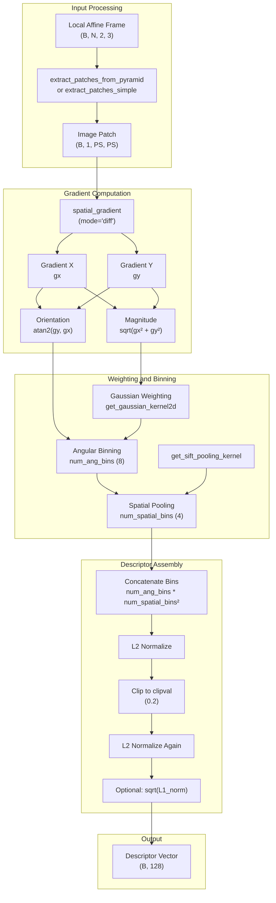
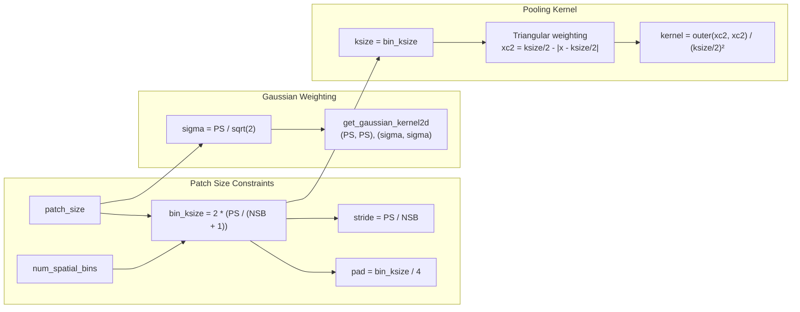
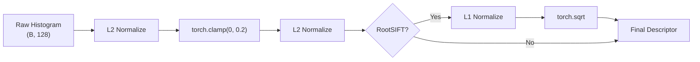
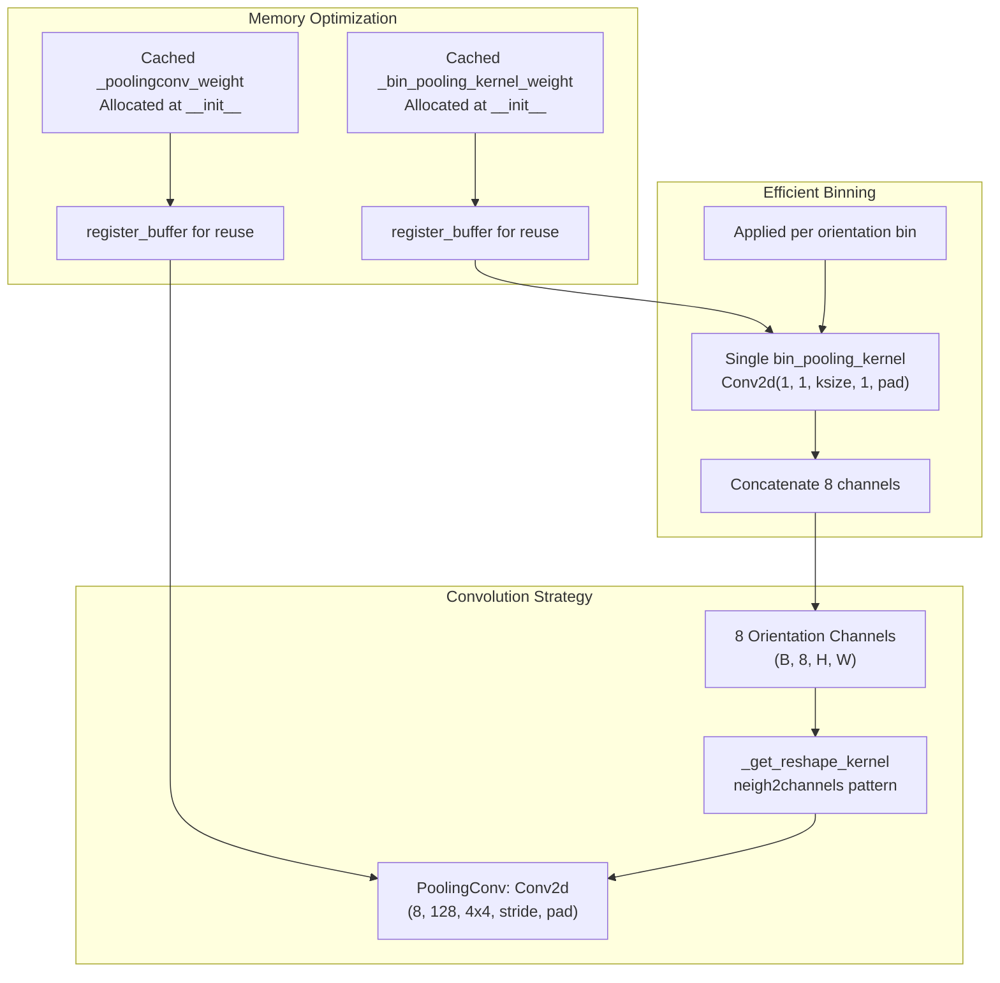
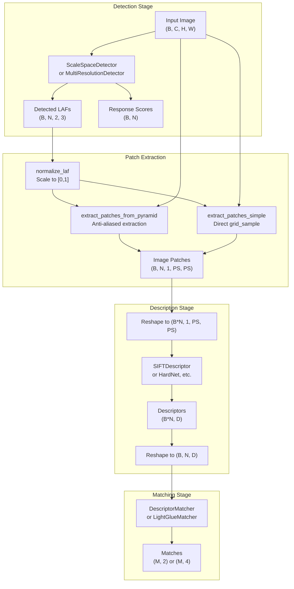
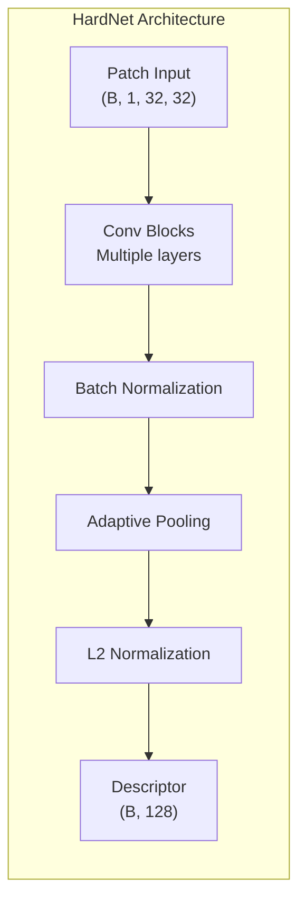
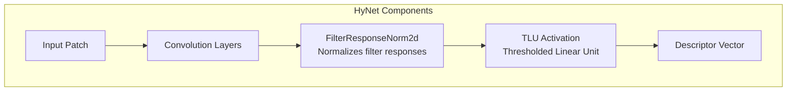
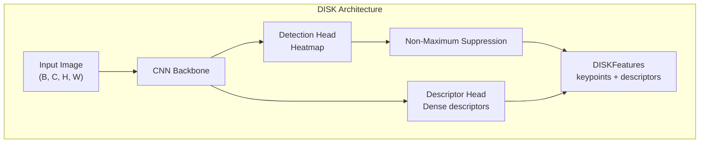

<!-- source: DeepWiki mcp.deepwiki.com · repo kornia/kornia · page 5.4 Feature Descriptors (SIFT and Learned) · fetched 2026-10-21 -->

# Feature Descriptors (SIFT and Learned)

<details>
<summary>Relevant source files</summary>

The following files were used as context for generating this wiki page:

- [docs/source/feature.rst](docs/source/feature.rst)
- [kornia/feature/__init__.py](kornia/feature/__init__.py)
- [kornia/feature/laf.py](kornia/feature/laf.py)
- [kornia/feature/responses.py](kornia/feature/responses.py)
- [kornia/feature/scale_space_detector.py](kornia/feature/scale_space_detector.py)
- [kornia/feature/siftdesc.py](kornia/feature/siftdesc.py)
- [kornia/geometry/transform/pyramid.py](kornia/geometry/transform/pyramid.py)

</details>


Feature descriptors convert detected local features into compact, distinctive vector representations that enable matching across images. This page documents Kornia's descriptor implementations, including both classical SIFT descriptors and modern learned descriptors trained on patch matching tasks.

For information about feature detection, see page 5.2 (Scale-Space Detection). For information about LAF data structures and patch extraction, see page 5.1 (Local Affine Frames). For information about matching descriptors, see page 5.5 (Feature Matching).

## Overview

Feature descriptors transform image patches (typically extracted around detected keypoints) into numerical vectors that capture local appearance while remaining invariant to transformations like rotation, scale changes, and illumination variations. Kornia provides two families of descriptors:

**Classical Descriptors:**
- **SIFT** (`SIFTDescriptor`, `DenseSIFTDescriptor`): Hand-crafted histogram-of-gradients representation
- Rotation and scale invariant by design
- Explicit orientation binning and spatial pooling

**Learned Descriptors:**
- **HardNet/HardNet8**: CNN-based, trained on photo-tourism datasets
- **HyNet**: Hybrid architecture with FilterResponseNorm2d layers
- **SOSNet**: Second-order similarity network
- **TFeat**: Triplet loss trained descriptor
- **MKDDescriptor**: Multi-kernel descriptor
- Learned end-to-end from matching tasks
- Typically more discriminative than hand-crafted features

**Key Concepts:**
- **Patch Descriptors**: Operate on fixed-size image patches (e.g., 32×32 or 41×41 pixels)
- **Dense Descriptors**: Compute descriptors at every pixel location
- **LAF Integration**: Descriptors can be extracted directly from Local Affine Frames
- **Differentiability**: All operations support gradient backpropagation

Sources: [kornia/feature/siftdesc.py:1-348](), [kornia/feature/__init__.py:1-189]()

## SIFT Descriptor Architecture



**Diagram: SIFT Descriptor Computation Pipeline**

The SIFT descriptor computation follows a multi-stage process that converts raw pixel intensities into rotation-invariant feature vectors. Each stage is differentiable, allowing end-to-end training.

Sources: [kornia/feature/siftdesc.py:93-202](), [kornia/feature/laf.py:404-490]()

## SIFTDescriptor Class

The `SIFTDescriptor` module computes classical SIFT descriptors for fixed-size image patches. It implements the algorithm described by Lowe (2004) with support for the RootSIFT normalization variant.

### Configuration Parameters

| Parameter | Type | Default | Description |
|-----------|------|---------|-------------|
| `patch_size` | int | 41 | Input patch size in pixels (must match spatial bins) |
| `num_ang_bins` | int | 8 | Number of orientation histogram bins |
| `num_spatial_bins` | int | 4 | Number of spatial bins per dimension (4×4 grid) |
| `rootsift` | bool | True | Apply RootSIFT normalization |
| `clipval` | float | 0.2 | Clipping value to reduce single-bin dominance |

### Implementation Details



**Diagram: SIFT Descriptor Parameter Relationships**

The patch size, number of spatial bins, and pooling kernel size are mathematically constrained to ensure proper spatial alignment. The function `get_sift_bin_ksize_stride_pad` validates these constraints.

Sources: [kornia/feature/siftdesc.py:69-91](), [kornia/feature/siftdesc.py:127-158]()

### Gradient Histogram Construction

The descriptor builds an 8-bin orientation histogram for each of the 16 (4×4) spatial regions:

1. **Gradient Computation**: Uses `spatial_gradient` with `mode='diff'` for efficiency
2. **Magnitude Weighting**: Multiplies gradient magnitude by Gaussian kernel centered at patch center
3. **Orientation Binning**: Maps gradient angles [0, 2π] to 8 bins with linear interpolation
4. **Spatial Pooling**: Applies triangular weighting kernel via `nn.Conv2d` with stride

The angular binning uses soft assignment to adjacent bins:
- Primary bin: `bo0 = floor(8 * angle / 2π) % 8`
- Secondary bin: `bo1 = (bo0 + 1) % 8`
- Weights: `wo0 = (1 - fraction) * magnitude`, `wo1 = fraction * magnitude`

Sources: [kornia/feature/siftdesc.py:166-194]()

### Normalization Pipeline



**Diagram: SIFT Descriptor Normalization**

The two-stage L2 normalization with clipping reduces the influence of dominant gradients (e.g., from strong edges). RootSIFT applies an additional L1 normalization followed by square root, which has been shown to improve matching performance.

Sources: [kornia/feature/siftdesc.py:195-201]()

### Example Usage

```python
# Create descriptor module
sift = SIFTDescriptor(patch_size=32, num_ang_bins=8, num_spatial_bins=4, rootsift=True)

# Input: patches extracted from LAF
patches = torch.rand(23, 1, 32, 32)  # B, C, H, W

# Compute descriptors
descriptors = sift(patches)  # (23, 128)
```

Sources: [kornia/feature/siftdesc.py:110-114]()

## DenseSIFTDescriptor Class

The `DenseSIFTDescriptor` module computes SIFT descriptors at every pixel location, producing a dense descriptor field. This is useful for dense matching and semantic correspondence tasks.

### Architecture Comparison

| Feature | SIFTDescriptor | DenseSIFTDescriptor |
|---------|---------------|---------------------|
| Input Shape | (B, 1, PS, PS) | (B, 1, H, W) |
| Output Shape | (B, 128) | (B, 128, H', W') |
| Patch Extraction | External (via LAF) | Internal (sliding window) |
| Typical Use | Sparse keypoints | Dense correspondences |
| Stride | N/A (one patch) | Configurable (default: 1) |

### Implementation Optimizations



**Diagram: DenseSIFTDescriptor Optimization Strategy**

The implementation uses several optimization techniques:
1. **Cached Kernels**: Pooling and reshape kernels allocated once at initialization
2. **Efficient Reshape**: Uses `_get_reshape_kernel` with eye matrix pattern for channel rearrangement
3. **Single Convolution**: Spatial binning via strided convolution instead of explicit loops

Sources: [kornia/feature/siftdesc.py:220-348](), [kornia/feature/siftdesc.py:30-51]()

### Configuration Parameters

| Parameter | Type | Default | Description |
|-----------|------|---------|-------------|
| `num_ang_bins` | int | 8 | Number of orientation histogram bins |
| `num_spatial_bins` | int | 4 | Spatial bins per descriptor (4×4 grid) |
| `spatial_bin_size` | int | 4 | Size of each spatial bin in pixels |
| `stride` | int | 1 | Stride for sliding window |
| `padding` | int | 1 | Padding to maintain spatial dimensions |
| `rootsift` | bool | True | Apply RootSIFT normalization |
| `clipval` | float | 0.2 | Clipping threshold |

### Output Spatial Dimensions

The output spatial dimensions are computed as:
```
H_out = (H + 2*padding - num_spatial_bins*spatial_bin_size) / stride + 1
W_out = (W + 2*padding - num_spatial_bins*spatial_bin_size) / stride + 1
```

With default parameters (`num_spatial_bins=4`, `spatial_bin_size=4`, `stride=1`, `padding=1`), a 200×300 image produces a 194×294 descriptor field.

Sources: [kornia/feature/siftdesc.py:236-239]()

### Example Usage

```python
# Create dense descriptor module
dense_sift = DenseSIFTDescriptor(
    num_ang_bins=8, 
    num_spatial_bins=4,
    spatial_bin_size=4,
    stride=1,
    padding=1
)

# Input: full image
image = torch.rand(2, 1, 200, 300)

# Compute dense descriptors
descriptors = dense_sift(image)  # (2, 128, 194, 294)
```

Sources: [kornia/feature/siftdesc.py:240-243]()

## Integration with LAF System

Feature descriptors typically operate on patches extracted from Local Affine Frames (LAFs). Kornia provides utilities in the `laf` module for this purpose.



**Diagram: Complete Feature Detection and Description Pipeline**

Sources: [kornia/feature/scale_space_detector.py:243-262](), [kornia/feature/laf.py:440-490]()

### Patch Extraction Methods

Kornia provides two patch extraction methods, each with different trade-offs:

#### extract_patches_simple

- **Method**: Direct `F.grid_sample` with bilinear interpolation
- **Pros**: Fast, simple implementation
- **Cons**: Aliasing artifacts when LAF scale is large
- **Use Case**: Small-scale features, prototyping

Sources: [kornia/feature/laf.py:404-437]()

#### extract_patches_from_pyramid

- **Method**: Extracts patches from appropriate pyramid level based on LAF scale
- **Scale Selection**: `pyr_level = log2(2 * laf_scale / patch_size)`
- **Pros**: Anti-aliased, better quality for large-scale features
- **Cons**: Requires image pyramid pre-computation, more complex
- **Use Case**: Production pipelines, scale-invariant matching

The implementation uses pyramid downsampling to match the LAF scale to the patch size:

```python
# Pseudo-code representation
scale = 2.0 * get_laf_scale(denormalize_laf(nlaf, img)) / PS
pyr_idx = scale.log2().clamp(min=0.0, max=max_level-1).long()

# Extract from appropriate level
for level in pyramid:
    mask = (pyr_idx == current_level)
    patches[mask] = grid_sample(pyramid[level], generate_grid(nlaf[mask]))
```

Sources: [kornia/feature/laf.py:440-489]()

### LAF Normalization

Before patch extraction, LAFs must be normalized to image coordinates:

```python
# LAFs are typically in normalized [0,1] space
laf_normalized = normalize_laf(laf, img)  # (B, N, 2, 3)

# Extract patches
patches = extract_patches_from_pyramid(img, laf_normalized, PS=41)
```

The normalization converts:
- Scale: `min(H-1, W-1)` factor
- Position: Separate factors for width `(W-1)` and height `(H-1)`

Sources: [kornia/feature/laf.py:347-375]()

## Learned Descriptor Architectures

Kornia provides several CNN-based learned descriptors trained on patch matching tasks. These descriptors typically outperform hand-crafted features like SIFT on challenging datasets with viewpoint changes, illumination variations, and texture changes.

### Descriptor Comparison Table

| Descriptor | Dimension | Patch Size | Training Data | Key Features |
|------------|-----------|------------|---------------|--------------|
| `SIFTDescriptor` | 128 | 32-41 | N/A (hand-crafted) | Histogram of gradients, explicit rotation invariance |
| `HardNet` | 128 | 32 | Photo-tourism (Brown et al.) | L2 normalized, batch normalization |
| `HardNet8` | 128 | 32 | Photo-tourism | 8-layer variant, deeper architecture |
| `HyNet` | 128 | 32 | HPatches | FilterResponseNorm2d, TLU activation |
| `SOSNet` | 128 | 32 | Liberty, HPatches | Second-order pooling |
| `TFeat` | 128 | 32 | Liberty | Triplet loss training |
| `MKDDescriptor` | Configurable | 32 | Multiple sources | Multi-kernel convolutions |

Sources: [kornia/feature/__init__.py:23-95](), [docs/source/feature.rst:131-149]()

### HardNet and HardNet8

`HardNet` is a CNN-based descriptor trained on the photo-tourism dataset from Brown et al. using a metric learning approach. The architecture uses L2 normalization and batch normalization layers.



**Usage:**
```python
from kornia.feature import HardNet

hardnet = HardNet()
patches = torch.rand(10, 1, 32, 32)
descriptors = hardnet(patches)  # (10, 128)
```

`HardNet8` is a deeper 8-layer variant that can achieve better performance with increased computational cost.

Sources: [kornia/feature/__init__.py:27-28](), [docs/source/feature.rst:137-138]()

### HyNet with FilterResponseNorm2d

`HyNet` uses `FilterResponseNorm2d` layers and `TLU` (Thresholded Linear Unit) activation functions. These architectural choices provide better feature learning compared to standard batch normalization.



**Key Classes:**
- `FilterResponseNorm2d`: Normalizes responses across spatial dimensions
- `TLU`: Learnable thresholded activation function

Sources: [kornia/feature/__init__.py:28](), [docs/source/feature.rst:139](), [docs/source/feature.rst:276-277]()

### SOSNet (Second-Order Similarity)

`SOSNet` incorporates second-order pooling operations to capture more complex feature relationships. This architecture is particularly effective for matching under geometric transformations.

Sources: [kornia/feature/__init__.py:94](), [docs/source/feature.rst:141]()

### TFeat (Triplet-Trained Features)

`TFeat` is trained using triplet loss on the Liberty dataset. The triplet training paradigm explicitly optimizes for discriminative descriptors by learning to minimize intra-class distance while maximizing inter-class distance.

Sources: [kornia/feature/__init__.py:95](), [docs/source/feature.rst:140]()

### MKDDescriptor (Multi-Kernel Descriptor)

`MKDDescriptor` uses multiple convolutional kernels of different sizes to capture features at multiple scales within the patch. This multi-scale approach improves robustness to scale variations.

Sources: [kornia/feature/__init__.py:77](), [docs/source/feature.rst:136]()

## Integrated Detector-Descriptor Models

Some models combine detection and description into a unified architecture, processing the entire image end-to-end.

### DISK (Discrete Keypoint Detector)

`DISK` jointly learns keypoint detection and description in a single forward pass. It produces both keypoint heatmaps and dense descriptor maps.



**Key Methods:**
- `from_pretrained()`: Load pre-trained weights
- `heatmap_and_dense_descriptors()`: Forward pass returning heatmap and descriptor map
- `forward()`: End-to-end detection and description

**DISKFeatures Output:**
The model returns a `DISKFeatures` object containing:
- `keypoints`: Detected keypoint locations
- `descriptors`: Descriptor vectors for each keypoint
- `detection_scores`: Confidence scores

Sources: [kornia/feature/__init__.py:26-27](), [docs/source/feature.rst:165-171]()

### DeDoDe (Detector-Descriptor)

`DeDoDe` is a recent architecture that learns detection and description jointly with a focus on efficiency and accuracy.

**Key Methods:**
- `from_pretrained()`: Load pre-trained model
- `detect()`: Detect keypoints with confidence scores
- `describe()`: Compute descriptors for given keypoints
- `forward()`: Unified detection and description

Sources: [kornia/feature/__init__.py:24](), [docs/source/feature.rst:162-164]()

## LAFDescriptor Wrapper

The `LAFDescriptor` class provides a unified interface that combines patch extraction with descriptor computation:

### LAFDescriptor Wrapper

The `LAFDescriptor` class provides a unified interface that combines patch extraction with descriptor computation:

```python
from kornia.feature import LAFDescriptor, SIFTDescriptor

# Create wrapped descriptor
descriptor = LAFDescriptor(
    SIFTDescriptor(patch_size=32),
    patch_size=32,
    grayscale_descriptor=True
)

# Use directly with LAFs
lafs = torch.rand(1, 100, 2, 3)  # Detected LAFs
image = torch.rand(1, 3, 480, 640)

descriptors = descriptor(lafs, image)  # (1, 100, 128)
```

The wrapper handles:
- Patch extraction from LAFs
- Grayscale conversion if needed
- Batch processing across multiple keypoints
- Proper reshaping of outputs

Sources: [kornia/feature/__init__.py:29-36]()

## Best Practices and Usage Guidelines

### Choosing Between Classical and Learned Descriptors

**Use SIFT descriptors when:**
- Working with well-textured scenes
- Need explicit rotation/scale invariance guarantees
- Interpretability is important (histogram bins have semantic meaning)
- Working in domains far from natural images (medical, remote sensing)
- Limited training data available

**Use learned descriptors (HardNet, HyNet, etc.) when:**
- Matching challenging photo-tourism scenes
- Have GPU resources available (CNNs are slower than SIFT)
- Need best matching performance on natural images
- Working with large-scale matching tasks
- Can use pre-trained models

**Use integrated models (DISK, DeDoDe) when:**
- Need end-to-end detection + description
- Want joint optimization of detection and description
- Have GPU resources and prefer modern architectures
- Working on outdoor/indoor scene matching

Sources: [docs/source/feature.rst:34-102]()

### Patch Size Selection for SIFT

The patch size should be compatible with the number of spatial bins:

| `num_spatial_bins` | Recommended `patch_size` | Descriptor Dimension |
|--------------------|-------------------------|---------------------|
| 4 | 32, 41 | 128 |
| 3 | 24, 31 | 72 |
| 5 | 40, 51 | 200 |

**Formula**: `patch_size ≈ (num_spatial_bins + 1) * bin_size` where `bin_size` is typically 4-8 pixels.

Sources: [kornia/feature/siftdesc.py:69-90]()

### RootSIFT vs Standard SIFT

RootSIFT improves matching performance by applying Hellinger kernel normalization:

```python
# Standard SIFT
descriptor = L2_normalize(clip(L2_normalize(histogram)))

# RootSIFT  
descriptor = sqrt(L1_normalize(clip(L2_normalize(histogram))))
```

**Recommendation**: Use `rootsift=True` (default) for better matching, especially in retrieval tasks.

Sources: [kornia/feature/siftdesc.py:199-201]()

### Dense vs Sparse Descriptors

**Use `SIFTDescriptor` when:**
- Working with detected keypoints
- Memory constrained (fewer descriptors)
- Need integration with LAF-based detection

**Use `DenseSIFTDescriptor` when:**
- Performing dense correspondence
- Semantic/optical flow estimation
- Need descriptor field for downstream CNN processing

### Performance Considerations

1. **Batch Processing**: All descriptor types support batched computation
2. **GPU Acceleration**: All operations are GPU-compatible
3. **Memory Usage**: 
   - Dense SIFT: `B × 128 × H × W` memory
   - Learned descriptors: Depends on CNN architecture
4. **Speed**: 
   - SIFT is typically faster than learned descriptors
   - Integrated models (DISK) amortize cost over detection + description
5. **Gradient Computation**: Fully differentiable for end-to-end training

### Integration with Detection Pipeline

**Classical pipeline (detector + descriptor):**
```python
from kornia.feature import ScaleSpaceDetector, SIFTDescriptor, extract_patches_from_pyramid

# 1. Detect keypoints
detector = ScaleSpaceDetector(num_features=1000)
lafs, responses = detector(image)

# 2. Extract patches
patches = extract_patches_from_pyramid(image, lafs, PS=41)

# 3. Compute descriptors
sift = SIFTDescriptor(patch_size=41)
descriptors = sift(patches.view(-1, 1, 41, 41))
```

**Learned descriptor pipeline:**
```python
from kornia.feature import ScaleSpaceDetector, LAFDescriptor, HardNet

# Use LAFDescriptor wrapper
descriptor = LAFDescriptor(HardNet(), patch_size=32, grayscale_descriptor=True)

detector = ScaleSpaceDetector(num_features=1000)
lafs, responses = detector(image)

# Direct descriptor computation from LAFs
descriptors = descriptor(lafs, image)  # (B, N, 128)
```

**Integrated model pipeline:**
```python
from kornia.feature import DISK

# Single forward pass
disk = DISK.from_pretrained('depth')
features = disk(image)

# Access results
keypoints = features.keypoints  # (N, 2)
descriptors = features.descriptors  # (N, 128)
scores = features.detection_scores  # (N,)
```

Sources: [kornia/feature/scale_space_detector.py:151-262](), [kornia/feature/laf.py:440-489](), [kornia/feature/__init__.py:29-41]()

## Mathematical Formulation

### SIFT Descriptor Vector Construction

For a patch with gradients `(gx, gy)`:

1. **Gradient Magnitude and Orientation**:
   ```
   m(x,y) = √(gx² + gy²)
   θ(x,y) = atan2(gy, gx)
   ```

2. **Gaussian Weighting**:
   ```
   w(x,y) = m(x,y) · G(x,y; σ = patch_size/√2)
   ```

3. **Histogram Accumulation** (for each spatial bin):
   ```
   h[b] = Σ w(x,y) · δ(spatial_bin(x,y) = s) · δ(angle_bin(θ) = b)
   ```
   where interpolation distributes weight across adjacent bins.

4. **Normalization**:
   ```
   d = h / ||h||₂
   d = clip(d, 0, 0.2)
   d = d / ||d||₂
   d_rootsift = √(d / ||d||₁)  [optional]
   ```

Sources: [kornia/feature/siftdesc.py:166-201]()

### Spatial Pooling Kernel

The triangular pooling kernel weights pixels by distance from bin center:

```
w(i,j) = (k/2 - |i - k/2|) · (k/2 - |j - k/2|) / (k/2)²
```

where `k` is the kernel size. This provides smooth interpolation between spatial bins.

Sources: [kornia/feature/siftdesc.py:53-66]()

## Summary

Feature descriptors transform image patches into compact vector representations suitable for matching and recognition. Kornia's SIFT implementation provides:

- **Classical SIFT**: Histogram-of-gradients descriptor with proven robustness
- **Dense SIFT**: Efficient dense descriptor computation for correspondence tasks  
- **RootSIFT**: Improved normalization for better matching performance
- **Differentiability**: Full gradient support for end-to-end learning
- **LAF Integration**: Seamless connection with detection pipeline

The modular design allows mixing classical detectors (Harris, DoG) with learned descriptors (HardNet, HyNet) or vice versa, providing flexibility for different application requirements.

---

