<!-- source: DeepWiki mcp.deepwiki.com · repo kornia/kornia · page 5.5 Feature Matching and Geometric Filtering · fetched 2026-10-21 -->

# Feature Matching and Geometric Filtering

<details>
<summary>Relevant source files</summary>

The following files were used as context for generating this wiki page:

- [docs/source/feature.rst](docs/source/feature.rst)
- [kornia/feature/__init__.py](kornia/feature/__init__.py)
- [kornia/feature/laf.py](kornia/feature/laf.py)
- [kornia/feature/responses.py](kornia/feature/responses.py)
- [kornia/feature/scale_space_detector.py](kornia/feature/scale_space_detector.py)
- [kornia/feature/siftdesc.py](kornia/feature/siftdesc.py)
- [kornia/geometry/transform/pyramid.py](kornia/geometry/transform/pyramid.py)

</details>


Feature matching establishes correspondences between local features detected in different images. This module provides algorithms ranging from classical nearest neighbor matching to learned neural network-based matchers, combined with geometric filtering techniques to reject outliers. Geometric filtering uses spatial relationships, local affine frame parameters, and transformation consistency to remove incorrect matches, which is essential for robust applications in image registration, structure from motion, visual odometry, and panorama stitching.

For feature detection, see page 5.2. For descriptor computation, see page 5.4. This page focuses on the matching and filtering stages of the pipeline.

**Key Components:**
- Classical matching functions: `match_nn`, `match_mnn`, `match_snn`, `match_smnn`
- Geometric filtering: `match_adalam`, `match_fginn`, `GeometryAwareDescriptorMatcher`
- Learned matchers: `LightGlue`, `LoFTR`, `OnnxLightGlue`
- High-level interfaces: `LocalFeatureMatcher`, `LightGlueMatcher`

## Feature Matching and Filtering Pipeline

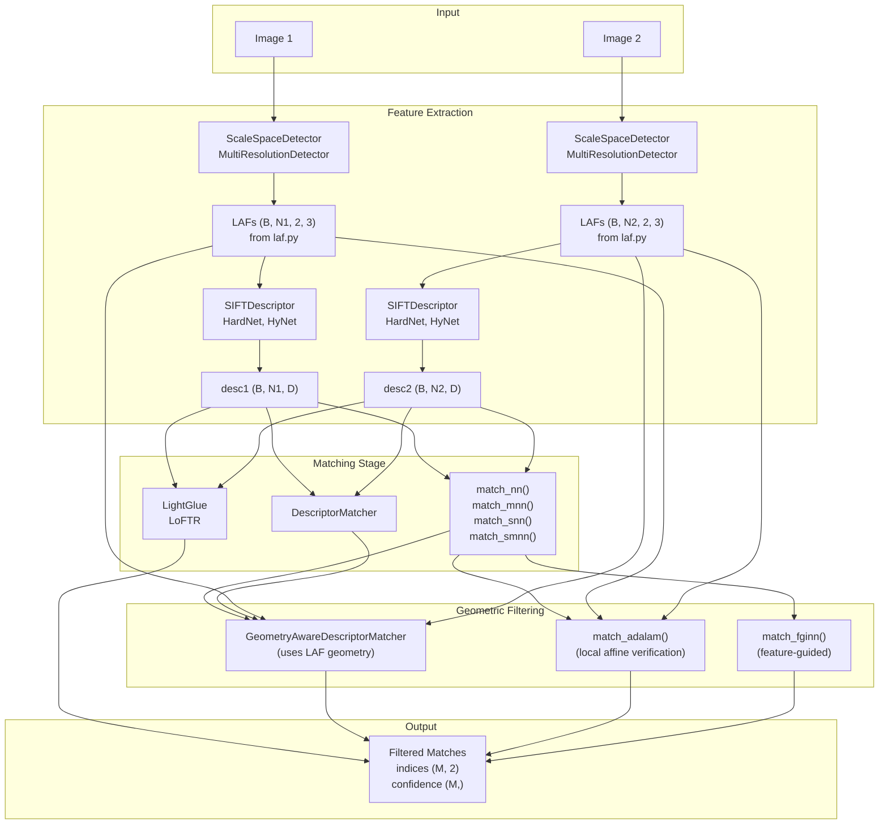

**Diagram: Complete Matching and Filtering Pipeline**

The pipeline shows how features flow from detection through matching to geometric filtering. LAFs (Local Affine Frames from [kornia/feature/laf.py]()) carry geometric information (position, scale, orientation) that geometric filtering methods use to reject spatially inconsistent matches. Classical matchers can be enhanced with geometric filtering, while learned matchers often incorporate geometric reasoning internally.

Sources: [kornia/feature/__init__.py:67-76](), [kornia/feature/laf.py:31-616](), [docs/source/feature.rst:191-227]()

## Classical Matching Functions

Kornia provides descriptor matching algorithms as functional APIs in [kornia/feature/matching.py](). These compare descriptors using distance metrics and apply filtering strategies to obtain reliable matches.

### Basic Nearest Neighbor Matching

| Function | Description | Input Shape | Output Shape |
|----------|-------------|-------------|--------------|
| `match_nn` | Nearest neighbor for each descriptor | desc1 (B,N1,D), desc2 (B,N2,D) | indices (B,N1,2) |
| `match_mnn` | Mutual nearest neighbor bidirectional consistency | desc1 (B,N1,D), desc2 (B,N2,D) | indices (B,M,2) |
| `match_snn` | Lowe's ratio test (dist1/dist2 < threshold) | desc1 (B,N1,D), desc2 (B,N2,D) | indices (B,M,2) |
| `match_smnn` | Symmetric mutual nearest neighbor + ratio test | desc1 (B,N1,D), desc2 (B,N2,D) | indices (B,M,2) |

### Geometric Filtering Functions

| Function | Description | Additional Input | Purpose |
|----------|-------------|------------------|---------|
| `match_fginn` | Feature-guided iterative nearest neighbor | - | Iterative refinement |
| `match_adalam` | Adaptive locally affine matching | LAFs (B,N,2,3) | Geometric verification |

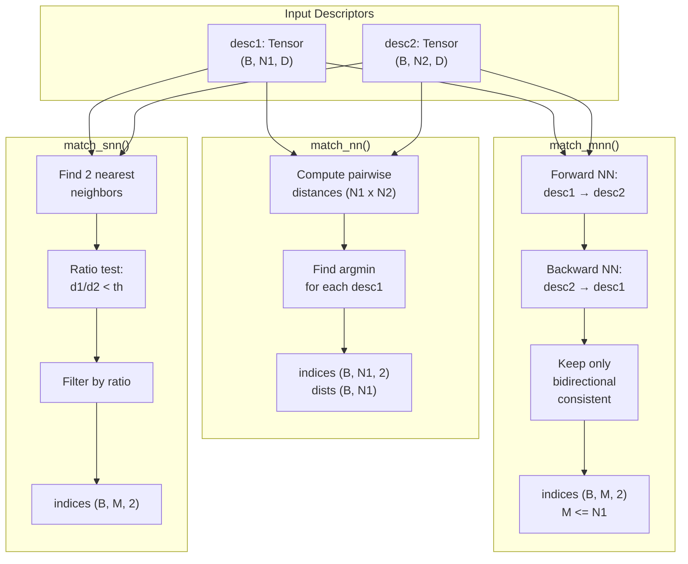

**Diagram: Classical Matching Function Implementations**

### Matching Function Details

**`match_nn(desc1, desc2)`** - Basic nearest neighbor search:
- Computes pairwise distance matrix between all descriptors
- For each descriptor in desc1, finds closest descriptor in desc2
- Returns all N1 matches (no filtering)
- Fast but produces many outliers

**`match_mnn(desc1, desc2)`** - Mutual nearest neighbor:
- Performs forward matching (desc1 → desc2) and backward matching (desc2 → desc1)
- Keeps only matches where both directions agree: match(i,j) kept if NN(desc1[i]) = desc2[j] AND NN(desc2[j]) = desc1[i]
- Significantly reduces false positives
- May reject valid matches if descriptor distributions are imbalanced

**`match_snn(desc1, desc2, th=0.8)`** - Lowe's ratio test:
- For each descriptor in desc1, finds 2 nearest neighbors in desc2
- Computes ratio: `r = dist(1st neighbor) / dist(2nd neighbor)`
- Accepts match only if `r < th` (typically 0.8)
- Filters ambiguous matches where multiple descriptors are similarly close
- Effective for distinctive features, less so for repetitive patterns

**`match_smnn(desc1, desc2, th=0.8)`** - Combined approach:
- Applies both mutual nearest neighbor constraint and ratio test
- Most conservative filtering, highest precision but lower recall

Sources: [kornia/feature/__init__.py:70-76](), [docs/source/feature.rst:194-199]()

## Geometric Filtering with LAF Information

### GeometryAwareDescriptorMatcher

`GeometryAwareDescriptorMatcher` extends `DescriptorMatcher` by incorporating geometric information from Local Affine Frames defined in [kornia/feature/laf.py:31-616]().

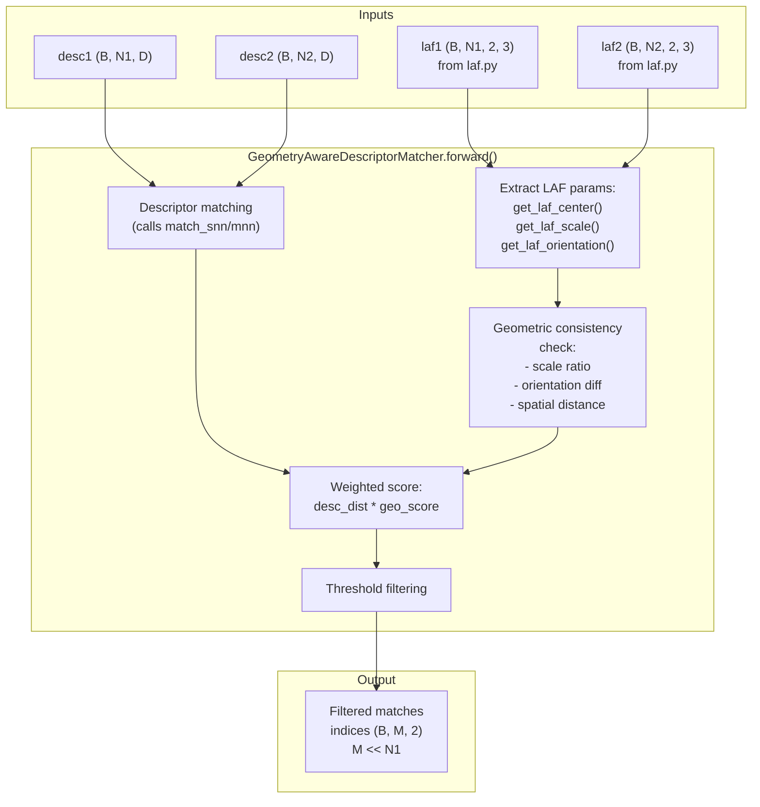

**Diagram: GeometryAwareDescriptorMatcher Implementation**

**LAF Geometric Parameters Used:**
- **Position**: `get_laf_center(LAF)` returns (B, N, 2) coordinates
- **Scale**: `get_laf_scale(LAF)` returns (B, N, 1, 1) scale factor
- **Orientation**: `get_laf_orientation(LAF)` returns (B, N, 1) angle in degrees

**Geometric Consistency Checks:**
1. **Scale consistency**: Reject matches where scale ratio is outside acceptable range (e.g., [0.5, 2.0])
2. **Orientation consistency**: Check if orientation difference is below threshold (e.g., 30 degrees)
3. **Spatial consistency**: Verify that matched features maintain consistent spatial relationships

This filtering is particularly effective for:
- Rejecting matches between features at vastly different scales
- Filtering matches with incompatible orientations
- Removing spatially inconsistent correspondences

Sources: [kornia/feature/__init__.py:69](), [kornia/feature/laf.py:31-89](), [docs/source/feature.rst:204-205]()

### AdaLAM: Adaptive Local Affine Matching

`match_adalam()` implements AdaLAM, which performs local affine geometric verification using LAF information.

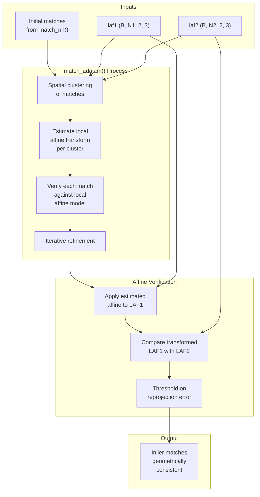

**Diagram: AdaLAM Local Affine Verification Process**

**AdaLAM Key Features:**
- Estimates local affine transformations in spatial neighborhoods
- Robust to non-rigid deformations and viewpoint changes
- Uses LAF parameters for transformation estimation via `perspective_transform_lafs()` from [kornia/feature/laf.py:548-616]()
- Iteratively refines match set by removing outliers
- More robust than global homography estimation for scenes with depth variation

Sources: [kornia/feature/__init__.py:73](), [kornia/feature/laf.py:548-616](), [docs/source/feature.rst:199]()

### DescriptorMatcher Module

`DescriptorMatcher` is a `torch.nn.Module` wrapper for classical matching functions.

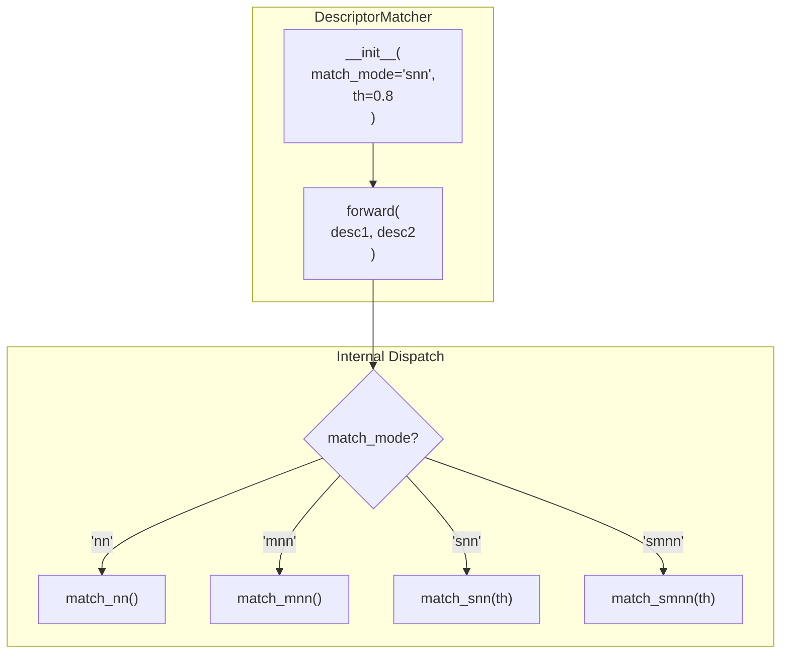

**Diagram: DescriptorMatcher Mode Dispatch**

The `DescriptorMatcher` class encapsulates matching logic in a `torch.nn.Module`, enabling:
- Integration into end-to-end trainable pipelines
- Batch processing support
- Configuration via initialization parameters
- Consistent interface with other Kornia modules

Sources: [kornia/feature/__init__.py:68](), [docs/source/feature.rst:201-202]()

## Learned Matching Models

Modern learned matchers use neural networks to find correspondences, either by learning better descriptor representations or by directly predicting match confidence.

### LightGlue

`LightGlue` is a lightweight learned feature matcher that operates on pre-computed keypoints and descriptors. It uses attention mechanisms to reason about feature relationships and predict match confidence.

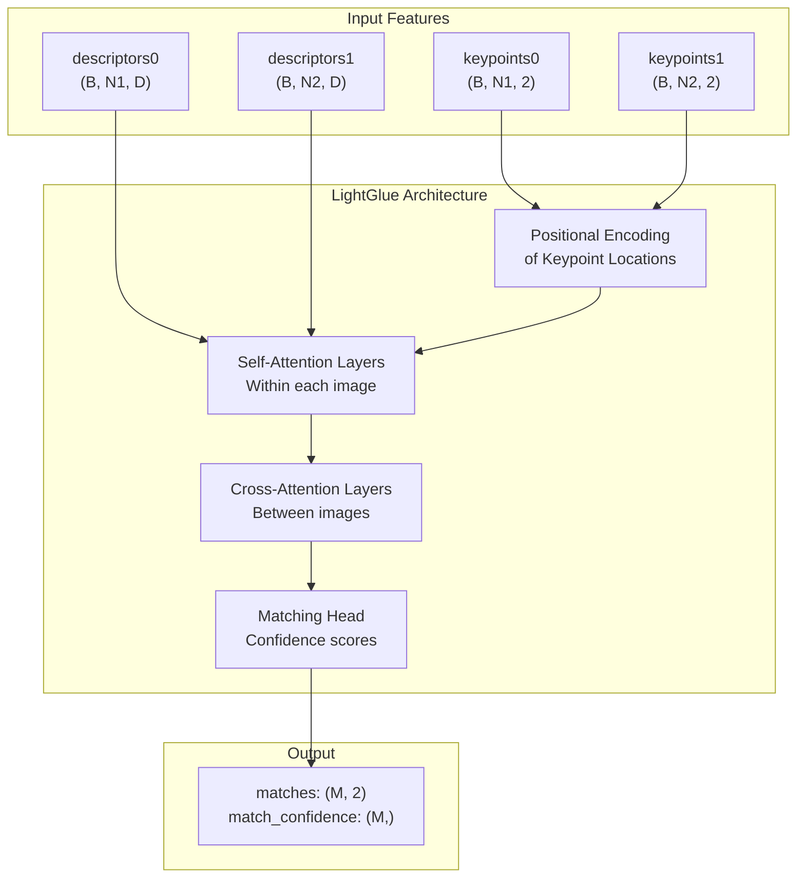

**Diagram: LightGlue Architecture**

LightGlue uses self-attention to refine features within each image, then cross-attention to match features between images. The attention mechanism allows the network to reason about relationships between features and suppress ambiguous or repetitive patterns.

**Key Features:**
- Works with any detector/descriptor (SIFT, SuperPoint, DISK, etc.)
- Adaptive depth - can exit early for easy image pairs
- Efficient attention mechanisms optimized for speed
- Outputs match confidence scores
- Supports both CPU and GPU inference

Sources: [kornia/feature/__init__.py:59-60](), [docs/source/feature.rst:213-214]()

### OnnxLightGlue

`OnnxLightGlue` provides an ONNX-exported version of LightGlue for deployment in production environments that require ONNX runtime.

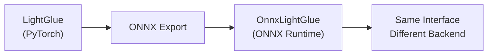

**Diagram: ONNX Export Path for LightGlue**

The ONNX version maintains the same input/output interface as the PyTorch version but runs on ONNX Runtime, which can be more efficient in certain deployment scenarios or on specialized hardware.

Sources: [kornia/feature/__init__.py:60-61](), [docs/source/feature.rst:225-226]()

### LoFTR

`LoFTR` (Local Feature TRansformer) is a detector-free matcher that establishes semi-dense correspondences directly from image pairs without explicit keypoint detection.

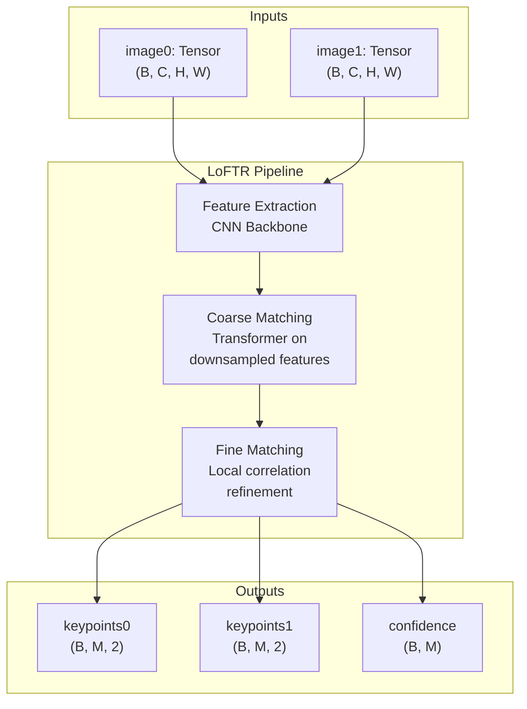

**Diagram: LoFTR Detector-Free Matching Pipeline**

**Key Characteristics:**
- **Detector-free**: Operates directly on image pairs without requiring pre-detected keypoints
- **Semi-dense**: Produces many correspondences across the image, not just at distinctive keypoints
- **Two-stage**: Coarse matching at low resolution followed by fine-grained refinement
- **Transformer-based**: Uses attention mechanisms to establish correspondences

**Coarse Matching Stage:**
1. Extract multi-scale features using a CNN backbone
2. Downsample features to a coarse resolution (e.g., 1/8 of original)
3. Apply linear attention between feature maps
4. Compute match confidence matrix and extract coarse correspondences

**Fine Matching Stage:**
1. For each coarse match, extract a local window from full-resolution features
2. Compute local correlation volume
3. Predict sub-pixel refinement using a small CNN
4. Output refined keypoint locations with confidence scores

LoFTR excels at matching textureless regions and repetitive structures where sparse keypoint detectors struggle.

Sources: [kornia/feature/__init__.py:61-62](), [docs/source/feature.rst:216-217]()

## High-Level Matching Interfaces

## High-Level Matching Interfaces

### LocalFeatureMatcher

`LocalFeatureMatcher` from [kornia/feature/__init__.py:36]() combines detection, description, and matching in a single `torch.nn.Module`.

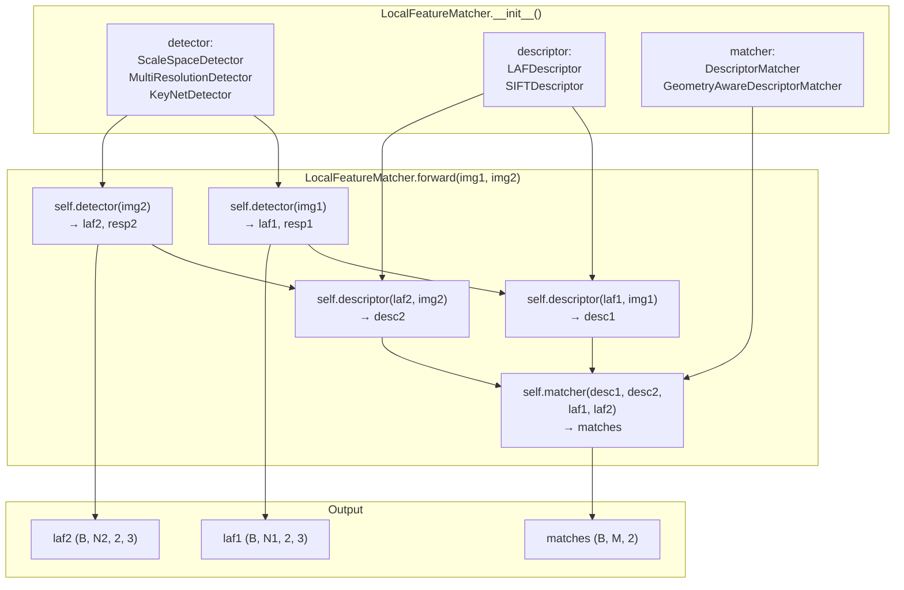

**Diagram: LocalFeatureMatcher Pipeline Orchestration**

**Usage:**
```python
from kornia.feature import (
    LocalFeatureMatcher, ScaleSpaceDetector,
    LAFDescriptor, HardNet, GeometryAwareDescriptorMatcher
)

# Configure complete pipeline
matcher = LocalFeatureMatcher(
    detector=ScaleSpaceDetector(num_features=1000),
    descriptor=LAFDescriptor(HardNet()),
    matcher=GeometryAwareDescriptorMatcher('snn', th=0.85)
)

# Run end-to-end
laf1, laf2, matches = matcher(img1, img2)
```

The `LocalFeatureMatcher` manages component coordination and ensures compatible data flow between detection, description, and matching stages.

Sources: [kornia/feature/__init__.py:36](), [docs/source/feature.rst:207-208]()

### LightGlueMatcher

`LightGlueMatcher` is a specialized high-level interface that pairs a feature detector with the LightGlue learned matcher.

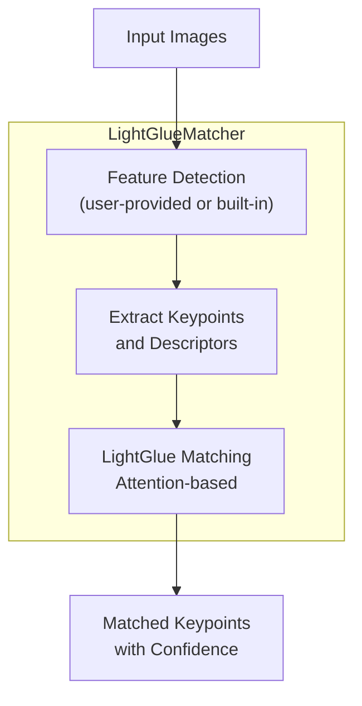

**Diagram: LightGlueMatcher Pipeline**

This interface is optimized for use with LightGlue and provides a streamlined API for detector + LightGlue matching workflows. It handles the conversion between different feature representations and ensures compatibility between detector output and LightGlue input requirements.

Sources: [kornia/feature/__init__.py:30-31](), [docs/source/feature.rst:210-211]()

## Integration with Detection and Description

Feature matching is the final stage in the local feature pipeline, building on detection and description:

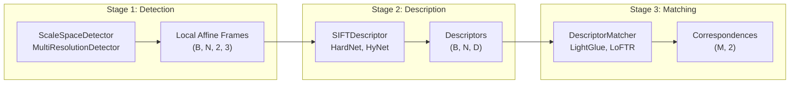

**Diagram: Three-Stage Feature Pipeline**

**LAF Integration:**
- LAFs from detection ([kornia/feature/laf.py:31-616]()) define the local coordinate frames for descriptor computation
- `extract_patches_from_pyramid` uses LAFs to sample normalized patches at appropriate scales
- Geometry-aware matching uses LAF parameters (scale, orientation) for geometric consistency checks

**Descriptor Integration:**
- Patch descriptors like SIFT ([kornia/feature/siftdesc.py:93-202]()) require normalized patches extracted using LAFs
- Learned descriptors (HardNet, HyNet) operate on patches extracted at LAF locations
- Descriptor dimensionality (typically 128 or 256) must match between images for matching

**Matching Output:**
- Match indices reference the original feature indices from detection
- Confidence scores indicate reliability of each match
- Output can be used for geometric estimation (homography, fundamental matrix)

Sources: [kornia/feature/scale_space_detector.py:72-263](), [kornia/feature/laf.py:404-489](), [kornia/feature/siftdesc.py:93-202]()

## Workflow Examples

### Pattern 1: Classical Matching with Geometric Filtering

```python
from kornia.feature import (
    ScaleSpaceDetector, SIFTDescriptor, 
    match_snn, match_adalam,
    get_laf_descriptors
)

# Detect features with LAFs containing geometric info
detector = ScaleSpaceDetector(num_features=1000)
laf1, resp1 = detector(img1)  # (1, N1, 2, 3)
laf2, resp2 = detector(img2)  # (1, N2, 2, 3)

# Compute descriptors
descriptor = SIFTDescriptor(patch_size=41)
desc1 = get_laf_descriptors(img1, laf1, descriptor)  # (1, N1, 128)
desc2 = get_laf_descriptors(img2, laf2, descriptor)  # (1, N2, 128)

# Match with ratio test
initial_matches = match_snn(desc1, desc2, th=0.8)  # (1, M, 2)

# Apply geometric filtering with AdaLAM
filtered_matches = match_adalam(
    desc1, desc2, laf1, laf2, 
    config={'ransac_iters': 1000}
)  # (1, M', 2) where M' < M
```

This pattern demonstrates the complete pipeline from detection through geometric filtering. LAFs provide the geometric context needed for robust filtering.

### Pattern 2: Geometry-Aware Matcher Module

```python
from kornia.feature import (
    KeyNetDetector, LAFDescriptor, HardNet,
    GeometryAwareDescriptorMatcher
)

# Detect with KeyNet
detector = KeyNetDetector(num_features=2048)
laf1, _ = detector(img1)
laf2, _ = detector(img2)

# Describe with HardNet
descriptor = LAFDescriptor(HardNet())
desc1 = descriptor(laf1, img1)
desc2 = descriptor(laf2, img2)

# Geometry-aware matching (uses LAF scale, orientation)
geo_matcher = GeometryAwareDescriptorMatcher(
    match_mode='snn',
    th=0.9,
    geometric_threshold=0.1
)
matches = geo_matcher(desc1, desc2, laf1, laf2)
```

The `GeometryAwareDescriptorMatcher` automatically incorporates LAF geometric information into the matching process.

### Pattern 3: Learned Matcher (No Explicit LAFs)

```python
from kornia.feature import LoFTR

# Detector-free matching
loftr = LoFTR(pretrained='outdoor')
result = loftr({'image0': img1, 'image1': img2})

kp0 = result['keypoints0']  # (M, 2)
kp1 = result['keypoints1']  # (M, 2)
confidence = result['confidence']  # (M,)

# LoFTR internally handles geometric reasoning
# No explicit LAFs, but transformer attention captures spatial relationships
```

Learned matchers like LoFTR use attention mechanisms to implicitly reason about geometry without requiring explicit LAF representations.

Sources: [kornia/feature/__init__.py:29-90](), [kornia/feature/laf.py:404-489]()

## Performance Considerations

### Computational Complexity

| Method | Complexity | Best Use Case |
|--------|------------|---------------|
| `match_nn` | O(N1 × N2 × D) | Fast, baseline matching |
| `match_mnn` | O(N1 × N2 × D) | Bidirectional consistency |
| `match_snn` | O(N1 × N2 × D × log(N2)) | Robust to ambiguous features |
| `LightGlue` | O((N1 + N2) × d²) with attention | Medium-sized feature sets (100-1000s) |
| `LoFTR` | O(H × W) for coarse stage | Dense matching, textureless scenes |

**Memory Usage:**
- Classical matchers: Low memory, only store distance matrices temporarily
- LightGlue: Moderate memory for attention mechanisms
- LoFTR: Higher memory due to transformer operations on dense features

**Speed Optimizations:**
- Use GPU acceleration for all neural network-based matchers
- Consider `OnnxLightGlue` for deployment where ONNX Runtime provides better performance
- For large feature sets (>10K), consider hierarchical or spatial hashing approaches
- Pre-filter features by spatial proximity if scene constraints are known

### Accuracy vs Speed Trade-offs

**For highest accuracy:**
- Use learned matchers (LightGlue, LoFTR) with pre-trained weights
- Combine with geometric verification (RANSAC)
- Use `match_adalam` for robust geometric consistency

**For fastest matching:**
- Use `match_nn` or `match_mnn` with GPU-accelerated distance computation
- Reduce number of features detected
- Use lower-dimensional descriptors

**Balanced approach:**
- Use `match_snn` with appropriate ratio threshold (0.8-0.9)
- Combine with lightweight geometric filtering
- Scale number of features based on image resolution

Sources: [kornia/feature/__init__.py:62-71](), [docs/source/feature.rst:33-103]()

## Geometric Verification

Feature matches often contain outliers. Geometric verification estimates a transformation model (homography, fundamental matrix) using RANSAC or similar robust methods to filter incorrect matches.

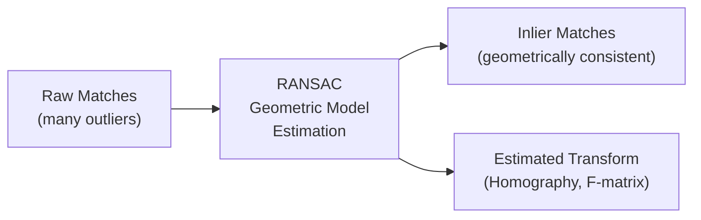

**Diagram: Geometric Verification Workflow**

While Kornia's geometry module provides transformation estimation tools, `match_adalam` integrates geometric verification directly into the matching process, making it robust to viewpoint changes and non-rigid deformations.

Sources: [kornia/feature/__init__.py:68-69](), [docs/source/feature.rst:199]()

---

