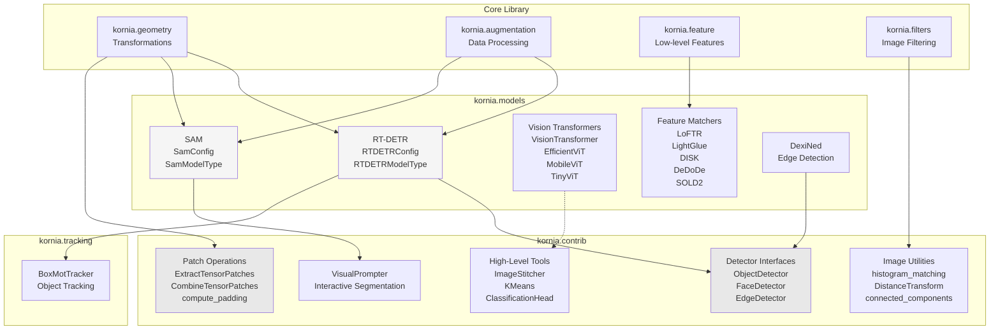
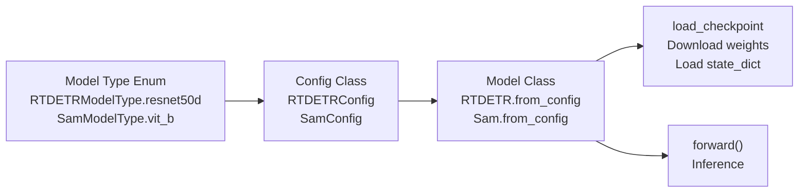
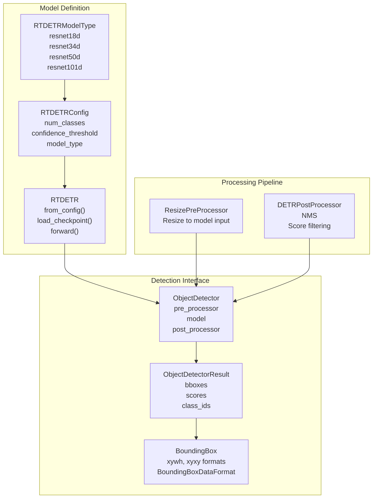
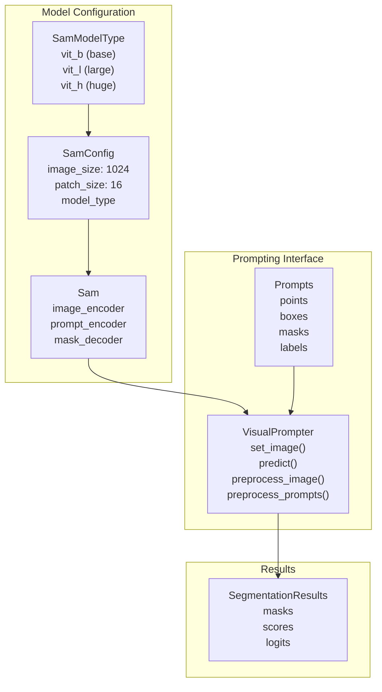
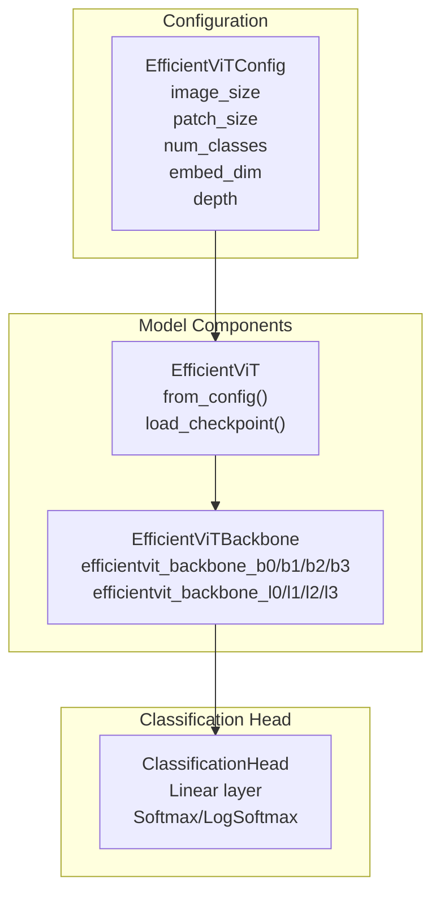
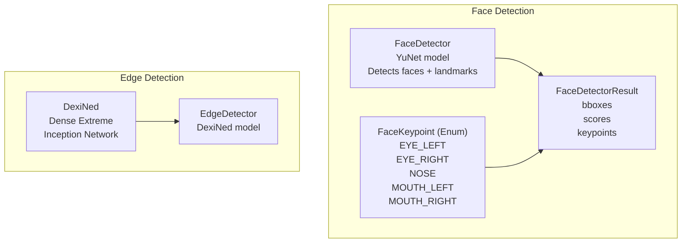
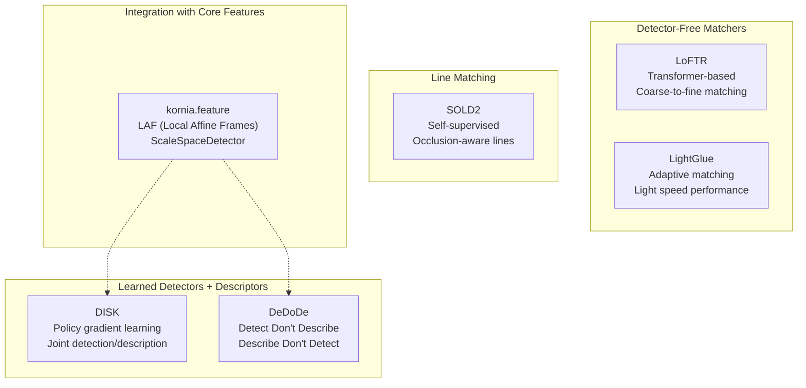
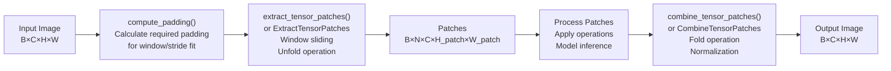
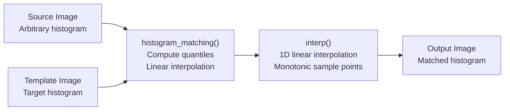
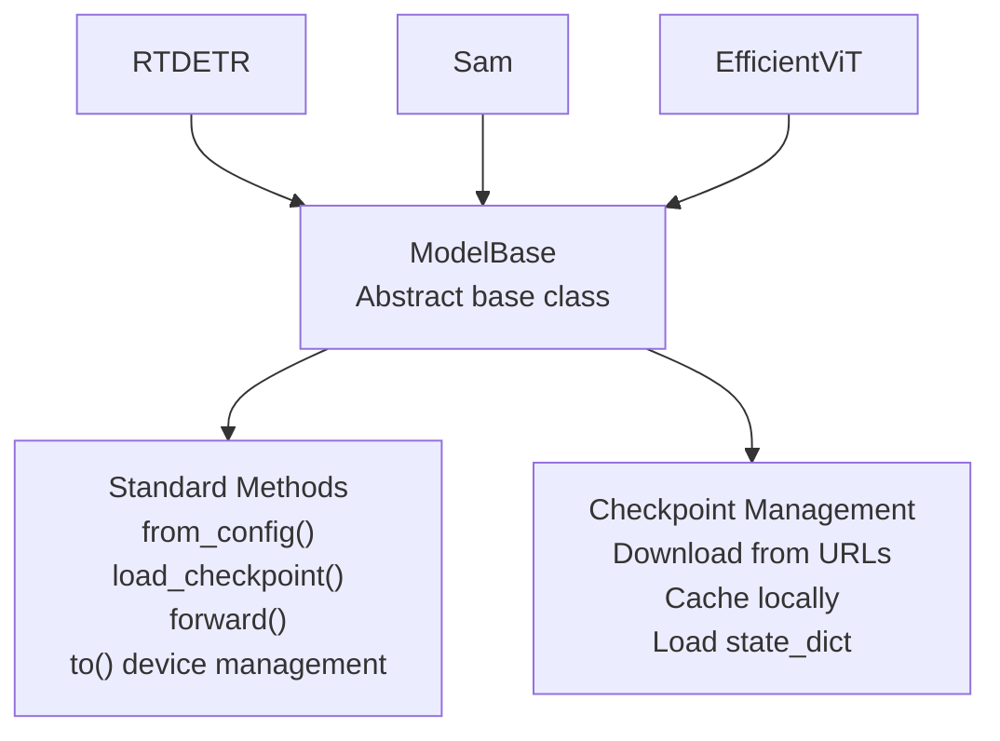

<!-- source: DeepWiki mcp.deepwiki.com · repo kornia/kornia · page 6 Models and Applications (contrib) · fetched 2026-10-21 -->

# Models and Applications

<details>
<summary>Relevant source files</summary>

The following files were used as context for generating this wiki page:

- [docs/source/contrib.rst](docs/source/contrib.rst)
- [docs/source/references.bib](docs/source/references.bib)
- [kornia/contrib/__init__.py](kornia/contrib/__init__.py)
- [kornia/contrib/histogram_matching.py](kornia/contrib/histogram_matching.py)
- [kornia/contrib/models/rt_detr/__init__.py](kornia/contrib/models/rt_detr/__init__.py)
- [kornia/contrib/models/rt_detr/architecture/__init__.py](kornia/contrib/models/rt_detr/architecture/__init__.py)

</details>


## Purpose and Scope

This page documents the high-level models and application utilities in Kornia, primarily housed in the `kornia.contrib` and `kornia.models` modules. These components provide pre-trained models for computer vision tasks (detection, segmentation, classification, feature matching) and utilities for common image processing operations (patch extraction, histogram matching, distance transforms, image stitching).

For low-level feature detection and description primitives, see [Feature Detection and Description](#5). For data augmentation operations, see [Data Augmentation System](#6). For loss functions used to train these models, see [Loss Functions](#8).

**Sources:** [docs/source/contrib.rst:1-210]()

---

## Architecture Overview

The models and applications layer provides two main categories of functionality:

1. **Pre-trained Models** (`kornia.models`): Complete neural network models for specific tasks, including RT-DETR for object detection, SAM for segmentation, Vision Transformers for classification, and learned feature matchers (LoFTR, LightGlue, DISK, DeDoDe, SOLD2).

2. **Application Utilities** (`kornia.contrib`): Reusable components and wrappers including standardized detector interfaces (`ObjectDetector`, `FaceDetector`, `EdgeDetector`), patch processing operations, image utilities (histogram matching, distance transform, connected components), and higher-level tools (ImageStitcher, KMeans clustering).

### Module Organization



**Sources:** [kornia/contrib/__init__.py:1-62](), [docs/source/contrib.rst:1-210]()

---

## Pre-trained Model Architecture

All pre-trained models in Kornia follow a consistent design pattern with three key components:

| Component | Purpose | Example Classes |
|-----------|---------|-----------------|
| **Config Classes** | Define model hyperparameters and architecture variants | `RTDETRConfig`, `SamConfig`, `EfficientViTConfig` |
| **Model Types** | Enumerate available pre-trained checkpoints | `RTDETRModelType`, `SamModelType` (enums) |
| **Model Classes** | Neural network implementation with checkpoint loading | `RTDETR`, `Sam`, `EfficientViT` |

### Model Instantiation Pattern



**Sources:** [docs/source/contrib.rst:125-166]()

---

## Object Detection

### RT-DETR (Real-Time Detection Transformer)

RT-DETR is a transformer-based object detector that provides real-time detection performance. Kornia's implementation includes multiple backbone variants and a standardized interface.

#### RT-DETR Components



**Key Classes:**
- **`RTDETRModelType`**: Enumeration of available model variants (resnet18d, resnet34d, resnet50d, resnet101d)
- **`RTDETRConfig`**: Configuration specifying model architecture, number of classes, confidence threshold
- **`RTDETR`**: Main model class implementing the detection transformer
- **`ObjectDetector`**: Generic detector interface that wraps pre-processor, model, and post-processor
- **`DETRPostProcessor`**: Post-processing including NMS and confidence filtering
- **`BoundingBoxDataFormat`**: Enum specifying XYXY, XYWH, CXCYWH formats

**Sources:** [docs/source/contrib.rst:98-144](), [docs/source/references.bib:2-7]()

---

## Segmentation Models

### SAM (Segment Anything Model)

SAM provides interactive segmentation with visual prompts (points, boxes, masks). Kornia implements SAM with support for multiple model sizes and a user-friendly prompting interface.

#### SAM Architecture



**Key Classes:**
- **`SamModelType`**: Enumeration of model sizes (vit_b, vit_l, vit_h corresponding to base, large, huge)
- **`SamConfig`**: Configuration with image size (1024x1024), patch size, and encoder parameters
- **`Sam`**: Main model with image encoder (ViT), prompt encoder, and mask decoder components
- **`VisualPrompter`**: High-level interface for interactive segmentation
  - `set_image()`: Precompute image embeddings
  - `predict()`: Generate masks from prompts
  - `preprocess_prompts()`: Convert prompts to model format
- **`Prompts`**: Dataclass containing point coordinates, bounding boxes, mask inputs, and labels
- **`SegmentationResults`**: Output containing predicted masks, confidence scores, and raw logits

**Sources:** [docs/source/contrib.rst:65-70](), [docs/source/contrib.rst:150-166]()

---

## Vision Transformers and Classification

Kornia provides multiple Vision Transformer architectures optimized for different use cases:

### Available Architectures

| Model | Key Features | Use Case |
|-------|--------------|----------|
| **`VisionTransformer`** | Standard ViT implementation | General classification |
| **`EfficientViT`** | Hardware-efficient design with sandwich layout | Edge devices, mobile |
| **`MobileViT`** | MobileNet + Transformer hybrid | Mobile applications |
| **`TinyViT`** | Lightweight variant with hierarchical structure | Resource-constrained environments |

### EfficientViT Structure



**Key Classes:**
- **`EfficientViTConfig`**: Configuration for model architecture (image size, patch size, embedding dimensions, depth)
- **`EfficientViT`**: Main model class with `from_config()` factory method and checkpoint loading
- **`EfficientViTBackbone`**: Feature extraction backbone available in multiple sizes (b0-b3 for base, l0-l3 for large)
- **`EfficientViTLargeBackbone`**: Large variant optimized for higher capacity
- **`ClassificationHead`**: Final classification layer with configurable output dimensions

**Backbone Variants:**
- `efficientvit_backbone_b0()`, `b1()`, `b2()`, `b3()`: Base variants with increasing capacity
- `efficientvit_backbone_l0()`, `l1()`, `l2()`, `l3()`: Large variants for higher accuracy

**Sources:** [docs/source/contrib.rst:19-51](), [docs/source/contrib.rst:178-186](), [docs/source/references.bib:2-7]()

---

## Face and Edge Detection

### Face Detection Interface



**Face Detection Components:**
- **`FaceDetector`**: Wraps YuNet face detection model
  - Detects face bounding boxes
  - Localizes 5 facial keypoints (eyes, nose, mouth corners)
- **`FaceKeypoint`**: Enumeration defining landmark types
  - `EYE_LEFT`, `EYE_RIGHT`: Eye centers
  - `NOSE`: Nose tip
  - `MOUTH_LEFT`, `MOUTH_RIGHT`: Mouth corners
- **`FaceDetectorResult`**: Detection output with bounding boxes, confidence scores, and keypoint coordinates

**Edge Detection Components:**
- **`EdgeDetector`**: Interface for edge detection
- **`DexiNed`**: Dense Extreme Inception Network for robust CNN-based edge detection
  - Multi-scale edge detection
  - Handles diverse edge types (object boundaries, texture edges)

**Sources:** [docs/source/contrib.rst:71-97](), [docs/source/references.bib:177-199]()

---

## Feature Matching Models

Kornia provides state-of-the-art learned feature matching models that build on the low-level feature primitives described in [Feature Detection and Description](#5).

### Feature Matching Model Hierarchy



**Model Descriptions:**

- **`LoFTR`** (Local Feature Matching with Transformers)
  - Detector-free matching using transformer architecture
  - Coarse-to-fine matching strategy
  - Produces dense correspondences without explicit keypoint detection
  - Reference: [docs/source/references.bib:135-140]()

- **`LightGlue`**
  - Fast adaptive matching optimized for inference speed
  - Works with various feature types
  - Early termination for efficiency
  - Reference: [docs/source/references.bib:51-58]()

- **`DISK`** (Differentiable Interest-point and descriptor using policy gradient)
  - End-to-end trainable detector and descriptor
  - Learned with policy gradient methods
  - Joint optimization of detection and description
  - Reference: [docs/source/references.bib:319-326]()

- **`DeDoDe`** (Detect, Don't Describe - Describe, Don't Detect)
  - Decouples detection and description
  - Specialized components for each task
  - Improved performance through task separation
  - Reference: [docs/source/references.bib:328-333]()

- **`SOLD2`** (Self-supervised Occlusion-aware Line Description and Detection)
  - Line segment detection and matching
  - Self-supervised training approach
  - Handles occlusions robustly
  - Reference: [docs/source/references.bib:201-206]()

**Sources:** [docs/source/references.bib:51-58](), [docs/source/references.bib:135-140](), [docs/source/references.bib:319-333]()

---

## Patch Operations

The patch extraction and combination utilities enable patch-based processing workflows, essential for handling large images, implementing sliding-window algorithms, and creating patch-based augmentation pipelines.

### Patch Processing Pipeline



### Core Functions and Classes

**Functional API:**
- **`compute_padding(original_size, window_size, stride)`**: [kornia/contrib/extract_patches.py:53-118]()
  - Calculates padding required to ensure window and stride evenly divide image dimensions
  - Returns tuple of (top, bottom, left, right) padding values
  - Enables perfect reconstruction when chaining extract and combine operations

- **`extract_tensor_patches(input, window_size, stride, padding, allow_auto_padding)`**: [kornia/contrib/extract_patches.py:434-498]()
  - Extracts overlapping or non-overlapping patches from input tensor
  - Uses `torch.Tensor.unfold()` for efficient extraction
  - Input shape: `(B, C, H, W)` → Output shape: `(B, N, C, H_patch, W_patch)`
  - `allow_auto_padding=True` automatically computes and applies padding

- **`combine_tensor_patches(patches, original_size, window_size, stride, unpadding, allow_auto_unpadding)`**: [kornia/contrib/extract_patches.py:314-422]()
  - Reconstructs image from patches using `torch.nn.functional.fold()`
  - Handles overlapping patches by averaging overlapping regions
  - Creates normalization map to correctly weight overlapping pixels
  - Removes padding if `unpadding` or `allow_auto_unpadding` specified

**Module API:**
- **`ExtractTensorPatches`**: [kornia/contrib/extract_patches.py:121-205]()
  - `nn.Module` wrapper for `extract_tensor_patches()`
  - Stores window_size, stride, padding as module parameters
  - Enables integration into `nn.Sequential` pipelines

- **`CombineTensorPatches`**: [kornia/contrib/extract_patches.py:207-298]()
  - `nn.Module` wrapper for `combine_tensor_patches()`
  - Stores original_size, window_size, stride, unpadding as parameters
  - Paired with `ExtractTensorPatches` for end-to-end patch processing

### Usage Pattern

The typical workflow ensures perfect reconstruction:

```python
# Step 1: Compute padding for perfect tiling
padding = compute_padding(original_size=(H, W), window_size=(32, 32), stride=(32, 32))

# Step 2: Extract patches with computed padding
patches = extract_tensor_patches(image, window_size=(32, 32), stride=(32, 32), padding=padding)
# Shape: (B, N, C, 32, 32) where N = number of patches

# Step 3: Process patches independently
processed_patches = model(patches)

# Step 4: Reconstruct with matching unpadding
output = combine_tensor_patches(
    processed_patches, 
    original_size=(H, W), 
    window_size=(32, 32), 
    stride=(32, 32),
    unpadding=padding
)
# Shape: (B, C, H, W) - original dimensions restored
```

**Sources:** [kornia/contrib/extract_patches.py:1-499](), [docs/source/contrib.rst:167-176]()

---

## Image Utilities

### Histogram Matching

Histogram matching adjusts pixel value distributions to match a reference image's histogram. This technique is useful for color transfer, style matching, and dataset normalization.



**Implementation:**
- **`histogram_matching(source, template)`**: [kornia/contrib/histogram_matching.py:21-61]()
  - Computes cumulative distribution functions (CDFs) for source and template
  - Maps source quantiles to template quantiles via linear interpolation
  - Operates on flattened tensors (not element-wise for batched inputs)
  - Returns transformed image with same shape as source

- **`interp(x, xp, fp)`**: [kornia/contrib/histogram_matching.py:64-85]()
  - One-dimensional piecewise linear interpolation
  - Monotonically increasing sample points
  - Uses `torch.searchsorted()` and linear blending
  - Helper function for histogram_matching

### Distance Transform

The distance transform computes the distance from each pixel to the nearest boundary pixel, useful for morphological operations and segmentation post-processing.

**Components:**
- **`DistanceTransform`**: Module for computing distance transforms
- **`distance_transform()`**: Functional API
- Uses fast convolutional distance transform algorithm
- References: [docs/source/references.bib:208-226]()

### Connected Components

Connected component labeling identifies and labels distinct regions in binary images.

**Function:**
- **`connected_components()`**: Labels connected regions in binary masks
- Essential for instance segmentation post-processing

**Sources:** [kornia/contrib/histogram_matching.py:1-86](), [docs/source/contrib.rst:146-204]()

---

## Image Stitching and Clustering

### ImageStitcher

The `ImageStitcher` class provides panorama creation by stitching multiple overlapping images. It leverages Kornia's geometry transformations and feature matching.

**Workflow:**
1. Extract features from input images (uses [Feature Detection and Description](#5))
2. Match features across images (uses feature matchers described above)
3. Estimate homographies between image pairs
4. Warp images to common coordinate frame (uses [Image Warping Operations](#2.2))
5. Blend warped images to create seamless panorama

### KMeans Clustering

The `KMeans` class implements K-means clustering for feature vectors, useful for color quantization, feature clustering, and image segmentation.

**Key Methods:**
- Initialization strategies (random, k-means++)
- Iterative centroid updates
- Distance computation using PyTorch operations
- GPU acceleration support

**Sources:** [docs/source/contrib.rst:187-209]()

---

## Object Tracking

The `kornia.tracking` module provides multi-object tracking capabilities built on detection results.

### BoxMotTracker


**Key Features:**
- Motion-based tracking using bounding box motion models
- Associates detections across frames to maintain track IDs
- Handles track creation, update, and deletion
- Integrates with `ObjectDetector` output format

**Sources:** Architecture overview from high-level diagrams

---

## Model Base Classes

All models inherit from a common base class providing standardized functionality:

### ModelBase



**Key Responsibilities:**
- **`from_config(config)`**: Factory method for instantiating models from configuration objects
- **`load_checkpoint(path_or_url)`**: Loads pre-trained weights from local path or remote URL
- **`forward()`**: Abstract method implemented by subclasses for inference
- Device management: Standard PyTorch `.to(device)` and `.cuda()` support

**Sources:** [docs/source/contrib.rst:13-17]()

---

## External Integration

### ONNX Export

Models can be exported to ONNX format for deployment in production environments.

**Features:**
- `ONNXSequential`: Chains multiple operations into exportable graph
- Maintains differentiability where applicable
- Supports model optimization and quantization

### Multi-Framework Compatibility

Through Ivy transpilation, Kornia models and operations can be used with:
- TensorFlow/Keras
- JAX/Flax
- NumPy (for prototyping)

This enables cross-framework workflows and deployment flexibility.

**Sources:** Architecture overview from high-level diagrams

---

## Summary

The models and applications layer provides:

1. **Pre-trained Models**: RT-DETR, SAM, Vision Transformers, feature matchers, edge detection
2. **Standardized Interfaces**: ObjectDetector, FaceDetector, EdgeDetector, VisualPrompter
3. **Patch Processing**: ExtractTensorPatches, CombineTensorPatches, compute_padding
4. **Image Utilities**: histogram_matching, DistanceTransform, connected_components
5. **High-Level Tools**: ImageStitcher, KMeans, ClassificationHead

All components integrate with Kornia's core library ([Geometry and Transformations](#2), [Data Augmentation](#6), [Feature Detection](#5)) and support PyTorch's differentiable computation model for end-to-end training and deployment.

---

