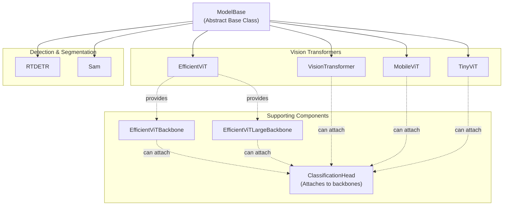
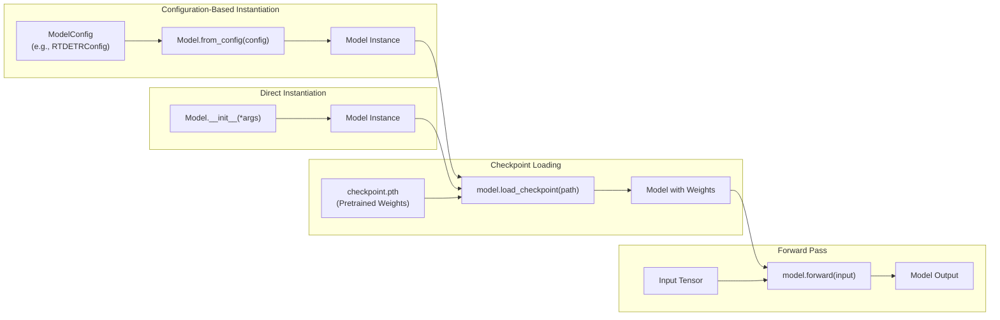
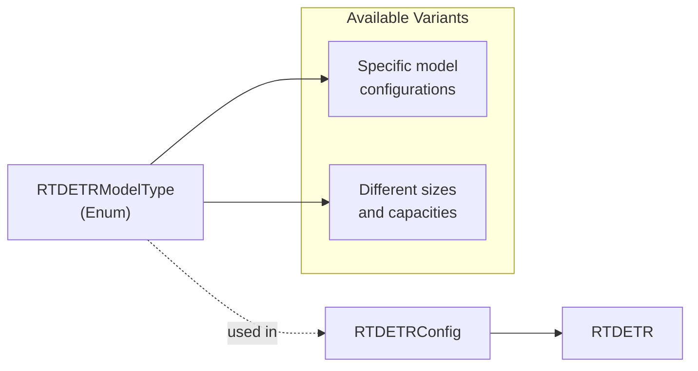
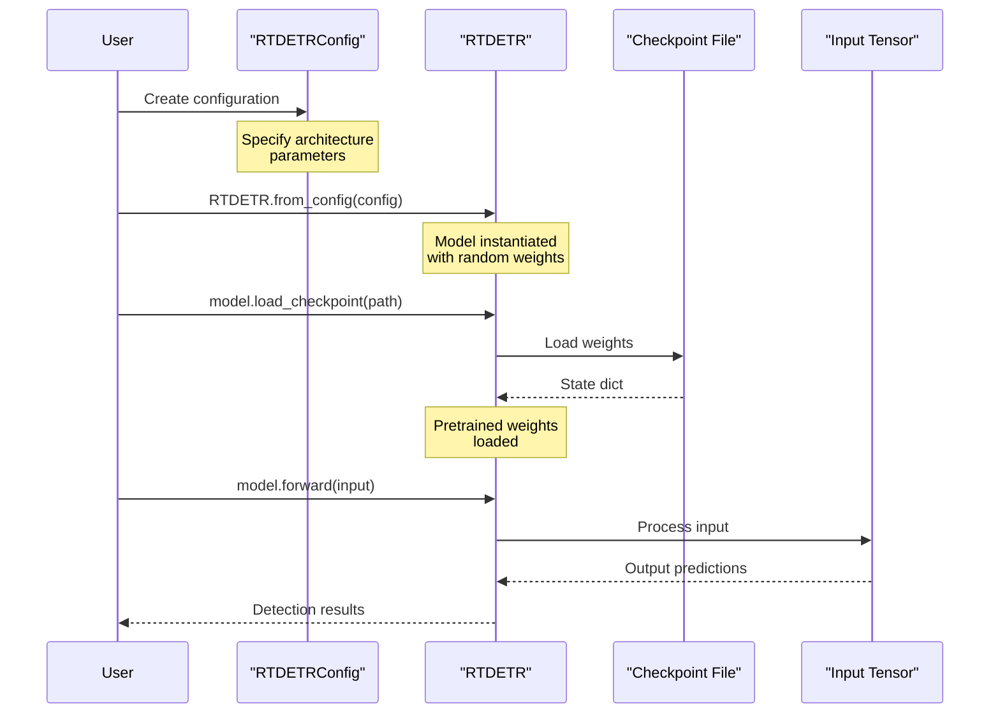
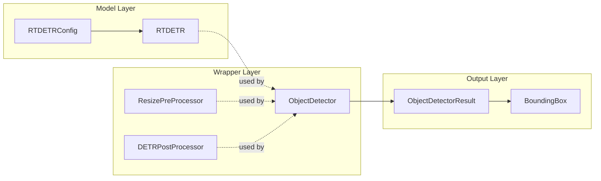
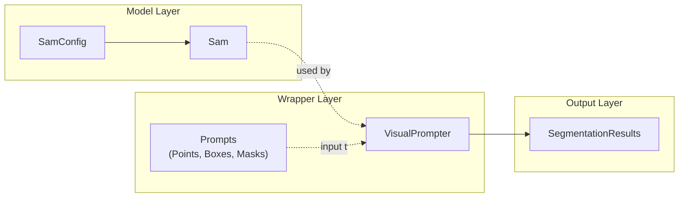
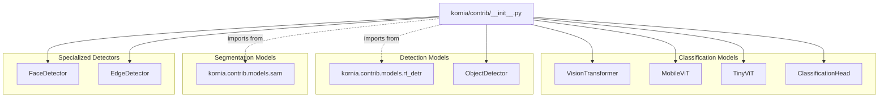

<!-- source: DeepWiki mcp.deepwiki.com · repo kornia/kornia · page 6.1 Model Base Classes and Configuration · fetched 2026-10-21 -->

# Model Base Classes and Configuration

<details>
<summary>Relevant source files</summary>

The following files were used as context for generating this wiki page:

- [docs/source/contrib.rst](docs/source/contrib.rst)
- [docs/source/references.bib](docs/source/references.bib)
- [kornia/contrib/__init__.py](kornia/contrib/__init__.py)
- [kornia/contrib/histogram_matching.py](kornia/contrib/histogram_matching.py)
- [kornia/contrib/models/rt_detr/__init__.py](kornia/contrib/models/rt_detr/__init__.py)
- [kornia/contrib/models/rt_detr/architecture/__init__.py](kornia/contrib/models/rt_detr/architecture/__init__.py)

</details>


## Purpose and Scope

This document describes the base class architecture and configuration patterns used by deep learning models in the `kornia.contrib` module. It covers the `ModelBase` interface, configuration classes, and instantiation patterns that provide a consistent API across different model architectures including Vision Transformers, RT-DETR, SAM, and others.

For information about specific model implementations (Vision Transformers, RT-DETR, etc.), see [Vision Transformers (ViT, EfficientViT, MobileViT)](#6.2), [Object Detection with RT-DETR](#6.3), and [Segmentation with SAM](#6.4). For face and edge detection utilities, see [Face and Edge Detection](#6.5).

**Sources:** [docs/source/contrib.rst:1-210](), [kornia/contrib/__init__.py:1-67]()

---

## ModelBase Interface

The `ModelBase` class serves as the abstract base class for all deep learning models in `kornia.contrib`. It establishes a consistent interface that all models must implement, ensuring predictable instantiation, checkpoint loading, and forward pass behavior.

### Core Methods

All models inheriting from `ModelBase` must implement three core methods:

| Method | Type | Purpose |
|--------|------|---------|
| `from_config(config)` | Class method | Instantiate model from configuration object |
| `forward(...)` | Instance method | Perform forward pass (model-specific signature) |
| `load_checkpoint(path)` | Instance method | Load pretrained weights from checkpoint file |

The `ModelBase` interface does not prescribe a specific `__init__` signature, allowing each model to define its own initialization parameters. However, the `from_config` pattern provides a standardized alternative constructor.

**Sources:** [docs/source/contrib.rst:13-17]()

---

## Model Inheritance Hierarchy

The following diagram shows the class hierarchy with actual model implementations in Kornia:



**Sources:** [docs/source/contrib.rst:10-186](), [kornia/contrib/__init__.py:23-43]()

---

## Configuration Classes

Each model in `kornia.contrib` has an associated configuration class that encapsulates all hyperparameters and architectural choices. Configuration classes follow a naming convention: `{ModelName}Config`.

### Configuration Class Examples

| Model | Configuration Class | Documentation Reference |
|-------|---------------------|------------------------|
| EfficientViT | `EfficientViTConfig` | [docs/source/contrib.rst:28-30]() |
| RT-DETR | `RTDETRConfig` | [docs/source/contrib.rst:133-135]() |
| SAM | `SamConfig` | [docs/source/contrib.rst:158-160]() |

Configuration classes are typically Python dataclasses or simple objects that store:
- Architecture parameters (layer dimensions, number of blocks, etc.)
- Model variant selection (e.g., `RTDETRModelType`, `SamModelType`)
- Training-related settings (dropout rates, normalization choices)
- Input/output specifications

**Sources:** [docs/source/contrib.rst:28-30](), [docs/source/contrib.rst:133-135](), [docs/source/contrib.rst:158-160]()

---

## Model Instantiation Patterns

Kornia models support two primary instantiation patterns: direct construction via `__init__` and configuration-based construction via `from_config`.

### Instantiation Flow Diagram



**Sources:** [docs/source/contrib.rst:22-25](), [docs/source/contrib.rst:138-140](), [docs/source/contrib.rst:163-165]()

---

## The from_config Pattern

The `from_config` class method provides a factory pattern for model instantiation, separating configuration from construction logic.

### Method Signature Pattern

```python
@classmethod
def from_config(cls, config: ModelConfig) -> Model:
    """Instantiate model from configuration object."""
```

### Benefits

1. **Separation of Concerns**: Configuration objects can be serialized, versioned, and shared independently of model code
2. **Reproducibility**: Complete model specification in a single configuration object
3. **Flexibility**: Easy to create model variants by modifying config objects
4. **Consistency**: Uniform instantiation interface across all model types

### Usage Pattern

The typical workflow involves:
1. Create or load a configuration object (e.g., `RTDETRConfig`, `SamConfig`)
2. Call `Model.from_config(config)` to instantiate the model
3. Optionally call `model.load_checkpoint(path)` to load pretrained weights
4. Use `model.forward(input)` for inference

**Sources:** [docs/source/contrib.rst:23-25](), [docs/source/contrib.rst:138-140](), [docs/source/contrib.rst:163-165]()

---

## The load_checkpoint Method

The `load_checkpoint` instance method provides a standardized way to load pretrained weights into a model instance.

### Characteristics

- **Post-initialization**: Called after model instantiation (via `__init__` or `from_config`)
- **Weight Loading**: Loads state_dict from checkpoint file into model parameters
- **Compatibility**: Must handle potential architecture mismatches gracefully
- **Side Effects**: Modifies model state in-place

### Method Signature Pattern

```python
def load_checkpoint(self, checkpoint_path: str) -> None:
    """Load pretrained weights from checkpoint file."""
```

The method typically handles:
- Loading checkpoint file from disk or URL
- Extracting state_dict from checkpoint structure
- Mapping checkpoint keys to model parameter names
- Loading weights with `torch.nn.Module.load_state_dict`

**Sources:** [docs/source/contrib.rst:23-25](), [docs/source/contrib.rst:138-140](), [docs/source/contrib.rst:163-165]()

---

## Model Type Enumerations

Several models define enumeration classes to specify model variants, providing type-safe model selection.

### RT-DETR Model Types

The `RTDETRModelType` enumeration specifies available RT-DETR variants:



**Sources:** [docs/source/contrib.rst:128-131]()

### SAM Model Types

The `SamModelType` enumeration specifies available SAM variants:

**Sources:** [docs/source/contrib.rst:153-156]()

---

## Configuration to Model Mapping

The following table shows how configuration classes map to their corresponding models:

| Configuration Class | Model Class | Model Type Enum | Primary Use Case |
|---------------------|-------------|-----------------|------------------|
| `EfficientViTConfig` | `EfficientViT` | N/A | Efficient vision transformers |
| `RTDETRConfig` | `RTDETR` | `RTDETRModelType` | Real-time object detection |
| `SamConfig` | `Sam` | `SamModelType` | Interactive segmentation |

Each configuration class encapsulates the architectural parameters needed to construct its corresponding model, while model type enums provide predefined configurations for common variants.

**Sources:** [docs/source/contrib.rst:28-30](), [docs/source/contrib.rst:128-135](), [docs/source/contrib.rst:153-160]()

---

## Model Lifecycle Example

The following diagram illustrates the typical lifecycle of a model from configuration to inference:



This sequence shows:
1. **Configuration Creation**: User creates a config object with desired parameters
2. **Model Instantiation**: Model created via `from_config` with architecture defined by config
3. **Weight Loading**: Pretrained weights loaded into model structure
4. **Inference**: Model processes inputs and returns predictions

**Sources:** [docs/source/contrib.rst:128-144]()

---

## Integration with Detection and Segmentation Pipelines

Models from `kornia.contrib.models` are often wrapped in higher-level detector interfaces that provide preprocessing, postprocessing, and structured output formats.

### Detection Pipeline Example



The `ObjectDetector` class wraps the `RTDETR` model and handles:
- Input preprocessing via `ResizePreProcessor`
- Raw model inference
- Output postprocessing via `DETRPostProcessor`
- Structured results as `ObjectDetectorResult`

**Sources:** [docs/source/contrib.rst:114-124](), [docs/source/contrib.rst:142-144]()

### Segmentation Pipeline Example



The `VisualPrompter` class wraps the `Sam` model and provides:
- Image preprocessing via `set_image` method
- Prompt processing (points, boxes, masks)
- Interactive segmentation via `predict` method
- Structured results as `SegmentationResults`

**Sources:** [docs/source/contrib.rst:65-69](), [docs/source/contrib.rst:162-165]()

---

## Model Registry and Discovery

Models in `kornia.contrib` are organized into submodules for discovery and import:



The main `kornia.contrib` package re-exports models and utilities, making them accessible via:
```python
from kornia.contrib import VisionTransformer, MobileViT, TinyViT
from kornia.contrib import ObjectDetector, FaceDetector, EdgeDetector
```

Model implementations in submodules (e.g., `kornia.contrib.models.rt_detr`, `kornia.contrib.models.sam`) can also be imported directly:
```python
from kornia.contrib.models.rt_detr import RTDETR, RTDETRConfig
from kornia.contrib.models.sam import Sam, SamConfig
```

**Sources:** [kornia/contrib/__init__.py:23-66](), [kornia/contrib/models/rt_detr/__init__.py:23-24]()

---

## Backbone Architectures

Some models provide backbone variants that can be used independently or with task-specific heads.

### EfficientViT Backbones

The `EfficientViT` model provides both standard and large backbone variants:

| Backbone Class | Variants | Purpose |
|----------------|----------|---------|
| `EfficientViTBackbone` | B0, B1, B2, B3 | Standard efficiency variants |
| `EfficientViTLargeBackbone` | L0, L1, L2, L3 | Large capacity variants |

Factory functions for instantiation:
- `efficientvit_backbone_b0()`, `efficientvit_backbone_b1()`, `efficientvit_backbone_b2()`, `efficientvit_backbone_b3()`
- `efficientvit_backbone_l0()`, `efficientvit_backbone_l1()`, `efficientvit_backbone_l2()`, `efficientvit_backbone_l3()`

These backbones can be attached to `ClassificationHead` for image classification tasks or used as feature extractors in custom architectures.

**Sources:** [docs/source/contrib.rst:32-51]()

---

## Summary

The `ModelBase` architecture in Kornia provides:

1. **Consistent Interface**: All models implement `from_config`, `forward`, and `load_checkpoint`
2. **Configuration Pattern**: Separate config classes for reproducible model specification
3. **Flexible Instantiation**: Support for both direct and config-based construction
4. **Checkpoint Management**: Standardized pretrained weight loading
5. **Type Safety**: Model type enumerations for variant selection
6. **Hierarchical Organization**: Clear inheritance hierarchy and module structure

This architecture enables users to work with different model types (Vision Transformers, object detectors, segmentation models) through a uniform API while maintaining the flexibility to customize individual implementations.

**Sources:** [docs/source/contrib.rst:1-210](), [kornia/contrib/__init__.py:1-67](), [kornia/contrib/models/rt_detr/__init__.py:1-24]()

---

