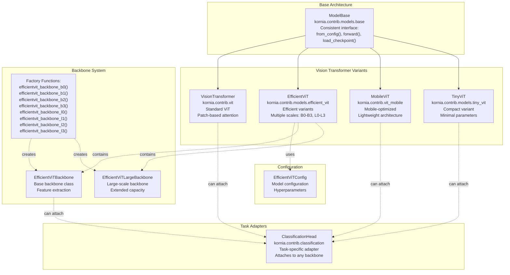
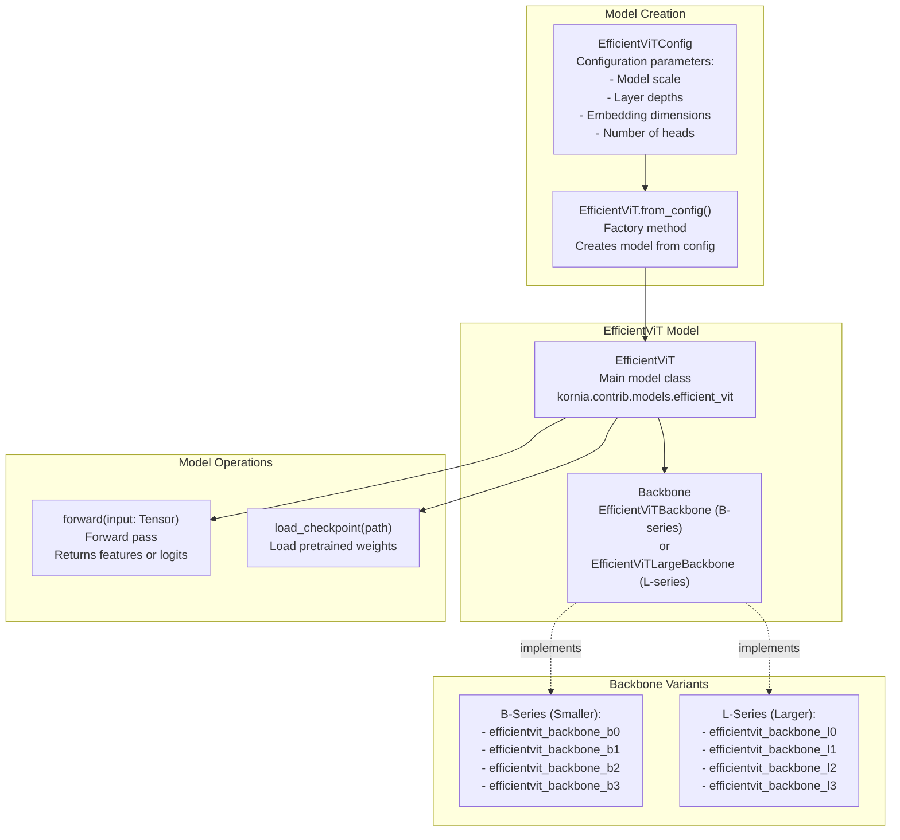
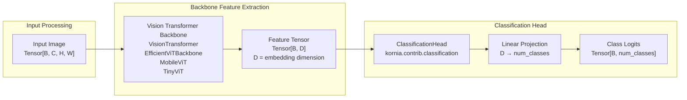
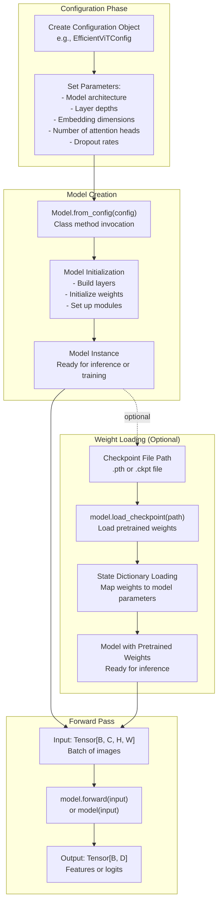
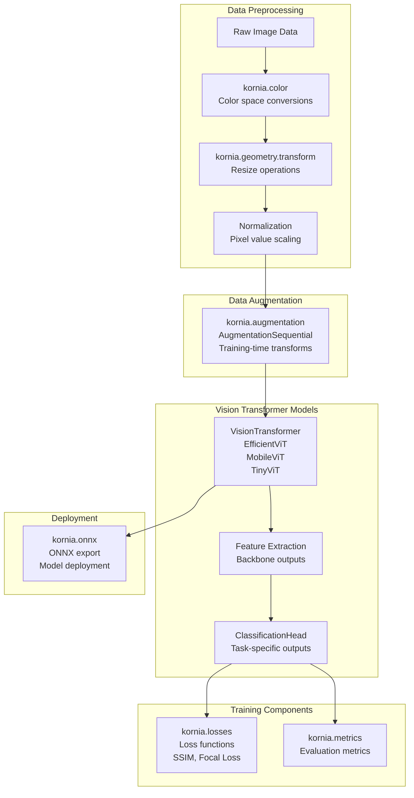

<!-- source: DeepWiki mcp.deepwiki.com · repo kornia/kornia · page 6.2 Vision Transformers (ViT, EfficientViT, MobileViT) · fetched 2026-10-21 -->

# Vision Transformers (ViT, EfficientViT, MobileViT)

<details>
<summary>Relevant source files</summary>

The following files were used as context for generating this wiki page:

- [docs/source/contrib.rst](docs/source/contrib.rst)
- [docs/source/references.bib](docs/source/references.bib)
- [kornia/contrib/__init__.py](kornia/contrib/__init__.py)
- [kornia/contrib/histogram_matching.py](kornia/contrib/histogram_matching.py)
- [kornia/contrib/models/rt_detr/__init__.py](kornia/contrib/models/rt_detr/__init__.py)
- [kornia/contrib/models/rt_detr/architecture/__init__.py](kornia/contrib/models/rt_detr/architecture/__init__.py)

</details>


## Purpose and Scope

This document describes the Vision Transformer (ViT) model implementations in `kornia.contrib`, including standard ViT, efficient variants (EfficientViT), mobile-optimized variants (MobileViT), and compact variants (TinyViT). These models provide differentiable transformer-based architectures for image classification and feature extraction tasks. For object detection models, see [Object Detection with RT-DETR](#6.3). For segmentation models, see [Segmentation with SAM](#6.4).

**Sources:** [docs/source/contrib.rst:178-186](), [kornia/contrib/__init__.py:23-43]()

---

## Architecture Overview

All Vision Transformer implementations in Kornia inherit from `ModelBase`, providing a consistent interface across different architectures. The family includes standard, efficient, mobile-optimized, and compact variants designed for different deployment scenarios.

### Vision Transformer Model Hierarchy



**Sources:** [docs/source/contrib.rst:10-51](), [kornia/contrib/__init__.py:23-43]()

---

## ModelBase Interface

All Vision Transformer models inherit from `ModelBase`, providing three core methods:

| Method | Purpose | Signature |
|--------|---------|-----------|
| `from_config()` | Factory method to create model from configuration | `@classmethod from_config(cls, config) -> Model` |
| `forward()` | Forward pass through the model | `forward(input: Tensor) -> Tensor` |
| `load_checkpoint()` | Load pretrained weights from checkpoint | `load_checkpoint(checkpoint_path: str)` |

This interface ensures consistent model instantiation and usage patterns across all Vision Transformer variants.

**Sources:** [docs/source/contrib.rst:13-17]()

---

## VisionTransformer (Standard ViT)

The `VisionTransformer` class implements the standard Vision Transformer architecture from Dosovitskiy et al. (2021). This model divides input images into fixed-size patches, linearly embeds each patch, and processes the sequence of patch embeddings through transformer encoder layers.

### Key Characteristics

- **Patch-based processing**: Splits images into non-overlapping patches (typically 16x16)
- **Positional embeddings**: Learnable position embeddings added to patch embeddings
- **Transformer encoder**: Standard multi-head self-attention mechanism
- **CLS token**: Special classification token prepended to sequence

### Implementation Location

The implementation is located in [kornia/contrib/vit.py](), though specific line numbers depend on the actual file structure. The class is exposed through [kornia/contrib/__init__.py:42]().

**Sources:** [kornia/contrib/__init__.py:42](), [docs/source/contrib.rst:180-181](), [docs/source/references.bib:2-7]()

---

## EfficientViT

`EfficientViT` provides efficient Vision Transformer architectures optimized for both accuracy and computational efficiency. It offers multiple model scales through a backbone system, allowing users to select appropriate trade-offs between model capacity and inference speed.

### EfficientViT Architecture



### Backbone System

EfficientViT uses a two-tier backbone system:

#### B-Series Backbones (Base Scale)

The B-series provides smaller, faster models suitable for resource-constrained environments:

| Backbone Function | Class | Typical Use Case |
|-------------------|-------|------------------|
| `efficientvit_backbone_b0()` | `EfficientViTBackbone` | Ultra-lightweight deployment |
| `efficientvit_backbone_b1()` | `EfficientViTBackbone` | Mobile devices |
| `efficientvit_backbone_b2()` | `EfficientViTBackbone` | Balanced efficiency |
| `efficientvit_backbone_b3()` | `EfficientViTBackbone` | Higher accuracy with efficiency |

#### L-Series Backbones (Large Scale)

The L-series provides larger models with greater capacity:

| Backbone Function | Class | Typical Use Case |
|-------------------|-------|------------------|
| `efficientvit_backbone_l0()` | `EfficientViTLargeBackbone` | Server deployment |
| `efficientvit_backbone_l1()` | `EfficientViTLargeBackbone` | High-accuracy tasks |
| `efficientvit_backbone_l2()` | `EfficientViTLargeBackbone` | Research applications |
| `efficientvit_backbone_l3()` | `EfficientViTLargeBackbone` | Maximum capacity |

### Configuration Pattern

The `EfficientViTConfig` class encapsulates model hyperparameters, allowing for flexible model definition:

```python
# Typical usage pattern (conceptual)
config = EfficientViTConfig(
    model_scale='b0',  # or 'b1', 'b2', 'b3', 'l0', 'l1', 'l2', 'l3'
    # Additional configuration parameters
)
model = EfficientViT.from_config(config)
```

**Sources:** [docs/source/contrib.rst:19-51](), [kornia/contrib/models/rt_detr/__init__.py]() (shows similar pattern)

---

## MobileViT

`MobileViT` is a mobile-optimized Vision Transformer that combines the strengths of CNNs and transformers for efficient deployment on mobile and edge devices. It uses lightweight architectural components to reduce computational cost while maintaining accuracy.

### Key Design Principles

- **Hybrid architecture**: Combines convolutional layers with transformer blocks
- **Lightweight operations**: Depthwise separable convolutions
- **Reduced parameter count**: Optimized for mobile deployment
- **Efficient self-attention**: Modified attention mechanism for lower complexity

The implementation is located in [kornia/contrib/vit_mobile.py]() and follows the same `ModelBase` interface as other Vision Transformer variants.

**Sources:** [kornia/contrib/__init__.py:43](), [docs/source/contrib.rst:182]()

---

## TinyViT

`TinyViT` provides an extremely compact Vision Transformer variant designed for scenarios requiring minimal model size and inference cost. It achieves compactness through aggressive parameter reduction while attempting to preserve model effectiveness.

### Characteristics

- **Minimal parameters**: Smallest footprint in the ViT family
- **Fast inference**: Optimized for speed-critical applications
- **Reduced embedding dimensions**: Smaller hidden states
- **Fewer transformer layers**: Shallow architecture

The implementation is located in [kornia/contrib/models/tiny_vit.py]() and inherits from `ModelBase`.

**Sources:** [kornia/contrib/__init__.py:40](), [docs/source/contrib.rst:183-184]()

---

## ClassificationHead

`ClassificationHead` is a task-specific adapter that can be attached to any Vision Transformer backbone for classification tasks. It provides the final projection layer that maps backbone features to class logits.

### Architecture and Usage



### Design Pattern

The `ClassificationHead` can be attached to any backbone that produces feature vectors:

```python
# Conceptual usage pattern
backbone = efficientvit_backbone_b0()
classifier = ClassificationHead(
    in_features=backbone.embed_dim,
    num_classes=1000  # ImageNet classes
)

# Forward pass
features = backbone(images)
logits = classifier(features)
```

This separation of backbone and head enables:
- **Transfer learning**: Pretrained backbones with custom heads
- **Multi-task learning**: Multiple heads on same backbone
- **Flexible deployment**: Swap heads without retraining backbone

**Sources:** [kornia/contrib/__init__.py:23](), [docs/source/contrib.rst:185]()

---

## Model Instantiation and Configuration

Vision Transformer models in Kornia follow a consistent instantiation pattern through the `ModelBase` interface.

### Configuration-Based Instantiation Flow



### Common Configuration Parameters

While specific parameters vary by model variant, common configuration elements include:

| Parameter | Description | Typical Values |
|-----------|-------------|----------------|
| `embed_dim` | Embedding dimension size | 192, 384, 768, 1024 |
| `num_heads` | Number of attention heads | 3, 6, 12, 16 |
| `depth` | Number of transformer layers | 6, 12, 24 |
| `patch_size` | Size of image patches | 8, 16, 32 |
| `mlp_ratio` | MLP expansion ratio | 4.0 |
| `dropout` | Dropout rate | 0.0, 0.1 |

**Sources:** [docs/source/contrib.rst:13-30]()

---

## Checkpoint Loading

All Vision Transformer models support loading pretrained weights through the `load_checkpoint()` method, enabling transfer learning and fine-tuning workflows.

### Checkpoint Loading Process

The checkpoint loading mechanism follows this general pattern:

1. **Path specification**: Provide local file path or URL to checkpoint
2. **State dict extraction**: Extract model weights from checkpoint file
3. **Parameter mapping**: Map checkpoint keys to model parameter names
4. **Weight loading**: Load compatible weights into model
5. **Validation**: Verify shapes and types match expected values

### Example Usage Pattern

```python
# Conceptual example (not actual implementation)
model = EfficientViT.from_config(config)
model.load_checkpoint('path/to/pretrained_weights.pth')
# Model now has pretrained weights loaded
```

This pattern enables:
- **Transfer learning**: Start from pretrained ImageNet weights
- **Fine-tuning**: Adapt pretrained models to new tasks
- **Deployment**: Load optimized checkpoints for inference

**Sources:** [docs/source/contrib.rst:23]()

---

## Integration with Kornia Ecosystem

Vision Transformer models integrate seamlessly with other Kornia components for building complete computer vision pipelines.

### Integration Points



### Typical Pipeline Flow

1. **Preprocessing**: Use `kornia.color` for color conversions, `kornia.geometry` for resizing
2. **Augmentation**: Apply `kornia.augmentation.AugmentationSequential` for training robustness
3. **Feature extraction**: Pass augmented images through ViT backbone
4. **Classification**: Apply `ClassificationHead` for task-specific outputs
5. **Loss computation**: Use `kornia.losses` for training objectives
6. **Deployment**: Export via `kornia.onnx` for production serving

This integration allows Vision Transformers to benefit from Kornia's differentiable operations throughout the pipeline.

**Sources:** [docs/source/contrib.rst:1-210]()

---

## Comparison of Vision Transformer Variants

The following table summarizes the key differences between Vision Transformer variants in Kornia:

| Model | Primary Use Case | Architecture Style | Parameter Count | Computational Cost | Key Features |
|-------|------------------|-------------------|-----------------|-------------------|--------------|
| `VisionTransformer` | General purpose, research | Standard transformer | Medium-High | Medium-High | Patch-based, canonical ViT design |
| `EfficientViT` (B-series) | Efficient deployment | Optimized transformer | Low-Medium | Low-Medium | Multiple scales (B0-B3), efficiency-focused |
| `EfficientViT` (L-series) | High accuracy tasks | Optimized transformer | Medium-High | Medium-High | Multiple scales (L0-L3), capacity-focused |
| `MobileViT` | Mobile/edge devices | Hybrid CNN-Transformer | Low | Low | Depthwise convolutions, mobile-optimized |
| `TinyViT` | Ultra-lightweight | Compact transformer | Very Low | Very Low | Minimal footprint, speed-critical |

### Selection Guidelines

Choose your Vision Transformer variant based on:

- **VisionTransformer**: Research experiments, baseline comparisons, when computational resources are not constrained
- **EfficientViT B-series**: Production deployment with efficiency requirements, mobile applications
- **EfficientViT L-series**: Server-side inference requiring high accuracy, complex visual tasks
- **MobileViT**: On-device inference, mobile apps, IoT devices
- **TinyViT**: Extreme resource constraints, real-time applications, embedded systems

**Sources:** [docs/source/contrib.rst:19-184]()

---

## Forward Pass and Output Formats

All Vision Transformer models in Kornia follow consistent input/output conventions through the `forward()` method.

### Input Requirements

| Aspect | Specification |
|--------|--------------|
| **Input shape** | `Tensor[B, C, H, W]` where B=batch, C=channels, H=height, W=width |
| **Channel format** | Typically RGB (C=3) |
| **Value range** | Usually normalized to [0, 1] or [-1, 1] depending on model |
| **Spatial dimensions** | Model-specific, often requires specific sizes (e.g., 224×224, 256×256) |

### Output Formats

The output format depends on whether a `ClassificationHead` is attached:

#### Without ClassificationHead (Feature Extraction)
- **Shape**: `Tensor[B, D]` where D is the embedding dimension
- **Content**: Feature vectors from backbone
- **Use cases**: Transfer learning, feature extraction, similarity search

#### With ClassificationHead (Classification)
- **Shape**: `Tensor[B, num_classes]`
- **Content**: Logits for each class
- **Use cases**: Image classification, fine-tuning on labeled data

**Sources:** [docs/source/contrib.rst:180-186]()

---

## Relationship to Other Kornia Models

Vision Transformers in `kornia.contrib` are part of a broader ecosystem of deep learning models. Understanding their relationship to other models helps in selecting appropriate architectures for different tasks.

### Model Categories in kornia.contrib

| Model Category | Models | Primary Purpose | Page Reference |
|----------------|--------|-----------------|----------------|
| **Classification** | VisionTransformer, EfficientViT, MobileViT, TinyViT | Image classification and feature extraction | Current page (6.2) |
| **Object Detection** | RT-DETR | Bounding box detection of objects | [RT-DETR](#6.3) |
| **Segmentation** | SAM | Interactive and automatic segmentation | [SAM](#6.4) |
| **Face Detection** | FaceDetector | Face localization and landmark detection | [Face and Edge Detection](#6.5) |
| **Edge Detection** | EdgeDetector | Edge map generation | [Face and Edge Detection](#6.5) |

Vision Transformers are specifically designed for classification and feature extraction tasks, serving as backbones that can be adapted for various downstream tasks through appropriate head modules.

**Sources:** [docs/source/contrib.rst:1-210]()

---

## Summary

Kornia provides a comprehensive family of Vision Transformer implementations through `kornia.contrib`, all inheriting from `ModelBase` for consistent interface design. The key implementations are:

- **VisionTransformer**: Standard ViT implementation for general-purpose use
- **EfficientViT**: Efficient variants with B-series (smaller) and L-series (larger) backbones, offering 8 model scales via factory functions
- **MobileViT**: Mobile-optimized hybrid CNN-Transformer for on-device deployment
- **TinyViT**: Ultra-compact variant for resource-constrained scenarios
- **ClassificationHead**: Task-specific adapter attachable to any backbone

All models support:
- Configuration-based instantiation via `from_config()`
- Pretrained weight loading via `load_checkpoint()`
- Standard forward pass via `forward()` or `__call__()`

The modular design allows flexible composition with other Kornia components (augmentation, geometric transforms, losses) for building complete differentiable computer vision pipelines. The separation of backbones and classification heads enables transfer learning, multi-task learning, and flexible deployment scenarios.

**Sources:** [docs/source/contrib.rst:1-210](), [kornia/contrib/__init__.py:1-67](), [docs/source/references.bib:2-7]()

---

