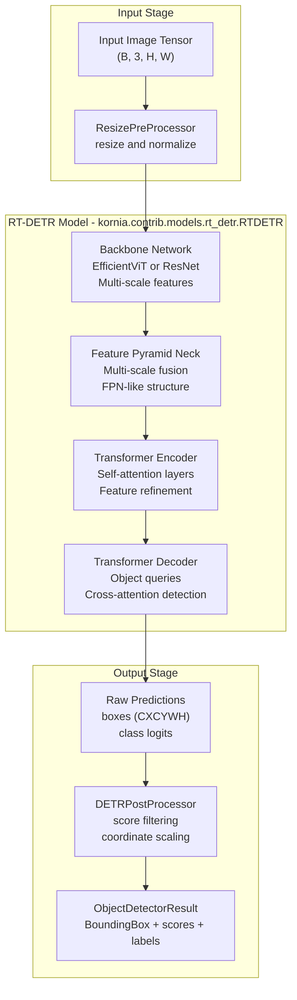
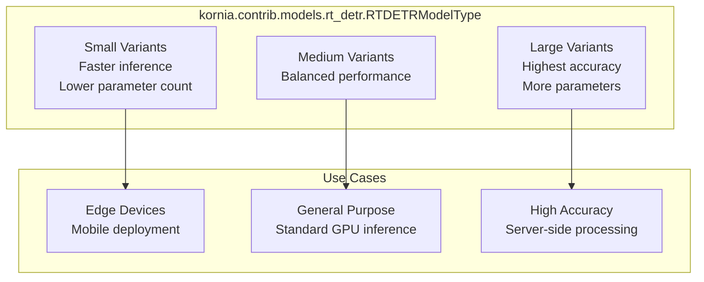
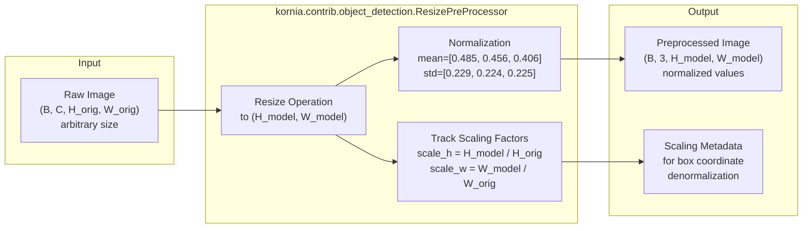
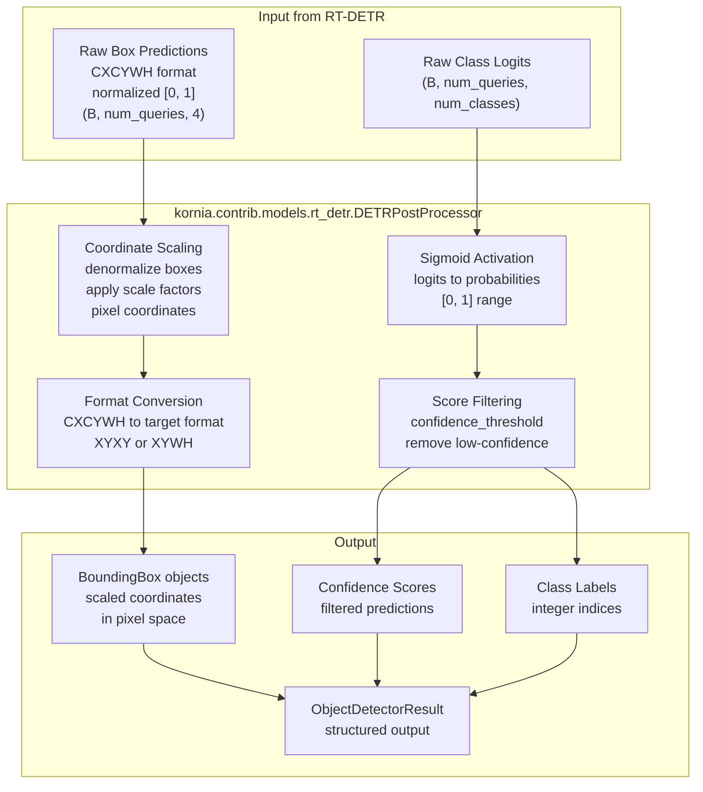
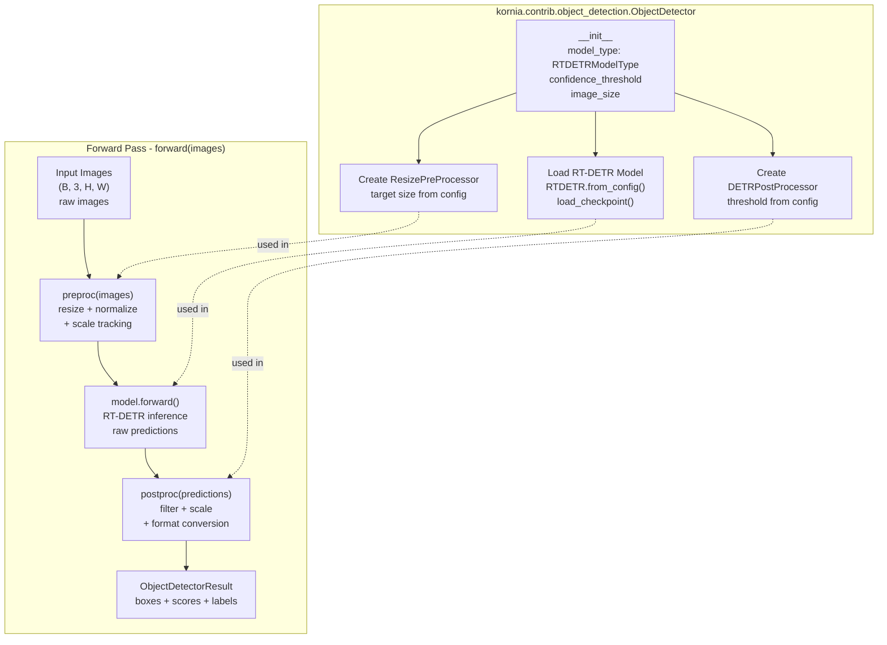
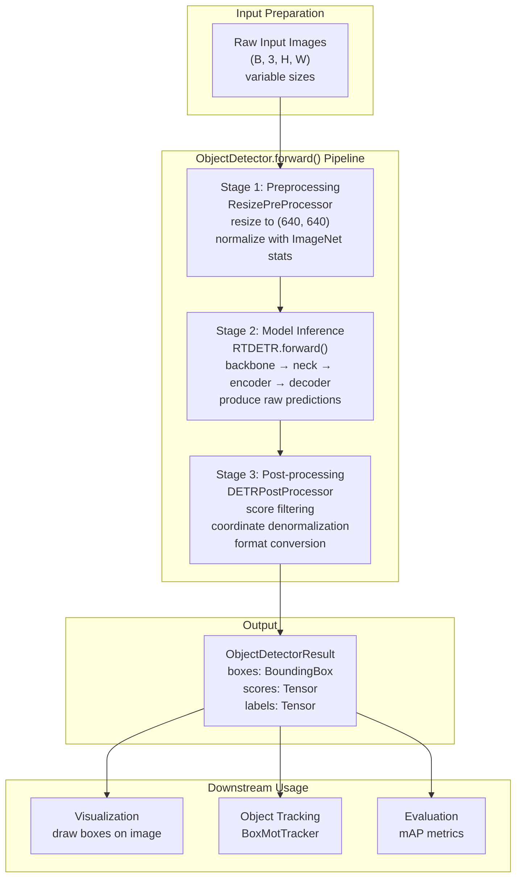
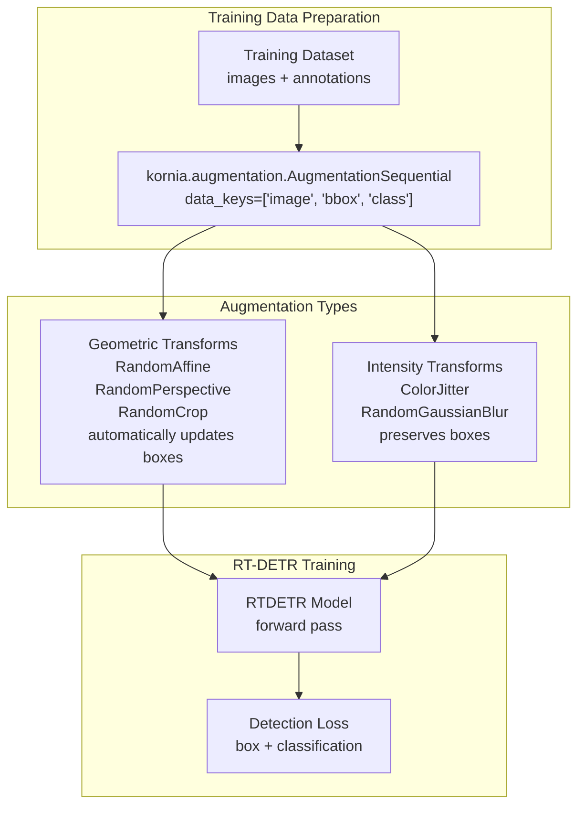

<!-- source: DeepWiki mcp.deepwiki.com · repo kornia/kornia · page 6.3 Object Detection with RT-DETR · fetched 2026-10-21 -->

# Object Detection with RT-DETR

<details>
<summary>Relevant source files</summary>

The following files were used as context for generating this wiki page:

- [docs/source/contrib.rst](docs/source/contrib.rst)
- [docs/source/references.bib](docs/source/references.bib)
- [kornia/contrib/__init__.py](kornia/contrib/__init__.py)
- [kornia/contrib/histogram_matching.py](kornia/contrib/histogram_matching.py)
- [kornia/contrib/models/rt_detr/__init__.py](kornia/contrib/models/rt_detr/__init__.py)
- [kornia/contrib/models/rt_detr/architecture/__init__.py](kornia/contrib/models/rt_detr/architecture/__init__.py)

</details>


## Purpose and Scope

This document covers the RT-DETR (Real-Time Detection Transformer) model architecture in Kornia, including preprocessing, post-processing, and the `ObjectDetector` interface. RT-DETR is a transformer-based object detection model that provides state-of-the-art accuracy with real-time inference performance.

For face detection, see page 6.5. For segmentation with SAM, see page 6.4. For vision transformers in classification, see page 6.2. For bounding box structures used across detection models, see the Object Detection section in page 6.3.

---

## RT-DETR Architecture Overview

RT-DETR (Real-Time Detection Transformer) is a transformer-based object detection architecture that eliminates the need for hand-crafted components like anchor generation or Non-Maximum Suppression (NMS) tuning. The model consists of four main components: backbone, neck, transformer encoder, and transformer decoder.

### RT-DETR Architecture Diagram



**Sources:** [docs/source/contrib.rst:125-145](), [kornia/contrib/models/rt_detr/__init__.py:1-25]()

---

## RT-DETR Model Components

### RTDETRModelType

The `RTDETRModelType` enum defines available pre-trained model variants. Different variants provide trade-offs between accuracy and inference speed.



**Sources:** [docs/source/contrib.rst:128-131]()

### RTDETRConfig

The `RTDETRConfig` class configures the RT-DETR model architecture. It specifies the backbone type, transformer dimensions, number of queries, and other architectural hyperparameters.

**Key Configuration Parameters:**

| Parameter | Description |
|-----------|-------------|
| `backbone` | Backbone architecture (EfficientViT, ResNet variants) |
| `num_encoder_layers` | Number of transformer encoder layers |
| `num_decoder_layers` | Number of transformer decoder layers |
| `num_queries` | Number of object queries (detection slots) |
| `hidden_dim` | Hidden dimension size for transformer |
| `num_classes` | Number of object classes to detect |

**Sources:** [docs/source/contrib.rst:133-135]()

### RTDETR Class

The `RTDETR` class is the main model implementation in [kornia/contrib/models/rt_detr/model.py](). It inherits from `ModelBase` and implements the complete detection transformer architecture.

**Key Methods:**

- **`from_config(config: RTDETRConfig)`**: Factory method to instantiate model from configuration
- **`forward(images: Tensor)`**: Forward pass producing raw box predictions and class logits
- **`load_checkpoint(path: str)`**: Load pre-trained weights from checkpoint file

**Forward Pass Behavior:**

The `forward()` method processes input images through the backbone → neck → encoder → decoder pipeline, producing:
- Box coordinates in CXCYWH format (center_x, center_y, width, height)
- Class logits for each detection query
- Raw predictions require post-processing for final results

**Sources:** [docs/source/contrib.rst:137-140](), [kornia/contrib/models/rt_detr/__init__.py:23-23]()

---

## Preprocessing with ResizePreProcessor

The `ResizePreProcessor` class in [kornia/contrib/object_detection/]() handles image preprocessing before RT-DETR inference. It resizes images to the model's expected input dimensions while tracking scaling factors for coordinate transformation.

### ResizePreProcessor Data Flow



**Preprocessing Steps:**

1. **Resize**: Images are resized to match the model's expected input dimensions (e.g., 640×640)
2. **Normalize**: Pixel values are normalized using ImageNet mean and standard deviation
3. **Scale Tracking**: Original image dimensions and scaling factors are stored for post-processing

**Sources:** [docs/source/contrib.rst:119-121]()

---

## Post-Processing with DETRPostProcessor

The `DETRPostProcessor` class transforms raw RT-DETR predictions into structured `ObjectDetectorResult` instances. Unlike anchor-based detectors, DETR-based models produce a fixed set of predictions that require minimal post-processing.

### DETRPostProcessor Pipeline



**Post-Processing Steps:**

1. **Score Filtering**: Apply sigmoid to logits, then filter detections below confidence threshold
2. **Coordinate Scaling**: Denormalize box coordinates from [0, 1] to pixel space using scaling factors from preprocessing
3. **Format Conversion**: Convert from CXCYWH (center-x, center-y, width, height) to desired format
4. **Result Construction**: Package boxes, scores, and labels into `ObjectDetectorResult`

**No NMS Required:** DETR-based models produce naturally diverse predictions through learned queries, eliminating the need for Non-Maximum Suppression in most cases.

**Sources:** [docs/source/contrib.rst:142-144]()

---

## ObjectDetector High-Level Interface

The `ObjectDetector` class in [kornia/contrib/object_detection/]() provides a high-level wrapper around RT-DETR and its preprocessing/post-processing pipeline. It simplifies the detection workflow into a single forward pass.

### ObjectDetector Component Integration



**ObjectDetector Initialization:**

```python
# Example initialization (pseudocode)
detector = ObjectDetector(
    model_type=RTDETRModelType.RESNET50,
    confidence_threshold=0.5,
    image_size=(640, 640)
)
```

**Key Methods:**

- **`__init__(model_type, confidence_threshold, image_size, ...)`**: Initialize with model selection and parameters
- **`forward(images: Tensor) -> ObjectDetectorResult`**: End-to-end detection from raw images to structured results

**Sources:** [docs/source/contrib.rst:114-117](), [kornia/contrib/__init__.py:41-41]()

---

## Detection Workflow and Usage

### Complete RT-DETR Pipeline



**Sources:** [docs/source/contrib.rst:98-145]()

### Usage Example Pattern

The typical usage pattern involves:

1. **Initialization**: Create `ObjectDetector` with model type and confidence threshold
2. **Inference**: Call `forward(images)` with batched image tensors
3. **Result Processing**: Access `boxes`, `scores`, and `labels` from result object

**Sources:** [docs/source/contrib.rst:114-117]()

### results_from_detections Utility

The `results_from_detections` function in [kornia/contrib/object_detection/]() converts raw detection tensors into structured `ObjectDetectorResult` instances. This is useful for:

- Adapting custom detection models to Kornia's format
- Converting outputs from external frameworks (ONNX, TensorFlow)
- Testing post-processing logic independently

**Sources:** [docs/source/contrib.rst:123-123]()

---

## Bounding Box Data Structures

RT-DETR works with standardized bounding box representations defined in [kornia/contrib/object_detection/](). Understanding these structures is essential for working with detection outputs.

### BoundingBoxDataFormat

The `BoundingBoxDataFormat` enum defines coordinate representation formats:

| Format | Description | Use Case |
|--------|-------------|----------|
| `XYXY` | `[x_min, y_min, x_max, y_max]` | IoU computation, coordinate clipping |
| `XYWH` | `[x_min, y_min, width, height]` | COCO dataset format |
| `CXCYWH` | `[center_x, center_y, width, height]` | DETR/transformer models (RT-DETR native) |

RT-DETR natively outputs `CXCYWH` format, which is converted during post-processing.

**Sources:** [docs/source/contrib.rst:101-104]()

### BoundingBox Class

The `BoundingBox` class wraps box coordinate tensors with format metadata:

**Attributes:**
- `data`: Tensor of shape `(N, 4)` with box coordinates
- `format`: `BoundingBoxDataFormat` enum value
- Batch and image index metadata for multi-image processing

**Sources:** [docs/source/contrib.rst:106-108]()

### ObjectDetectorResult

The `ObjectDetectorResult` class structures detection outputs:

**Fields:**
- `boxes`: `BoundingBox` instances with coordinates
- `scores`: Confidence scores per detection (0 to 1 range)
- `labels`: Integer class indices

**Sources:** [docs/source/contrib.rst:110-112]()

---

## Integration with Kornia Ecosystem

### Augmentation Integration

RT-DETR training benefits from `kornia.augmentation` pipelines that maintain bounding box consistency:



The `AugmentationSequential` container (see page 4.7) automatically transforms bounding boxes when geometric augmentations are applied, ensuring consistency between augmented images and their annotations.

**Sources:** High-level diagrams, [docs/source/contrib.rst:98-145]()

### Geometry Module Integration

RT-DETR preprocessing and post-processing use `kornia.geometry` operations:

- **Coordinate transformations**: Used in `ResizePreProcessor` for scaling
- **Format conversions**: Convert between CXCYWH, XYXY, XYWH formats
- **Warping**: Apply geometric transforms to boxes during augmentation

**Sources:** High-level diagrams

---

## Model Characteristics and Deployment

### RT-DETR Performance Profile

RT-DETR provides real-time inference performance through architectural optimizations:

**Performance Characteristics:**

| Aspect | Description |
|--------|-------------|
| **Inference Speed** | Real-time capable on GPU (variant-dependent) |
| **Accuracy** | State-of-the-art on COCO dataset |
| **Memory** | Configurable via model variant selection |
| **Batch Processing** | Efficient parallel processing of multiple images |

**Model Variant Trade-offs:**

- Small variants: Faster inference, suitable for edge deployment
- Medium variants: Balanced accuracy and speed
- Large variants: Maximum accuracy for server-side applications

### Pre-trained Weights

RT-DETR models are pre-trained on the COCO dataset with 80 object classes. The `load_checkpoint()` method loads these weights from checkpoint files.

**Sources:** [docs/source/contrib.rst:137-140]()

### Deployment Considerations

RT-DETR models can be deployed through multiple pathways:

- **PyTorch**: Direct inference using Kornia's `ObjectDetector` or `RTDETR` classes
- **ONNX**: Export via `kornia.onnx` for cross-platform deployment
- **TorchScript**: Serialize for C++ inference environments
- **Batch Inference**: Process multiple images in parallel for throughput optimization

For ONNX export utilities, see page 6.1 for `ModelBase` interface which `RTDETR` inherits from.

**Sources:** High-level diagrams

---

## Summary

Kornia's object detection system provides:

1. **Unified Interface**: `ObjectDetector` class for consistent model usage
2. **Standardized Representations**: `BoundingBox` and `BoundingBoxDataFormat` for format consistency
3. **State-of-the-Art Models**: RT-DETR transformer-based detection
4. **Differentiable Pipeline**: Full integration with PyTorch for training and fine-tuning
5. **Modular Architecture**: Seamless integration with geometry, augmentation, and tracking modules

This architecture enables researchers and practitioners to build end-to-end detection pipelines with minimal boilerplate while maintaining flexibility for customization.

**Sources:** [docs/source/contrib.rst:98-145](), high-level diagrams

---

