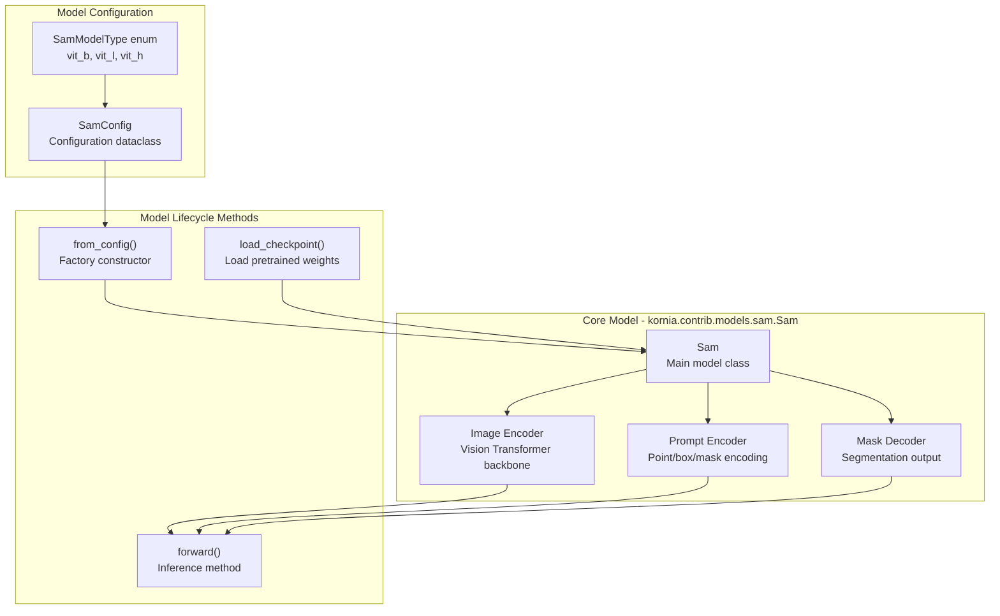
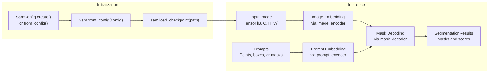
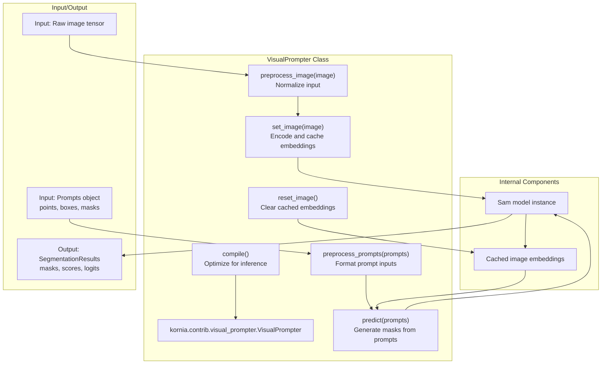
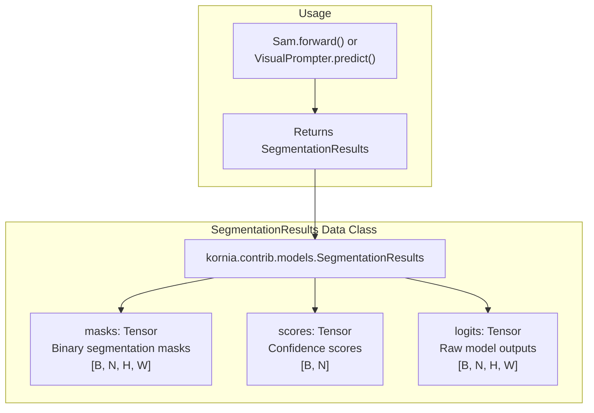
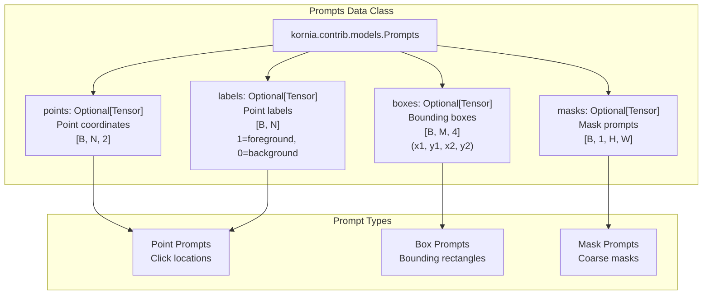
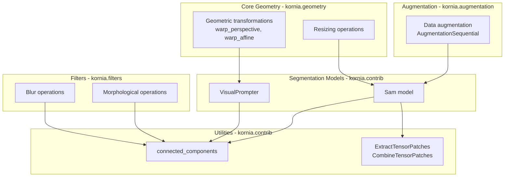

<!-- source: DeepWiki mcp.deepwiki.com · repo kornia/kornia · page 6.4 Segmentation with SAM · fetched 2026-10-21 -->

# Segmentation Models

<details>
<summary>Relevant source files</summary>

The following files were used as context for generating this wiki page:

- [docs/source/contrib.rst](docs/source/contrib.rst)
- [docs/source/references.bib](docs/source/references.bib)
- [kornia/contrib/__init__.py](kornia/contrib/__init__.py)
- [kornia/contrib/histogram_matching.py](kornia/contrib/histogram_matching.py)
- [kornia/contrib/models/rt_detr/__init__.py](kornia/contrib/models/rt_detr/__init__.py)
- [kornia/contrib/models/rt_detr/architecture/__init__.py](kornia/contrib/models/rt_detr/architecture/__init__.py)

</details>


## Purpose and Scope

This page documents Kornia's segmentation models and utilities, focusing on the **Segment Anything Model (SAM)** implementation and the **VisualPrompter** interface for interactive segmentation. These components are located in `kornia.contrib.models.sam` and `kornia.contrib.visual_prompter`.

For object detection models, see [Object Detection Models](#7.2). For edge detection capabilities, see [Face and Edge Detection](#7.4).

## Overview

Kornia provides pre-trained segmentation models with a focus on interactive, prompt-based segmentation through SAM (Segment Anything Model). The segmentation system consists of:

| Component | Purpose | Location |
|-----------|---------|----------|
| `Sam` | Core SAM model implementation | `kornia.contrib.models.sam` |
| `SamConfig` | Configuration for SAM model variants | `kornia.contrib.models.sam` |
| `SamModelType` | Enumeration of available SAM model sizes | `kornia.contrib.models.sam` |
| `VisualPrompter` | High-level interface for interactive segmentation | `kornia.contrib.visual_prompter` |
| `SegmentationResults` | Data structure for segmentation outputs | `kornia.contrib.models` |
| `Prompts` | Data structure for input prompts | `kornia.contrib.models` |
| `connected_components` | Connected component labeling utility | `kornia.contrib` |

**Sources:** [docs/source/contrib.rst:146-166](), [kornia/contrib/__init__.py:1-61]()

## SAM (Segment Anything Model)

### Model Architecture and Configuration

**Diagram: SAM Model Components**



The `Sam` class implements the Segment Anything Model, which uses a Vision Transformer-based image encoder to compute image embeddings, and then accepts various types of prompts (points, boxes, or masks) to generate segmentation masks.

**Sources:** [docs/source/contrib.rst:150-166]()

### Model Types and Variants

SAM is available in three sizes, defined by `SamModelType`:

| Model Type | Description | Backbone | Use Case |
|------------|-------------|----------|----------|
| `vit_b` | Base model | ViT-B | Balanced speed and accuracy |
| `vit_l` | Large model | ViT-L | Higher accuracy |
| `vit_h` | Huge model | ViT-H | Maximum accuracy |

The model variant is specified through `SamConfig`, which contains all hyperparameters needed to instantiate the model architecture.

**Sources:** [docs/source/contrib.rst:153-156]()

### Loading and Using SAM

**Diagram: SAM Initialization and Inference Flow**



The typical workflow for using SAM directly:

1. **Configuration**: Create a `SamConfig` instance specifying the model type
2. **Instantiation**: Use `Sam.from_config()` to create the model
3. **Weight Loading**: Call `load_checkpoint()` to load pre-trained weights
4. **Inference**: Call `forward()` with image and prompt inputs

**Sources:** [docs/source/contrib.rst:162-166]()

## VisualPrompter - Interactive Segmentation Interface

### Architecture and Purpose

`VisualPrompter` provides a high-level interface that wraps SAM for interactive segmentation workflows. It manages the image encoding/caching and simplifies the prompt-to-mask pipeline.

**Diagram: VisualPrompter Architecture**



`VisualPrompter` optimizes the segmentation workflow by:
- **Caching**: Encoding the image once and reusing embeddings for multiple prompts
- **Preprocessing**: Handling input normalization and format conversions
- **Simplification**: Providing a cleaner API than calling SAM directly

**Sources:** [docs/source/contrib.rst:65-70]()

### Interactive Segmentation Workflow

The typical workflow with `VisualPrompter`:

**Step 1: Initialize and Set Image**

```python
# Create VisualPrompter with SAM model
prompter = VisualPrompter(sam_model)

# Optional: compile for better performance
prompter.compile()

# Set the image to segment (encodes once, caches embeddings)
prompter.set_image(image_tensor)
```

**Step 2: Create Prompts and Predict**

```python
# Create prompts (points, boxes, or masks)
prompts = Prompts(
    points=point_coords,
    labels=point_labels
)

# Generate segmentation
results = prompter.predict(prompts)
```

**Step 3: Access Results**

```python
# SegmentationResults contains:
# - masks: binary segmentation masks
# - scores: confidence scores
# - logits: raw model outputs
```

**Step 4: Reset for New Image**

```python
# Clear cached embeddings when switching images
prompter.reset_image()
```

**Sources:** [docs/source/contrib.rst:69-70]()

### Method Reference

| Method | Purpose | Key Behavior |
|--------|---------|--------------|
| `set_image(image)` | Encode and cache image embeddings | Must be called before prediction |
| `reset_image()` | Clear cached embeddings | Required when changing images |
| `predict(prompts)` | Generate masks from prompts | Uses cached embeddings |
| `preprocess_image(image)` | Normalize image input | Applied automatically |
| `preprocess_prompts(prompts)` | Format prompts for model | Applied automatically |
| `compile()` | Optimize model for inference | Optional performance improvement |

**Sources:** [docs/source/contrib.rst:69-70]()

## Segmentation Data Structures

### SegmentationResults

**Diagram: SegmentationResults Structure**



`SegmentationResults` is a data structure returned by segmentation models. It contains:

| Field | Type | Shape | Description |
|-------|------|-------|-------------|
| `masks` | `Tensor` | `[B, N, H, W]` | Binary segmentation masks (0 or 1) |
| `scores` | `Tensor` | `[B, N]` | Confidence score for each mask |
| `logits` | `Tensor` | `[B, N, H, W]` | Raw unnormalized outputs (before sigmoid) |

Where:
- `B` = batch size
- `N` = number of predicted masks
- `H`, `W` = height and width of masks

**Sources:** [docs/source/contrib.rst:56-60]()

### Prompts

**Diagram: Prompts Structure and Types**



The `Prompts` data structure supports multiple types of user inputs for interactive segmentation:

**Point Prompts**
- Coordinates: `[B, N, 2]` tensor of (x, y) locations
- Labels: `[B, N]` tensor where 1 = foreground point, 0 = background point
- Use case: Click-based segmentation

**Box Prompts**
- Format: `[B, M, 4]` tensor of (x1, y1, x2, y2) coordinates
- Use case: Rough bounding box around object

**Mask Prompts**
- Format: `[B, 1, H, W]` tensor with coarse mask
- Use case: Refining existing segmentation

Multiple prompt types can be combined in a single `Prompts` object for multi-modal interaction.

**Sources:** [docs/source/contrib.rst:61-64]()

## Utility Functions

### connected_components

The `connected_components` function provides connected component labeling for binary segmentation masks.

**Function**: `kornia.contrib.connected_components()`

**Purpose**: Label connected regions in binary images, assigning unique IDs to each connected component.

**Typical Use Cases**:
- Post-processing segmentation masks
- Counting distinct objects
- Filtering small spurious regions
- Instance segmentation from semantic masks

This function complements the segmentation models by providing classical computer vision post-processing capabilities.

**Sources:** [docs/source/contrib.rst:148-149](), [kornia/contrib/__init__.py:19]()

## Integration with Core Library

**Diagram: Segmentation Models in Kornia Ecosystem**



The segmentation models integrate with other Kornia components:

**Preprocessing Pipeline**:
- Augmentation [](#6) transforms can be applied to training data
- Geometric transformations [](#2) can align or warp inputs
- Color space conversions [](#3) may be used for input normalization

**Post-processing Pipeline**:
- `connected_components` for instance segmentation
- Morphological filters [](#4.3) for mask refinement
- Patch operations [](#7.6) for processing large images in tiles

**Training**:
- Loss functions [](#8.2) including Dice loss, Focal loss for training custom segmentation models
- Data augmentation [](#6) for improving model robustness

**Sources:** [docs/source/contrib.rst:1-210](), [kornia/contrib/__init__.py:1-61]()

## Performance Considerations

### Model Compilation

The `VisualPrompter.compile()` method enables PyTorch compilation optimizations:

```python
prompter.compile()  # Optimize for faster inference
```

This applies `torch.compile()` to the underlying SAM model, potentially providing significant speedup for repeated inferences.

### Image Embedding Caching

`VisualPrompter` caches image embeddings to avoid redundant computation when applying multiple prompts to the same image:

1. Call `set_image()` once to encode the image
2. Call `predict()` multiple times with different prompts
3. Image encoding is reused, only prompt encoding and mask decoding run

This optimization is crucial for interactive segmentation workflows where users iterate on prompts.

### Memory Management

For large images:
- Use patch-based processing with `ExtractTensorPatches` [](#7.6)
- Process in tiles and combine results with `CombineTensorPatches`
- Call `reset_image()` to free cached embeddings when switching images

**Sources:** [docs/source/contrib.rst:69-70](), [kornia/contrib/extract_patches.py:1-499]()

## Typical Workflows

### Workflow 1: Single-Image Interactive Segmentation

```
User → Create VisualPrompter → Load SAM weights
     → Set image (encodes once)
     → Create point prompts → Predict → Get masks
     → Refine prompts → Predict → Get refined masks
     → Reset for next image
```

### Workflow 2: Batch Processing with SAM

```
Data → Configure Sam model → Load checkpoint
     → Prepare batch of images
     → Prepare batch of prompts
     → Call Sam.forward()
     → Process SegmentationResults
     → Post-process with connected_components
```

### Workflow 3: Large Image Segmentation

```
Large Image → Extract patches with ExtractTensorPatches
            → Process each patch with VisualPrompter
            → Combine with CombineTensorPatches
            → Post-process with connected_components
```

**Sources:** [docs/source/contrib.rst:65-70](), [docs/source/contrib.rst:150-166]()

---

