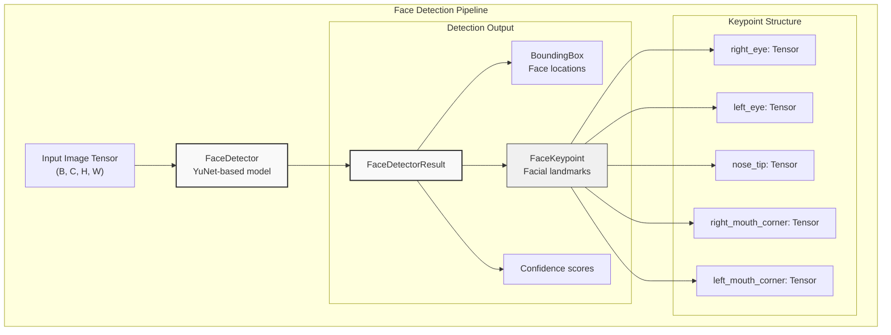
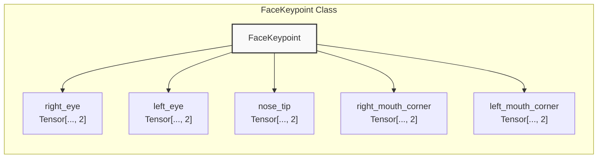
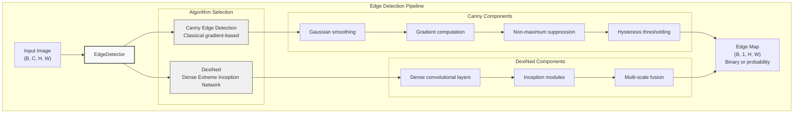
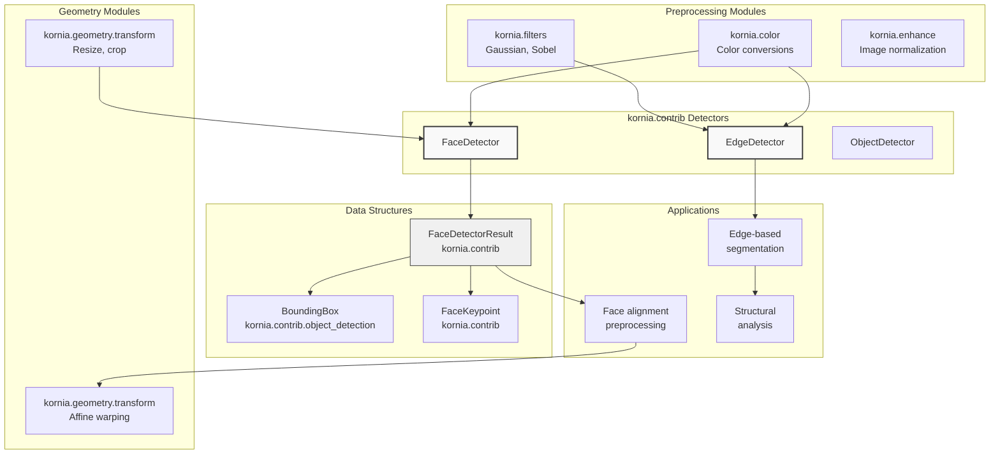

<!-- source: DeepWiki mcp.deepwiki.com · repo kornia/kornia · page 6.5 Face and Edge Detection · fetched 2026-10-21 -->

# Face and Edge Detection

Relevant source files

The following files were used as context for generating this wiki page:

- [docs/source/contrib.rst](docs/source/contrib.rst)
- [docs/source/references.bib](docs/source/references.bib)
- [kornia/contrib/__init__.py](kornia/contrib/__init__.py)
- [kornia/contrib/histogram_matching.py](kornia/contrib/histogram_matching.py)
- [kornia/contrib/models/rt_detr/__init__.py](kornia/contrib/models/rt_detr/__init__.py)
- [kornia/contrib/models/rt_detr/architecture/__init__.py](kornia/contrib/models/rt_detr/architecture/__init__.py)

## Purpose and Scope

This page documents the face detection and edge detection capabilities in the `kornia.contrib` module. These detectors provide specialized computer vision functionality for detecting faces with keypoints and extracting edges from images using both classical and deep learning methods.

For general object detection capabilities, see [Object Detection with RT-DETR](#6.3). For segmentation tasks, see [Segmentation with SAM](#6.4). For model base classes and configuration patterns, see [Model Base Classes and Configuration](#6.1).

**Sources:** [docs/source/contrib.rst:71-96](), [kornia/contrib/__init__.py:27-42]()

---

## Face Detection System

The face detection system in Kornia provides a `FaceDetector` class that wraps the YuNet face detection algorithm, enabling efficient detection of faces with associated facial keypoints in a single forward pass.

### FaceDetector Architecture

**Diagram: Face Detection Data Flow and Output Structure**

The `FaceDetector` processes input images and produces `FaceDetectorResult` objects containing face locations as bounding boxes, facial keypoints (eyes, nose, mouth corners), and confidence scores for each detection.

**Sources:** [docs/source/contrib.rst:76-88](), [docs/source/references.bib:177-182]()

---

### YuNet-Based Implementation

The face detection implementation is based on the YuNet algorithm, which provides efficient face detection with keypoint localization. YuNet is designed for real-time performance while maintaining high accuracy across various face scales and orientations.

| Feature | Description |
|---------|-------------|
| **Algorithm** | YuNet (You Only Learn One Representation) |
| **Output** | Face bounding boxes + 5 facial keypoints |
| **Keypoints** | Right eye, left eye, nose tip, right mouth corner, left mouth corner |
| **Format** | `FaceDetectorResult` with `BoundingBox` and `FaceKeypoint` objects |
| **Use Case** | Face detection, alignment preprocessing, facial landmark detection |

**Sources:** [docs/source/references.bib:177-182](), [docs/source/contrib.rst:76-88]()

---

### FaceKeypoint Data Structure

The `FaceKeypoint` class encapsulates the five facial landmarks detected by the face detector:

**Diagram: FaceKeypoint Attribute Structure**

Each keypoint is stored as a 2D coordinate tensor with shape `[..., 2]`, where the last dimension represents `(x, y)` pixel coordinates. The batch dimensions are preserved, allowing processing of multiple faces across multiple images simultaneously.

**Sources:** [docs/source/contrib.rst:81-83]()

---

### FaceDetectorResult Output Structure

The `FaceDetectorResult` class aggregates all detection outputs:

| Attribute | Type | Description |
|-----------|------|-------------|
| `keypoints` | `FaceKeypoint` | Five facial landmarks per detected face |
| `boxes` | `BoundingBox` | Bounding box coordinates for each face |
| `scores` | `Tensor` | Confidence scores for each detection |

The result structure enables both batch processing and individual face analysis. All tensors maintain consistent batch dimensions, allowing vectorized operations on multiple detections.

**Sources:** [docs/source/contrib.rst:85-87]()

---

## Edge Detection System

The edge detection system provides the `EdgeDetector` class, which implements both classical (Canny) and deep learning-based (DexiNed) edge detection algorithms in a unified interface.

### EdgeDetector Architecture

**Diagram: Edge Detection Architecture with Dual Algorithm Support**

The `EdgeDetector` provides a unified interface for both classical Canny edge detection and the deep learning-based DexiNed approach, allowing users to select the appropriate algorithm based on their performance and accuracy requirements.

**Sources:** [docs/source/contrib.rst:71-74](), [docs/source/references.bib:185-199]()

---

### Edge Detection Algorithms

The `EdgeDetector` supports two complementary approaches to edge detection:

#### Canny Edge Detection

The classical Canny algorithm performs edge detection through a multi-stage process:

| Stage | Operation | Purpose |
|-------|-----------|---------|
| 1. Smoothing | Gaussian filtering | Noise reduction |
| 2. Gradient | Sobel operators | Edge strength and direction |
| 3. Non-maximum suppression | Thinning | Single-pixel edge width |
| 4. Hysteresis thresholding | Dual threshold | Edge connectivity |

Canny provides fast, interpretable edge detection with explicit control over sensitivity through threshold parameters.

#### DexiNed (Dense Extreme Inception Network)

DexiNed is a deep learning-based edge detector that provides more robust edge detection across varying conditions:

| Feature | Description |
|---------|-------------|
| **Architecture** | Dense Extreme Inception Network |
| **Approach** | End-to-end learned edge detection |
| **Advantages** | Better handling of texture, illumination variations |
| **Output** | Probability maps with soft edge predictions |
| **Use Case** | Complex scenes, natural images, high-accuracy requirements |

**Sources:** [docs/source/references.bib:185-199]()

---

### Edge Detection Output Format

Both Canny and DexiNed edge detectors produce edge maps as single-channel tensors:

- **Shape:** `(B, 1, H, W)` where `B` is batch size, `H` and `W` are image dimensions
- **Canny Output:** Binary edge map with values `{0, 1}` indicating edge/non-edge pixels
- **DexiNed Output:** Probability map with values in `[0, 1]` representing edge confidence

The consistent output format allows seamless switching between algorithms while maintaining compatibility with downstream processing modules.

**Sources:** [docs/source/contrib.rst:71-74]()

---

## Integration with Kornia Ecosystem

### Module Relationships

**Diagram: Face and Edge Detector Integration with Kornia Modules**

Face and edge detectors integrate with Kornia's preprocessing modules (color conversion, filtering) for input preparation and geometric transformation modules for post-processing tasks like face alignment.

**Sources:** [kornia/contrib/__init__.py:23-66]()

---

### Shared Dependencies

Both face and edge detectors leverage common Kornia infrastructure:

| Dependency | Module | Purpose |
|------------|--------|---------|
| `BoundingBox` | `kornia.contrib.object_detection` | Unified bounding box representation |
| Color conversions | `kornia.color` | RGB/Grayscale preprocessing |
| Image filtering | `kornia.filters` | Gaussian smoothing, gradient computation |
| Geometric transforms | `kornia.geometry.transform` | Resizing, warping, alignment |
| Image enhancement | `kornia.enhance` | Normalization, histogram equalization |

This shared infrastructure ensures consistent interfaces and interoperability across detection modules.

**Sources:** [kornia/contrib/__init__.py:1-66](), [docs/source/contrib.rst:99-117]()

---

## Usage Patterns

### Typical Face Detection Workflow

1. **Initialize detector:** Create `FaceDetector` instance
2. **Preprocess input:** Convert to appropriate color space and resolution
3. **Run detection:** Forward pass through detector
4. **Extract results:** Access `FaceDetectorResult.boxes`, `FaceDetectorResult.keypoints`, `FaceDetectorResult.scores`
5. **Post-process:** Use keypoints for alignment, boxes for cropping

### Typical Edge Detection Workflow

1. **Initialize detector:** Create `EdgeDetector` with algorithm choice (Canny or DexiNed)
2. **Preprocess input:** Convert to grayscale if required
3. **Run detection:** Forward pass through detector
4. **Threshold (optional):** Apply additional thresholding to probability maps
5. **Post-process:** Use edge maps for segmentation, feature extraction, or structural analysis

**Sources:** [docs/source/contrib.rst:71-96]()

---

## API Surface Summary

### Face Detection Classes

| Class | Location | Purpose |
|-------|----------|---------|
| `FaceDetector` | `kornia.contrib` | Main face detection interface |
| `FaceKeypoint` | `kornia.contrib` | Five facial landmark coordinates |
| `FaceDetectorResult` | `kornia.contrib` | Detection output container |

### Edge Detection Classes

| Class | Location | Purpose |
|-------|----------|---------|
| `EdgeDetector` | `kornia.contrib` | Unified edge detection interface |

### Shared Infrastructure

| Class | Location | Purpose |
|-------|----------|---------|
| `BoundingBox` | `kornia.contrib.object_detection` | Bounding box representation |
| `BoundingBoxDataFormat` | `kornia.contrib.object_detection` | Coordinate format specification |

**Sources:** [docs/source/contrib.rst:71-117](), [kornia/contrib/__init__.py:23-66]()

---

## References and Citations

The face and edge detection implementations are based on the following academic work:

### Face Detection
- **YuNet Algorithm:** Feng et al., "Detect Faces Efficiently: A Survey and Evaluations," IEEE Transactions on Biometrics, Behavior, and Identity Science, 2021

### Edge Detection
- **DexiNed:** Soria, X., Riba, E., & Sappa, A., "Dense Extreme Inception Network: Towards a Robust CNN Model for Edge Detection," IEEE Winter Conference on Applications of Computer Vision (WACV), 2020

**Sources:** [docs/source/references.bib:177-199]()

---

