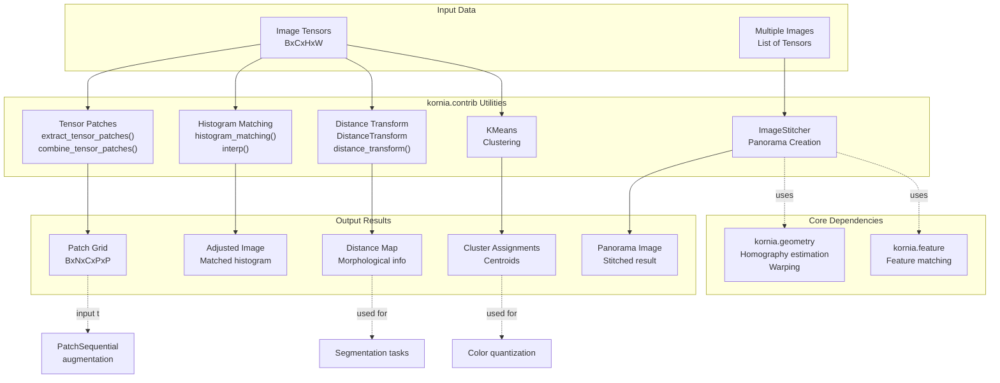
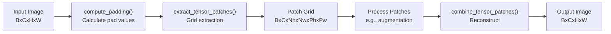
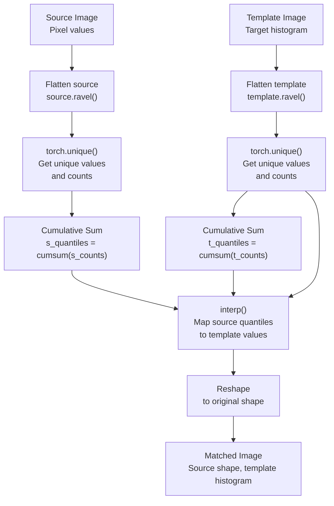
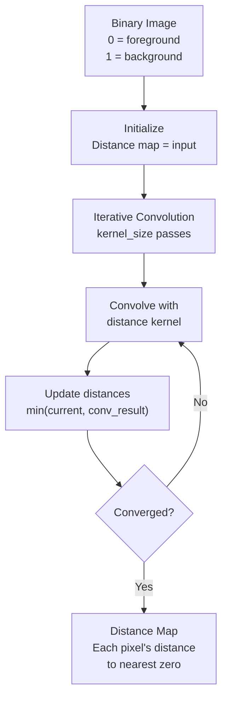
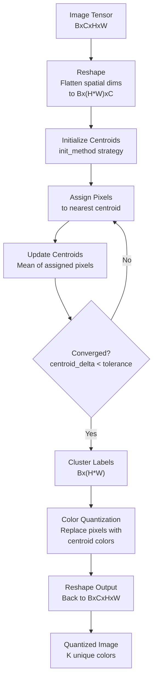
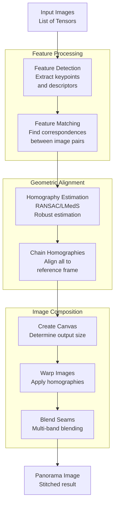

<!-- source: DeepWiki mcp.deepwiki.com · repo kornia/kornia · page 6.6 Image Processing Utilities · fetched 2026-10-21 -->

# Image Processing Utilities

<details>
<summary>Relevant source files</summary>

The following files were used as context for generating this wiki page:

- [docs/source/contrib.rst](docs/source/contrib.rst)
- [docs/source/references.bib](docs/source/references.bib)
- [kornia/contrib/__init__.py](kornia/contrib/__init__.py)
- [kornia/contrib/histogram_matching.py](kornia/contrib/histogram_matching.py)
- [kornia/contrib/models/rt_detr/__init__.py](kornia/contrib/models/rt_detr/__init__.py)
- [kornia/contrib/models/rt_detr/architecture/__init__.py](kornia/contrib/models/rt_detr/architecture/__init__.py)

</details>


## Purpose and Scope

This document covers the image processing utility functions and classes available in `kornia.contrib`. These utilities provide foundational operations for tensor manipulation, image adjustment, morphological processing, clustering, and panorama creation. They complement Kornia's core augmentation and transformation modules with specialized tools for advanced computer vision workflows.

For deep learning models (detection, segmentation, classification), see [Models and Applications](#6). For feature detection and matching, see [Feature Detection and Matching](#5). For core image transformations and warping, see [Geometry and Transformations](#3).

**Sources:** [kornia/contrib/__init__.py:1-67](), [docs/source/contrib.rst:1-210]()

## Utility Categories Overview

The contrib module provides five categories of image processing utilities:

| Category | Classes/Functions | Purpose |
|----------|------------------|---------|
| **Tensor Patches** | `ExtractTensorPatches`, `CombineTensorPatches`, `extract_tensor_patches()`, `combine_tensor_patches()`, `compute_padding()` | Grid-based patch extraction and reconstruction |
| **Histogram Processing** | `histogram_matching()`, `interp()` | Statistical image adjustment via histogram transformation |
| **Distance Transform** | `DistanceTransform`, `distance_transform()`, `diamond_square()` | Morphological distance computation and fractal generation |
| **Clustering** | `KMeans` | Color quantization and pixel clustering |
| **Image Stitching** | `ImageStitcher` | Panorama creation from multiple images |

These utilities are designed to be differentiable where applicable, enabling their use in gradient-based optimization and end-to-end trainable pipelines.

**Sources:** [kornia/contrib/__init__.py:23-66](), [docs/source/contrib.rst:167-209]()

## System Architecture



**Diagram: Image Processing Utilities Architecture**

This diagram shows how the five utility categories process different types of input data and produce specialized outputs. The `ImageStitcher` depends on Kornia's feature matching and geometry modules for homography estimation. Patch utilities support location-aware augmentation workflows via `PatchSequential`.

**Sources:** [kornia/contrib/__init__.py:1-67](), [docs/source/contrib.rst:167-210]()

## Tensor Patch Operations

Tensor patch operations provide efficient extraction and reconstruction of non-overlapping rectangular patches from images. These operations are critical for patch-based augmentation (see [PatchSequential](#4.8)) and processing high-resolution images in smaller chunks.

### Functional API

The functional interface provides stateless patch operations:

- **`extract_tensor_patches(input, window_size, stride, padding)`**: Extracts patches from input tensor. Returns shape `(B, C, num_patches_h, num_patches_w, window_h, window_w)`.
- **`combine_tensor_patches(patches, original_size, window_size, stride)`**: Reconstructs image from patches. Inverse operation of extraction.
- **`compute_padding(input_shape, window_size, stride)`**: Calculates padding needed to ensure complete grid coverage.

### Module API

The module interface wraps functional operations for use in `nn.Sequential` pipelines:

- **`ExtractTensorPatches(window_size, stride, padding)`**: Module wrapper for patch extraction
- **`CombineTensorPatches(window_size, stride, unpadding)`**: Module wrapper for patch combination

### Patch Extraction Pipeline



**Diagram: Patch Extraction and Reconstruction Pipeline**

The pipeline computes necessary padding to ensure the image can be evenly divided into patches, extracts a grid of patches, processes them independently, and reconstructs the full image. This enables efficient batch processing of large images and location-aware transformations.

**Sources:** [docs/source/contrib.rst:167-176](), [kornia/contrib/__init__.py:28-34]()

### Implementation Details

The patch extraction system uses the following approach:

1. **Padding Calculation**: `compute_padding()` ensures image dimensions are compatible with the window size and stride by calculating pad amounts for height and width.

2. **Grid Extraction**: `extract_tensor_patches()` uses efficient tensor operations to extract patches without copying. Patches are organized in a 6D tensor where dimensions 2-3 represent spatial grid location and dimensions 4-5 represent patch content.

3. **Reconstruction**: `combine_tensor_patches()` reverses the extraction by placing patches back into their grid positions. When used with the same padding parameters, this operation exactly reconstructs the original image.

The typical usage pattern for patch-based processing:

```
1. pad_h, pad_w = compute_padding(input.shape, window_size, stride)
2. patches = extract_tensor_patches(input, window_size, stride, (pad_h, pad_w))
3. processed_patches = apply_transformation(patches)
4. output = combine_tensor_patches(processed_patches, input.shape, window_size, stride)
```

This pattern is used internally by `PatchSequential` for location-aware augmentation.

**Sources:** [docs/source/contrib.rst:167-176]()

## Histogram Matching

Histogram matching (also called histogram specification) transforms an image's pixel value distribution to match a target histogram. This technique is useful for color normalization, style transfer preprocessing, and domain adaptation.

### Function Signatures

**`histogram_matching(source, template)`** [kornia/contrib/histogram_matching.py:21-61]()

Adjusts the pixel values of a source image to match the histogram of a template image.

**Parameters:**
- `source` (torch.Tensor): Image to transform, any shape
- `template` (torch.Tensor): Target histogram image, can have different dimensions

**Returns:**
- torch.Tensor: Transformed image with same shape as source

**`interp(x, xp, fp)`** [kornia/contrib/histogram_matching.py:64-85]()

One-dimensional linear interpolation for monotonically increasing sample points. Used internally by histogram matching.

### Algorithm Overview



**Diagram: Histogram Matching Algorithm Data Flow**

The algorithm computes empirical cumulative distribution functions (CDFs) for both images, then uses linear interpolation to find template pixel values that correspond to source quantiles. This mapping transforms the source histogram to match the template.

**Sources:** [kornia/contrib/histogram_matching.py:21-85]()

### Implementation Details

The histogram matching implementation in [kornia/contrib/histogram_matching.py:21-61]() follows these steps:

1. **Flatten**: Both images are flattened to 1D arrays for histogram computation.

2. **Unique Values**: `torch.unique()` extracts unique pixel values, their indices, and counts. The `return_inverse=True` parameter provides a mapping back to original positions.

3. **CDF Computation**: Cumulative sums of counts are computed and normalized by total pixel count to create empirical CDFs. These map pixel values to quantiles (0 to 1).

4. **Interpolation**: The `interp()` function performs linear interpolation to find template pixel values corresponding to each source quantile. This uses `torch.searchsorted()` for efficient binary search.

5. **Remapping**: The `bin_idx` from step 2 is used to map interpolated values back to original pixel positions, then reshape to original dimensions.

**Note:** The function processes the entire flattened tensor at once. For batched inputs, histograms are computed across the entire batch rather than per-image. For per-image matching, process each image separately.

**Sources:** [kornia/contrib/histogram_matching.py:21-85]()

## Distance Transform

Distance transform operations compute the distance from each pixel to the nearest feature (typically a zero pixel or boundary). The implementation is differentiable and suitable for use in neural network training.

### Function and Module Interfaces

**`distance_transform(image, kernel_size, h)`** 

Computes the distance transform using a differentiable convolution-based approach based on the Fast Convolutional Distance Transform algorithm.

**`DistanceTransform(kernel_size, h)`**

Module wrapper for distance transform operation, inheriting from `nn.Module`.

**`diamond_square(shape, roughness, random_seed)`**

Generates fractal noise using the diamond-square algorithm. Useful for creating natural-looking terrain or texture patterns.

### Distance Transform Algorithm

The distance transform implementation uses a convolutional approach that makes it differentiable and GPU-accelerable:



**Diagram: Distance Transform Computation Flow**

The algorithm iteratively applies convolution operations to propagate distance information from foreground pixels. The `kernel_size` parameter controls the size of the distance propagation kernel, affecting both accuracy and computational cost.

**Sources:** [docs/source/contrib.rst:197-203](), [docs/source/references.bib:208-226]()

### Applications

Distance transforms are commonly used for:

1. **Segmentation Loss Functions**: Boundary-aware losses that penalize predictions based on distance to true boundaries (see Hausdorff distance loss).

2. **Morphological Operations**: Skeleton extraction, medial axis computation, and shape analysis.

3. **Image Processing**: Erosion, dilation, and other morphological filters.

4. **Registration**: Aligning images based on distance field similarity.

The differentiability of `DistanceTransform` enables its use in end-to-end trainable pipelines where distance-based penalties are needed.

**Sources:** [docs/source/references.bib:208-226](), [docs/source/contrib.rst:197-203]()

## KMeans Clustering

The `KMeans` class provides differentiable k-means clustering for pixel-level operations on images. Common applications include color quantization, image segmentation, and feature space clustering.

### KMeans Class Interface

**`KMeans(num_clusters, init_method='rpp', max_iter=100, tolerance=1e-4)`**

Implements k-means clustering algorithm with support for different initialization methods.

**Key Methods:**
- `fit(X)`: Fit the k-means model to input data
- `predict(X)`: Assign cluster labels to new data
- `fit_predict(X)`: Combined fit and predict operation

**Parameters:**
- `num_clusters` (int): Number of clusters to form
- `init_method` (str): Initialization strategy ('rpp' for random partition, 'random' for random samples)
- `max_iter` (int): Maximum number of iterations
- `tolerance` (float): Convergence threshold for centroid movement

### Clustering Workflow



**Diagram: KMeans Color Quantization Pipeline**

For color quantization, pixels are treated as points in RGB space. The algorithm iteratively assigns pixels to nearest color centroids and updates centroids until convergence. The resulting cluster assignments can be used to reduce the color palette to K colors.

**Sources:** [docs/source/contrib.rst:205-209](), [kornia/contrib/__init__.py:38]()

### Use Cases

**Color Quantization:**
```
kmeans = KMeans(num_clusters=16)  # Reduce to 16 colors
labels = kmeans.fit_predict(image_pixels)
quantized = centroids[labels].reshape(original_shape)
```

**Superpixel Segmentation:**
Cluster pixels based on both color and spatial location for region-based processing.

**Feature Space Clustering:**
Apply k-means to deep feature maps for unsupervised region discovery in neural networks.

The implementation is designed to work with batched tensors and maintains differentiability where applicable, though the cluster assignment step involves non-differentiable argmax operations.

**Sources:** [docs/source/contrib.rst:205-209]()

## Image Stitching

The `ImageStitcher` class provides panorama creation from multiple overlapping images. It integrates Kornia's feature detection, matching, and geometric transformation capabilities to automatically align and blend images.

### ImageStitcher Interface

**`ImageStitcher(matcher='nn', estimator='ransac')`**

Creates panoramas from multiple images through automatic feature-based alignment.

**Key Parameters:**
- `matcher` (str): Feature matching method ('nn' for nearest neighbor, 'lightglue', 'loftr')
- `estimator` (str): Geometric estimation method ('ransac', 'lmeds')

### Stitching Pipeline



**Diagram: Image Stitching Processing Pipeline**

The stitcher processes images in sequence: (1) detects features in each image, (2) matches features between overlapping pairs, (3) estimates homographies relating image pairs, (4) chains homographies to a common reference frame, (5) determines canvas size, (6) warps images to aligned positions, and (7) blends overlapping regions for seamless transitions.

**Sources:** [docs/source/contrib.rst:187-190](), [kornia/contrib/__init__.py:37]()

### Integration with Kornia Modules

The `ImageStitcher` leverages multiple Kornia subsystems:

| Component | Kornia Module | Purpose |
|-----------|---------------|---------|
| Feature Detection | `kornia.feature.ScaleSpaceDetector` | Extract keypoints across scales |
| Feature Description | `kornia.feature.LAFOrienter`, descriptors | Compute descriptors from LAFs |
| Feature Matching | `kornia.feature.match_nn`, `LightGlue`, `LoFTR` | Find correspondences |
| Geometric Estimation | `kornia.geometry.find_homography` | RANSAC-based homography fitting |
| Warping | `kornia.geometry.warp_perspective` | Apply geometric transformations |

This integration demonstrates how high-level applications compose Kornia's modular primitives. The same components used for stitching can be recombined for visual odometry, structure-from-motion, or augmented reality applications.

**Sources:** [docs/source/contrib.rst:187-190]()

### Usage Pattern

Typical image stitching workflow:

```
1. stitcher = ImageStitcher(matcher='lightglue', estimator='ransac')
2. images = [load_image(path) for path in image_paths]
3. panorama = stitcher(images)
```

The stitcher automatically handles:
- Feature detection and description
- Pairwise matching with geometric verification
- Homography chain computation
- Canvas size determination
- Image warping and blending

For custom feature detection or matching strategies, users can extend the base class or pre-compute features and pass them to the lower-level geometry functions.

**Sources:** [docs/source/contrib.rst:187-190]()

## Utility Function Summary

| Function/Class | Input | Output | Primary Use Case |
|----------------|-------|--------|------------------|
| `extract_tensor_patches()` | Image BxCxHxW | Patches BxCxNhxNwxPhxPw | Patch-based processing, high-res images |
| `combine_tensor_patches()` | Patches BxCxNhxNwxPhxPw | Image BxCxHxW | Reconstruct from patches |
| `histogram_matching()` | Source, template images | Adjusted image | Color normalization, style matching |
| `distance_transform()` | Binary image | Distance map | Morphological ops, boundary-aware losses |
| `KMeans` | Pixel data | Cluster assignments | Color quantization, segmentation |
| `ImageStitcher` | Multiple images | Panorama | Panorama creation, wide-angle views |

These utilities provide building blocks for complex computer vision pipelines. They integrate with Kornia's differentiable operations and batch processing capabilities, enabling GPU acceleration and gradient-based optimization where applicable.

**Sources:** [docs/source/contrib.rst:167-210](), [kornia/contrib/__init__.py:23-66]()

---

