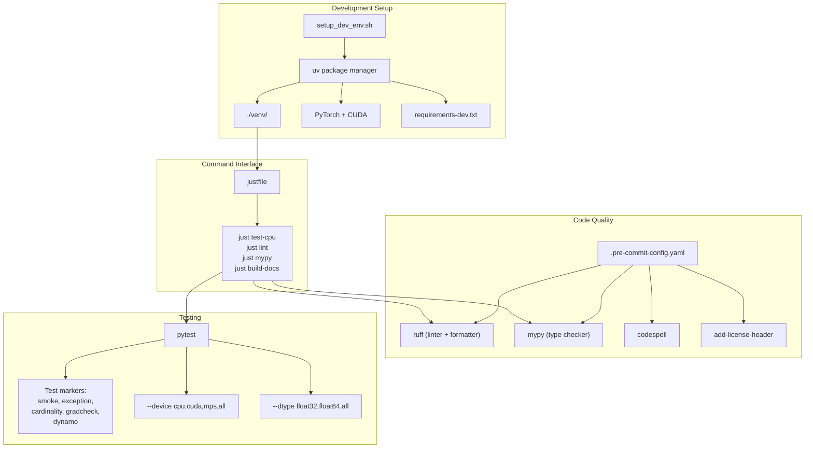
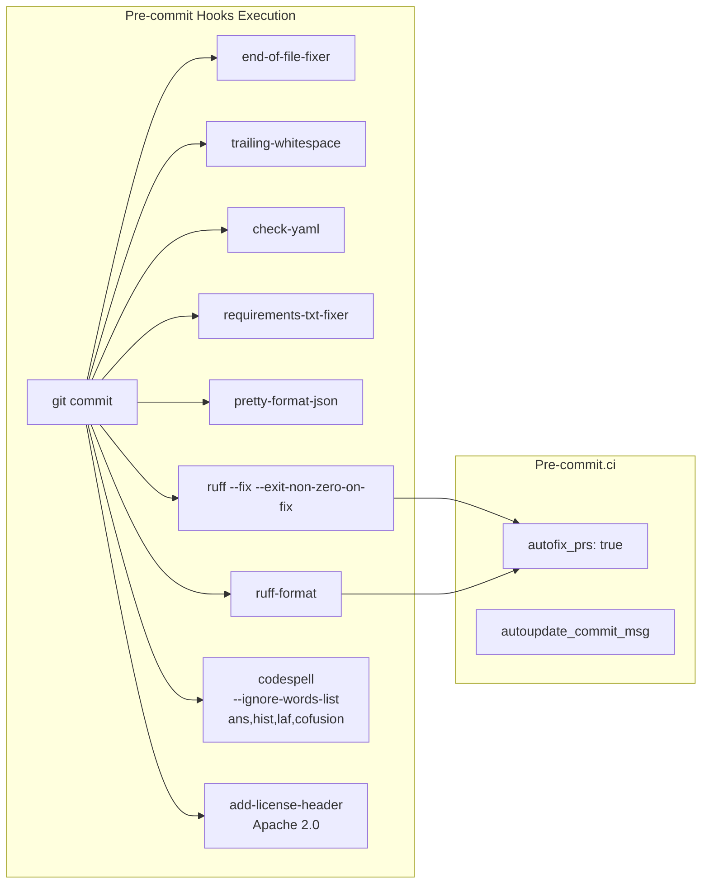
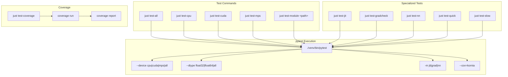
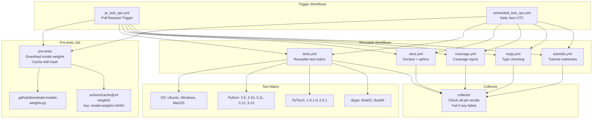
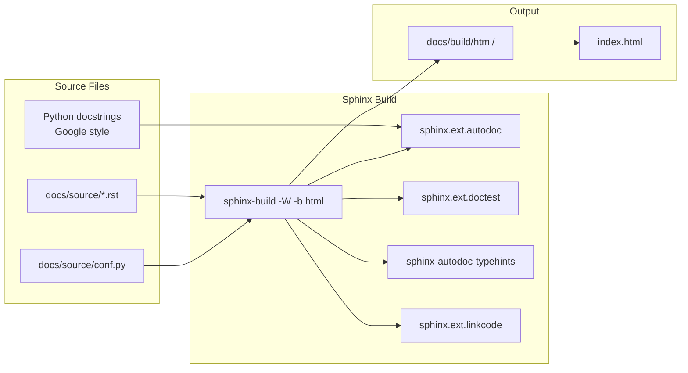
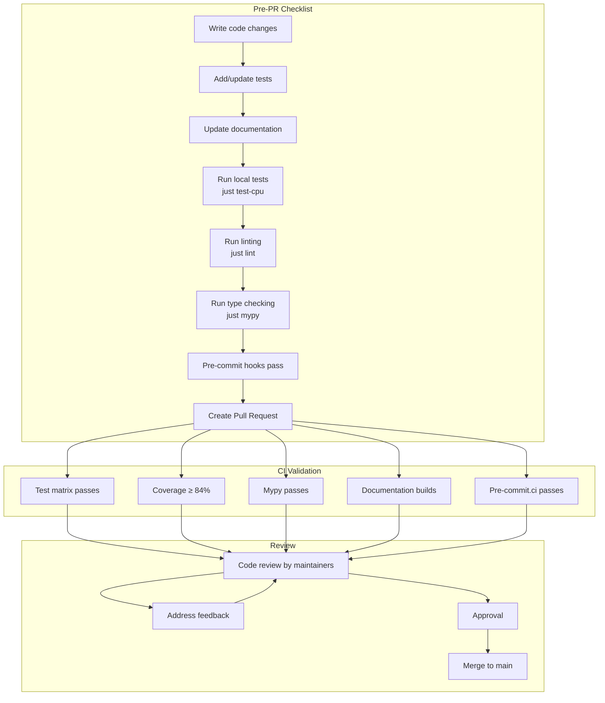

<!-- source: DeepWiki mcp.deepwiki.com · repo kornia/kornia · page 7 Development and Contributing · fetched 2026-10-21 -->

# Development and Contributing

<details>
<summary>Relevant source files</summary>

The following files were used as context for generating this wiki page:

- [.github/actions/env/action.yml](.github/actions/env/action.yml)
- [.github/workflows/coverage.yml](.github/workflows/coverage.yml)
- [.github/workflows/docs.yml](.github/workflows/docs.yml)
- [.github/workflows/pr_test_cpu.yml](.github/workflows/pr_test_cpu.yml)
- [.github/workflows/scheduled_test_cpu.yml](.github/workflows/scheduled_test_cpu.yml)
- [.github/workflows/tests.yml](.github/workflows/tests.yml)
- [.gitignore](.gitignore)
- [.pre-commit-config.yaml](.pre-commit-config.yaml)
- [CHANGELOG.md](CHANGELOG.md)
- [CONTRIBUTING.md](CONTRIBUTING.md)
- [README.md](README.md)
- [README_zh-CN.md](README_zh-CN.md)
- [docker/Dockerfile.benchmark](docker/Dockerfile.benchmark)
- [docs/Makefile](docs/Makefile)
- [docs/source/_static/css/main.css](docs/source/_static/css/main.css)
- [docs/source/_static/img/cn_community_zhihu.jpg](docs/source/_static/img/cn_community_zhihu.jpg)
- [docs/source/community/contribute.rst](docs/source/community/contribute.rst)
- [docs/source/conf.py](docs/source/conf.py)
- [docs/source/index.rst](docs/source/index.rst)
- [docs/source/models/vit.rst](docs/source/models/vit.rst)
- [justfile](justfile)
- [pyproject.toml](pyproject.toml)
- [readthedocs.yml](readthedocs.yml)
- [setup_dev_env.sh](setup_dev_env.sh)
- [uv.lock](uv.lock)

</details>


This document provides a comprehensive guide for developers contributing to Kornia. It covers setting up your development environment, understanding code quality standards, running tests, navigating the CI/CD pipeline, building documentation, and following the contribution workflow. This page focuses on the technical infrastructure for development rather than the functional aspects of the library itself.

For general installation instructions, see [Installation and Setup](#1.1).

---

## Development Environment Overview

Kornia uses a modern Python development stack centered around three key tools: **uv** (fast package manager), **just** (command runner), and **pre-commit** (code quality automation). The development environment supports multiple Python versions (3.9-3.13) and PyTorch versions (1.9.1-2.5.1), with testing across CPU, CUDA, and MPS devices.



**Sources**: [setup_dev_env.sh](), [justfile:1-149](), [.pre-commit-config.yaml:1-55](), [pyproject.toml:210-217](), [requirements/requirements-dev.txt:1-18]()

---

## Setting Up the Development Environment

### Automated Setup with setup_dev_env.sh

The primary method for setting up a development environment is the `setup_dev_env.sh` script, which automates the installation of uv, creation of a virtual environment, and installation of all dependencies.

**Basic usage**:
```bash
./setup_dev_env.sh
```

This script performs the following operations:
1. Installs `uv` if not already present
2. Creates a virtual environment in `./venv/`
3. Installs PyTorch with CUDA 12.1 (default)
4. Installs development dependencies from `requirements-dev.txt`
5. Installs documentation dependencies from `requirements-docs.txt`

**Configuration via environment variables**:
```bash
# Custom Python version
PYTHON_VERSION=3.10 ./setup_dev_env.sh

# Custom PyTorch and CUDA versions
PYTORCH_VERSION=2.4.0 CUDA_VERSION=11.8 ./setup_dev_env.sh

# CPU-only PyTorch
PYTORCH_MODE=cpuonly ./setup_dev_env.sh
```

**Sources**: [CONTRIBUTING.md:68-95](), [README.md:104-112]()

### Using justfile Commands

The `justfile` provides convenient commands for common development tasks. All commands automatically ensure the virtual environment is set up via the `_ensure-venv` recipe.

**Available commands**:

| Command | Purpose |
|---------|---------|
| `just test-cpu` | Run CPU-only tests |
| `just test-cuda` | Run CUDA tests |
| `just test-mps` | Run MPS tests (Apple Silicon) |
| `just lint` | Run code formatting and linting |
| `just mypy` | Run type checking |
| `just doctest` | Run doctests |
| `just build-docs` | Build documentation |
| `just setup` | Run setup_dev_env.sh |

**Example workflow**:
```bash
# Setup environment
just setup

# Activate virtual environment
source venv/bin/activate

# Run tests
just test-cpu

# Check code quality
just lint
just mypy
```

**Sources**: [justfile:1-149](), [CONTRIBUTING.md:97-118]()

### Manual Setup with uv

For manual control over the setup process:

1. **Install uv**:
```bash
# On Linux/macOS
curl -LsSf https://astral.sh/uv/install.sh | sh

# Or using pip
pip install uv
```

2. **Create and activate virtual environment**:
```bash
uv venv
source .venv/bin/activate  # Windows: .venv\Scripts\activate
```

3. **Install PyTorch**:
```bash
# CUDA 12.1
uv pip install torch torchvision --index-url https://download.pytorch.org/whl/cu121

# CPU-only
uv pip install torch torchvision --index-url https://download.pytorch.org/whl/cpu
```

4. **Install Kornia in editable mode**:
```bash
uv pip install -e .[dev,x]
uv pip install -e .[docs]  # For documentation development
```

**Sources**: [CONTRIBUTING.md:120-152](), [README.md:104-119]()

---

## Code Quality Standards

### Pre-commit Hook Configuration

Kornia uses `pre-commit` to enforce code quality standards automatically on each commit. The configuration is defined in `.pre-commit-config.yaml`.



**Hook repositories and versions**:
- **pre-commit-hooks** (v6.0.0): Basic file formatting checks
- **ruff-pre-commit** (v0.14.0): Linting and formatting
- **codespell** (v2.4.1): Spell checking
- **add-license-header** (v2.4.0): License header enforcement

**Sources**: [.pre-commit-config.yaml:1-55](), [CONTRIBUTING.md:171-173]()

### Ruff Configuration

Ruff is configured in `pyproject.toml` to handle both linting and formatting. It replaces multiple tools (isort, flake8, pylint) with a single fast linter.

**Configuration parameters** ([pyproject.toml:69-209]()):

| Parameter | Value | Purpose |
|-----------|-------|---------|
| `target-version` | `"py39"` | Minimum Python version |
| `line-length` | `120` | Maximum line length |
| `skip-magic-trailing-comma` | `false` | Format trailing commas |

**Enabled rule sets**:
- **E, F**: Core pycodestyle and Pyflakes
- **I**: Import sorting (isort)
- **B**: flake8-bugbear (bug detection)
- **UP**: pyupgrade (Python syntax modernization)
- **PL**: Pylint
- **D**: pydocstyle (Google convention)
- **S**: flake8-bandit (security)
- **RUF**: Ruff-specific rules
- **NPY**: NumPy-specific rules

**Notable ignored rules** ([pyproject.toml:135-151]()):
- `UP007`, `UP006`, `UP035`, `UP045`: Disabled due to TorchScript compatibility requirements
- `D100`, `D101`, `D102`, `D104`, `D107`: Documentation rules partially relaxed

**Per-file ignores**:
- `*/__init__.py`: Allows unused imports (`F401`) and star imports (`F403`)
- `tests/*` and `testing/*`: Allows asserts (`S101`), no documentation enforcement

**Sources**: [pyproject.toml:69-209](), [CONTRIBUTING.md:364-377]()

### Mypy Type Checking

Mypy configuration in `pyproject.toml` enforces strict type checking across the codebase.

**Configuration** ([pyproject.toml:256-268]()):

| Setting | Value | Purpose |
|---------|-------|---------|
| `check_untyped_defs` | `true` | Check function bodies even without annotations |
| `disallow_any_generics` | `true` | Require explicit generic type parameters |
| `disallow_incomplete_defs` | `true` | Disallow partially typed function signatures |
| `disallow_untyped_defs` | `true` | Require type annotations on all functions |
| `ignore_missing_imports` | `true` | Don't fail on missing stubs |
| `no_implicit_optional` | `true` | Require explicit Optional[] for None defaults |
| `warn_redundant_casts` | `true` | Warn about unnecessary type casts |
| `warn_unused_ignores` | `true` | Warn about unused `# type: ignore` comments |
| `files` | `["kornia/"]` | Check only kornia package, not tests |

**Module overrides** ([pyproject.toml:269-271]()):
- `kornia.feature.dedode.transformer.*`: Ignores all errors (external code)

**Running mypy**:
```bash
just mypy          # Using justfile
./venv/bin/mypy    # Direct execution
```

**Sources**: [pyproject.toml:256-271](), [justfile:82-83](), [CONTRIBUTING.md:337-358]()

### License Header Enforcement

The `add-license-header` hook ensures all Python files include the Apache 2.0 license header.

**Header template** ([.pre-commit-config.yaml:40-54]()):
```
Copyright 2018 Kornia Team

Licensed under the Apache License, Version 2.0 (the "License");
you may not use this file except in compliance with the License.
You may obtain a copy of the License at

    http://www.apache.org/licenses/LICENSE-2.0

Unless required by applicable law or agreed to in writing, software
distributed under the License is distributed on an "AS IS" BASIS,
WITHOUT WARRANTIES OR CONDITIONS OF ANY KIND, either express or implied.
See the License for the specific language governing permissions and
limitations under the License.
```

**Sources**: [.pre-commit-config.yaml:34-54](), [CONTRIBUTING.md:407-410]()

---

## Testing Framework

### Pytest Configuration and Markers

Kornia uses pytest with custom markers and fixtures to organize and execute tests across multiple configurations.

**Configured markers** ([pyproject.toml:210-217]()):

| Marker | Purpose |
|--------|---------|
| `grad` | Gradient check tests (validate backpropagation) |
| `jit` | TorchScript compilation tests |
| `nn` | Neural network module tests |
| `slow` | Tests that take significant time to run |

**Test execution options**:
```bash
# Run specific marker
pytest -v -m grad              # Only gradient tests
pytest -v -m "not slow"        # Exclude slow tests

# Run with device specification
pytest -v --device=cpu         # CPU only
pytest -v --device=cuda        # CUDA only
pytest -v --device=all         # All available devices

# Run with dtype specification
pytest -v --dtype=float32      # Single precision
pytest -v --dtype=float64      # Double precision
pytest -v --dtype=all          # Both precisions
```

**Sources**: [pyproject.toml:210-217](), [CONTRIBUTING.md:160-169](), [justfile:26-75]()

### Test Structure and BaseTester

Tests inherit from `BaseTester` class which provides common assertion methods and fixtures.

**Standard test structure** ([CONTRIBUTING.md:273-322]()):

```python
from testing.base import BaseTester

class TestMyFunction(BaseTester):
    def test_smoke(self, device, dtype):
        """Test basic functionality with different parameters"""
        pass
    
    def test_exception(self, device, dtype):
        """Test exception handling"""
        # with pytest.raises(ValueError) as errinfo:
        #     function_call(invalid_params)
        # assert 'expected message' in str(errinfo)
        pass
    
    def test_cardinality(self, device, dtype):
        """Test output shapes"""
        pass
    
    def test_gradcheck(self, device):
        """Test gradient computation"""
        # Uses self.gradcheck(...)
        pass
    
    def test_dynamo(self, device, dtype, torch_optimizer):
        """Test with torch.compile optimization"""
        # op_optimized = torch_optimizer(op)
        # self.assert_close(op(inputs), op_optimized(inputs))
        pass
```

**Device and dtype fixtures**:
- Generated automatically from `--device` and `--dtype` CLI arguments
- Create all combinations of specified devices and dtypes
- Available in all test functions as fixtures

**Sources**: [CONTRIBUTING.md:273-336](), [pyproject.toml:210-217]()

### Running Tests with justfile

The `justfile` provides convenient commands for different test scenarios.



**Test command examples**:

```bash
# Full test suite
just test-all                    # All devices, all dtypes

# Device-specific
just test-cpu                    # CPU only, all dtypes
just test-cpu-f32               # CPU only, float32 only
just test-cuda                   # CUDA, all dtypes
just test-mps                    # Apple Silicon

# Module-specific
just test-module test_color.py   # Single test file

# Marker-based
just test-jit                    # JIT compilation tests
just test-gradcheck             # Gradient tests
just test-nn                     # Neural network tests
just test-quick                  # Exclude slow tests
just test-slow                   # Only slow tests

# Coverage
just test-coverage              # Generate coverage report
```

**Sources**: [justfile:26-76](), [CONTRIBUTING.md:160-169]()

### Coverage Requirements

Coverage tracking is configured in `pyproject.toml` with specific requirements and exclusions.

**Configuration** ([pyproject.toml:219-254]()):

| Parameter | Value | Purpose |
|-----------|-------|---------|
| `branch` | `true` | Track branch coverage |
| `source` | `['kornia/']` | Source directory to measure |
| `fail_under` | `84` | Minimum coverage percentage required |
| `show_missing` | `true` | Show lines not covered |
| `skip_covered` | `true` | Don't show fully covered files |

**Excluded lines** (not counted in coverage):
- `# pragma: no cover` comments
- `raise AssertionError`, `raise NotImplementedError`
- Type checking blocks: `if TYPE_CHECKING:`
- Debug code: `if __name__ == "__main__":`

**Sources**: [pyproject.toml:219-254](), [justfile:72-76]()

---

## CI/CD Pipeline Architecture

### Workflow Structure Overview

Kornia's CI/CD system uses GitHub Actions with a hierarchical workflow structure. The main workflows call reusable workflows to avoid duplication.



**Sources**: [.github/workflows/pr_test_cpu.yml:1-130](), [.github/workflows/scheduled_test_cpu.yml:1-122](), [.github/workflows/tests.yml:1-132]()

### Pre-tests Job and Caching Strategy

The `pre-tests` job downloads and caches model weights to optimize subsequent test jobs.

**Pre-tests job structure** ([.github/workflows/pr_test_cpu.yml:16-38]()):

1. **Checkout repository**: `actions/checkout@v4`
2. **Setup environment**: `./.github/actions/env`
3. **Cache check**: `actions/cache@v4` with key `model-weights-${{ hashFiles('.github/download-models-weights.py') }}`
4. **Download models**: Run `python .github/download-models-weights.py -t weights/` if cache miss
5. **Output hash**: Generate hash for downstream jobs

**Cache configuration**:
- **Path**: `weights/`
- **Key**: `model-weights-{HASH}`
- **Cross-OS**: `enableCrossOsArchive: true`
- **Restore keys**: Progressive fallback to older caches

**Sources**: [.github/workflows/pr_test_cpu.yml:16-38](), [.github/workflows/scheduled_test_cpu.yml:15-37]()

### Test Matrix Strategy

The `tests.yml` workflow defines a comprehensive test matrix with exclusions for incompatible combinations.

**Matrix dimensions** ([.github/workflows/tests.yml:50-107]()):

| Dimension | Values |
|-----------|--------|
| **OS** | `Ubuntu-latest`, `Windows-latest`, `MacOS-latest` |
| **Python** | `3.9`, `3.10`, `3.11`, `3.12`, `3.13` |
| **PyTorch** | `1.9.1`, `1.10.2`, `1.11.0`, `1.12.1`, `1.13.1`, `2.0.1`, `2.1.2`, `2.2.2`, `2.3.1`, `2.4.0`, `2.5.1` |
| **dtype** | `float32`, `float64` |
| **device** | `cpu` (default), `cuda`, `mps` |

**Compatibility exclusions**:
- Python 3.10: Requires PyTorch ≥ 1.11
- Python 3.11: Requires PyTorch ≥ 2.0
- Python 3.12: Requires PyTorch ≥ 2.2
- Python 3.13: Requires PyTorch ≥ 2.5

**Workflow call example** ([.github/workflows/pr_test_cpu.yml:40-58]()):
```yaml
tests-cpu:
  needs: [pre-tests]
  strategy:
    fail-fast: true
    matrix:
      os: ["Ubuntu-latest", "Windows-latest"]
      pytorch-dtype: ["float32", "float64"]
  uses: ./.github/workflows/tests.yml
  with:
    os: ${{ matrix.os }}
    python-version: '["3.9", "3.12"]'
    pytorch-version: '["2.0.1", "2.5.1"]'
    pytorch-dtype: ${{ matrix.pytorch-dtype }}
    cache-path: weights/
    cache-key: model-weights-${{ needs.pre-tests.outputs.hash }}
```

**Sources**: [.github/workflows/tests.yml:46-107](), [.github/workflows/pr_test_cpu.yml:40-72]()

### Environment Setup Action

The custom action `.github/actions/env/action.yml` handles environment setup for all jobs.

**Action inputs** ([.github/actions/env/action.yml:4-26]()):

| Input | Default | Purpose |
|-------|---------|---------|
| `python-version` | `"3.13"` | Python version to install |
| `pytorch-version` | `"2.5.1"` | PyTorch version to install |
| `ref` | `${{ github.sha }}` | Git reference to checkout |
| `extra-deps` | `""` | Additional dependencies |

**Action steps**:
1. **Setup Python**: `actions/setup-python@v5` with specified version
2. **Install UV**: `pip install uv`
3. **Install just**: `extractions/setup-just@v3`
4. **Install PyTorch**: Different logic for nightly vs. release versions
   - Nightly: `--extra-index-url https://download.pytorch.org/whl/nightly/cpu/`
   - Release: `--find-links https://download.pytorch.org/whl/torch`
   - Adds `+cpu` suffix on Linux/Windows
5. **Install numpy**: For PyTorch < 2.3, install `numpy<2.0.0`
6. **Install Kornia**: `uv pip install --system --editable .[dev,x]`
7. **Handle transformers compatibility**: For PyTorch < 2.3, install `transformers<4.35.0`
8. **Verify versions**: Check installed PyTorch and Kornia versions

**Sources**: [.github/actions/env/action.yml:1-102](), [.github/workflows/tests.yml:123-131]()

### Documentation Workflow

The `docs.yml` workflow builds documentation and runs doctests.

**Workflow steps** ([.github/workflows/docs.yml:97-128]()):

1. **Checkout repository**
2. **Setup environment** with `./.github/actions/env`
3. **Restore cache** for model weights
4. **Run doctest**: `just ci-doctest`
   - Executes `pytest -v --doctest-modules kornia/`
   - Tests code examples in docstrings
5. **Install docs deps**: `uv pip install --system --editable .[docs]`
6. **Build documentation**: `just ci-build-docs`
   - Executes `sphinx-build -W -b html docs/source docs/build/html`
   - `-W` flag treats warnings as errors

**Documentation dependencies** ([requirements/requirements-docs.txt]()):
- `sphinx`: Core documentation engine
- `sphinx_rtd_theme`: Read the Docs theme
- `sphinx-autodoc-typehints`: Type hint support
- Other extensions for API documentation

**Sources**: [.github/workflows/docs.yml:1-129](), [justfile:88-99](), [CONTRIBUTING.md:176-199]()

### Coverage Workflow

The `coverage.yml` workflow generates test coverage reports and enforces the 84% threshold.

**Coverage configuration** ([pyproject.toml:227]()):
- **Threshold**: `fail_under = 84`
- **Command**: `coverage run --source kornia/ -m pytest --device=all --dtype float32,float64 tests/`
- **Report**: `coverage report` shows missing lines

**Sources**: [.github/workflows/pr_test_cpu.yml:73-81](), [pyproject.toml:219-254](), [justfile:72-76]()

### Collector Job

The `collector` job aggregates results from all parallel jobs and fails if any job failed.

**Implementation** ([.github/workflows/pr_test_cpu.yml:100-107]()):
```yaml
collector:
  needs: [coverage, tests-cpu, tutorials, typing, docs]
  if: always()
  runs-on: ubuntu-latest
  steps:
    - name: check for failures
      if: contains(needs.*.result, 'failure') || contains(needs.*.result, 'cancelled')
      run: echo job failed && exit 1
```

This ensures that the PR cannot be merged if any individual job fails, even in a parallel execution matrix.

**Sources**: [.github/workflows/pr_test_cpu.yml:100-107]()

### Concurrency Control

Both PR and scheduled workflows use concurrency groups to cancel redundant runs.

**PR workflow concurrency** ([.github/workflows/pr_test_cpu.yml:11-13]()):
```yaml
concurrency:
  group: ${{ github.workflow }}-${{ github.event.pull_request.number || github.ref }}
  cancel-in-progress: true
```

This cancels previous runs when a new commit is pushed to the PR.

**Sources**: [.github/workflows/pr_test_cpu.yml:11-13](), [.github/workflows/scheduled_test_cpu.yml:10-12]()

---

## Documentation System

### Sphinx Configuration

Kornia uses Sphinx to generate documentation from source code and reStructuredText files.

**Documentation build process**:



**Building documentation locally**:
```bash
just build-docs               # Using justfile
cd docs && make clean html    # Using Makefile
```

**CI documentation build**:
```bash
just ci-build-docs
# Executes: sphinx-build -W -b html docs/source docs/build/html
```

**Sources**: [.github/workflows/docs.yml:118-128](), [justfile:94-99](), [CONTRIBUTING.md:176-199]()

### Docstring Format

Kornia follows the Google docstring style, enforced by `pydocstyle` rules in ruff.

**Configuration** ([pyproject.toml:153-154]()):
```toml
[tool.ruff.lint.pydocstyle]
convention = "google"
```

**Example docstring format**:
```python
def function_name(arg1: Tensor, arg2: int) -> Tensor:
    """Short description.
    
    Longer description with more details.
    
    Args:
        arg1: Description of arg1.
        arg2: Description of arg2.
        
    Returns:
        Description of return value.
        
    Example:
        >>> import torch
        >>> x = torch.rand(2, 3)
        >>> result = function_name(x, 5)
    """
```

**Sources**: [pyproject.toml:153-154](), [CONTRIBUTING.md:273-322]()

### Running Doctests

Doctests validate code examples in docstrings to ensure they remain accurate.

**Local execution**:
```bash
just doctest                          # Using justfile
./venv/bin/pytest -v --doctest-modules kornia/
```

**CI execution**:
```bash
just ci-doctest                       # No venv prefix
pytest -v --doctest-modules kornia/
```

**Sources**: [justfile:86-91](), [.github/workflows/docs.yml:118-120]()

---

## Contributing Workflow

### Fork and Clone Process

The standard GitHub fork workflow is used for contributions.

**Step-by-step process** ([CONTRIBUTING.md:46-66]()):

1. **Fork the repository**: Click "Fork" on https://github.com/kornia/kornia
2. **Clone your fork**:
   ```bash
   git clone git@github.com:<your-username>/kornia.git
   cd kornia
   ```
3. **Add upstream remote**:
   ```bash
   git remote add upstream https://github.com/kornia/kornia.git
   ```
4. **Create feature branch**:
   ```bash
   git checkout upstream/main -b feat/foo_feature
   # or
   git checkout upstream/main -b fix/bar_bug
   ```
   ⚠️ **Never work directly on the `main` branch**

**Sources**: [CONTRIBUTING.md:46-66]()

### Branch Naming Conventions

Branch names should follow a consistent pattern to indicate the type of change.

**Naming patterns** ([CONTRIBUTING.md:60-64]()):

| Prefix | Purpose | Example |
|--------|---------|---------|
| `feat/` | New feature implementation | `feat/add_random_crop` |
| `fix/` | Bug fix | `fix/gradient_computation` |
| `docs/` | Documentation changes | `docs/update_readme` |
| `test/` | Test additions/fixes | `test/add_color_tests` |
| `refactor/` | Code refactoring | `refactor/simplify_augmentation` |

**Sources**: [CONTRIBUTING.md:60-64]()

### Pull Request Checklist

Before submitting a pull request, ensure the following requirements are met:



**Required items**:
1. ✅ All tests pass locally (`just test-cpu`)
2. ✅ Code formatting passes (`just lint`)
3. ✅ Type checking passes (`just mypy`)
4. ✅ Test coverage maintained or improved
5. ✅ Documentation updated if API changes
6. ✅ Pre-commit hooks pass
7. ✅ CI pipeline fully green

**Sources**: [CONTRIBUTING.md:157-173](), [CONTRIBUTING.md:383-406]()

### Code Review Process

Pull requests are reviewed by Kornia maintainers based on several criteria.

**Review criteria**:
- **Correctness**: Code implements the intended functionality correctly
- **Tests**: Adequate test coverage for new/modified code
- **Documentation**: Public APIs are documented with docstrings
- **Code style**: Follows PEP8 and Kornia conventions
- **Type hints**: All function signatures are properly typed
- **Performance**: No unnecessary performance regressions
- **Backwards compatibility**: Changes don't break existing APIs without deprecation

**Review workflow**:
1. Maintainer assigned to review
2. Comments and suggestions provided
3. Contributor addresses feedback
4. CI validates changes
5. Maintainer approves
6. Code merged to `main`

**Sources**: [CONTRIBUTING.md:383-406](), [CONTRIBUTING.md:1-43]()

### Coding Standards Summary

Key coding standards enforced in the project:

**Naming conventions**:
- Use meaningful names for variables, functions, and classes
- Follow PEP8 naming: `snake_case` for functions/variables, `PascalCase` for classes

**Type hints**:
- All function inputs and outputs must be typed
- Use `from kornia.core import Tensor` for tensor types
- Use `from __future__ import annotations` for modern typing features

**Documentation**:
- Google-style docstrings for all public functions
- Include `Args:`, `Returns:`, and `Example:` sections
- Provide runnable code examples in docstrings

**Testing**:
- Write tests for all new functionality
- Cover different dtypes (float32, float64) and devices (cpu, cuda)
- Use `BaseTester` class and standard test structure
- Include smoke, exception, cardinality, gradcheck, and feature tests

**Commits**:
- Make small, incremental commits
- Write clear commit messages
- Avoid large binary files

**Sources**: [CONTRIBUTING.md:250-378](), [pyproject.toml:69-209]()

---

## Development Tools Reference

### Quick Command Reference

| Tool | Command | Purpose |
|------|---------|---------|
| **Setup** | `./setup_dev_env.sh` | Setup development environment |
| | `just setup` | Same as above |
| **Testing** | `just test-cpu` | Run CPU tests |
| | `just test-cuda` | Run CUDA tests |
| | `just test-coverage` | Generate coverage report |
| | `pytest -v --device=all --dtype=all tests/` | Full test suite |
| **Quality** | `just lint` | Run ruff linting |
| | `just mypy` | Run type checking |
| | `pre-commit run --all-files` | Run all pre-commit hooks |
| **Docs** | `just build-docs` | Build documentation |
| | `just doctest` | Run docstring tests |
| **Cleanup** | `just clean` | Remove build artifacts |

### Configuration File Reference

| File | Purpose | Key Settings |
|------|---------|--------------|
| `pyproject.toml` | Project configuration | Build system, dependencies, ruff, mypy, pytest, coverage |
| `.pre-commit-config.yaml` | Pre-commit hooks | Ruff, codespell, license headers |
| `justfile` | Command runner | Test, lint, build shortcuts |
| `setup_dev_env.sh` | Environment setup | UV, PyTorch, dependencies installation |
| `.github/workflows/pr_test_cpu.yml` | PR CI workflow | Test matrix, jobs orchestration |
| `.github/workflows/tests.yml` | Reusable test workflow | Test matrix strategy |
| `.github/actions/env/action.yml` | Environment setup action | Python, PyTorch, Kornia installation |

**Sources**: [pyproject.toml:1-282](), [.pre-commit-config.yaml:1-55](), [justfile:1-149](), [.github/workflows/pr_test_cpu.yml:1-130]()

---

