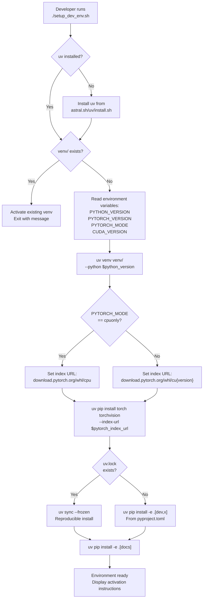
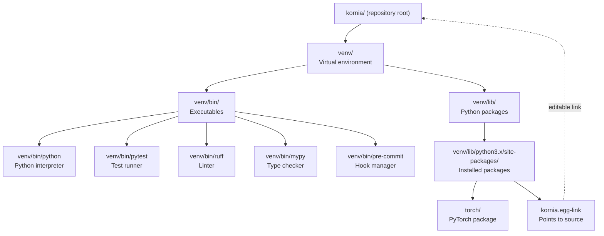
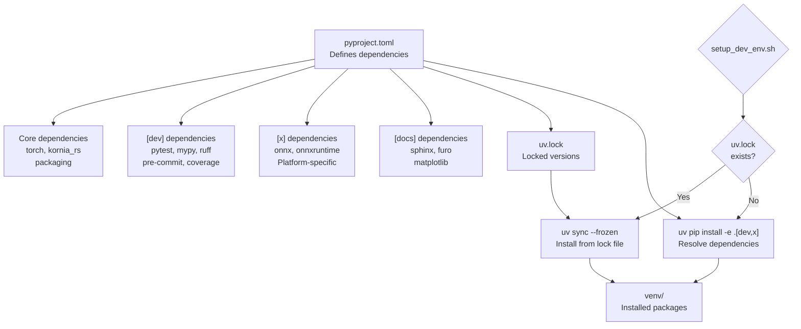
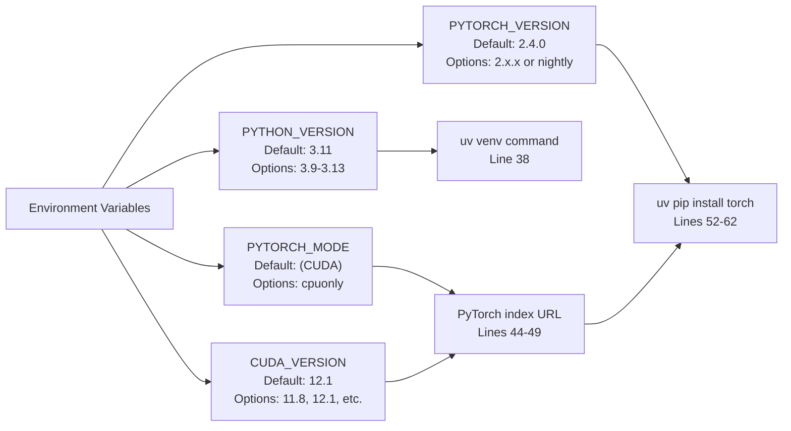

<!-- source: DeepWiki mcp.deepwiki.com · repo kornia/kornia · page 7.1 Development Environment Setup · fetched 2026-10-21 -->

# Development Environment Setup

<details>
<summary>Relevant source files</summary>

The following files were used as context for generating this wiki page:

- [.github/workflows/coverage.yml](.github/workflows/coverage.yml)
- [.gitignore](.gitignore)
- [CONTRIBUTING.md](CONTRIBUTING.md)
- [README.md](README.md)
- [README_zh-CN.md](README_zh-CN.md)
- [docker/Dockerfile.benchmark](docker/Dockerfile.benchmark)
- [docs/source/_static/img/cn_community_zhihu.jpg](docs/source/_static/img/cn_community_zhihu.jpg)
- [docs/source/community/contribute.rst](docs/source/community/contribute.rst)
- [justfile](justfile)
- [setup_dev_env.sh](setup_dev_env.sh)

</details>


This page describes how to set up a local development environment for contributing to Kornia. It covers the installation of required tools, creation of virtual environments, PyTorch installation with various configurations, and verification of the setup.

For information about dependency management and the `uv.lock` file, see [Dependency Management with uv](#7.2). For details about code quality tools and pre-commit hooks, see [Code Quality Tools and Standards](#7.3). For testing strategies, see [Testing Framework and Markers](#7.4).

## Overview of Setup Process

The Kornia development environment setup uses the `uv` package manager for fast, reproducible dependency management. The primary setup method is the `setup_dev_env.sh` script, which automates the entire process. The setup creates a local virtual environment in the `venv/` directory and installs PyTorch with the appropriate CUDA version, followed by all development dependencies.

**Setup Workflow**



**Sources:** [setup_dev_env.sh:1-81](), [CONTRIBUTING.md:67-95]()

## Primary Setup Method

The recommended setup method is the `setup_dev_env.sh` script, which automates all installation steps.

### Basic Setup

```bash
./setup_dev_env.sh
```

This command performs the following operations:

1. **Install uv package manager** - If `uv` is not found in the system path, the script downloads and installs it from `https://astral.sh/uv/install.sh` and adds it to `$HOME/.cargo/bin`
2. **Check for existing environment** - If `venv/` directory exists, the script activates it and exits with a message indicating that dependencies must be reinstalled by deleting the directory
3. **Create virtual environment** - Creates a new virtual environment using `uv venv venv/ --python $python_version`
4. **Install PyTorch** - Installs PyTorch and torchvision from the appropriate index URL based on the selected mode (CPU or CUDA)
5. **Install dependencies** - Uses `uv sync --frozen` if `uv.lock` exists, otherwise falls back to `uv pip install -e .[dev,x]`
6. **Install documentation dependencies** - Installs Sphinx and related tools with `uv pip install -e .[docs]`

**Sources:** [setup_dev_env.sh:1-81](), [README.md:104-112]()

### Customizing the Setup

The script supports several environment variables for customization:

| Variable | Default | Purpose |
|----------|---------|---------|
| `PYTHON_VERSION` | `3.11` | Python version for the virtual environment |
| `PYTORCH_VERSION` | `2.4.0` | Specific PyTorch version to install |
| `PYTORCH_MODE` | `""` (CUDA) | Set to `cpuonly` for CPU-only installation |
| `CUDA_VERSION` | `12.1` | CUDA version for GPU PyTorch builds |

**Examples:**

```bash
# Custom Python and PyTorch versions
PYTHON_VERSION=3.10 PYTORCH_VERSION=2.4.0 CUDA_VERSION=11.8 ./setup_dev_env.sh

# CPU-only PyTorch installation
PYTORCH_MODE=cpuonly ./setup_dev_env.sh

# Install nightly PyTorch builds
PYTORCH_VERSION=nightly ./setup_dev_env.sh
```

The PyTorch installation logic is implemented in [setup_dev_env.sh:43-62](). For CPU mode, it uses the index URL `https://download.pytorch.org/whl/cpu`. For CUDA mode, it constructs the URL as `https://download.pytorch.org/whl/cu${cuda_version//./}` (where dots are removed from the CUDA version).

**Sources:** [setup_dev_env.sh:19-24](), [setup_dev_env.sh:43-62](), [CONTRIBUTING.md:86-94]()

## Virtual Environment Structure

After running the setup script, the following directory structure is created:



The virtual environment is excluded from version control via `.gitignore` patterns at [.gitignore:29-30]().

**Sources:** [setup_dev_env.sh:36-41](), [.gitignore:29-30]()

## Alternative Setup Methods

### Using Justfile Commands

The `justfile` provides convenient command aliases that automatically ensure the virtual environment exists before running operations:

```bash
# Initial setup (calls setup_dev_env.sh)
just setup

# Run tests (ensures venv exists first)
just test-cpu

# Run linting (ensures venv exists first)
just lint
```

All justfile recipes that require the virtual environment call the `_ensure-venv` internal recipe at [justfile:16-23](), which checks for `venv/bin/activate` and runs `setup_dev_env.sh` if not found.

**Sources:** [justfile:16-23](), [justfile:127-129](), [CONTRIBUTING.md:96-118]()

### Manual Setup with uv

For users who prefer manual control over the setup process:

**Step 1: Install uv**

```bash
# On Linux/macOS
curl -LsSf https://astral.sh/uv/install.sh | sh

# Or using pip
pip install uv
```

**Step 2: Create virtual environment**

```bash
uv venv
source .venv/bin/activate  # On Windows: .venv\Scripts\activate
```

Note that manual setup typically creates `.venv/` while the script creates `venv/`. Both directories are ignored by Git.

**Step 3: Install PyTorch**

```bash
# For CUDA 12.1 (default)
uv pip install torch torchvision --index-url https://download.pytorch.org/whl/cu121

# For CPU-only
uv pip install torch torchvision --index-url https://download.pytorch.org/whl/cpu
```

**Step 4: Install Kornia dependencies**

```bash
# Development dependencies
uv pip install -e .[dev,x]

# Documentation dependencies (optional)
uv pip install -e .[docs]
```

The `-e` flag installs Kornia in editable mode, allowing code changes to be immediately reflected without reinstallation. The dependency groups `dev` and `x` are defined in `pyproject.toml`.

**Sources:** [CONTRIBUTING.md:119-151](), [README.md:98-102]()

## Dependency Installation Details

**Dependency Installation Flow**



### Lock File Usage

When `uv.lock` exists, the setup script uses `uv sync --frozen` at [setup_dev_env.sh:68]() to install exact versions from the lock file. This ensures reproducible builds across all developer machines and CI environments. The `--frozen` flag prevents any dependency resolution or updates.

If `uv.lock` is missing, the script falls back to `uv pip install -e .[dev,x]` at [setup_dev_env.sh:71](), which resolves dependencies from `pyproject.toml` and installs the latest compatible versions.

**Sources:** [setup_dev_env.sh:64-77](), [CONTRIBUTING.md:156-178]()

### Dependency Groups

The development environment requires multiple dependency groups:

| Group | Purpose | Installation |
|-------|---------|--------------|
| Core runtime | `torch>=2.0.0`, `kornia_rs>=0.1.9`, `packaging` | Installed automatically |
| `[dev]` | Testing, linting, type checking | `.[dev,x]` in setup script |
| `[x]` | ONNX support, platform-specific extensions | `.[dev,x]` in setup script |
| `[docs]` | Sphinx, documentation themes | `.[docs]` in setup script |

The setup script installs `[dev,x]` together at [setup_dev_env.sh:71]() and then separately installs `[docs]` at [setup_dev_env.sh:76]().

**Sources:** [setup_dev_env.sh:64-77]()

## Verifying the Setup

After setup completes, verify the installation:

**Step 1: Activate the virtual environment**

```bash
source venv/bin/activate
```

**Step 2: Check Python and PyTorch versions**

```bash
python --version
python -c "import torch; print(f'PyTorch {torch.__version__}')"
python -c "import torch; print(f'CUDA available: {torch.cuda.is_available()}')"
```

**Step 3: Check installed development tools**

```bash
which pytest
which ruff
which mypy
which pre-commit
```

All commands should point to executables in `venv/bin/`.

**Step 4: Verify Kornia installation**

```bash
python -c "import kornia; print(f'Kornia {kornia.__version__}')"
```

Since Kornia is installed in editable mode, this should work without errors.

**Step 5: Run a simple test**

```bash
pytest tests/color/test_gray.py -v --device=cpu --dtype=float32
```

This runs a small test suite to verify that the testing infrastructure works correctly.

**Using justfile for verification:**

```bash
# Check virtual environment status
just venv-status

# Run quick CPU tests
just test-cpu-f32
```

The `venv-status` recipe at [justfile:136-145]() displays the current virtual environment information.

**Sources:** [justfile:136-145](), [justfile:33-34]()

## Common Setup Scenarios

### Scenario 1: Fresh Development Setup

```bash
# Clone repository
git clone git@github.com:<username>/kornia.git
cd kornia

# Run setup script with defaults (Python 3.11, PyTorch 2.4.0, CUDA 12.1)
./setup_dev_env.sh

# Activate environment
source venv/bin/activate

# Verify installation
just venv-status
just test-cpu-f32
```

### Scenario 2: CPU-Only Development

```bash
# Clone repository
git clone git@github.com:<username>/kornia.git
cd kornia

# Setup with CPU-only PyTorch
PYTORCH_MODE=cpuonly ./setup_dev_env.sh

# Activate and test
source venv/bin/activate
pytest tests/ -k "not cuda" --device=cpu --dtype=float32
```

### Scenario 3: Multiple PyTorch Versions

For testing compatibility with different PyTorch versions, create separate virtual environments:

```bash
# PyTorch 2.3.0 with CUDA 11.8
PYTORCH_VERSION=2.3.0 CUDA_VERSION=11.8 ./setup_dev_env.sh
mv venv venv-pt23

# PyTorch 2.4.0 with CUDA 12.1
PYTORCH_VERSION=2.4.0 CUDA_VERSION=12.1 ./setup_dev_env.sh
mv venv venv-pt24

# Activate specific version
source venv-pt24/bin/activate
```

### Scenario 4: Updating Existing Environment

If the `venv/` directory already exists, the setup script exits immediately at [setup_dev_env.sh:27-33](). To update:

```bash
# Delete existing environment
rm -rf venv/

# Re-run setup
./setup_dev_env.sh

# Or use justfile
rm -rf venv/
just setup
```

**Sources:** [setup_dev_env.sh:27-33](), [CONTRIBUTING.md:52-65]()

## Integration with Development Workflow

The development environment integrates with several tools:

### Pre-commit Hooks

After setup, install pre-commit hooks to enforce code quality on every commit:

```bash
pre-commit install
```

This installs Git hooks that run `ruff`, `codespell`, and license header checks automatically. See [Code Quality Tools and Standards](#7.3) for details.

### Justfile Commands

The `justfile` provides shortcuts for common development tasks. All commands automatically use the virtual environment:

| Command | Purpose |
|---------|---------|
| `just test-cpu` | Run CPU tests |
| `just test-cuda` | Run CUDA tests |
| `just lint` | Run code linting with ruff |
| `just mypy` | Run type checking |
| `just build-docs` | Build documentation locally |
| `just sync` | Sync dependencies from uv.lock |
| `just lock-update` | Update uv.lock with new dependencies |

The `_ensure-venv` recipe at [justfile:16-23]() ensures all commands have an active virtual environment.

**Sources:** [justfile:16-23](), [justfile:78-112]()

### CI/CD Environment Setup

The GitHub Actions CI/CD pipeline uses a similar setup process via the `env/action.yml` composite action, which:

1. Sets up Python using `actions/setup-python`
2. Installs `uv` package manager
3. Installs dependencies using `uv sync --frozen` if `uv.lock` exists
4. Caches the `.venv/` directory for faster subsequent runs

The CI environment setup differs from local development in that it uses `.venv/` instead of `venv/` and runs in a clean container on each build. See [CI/CD Pipeline Architecture](#7.5) for details.

**Sources:** [.github/workflows/coverage.yml:149-166]()

## Troubleshooting

### Problem: uv installation fails

**Symptom:** The setup script fails when trying to install `uv`

**Solution:** Install `uv` manually before running the script:

```bash
# Using pip
pip install uv

# Or download the installer
curl -LsSf https://astral.sh/uv/install.sh | sh
```

### Problem: PyTorch CUDA version mismatch

**Symptom:** PyTorch installs but `torch.cuda.is_available()` returns `False`

**Solution:** Verify CUDA version and reinstall with correct index:

```bash
# Check system CUDA version
nvcc --version

# Remove venv and reinstall with correct CUDA version
rm -rf venv/
CUDA_VERSION=11.8 ./setup_dev_env.sh
```

### Problem: Lock file sync fails

**Symptom:** `uv sync --frozen` fails with version conflicts

**Solution:** The lock file may be out of sync. Regenerate it:

```bash
# Update lock file
just lock-update

# Or manually
uv lock --upgrade

# Then sync again
just sync
```

### Problem: Editable install not working

**Symptom:** Code changes don't take effect without reinstalling

**Solution:** Verify editable installation:

```bash
# Check if kornia is installed in editable mode
pip list | grep kornia
# Should show: kornia  <version>  <path-to-repo>

# If not, reinstall in editable mode
uv pip uninstall kornia
uv pip install -e .
```

### Problem: Import errors for optional dependencies

**Symptom:** `ModuleNotFoundError` for ONNX or other optional packages

**Solution:** Install the `[x]` dependency group:

```bash
uv pip install -e .[x]
```

**Sources:** [setup_dev_env.sh:12-17](), [setup_dev_env.sh:64-77](), [CONTRIBUTING.md:153-154]()

## Environment Variables Reference

Complete reference of environment variables supported by `setup_dev_env.sh`:



**Sources:** [setup_dev_env.sh:19-24](), [setup_dev_env.sh:38](), [setup_dev_env.sh:43-62]()

---

