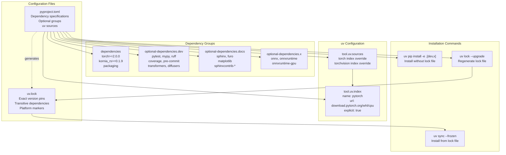
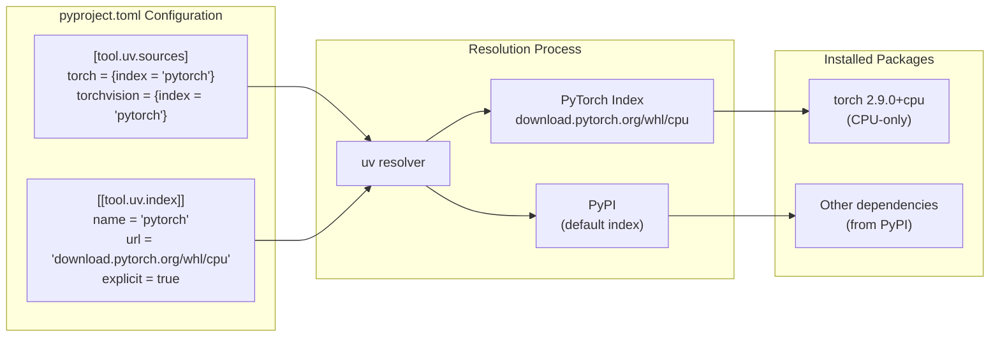
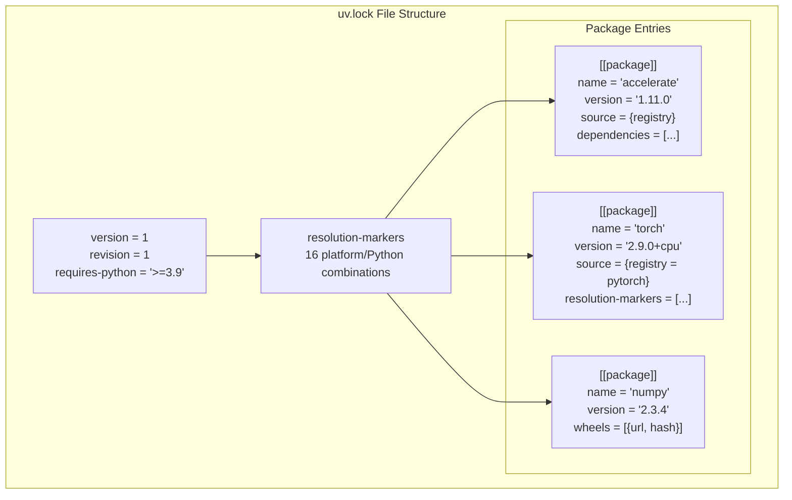
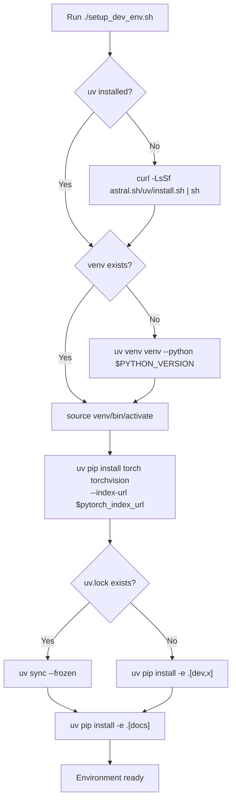
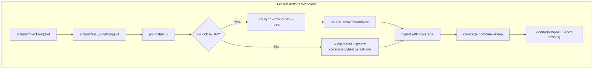
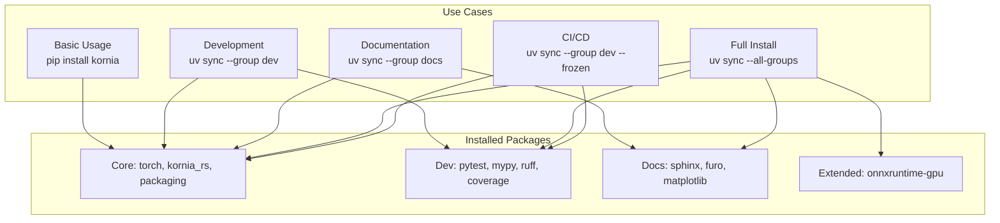

<!-- source: DeepWiki mcp.deepwiki.com · repo kornia/kornia · page 7.2 Dependency Management with uv · fetched 2026-10-21 -->

# Dependency Management with uv

<details>
<summary>Relevant source files</summary>

The following files were used as context for generating this wiki page:

- [.github/workflows/coverage.yml](.github/workflows/coverage.yml)
- [.gitignore](.gitignore)
- [.pre-commit-config.yaml](.pre-commit-config.yaml)
- [CHANGELOG.md](CHANGELOG.md)
- [CONTRIBUTING.md](CONTRIBUTING.md)
- [README.md](README.md)
- [README_zh-CN.md](README_zh-CN.md)
- [docker/Dockerfile.benchmark](docker/Dockerfile.benchmark)
- [docs/source/_static/img/cn_community_zhihu.jpg](docs/source/_static/img/cn_community_zhihu.jpg)
- [docs/source/community/contribute.rst](docs/source/community/contribute.rst)
- [justfile](justfile)
- [pyproject.toml](pyproject.toml)
- [setup_dev_env.sh](setup_dev_env.sh)
- [uv.lock](uv.lock)

</details>


## Purpose and Scope

This document describes Kornia's dependency management system using the [uv](https://github.com/astral-sh/uv) package manager. It covers the dependency configuration in `pyproject.toml`, the lock file mechanism in `uv.lock`, dependency groups, PyTorch-specific installation strategies, and integration with development workflows and CI/CD pipelines.

For information about setting up the development environment using these dependency configurations, see [Development Environment Setup](#7.1). For details on the tools installed as development dependencies (ruff, mypy, pytest), see [Code Quality Tools and Standards](#7.3).

## What is uv?

`uv` is a fast Python package manager and resolver written in Rust that Kornia uses for:

- **Fast dependency resolution**: Significantly faster than pip for resolving complex dependency graphs
- **Reproducible builds**: Lock file (`uv.lock`) ensures exact versions across all environments
- **Virtual environment management**: Built-in `uv venv` for creating isolated environments
- **Index management**: Custom package indices (e.g., PyTorch wheels from download.pytorch.org)
- **Cross-platform consistency**: Unified behavior across Linux, macOS, and Windows

Kornia migrated to `uv` to improve developer experience with faster installation times and guaranteed reproducibility across development, testing, and production environments.

**Sources:** [README.md:104-112](), [CONTRIBUTING.md:70-74](), [setup_dev_env.sh:12-17]()

## Dependency Configuration Architecture



**Sources:** [pyproject.toml:1-379](), [uv.lock:1-22]()

## Core Dependency Structure

Kornia's dependencies are organized into clearly separated groups defined in [pyproject.toml:14-60]():

### Runtime Dependencies

The minimal set required to use Kornia in production:

| Package | Version Constraint | Purpose |
|---------|-------------------|---------|
| `torch` | `>=2.0.0` | PyTorch framework (core dependency) |
| `kornia_rs` | `>=0.1.9` | Rust-based I/O operations |
| `packaging` | (any) | Version parsing utilities |

### Development Dependencies (`dev` group)

Tools and libraries needed for development, testing, and code quality:

```python
# From pyproject.toml:19-37
optional-dependencies.dev = [
    "accelerate",           # Fast model training utilities
    "coverage",            # Code coverage measurement
    "diffusers",           # Stable Diffusion utilities
    "ivy>=1.0.0.0",        # Multi-framework support
    "mypy",                # Static type checking
    "numpy<3",             # Array operations (pinned to v2.x)
    "onnx",                # ONNX model export
    "onnxruntime",         # ONNX inference
    "pillow",              # Image processing
    "pre-commit>=2",       # Git hooks for code quality
    "pytest==8.3.5",       # Test framework (exact version)
    "pytest-cov",          # Coverage plugin for pytest
    "pytest-timeout",      # Timeout plugin for pytest
    "requests",            # HTTP library
    "setuptools>=61.2",    # Build system
    "transformers<4.57",   # HuggingFace transformers (upper bound)
    "types-requests",      # Type stubs for requests
]
```

### Documentation Dependencies (`docs` group)

Sphinx and related tools for building documentation:

```python
# From pyproject.toml:42-60
optional-dependencies.docs = [
    "furo",                        # Sphinx theme
    "ivy>=1.0.0.0",               # Multi-framework examples
    "kornia_moons",               # Additional utilities
    "matplotlib",                 # Plotting for examples
    "onnx",                       # ONNX documentation
    "onnxruntime",                # ONNX runtime examples
    "opencv-python",              # OpenCV examples
    "PyYAML>=5.1",                # YAML parsing
    "sphinx",                     # Documentation generator
    "sphinx-autodoc-defaultargs", # Enhanced autodoc
    "sphinx-autodoc-typehints",   # Type hints in docs
    "sphinx-copybutton>=0.3",     # Copy button for code
    "sphinx-design",              # Design elements
    "sphinx-notfound-page",       # Custom 404 page
    "sphinxcontrib-bibtex",       # Bibliography support
    "sphinxcontrib-gtagjs",       # Google Analytics
    "sphinxcontrib-youtube",      # YouTube embedding
]
```

### Extended Dependencies (`x` group)

GPU-accelerated ONNX runtime for advanced use cases:

```python
# From pyproject.toml:38-41
optional-dependencies.x = [
    "accelerate",
    "onnxruntime-gpu>=1.16; sys_platform != 'darwin'",  # Conditional on platform
]
```

**Sources:** [pyproject.toml:14-60]()

## PyTorch Installation Strategy

Kornia uses a custom PyTorch installation strategy to avoid large CUDA dependencies by default. The configuration uses `tool.uv.sources` and `tool.uv.index` to pin PyTorch to CPU wheels:



### Configuration Details

[pyproject.toml:324-332]() defines the PyTorch source override:

```toml
[tool.uv.sources]
# Pin PyTorch to specific versions for reproducibility
torch = { index = "pytorch" }
torchvision = { index = "pytorch" }

[[tool.uv.index]]
name = "pytorch"
url = "https://download.pytorch.org/whl/cpu"
explicit = true
```

- **`explicit = true`**: Only packages explicitly marked with `index = "pytorch"` use this index
- **CPU-only by default**: Reduces download size from ~2GB to ~200MB
- **Override via environment**: `setup_dev_env.sh` allows specifying CUDA versions

### Dynamic CUDA Version Selection

[setup_dev_env.sh:43-62]() implements runtime CUDA version selection:

```bash
# Configure pytorch installation based on mode
if [ "$pytorch_mode" == "cpuonly" ]; then
    pytorch_index_url="https://download.pytorch.org/whl/cpu"
else
    # For CUDA, use the appropriate index URL
    pytorch_index_url="https://download.pytorch.org/whl/cu${cuda_version//./}"
fi

# Install pytorch and torchvision
if [ "$pytorch_version" == "nightly" ]; then
    uv pip install --pre torch torchvision --index-url https://download.pytorch.org/whl/nightly/cu${cuda_version//./}
elif [ "$pytorch_version" != "" ]; then
    uv pip install torch==$pytorch_version torchvision --index-url $pytorch_index_url
else
    uv pip install torch torchvision --index-url $pytorch_index_url
fi
```

Usage examples:

```bash
# CPU-only (default)
./setup_dev_env.sh

# Explicit CPU-only
PYTORCH_MODE=cpuonly ./setup_dev_env.sh

# CUDA 12.1 (default)
CUDA_VERSION=12.1 ./setup_dev_env.sh

# CUDA 11.8
CUDA_VERSION=11.8 ./setup_dev_env.sh

# Nightly build with CUDA
PYTORCH_VERSION=nightly CUDA_VERSION=12.1 ./setup_dev_env.sh
```

**Sources:** [pyproject.toml:324-332](), [setup_dev_env.sh:43-62]()

## Lock File Management

The `uv.lock` file provides reproducible dependency resolution across all platforms and Python versions. It contains exact version pins for all direct and transitive dependencies.

### Lock File Structure



[uv.lock:1-21]() shows the header structure:

```toml
version = 1
revision = 1
requires-python = ">=3.9"
resolution-markers = [
    "python_full_version >= '3.13' and platform_machine == 'aarch64' and sys_platform == 'linux'",
    "python_full_version == '3.12.*' and platform_machine == 'aarch64' and sys_platform == 'linux'",
    # ... 14 more platform/Python combinations
]
```

### Resolution Markers

The lock file contains 16 different resolution marker combinations to support:

- **Python versions**: 3.9, 3.10, 3.11, 3.12, 3.13
- **Operating systems**: Linux, macOS, Windows
- **Architectures**: x86_64, aarch64 (Linux), arm64 (macOS)

This ensures consistent dependency versions across all supported environments.

### Updating the Lock File

**When to update:**
- Adding new dependencies to `pyproject.toml`
- Updating dependency version constraints
- Periodically to get security updates

**Update workflow:**

```bash
# Update all dependencies to latest compatible versions
just lock-update
# Or: uv lock --upgrade

# Update a specific package
uv lock --upgrade-package numpy

# Regenerate lock file from scratch
rm uv.lock
uv lock
```

**Commit both files together:**
```bash
git add pyproject.toml uv.lock
git commit -m "Update numpy to fix CVE-XXXX-XXXX"
```

**Sources:** [uv.lock:1-80](), [CONTRIBUTING.md:167-184](), [justfile:106-107]()

## Development Workflow

### Initial Setup

The [setup_dev_env.sh:1-81]() script orchestrates the complete setup:



**Script logic breakdown:**

1. **Install uv** [setup_dev_env.sh:12-17](): Downloads and installs uv if not present
2. **Skip if venv exists** [setup_dev_env.sh:26-34](): Prevents accidental reinstallation
3. **Create virtual environment** [setup_dev_env.sh:37-41](): Uses `uv venv` with specified Python version
4. **Configure PyTorch** [setup_dev_env.sh:43-49](): Determines index URL based on CUDA/CPU mode
5. **Install PyTorch** [setup_dev_env.sh:52-62](): Version-specific installation with custom index
6. **Install dependencies** [setup_dev_env.sh:66-72]():
   - If `uv.lock` exists: `uv sync --frozen` (reproducible)
   - Otherwise: `uv pip install -e .[dev,x]` (resolve from scratch)
7. **Install docs dependencies** [setup_dev_env.sh:75-76](): Separate step for documentation tools

**Sources:** [setup_dev_env.sh:1-81]()

### Using justfile Commands

The [justfile:1-157]() provides convenient commands that automatically ensure the virtual environment exists:

```bash
# Ensure venv is set up (internal command)
just _ensure-venv

# Install dependencies from lock file
just sync

# Update lock file with latest versions
just lock-update

# Install package in development mode
just install-dev
```

Key implementation [justfile:16-23]():

```makefile
_ensure-venv:
    #!/usr/bin/env bash
    if [[ ! -f "venv/bin/activate" ]]; then
        echo "🔧 Setting up virtual environment..."
        ./setup_dev_env.sh
    else
        echo "Virtual environment found!"
    fi
```

All testing and development commands depend on `_ensure-venv`, ensuring consistent environment state.

**Sources:** [justfile:16-133]()

## CI/CD Integration

### Coverage Workflow

[.github/workflows/coverage.yml:1-187]() demonstrates CI/CD usage of uv:



**Key patterns from [.github/workflows/coverage.yml:153-166]():**

```yaml
- name: Install UV
  shell: bash
  run: pip install uv

- name: Install dev dependencies
  shell: bash
  run: |
    if [ -f "uv.lock" ]; then
      uv sync --group dev --frozen
      source .venv/bin/activate
      echo "$PWD/.venv/bin" >> $GITHUB_PATH
    else
      uv pip install --system coverage pytest pytest-cov
    fi
```

**Benefits:**
- **`--frozen` flag**: Fails if lock file is out of sync (prevents drift)
- **`--group dev`**: Installs only dev dependencies (faster, smaller)
- **Fallback mechanism**: Works even if lock file is missing
- **PATH manipulation**: Makes installed tools available to subsequent steps

### Docker Integration

[docker/Dockerfile.benchmark:1-37]() shows containerized usage:

```dockerfile
# Install uv
RUN pip install uv --no-cache-dir

# Install dependencies from lock file (or fallback)
RUN uv sync --group dev --group x --frozen || pip install .[dev,x] --no-cache-dir

# Install package in editable mode
RUN pip install -e . --no-cache-dir
```

**Multi-group installation:**
- `--group dev`: Development and testing tools
- `--group x`: Extended dependencies (ONNX GPU runtime)
- `--frozen`: Ensures reproducibility in container builds
- Fallback to pip if lock file is missing (for compatibility)

**Sources:** [.github/workflows/coverage.yml:153-177](), [docker/Dockerfile.benchmark:17-20]()

## Common Workflows

### Adding a New Dependency

1. **Add to pyproject.toml** in appropriate section:
   ```toml
   # For runtime dependencies
   dependencies = [
       "new-package>=1.0.0",
   ]
   
   # For development dependencies
   optional-dependencies.dev = [
       "new-dev-tool",
   ]
   ```

2. **Update lock file:**
   ```bash
   just lock-update
   ```

3. **Verify installation:**
   ```bash
   just sync
   python -c "import new_package; print(new_package.__version__)"
   ```

4. **Commit both files:**
   ```bash
   git add pyproject.toml uv.lock
   git commit -m "Add new-package for feature X"
   ```

### Updating Dependencies

```bash
# Update all dependencies
just lock-update

# Update specific package
uv lock --upgrade-package torch

# Update dependencies in a specific group
uv lock --upgrade-package pytest --upgrade-package mypy

# Re-sync environment
just sync
```

### Reproducing an Environment

```bash
# Clone repository
git clone https://github.com/kornia/kornia
cd kornia

# Run setup script (uses lock file automatically)
./setup_dev_env.sh

# Or manually with uv
uv venv
source venv/bin/activate  # or venv\Scripts\activate on Windows
uv sync --frozen
```

The `--frozen` flag ensures exact reproduction of dependencies from `uv.lock`.

**Sources:** [CONTRIBUTING.md:156-184]()

## Dependency Group Usage

Dependency groups allow selective installation based on use case:



### Installation Commands

| Command | Use Case | Groups Installed |
|---------|----------|------------------|
| `pip install kornia` | End users | Core only |
| `uv sync` | Basic development | Core + dev (from [dependency-groups]) |
| `uv sync --group dev` | Development with tests | Core + dev |
| `uv sync --group docs` | Documentation building | Core + docs |
| `uv sync --group dev --group x` | Development with GPU | Core + dev + x |
| `uv sync --all-groups` | Full installation | All groups |

### Dual Configuration System

Kornia maintains two parallel dependency specifications:

1. **[optional-dependencies]** [pyproject.toml:19-60](): For pip compatibility
2. **[dependency-groups]** [pyproject.toml:334-378](): For uv lock file generation

This ensures compatibility with both traditional pip-based workflows and modern uv-based workflows.

**Sources:** [pyproject.toml:19-60](), [pyproject.toml:334-378]()

## Troubleshooting

### Lock File Out of Sync

**Error:**
```
error: The lockfile at `uv.lock` needs to be updated, but `--frozen` was provided.
```

**Solution:**
```bash
uv lock
git add uv.lock
git commit -m "Update lock file"
```

### PyTorch Version Mismatch

**Issue:** Need specific PyTorch version with CUDA support

**Solution:**
```bash
# Set environment variables before setup
PYTORCH_VERSION=2.4.0 CUDA_VERSION=11.8 ./setup_dev_env.sh

# Or install manually
uv pip install torch==2.4.0 torchvision \
    --index-url https://download.pytorch.org/whl/cu118
```

### Missing uv Command

**Error:**
```
bash: uv: command not found
```

**Solution:**
```bash
# Install uv
curl -LsSf https://astral.sh/uv/install.sh | sh

# Or with pip
pip install uv

# Add to PATH (if needed)
export PATH="$HOME/.cargo/bin:$PATH"
```

### Virtual Environment Corruption

**Issue:** Dependency conflicts or broken installation

**Solution:**
```bash
# Remove virtual environment
rm -rf venv

# Recreate from scratch
./setup_dev_env.sh
```

### Platform-Specific Dependencies

**Issue:** Dependency not available for your platform

**Example:** `onnxruntime-gpu` on macOS

**Configuration in [pyproject.toml:40-41]():**
```toml
optional-dependencies.x = [
    "accelerate",
    "onnxruntime-gpu>=1.16; sys_platform != 'darwin'",  # Skipped on macOS
]
```

The environment marker `sys_platform != 'darwin'` automatically excludes the package on macOS.

**Sources:** [setup_dev_env.sh:12-17](), [pyproject.toml:40-41](), [CONTRIBUTING.md:156-184]()

---

