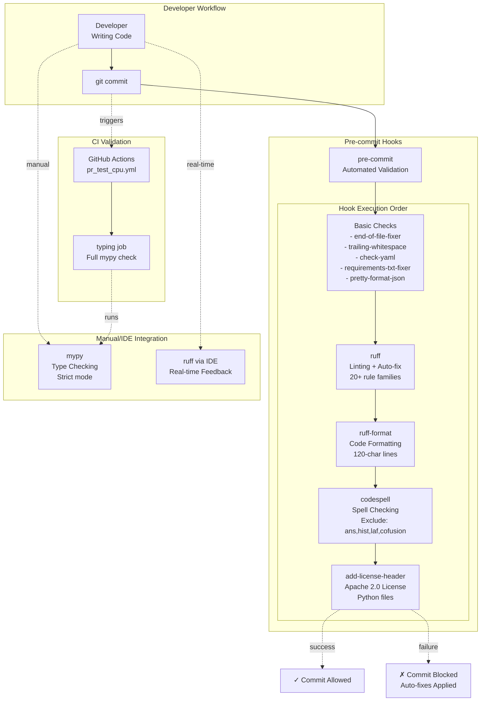
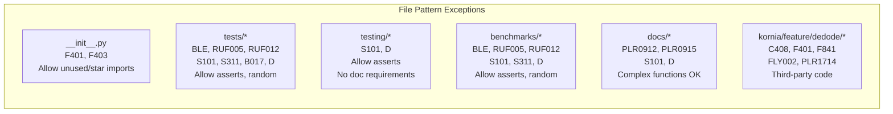
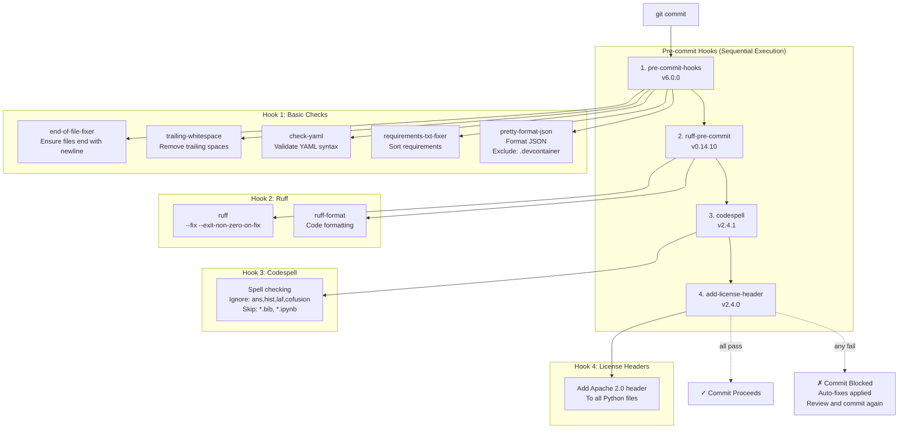
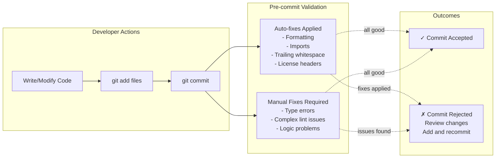

<!-- source: DeepWiki mcp.deepwiki.com · repo kornia/kornia · page 7.3 Code Quality Tools and Standards · fetched 2026-10-21 -->

# Code Quality Tools and Standards

<details>
<summary>Relevant source files</summary>

The following files were used as context for generating this wiki page:

- [.pre-commit-config.yaml](.pre-commit-config.yaml)
- [CHANGELOG.md](CHANGELOG.md)
- [pyproject.toml](pyproject.toml)
- [uv.lock](uv.lock)

</details>


## Purpose and Scope

This document describes the code quality tools, configurations, and standards used in the Kornia codebase to maintain consistent code style, catch bugs early, and enforce best practices. It covers linting, formatting, type checking, and automated pre-commit validation.

For information about testing frameworks and test execution, see [Testing Framework and Markers](#7.4). For information about the CI/CD pipeline that runs these tools on pull requests, see [CI/CD Pipeline Architecture](#7.5).

## Code Quality Tool Ecosystem

Kornia uses a comprehensive set of tools that work together to enforce code quality at multiple stages of development:



**Sources**: [.pre-commit-config.yaml:1-55](), [pyproject.toml:110-250]()

## Ruff: Unified Linting and Formatting

### Overview

Kornia uses `ruff` as its primary linting and formatting tool. Ruff is an extremely fast Python linter and formatter written in Rust that replaces multiple tools (flake8, isort, pyupgrade, etc.) with a single unified interface.

**Configuration Location**: [pyproject.toml:110-250]()

### Core Settings

| Setting | Value | Purpose |
|---------|-------|---------|
| `target-version` | `"py39"` | Minimum Python version (3.9+) |
| `line-length` | `120` | Maximum characters per line |
| `skip-magic-trailing-comma` | `false` | Respect trailing commas for formatting |

### Rule Families

Kornia enables 20+ rule families covering different aspects of code quality:

```mermaid
graph TB
    subgraph "Ruff Rule Categories"
        ERRORS["Core Error Detection"]
        STYLE["Code Style & Best Practices"]
        MODERN["Modernization & Performance"]
        SECURITY["Security & Safety"]
        DOCS["Documentation"]
    end
    
    subgraph "Core Error Detection"
        E["E - pycodestyle errors"]
        F["F - Pyflakes"]
        B["B - flake8-bugbear"]
        PL["PL - Pylint"]
    end
    
    subgraph "Code Style & Best Practices"
        C4["C4 - flake8-comprehensions"]
        C90["C90 - McCabe complexity<br/>max=20"]
        I["I - isort<br/>Import sorting"]
        ICN["ICN - Import conventions"]
        RUF["RUF - Ruff-specific rules"]
    end
    
    subgraph "Modernization & Performance"
        UP["UP - pyupgrade<br/>Modern syntax"]
        FLY["FLY - flynt<br/>f-string conversion"]
        NPY["NPY - NumPy rules"]
        PERF["Performance hints"]
    end
    
    subgraph "Security & Safety"
        S["S - flake8-bandit<br/>Security issues"]
        BLE["BLE - Blind except"]
        T10["T10 - Debugger detection"]
    end
    
    subgraph "Documentation"
        D["D - pydocstyle<br/>Google convention"]
    end
    
    ERRORS --> E
    ERRORS --> F
    ERRORS --> B
    ERRORS --> PL
    
    STYLE --> C4
    STYLE --> C90
    STYLE --> I
    STYLE --> ICN
    STYLE --> RUF
    
    MODERN --> UP
    MODERN --> FLY
    MODERN --> NPY
    MODERN --> PERF
    
    SECURITY --> S
    SECURITY --> BLE
    SECURITY --> T10
    
    DOCS --> D
```



**Complete rule family list** [pyproject.toml:118-175]():
- `AIR` - Airflow-specific checks
- `ASYNC` - flake8-async (async/await best practices)
- `B` - flake8-bugbear (bug detection)
- `BLE` - flake8-blind-except (catch-all exception handling)
- `C4` - flake8-comprehensions (list/dict/set comprehensions)
- `C90` - McCabe cyclomatic complexity (max 20)
- `D` - pydocstyle (documentation style)
- `DTZ` - flake8-datetimez (timezone-aware datetime)
- `E`, `W` - pycodestyle (PEP 8 errors and warnings)
- `F` - Pyflakes (logical errors)
- `FLY` - flynt (f-string conversions)
- `I` - isort (import sorting)
- `ICN` - flake8-import-conventions (import aliases)
- `INT` - flake8-gettext (internationalization)
- `NPY` - NumPy-specific rules
- `PL` - Pylint (comprehensive checks)
- `PYI` - flake8-pyi (stub file checks)
- `RSE` - flake8-raise (exception raising)
- `RUF` - Ruff-specific rules
- `S` - flake8-bandit (security issues)
- `SLOT` - flake8-slots (slot usage)
- `T10` - flake8-debugger (debug statement detection)
- `TID` - flake8-tidy-imports (import organization)
- `UP` - pyupgrade (modern Python syntax)
- `YTT` - flake8-2020 (Python 2/3 compatibility)

### Ignored Rules

Certain rules are intentionally disabled for compatibility or practical reasons [pyproject.toml:176-192]():

| Rule | Reason for Ignoring |
|------|-------------------|
| `PLR0915` | Allow complex functions with many statements |
| `PLC0415` | Allow imports outside top-level (for lazy loading) |
| `PLW2901` | Allow overwriting loop variables |
| `UP007`, `UP006`, `UP035`, `UP045` | Preserve `Optional[]`, `List[]` syntax for TorchScript compatibility |
| `RUF005` | Concatenation syntax breaks JIT compilation |
| `D100`, `D101`, `D102`, `D104`, `D105`, `D107` | Documentation requirements partially relaxed |

### Per-File Exceptions

Different rules apply to different parts of the codebase [pyproject.toml:212-249]():



### isort Configuration

Import sorting follows specific rules [pyproject.toml:197-200]():
- **First-party**: `kornia` package
- **Forced separate**: `testing`, `tests` modules
- **Split on trailing comma**: Maintain formatting with trailing commas

### Pylint Limits

Relaxed limits for complex computer vision code [pyproject.toml:205-210]():

| Parameter | Value | Default |
|-----------|-------|---------|
| `max-args` | 30 | 5 |
| `max-branches` | 21 | 12 |
| `max-returns` | 13 | 6 |
| `max-statements` | 64 | 50 |

### pydocstyle Convention

All docstrings follow **Google style convention** [pyproject.toml:194-195]():
- Args section for parameters
- Returns section for return values
- Raises section for exceptions
- Examples section with code snippets

**Sources**: [pyproject.toml:110-250]()

## MyPy: Static Type Checking

### Overview

MyPy enforces static type checking with strict settings to catch type-related bugs early. Configuration is at [pyproject.toml:297-312]().

### Type Checking Configuration

```mermaid
graph TB
    subgraph "MyPy Configuration"
        STRICT["Strict Mode Settings"]
        SCOPE["Checking Scope"]
        OVERRIDES["Module Overrides"]
    end
    
    subgraph "Strict Checks Enabled"
        CHECK1["check_untyped_defs: true<br/>Check untyped function bodies"]
        CHECK2["disallow_any_generics: true<br/>Require specific generic types"]
        CHECK3["disallow_incomplete_defs: true<br/>All functions must be typed"]
        CHECK4["disallow_untyped_defs: true<br/>No untyped function definitions"]
        CHECK5["no_implicit_optional: true<br/>Explicit Optional[] required"]
        CHECK6["warn_redundant_casts: true<br/>Detect unnecessary casts"]
        CHECK7["warn_unused_ignores: true<br/>Detect unused type: ignore"]
    end
    
    subgraph "Scope & Output"
        FILES["files = ['kornia/']<br/>Main package only"]
        MISSING["ignore_missing_imports: true<br/>Skip third-party stubs"]
        PRETTY["pretty: true<br/>Readable output"]
        CODES["show_error_codes: true<br/>Show error codes"]
    end
    
    subgraph "Exceptions"
        DEDODE["kornia/feature/dedode/transformer.*<br/>ignore_errors: true<br/>Third-party DINOv2 code"]
    end
    
    STRICT --> CHECK1
    STRICT --> CHECK2
    STRICT --> CHECK3
    STRICT --> CHECK4
    STRICT --> CHECK5
    STRICT --> CHECK6
    STRICT --> CHECK7
    
    SCOPE --> FILES
    SCOPE --> MISSING
    SCOPE --> PRETTY
    SCOPE --> CODES
    
    OVERRIDES --> DEDODE
```



### Key Configuration Details

**Strict type checking** [pyproject.toml:298-308]():
- `check_untyped_defs = true`: Type-check function bodies even without annotations
- `disallow_any_generics = true`: Generic types must have specific type parameters (e.g., `List[int]` not `List`)
- `disallow_incomplete_defs = true`: All parameters and return types must be annotated
- `disallow_untyped_defs = true`: Every function must have type annotations
- `no_implicit_optional = true`: `Optional[T]` must be explicit, not inferred from `None` defaults
- `warn_redundant_casts = true`: Flag unnecessary type casts
- `warn_unused_ignores = true`: Detect `# type: ignore` comments that are no longer needed

**Scope and behavior** [pyproject.toml:302-306]():
- `files = ["kornia/"]`: Only check the main package, not tests or docs
- `ignore_missing_imports = true`: Don't error on third-party packages without type stubs
- `pretty = true`: Human-readable error output
- `show_error_codes = true`: Display error codes like `[arg-type]` for easier lookup

**Module overrides** [pyproject.toml:310-312]():
- `kornia.feature.dedode.transformer.*`: Errors ignored because this is third-party DINOv2 code with different conventions

### Integration with Development Workflow

MyPy is **not** included in pre-commit hooks because:
1. It's relatively slow on the full codebase
2. It requires all dependencies to be installed
3. It's run separately in CI as a dedicated `typing` job

Developers can run it manually:
```bash
mypy kornia/
```

Or use the justfile task:
```bash
just lint
```

**Sources**: [pyproject.toml:297-312]()

## Pre-commit Hook System

### Overview

Pre-commit hooks automatically validate code before each commit, ensuring consistent quality and catching issues early. Configuration is at [.pre-commit-config.yaml:1-55]().

### Hook Execution Pipeline



### Hook Definitions

#### 1. Basic Pre-commit Hooks [.pre-commit-config.yaml:7-15]()

From `pre-commit/pre-commit-hooks` v6.0.0:
- **end-of-file-fixer**: Ensures files end with exactly one newline
- **trailing-whitespace**: Removes trailing whitespace from lines
- **check-yaml**: Validates YAML syntax
- **requirements-txt-fixer**: Alphabetically sorts requirements.txt files
- **pretty-format-json**: Formats JSON with consistent indentation (excludes `.devcontainer/`)

#### 2. Ruff Hooks [.pre-commit-config.yaml:17-22]()

From `astral-sh/ruff-pre-commit` v0.14.10:
- **ruff**: Runs linting with auto-fix enabled (`--fix --exit-non-zero-on-fix`)
  - Automatically fixes issues when possible
  - Exits with error code if any issues were fixed (requires re-commit)
- **ruff-format**: Applies code formatting (120-character line length)

#### 3. Codespell [.pre-commit-config.yaml:24-32]()

From `codespell-project/codespell` v2.4.1:
- Checks for common spelling mistakes in code and comments
- **Ignored words**: `ans,hist,laf,cofusion` (domain-specific terms)
- **Skipped files**: `*.bib` (bibliography), `*.ipynb` (notebooks)

#### 4. License Header [.pre-commit-config.yaml:34-54]()

From `arkinmodi/add-license-header` v2.4.0:
- Automatically adds Apache 2.0 license header to all Python files
- **Header content** [.pre-commit-config.yaml:41-54]():
```
Copyright 2018 Kornia Team

Licensed under the Apache License, Version 2.0 (the "License");
you may not use this file except in compliance with the License.
You may obtain a copy of the License at

    http://www.apache.org/licenses/LICENSE-2.0

Unless required by applicable law or agreed to in writing, software
distributed under the License is distributed on an "AS IS" BASIS,
WITHOUT WARRANTIES OR CONDITIONS OF ANY KIND, either express or implied.
See the License for the specific language governing permissions and
limitations under the License.
```

### Pre-commit.ci Integration

The repository uses **pre-commit.ci** for automated PR fixes [.pre-commit-config.yaml:1-4]():

| Setting | Value | Purpose |
|---------|-------|---------|
| `autofix_prs` | `true` | Automatically commit fixes to PRs |
| `autoupdate_commit_msg` | `[pre-commit.ci] pre-commit suggestions` | Standardized commit message |

When a PR is opened, pre-commit.ci:
1. Runs all pre-commit hooks
2. If auto-fixable issues are found, creates a new commit with fixes
3. Updates the PR automatically
4. Developers can pull the changes and continue working

### Local Setup

Install pre-commit hooks locally:
```bash
pre-commit install
```

Run manually on all files:
```bash
pre-commit run --all-files
```

Run on staged files:
```bash
pre-commit run
```

**Sources**: [.pre-commit-config.yaml:1-55]()

## Code Style Standards

### Line Length and Formatting

- **Maximum line length**: 120 characters [pyproject.toml:112]()
- **Magic trailing comma**: Respected for formatting decisions [pyproject.toml:115]()
- **Line breaks**: Ruff format handles automatically

### Import Organization

Imports follow isort rules with Kornia-specific settings [pyproject.toml:197-200]():

1. **Standard library imports**
2. **Third-party imports**
3. **First-party imports** (`kornia.*`)
4. **Testing imports** (forced separate): `testing`, `tests`

Example:
```python
import os
from typing import Optional

import torch
import torch.nn as nn

from kornia.core import Tensor
from kornia.geometry import transform_points

from testing import BaseTester
```

### Documentation Style

All public APIs use **Google-style docstrings** [pyproject.toml:194-195]():

```python
def function_name(param1: int, param2: str) -> bool:
    """Brief description of function.

    Longer description if needed, explaining behavior
    and important details.

    Args:
        param1: Description of param1.
        param2: Description of param2.

    Returns:
        Description of return value.

    Raises:
        ValueError: When validation fails.

    Example:
        >>> result = function_name(42, "test")
        >>> print(result)
        True
    """
```

### Type Annotations

All functions must have complete type annotations [pyproject.toml:298-301]():
- Parameter types
- Return type
- Use `Optional[T]` explicitly, not implicit from `None` defaults
- Generic types must specify type parameters (e.g., `List[Tensor]` not `List`)

### Complexity Limits

| Metric | Limit | Check |
|--------|-------|-------|
| McCabe complexity | 20 | [pyproject.toml:203]() |
| Function arguments | 30 | [pyproject.toml:207]() |
| Branches | 21 | [pyproject.toml:208]() |
| Return statements | 13 | [pyproject.toml:209]() |
| Statements | 64 | [pyproject.toml:210]() |

These limits are more relaxed than defaults to accommodate complex computer vision algorithms.

### TorchScript Compatibility

Code must maintain compatibility with TorchScript, which affects type annotation style [pyproject.toml:181-185]():
- Use `Optional[]` and `Union[]` instead of `|` operator
- Use `List[]`, `Dict[]` instead of `list`, `dict`
- Avoid `RUF005` optimizations that break JIT compilation
- Preserve deprecated typing imports (`UP035`, `UP045`)

**Sources**: [pyproject.toml:110-250]()

## Quality Enforcement Workflow

### Development Stage



### CI/CD Validation Stage

When code reaches CI, additional validation occurs (see [CI/CD Pipeline Architecture](#7.5)):

1. **typing job**: Full mypy check on the codebase
2. **tests job**: Runs all tests with coverage requirements
3. **docs job**: Builds documentation and runs doctests
4. **tutorials job**: Validates notebook examples

The pre-commit hooks ensure most issues are caught before CI, making CI failures less common and faster to debug.

**Sources**: [.pre-commit-config.yaml:1-55](), [pyproject.toml:110-312]()

## Running Quality Checks Manually

### Using justfile Commands

The project provides a `justfile` with convenience commands for running quality checks:

```bash
# Run all linting and formatting
just lint

# Run type checking
just mypy

# Run pre-commit on all files
just pre-commit

# Auto-fix formatting issues
just format
```

See [Development Environment Setup](#7.1) for justfile details.

### Direct Tool Invocation

Run individual tools directly:

```bash
# Ruff linting with auto-fix
ruff check --fix kornia/

# Ruff formatting
ruff format kornia/

# Type checking
mypy kornia/

# Pre-commit on staged files
pre-commit run

# Pre-commit on all files
pre-commit run --all-files

# Spell checking
codespell kornia/
```

### IDE Integration

Most IDEs support integration with these tools:

- **VS Code**: Install Ruff and MyPy extensions
- **PyCharm**: Configure Ruff as external tool, enable MyPy plugin
- **Vim/Neovim**: Use ALE or similar linting plugins

IDE integration provides real-time feedback as you type, catching issues before commit.

**Sources**: [pyproject.toml:110-312](), [.pre-commit-config.yaml:1-55]()

---

