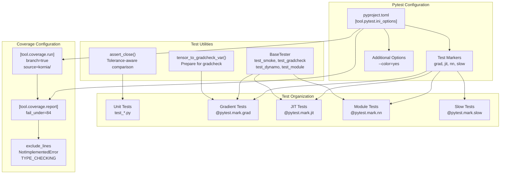
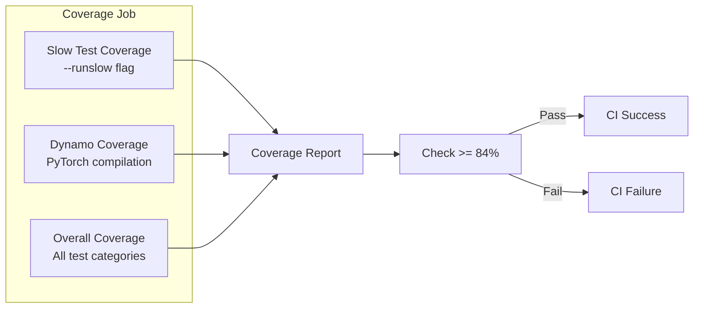
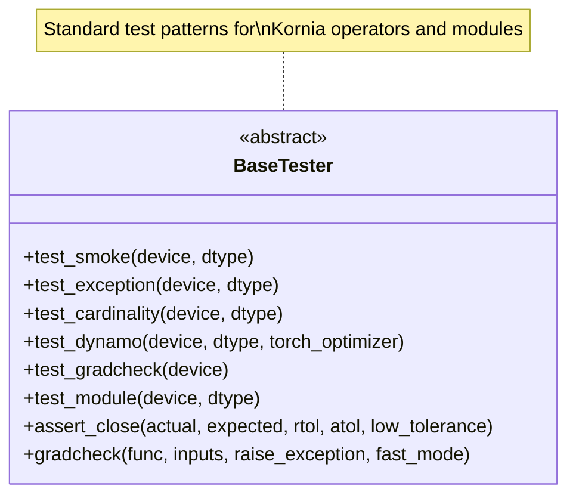
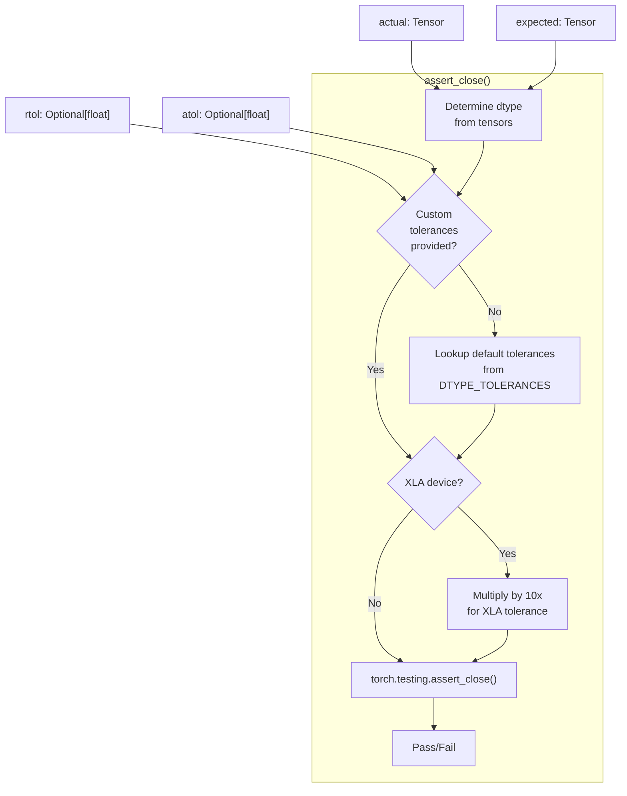
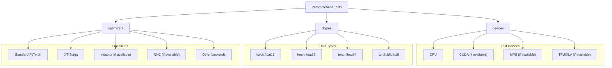
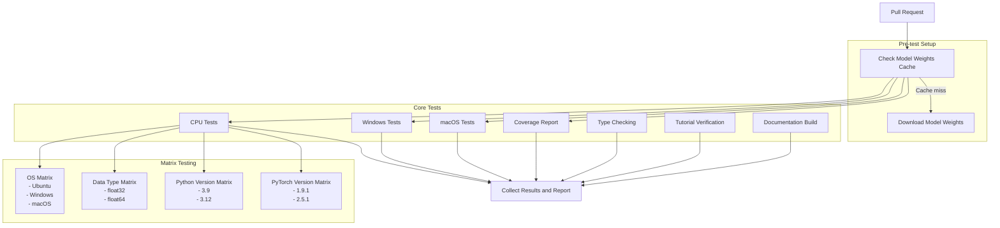
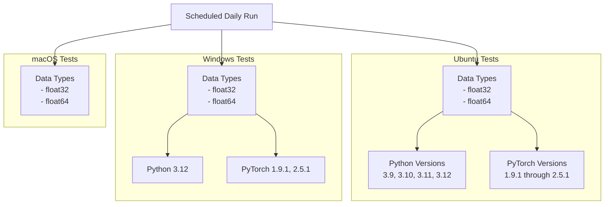
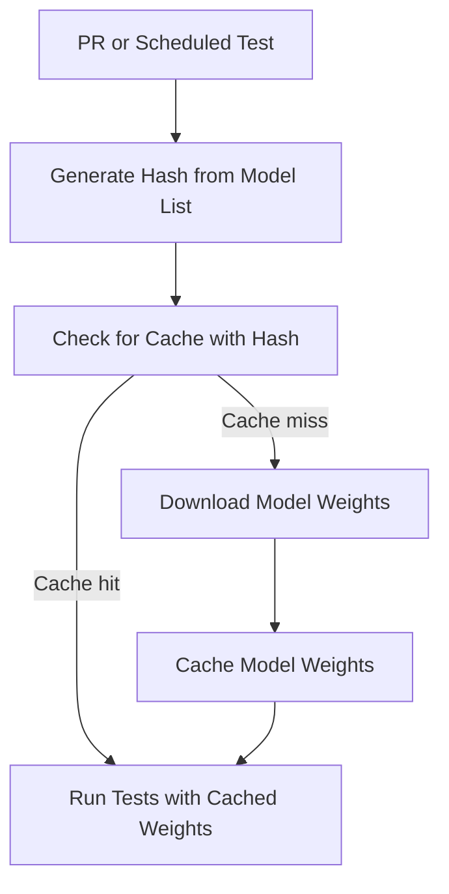

<!-- source: DeepWiki mcp.deepwiki.com · repo kornia/kornia · page 7.4 Testing Framework and Markers · fetched 2026-10-21 -->

# Testing Framework and Markers

<details>
<summary>Relevant source files</summary>

The following files were used as context for generating this wiki page:

- [.github/actions/env/action.yml](.github/actions/env/action.yml)
- [.github/workflows/docs.yml](.github/workflows/docs.yml)
- [.github/workflows/pr_test_cpu.yml](.github/workflows/pr_test_cpu.yml)
- [.github/workflows/scheduled_test_cpu.yml](.github/workflows/scheduled_test_cpu.yml)
- [.github/workflows/tests.yml](.github/workflows/tests.yml)
- [.pre-commit-config.yaml](.pre-commit-config.yaml)
- [CHANGELOG.md](CHANGELOG.md)
- [pyproject.toml](pyproject.toml)
- [uv.lock](uv.lock)

</details>


## Purpose and Scope

This document explains Kornia's testing infrastructure, including the pytest framework configuration, test markers for categorizing tests, coverage requirements, and the base testing utilities. The testing system ensures reliability and correctness across devices (CPU, CUDA, MPS), data types (float16, float32, float64, bfloat16), and PyTorch versions. Kornia uses pytest markers to categorize tests by their characteristics (gradient checking, JIT compilation, module testing, execution speed), enabling selective test execution during development and CI.

## Testing Framework Architecture

Kornia's testing infrastructure integrates pytest configuration, test markers, coverage tracking, and test utilities to validate functionality across different environments.

### High-Level Testing Components



Sources: [pyproject.toml:251-258](), [pyproject.toml:260-295](), [conftest.py:1-344]()

## Pytest Markers

Kornia defines four custom pytest markers to categorize tests by their characteristics. These markers enable selective test execution and help organize the test suite.

### Marker Definitions

The markers are defined in `pyproject.toml` under `[tool.pytest.ini_options]`:

| Marker | Purpose | Usage |
|--------|---------|-------|
| `grad` | Marks a test as a gradient checking test using `torch.autograd.gradcheck` | `@pytest.mark.grad` |
| `jit` | Marks a test that validates TorchScript compilation compatibility | `@pytest.mark.jit` |
| `nn` | Marks a test that validates `nn.Module` functionality (forward, state_dict, etc.) | `@pytest.mark.nn` |
| `slow` | Marks a test as slow to run, typically excluded from fast CI runs | `@pytest.mark.slow` |

### Selective Test Execution

Markers enable running specific test categories:

```bash
# Run only gradient checking tests
pytest -m grad

# Run tests except slow ones
pytest -m "not slow"

# Run gradient and JIT tests
pytest -m "grad or jit"

# Run module tests that are not slow
pytest -m "nn and not slow"
```

During CI, slow tests are conditionally executed:
- **PR tests**: Slow tests are excluded by default (`-k "not test_dynamo"`)
- **Scheduled tests**: Slow tests are included with `--runslow` flag

Sources: [pyproject.toml:251-258](), [.github/workflows/pr_test_cpu.yml:27](), [.github/workflows/scheduled_test_cpu.yml:53]()

## Coverage Configuration

Kornia enforces a minimum branch coverage of **84%** to ensure adequate test coverage across the codebase.

### Coverage Settings

The coverage configuration is defined in `[tool.coverage.run]` and `[tool.coverage.report]`:

| Setting | Value | Purpose |
|---------|-------|---------|
| `branch` | `true` | Track branch coverage (if/else paths), not just line coverage |
| `source` | `['kornia/']` | Measure coverage only for kornia package code |
| `omit` | `['*/__main__.py', '*/setup.py']` | Exclude entry points and setup scripts |
| `fail_under` | `84` | Fail if coverage drops below 84% |
| `show_missing` | `true` | Display lines not covered in report |
| `skip_covered` | `true` | Hide files with 100% coverage from report |

### Excluded Lines

Certain code patterns are excluded from coverage requirements:

| Pattern | Reason |
|---------|--------|
| `# pragma: no cover` | Explicit exclusion marker |
| `raise AssertionError` | Defensive programming, rarely executed |
| `raise NotImplementedError` | Abstract methods, implemented in subclasses |
| `if TYPE_CHECKING:` | Type-checking only code, not executed at runtime |
| `def __repr__` | String representations, low priority |
| `if __name__ == .__main__.:` | Script entry points |

### Coverage Workflow

Coverage is measured during CI in the `coverage` job, which runs three coverage types:



Sources: [pyproject.toml:260-295](), [.github/workflows/coverage.yml]()

## Test Utilities

Kornia provides testing utilities in the `kornia.testing` module for consistent test behavior and tensor comparisons.

### Key Testing Utilities

| Utility | Purpose | Typical Usage |
|---------|---------|---------------|
| `assert_close()` | Compares tensors with dtype-appropriate tolerances | Verifying operation outputs |
| `tensor_to_gradcheck_var()` | Prepares tensors for `torch.autograd.gradcheck` | Gradient validation tests marked with `@pytest.mark.grad` |
| `BaseTester` | Abstract base class with standard test methods | Extend for systematic operator testing |
| `create_eye_batch()` | Creates batches of identity matrices | Testing transformations and matrix operations |
| `xla_is_available()` | Checks XLA backend availability | Conditional XLA-specific tests |

Note: The `kornia.testing` module is deprecated since Kornia 0.7.2 and will be removed in Kornia 0.8.0.

Sources: [kornia/testing/__init__.py:18-60]()

## BaseTester Class

The `BaseTester` abstract class provides standardized test methods for Kornia operators, reducing test boilerplate and ensuring consistent validation patterns.

### BaseTester Test Methods



### Test Method Purposes

| Method | Marker | Purpose |
|--------|--------|---------|
| `test_smoke()` | None | Basic functionality test with simple inputs |
| `test_exception()` | None | Validates proper error handling for invalid inputs |
| `test_cardinality()` | None | Verifies output shape matches expected dimensions |
| `test_gradcheck()` | `@pytest.mark.grad` | Validates gradient computation using `torch.autograd.gradcheck` |
| `test_dynamo()` | `@pytest.mark.slow` | Tests compatibility with `torch.compile` and various backends |
| `test_module()` | `@pytest.mark.nn` | Tests `nn.Module` interface (forward, state_dict, load_state_dict) |
| `assert_close()` | N/A (utility) | Compares tensors with appropriate tolerances |
| `gradcheck()` | N/A (utility) | Wrapper around `torch.autograd.gradcheck` with defaults |

### BaseTester Usage Pattern

Test classes extend `BaseTester` and implement abstract methods to define test scenarios:

```python
class TestMyOperation(BaseTester):
    def test_smoke(self, device, dtype):
        # Define test input
        input_tensor = torch.rand(2, 3, 4, device=device, dtype=dtype)
        
        # Run operation
        output = my_operation(input_tensor)
        
        # Verify shape and basic properties
        assert output.shape == input_tensor.shape
        assert output.device == device
        assert output.dtype == dtype
    
    @pytest.mark.grad
    def test_gradcheck(self, device):
        # Use float64 for gradient checking
        input_tensor = torch.rand(2, 3, 4, device=device, dtype=torch.float64, requires_grad=True)
        
        # Convert to gradcheck variable
        input_tensor = tensor_to_gradcheck_var(input_tensor)
        
        # Verify gradients
        assert self.gradcheck(my_operation, (input_tensor,), raise_exception=True)
```

Sources: [kornia/testing/__init__.py:141-215]()

## Tensor Comparison and Tolerances

The `assert_close()` function compares tensors with dtype-specific tolerances, accounting for the precision characteristics of different floating-point formats.

### Tolerance Selection Algorithm



### Default Tolerance Values

The `_DTYPE_TOLERANCES` dictionary defines tolerances for each dtype:

| Data Type | Relative Tolerance (rtol) | Absolute Tolerance (atol) | Use Case |
|-----------|---------------------------|---------------------------|----------|
| `torch.bfloat16` | 7.8e-3 | 7.8e-3 | Brain floating-point, reduced precision |
| `torch.float16` | 9.7e-4 | 9.7e-4 | Half precision, GPU acceleration |
| `torch.float32` | 1e-4 | 1e-5 | Standard precision, default for most operations |
| `torch.float64` | 1e-5 | 1e-5 | Double precision, used for gradient checking |

### XLA Device Adjustment

When tensors are on XLA devices (TPU), tolerances are automatically increased by 10x to account for different numerical behavior:

```python
# Example: torch.float32 on XLA
# Standard: rtol=1e-4, atol=1e-5
# XLA adjusted: rtol=1e-3, atol=1e-4
```

### Low Tolerance Mode

The `low_tolerance` parameter further relaxes tolerances for operations where numerical precision is challenging:

```python
# With low_tolerance=True, tolerances are multiplied by another 10x
assert_close(actual, expected, low_tolerance=True)
```

Sources: [kornia/testing/__init__.py:131-139](), [kornia/testing/__init__.py:167-204](), [kornia/testing/__init__.py:318-339]()

## Test Configuration

The `conftest.py` file sets up the testing environment and defines fixtures and parameterization for tests.

### Device and Data Type Management

Tests in Kornia are parameterized to run on multiple devices and data types:



Sources: [conftest.py:41-83](), [conftest.py:124-171]()

### Test Fixtures

Key pytest fixtures provided for testing:

| Fixture | Purpose |
|---------|---------|
| `device` | Returns a torch device for testing (CPU, CUDA, MPS, XLA) |
| `dtype` | Returns a torch dtype for testing |
| `torch_optimizer` | Returns a function to optimize torch code (JIT, compile) |
| `data` | Returns test data for specific test scenarios |

Sources: [conftest.py:89-102](), [conftest.py:332-343]()

## Continuous Integration

Kornia uses GitHub Actions for continuous integration, with several workflows to ensure comprehensive testing across different environments.

### CI Workflow for Pull Requests



Sources: [.github/workflows/pr_test_cpu.yml:1-129]()

### Scheduled Tests

Kornia also runs scheduled tests daily, which test against a wider range of Python and PyTorch versions:



Sources: [.github/workflows/scheduled_test_cpu.yml:1-119]()

## Model Weights Caching

Tests that require pre-trained models use a caching system to avoid downloading weights repeatedly:



Sources: [.github/download-models-weights.py:1-52](), [.github/workflows/pr_test_cpu.yml:17-36]()

## Test Writing Best Practices

When writing tests for Kornia, follow these patterns to ensure consistency and comprehensive coverage.

### General Guidelines

| Practice | Description | Reason |
|----------|-------------|--------|
| **Extend BaseTester** | Use `BaseTester` for operator tests | Provides standardized test methods |
| **Apply Markers** | Use `@pytest.mark.grad`, `@pytest.mark.jit`, `@pytest.mark.nn`, `@pytest.mark.slow` | Enables selective test execution |
| **Test Matrix** | Parameterize across devices, dtypes, and shapes | Ensures broad compatibility |
| **Use assert_close** | Prefer `assert_close()` over direct equality | Handles floating-point tolerances correctly |
| **Document Slow Tests** | Mark computationally intensive tests with `@pytest.mark.slow` | Excluded from fast CI runs |

### Example Test Patterns

#### Basic Unit Test with Device/Dtype Parameterization

```python
def test_operation(device, dtype):
    """Test basic operation functionality."""
    # Create input tensor using fixture-provided device and dtype
    input_tensor = torch.rand(1, 3, 32, 32, device=device, dtype=dtype)
    
    # Run operation
    output = kornia_operation(input_tensor)
    
    # Expected output (reference or analytical result)
    expected = compute_expected(input_tensor)
    
    # Compare with appropriate tolerance
    assert_close(output, expected)
```

#### Gradient Checking Test

```python
@pytest.mark.grad
def test_gradcheck(device):
    """Verify gradient computation correctness."""
    # Always use float64 for gradient checking
    input_tensor = torch.rand(
        2, 3, 32, 32, 
        device=device, 
        dtype=torch.float64, 
        requires_grad=True
    )
    
    # Prepare for gradcheck
    input_tensor = tensor_to_gradcheck_var(input_tensor)
    
    # Run gradient check
    assert gradcheck(
        kornia_operation, 
        (input_tensor,), 
        raise_exception=True,
        fast_mode=True  # Faster numerical gradient approximation
    )
```

#### Module Test with nn.Module Interface

```python
@pytest.mark.nn
def test_module(device, dtype):
    """Test nn.Module interface compliance."""
    # Instantiate module
    module = KorniaModule(param1=1.0, param2=2.0).to(device, dtype)
    
    # Test forward pass
    input_tensor = torch.rand(2, 3, 32, 32, device=device, dtype=dtype)
    output = module(input_tensor)
    
    assert output.shape == input_tensor.shape
    assert output.device == device
    assert output.dtype == dtype
    
    # Test state dict serialization
    state_dict = module.state_dict()
    new_module = KorniaModule(param1=0.0, param2=0.0).to(device, dtype)
    new_module.load_state_dict(state_dict)
    
    # Verify loaded module produces same output
    output2 = new_module(input_tensor)
    assert_close(output, output2)
```

#### JIT Compilation Test

```python
@pytest.mark.jit
def test_jit(device, dtype):
    """Test TorchScript compilation compatibility."""
    # Create operation wrapper for scripting
    def operation_wrapper(x: torch.Tensor) -> torch.Tensor:
        return kornia_operation(x)
    
    # Script the operation
    scripted_op = torch.jit.script(operation_wrapper)
    
    # Compare scripted vs. eager execution
    input_tensor = torch.rand(2, 3, 32, 32, device=device, dtype=dtype)
    
    eager_output = operation_wrapper(input_tensor)
    scripted_output = scripted_op(input_tensor)
    
    assert_close(scripted_output, eager_output)
```

#### Slow Test Marking

```python
@pytest.mark.slow
def test_large_scale_operation(device, dtype):
    """Test operation on large inputs (marked slow)."""
    # Large tensor that takes significant time
    large_input = torch.rand(32, 3, 512, 512, device=device, dtype=dtype)
    
    output = kornia_operation(large_input)
    
    # Verify properties on large scale
    assert output.shape == large_input.shape
```

### BaseTester Extension Pattern

```python
class TestMyOperation(BaseTester):
    """Comprehensive test suite for my_operation using BaseTester."""
    
    def test_smoke(self, device, dtype):
        """Basic smoke test."""
        input_tensor = torch.rand(2, 3, 4, 5, device=device, dtype=dtype)
        output = my_operation(input_tensor)
        assert output.shape == input_tensor.shape
    
    def test_exception(self, device, dtype):
        """Test invalid input handling."""
        with pytest.raises(ValueError):
            my_operation(torch.rand(2, 3, device=device, dtype=dtype))  # Wrong shape
    
    def test_cardinality(self, device, dtype):
        """Verify output dimensions."""
        for shape in [(1, 3, 4, 5), (2, 3, 8, 8), (4, 3, 16, 16)]:
            input_tensor = torch.rand(*shape, device=device, dtype=dtype)
            output = my_operation(input_tensor)
            assert output.shape == input_tensor.shape
    
    @pytest.mark.grad
    def test_gradcheck(self, device):
        """Gradient checking test."""
        input_tensor = tensor_to_gradcheck_var(
            torch.rand(2, 3, 4, 5, device=device, dtype=torch.float64)
        )
        assert self.gradcheck(my_operation, (input_tensor,))
    
    @pytest.mark.nn
    def test_module(self, device, dtype):
        """Module interface test."""
        module = MyOperationModule().to(device, dtype)
        input_tensor = torch.rand(2, 3, 4, 5, device=device, dtype=dtype)
        output = module(input_tensor)
        assert output.shape == input_tensor.shape
```

Sources: [kornia/testing/__init__.py:141-215](), [pyproject.toml:251-258]()

## Conclusion

Kornia's testing framework provides a robust foundation for ensuring the library's reliability across different environments. By leveraging PyTorch's testing utilities and extending them with computer vision-specific tools, the framework enables comprehensive validation of mathematical correctness, gradient computation, and compatibility across devices and data types.

The combination of unit tests, test utilities, and continuous integration pipelines helps maintain Kornia's quality as it continues to evolve, ensuring that all operations work correctly on supported platforms and with various data types.

---

