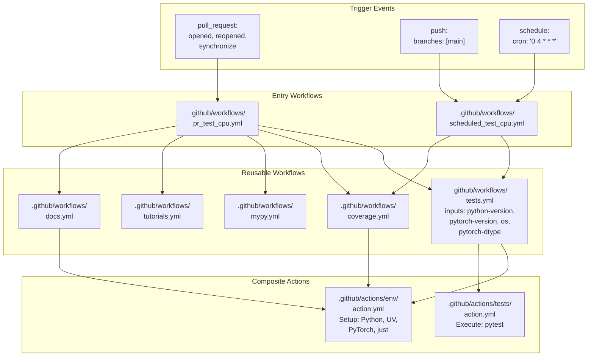
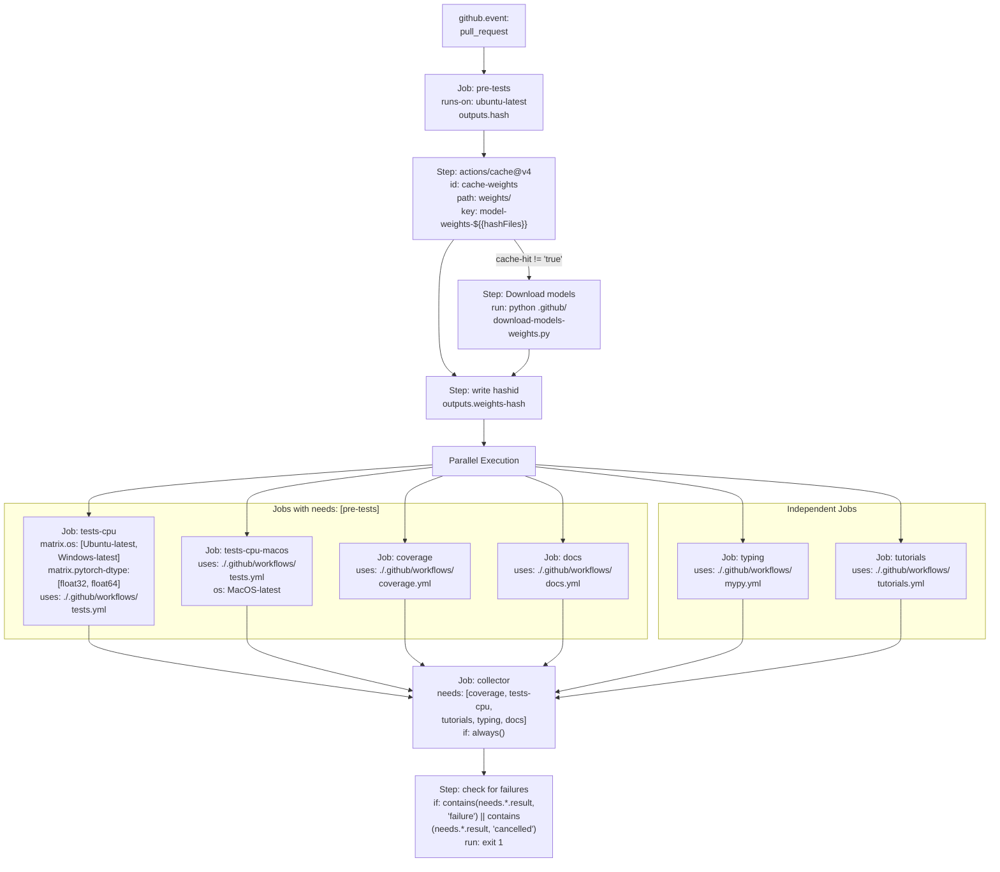
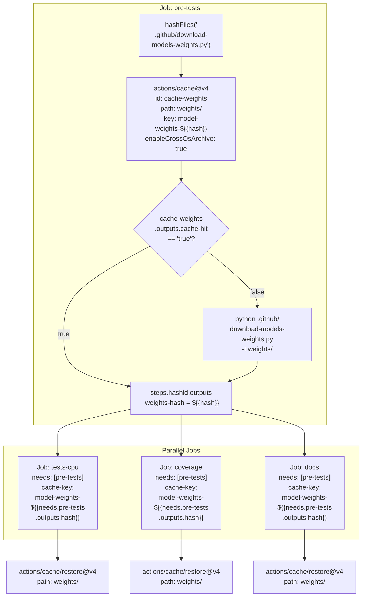
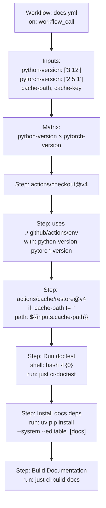
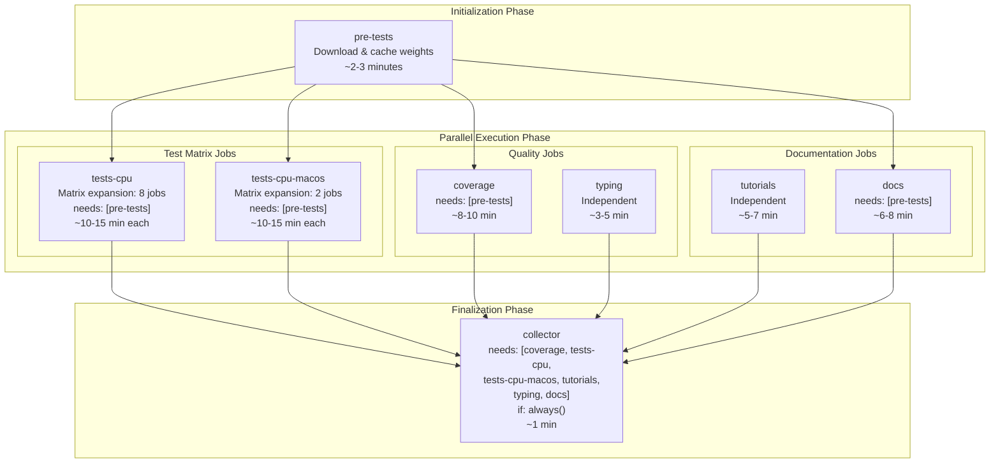
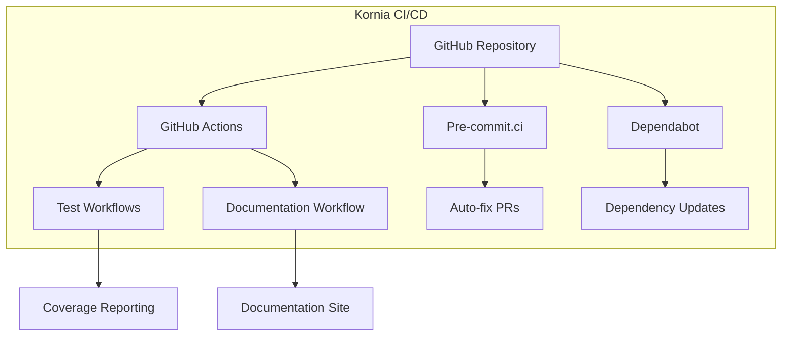

<!-- source: DeepWiki mcp.deepwiki.com · repo kornia/kornia · page 7.5 CI/CD Pipeline Architecture · fetched 2026-10-21 -->

# CI/CD Pipeline Architecture

<details>
<summary>Relevant source files</summary>

The following files were used as context for generating this wiki page:

- [.github/actions/env/action.yml](.github/actions/env/action.yml)
- [.github/workflows/docs.yml](.github/workflows/docs.yml)
- [.github/workflows/pr_test_cpu.yml](.github/workflows/pr_test_cpu.yml)
- [.github/workflows/scheduled_test_cpu.yml](.github/workflows/scheduled_test_cpu.yml)
- [.github/workflows/tests.yml](.github/workflows/tests.yml)

</details>


This document describes Kornia's GitHub Actions CI/CD pipeline architecture, focusing on workflow orchestration, test matrix expansion, caching mechanisms, and composite action design. See page 7.3 for code quality tools and page 7.4 for testing framework details.

## Overview

Kornia's CI/CD system uses GitHub Actions with reusable workflows (`workflow_call` trigger) to test across multiple platforms. The pipeline validates PRs with a fast matrix (2 Python × 2 PyTorch versions) and runs comprehensive scheduled tests daily (4 Python × 6 PyTorch versions on Ubuntu).

### High-Level Architecture



Sources: [.github/workflows/pr_test_cpu.yml:3-9](), [.github/workflows/scheduled_test_cpu.yml:3-8](), [.github/workflows/tests.yml:1-3](), [.github/actions/env/action.yml:1-4]()
</thinking>

### CI/CD Pipeline Characteristics

| Characteristic | Implementation | Location |
|---------------|---------------|----------|
| **Reusable Workflows** | `workflow_call` trigger with parameterized inputs | [.github/workflows/tests.yml:1-3]() |
| **Concurrency Control** | `cancel-in-progress: true` per PR/branch | [.github/workflows/pr_test_cpu.yml:11-13]() |
| **Model Weight Caching** | `actions/cache@v4` with hash-based keys | [.github/workflows/pr_test_cpu.yml:24-30]() |
| **Matrix Testing** | JSON array inputs with `fromJSON()` expansion | [.github/workflows/tests.yml:53-54]() |
| **Job Aggregation** | `collector` job with `needs` + `if: always()` | [.github/workflows/pr_test_cpu.yml:100-107]() |
| **Environment Setup** | Composite action at `.github/actions/env/` | [.github/actions/env/action.yml:1-120]() |

Sources: [.github/workflows/pr_test_cpu.yml:1-130](), [.github/workflows/tests.yml:1-132](), [.github/actions/env/action.yml:1-120]()


## Workflow Composition and Reusability

Kornia's CI/CD architecture uses GitHub Actions' `workflow_call` trigger to create reusable workflow modules. This design allows the same test logic to be invoked from multiple entry points (PR tests, scheduled tests, manual dispatch) with different configurations.

### Reusable Workflow Pattern

The `tests.yml` workflow accepts inputs for customization:

```yaml
on:
  workflow_call:
    inputs:
      python-version: '["3.12"]'
      pytorch-version: '["2.5.1"]'
      os: ubuntu-latest
      pytorch-dtype: float32
      pytorch-device: cpu
      pytest-extra: --timeout=30 -k "not test_dynamo"
      cache-path: weights/
      cache-key: model-weights-{hash}
```

This workflow is called by both `pr_test_cpu.yml` and `scheduled_test_cpu.yml` with different matrix configurations:

| Workflow | Python Versions | PyTorch Versions | OS Coverage |
|----------|----------------|------------------|-------------|
| `pr_test_cpu.yml` | 3.9, 3.12 | 2.0.1, 2.5.1 | Ubuntu, Windows, macOS |
| `scheduled_test_cpu.yml` | 3.9, 3.10, 3.11, 3.12 | 1.9.1, 2.0.1-2.5.1 | Ubuntu, Windows, macOS |

Sources: [.github/workflows/tests.yml:1-44](), [.github/workflows/pr_test_cpu.yml:40-71](), [.github/workflows/scheduled_test_cpu.yml:39-94]()

## Pull Request Workflow: `pr_test_cpu.yml`

The `pr_test_cpu.yml` workflow coordinates parallel test execution with the `pre-tests` job for initialization and the `collector` job for result aggregation.

### Job Orchestration Graph



Sources: [.github/workflows/pr_test_cpu.yml:15-107]()

### Concurrency Configuration

The workflow uses GitHub Actions concurrency groups to cancel redundant runs:

```yaml
concurrency:
  group: ${{ github.workflow }}-${{ github.event.pull_request.number || github.ref }}
  cancel-in-progress: true
```

This configuration at [.github/workflows/pr_test_cpu.yml:11-13]() creates a unique group per PR number, automatically canceling in-progress runs when new commits are pushed to the same PR.

Sources: [.github/workflows/pr_test_cpu.yml:11-13]()

## Test Matrix Strategy

Kornia's test matrix strategy uses GitHub Actions matrix expansion to generate multiple job instances from a compact configuration. The matrix dimensions include OS, Python version, PyTorch version, and dtype.

### Matrix Expansion Example

The `pr_test_cpu.yml` workflow defines a matrix:

```yaml
strategy:
  fail-fast: true
  matrix:
    os: ["Ubuntu-latest", "Windows-latest"]
    pytorch-dtype: ["float32", "float64"]
```

This matrix is passed to the reusable `tests.yml` workflow with Python and PyTorch version arrays:

```yaml
with:
  os: ${{ matrix.os }}
  python-version: '["3.9", "3.12"]'
  pytorch-version: '["2.0.1", "2.5.1"]'
  pytorch-dtype: ${{ matrix.pytorch-dtype }}
```

The `tests.yml` workflow further expands this into a full matrix:

```yaml
strategy:
  matrix:
    python-version: ${{ fromJSON(inputs.python-version) }}  # ["3.9", "3.12"]
    pytorch-version: ${{ fromJSON(inputs.pytorch-version) }}  # ["2.0.1", "2.5.1"]
```

This creates 2 (OS) × 2 (dtype) × 2 (Python) × 2 (PyTorch) = **16 test jobs** for the PR workflow.

Sources: [.github/workflows/pr_test_cpu.yml:42-53](), [.github/workflows/tests.yml:50-54]()

### Matrix Exclusions

The `tests.yml` workflow includes exclusion rules to handle incompatible combinations:

| PyTorch Version | Excluded Python Versions | Reason |
|----------------|-------------------------|---------|
| 1.9.1, 1.10.2 | 3.10, 3.11, 3.12, 3.13 | Python 3.10+ requires PyTorch 1.11+ |
| 1.9.1 - 1.13.1 | 3.11, 3.12, 3.13 | Python 3.11+ requires PyTorch 2.0+ |
| 1.9.1 - 2.1.2 | 3.12, 3.13 | Python 3.12+ requires PyTorch 2.2+ |
| 1.9.1 - 2.4.1 | 3.13 | Python 3.13 requires PyTorch 2.5+ |

Sources: [.github/workflows/tests.yml:55-107]()

### Scheduled Testing Matrix

The `scheduled_test_cpu.yml` workflow runs comprehensive testing daily via cron schedule at [.github/workflows/scheduled_test_cpu.yml:6-7]():

| Job Name | OS | Python Versions | PyTorch Versions | Data Types | Total Jobs |
|----------|----|-----------------|--------------------|------------|------------|
| `tests-cpu-ubuntu` | Ubuntu-latest | 3.9, 3.10, 3.11, 3.12 | 2.0.1, 2.1.2, 2.2.2, 2.3.1, 2.4.0, 2.5.1 | float32, float64 | 4×6×2=48 |
| `tests-cpu-windows` | Windows-latest | 3.12 | 2.0.1, 2.5.1 | float32, float64 | 1×2×2=4 |
| `tests-cpu-mac` | MacOS-latest | (default) | (default) | float32, float64 | 1×1×2=2 |

**Total**: 54 test jobs per scheduled run, with additional `--runslow` pytest flag on Ubuntu at [.github/workflows/scheduled_test_cpu.yml:53]().

Sources: [.github/workflows/scheduled_test_cpu.yml:39-94]()

## Caching Strategy

The CI pipeline implements a sophisticated caching strategy to avoid repeatedly downloading model weights (~500MB), which would significantly slow down each test run.

### Model Weights Caching

The `pre-tests` job downloads and caches model weights using a hash-based key:

```yaml
pre-tests:
  runs-on: ubuntu-latest
  outputs:
    hash: ${{ steps.hashid.outputs.weights-hash }}
  steps:
    - uses: actions/cache@v4
      id: cache-weights
      with:
        path: weights/
        key: model-weights-${{ hashFiles('.github/download-models-weights.py') }}
        enableCrossOsArchive: true
    
    - name: Download models weights...
      if: steps.cache-weights.outputs.cache-hit != 'true'
      run: python .github/download-models-weights.py -t weights/
```

The cache key is based on the hash of the download script, ensuring the cache is invalidated when model requirements change. The `enableCrossOsArchive` option allows the cache to be shared across different operating systems.

Sources: [.github/workflows/pr_test_cpu.yml:16-38]()

### Cache Restoration in Test Jobs

Dependent jobs restore the cache using the hash output from `pre-tests`:

```yaml
tests-cpu:
  needs: [pre-tests]
  uses: ./.github/workflows/tests.yml
  with:
    cache-path: weights/
    cache-key: model-weights-${{ needs.pre-tests.outputs.hash }}
    cache-restore-keys: |
      model-weights-${{ needs.pre-tests.outputs.hash }}
      model-weights-
```

The `cache-restore-keys` provides fallback patterns, allowing partial cache hits when an exact match isn't found.

Sources: [.github/workflows/pr_test_cpu.yml:48-58]()

### Cache Flow Across Jobs



Sources: [.github/workflows/pr_test_cpu.yml:16-38](), [.github/workflows/pr_test_cpu.yml:48-58](), [.github/workflows/tests.yml:115-121]()

## Documentation Workflow: `docs.yml`

The `docs.yml` reusable workflow executes docstring tests and builds Sphinx documentation. It is called by both `pr_test_cpu.yml` and `scheduled_test_cpu.yml`.

### Documentation Build Pipeline



Sources: [.github/workflows/docs.yml:1-129]()

### Documentation Testing Commands

The workflow executes two `justfile` commands:

| Command | Purpose | Location |
|---------|---------|----------|
| `just ci-doctest` | Execute docstring tests in code examples | [.github/workflows/docs.yml:120]() |
| `just ci-build-docs` | Build Sphinx HTML documentation | [.github/workflows/docs.yml:128]() |

The workflow installs documentation dependencies from the `[docs]` extra group in `pyproject.toml` at [.github/workflows/docs.yml:124]().

Sources: [.github/workflows/docs.yml:118-128]()

## Parallel Execution and Job Dependencies

The CI pipeline uses GitHub Actions' job dependency system to optimize execution time while ensuring correctness.

### Job Dependency Graph



Sources: [.github/workflows/pr_test_cpu.yml:15-107]()

### Fail-Fast Strategy

Different workflows use different fail-fast strategies:

| Workflow | fail-fast Setting | Rationale |
|----------|------------------|-----------|
| PR Tests (Ubuntu/Windows) | `true` | Fast feedback; fail immediately on incompatible changes |
| PR Tests (macOS) | Not specified (default: `false`) | macOS runners are slower; allow other tests to complete |
| Scheduled Tests | `false` | Comprehensive testing; gather all failure information |
| Tests with nightly PyTorch | `false` | Nightly may have issues; don't block other tests |

Sources: [.github/workflows/pr_test_cpu.yml:43](), [.github/workflows/scheduled_test_cpu.yml:42](), [.github/workflows/pr_test_cpu.yml:115]()

### Collector Job Implementation

The `collector` job at [.github/workflows/pr_test_cpu.yml:100-107]() aggregates results from all parallel jobs:

```yaml
collector:
  needs: [coverage, tests-cpu, tutorials, typing, docs]
  if: always()
  runs-on: ubuntu-latest
  steps:
    - name: check for failures
      if: contains(needs.*.result, 'failure') || contains(needs.*.result, 'cancelled')
      run: echo job failed && exit 1
```

The `if: always()` condition ensures the collector runs regardless of job failures. The `contains(needs.*.result, 'failure')` expression checks if any dependency job failed, providing a single aggregated pass/fail status for the entire PR.

Sources: [.github/workflows/pr_test_cpu.yml:100-107]()

## Release Process

Though not explicitly defined in the CI configuration, Kornia follows semantic versioning for releases as documented in the changelog. The release process likely involves:

1. Version bumping
2. Changelog updating
3. Tag creation
4. Automated package building and publishing

The CHANGELOG.md file shows a consistent release pattern with features, bug fixes, improvements, and deprecations clearly documented.

Sources: [CHANGELOG.md:1-617]()

## Integration with External Services

The CI pipeline integrates with several external services:

1. **Pre-commit.ci**: For automated pre-commit hook updates
2. **Dependabot**: For automated dependency updates
3. **Coverage**: For code coverage reporting



Sources: [.pre-commit-config.yaml:1-5](), [CHANGELOG.md:38-38]()

## Conclusion

Kornia's CI/CD pipeline provides comprehensive testing and quality assurance through a combination of pre-commit hooks and GitHub Actions workflows. The pipeline ensures code quality, compatibility across multiple platforms and Python/PyTorch versions, and maintains documentation accuracy. This robust CI/CD infrastructure allows the project to maintain high standards of reliability and code quality while facilitating contributions from the community.

---

