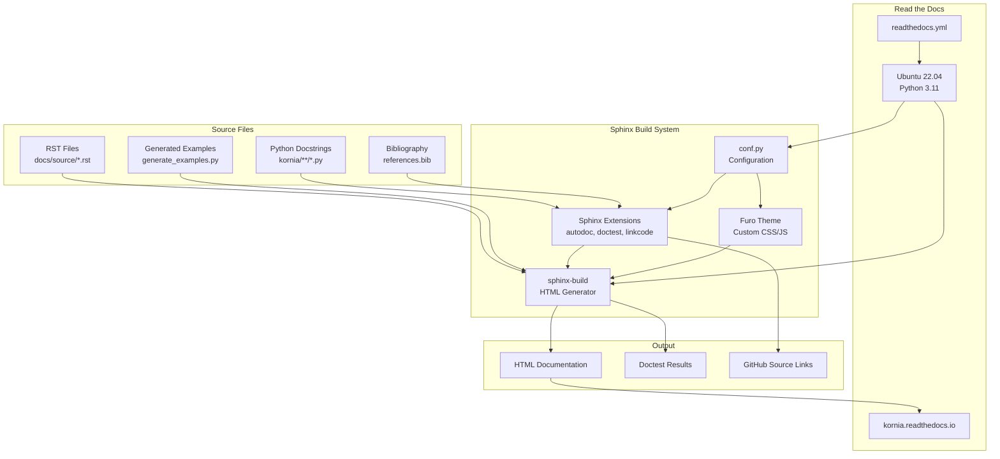
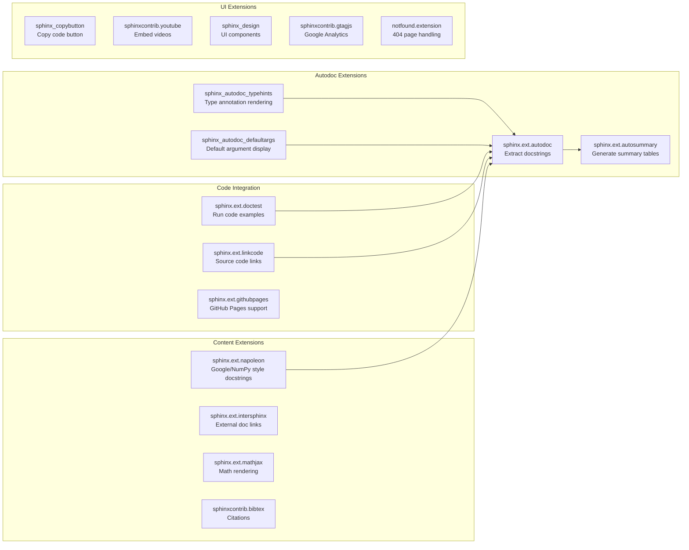
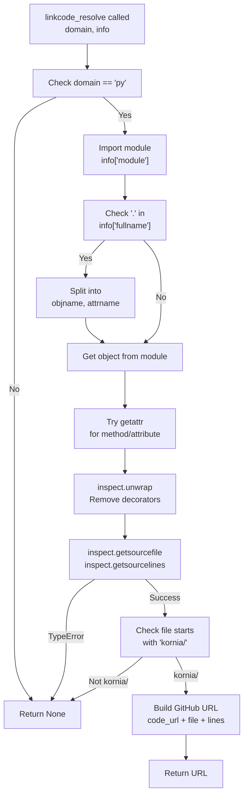
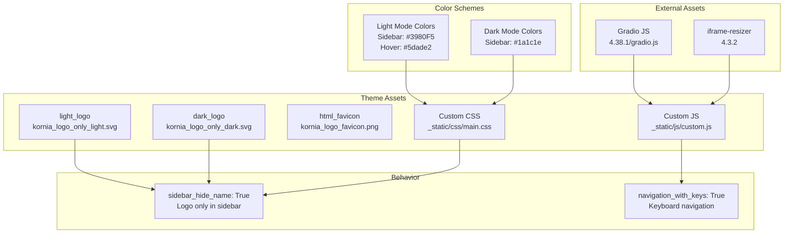
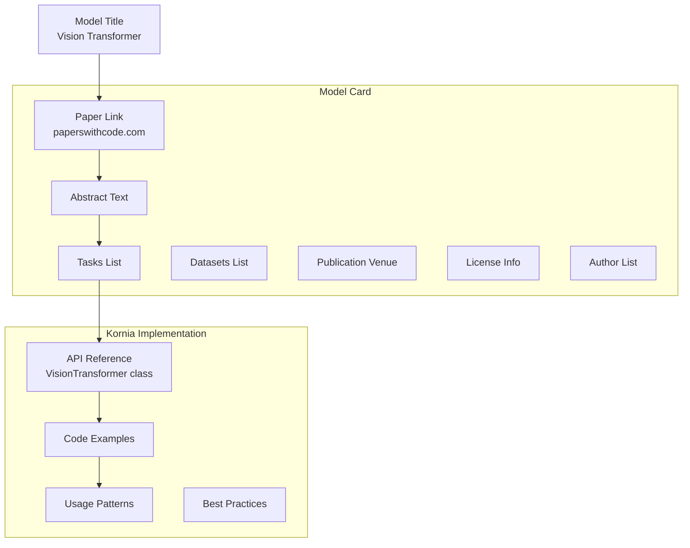

<!-- source: DeepWiki mcp.deepwiki.com · repo kornia/kornia · page 7.6 Documentation System · fetched 2026-10-21 -->

# Documentation System

<details>
<summary>Relevant source files</summary>

The following files were used as context for generating this wiki page:

- [docs/Makefile](docs/Makefile)
- [docs/source/_static/css/main.css](docs/source/_static/css/main.css)
- [docs/source/conf.py](docs/source/conf.py)
- [docs/source/index.rst](docs/source/index.rst)
- [docs/source/models/vit.rst](docs/source/models/vit.rst)
- [readthedocs.yml](readthedocs.yml)

</details>


## Purpose and Scope

This document explains Kornia's documentation system, which uses Sphinx to generate API documentation and user guides hosted on Read the Docs. The system automatically extracts docstrings from Python code, generates HTML documentation, runs doctests, and creates source code links for every documented entity. 

For information about the CI/CD pipeline that builds and deploys documentation, see [CI/CD Pipeline Architecture](#9.4). For development environment setup including local documentation building, see [Development Environment Setup](#9.1).

---

## System Architecture

The documentation system consists of three main components: Sphinx configuration, Read the Docs hosting infrastructure, and a pre-generation pipeline for example images.



**Sources:** [docs/source/conf.py:1-293](), [readthedocs.yml:1-26](), [docs/Makefile:1-28]()

---

## Sphinx Configuration

The Sphinx configuration is defined in [docs/source/conf.py:1-293](). This file controls all aspects of documentation generation.

### Core Configuration Settings

| Setting | Value | Purpose |
|---------|-------|---------|
| `project` | "Kornia" | Project name displayed in documentation |
| `master_doc` | "index" | Root document ([docs/source/index.rst:1-185]()) |
| `html_theme` | "furo" | Modern documentation theme |
| `html_baseurl` | "https://kornia.readthedocs.io" | Canonical URL |
| `source_suffix` | `[".rst", ".ipynb"]` | Supported file formats |
| `language` | "en" | Documentation language |

**Sources:** [docs/source/conf.py:94-130]()

### Sphinx Extensions

The system uses 17 Sphinx extensions to provide comprehensive documentation functionality:



**Sources:** [docs/source/conf.py:55-72]()

---

## Source Code Linking

The `linkcode_resolve` function generates GitHub source links for every documented Python entity. This allows users to click "View Source" and navigate directly to the code.

### Linkcode Resolution Process



**Sources:** [docs/source/conf.py:199-236]()

### URL Format

The `linkcode_resolve` function generates URLs in the format:
```
https://github.com/kornia/kornia/blob/main/{file}#L{start}-L{end}
```

For example, a function at [kornia/filters/kernels.py:45-67]() would generate:
```
https://github.com/kornia/kornia/blob/main/kornia/filters/kernels.py#L45-L67
```

**Sources:** [docs/source/conf.py:199-236]()

---

## Documentation Build Process

The documentation build follows a multi-stage pipeline that pre-generates content, configures Sphinx, and builds HTML output.

### Local Build Process

```mermaid
graph LR
    Developer["Developer runs<br/>make html or<br/>just build-docs"]
    
    subgraph "Pre-build"
        GenExamples["generate_examples.py<br/>Create example images"]
        SetPath["Add kornia to<br/>sys.path"]
    end
    
    subgraph "Sphinx Build"
        ParseRST["Parse RST files"]
        ExtractDocs["Extract docstrings<br/>autodoc"]
        RunDoctests["Run code examples<br/>doctest"]
        LinkSource["Generate source links<br/>linkcode"]
        ApplyTheme["Apply Furo theme"]
    end
    
    Output["HTML output in<br/>docs/build/html/"]
    
    Developer --> GenExamples
    GenExamples --> SetPath
    SetPath --> ParseRST
    ParseRST --> ExtractDocs
    ExtractDocs --> RunDoctests
    RunDoctests --> LinkSource
    LinkSource --> ApplyTheme
    ApplyTheme --> Output
```



**Sources:** [docs/Makefile:1-28](), [docs/source/conf.py:32-44]()

### Read the Docs Build Process

Read the Docs uses [readthedocs.yml:1-26]() to configure the build environment:

| Configuration | Value | Purpose |
|---------------|-------|---------|
| `version` | 2 | RTD config version |
| `build.os` | ubuntu-22.04 | Build environment OS |
| `build.tools.python` | "3.11" | Python version |
| `sphinx.configuration` | docs/source/conf.py | Sphinx config path |
| `python.install.method` | pip | Installation method |
| `python.install.path` | . | Install Kornia package |
| `python.install.extra_requirements` | [docs] | Install documentation dependencies |

**Sources:** [readthedocs.yml:1-26]()

### Pre-generation of Examples

The [docs/source/conf.py:32-37]() imports and executes `generate_examples.py` before Sphinx runs. This pre-generates example images that are used in the documentation:

```python
spec = importlib.util.spec_from_file_location("generate_examples", "../generate_examples.py")
generate_examples = importlib.util.module_from_spec(spec)
spec.loader.exec_module(generate_examples)
generate_examples.main()
```

**Sources:** [docs/source/conf.py:32-37]()

---

## Documentation Structure

The documentation is organized into several top-level sections, each containing multiple pages.

### Table of Contents Structure

```mermaid
graph TB
    Index["index.rst<br/>Main landing page"]
    
    subgraph "GET STARTED"
        Intro["introduction"]
        Highlights["highlights"]
        Install["installation"]
        About["about"]
        MultiFramework["multi-framework-support"]
        Training["training"]
        Governance["governance"]
    end
    
    subgraph "API REFERENCE"
        Aug["augmentation"]
        Color["color"]
        Contrib["contrib"]
        Feature["feature"]
        Filters["filters"]
        Geometry["geometry"]
        Losses["losses"]
        Models["models"]
    end
    
    subgraph "KORNIA APPLICATIONS"
        AppIntro["applications/intro"]
        VisPrompt["applications/visual_prompting"]
        FaceDet["applications/face_detection"]
        ImgAug["applications/image_augmentations"]
        Detection["applications/object_detection"]
    end
    
    subgraph "KORNIA MODELS"
        ViT["models/vit"]
        RTDETR["models/rt_detr"]
        SAM["models/segment_anything"]
        LoFTR["models/loftr"]
        DexiNed["models/dexined"]
    end
    
    subgraph "COMMUNITY"
        Contribute["community/contribute"]
        FAQs["community/faqs"]
        Bibliography["community/bibliography"]
    end
    
    Index --> Intro
    Index --> Aug
    Index --> AppIntro
    Index --> ViT
    Index --> Contribute
```



**Sources:** [docs/source/index.rst:89-185]()

### API Reference Modules

The API Reference section documents all major Kornia modules:

| Module | Purpose | toctree Entry |
|--------|---------|---------------|
| augmentation | Data augmentation operations | [docs/source/index.rst:108]() |
| color | Color space conversions | [docs/source/index.rst:109]() |
| contrib | Models and utilities | [docs/source/index.rst:110]() |
| feature | Feature detection and description | [docs/source/index.rst:113]() |
| filters | Image filtering operations | [docs/source/index.rst:114]() |
| geometry | Geometric transformations | [docs/source/index.rst:115]() |
| losses | Loss functions | [docs/source/index.rst:119]() |
| models | Pre-trained models | [docs/source/index.rst:120]() |

**Sources:** [docs/source/index.rst:103-128]()

---

## Theme Customization

Kornia uses the Furo theme with extensive customization for branding and user experience.

### Theme Configuration

The [docs/source/conf.py:130-170]() configures the Furo theme with custom colors, logos, and behavior:



**Sources:** [docs/source/conf.py:130-195]()

### Custom CSS

The [docs/source/_static/css/main.css:1-14]() defines custom styling:

| Selector | Property | Value | Purpose |
|----------|----------|-------|---------|
| `.sidebar-logo` | max-width | 30% | Sidebar logo size |
| `body` | font-family | 'Montserrat', sans-serif | Consistent typography |
| `.sidebar-scroll p.caption` | background-color | #4d59ff | Section header color |

**Sources:** [docs/source/_static/css/main.css:1-14]()

---

## Docstring Standards

Kornia uses Google-style docstrings, parsed by the Napoleon extension. The [docs/source/conf.py:79]() enables `napoleon_use_ivar = True` for instance variable documentation.

### Example Model Documentation

The [docs/source/models/vit.rst:1-84]() demonstrates the documentation structure for models:



**Sources:** [docs/source/models/vit.rst:1-84]()

---

## Intersphinx Mapping

The documentation links to external documentation using intersphinx. The [docs/source/conf.py:285-289]() configures mappings to Python, NumPy, and PyTorch documentation:

| Project | URL | Purpose |
|---------|-----|---------|
| python | https://docs.python.org/3/ | Python standard library |
| numpy | http://numpy.org/doc/stable/ | NumPy arrays and functions |
| torch | http://pytorch.org/docs/stable/ | PyTorch tensors and operations |

**Sources:** [docs/source/conf.py:285-289]()

---

## Building Documentation Locally

### Using Make

```bash
cd docs
make html        # Build HTML documentation
make clean       # Clean build directory
make images      # Generate example images
```

### Using Just

The project's justfile provides documentation commands (see [Development Environment Setup](#9.1)):

```bash
just build-docs  # Build documentation with Sphinx
```

**Sources:** [docs/Makefile:1-28]()

---

## Autodoc Mock Imports

Some modules are mocked during documentation build to avoid import errors for optional dependencies. The [docs/source/conf.py:292]() configures:

```python
autodoc_mock_imports = ["boxmot", "segmentation_models_pytorch"]
```

These modules are referenced in the code but not required for documentation generation.

**Sources:** [docs/source/conf.py:292]()

---

## Analytics and Tracking

The documentation includes Google Analytics tracking via the `sphinxcontrib.gtagjs` extension. The [docs/source/conf.py:178-180]() configures tracking ID:

```python
gtagjs_ids = [
    "G-YSCFZB2WDV",
]
```

**Sources:** [docs/source/conf.py:176-180]()

---

## Contributing to Documentation

When contributing documentation changes:

1. **Update RST files** in [docs/source/]() for structural changes
2. **Update docstrings** in Python files for API documentation changes
3. **Build locally** using `just build-docs` to verify changes
4. **Run doctests** to ensure code examples work correctly
5. **Check links** to ensure all internal and external references resolve

The CI/CD pipeline automatically builds and validates documentation on every pull request (see [CI/CD Pipeline Architecture](#9.4)).

**Sources:** [docs/source/conf.py:1-293](), [readthedocs.yml:1-26]()

---

