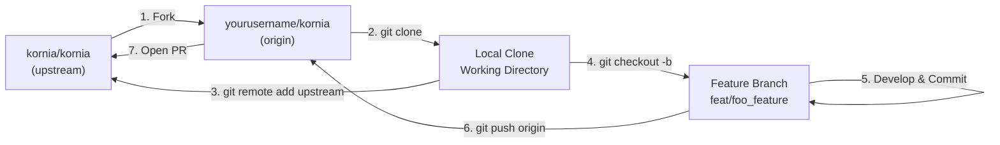
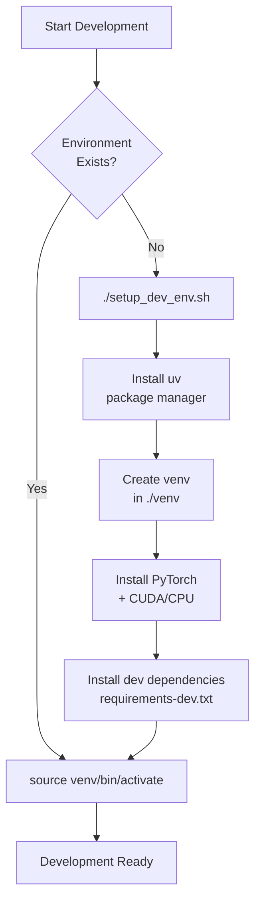
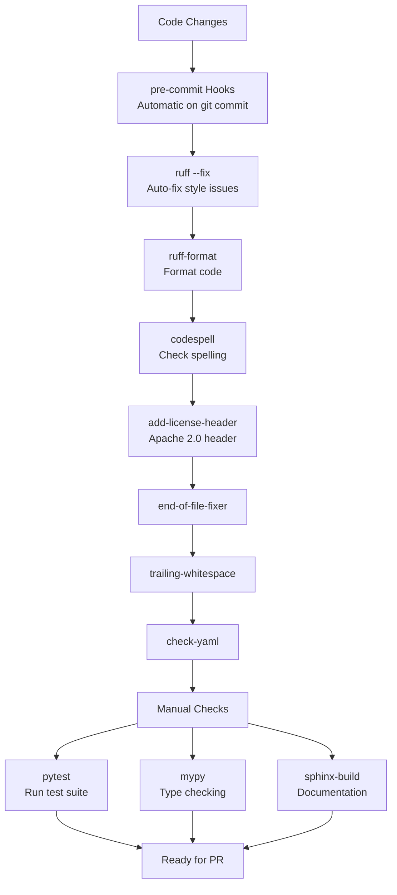
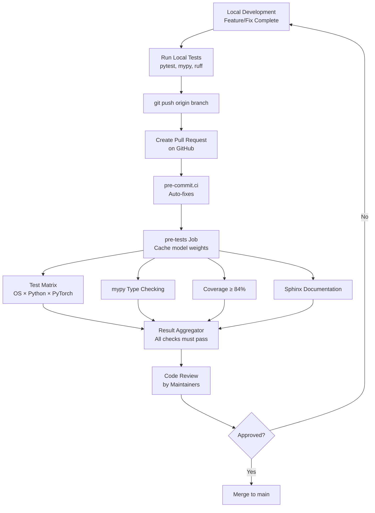
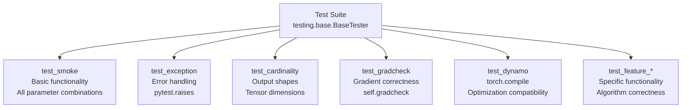

<!-- source: DeepWiki mcp.deepwiki.com · repo kornia/kornia · page 7.7 Contributing Guidelines · fetched 2026-10-21 -->

# Contributing Guidelines

<details>
<summary>Relevant source files</summary>

The following files were used as context for generating this wiki page:

- [.github/workflows/coverage.yml](.github/workflows/coverage.yml)
- [.gitignore](.gitignore)
- [.pre-commit-config.yaml](.pre-commit-config.yaml)
- [CHANGELOG.md](CHANGELOG.md)
- [CONTRIBUTING.md](CONTRIBUTING.md)
- [README.md](README.md)
- [README_zh-CN.md](README_zh-CN.md)
- [docker/Dockerfile.benchmark](docker/Dockerfile.benchmark)
- [docs/source/_static/img/cn_community_zhihu.jpg](docs/source/_static/img/cn_community_zhihu.jpg)
- [docs/source/community/contribute.rst](docs/source/community/contribute.rst)
- [justfile](justfile)
- [pyproject.toml](pyproject.toml)
- [setup_dev_env.sh](setup_dev_env.sh)
- [uv.lock](uv.lock)

</details>


This page provides comprehensive guidelines for contributing to Kornia, including the development workflow, code quality standards, testing requirements, and pull request process. Whether you're fixing bugs, implementing new features, or improving documentation, this guide will help you make effective contributions to the project.

For information about setting up your development environment, see [Development Environment Setup](#9.1). For details about code quality tools and standards, see [Code Quality Standards](#9.2). For testing framework documentation, see [Testing Framework](#9.3).

---

## Contribution Overview

Kornia welcomes contributions from the community through multiple channels. The project maintains an open development process with clear standards for code quality, testing, and documentation.

### Contribution Types

The following table summarizes the different ways to contribute to Kornia:

| Contribution Type | Description | Where to Start |
|------------------|-------------|----------------|
| **Questions & Answers** | Help others or get help with using Kornia | [GitHub Discussions](https://github.com/kornia/kornia/discussions), Discord |
| **Bug Reports** | Report issues, provide reproduction steps | [GitHub Issues](https://github.com/kornia/kornia/issues) |
| **Bug Fixes** | Fix reported bugs or issues you discover | Pick an open bug ticket |
| **Feature Development** | Implement new features from roadmap | Pick unassigned feature ticket |
| **Documentation** | Improve docs, add examples, fix typos | `docs/` directory |
| **Code Review** | Review pull requests from other contributors | Open pull requests |
| **Financial Support** | Sponsor the project | [GitHub Sponsors](https://github.com/sponsors/kornia), [OpenCollective](https://opencollective.com/kornia) |

**Important Guidelines:**
- Do **not** use GitHub Issues for questions (use Discussions instead)
- Do a quick search before reporting new bugs
- Do **not** work directly on the `main` branch
- Include code samples and package versions in bug reports

Sources: [CONTRIBUTING.md:1-43](), [README.md:238-245]()

---

## Development Workflow

### Repository Setup

The standard Git workflow for contributing follows a fork-and-branch model:



**Setup Commands:**

```bash
# 1. Clone your fork
git clone git@github.com:<your-username>/kornia.git
cd kornia

# 2. Add upstream remote
git remote add upstream https://github.com/kornia/kornia.git

# 3. Create feature branch from upstream/main
git checkout upstream/main -b feat/your_feature_name
# or for bug fixes:
git checkout upstream/main -b fix/bug_description
```

**Branch Naming Conventions:**
- Features: `feat/feature_name`
- Bug fixes: `fix/bug_description`
- Documentation: `docs/topic_name`
- Never work directly on `main` branch

Sources: [CONTRIBUTING.md:46-66]()

### Development Environment Setup

Kornia uses `uv` for fast Python package management and `just` for task automation:



**Quick Setup (Recommended):**

```bash
# Automatic setup with defaults (CUDA 12.1, Python 3.12)
./setup_dev_env.sh

# Custom setup with environment variables
PYTHON_VERSION=3.10 PYTORCH_VERSION=2.4.0 CUDA_VERSION=11.8 ./setup_dev_env.sh

# CPU-only setup
PYTORCH_MODE=cpuonly ./setup_dev_env.sh
```

The setup script performs the following:
1. Installs `uv` if not already available
2. Creates a virtual environment in `./venv`
3. Installs PyTorch with specified CUDA version
4. Installs development dependencies from [requirements/requirements-dev.txt]()
5. Installs documentation dependencies

**Using Just Commands:**

The `justfile` provides convenient development commands:

```bash
# View all available commands
just

# Common development tasks
just test-cpu          # Run CPU tests
just test-cuda         # Run CUDA tests
just lint              # Run code linting
just mypy              # Run type checking
just build-docs        # Build documentation
just benchmark         # Run benchmarks
```

Sources: [CONTRIBUTING.md:68-156](), [justfile:1-149](), [README.md:104-112]()

---

## Development Cycle

### Code Development Guidelines

**Commit Best Practices:**
- Write small, incremental commits with clear messages
- Commit each logical change separately
- Avoid pushing large files
- Keep commit history linear and clean

**Code Organization:**
- Use meaningful names for variables, functions, and classes
- Follow the module organization patterns (see [Architecture and Module Organization](#1.3))
- Place utility functions in appropriate modules
- Group related functionality together

Sources: [CONTRIBUTING.md:256-264]()

### Testing Requirements

Every contribution must include comprehensive tests. Kornia uses `pytest` with custom test infrastructure in the `testing/` directory.

**Test Structure Using BaseTester:**

```python
from testing.base import BaseTester

class TestMyFunction(BaseTester):
    def test_smoke(self, device, dtype):
        """Test function runs with various parameter combinations."""
        pass
    
    def test_exception(self, device, dtype):
        """Test exceptions are raised correctly."""
        # with pytest.raises(ValueError) as errinfo:
        #     my_function(invalid_params)
        # assert 'expected error message' in str(errinfo)
        pass
    
    def test_cardinality(self, device, dtype):
        """Test output shapes match expectations."""
        pass
    
    def test_gradcheck(self, device):
        """Test gradients using self.gradcheck(...)."""
        pass
    
    def test_dynamo(self, device, dtype, torch_optimizer):
        """Test with torch.compile optimization."""
        # op = my_function
        # op_optimized = torch_optimizer(op)
        # self.assert_close(op(inputs), op_optimized(inputs))
        pass
```

**Running Tests:**

```bash
# Test specific module with all dtypes and devices
pytest tests/test_module.py --dtype=float32,float64 --device=all

# Test with specific configurations
pytest tests/test_module.py --dtype=all --device=cpu
pytest tests/test_module.py --dtype=float32 --device=cuda

# Using just commands
just test-cpu        # CPU tests only
just test-cuda       # CUDA tests only
just test-quick      # Exclude slow tests (jit, grad, nn)
just test-gradcheck  # Only gradient tests
```

**Device and Dtype Testing:**
- `--device`: `cpu`, `cuda`, `mps`, `tpu`, `all`
- `--dtype`: `bfloat16`, `float16`, `float32`, `float64`, `all`

**Test Markers:**

| Marker | Description | Usage |
|--------|-------------|-------|
| `grad` | Gradient check tests | `@pytest.mark.grad` |
| `jit` | TorchScript compilation tests | `@pytest.mark.jit` |
| `nn` | Neural network module tests | `@pytest.mark.nn` |
| `slow` | Long-running tests | `@pytest.mark.slow` |

Sources: [CONTRIBUTING.md:157-336](), [pyproject.toml:210-217]()

### Type Checking Requirements

Kornia requires static type hints for all public APIs:

```python
from __future__ import annotations
from kornia.core import Tensor

def homography_warp(
    patch_src: Tensor,
    dst_homo_src: Tensor,
    dsize: tuple[int, int],
    mode: str = 'bilinear',
    padding_mode: str = 'zeros'
) -> Tensor:
    """Warp image patches using homography."""
    ...
```

**Type Checking Configuration:**
- Uses `mypy` in strict mode
- Configuration in [pyproject.toml:256-271]()
- All functions must have input and output type annotations
- Use `kornia.core.Tensor` for tensor types
- Use `from __future__ import annotations` for modern typing features

**Running Type Checks:**

```bash
# Using mypy directly
mypy

# Using just command
just mypy
```

Sources: [CONTRIBUTING.md:337-358](), [pyproject.toml:256-271]()

---

## Code Quality Gates

Before submitting a pull request, your code must pass multiple quality gates both locally and in CI/CD.

### Local Quality Checks



### Pre-commit Hooks

Kornia uses `pre-commit` to automatically enforce code standards. The hooks run automatically on `git commit`:

**Installed Hooks:**
1. **pre-commit-hooks** [.pre-commit-config.yaml:7-15]()
   - `end-of-file-fixer`: Ensures files end with newline
   - `trailing-whitespace`: Removes trailing whitespace
   - `check-yaml`: Validates YAML syntax
   - `requirements-txt-fixer`: Sorts requirements files
   - `pretty-format-json`: Formats JSON files

2. **ruff** [.pre-commit-config.yaml:17-22]()
   - Linting with `--fix` and `--exit-non-zero-on-fix`
   - Code formatting with `ruff-format`

3. **codespell** [.pre-commit-config.yaml:24-32]()
   - Spell checking with ignore list: "ans,hist,laf,cofusion"
   - Skips `.bib` and `.ipynb` files

4. **add-license-header** [.pre-commit-config.yaml:34-54]()
   - Adds Apache 2.0 license header to Python files

**Setup Pre-commit:**

```bash
# Install pre-commit hooks (one-time setup)
pre-commit install

# Run hooks manually on all files
pre-commit run --all-files

# Run specific hook
pre-commit run ruff --all-files
```

Sources: [.pre-commit-config.yaml:1-55](), [CONTRIBUTING.md:171-173]()

### Ruff Configuration

Ruff handles both linting and formatting. Configuration is in [pyproject.toml:69-209]():

**Key Settings:**
- Python target: 3.9+
- Line length: 120 characters
- Convention: Google docstring style

**Enabled Rules:**
- `E`, `F`: pycodestyle and Pyflakes (core Python style)
- `I`: isort (import sorting)
- `B`: flake8-bugbear (common bugs)
- `UP`: pyupgrade (modern Python syntax)
- `D`: pydocstyle (docstring conventions)
- `PL`: Pylint (additional checks)
- `RUF`: Ruff-specific rules
- `S`: flake8-bandit (security)

**Running Ruff:**

```bash
# Using just command (recommended)
just lint

# Direct ruff commands
ruff check --fix .
ruff format .
```

Sources: [pyproject.toml:69-209]()

### Coverage Requirements

Test coverage must remain above 84% threshold:

**Coverage Configuration** [pyproject.toml:219-254]():
- Minimum coverage: 84%
- Source directory: `kornia/`
- Excludes: `__main__.py`, `setup.py`

**Running Coverage:**

```bash
# Using just command
just test-coverage

# Manual coverage run
coverage erase
coverage run --source kornia/ -m pytest tests/
coverage report
```

Excluded from coverage:
- `# pragma: no cover` comments
- `raise NotImplementedError`
- `if TYPE_CHECKING:` blocks
- `def __repr__` methods
- Debug code blocks

Sources: [pyproject.toml:219-254]()

---

## Pull Request Process

### Pull Request Workflow



### CI/CD Pipeline Requirements

Pull requests must pass all CI checks before merge. The pipeline runs multiple jobs in parallel:

**1. Pre-tests Job:**
- Downloads and caches model weights
- Sets up environment for other jobs
- Optimizes CI performance

**2. Test Matrix:**
- **Operating Systems:** Ubuntu, Windows, macOS
- **Python Versions:** 3.9, 3.10, 3.11, 3.12, 3.13
- **PyTorch Versions:** 1.9.1 through 2.5.x
- **Dtypes:** float32, float64

**3. Type Checking:**
- Runs `mypy` in strict mode
- All public APIs must be typed
- Configuration: [pyproject.toml:256-271]()

**4. Coverage Analysis:**
- Measures test coverage
- Enforces 84% minimum threshold
- Fails if coverage decreases

**5. Documentation Build:**
- Builds Sphinx documentation
- Runs doctests in documentation
- Ensures all examples work

**6. Pre-commit CI:**
- Automatically fixes formatting issues
- Applies `ruff --fix` changes
- Commits fixes back to PR branch

Sources: [CONTRIBUTING.md:383-406]()

### Creating an Effective Pull Request

**Before Opening PR:**
1. ✓ All tests pass locally
2. ✓ Code is formatted (`just lint`)
3. ✓ Type checks pass (`just mypy`)
4. ✓ Documentation builds (`just build-docs`)
5. ✓ Commits have clear messages
6. ✓ Branch is up-to-date with upstream/main

**PR Description Should Include:**
- Clear title describing the change
- Summary of what changed and why
- Reference to related issue (e.g., "Fixes #123")
- Any breaking changes
- Testing methodology
- Examples of new functionality

**After PR Submission:**
- Respond to reviewer feedback
- Keep PR scope focused (avoid feature creep)
- Update PR if pre-commit.ci makes changes
- Ensure all CI checks pass (green checkmarks)

Sources: [CONTRIBUTING.md:383-406](), [README.md:238-240]()

---

## Testing Framework Details

### Test Categories

Kornia organizes tests into specific categories, each serving a different purpose:



**Test Category Descriptions:**

| Category | Purpose | Example |
|----------|---------|---------|
| **smoke** | Verify function runs without errors | Test all parameter combinations |
| **exception** | Validate error handling | Test `ValueError`, `TypeError` raised correctly |
| **cardinality** | Check output tensor shapes | Verify `(B, C, H, W)` dimensions |
| **gradcheck** | Verify gradient computation | Use `self.gradcheck(op, inputs)` |
| **dynamo** | Test torch.compile compatibility | Compare eager vs. optimized outputs |
| **feature** | Test specific functionality | Algorithm correctness, edge cases |

Sources: [CONTRIBUTING.md:265-322]()

### Using BaseTester

The `testing.base.BaseTester` class provides utilities for writing consistent tests:

**Key Methods:**
- `self.assert_close(actual, expected)`: Compare tensors with appropriate tolerances
- `self.gradcheck(op, inputs)`: Verify gradient correctness
- Device and dtype fixtures automatically provided

**Example Test:**

```python
from testing.base import BaseTester
import pytest

class TestSomeFunction(BaseTester):
    def test_smoke(self, device, dtype):
        """Test basic functionality."""
        input_tensor = torch.randn(2, 3, 4, 4, device=device, dtype=dtype)
        output = some_function(input_tensor)
        assert output.shape == (2, 3, 4, 4)
    
    def test_exception(self, device, dtype):
        """Test invalid inputs raise errors."""
        with pytest.raises(ValueError) as errinfo:
            some_function(torch.randn(2, 3))  # Wrong dimensions
        assert 'Expected 4D tensor' in str(errinfo)
    
    @pytest.mark.parametrize("batch_size", [1, 2, 5])
    def test_cardinality(self, batch_size, device, dtype):
        """Test output shapes with different batch sizes."""
        input_tensor = torch.randn(batch_size, 3, 32, 32, device=device, dtype=dtype)
        output = some_function(input_tensor)
        assert output.shape[0] == batch_size
    
    def test_gradcheck(self, device):
        """Test gradient computation."""
        input_tensor = torch.randn(1, 3, 4, 4, device=device, dtype=torch.float64, requires_grad=True)
        self.gradcheck(some_function, (input_tensor,))
```

Sources: [CONTRIBUTING.md:273-322]()

---

## Documentation Contributions

### Building Documentation

Kornia uses Sphinx for documentation generation with automatic API documentation and doctests.

**Build Process:**

```bash
# Using just command (recommended)
just build-docs

# Manual build
cd docs
make clean html

# View locally
open docs/build/html/index.html
```

The documentation build:
1. Cleans previous builds (`make clean`)
2. Generates HTML from `.rst` files in `docs/source/`
3. Auto-generates API docs from docstrings
4. Runs doctests embedded in documentation
5. Creates linkable source code references

**Documentation Structure:**
- Main docs: `docs/source/`
- API reference: Auto-generated from docstrings
- Tutorials: `docs/source/tutorials/`
- Examples: Links to `kornia-examples` repository

Sources: [CONTRIBUTING.md:175-199]()

### Docstring Standards

All public APIs must have Google-style docstrings:

```python
def my_function(input: Tensor, param: float = 1.0) -> Tensor:
    """Short description of function.
    
    Longer description providing more details about the function's
    behavior, assumptions, and any important notes.
    
    Args:
        input: Description of input tensor. Shape: :math:`(B, C, H, W)`.
        param: Description of parameter. Default: 1.0.
    
    Returns:
        Output tensor description. Shape: :math:`(B, C, H, W)`.
    
    Example:
        >>> input = torch.rand(1, 3, 4, 4)
        >>> output = my_function(input, param=2.0)
        >>> output.shape
        torch.Size([1, 3, 4, 4])
    """
    ...
```

**Docstring Requirements:**
- Use Google-style format (enforced by pydocstyle)
- Include tensor shapes using LaTeX math notation
- Provide working examples in `Example:` section
- Document all parameters and return values
- Add notes for important behavior or limitations

Sources: [pyproject.toml:153-154]()

---

## Benchmarking

Kornia includes a benchmarking suite for performance testing using `pytest-benchmark`:

**Running Benchmarks:**

```bash
# Using just command
just benchmark

# Benchmark specific file
make benchmark BENCHMARK_SOURCE=benchmarks/augmentation/2d_geometric_test.py

# Benchmark specific test
make benchmark BENCHMARK_SOURCE=benchmarks/augmentation/2d_geometric_test.py::test_aug_2d_elastic_transform

# Specify backends
make benchmark BENCHMARK_BACKENDS='inductor,eager'

# CUDA benchmarking
make benchmark BENCHMARK_OPTS='--device=cuda -vv'

# Docker benchmarking
just benchmark-docker
```

**Benchmark Configuration:**
- Warmup enabled (for JIT/compile overhead)
- Results grouped by function
- High precision timing
- Supports multiple backends: `'inductor'`, `'eager'`, `'jit'`

Sources: [CONTRIBUTING.md:201-249]()

---

## Community Channels

### Getting Help and Discussion

**GitHub Discussions:** [https://github.com/kornia/kornia/discussions]()
- Ask questions about using Kornia
- Discuss implementations and research
- Share projects and use cases

**Discord:** [https://discord.gg/HfnywwpBnD]()
- Real-time chat with maintainers
- Quick questions and feedback
- Community support

**PyTorch Discuss:** Use `#kornia` tag
- Integration with broader PyTorch community
- Deep learning discussions

**GitHub Issues:** [https://github.com/kornia/kornia/issues]()
- Bug reports only (not for questions)
- Feature requests
- Roadmap discussions

Sources: [CONTRIBUTING.md:7-15](), [README.md:242-245]()

### Code of Conduct

All contributors must follow the project's Code of Conduct, which ensures a welcoming and inclusive environment for everyone. Key principles:
- Be respectful and constructive
- Welcome newcomers
- Focus on what's best for the community
- Show empathy towards others

Violations should be reported to the maintainers.

Sources: [README.md:240](), [CONTRIBUTING.md:1-4]()

---

## Quick Reference

### Common Development Commands

| Task | Command |
|------|---------|
| Setup environment | `./setup_dev_env.sh` |
| Run CPU tests | `just test-cpu` |
| Run all tests | `just test-all` |
| Check types | `just mypy` |
| Lint code | `just lint` |
| Build docs | `just build-docs` |
| Run benchmarks | `just benchmark` |
| View all commands | `just` or `just --list` |

### File Locations

| Component | Location |
|-----------|----------|
| Development dependencies | [requirements/requirements-dev.txt]() |
| Pre-commit hooks | [.pre-commit-config.yaml]() |
| Project configuration | [pyproject.toml]() |
| Task runner commands | [justfile]() |
| Test utilities | `testing/` directory |
| Documentation source | `docs/source/` |
| Benchmarks | `benchmarks/` |

Sources: [justfile:1-149](), [CONTRIBUTING.md:44-410]()