# Page: Overview

# Overview

<details>
<summary>Relevant source files</summary>

The following files were used as context for generating this wiki page:

- [.pre-commit-config.yaml](.pre-commit-config.yaml)
- [CHANGELOG.md](CHANGELOG.md)
- [docs/source/augmentation.rst](docs/source/augmentation.rst)
- [docs/source/color.rst](docs/source/color.rst)
- [docs/source/contrib.rst](docs/source/contrib.rst)
- [docs/source/feature.rst](docs/source/feature.rst)
- [docs/source/geometry.conversions.rst](docs/source/geometry.conversions.rst)
- [docs/source/geometry.transform.rst](docs/source/geometry.transform.rst)
- [docs/source/references.bib](docs/source/references.bib)
- [kornia/__init__.py](kornia/__init__.py)
- [kornia/augmentation/__init__.py](kornia/augmentation/__init__.py)
- [kornia/color/__init__.py](kornia/color/__init__.py)
- [kornia/color/raw.py](kornia/color/raw.py)
- [kornia/color/rgb.py](kornia/color/rgb.py)
- [kornia/contrib/__init__.py](kornia/contrib/__init__.py)
- [kornia/contrib/histogram_matching.py](kornia/contrib/histogram_matching.py)
- [kornia/contrib/models/rt_detr/__init__.py](kornia/contrib/models/rt_detr/__init__.py)
- [kornia/contrib/models/rt_detr/architecture/__init__.py](kornia/contrib/models/rt_detr/architecture/__init__.py)
- [kornia/feature/__init__.py](kornia/feature/__init__.py)
- [kornia/feature/laf.py](kornia/feature/laf.py)
- [kornia/feature/responses.py](kornia/feature/responses.py)
- [kornia/feature/scale_space_detector.py](kornia/feature/scale_space_detector.py)
- [kornia/feature/siftdesc.py](kornia/feature/siftdesc.py)
- [kornia/geometry/camera/pinhole.py](kornia/geometry/camera/pinhole.py)
- [kornia/geometry/conversions.py](kornia/geometry/conversions.py)
- [kornia/geometry/transform/affwarp.py](kornia/geometry/transform/affwarp.py)
- [kornia/geometry/transform/imgwarp.py](kornia/geometry/transform/imgwarp.py)
- [kornia/geometry/transform/pyramid.py](kornia/geometry/transform/pyramid.py)
- [pyproject.toml](pyproject.toml)
- [tests/color/test_rgb.py](tests/color/test_rgb.py)
- [uv.lock](uv.lock)

</details>


## Purpose and Scope

Kornia is a differentiable computer vision library for PyTorch that provides GPU-accelerated, batch-processing implementations of classical and modern computer vision algorithms. The library's core value proposition is enabling end-to-end gradient flow through vision operations, making it suitable for deep learning pipelines where vision operations need to be learned or optimized.

**Current Version**: 0.8.2 [kornia/__init__.py:66]()

**Key Scope**:
- Image processing operations (filters, color space conversions, morphology)
- Geometric transformations and camera models
- Data augmentation with differentiable transforms
- Feature detection, description, and matching
- Vision models and experimental features

**Out of Scope**: This overview covers the library's architecture and organization. For specific module details, see:
- Color space conversions → [2](#2)
- Geometric operations → [3](#3)
- Data augmentation → [4](#4)
- Feature detection/matching → [5](#5)
- Models and contrib → [6](#6)
- Development setup → [7](#7)

**Sources**: [kornia/__init__.py:1-67](), [pyproject.toml:1-109]()

## Core Architecture

The following diagram shows Kornia's main package structure with concrete module names from the codebase:

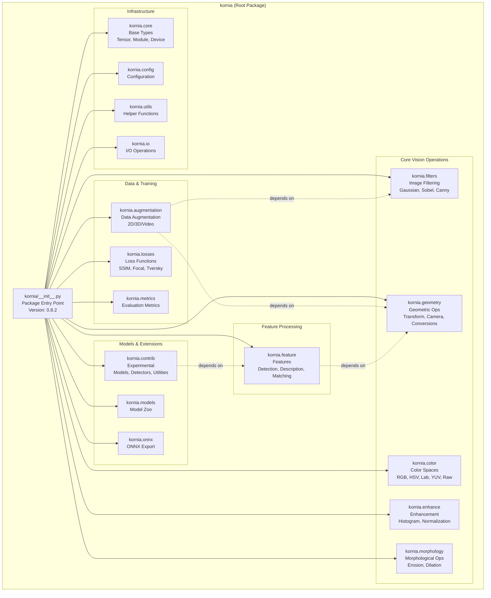

**Sources**: [kornia/__init__.py:24-48]()

## Module Organization

Kornia organizes functionality into several layers, each with specific responsibilities:

### Layer 1: Core Infrastructure

| Module | Path | Purpose |
|--------|------|---------|
| `kornia.core` | [kornia/core/]() | Base tensor types, modules, device abstractions |
| `kornia.utils` | [kornia/utils/]() | Helper functions: `image_to_tensor`, `tensor_to_image`, `create_meshgrid` |
| `kornia.io` | [kornia/io/]() | Image loading and saving operations |
| `kornia.config` | [kornia/config/]() | Library configuration management |

### Layer 2: Basic Vision Operations

These modules provide fundamental differentiable operations:

| Module | Path | Key Operations |
|--------|------|----------------|
| `kornia.filters` | [kornia/filters/]() | Gaussian blur, Sobel, Laplacian, median filtering |
| `kornia.color` | [kornia/color/__init__.py:1-160]() | `rgb_to_grayscale`, `rgb_to_hsv`, `rgb_to_lab`, `raw_to_rgb` |
| `kornia.morphology` | [kornia/morphology/]() | Erosion, dilation, opening, closing |
| `kornia.enhance` | [kornia/enhance/]() | Histogram equalization, normalization, CLAHE |

### Layer 3: Geometric Operations

The `kornia.geometry` module is subdivided into specialized components:

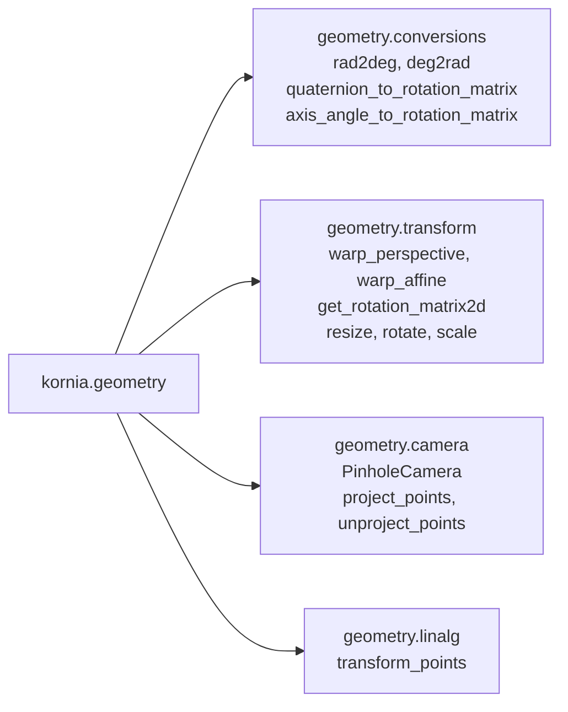

**Sources**: [kornia/geometry/conversions.py:1-2084](), [kornia/geometry/transform/imgwarp.py:1-957]()

### Layer 4: Data Augmentation

The augmentation system has a hierarchical class structure:

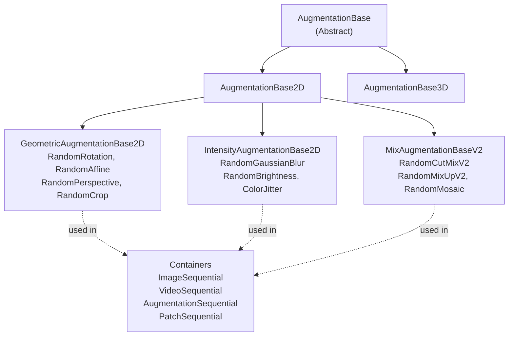

**Sources**: [kornia/augmentation/__init__.py:1-205](), [kornia/augmentation/_2d/base.py]()

### Layer 5: Feature Processing

The feature module provides classical and learned feature detection:

| Component | Key Classes/Functions |
|-----------|----------------------|
| **LAF Operations** | `laf_from_center_scale_ori`, `extract_patches_from_pyramid`, `normalize_laf` |
| **Detectors** | `ScaleSpaceDetector`, `MultiResolutionDetector`, `KeyNet`, `DISK` |
| **Response Functions** | `harris_response`, `hessian_response`, `dog_response`, `gftt_response` |
| **Descriptors** | `SIFTDescriptor`, `HardNet`, `HyNet`, `SOSNet` |
| **Matching** | `match_nn`, `match_mnn`, `match_adalam`, `LightGlue`, `LoFTR` |

**Sources**: [kornia/feature/__init__.py:1-189](), [kornia/feature/laf.py:1-520]()

### Layer 6: Models and Experimental

The `kornia.contrib` module contains experimental features and modern architectures:

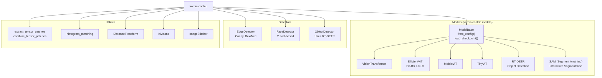

**Sources**: [kornia/contrib/__init__.py:1-67](), [docs/source/contrib.rst:1-161]()

## Design Principles

Kornia follows several key design principles that distinguish it from other computer vision libraries:

### 1. Differentiability First

All operations support PyTorch autograd for gradient computation:

- **Functional API**: Pure functions like `rgb_to_grayscale(input)` [kornia/color/__init__.py:24]()
- **Module API**: `nn.Module` classes like `RgbToGrayscale()` for integration into neural networks [kornia/color/__init__.py:24]()
- **Gradient flow**: Operations preserve gradient information for end-to-end learning

### 2. Batch Processing

Operations are designed for batched tensor inputs:

- Standard shape: `(B, C, H, W)` for 2D images
- 3D/Video shape: `(B, C, D, H, W)` for volumetric data
- Broadcasting support for efficient batch operations

### 3. Device Agnostic

Tensors can reside on CPU, CUDA, or other accelerators:

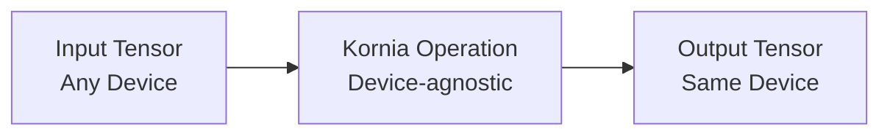

### 4. PyTorch Native

- No external dependencies like OpenCV for core operations
- Uses PyTorch's native functions: `F.grid_sample`, `F.affine_grid`, etc.
- Compatible with TorchScript, ONNX export [kornia/onnx/]()

**Sources**: [kornia/__init__.py:18-22](), [pyproject.toml:1-109]()

## Dependencies and Build System

### Core Dependencies

From [pyproject.toml:14-18]():

| Dependency | Version | Purpose |
|------------|---------|---------|
| `torch` | ≥2.0.0 | Core tensor operations and autograd |
| `kornia_rs` | ≥0.1.9 | Rust-based accelerated operations |
| `packaging` | - | Version management |

### Development Dependencies

Key development tools configured in [pyproject.toml:19-37]():

- **Testing**: `pytest==8.3.5`, `pytest-cov`, `pytest-timeout`
- **Type Checking**: `mypy` with strict configuration [pyproject.toml:297-309]()
- **Linting**: `ruff` with 20+ rule families [pyproject.toml:117-192]()
- **Pre-commit**: Automated code quality checks [.pre-commit-config.yaml:1-55]()

### Package Management

Kornia uses the **uv** package manager for reproducible environments:

- Lock file: [uv.lock:1-10000+]() with exact dependency pins
- PyTorch index: `https://download.pytorch.org/whl/cpu` [pyproject.toml:324-332]()
- Multiple Python versions: 3.9-3.13 [pyproject.toml:13]()

**Sources**: [pyproject.toml:1-379](), [.pre-commit-config.yaml:1-55](), [uv.lock:1-10]()

## Library Entry Points

The main package exposes core utilities at the top level [kornia/__init__.py:54-63]():

```python
from kornia.constants import pi
from kornia.utils import (
    eye_like,
    vec_like,
    create_meshgrid,
    image_to_tensor,
    tensor_to_image,
    xla_is_available,
)
```

### Multi-Framework Support

Kornia includes experimental transpilers for cross-framework compatibility [kornia/__init__.py:52]():

- `to_jax()` - Convert to JAX
- `to_numpy()` - Convert to NumPy
- `to_tensorflow()` - Convert to TensorFlow

**Sources**: [kornia/__init__.py:51-63]()

## Typical Data Flow

The following diagram shows how data flows through a typical Kornia pipeline:

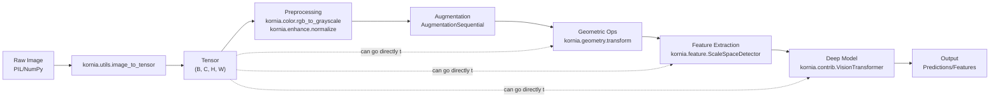

Each stage is differentiable, allowing gradients to flow backward through the entire pipeline.

**Sources**: [kornia/__init__.py:56-62](), Diagram 3 from high-level architecture

## Getting Started

To use Kornia in your project:

1. **Installation**: `pip install kornia` or `pip install kornia[x]` for extended features [pyproject.toml:38-41]()
2. **Import**: `import kornia` or specific modules like `from kornia import augmentation`
3. **Configuration**: See [1.1](#1.1) for installation details
4. **Development Setup**: See [7](#7) for contributing guidelines

The library is designed to be imported and used immediately with PyTorch:

```python
import torch
import kornia

# All operations work with PyTorch tensors
img = torch.rand(1, 3, 256, 256)
gray = kornia.color.rgb_to_grayscale(img)
```

**Sources**: [kornia/__init__.py:1-67](), [pyproject.toml:5-18]()

---

# Page: Installation and Setup

# Installation and Setup

<details>
<summary>Relevant source files</summary>

The following files were used as context for generating this wiki page:

- [.github/workflows/coverage.yml](.github/workflows/coverage.yml)
- [.gitignore](.gitignore)
- [.pre-commit-config.yaml](.pre-commit-config.yaml)
- [CHANGELOG.md](CHANGELOG.md)
- [CONTRIBUTING.md](CONTRIBUTING.md)
- [README.md](README.md)
- [README_zh-CN.md](README_zh-CN.md)
- [docker/Dockerfile.benchmark](docker/Dockerfile.benchmark)
- [docs/source/_static/img/cn_community_zhihu.jpg](docs/source/_static/img/cn_community_zhihu.jpg)
- [docs/source/community/contribute.rst](docs/source/community/contribute.rst)
- [justfile](justfile)
- [pyproject.toml](pyproject.toml)
- [setup_dev_env.sh](setup_dev_env.sh)
- [uv.lock](uv.lock)

</details>


This document covers the installation process for Kornia and the setup of a development environment for contributors. It includes basic installation methods for end users, detailed development environment configuration, project dependencies, and development tools.

For information about the overall architecture and module organization, see [Architecture and Module Organization](#1.3). For details about contributing code and development practices, see [Development Environment Setup](#9.1) and [Code Quality Standards](#9.2).

---

## Overview

Kornia supports multiple installation methods depending on your use case:
- **End users** can install via pip from PyPI or directly from GitHub
- **Contributors** should use the automated development environment setup script
- **Advanced users** can install from source with editable mode

The project requires **Python 3.9+** and **PyTorch 1.9.1+** as specified in [pyproject.toml:13-27]() and [README.md:86-87]().

---

## Basic Installation

### Installation via pip

The simplest method for end users is to install the stable release from PyPI:

```bash
pip install kornia
```

This installs the latest stable version with all required dependencies as specified in [requirements/requirements.txt]().

Sources: [README.md:89-93](), [pyproject.toml:1-65]()

### Installation from Source

For users who want the latest features or need to make local modifications:

```bash
pip install -e .
```

The `-e` flag installs the package in editable mode, allowing changes to the source code to be immediately reflected without reinstalling. This uses setuptools as the build backend as configured in [pyproject.toml:1-3]().

Sources: [README.md:98-102](), [CONTRIBUTING.md:154-156]()

### Installation from GitHub

To install the latest development version directly from the GitHub repository:

```bash
pip install git+https://github.com/kornia/kornia
```

This method pulls the most recent code from the main branch.

Sources: [README.md:114-118]()

---

## Installation Methods Comparison

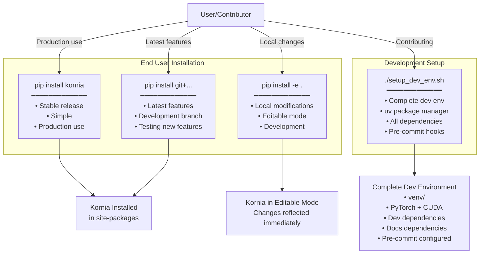

Sources: [README.md:84-120](), [CONTRIBUTING.md:68-156]()

---

## Development Environment Setup

### Using the Automated Setup Script (Recommended)

For contributors, Kornia provides an automated setup script that uses `uv` for fast package management:

```bash
./setup_dev_env.sh
```

This script performs the following operations:
1. Installs `uv` if not already available
2. Creates a virtual environment in `./venv`
3. Installs PyTorch with appropriate CUDA support (default: CUDA 12.1)
4. Installs development dependencies from [requirements/requirements-dev.txt]()
5. Installs documentation dependencies from [requirements/requirements-docs.txt]()
6. Installs Kornia in editable mode

Sources: [README.md:104-112](), [CONTRIBUTING.md:70-86]()

#### Customizing the Setup

The setup script supports environment variables for customization:

```bash
# Custom Python version
PYTHON_VERSION=3.10 ./setup_dev_env.sh

# Custom PyTorch and CUDA versions
PYTORCH_VERSION=2.4.0 CUDA_VERSION=11.8 ./setup_dev_env.sh

# CPU-only installation
PYTORCH_MODE=cpuonly ./setup_dev_env.sh
```

Sources: [CONTRIBUTING.md:87-95]()

### Manual Setup with uv

If you prefer manual control over the environment setup:

1. **Install uv**:
```bash
# Linux/macOS
curl -LsSf https://astral.sh/uv/install.sh | sh

# Or using pip
pip install uv
```

2. **Create and activate virtual environment**:
```bash
uv venv
source .venv/bin/activate  # On Windows: .venv\Scripts\activate
```

3. **Install PyTorch**:
```bash
# For CUDA 12.1 (default)
uv pip install torch torchvision --index-url https://download.pytorch.org/whl/cu121

# For CPU-only
uv pip install torch torchvision --index-url https://download.pytorch.org/whl/cpu
```

4. **Install Kornia dependencies**:
```bash
uv pip install -e .[dev,x]
uv pip install -e .[docs]  # For documentation development
```

Sources: [CONTRIBUTING.md:120-152]()

---

## Development Environment Architecture

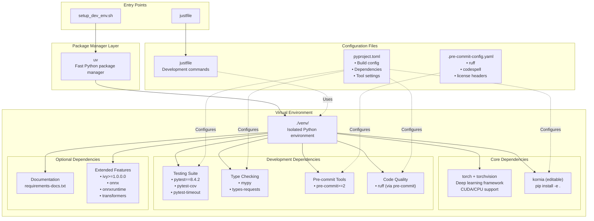

Sources: [CONTRIBUTING.md:68-156](), [pyproject.toml:1-282](), [.pre-commit-config.yaml:1-55](), [justfile:1-149]()

---

## Project Dependencies

### Core Runtime Dependencies

The minimum requirements for running Kornia are defined in [requirements/requirements.txt]():

| Package | Purpose |
|---------|---------|
| `torch` | PyTorch tensor operations and autograd |
| `packaging` | Version parsing and comparison |

Kornia supports **PyTorch 1.9.1+** and **Python 3.9-3.13** as declared in [pyproject.toml:13,26-29]().

### Development Dependencies

Development dependencies are specified in [requirements/requirements-dev.txt:1-18]():

| Package | Version | Purpose |
|---------|---------|---------|
| `pytest` | 8.4.2 | Testing framework |
| `pytest-cov` | - | Code coverage reporting |
| `pytest-timeout` | - | Test timeout management |
| `mypy` | - | Static type checking |
| `pre-commit` | >=2 | Git pre-commit hooks |
| `coverage` | - | Coverage analysis |
| `numpy` | <3 | Numerical operations |
| `pillow` | - | Image I/O |
| `onnx` | - | ONNX model export |
| `onnxruntime` | - | ONNX inference |
| `ivy` | >=1.0.0.0 | Multi-framework support |
| `transformers` | - | Pre-trained models |
| `diffusers` | - | Diffusion models |
| `accelerate` | - | Training acceleration |

### Optional Dependencies

Kornia defines optional dependency groups in [pyproject.toml:54-57]():

- **`dev`**: All development tools (from requirements-dev.txt)
- **`docs`**: Documentation building tools (from requirements-docs.txt)
- **`x`**: Extended features including ONNX, transformers, etc. (from requirements-x.txt)

Installation with optional dependencies:
```bash
pip install kornia[dev]      # Development dependencies
pip install kornia[docs]     # Documentation dependencies
pip install kornia[x]        # Extended features
pip install kornia[dev,x]    # Multiple groups
```

Sources: [pyproject.toml:49-57](), [requirements/requirements-dev.txt:1-18]()

---

## Development Tools and Commands

### justfile Command Runner

Kornia uses `just` (a command runner similar to `make`) to provide convenient development commands. The configuration is in [justfile:1-149]().

**Common commands:**

```bash
just                    # List all available commands
just test-cpu          # Run CPU tests
just test-cuda         # Run CUDA tests
just test-all          # Run all tests with coverage
just lint              # Run code formatting and linting
just mypy              # Run type checking
just build-docs        # Build documentation
just benchmark         # Run benchmarks
```

The `justfile` automatically ensures the virtual environment is set up via the `_ensure-venv` recipe before running commands [justfile:16-23]().

Sources: [justfile:1-149](), [CONTRIBUTING.md:97-119]()

### Pre-commit Hooks

Kornia uses pre-commit hooks to enforce code quality standards before commits. Configuration is in [.pre-commit-config.yaml:1-55]().

**Hooks configured:**

| Hook | Tool | Purpose |
|------|------|---------|
| `end-of-file-fixer` | pre-commit | Ensures files end with newline |
| `trailing-whitespace` | pre-commit | Removes trailing whitespace |
| `check-yaml` | pre-commit | Validates YAML syntax |
| `ruff --fix` | ruff v0.14.0 | Auto-fixes linting issues |
| `ruff-format` | ruff v0.14.0 | Formats code |
| `codespell` | codespell v2.4.1 | Checks spelling |
| `add-license-header` | add-license-header v2.4.0 | Adds Apache 2.0 license headers |

The hooks run automatically on commit and can also be triggered manually:
```bash
pre-commit run --all-files
```

The configuration enables auto-fixing on pull requests via pre-commit.ci [.pre-commit-config.yaml:1-4]().

Sources: [.pre-commit-config.yaml:1-55](), [CONTRIBUTING.md:171-173]()

---

## Development Workflow

```mermaid
graph LR
    subgraph "Initial Setup"
        Clone["git clone kornia<br/>git remote add upstream"]
        Setup["./setup_dev_env.sh"]
        Activate["source venv/bin/activate"]
    end
    
    subgraph "Development Cycle"
        Branch["git checkout -b<br/>feat/feature-name"]
        Code["Edit code<br/>kornia/..."]
        LocalTest["just test-cpu<br/>just lint<br/>just mypy"]
        Commit["git commit"]
        PreCommitHooks["Pre-commit runs:<br/>• ruff --fix<br/>• ruff-format<br/>• codespell<br/>• license headers"]
    end
    
    subgraph "Submission"
        Push["git push origin<br/>feature-branch"]
        PR["Create Pull Request"]
        CI["CI/CD Pipeline:<br/>• Test matrix<br/>• Type checking<br/>• Coverage<br/>• Docs build"]
    end
    
    Clone --> Setup
    Setup --> Activate
    Activate --> Branch
    Branch --> Code
    Code --> LocalTest
    LocalTest -->|"Pass"| Commit
    LocalTest -->|"Fail"| Code
    Commit --> PreCommitHooks
    PreCommitHooks -->|"Auto-fix"| Code
    PreCommitHooks -->|"Pass"| Push
    Push --> PR
    PR --> CI
    CI -->|"All pass"| Merge["Merge to main"]
    CI -->|"Fail"| Code
```

Sources: [CONTRIBUTING.md:44-173](), [.pre-commit-config.yaml:1-55](), [justfile:1-149]()

---

## Tool Configuration

### pyproject.toml Configuration

The [pyproject.toml:1-282]() file centralizes all project configuration:

**Build system** [pyproject.toml:1-3]():
- Backend: `setuptools.build_meta`
- Requires: `setuptools>=61.2`

**Project metadata** [pyproject.toml:5-43]():
- Name: `kornia`
- License: Apache-2.0
- Python requirement: `>=3.9`
- Classifiers include Python 3.9-3.12, GPU support, etc.

**ruff configuration** [pyproject.toml:69-209]():
- Target: Python 3.9
- Line length: 120 characters
- Enabled linters: Pyflakes, pycodestyle, pylint, pydocstyle, and more
- Google-style docstrings [pyproject.toml:153-154]()
- Per-file ignores for tests, benchmarks, docs

**mypy configuration** [pyproject.toml:256-271]():
- Strict mode enabled
- Files: `kornia/` directory
- Flags: `check_untyped_defs`, `disallow_any_generics`, `disallow_incomplete_defs`, etc.

**pytest configuration** [pyproject.toml:210-217]():
- Markers for test categories: `grad`, `jit`, `nn`, `slow`
- Color output enabled

**coverage configuration** [pyproject.toml:219-254]():
- Source: `kornia/`
- Fail threshold: 84%
- Branch coverage enabled

Sources: [pyproject.toml:1-282]()

### Testing Configuration

Tests support multiple devices and dtypes through command-line arguments:

```bash
# Test on all devices and dtypes
pytest tests/ --device=all --dtype=all

# Test on specific device
pytest tests/ --device=cpu --dtype=float32,float64

# Test on CUDA
pytest tests/ --device=cuda --dtype=float32
```

Available options:
- **Device**: `cpu`, `cuda`, `mps`, `tpu`, `all`
- **Dtype**: `bfloat16`, `float16`, `float32`, `float64`, `all`

Test markers defined in [pyproject.toml:212-217]():
- `grad`: Gradient check tests
- `jit`: TorchScript compilation tests
- `nn`: Neural network module tests
- `slow`: Tests that take significant time

Sources: [CONTRIBUTING.md:160-169](), [pyproject.toml:210-217]()

---

## Dependency Resolution and Package Structure

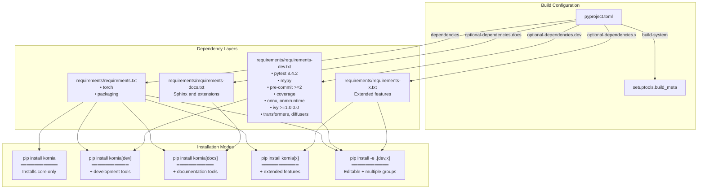

Sources: [pyproject.toml:1-65](), [requirements/requirements-dev.txt:1-18]()

---

## Platform Support

### Operating Systems

Kornia is tested on multiple operating systems through the CI/CD pipeline:
- **Ubuntu** (Linux)
- **Windows**
- **macOS**

Sources: [README.md:86-87](), Diagram 3 from provided overview

### Python Versions

Supported Python versions as declared in [pyproject.toml:13,25-29]():
- Python 3.9
- Python 3.10
- Python 3.11
- Python 3.12
- Python 3.13 (beta support)

### PyTorch Versions

Kornia maintains compatibility with PyTorch versions from 1.9.1 to the latest (2.5+). The CI/CD pipeline tests against multiple PyTorch versions to ensure compatibility.

### Hardware Acceleration

Kornia supports multiple hardware backends:
- **CPU**: Standard CPU operations
- **CUDA**: NVIDIA GPU acceleration (CUDA 11.8, 12.1)
- **MPS**: Apple Silicon Metal Performance Shaders
- **TPU**: Google Cloud TPU (limited support)

The setup script defaults to CUDA 12.1 but can be customized via environment variables [CONTRIBUTING.md:87-95]().

Sources: [pyproject.toml:13-33](), [CONTRIBUTING.md:87-95]()

---

## Verification

After installation, verify that Kornia is correctly installed:

```python
import kornia
print(kornia.__version__)

# Test a simple operation
import torch
image = torch.rand(1, 3, 224, 224)
gray = kornia.color.rgb_to_grayscale(image)
print(f"Grayscale shape: {gray.shape}")  # Should be (1, 1, 224, 224)
```

For development environments, verify all tools are available:

```bash
# Check Python and PyTorch versions
python --version
python -c "import torch; print(f'PyTorch {torch.__version__}')"

# Verify development tools
pytest --version
mypy --version
pre-commit --version
just --version
```

Sources: [README.md:122-159]()

---

## Troubleshooting

### Common Issues

**Virtual environment not found**:
- Run `./setup_dev_env.sh` to create the environment
- Or check that you're in the correct directory

**CUDA version mismatch**:
- Specify CUDA version explicitly: `CUDA_VERSION=11.8 ./setup_dev_env.sh`
- For CPU-only: `PYTORCH_MODE=cpuonly ./setup_dev_env.sh`

**Pre-commit hooks failing**:
- Run manually: `pre-commit run --all-files`
- Update hooks: `pre-commit autoupdate`

**Type checking errors with mypy**:
- Ensure virtual environment is activated
- Run: `mypy` or `just mypy`

**Import errors**:
- For editable installs, ensure you ran `pip install -e .` from the repository root
- Check that the virtual environment is activated

Sources: [CONTRIBUTING.md:68-173](), [justfile:1-149]()

---

## Summary

Kornia provides multiple installation methods tailored to different use cases:
- **End users**: Simple `pip install kornia` for production use
- **Contributors**: Automated `./setup_dev_env.sh` for complete development environment
- **Advanced users**: Manual setup with `uv` for custom configurations

The development environment uses modern Python tooling:
- `uv` for fast package management
- `just` for convenient development commands
- `pre-commit` for automated code quality checks
- `pytest` with extensive device/dtype testing support

All configuration is centralized in `pyproject.toml`, making the project easy to maintain and extend. The setup supports Python 3.9-3.13, PyTorch 1.9.1+, and multiple hardware backends (CPU, CUDA, MPS).

Sources: [README.md:84-120](), [CONTRIBUTING.md:44-173](), [pyproject.toml:1-282](), [justfile:1-149](), [.pre-commit-config.yaml:1-55]()

---

# Page: Key Features and Capabilities

# Key Features

<details>
<summary>Relevant source files</summary>

The following files were used as context for generating this wiki page:

- [docs/source/augmentation.rst](docs/source/augmentation.rst)
- [docs/source/contrib.rst](docs/source/contrib.rst)
- [docs/source/feature.rst](docs/source/feature.rst)
- [docs/source/geometry.conversions.rst](docs/source/geometry.conversions.rst)
- [docs/source/geometry.transform.rst](docs/source/geometry.transform.rst)
- [docs/source/references.bib](docs/source/references.bib)
- [kornia/augmentation/__init__.py](kornia/augmentation/__init__.py)
- [kornia/contrib/__init__.py](kornia/contrib/__init__.py)
- [kornia/contrib/histogram_matching.py](kornia/contrib/histogram_matching.py)
- [kornia/contrib/models/rt_detr/__init__.py](kornia/contrib/models/rt_detr/__init__.py)
- [kornia/contrib/models/rt_detr/architecture/__init__.py](kornia/contrib/models/rt_detr/architecture/__init__.py)
- [kornia/feature/__init__.py](kornia/feature/__init__.py)
- [kornia/feature/laf.py](kornia/feature/laf.py)
- [kornia/feature/responses.py](kornia/feature/responses.py)
- [kornia/feature/scale_space_detector.py](kornia/feature/scale_space_detector.py)
- [kornia/feature/siftdesc.py](kornia/feature/siftdesc.py)
- [kornia/geometry/camera/pinhole.py](kornia/geometry/camera/pinhole.py)
- [kornia/geometry/conversions.py](kornia/geometry/conversions.py)
- [kornia/geometry/transform/affwarp.py](kornia/geometry/transform/affwarp.py)
- [kornia/geometry/transform/imgwarp.py](kornia/geometry/transform/imgwarp.py)
- [kornia/geometry/transform/pyramid.py](kornia/geometry/transform/pyramid.py)

</details>


This page documents Kornia's key capabilities that distinguish it as a differentiable computer vision library. These features enable seamless integration of computer vision operations into deep learning pipelines with support for automatic differentiation, GPU acceleration, and multi-framework compatibility.

For installation and setup instructions, see [Installation and Setup](#1.1). For information about the overall architecture and how these features are organized across modules, see [Architecture and Module Organization](#1.3).

---

## Overview of Key Capabilities

Kornia is built on PyTorch and provides a comprehensive set of differentiable computer vision operations. The library's design emphasizes several core capabilities:

| Capability | Description | Primary Benefit |
|------------|-------------|-----------------|
| **Differentiability** | All operations support automatic differentiation | End-to-end training of vision pipelines |
| **GPU Acceleration** | Native PyTorch tensor operations with CUDA support | High-performance batch processing |
| **Batch Processing** | Vectorized operations on batched inputs | Efficient parallel computation |
| **Multi-Framework** | Transpilation to JAX, TensorFlow, NumPy | Ecosystem interoperability |
| **Rich Operator Set** | 500+ vision operations across multiple domains | Comprehensive toolset |
| **ONNX Export** | Model serialization and chaining support | Production deployment |
| **Type Safety** | Static typing with mypy validation | Code reliability |

**Sources:** [README.md:28-49](), [kornia/__init__.py:18-60]()

---

## Differentiability and Automatic Gradient Computation

All Kornia operations are implemented as differentiable functions that integrate seamlessly with PyTorch's autograd system. This enables gradient-based optimization of entire computer vision pipelines.

### Gradient Flow Architecture

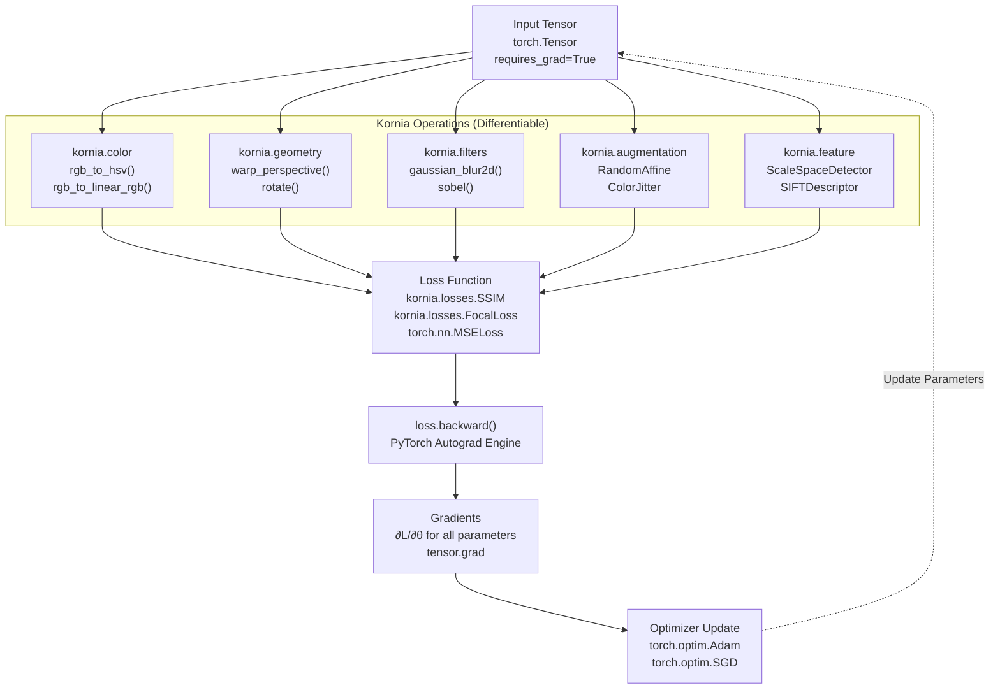

### Gradient Checking Infrastructure

Kornia maintains strict gradient correctness through comprehensive testing:

- **Gradient Check Tests**: Each operation includes `test_gradcheck()` validating numerical vs. analytical gradients
- **Test Framework**: Located in [testing/base.py](), provides `BaseTester.gradcheck()` helper
- **Example Tests**: [tests/color/test_rgb.py:92-95](), [tests/color/test_rgb.py:383-387]()

The gradient checking ensures all operations satisfy:
```
|∇f_numerical - ∇f_analytical| < tolerance
```

**Sources:** [kornia/color/rgb.py:206-259](), [tests/color/test_rgb.py:92-95](), [CONTRIBUTING.md:307-311]()

---

## GPU Acceleration and Multi-Device Support

Kornia operations execute on any PyTorch-supported device, including CPU, CUDA GPUs, and Apple Silicon MPS accelerators. The library leverages PyTorch's device abstraction for transparent device placement.

### Device Support Matrix

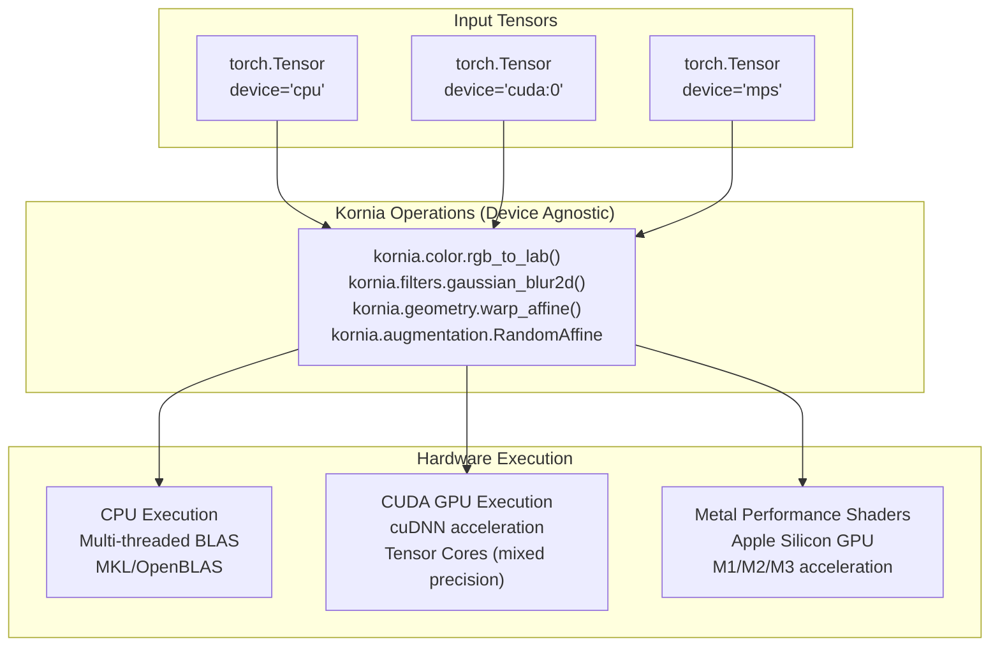

### Testing Across Devices

The test suite validates correctness across all devices:

**Test Configuration:**
- **Device Selection**: `--device=cpu`, `--device=cuda`, `--device=mps`, `--device=all`
- **Dtype Selection**: `--dtype=float32`, `--dtype=float64`, `--dtype=all`
- **Test Fixtures**: [testing/base.py]() provides `device` and `dtype` fixtures

**Example Test Commands:**
```bash
# CPU-only tests (from justfile)
just test-cpu          # All dtypes on CPU
just test-cpu-f32      # Float32 only on CPU

# CUDA tests
just test-cuda         # All dtypes on CUDA
just test-cuda-f32     # Float32 only on CUDA

# MPS tests (Apple Silicon)
just test-mps          # Float32 only, excluding grad/jit tests
```

**Sources:** [justfile:29-45](), [CONTRIBUTING.md:163-169](), [README.md:86-87]()

---

## Batch Processing and Vectorization

All Kornia operations support batched inputs with shape conventions `(B, C, H, W)` for 2D operations and `(B, C, D, H, W)` for 3D operations. Batch dimensions are preserved through all transformations.

### Batch Processing Flow

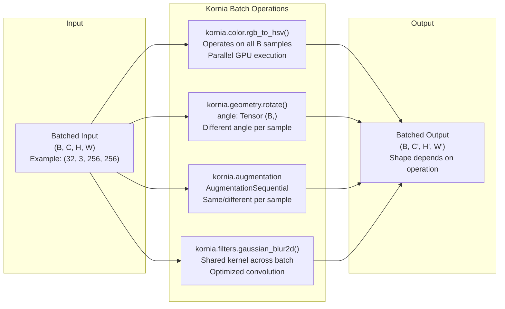

### Batch Dimension Conventions

| Operation Type | Input Shape | Output Shape | Notes |
|----------------|-------------|--------------|-------|
| **Color Conversion** | `(*, 3, H, W)` | `(*, 3, H, W)` | Arbitrary batch dimensions `*` |
| **Geometric Transform** | `(B, C, H, W)` | `(B, C, H', W')` | H', W' depend on transform |
| **Augmentation** | `(B, C, H, W)` | `(B, C, H', W')` | Random per-sample transforms |
| **Filtering** | `(B, C, H, W)` | `(B, C, H, W)` | Preserves spatial dimensions |
| **Raw to RGB** | `(*, 1, H, W)` | `(*, 3, H, W)` | H, W must be even |

**Example from Color Operations:**
- [kornia/color/rgb.py:29-52]() - `rgb_to_bgr()` accepts shape `(*, 3, H, W)`
- [kornia/color/raw.py:53-193]() - `raw_to_rgb()` processes batched raw images

**Sources:** [kornia/color/rgb.py:29-52](), [kornia/color/raw.py:240-298](), [README.md:28]()

---

## Multi-Framework Support via Ivy Transpilation

Kornia provides transpilation to JAX, TensorFlow, and NumPy through the Ivy framework, enabling interoperability across the deep learning ecosystem.

### Multi-Framework Architecture

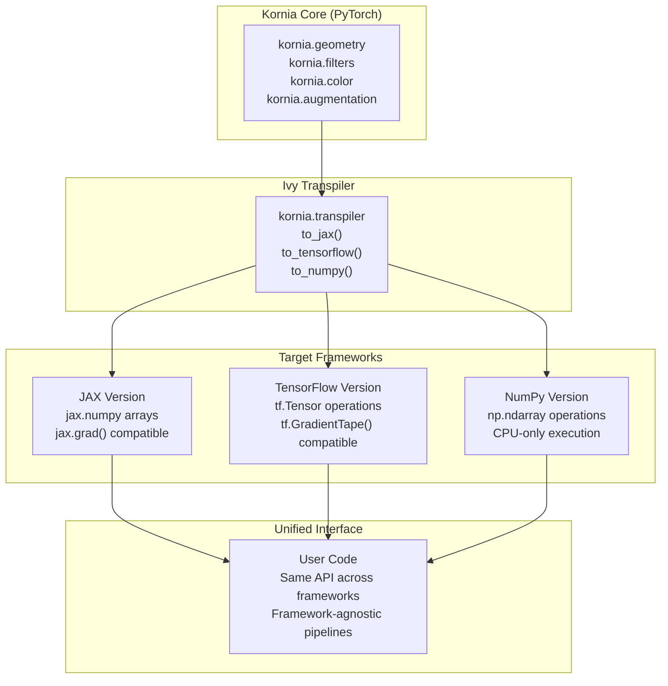

### Transpilation API

The transpilation interface is exposed at the top level:

**Import and Usage:**
```python
# From kornia/__init__.py
from kornia.transpiler import to_jax, to_numpy, to_tensorflow

# Usage example from README.md:191-193
import kornia
tf_kornia = kornia.to_tensorflow()
# Now use tf_kornia.geometry, tf_kornia.filters, etc.
```

**Transpiler Functions:**
- `to_jax()`: Converts Kornia operations to JAX
- `to_tensorflow()`: Converts to TensorFlow operations
- `to_numpy()`: Converts to NumPy operations (CPU-only)

**Ivy Integration:**
- Dependency: [requirements/requirements-dev.txt:4]() - `ivy>=1.0.0.0`
- Supports automatic backend conversion
- Maintains API compatibility across frameworks

**Sources:** [kornia/__init__.py:45](), [README.md:186-203](), [requirements/requirements-dev.txt:4]()

---

## Comprehensive Operator Coverage

Kornia provides over 500 operations across multiple computer vision domains, organized into specialized modules.

### Operator Categories and Code Organization

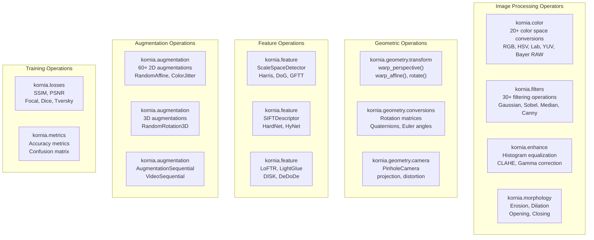

### Operator Statistics by Module

| Module | Operations | Primary Use Cases |
|--------|------------|-------------------|
| **kornia.color** | 20+ | Color space conversions, RAW processing |
| **kornia.filters** | 30+ | Gaussian blur, edge detection, kernels |
| **kornia.geometry** | 50+ | Transforms, projections, camera models |
| **kornia.feature** | 40+ | Feature detection, description, matching |
| **kornia.augmentation** | 60+ | Data augmentation pipelines |
| **kornia.losses** | 15+ | Training objectives, photometric losses |
| **kornia.morphology** | 10+ | Morphological operations |
| **kornia.enhance** | 10+ | Image enhancement, normalization |

**Module Imports:**
From [kornia/__init__.py:24-42]():
```python
from . import (
    augmentation,
    color,
    contrib,
    core,
    config,
    enhance,
    feature,
    io,
    losses,
    metrics,
    models,
    morphology,
    onnx,
    tracking,
    utils,
    x,
)
```

**Sources:** [kornia/__init__.py:18-60](), [README.md:50-73](), [docs/source/color.rst:1-236](), [kornia/color/__init__.py:18-152]()

---

## ONNX Export and Model Deployment

Kornia supports ONNX export for production deployment through the `kornia.onnx` module, enabling model chaining and cross-platform inference.

### ONNX Sequential Pipeline

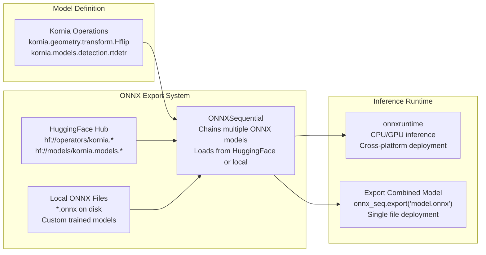

### ONNX Export Example

**Usage Pattern (from README.md):**
```python
from kornia.onnx import ONNXSequential

# Chain ONNX models from HuggingFace and local files
onnx_seq = ONNXSequential(
    "hf://operators/kornia.geometry.transform.flips.Hflip",
    "hf://models/kornia.models.detection.rtdetr_r18vd_640x640",
)

# Inference
input_data = np.random.randn(1, 3, 384, 512).astype(np.float32)
outputs = onnx_seq(input_data)

# Export chained model
onnx_seq.export("chained_model.onnx")
```

**ONNX Module Support:**
- Module organization: [kornia/onnx/]()
- Operator exports: Models with `ONNX_DEFAULT_INPUTSHAPE` and `ONNX_DEFAULT_OUTPUTSHAPE` attributes
- Examples: [kornia/color/rgb.py:356-357](), [kornia/color/raw.py:316-317]()

**Sources:** [README.md:164-183](), [kornia/color/rgb.py:356-357](), [kornia/color/raw.py:316-317](), [requirements/requirements-dev.txt:7-8]()

---

## Type Safety and Static Analysis

Kornia maintains strict type safety through comprehensive type annotations and mypy validation, ensuring code reliability and developer productivity.

### Type System Architecture

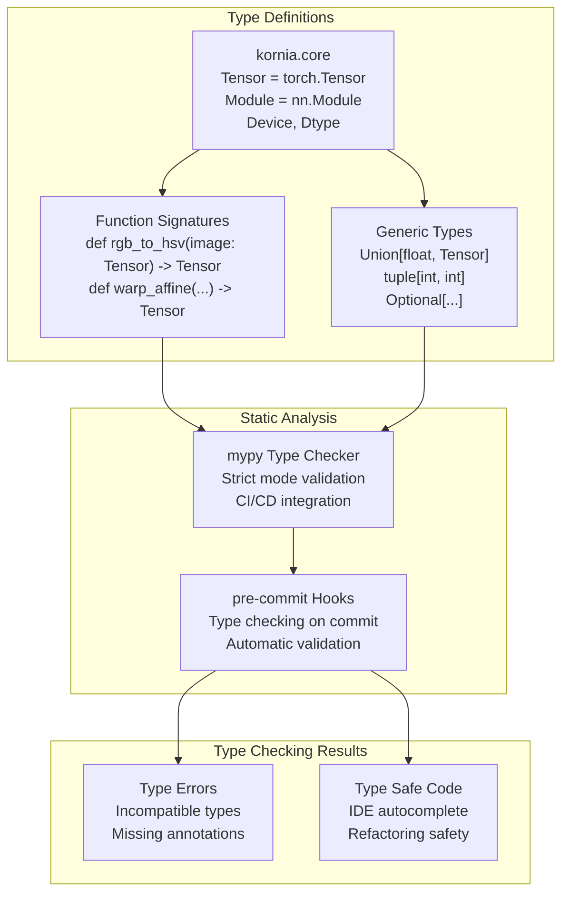

### Type Annotation Examples

**Color Module Example:**
From [kornia/color/rgb.py:18-20](), [kornia/color/rgb.py:79-115]():
```python
from __future__ import annotations
from kornia.core import Tensor

def rgb_to_rgba(image: Tensor, alpha_val: Union[float, Tensor]) -> Tensor:
    # Type-safe implementation
    # Returns RGBA version of shape (*, 4, H, W)
```

**Mypy Configuration:**
- Tool: `mypy` in [requirements/requirements-dev.txt:5]()
- Justfile command: `just mypy` runs type checking [justfile:82-83]()
- CI validation: Type checks run on all pull requests [CONTRIBUTING.md:398]()

**Type Checking Standards (from CONTRIBUTING.md):**
- Use `from __future__ import annotations` for advanced typing
- Import types from `kornia.core`: `Tensor`, `Module`
- Always type function inputs and outputs
- Use typing for complex types: `Union`, `Optional`, `tuple[int, int]`

**Sources:** [kornia/color/rgb.py:18-115](), [CONTRIBUTING.md:337-358](), [justfile:82-83](), [requirements/requirements-dev.txt:5]()

---

## Development and Testing Infrastructure

Kornia maintains high code quality through comprehensive testing infrastructure and CI/CD pipelines that validate all key features across multiple configurations.

### Testing Matrix

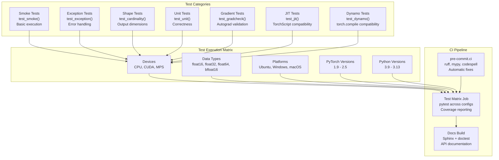

### Test Framework Structure

**Base Test Class:**
From [CONTRIBUTING.md:273-322]():
```python
from testing.base import BaseTester

class TestMyFunction(BaseTester):
    def test_smoke(self, device, dtype):
        # Test basic execution
        pass
    
    def test_exception(self, device, dtype):
        # Test error handling
        pass
    
    def test_cardinality(self, device, dtype):
        # Test output shapes
        pass
    
    def test_gradcheck(self, device):
        # Test gradients with self.gradcheck(...)
        pass
    
    def test_dynamo(self, device, dtype, torch_optimizer):
        # Test torch.compile compatibility
        pass
```

**CI/CD Pipeline:**
- Pre-commit hooks: [.pre-commit-config.yaml]() with ruff, mypy, codespell
- Test matrix: [.github/workflows/]() validates across platforms
- Coverage threshold: 84% minimum [CONTRIBUTING.md:395-397]()

**Justfile Test Commands:**
```bash
just test-all          # Run all tests with coverage
just test-cpu          # CPU-only tests
just test-cuda         # CUDA tests
just test-quick        # Fast tests (no jit/grad)
just test-coverage     # Coverage report
```

**Sources:** [CONTRIBUTING.md:158-322](), [justfile:25-76](), [README.md:104-112]()

---

## Summary

Kornia's key features work together to provide a comprehensive, production-ready computer vision library:

1. **Differentiability**: Enables end-to-end training with automatic gradient computation
2. **GPU Acceleration**: Leverages PyTorch's device abstraction for high-performance execution
3. **Batch Processing**: Vectorized operations for efficient parallel computation
4. **Multi-Framework**: Transpilation to JAX, TensorFlow, and NumPy via Ivy
5. **Rich Operators**: 500+ operations across color, geometry, features, and augmentation
6. **ONNX Export**: Production deployment with model chaining
7. **Type Safety**: Comprehensive type annotations with mypy validation
8. **Testing**: Extensive test matrix ensuring correctness across configurations

These capabilities are organized into a modular architecture detailed in [Architecture and Module Organization](#1.3), with each feature supporting the others to create a cohesive ecosystem for differentiable computer vision.

**Sources:** [README.md:1-256](), [kornia/__init__.py:18-60](), [CONTRIBUTING.md:1-410]()

---

# Page: Module Organization and Architecture

# Module Organization and Architecture

<details>
<summary>Relevant source files</summary>

The following files were used as context for generating this wiki page:

- [.pre-commit-config.yaml](.pre-commit-config.yaml)
- [CHANGELOG.md](CHANGELOG.md)
- [docs/source/augmentation.rst](docs/source/augmentation.rst)
- [docs/source/color.rst](docs/source/color.rst)
- [kornia/__init__.py](kornia/__init__.py)
- [kornia/augmentation/__init__.py](kornia/augmentation/__init__.py)
- [kornia/color/__init__.py](kornia/color/__init__.py)
- [kornia/color/raw.py](kornia/color/raw.py)
- [kornia/color/rgb.py](kornia/color/rgb.py)
- [pyproject.toml](pyproject.toml)
- [tests/color/test_rgb.py](tests/color/test_rgb.py)
- [uv.lock](uv.lock)

</details>


This document describes how the Kornia codebase is organized into modules, the architectural patterns used consistently across modules, and the dependency relationships between major components. For specific details about individual modules' functionality, see the module-specific documentation pages (e.g., [Color Space Processing](#2), [Geometry and Transformations](#3), [Data Augmentation System](#4), etc.).

## Overview of Module Structure

Kornia is organized as a hierarchical package with approximately 15 top-level modules, each providing a cohesive set of computer vision functionality. The library follows a consistent architectural pattern across modules: each module exposes both functional (pure function) and object-oriented (`nn.Module` subclass) interfaces for the same operations, enabling flexible integration into PyTorch workflows.

The main package entry point at [kornia/__init__.py:1-67]() establishes the module namespace and handles imports. Critical to the architecture is the import order: `filters` and `geometry` modules must be imported first [kornia/__init__.py:24-27]() as they are foundational and changing this order can cause circular dependency issues.

**Sources:** [kornia/__init__.py:1-67]()

## Top-Level Module Taxonomy

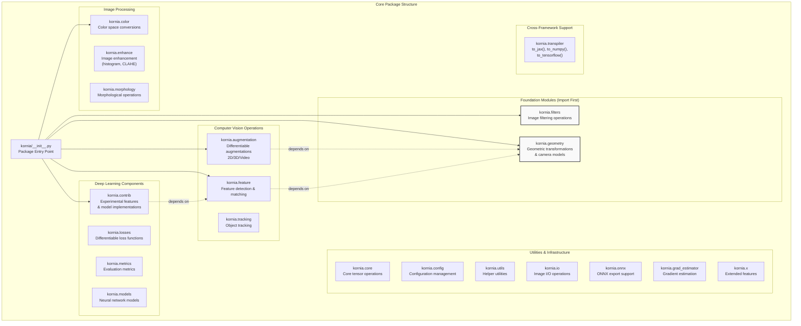

The modules are imported in a specific order at [kornia/__init__.py:24-48]():

| Import Order | Module | Purpose | Key Dependencies |
|--------------|--------|---------|------------------|
| 1-2 | `filters`, `geometry` | Foundation modules providing core operations | None (must be first) |
| 3 | `grad_estimator` | Gradient estimation utilities | Core modules |
| 4-16 | `augmentation`, `color`, `contrib`, `core`, `config`, `enhance`, `feature`, `io`, `losses`, `metrics`, `models`, `morphology`, `onnx`, `tracking`, `utils`, `x` | Feature modules | Foundation modules |
| 17 | `transpiler` | Multi-framework support | Core modules |

**Sources:** [kornia/__init__.py:24-52]()

## Module Design Pattern: Functional + Object-Oriented Interface

Kornia follows a dual-interface pattern across all modules: each operation is implemented as both a functional (pure function) and an object-oriented (`torch.nn.Module` subclass) interface. This pattern provides flexibility for different use cases—functions for simple transformations and modules for integration into neural network architectures.

### Pattern Structure

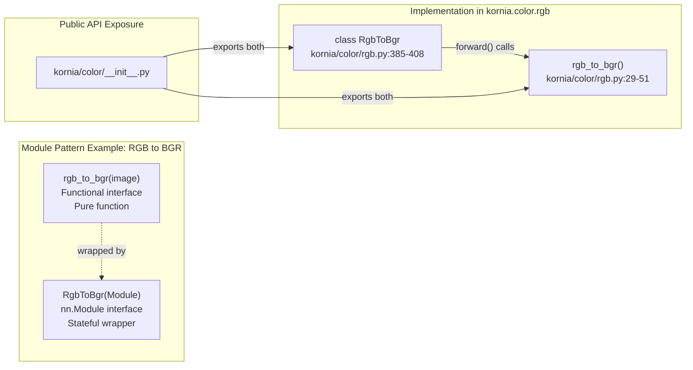

**Example Implementation:**

The `rgb_to_bgr` operation demonstrates this pattern:

1. **Functional Interface** [kornia/color/rgb.py:29-51](): Pure function accepting a tensor and returning the transformed tensor
2. **Module Interface** [kornia/color/rgb.py:385-408](): `RgbToBgr` class inheriting from `Module` with a `forward()` method that calls the functional implementation
3. **Public Exports** [kornia/color/__init__.py:39-49](): Both interfaces exported in `__all__` list for consistent API

This pattern is applied consistently across:
- Color conversions (RGB↔BGR, RGB↔HSV, RGB↔Lab, etc.)
- Geometric transformations (affine, perspective, rotation)
- Augmentations (all 60+ augmentation operations)
- Filters (Gaussian, Sobel, median, etc.)

**Sources:** [kornia/color/rgb.py:29-51](), [kornia/color/rgb.py:385-408](), [kornia/color/__init__.py:23-160]()

## Internal Module Hierarchy: Augmentation Module Example

Modules are internally organized with multi-level hierarchies to separate concerns. The augmentation module exemplifies this structure:

```mermaid
graph TB
    subgraph "kornia.augmentation Module"
        AUG_INIT["kornia/augmentation/__init__.py<br/>Public API Surface"]
        
        subgraph "Base Classes"
            BASE["augmentation.base<br/>AugmentationBase"]
            BASE_2D["augmentation._2d.base<br/>AugmentationBase2D<br/>RigidAffineAugmentationBase2D"]
            BASE_3D["augmentation._3d.base<br/>AugmentationBase3D<br/>RigidAffineAugmentationBase3D"]
        end
        
        subgraph "2D Augmentation Categories"
            GEOM_2D["augmentation._2d.geometric.base<br/>GeometricAugmentationBase2D"]
            INTENS_2D["augmentation._2d.intensity.base<br/>IntensityAugmentationBase2D"]
            MIX_2D["augmentation._2d.mix.base<br/>MixAugmentationBaseV2"]
            
            GEOM_IMPL["augmentation._2d.geometric<br/>~20 implementations:<br/>RandomAffine, RandomPerspective,<br/>RandomCrop, RandomRotation, etc."]
            INTENS_IMPL["augmentation._2d.intensity<br/>~35 implementations:<br/>RandomBrightness, RandomContrast,<br/>RandomGaussianBlur, etc."]
            MIX_IMPL["augmentation._2d.mix<br/>~5 implementations:<br/>RandomCutMixV2, RandomMixUpV2,<br/>RandomMosaic"]
        end
        
        subgraph "3D Augmentation Categories"
            GEOM_3D["augmentation._3d.geometric.base<br/>GeometricAugmentationBase3D"]
            INTENS_3D["augmentation._3d.intensity.base<br/>IntensityAugmentationBase3D"]
            
            IMPL_3D["augmentation._3d<br/>RandomAffine3D, RandomCrop3D,<br/>RandomRotation3D, etc."]
        end
        
        subgraph "Container System"
            CONTAINERS["augmentation.container<br/>ImageSequential<br/>VideoSequential<br/>AugmentationSequential<br/>PatchSequential"]
        end
        
        subgraph "Auto Module"
            AUTO["augmentation.auto<br/>AutoAugment policies"]
        end
    end
    
    BASE --> BASE_2D
    BASE --> BASE_3D
    
    BASE_2D --> GEOM_2D
    BASE_2D --> INTENS_2D
    BASE_2D --> MIX_2D
    
    GEOM_2D --> GEOM_IMPL
    INTENS_2D --> INTENS_IMPL
    MIX_2D --> MIX_IMPL
    
    BASE_3D --> GEOM_3D
    BASE_3D --> INTENS_3D
    
    GEOM_3D --> IMPL_3D
    INTENS_3D --> IMPL_3D
    
    AUG_INIT --> BASE
    AUG_INIT --> GEOM_IMPL
    AUG_INIT --> INTENS_IMPL
    AUG_INIT --> MIX_IMPL
    AUG_INIT --> IMPL_3D
    AUG_INIT --> CONTAINERS
    AUG_INIT --> AUTO
```

**Hierarchy Levels:**

1. **Package Entry** [kornia/augmentation/__init__.py:1-205](): Imports and re-exports public API (60+ augmentations + containers)
2. **Abstract Base Classes**: Define common interfaces
   - `AugmentationBase` - Root base for all augmentations
   - `AugmentationBase2D` [kornia/augmentation/__init__.py:88]() - Base for 2D operations
   - `AugmentationBase3D` [kornia/augmentation/__init__.py:105]() - Base for 3D operations
3. **Categorical Bases**: Organize by operation type
   - `GeometricAugmentationBase2D` [kornia/augmentation/__init__.py:89]() - Spatial transformations
   - `IntensityAugmentationBase2D` [kornia/augmentation/__init__.py:90]() - Pixel-level adjustments
   - `MixAugmentationBaseV2` [kornia/augmentation/__init__.py:91]() - Multi-image mixing
4. **Concrete Implementations**: Specific augmentation classes (e.g., `RandomAffine`, `RandomBrightness`)
5. **Container Classes**: Pipeline builders (`ImageSequential`, `AugmentationSequential`) [kornia/augmentation/__init__.py:108-115]()

**Sources:** [kornia/augmentation/__init__.py:1-205]()

## Color Module Internal Structure

The color module demonstrates organization by conversion families:

```mermaid
graph TB
    subgraph "kornia.color Module Structure"
        COLOR_INIT["kornia/color/__init__.py<br/>Exports 150+ symbols"]
        
        subgraph "Submodules by Color Space"
            RGB_MOD["color.rgb<br/>RGB/BGR/RGBA conversions<br/>Linear RGB<br/>RGB255 utilities"]
            GRAY_MOD["color.gray<br/>Grayscale conversions"]
            HSV_MOD["color.hsv<br/>HSV color space"]
            HLS_MOD["color.hls<br/>HLS color space"]
            LAB_MOD["color.lab<br/>Lab color space"]
            LUV_MOD["color.luv<br/>Luv color space"]
            XYZ_MOD["color.xyz<br/>XYZ color space"]
            YCBCR_MOD["color.ycbcr<br/>YCbCr color space"]
            YUV_MOD["color.yuv<br/>YUV/YUV420/YUV422"]
            RAW_MOD["color.raw<br/>Bayer RAW processing<br/>CFA enum"]
            SEPIA_MOD["color.sepia<br/>Sepia effect"]
            COLORMAP_MOD["color.colormap<br/>ColorMap class<br/>ColorMapType enum<br/>apply_colormap()"]
        end
    end
    
    COLOR_INIT --> RGB_MOD
    COLOR_INIT --> GRAY_MOD
    COLOR_INIT --> HSV_MOD
    COLOR_INIT --> HLS_MOD
    COLOR_INIT --> LAB_MOD
    COLOR_INIT --> LUV_MOD
    COLOR_INIT --> XYZ_MOD
    COLOR_INIT --> YCBCR_MOD
    COLOR_INIT --> YUV_MOD
    COLOR_INIT --> RAW_MOD
    COLOR_INIT --> SEPIA_MOD
    COLOR_INIT --> COLORMAP_MOD
```

Each submodule typically contains:
- 2-4 functional implementations (forward and reverse conversions)
- Corresponding `nn.Module` wrapper classes
- Type definitions (e.g., `CFA` enum for Bayer patterns [kornia/color/raw.py:30-51]())

**Example Exports from RGB Module:**

| Category | Functions | Modules |
|----------|-----------|---------|
| RGB↔BGR | `rgb_to_bgr`, `bgr_to_rgb` | `RgbToBgr`, `BgrToRgb` |
| RGB↔RGBA | `rgb_to_rgba`, `rgba_to_rgb`, `bgr_to_rgba`, `rgba_to_bgr` | `RgbToRgba`, `RgbaToRgb`, `BgrToRgba`, `RgbaToBgr` |
| Linear RGB | `rgb_to_linear_rgb`, `linear_rgb_to_rgb` | `RgbToLinearRgb`, `LinearRgbToRgb` |
| Quantization | `rgb_to_rgb255`, `rgb255_to_rgb` | `RgbToRgb255`, `Rgb255ToRgb` |
| Normals | `normals_to_rgb255`, `rgb255_to_normals` | `NormalsToRgb255`, `Rgb255ToNormals` |

**Sources:** [kornia/color/__init__.py:23-160](), [kornia/color/rgb.py:1-684](), [kornia/color/raw.py:30-51]()

## Import Management and Public API Control

Kornia uses explicit import management to control the public API surface and prevent namespace pollution:

### The `__all__` Pattern

Every module defines an `__all__` list explicitly enumerating exported symbols [kornia/augmentation/__init__.py:117-204]():

```python
__all__ = [
    "AugmentationBase2D",
    "AugmentationBase3D",
    "AugmentationSequential",
    "CenterCrop",
    # ... 200+ more symbols
]
```

**Benefits:**
- Documents intended public API
- Prevents accidental exports of internal utilities
- Enables IDE autocomplete
- Controls `from kornia.module import *` behavior

### Module-Level Convenience Imports

The top-level package exposes a curated set of commonly-used utilities directly [kornia/__init__.py:54-63]():

```python
from kornia.constants import pi
from kornia.utils import (
    eye_like,
    vec_like,
    create_meshgrid,
    image_to_tensor,
    tensor_to_image,
    xla_is_available,
)
```

This allows users to write `kornia.image_to_tensor()` instead of `kornia.utils.image_to_tensor()` for frequently-used functions.

### Import Order and Circular Dependencies

The comment at [kornia/__init__.py:24-25]() explicitly documents the critical import order:

> "NOTE: kornia filters and geometry must go first since are the core of the library and by changing the import order you might get into a circular dependencies issue."

This architectural constraint exists because:
- `augmentation` depends on `geometry` for transformation matrices
- `feature` depends on `geometry` for LAF (Local Affine Frame) operations  
- Multiple modules depend on `filters` for core convolution operations

**Sources:** [kornia/__init__.py:24-63](), [kornia/augmentation/__init__.py:117-204](), [kornia/color/__init__.py:74-160]()

## Geometry Module Internal Organization

The geometry module is internally subdivided by functional area:

```mermaid
graph TB
    subgraph "kornia.geometry Module"
        GEOM_INIT["kornia.geometry<br/>Package entry point"]
        
        subgraph "Submodules"
            CONVERSIONS["geometry.conversions<br/>Rotation representations<br/>quaternion, axis-angle,<br/>rotation matrix, euler angles"]
            
            TRANSFORM["geometry.transform<br/>Image warping<br/>warp_perspective, warp_affine<br/>Transformation matrices"]
            
            CAMERA["geometry.camera<br/>Pinhole camera model<br/>projection, unprojection<br/>Camera parameters"]
            
            SUBPIX["geometry.subpix<br/>Subpixel operations<br/>spatial_soft_argmax"]
            
            DEPTH["geometry.depth<br/>Depth-related operations"]
            
            EPIPOLAR["geometry.epipolar<br/>Epipolar geometry<br/>Fundamental matrix, Essential matrix"]
            
            HOMOGRAPHY["geometry.homography<br/>Homography estimation<br/>RANSAC variants"]
            
            LINALG["geometry.linalg<br/>Linear algebra utilities<br/>euclidean_distance"]
            
            LIEGROUP["geometry.liegroup<br/>Lie group operations<br/>SO2, SO3, SE2, SE3"]
            
            CALIBRATION["geometry.calibration<br/>Camera calibration<br/>undistort_points"]
        end
    end
    
    GEOM_INIT --> CONVERSIONS
    GEOM_INIT --> TRANSFORM
    GEOM_INIT --> CAMERA
    GEOM_INIT --> SUBPIX
    GEOM_INIT --> DEPTH
    GEOM_INIT --> EPIPOLAR
    GEOM_INIT --> HOMOGRAPHY
    GEOM_INIT --> LINALG
    GEOM_INIT --> LIEGROUP
    GEOM_INIT --> CALIBRATION
```

The geometry module contains particularly complex internal dependencies because:
- `transform` uses `conversions` for rotation matrix generation
- `camera` uses `conversions` for coordinate transformations
- `epipolar` depends on both `camera` and `linalg`
- `homography` depends on `transform` for warp operations

**Sources:** Based on diagram analysis from high-level architecture diagrams

## Contrib Module: Experimental Features

The `kornia.contrib` module houses experimental features and higher-level APIs not yet stabilized for the main modules:

```mermaid
graph TB
    subgraph "kornia.contrib - Experimental Features"
        CONTRIB_INIT["kornia.contrib<br/>Entry point"]
        
        subgraph "Model Implementations"
            VIT["contrib.models.vit<br/>VisionTransformer<br/>EfficientViT, MobileViT, TinyViT"]
            RTDETR["contrib.models.rt_detr<br/>RT-DETR detector<br/>Multiple model variants"]
            SAM["contrib.models.sam<br/>Segment Anything Model<br/>VisualPrompter interface"]
        end
        
        subgraph "Detection Interfaces"
            FACE["contrib.face_detection<br/>FaceDetector<br/>YuNet-based"]
            EDGE["contrib.edge_detection<br/>EdgeDetector<br/>Canny, DexiNed"]
            OBJECT["contrib.object_detection<br/>ObjectDetector<br/>Uses RT-DETR"]
        end
        
        subgraph "Utilities"
            PATCHES["contrib.extract_patches<br/>extract_tensor_patches<br/>combine_tensor_patches"]
            HISTOGRAM["contrib.histogram_matching<br/>histogram_matching"]
            DISTANCE["contrib.distance_transform<br/>DistanceTransform"]
            KMEANS["contrib.kmeans<br/>KMeans clustering"]
            STITCHER["contrib.image_stitcher<br/>ImageStitcher<br/>Panorama creation"]
        end
    end
    
    CONTRIB_INIT --> VIT
    CONTRIB_INIT --> RTDETR
    CONTRIB_INIT --> SAM
    CONTRIB_INIT --> FACE
    CONTRIB_INIT --> EDGE
    CONTRIB_INIT --> OBJECT
    CONTRIB_INIT --> PATCHES
    CONTRIB_INIT --> HISTOGRAM
    CONTRIB_INIT --> DISTANCE
    CONTRIB_INIT --> KMEANS
    CONTRIB_INIT --> STITCHER
```

The contrib module serves as an incubation space where:
- New models can be added without strict API stability guarantees
- Experimental interfaces can be tested before promoting to main modules
- Community contributions can be integrated with lower barriers
- Complex multi-component systems (like `ObjectDetector` wrapping RT-DETR with pre/post-processing) can be developed

**Sources:** Based on high-level architecture diagrams (Diagram 5)

## Dependency Flow and Module Relationships

The following table summarizes key inter-module dependencies:

| Module | Direct Dependencies | Reason for Dependency |
|--------|-------------------|----------------------|
| `augmentation` | `geometry.transform`, `geometry.conversions` | Geometric augmentations require transformation matrix generation and application |
| `feature` | `geometry` (LAF operations), `filters` | Feature detection uses scale-space filtering; LAFs require geometric utilities |
| `contrib.models` | `feature` (matching), `filters` | Models like RT-DETR use feature processing pipelines |
| `augmentation.container` | `geometry.transform` | `AugmentationSequential` applies geometric transforms to masks/boxes/keypoints |
| All modules | `core` | Core tensor operations and base classes (`Tensor`, `Module`, `as_tensor`) |

**Circular Dependency Prevention:**

The architecture avoids circular dependencies through:
1. **Layered Import Order**: Foundation modules (`filters`, `geometry`) imported before dependent modules
2. **Lazy Imports**: Some heavy dependencies (like model weights) use lazy loading
3. **Interface Segregation**: Modules depend on interfaces/base classes rather than concrete implementations
4. **Clear Hierarchy**: No bi-directional dependencies; dependency graph is a DAG (directed acyclic graph)

**Sources:** [kornia/__init__.py:24-27]()

## Configuration and Extension Points

### Package Configuration

The `kornia.config` module [kornia/__init__.py:36]() provides runtime configuration options. The `kornia.constants` module [kornia/__init__.py:55]() defines mathematical constants (e.g., `pi`) used throughout the library.

### ONNX Export Support

The `kornia.onnx` module [kornia/__init__.py:44]() provides export functionality for converting Kornia operations to ONNX format. Module classes define `ONNX_DEFAULT_INPUTSHAPE` and `ONNX_DEFAULT_OUTPUTSHAPE` class variables to specify default tensor shapes for ONNX export [kornia/color/rgb.py:378-379](), [kornia/color/raw.py:316-317]().

### Multi-Framework Transpilation

The `kornia.transpiler` module [kornia/__init__.py:52]() provides experimental support for converting PyTorch operations to other frameworks:
- `to_jax()` - Convert to JAX
- `to_numpy()` - Convert to NumPy  
- `to_tensorflow()` - Convert to TensorFlow

This uses the Ivy framework for cross-framework translation.

**Sources:** [kornia/__init__.py:36-55](), [kornia/color/rgb.py:378-379](), [kornia/color/raw.py:316-317]()

## Module Documentation Structure

Kornia modules are documented using Sphinx with reStructuredText format. Each major module has a corresponding `.rst` file in `docs/source/`:

| Module | Documentation File | Notable Sections |
|--------|-------------------|------------------|
| augmentation | `docs/source/augmentation.rst` | Interactive demo, benchmark table, module organization |
| color | `docs/source/color.rst` | Organized by color space families with Wikipedia references |
| geometry | `docs/source/geometry.rst` | Subdivided by transformation types |
| feature | `docs/source/feature.rst` | Detector/descriptor/matcher organization |

Each documentation file:
- Uses `.. autofunction::` directives to generate API docs from docstrings [docs/source/color.rst:22-26]()
- Uses `.. autoclass::` directives for module classes [docs/source/color.rst:28-32]()
- Groups related functions together (e.g., "Grayscale", "RGB", "RGBA" sections)
- Provides links to external references (Wikipedia, papers)
- Shows example usage with interactive demos where available [docs/source/augmentation.rst:20-30]()

**Sources:** [docs/source/augmentation.rst:1-77](), [docs/source/color.rst:1-236]()

## Testing Organization

Tests mirror the module structure with a corresponding test file for each module file:

```mermaid
graph LR
    subgraph "Source"
        RGB_SRC["kornia/color/rgb.py"]
        RAW_SRC["kornia/color/raw.py"]
    end
    
    subgraph "Tests"
        RGB_TEST["tests/color/test_rgb.py<br/>TestRgbToBgr<br/>TestRgbToRgba<br/>TestLinearRgb<br/>TestRgb255Normals"]
        RAW_TEST["tests/color/test_raw.py"]
    end
    
    RGB_SRC -.tested by.-> RGB_TEST
    RAW_SRC -.tested by.-> RAW_TEST
```

Test classes inherit from `BaseTester` [tests/color/test_rgb.py:24]() which provides:
- `assert_close()` for tensor comparison
- Device and dtype parametrization
- Standard test method names: `test_smoke`, `test_cardinality`, `test_exception`, `test_gradcheck`, `test_jit`, `test_module`

**Test Coverage Categories:**
1. **Smoke tests** [tests/color/test_rgb.py:28-31](): Basic execution without errors
2. **Cardinality tests** [tests/color/test_rgb.py:33-36](): Output shape verification
3. **Exception tests** [tests/color/test_rgb.py:38-59](): Error handling
4. **Unit tests** [tests/color/test_rgb.py:67-89](): Known input/output pairs
5. **Gradient tests** [tests/color/test_rgb.py:91-95](): Backward pass validation
6. **JIT tests** [tests/color/test_rgb.py:97-103](): TorchScript compilation
7. **Module tests** [tests/color/test_rgb.py:105-117](): Module/functional equivalence

**Sources:** [tests/color/test_rgb.py:1-484]()

---

# Page: Color Space Processing

# Color Space Processing

<details>
<summary>Relevant source files</summary>

The following files were used as context for generating this wiki page:

- [docs/source/color.rst](docs/source/color.rst)
- [kornia/__init__.py](kornia/__init__.py)
- [kornia/color/__init__.py](kornia/color/__init__.py)
- [kornia/color/gray.py](kornia/color/gray.py)
- [kornia/color/hls.py](kornia/color/hls.py)
- [kornia/color/hsv.py](kornia/color/hsv.py)
- [kornia/color/lab.py](kornia/color/lab.py)
- [kornia/color/luv.py](kornia/color/luv.py)
- [kornia/color/raw.py](kornia/color/raw.py)
- [kornia/color/rgb.py](kornia/color/rgb.py)
- [kornia/color/xyz.py](kornia/color/xyz.py)
- [kornia/color/ycbcr.py](kornia/color/ycbcr.py)
- [kornia/color/yuv.py](kornia/color/yuv.py)
- [tests/color/test_rgb.py](tests/color/test_rgb.py)

</details>


## Purpose and Scope

This document provides an overview of color space processing capabilities in the `kornia.color` module. The module provides differentiable color space conversions that operate on PyTorch tensors with full GPU acceleration and autograd support. All conversions preserve batch dimensions and support arbitrary leading batch dimensions.

The module covers five main categories of color space operations:

1. **RGB Family** (page 2.1): RGB, BGR, RGBA conversions and channel reordering
2. **Perceptual Color Spaces** (page 2.2): HSV, HLS, Lab, Luv for human-perceptual color manipulation
3. **Video Color Spaces** (page 2.3): YUV, YUV420, YUV422, YCbCr with chroma subsampling
4. **Bayer RAW Processing** (page 2.4): Demosaicing and color filter array handling for camera sensors
5. **Grayscale and Utilities** (page 2.5): Grayscale conversion, gamma correction, linear RGB, and colormaps

All color conversions support:
- Arbitrary batch dimensions `(*, C, H, W)`
- Full autograd/gradient computation
- GPU acceleration
- JIT compilation
- ONNX export (most modules)

**Sources:** [kornia/color/__init__.py:1-160](), [docs/source/color.rst:1-236]()

## Architecture Overview

The color module follows Kornia's dual-API design pattern, providing both functional and Module-based interfaces for all color conversions. Each conversion operation is implemented as:
1. A functional implementation (e.g., `rgb_to_bgr()`, `rgb_to_hsv()`)
2. A corresponding `nn.Module` class (e.g., `RgbToBgr`, `RgbToHsv`)

This architecture enables flexible usage in both imperative code and as part of `nn.Sequential` pipelines. All conversions are fully differentiable and support backpropagation.

### Module Organization

**Color Processing System Structure:**

```mermaid
graph TB
    subgraph "kornia.color Module"
        ColorInit["kornia.color.__init__.py<br/>Exports all public APIs"]
        
        subgraph "RGB Family (Page 2.1)"
            RgbPy["rgb.py<br/>rgb_to_bgr, bgr_to_rgb<br/>rgb_to_rgba, rgba_to_rgb<br/>rgb_to_linear_rgb<br/>rgb255 conversions"]
        end
        
        subgraph "Perceptual Spaces (Page 2.2)"
            HsvPy["hsv.py<br/>rgb_to_hsv, hsv_to_rgb"]
            HlsPy["hls.py<br/>rgb_to_hls, hls_to_rgb"]
            LabPy["lab.py<br/>rgb_to_lab, lab_to_rgb"]
            LuvPy["luv.py<br/>rgb_to_luv, luv_to_rgb"]
        end
        
        subgraph "Video Spaces (Page 2.3)"
            YuvPy["yuv.py<br/>rgb_to_yuv, yuv_to_rgb<br/>rgb_to_yuv420, yuv420_to_rgb<br/>rgb_to_yuv422, yuv422_to_rgb"]
            YcbcrPy["ycbcr.py<br/>rgb_to_ycbcr, ycbcr_to_rgb<br/>rgb_to_y"]
        end
        
        subgraph "RAW Processing (Page 2.4)"
            RawPy["raw.py<br/>CFA enum<br/>raw_to_rgb, rgb_to_raw<br/>raw_to_rgb_2x2_downscaled"]
        end
        
        subgraph "Utilities (Page 2.5)"
            GrayPy["gray.py<br/>rgb_to_grayscale<br/>grayscale_to_rgb"]
            XyzPy["xyz.py<br/>rgb_to_xyz, xyz_to_rgb<br/>Used by Lab/Luv"]
            ColormapPy["colormap.py<br/>ColorMap, ApplyColorMap<br/>ColorMapType enum"]
            SepiaPy["sepia.py<br/>sepia_from_rgb"]
        end
    end
    
    ColorInit --> RgbPy
    ColorInit --> HsvPy
    ColorInit --> HlsPy
    ColorInit --> LabPy
    ColorInit --> LuvPy
    ColorInit --> YuvPy
    ColorInit --> YcbcrPy
    ColorInit --> RawPy
    ColorInit --> GrayPy
    ColorInit --> XyzPy
    ColorInit --> ColormapPy
    ColorInit --> SepiaPy
    
    LabPy -.-> XyzPy
    LuvPy -.-> XyzPy
    LabPy -.-> RgbPy
    LuvPy -.-> RgbPy
    XyzPy -.-> RgbPy
```

**Sources:** [kornia/color/__init__.py:1-160](), [docs/source/color.rst:1-236]()

### Dual API Pattern

**Functional API and Module API Correspondence:**

```mermaid
graph LR
    subgraph "User Code Patterns"
        FunctionalCall["Functional Call<br/>output = rgb_to_hsv(input)"]
        ModuleCall["Module Forward<br/>converter = RgbToHsv()<br/>output = converter(input)"]
        Sequential["nn.Sequential<br/>pipeline = nn.Sequential(<br/>  RgbToHsv(),<br/>  ...<br/>)"]
    end
    
    subgraph "Implementation Layer"
        Function["Function<br/>rgb_to_hsv(image: Tensor)"]
        Module["Module Class<br/>class RgbToHsv(Module):<br/>  forward(image)"]
    end
    
    FunctionalCall --> Function
    ModuleCall --> Module
    Sequential --> Module
    Module --> Function
```

The Module classes are thin wrappers that:
- Store configuration parameters (if any)
- Call the corresponding functional implementation in `forward()`
- Provide ONNX export metadata
- Enable integration with `nn.Sequential`

**Sources:** [kornia/color/hsv.py:119-150](), [kornia/color/rgb.py:359-408]()

## Color Space Categories

### RGB Family (Page 2.1)

The RGB family provides conversions between RGB, BGR, and RGBA color representations, as well as value range transformations and gamma correction.

**Key Operations:**
- **Channel reordering:** `rgb_to_bgr()`, `bgr_to_rgb()` - simple channel flip
- **Alpha channel:** `rgb_to_rgba()`, `rgba_to_rgb()` - add/remove transparency
- **Gamma correction:** `rgb_to_linear_rgb()`, `linear_rgb_to_rgb()` - sRGB transfer functions
- **Value ranges:** `rgb_to_rgb255()`, `rgb255_to_rgb()` - normalize between `[0,1]` and `[0,255]`
- **Surface normals:** `normals_to_rgb255()`, `rgb255_to_normals()` - visualize 3D normal maps

These operations are the most fundamental and are used by many other color space conversions.

**Sources:** [kornia/color/rgb.py:29-684](), [docs/source/color.rst:34-77]()

### Perceptual Color Spaces (Page 2.2)

Perceptual color spaces represent colors in ways that align with human color perception, separating hue, saturation, and lightness/value.

**Available Color Spaces:**

| Color Space | Functions | Use Case |
|-------------|-----------|----------|
| **HSV** | `rgb_to_hsv()`, `hsv_to_rgb()` | Hue-based color selection, color filtering |
| **HLS** | `rgb_to_hls()`, `hls_to_rgb()` | Similar to HSV, alternative lightness definition |
| **Lab** | `rgb_to_lab()`, `lab_to_rgb()` | Perceptually uniform, color difference metrics |
| **Luv** | `rgb_to_luv()`, `luv_to_rgb()` | Perceptually uniform, chromaticity diagrams |

**Conversion Path:**
Most perceptual spaces require linear RGB as an intermediate:
```
RGB (sRGB) → Linear RGB → XYZ → Lab/Luv
```

HSV and HLS convert directly from sRGB without requiring gamma removal.

**Sources:** [kornia/color/hsv.py:28-176](), [kornia/color/hls.py:29-205](), [kornia/color/lab.py:35-213](), [kornia/color/luv.py:35-206](), [docs/source/color.rst:78-125]()

### Video Color Spaces (Page 2.3)

Video color spaces separate luminance (Y) from chrominance (U/V or Cb/Cr) and often use chroma subsampling for compression.

**Available Color Spaces:**

| Color Space | Format | Chroma Subsampling | Functions |
|-------------|--------|-------------------|-----------|
| **YUV** | 4:4:4 | None | `rgb_to_yuv()`, `yuv_to_rgb()` |
| **YUV420** | 4:2:0 | 2× horizontal, 2× vertical | `rgb_to_yuv420()`, `yuv420_to_rgb()` |
| **YUV422** | 4:2:2 | 2× horizontal | `rgb_to_yuv422()`, `yuv422_to_rgb()` |
| **YCbCr** | 4:4:4 | None | `rgb_to_ycbcr()`, `ycbcr_to_rgb()` |

**Subsampled Formats:**
YUV420 and YUV422 return tuples: `(Y_plane, UV_planes)` where chroma planes are downsampled. This reduces data size for video compression.

**Sources:** [kornia/color/yuv.py:28-504](), [kornia/color/ycbcr.py:33-180](), [docs/source/color.rst:126-179]()

### Bayer RAW Processing (Page 2.4)

RAW processing handles Bayer color filter array (CFA) data from camera sensors where each pixel captures only one color.

**Key Components:**
- **CFA Enum:** Four standard Bayer patterns (`CFA.BG`, `CFA.GB`, `CFA.RG`, `CFA.GR`)
- **Demosaicing:** `raw_to_rgb()` - interpolates missing color channels
- **Mosaicing:** `rgb_to_raw()` - extracts sensor pattern from RGB
- **Fast preview:** `raw_to_rgb_2x2_downscaled()` - demosaic and downsample in one operation

**Features:**
- Reversible demosaicing (preserves original sensor samples)
- Bilinear interpolation for R/B channels
- Convolutional interpolation for G channels
- Efficient 2×2 downscaling

**Sources:** [kornia/color/raw.py:30-380](), [docs/source/color.rst:192-209]()

### Grayscale and Utilities (Page 2.5)

Additional color utilities include grayscale conversion, colormaps, and special effects.

**Key Operations:**
- **Grayscale:** `rgb_to_grayscale()`, `grayscale_to_rgb()` - weighted luminance conversion
- **XYZ:** `rgb_to_xyz()`, `xyz_to_rgb()` - CIE XYZ color space (used by Lab/Luv)
- **Colormaps:** `apply_colormap()` - apply scientific colormaps to grayscale
- **Sepia:** `sepia_from_rgb()` - vintage photo effect

**Grayscale Weights:**
By default, grayscale conversion uses ITU-R BT.601 weights:
```
Y = 0.299*R + 0.587*G + 0.114*B
```

Custom weights can be provided for specialized applications.

**Sources:** [kornia/color/gray.py:30-216](), [kornia/color/xyz.py:28-150](), [docs/source/color.rst:16-33]()

## Usage Patterns

### Functional API

```python
import kornia
import torch

# RGB/BGR conversion
rgb_image = torch.rand(2, 3, 256, 256)
bgr_image = kornia.color.rgb_to_bgr(rgb_image)

# Add alpha channel
rgba_image = kornia.color.rgb_to_rgba(rgb_image, alpha_val=1.0)

# Gamma correction
linear_rgb = kornia.color.rgb_to_linear_rgb(rgb_image)
srgb_image = kornia.color.linear_rgb_to_rgb(linear_rgb)

# RAW processing
raw_image = torch.rand(1, 1, 512, 512)
rgb_demosaiced = kornia.color.raw_to_rgb(raw_image, cfa=kornia.color.CFA.RG)
```

### Module API with nn.Sequential

```python
import torch.nn as nn
import kornia

# Build a color processing pipeline
pipeline = nn.Sequential(
    kornia.color.RgbToLinearRgb(),
    # ... other processing ...
    kornia.color.LinearRgbToRgb(),
)

# Or for RAW processing
raw_pipeline = nn.Sequential(
    kornia.color.RawToRgb(cfa=kornia.color.CFA.RG),
    # ... neural network layers ...
    kornia.color.RgbToBgr(),
)
```

### Differentiable Color Processing

All color conversions support autograd for gradient-based optimization:

```python
rgb_image = torch.rand(1, 3, 64, 64, requires_grad=True)

# Forward pass
bgr_image = kornia.color.rgb_to_bgr(rgb_image)
loss = bgr_image.sum()

# Backward pass
loss.backward()
print(rgb_image.grad.shape)  # (1, 3, 64, 64)
```

**Sources:** [tests/color/test_rgb.py:27-118](), [tests/color/test_rgb.py:292-418]()

## Common Implementation Patterns

### Input Validation

All color conversion functions validate input tensors with consistent error checking:

```python
# Type validation
if not isinstance(image, Tensor):
    raise TypeError(f"Input type is not a Tensor. Got {type(image)}")

# Shape validation
if len(image.shape) < 3 or image.shape[-3] != 3:
    raise ValueError(f"Input size must have a shape of (*, 3, H, W). Got {image.shape}")
```

**Sources:** [kornia/color/rgb.py:45-49](), [kornia/color/hsv.py:51-55]()

### Batch Dimension Support

All functions support arbitrary leading batch dimensions through the `(*, C, H, W)` format:

| Shape Pattern | Interpretation |
|---------------|----------------|
| `(3, H, W)` | Single image |
| `(B, 3, H, W)` | Batch of images |
| `(B, T, 3, H, W)` | Batch of video sequences |
| `(B, N, T, 3, H, W)` | Nested batches (e.g., multi-view) |

The `*` notation indicates that operations broadcast correctly over any number of leading dimensions.

**Sources:** [kornia/color/rgb.py:45-49]()

### Differentiability

All color space conversions are fully differentiable and support gradient backpropagation:

```python
# Gradients flow through color conversions
rgb_image = torch.rand(1, 3, 64, 64, requires_grad=True)
hsv_image = rgb_to_hsv(rgb_image)
loss = hsv_image.sum()
loss.backward()
# rgb_image.grad is populated
```

This enables:
- End-to-end training through color transformations
- Color-space-aware loss functions
- Learned color correction pipelines

**Sources:** [tests/color/test_rgb.py:92-95]()

### ONNX Export Support

Most Module classes support ONNX export with shape metadata:

```python
ONNX_DEFAULT_INPUTSHAPE: ClassVar[list[int]] = [-1, 3, -1, -1]
ONNX_DEFAULT_OUTPUTSHAPE: ClassVar[list[int]] = [-1, 3, -1, -1]
```

The `-1` values indicate dynamic dimensions (batch size, height, width). Some operations with multiple outputs (e.g., `RgbToYuv420`) set `ONNX_EXPORTABLE = False`.

**Sources:** [kornia/color/rgb.py:378-379](), [kornia/color/yuv.py:364]()

## Relationship to Other Modules

### Integration with Augmentation

Color space operations are used by augmentation modules for color jittering and transformations:

```mermaid
graph LR
    Augmentation["kornia.augmentation<br/>ColorJitter, RandomGamma"]
    ColorModule["kornia.color<br/>Color space conversions"]
    Filters["kornia.filters<br/>Image filtering"]
    
    Augmentation -->|"Uses conversions"| ColorModule
    Augmentation -->|"Uses blur, etc."| Filters
```

For details on augmentation operations, see [Data Augmentation System](#6).

### Integration with Standard Color Spaces

The RGB conversions serve as the foundation for other color space transformations:

```mermaid
graph TD
    RGB["RGB/sRGB<br/>(gamma-corrected)"]
    LinearRGB["Linear RGB<br/>(gamma-removed)"]
    
    HSV["HSV Color Space"]
    Lab["Lab Color Space"]
    Luv["Luv Color Space"]
    YUV["YUV/YCbCr"]
    XYZ["XYZ Color Space"]
    
    RGB -->|"rgb_to_linear_rgb()"| LinearRGB
    LinearRGB --> XYZ
    XYZ --> Lab
    XYZ --> Luv
    
    RGB --> HSV
    RGB --> YUV
```

For complete documentation of these color spaces, see [RGB and Standard Color Spaces](#3.1).

**Sources:** [kornia/color/__init__.py:18-68](), [docs/source/color.rst:1-236]()

---

# Page: RGB, BGR, and RGBA Conversions

# RGB, BGR, and RGBA Conversions

<details>
<summary>Relevant source files</summary>

The following files were used as context for generating this wiki page:

- [docs/source/color.rst](docs/source/color.rst)
- [kornia/__init__.py](kornia/__init__.py)
- [kornia/color/__init__.py](kornia/color/__init__.py)
- [kornia/color/gray.py](kornia/color/gray.py)
- [kornia/color/hls.py](kornia/color/hls.py)
- [kornia/color/hsv.py](kornia/color/hsv.py)
- [kornia/color/lab.py](kornia/color/lab.py)
- [kornia/color/luv.py](kornia/color/luv.py)
- [kornia/color/raw.py](kornia/color/raw.py)
- [kornia/color/rgb.py](kornia/color/rgb.py)
- [kornia/color/xyz.py](kornia/color/xyz.py)
- [kornia/color/ycbcr.py](kornia/color/ycbcr.py)
- [kornia/color/yuv.py](kornia/color/yuv.py)
- [tests/color/test_rgb.py](tests/color/test_rgb.py)

</details>


## Purpose and Scope

This page documents Kornia's functions and modules for basic color channel reordering and alpha channel manipulation. These operations enable conversion between RGB and BGR color orderings, and adding or removing alpha channels for transparency handling.

**Scope:** This page covers channel-level operations on 3-channel (RGB/BGR) and 4-channel (RGBA/BGRA) images. For color space transformations (HSV, Lab, etc.), see [2.2](#2.2). For grayscale conversions and gamma correction utilities, see [2.5](#2.5).

## Overview of Conversions

The RGB/BGR/RGBA conversion system provides three primary operation categories:

1. **Channel reordering**: Swapping between RGB and BGR channel orders
2. **Alpha addition**: Converting 3-channel images to 4-channel with alpha
3. **Alpha removal**: Converting 4-channel images to 3-channel via compositing

```mermaid
graph LR
    RGB["RGB\n(*, 3, H, W)"]
    BGR["BGR\n(*, 3, H, W)"]
    RGBA["RGBA\n(*, 4, H, W)"]
    BGRA["BGRA\n(*, 4, H, W)"]
    
    RGB <-->|"rgb_to_bgr\nbgr_to_rgb"| BGR
    RGB -->|"rgb_to_rgba\n+ alpha_val"| RGBA
    BGR -->|"bgr_to_rgba\n+ alpha_val"| BGRA
    RGBA -->|"rgba_to_rgb\nalpha compositing"| RGB
    BGRA -->|"rgba_to_bgr\nalpha compositing"| BGR
    RGBA <-->|"channel flip"| BGRA
```

**Diagram: Conversion pathways between RGB, BGR, RGBA, and BGRA formats**

Sources: [kornia/color/rgb.py:29-226]()

## Channel Reordering: RGB and BGR

RGB and BGR represent the same color information with reversed channel ordering. BGR ordering is used by OpenCV and some image codecs, while RGB is the standard representation in most frameworks.

### Functions

**`rgb_to_bgr(image: Tensor) -> Tensor`** and **`bgr_to_rgb(image: Tensor) -> Tensor`**

Both functions perform identical operations—flipping the channel dimension—making them symmetric.

| Aspect | Details |
|--------|---------|
| Input shape | `(*, 3, H, W)` where `*` is any number of batch dimensions |
| Output shape | `(*, 3, H, W)` (same as input) |
| Operation | Reverses dimension -3 using `image.flip(-3)` |
| Data range | Any (operation is value-agnostic) |
| Differentiable | Yes |

**Implementation**: The conversion is implemented as a simple channel flip operation at [kornia/color/rgb.py:74-76](), which reverses the order of the channel dimension.

```mermaid
graph TB
    subgraph "rgb_to_bgr / bgr_to_rgb"
        INPUT["Input Tensor\n(B, 3, H, W)\n[R, G, B]"]
        FLIP["torch.flip(dim=-3)"]
        OUTPUT["Output Tensor\n(B, 3, H, W)\n[B, G, R]"]
        
        INPUT --> FLIP
        FLIP --> OUTPUT
    end
    
    subgraph "Validation"
        CHECK1["Check: isinstance(Tensor)"]
        CHECK2["Check: len(shape) >= 3"]
        CHECK3["Check: shape[-3] == 3"]
    end
    
    CHECK1 --> CHECK2
    CHECK2 --> CHECK3
    CHECK3 --> INPUT
```

**Diagram: Channel flip operation for RGB/BGR conversion**

Sources: [kornia/color/rgb.py:29-77]()

### Module Classes

**`RgbToBgr`** and **`BgrToRgb`** ([kornia/color/rgb.py:385-408]()) are `nn.Module` wrappers that can be integrated into PyTorch model pipelines.

```python
# Example usage
transform = kornia.color.RgbToBgr()
bgr_image = transform(rgb_image)

# Equivalent functional call
bgr_image = kornia.color.rgb_to_bgr(rgb_image)
```

Both module classes define ONNX export shapes via class variables:
- `ONNX_DEFAULT_INPUTSHAPE = [-1, 3, -1, -1]`
- `ONNX_DEFAULT_OUTPUTSHAPE = [-1, 3, -1, -1]`

Sources: [kornia/color/rgb.py:359-409](), [tests/color/test_rgb.py:27-118]()

## Alpha Channel Operations

Alpha channel operations enable transparency handling by adding or removing a fourth channel that represents pixel opacity.

### Adding Alpha: RGB/BGR to RGBA/BGRA

**`rgb_to_rgba(image: Tensor, alpha_val: Union[float, Tensor]) -> Tensor`**

Adds an alpha channel to an RGB image with uniform or per-pixel alpha values.

| Parameter | Type | Description |
|-----------|------|-------------|
| `image` | `Tensor` | RGB image with shape `(*, 3, H, W)` |
| `alpha_val` | `float` or `Tensor` | Scalar for uniform alpha, or `(*, 1, H, W)` tensor for per-pixel alpha |
| Returns | `Tensor` | RGBA image with shape `(*, 4, H, W)` |

**Implementation** ([kornia/color/rgb.py:79-114]()):
1. Splits input into R, G, B channels using `torch.chunk`
2. Creates alpha channel from `alpha_val`:
   - If float: creates uniform tensor via `torch.full_like(r, fill_value=alpha_val)`
   - If tensor: uses directly
3. Concatenates `[r, g, b, a]` along channel dimension

**`bgr_to_rgba(image: Tensor, alpha_val: Union[float, Tensor]) -> Tensor`**

Converts BGR to RGBA by first converting to RGB, then adding alpha ([kornia/color/rgb.py:117-146]()).

```mermaid
graph TB
    RGB["RGB Input\n(*, 3, H, W)"]
    SPLIT["Split channels\n[R, G, B]"]
    ALPHA_CHECK{"alpha_val\ntype?"}
    ALPHA_FLOAT["torch.full_like(r,\nfill_value=alpha_val)"]
    ALPHA_TENSOR["Use tensor\ndirectly"]
    ALPHA_CHANNEL["Alpha Channel\n(*, 1, H, W)"]
    CONCAT["torch.cat([r, g, b, a],\ndim=-3)"]
    RGBA["RGBA Output\n(*, 4, H, W)"]
    
    RGB --> SPLIT
    SPLIT --> ALPHA_CHECK
    ALPHA_CHECK -->|float| ALPHA_FLOAT
    ALPHA_CHECK -->|Tensor| ALPHA_TENSOR
    ALPHA_FLOAT --> ALPHA_CHANNEL
    ALPHA_TENSOR --> ALPHA_CHANNEL
    ALPHA_CHANNEL --> CONCAT
    SPLIT --> CONCAT
    CONCAT --> RGBA
```

**Diagram: Adding alpha channel to create RGBA image**

Sources: [kornia/color/rgb.py:79-146](), [tests/color/test_rgb.py:120-276]()

### Removing Alpha: RGBA/BGRA to RGB/BGR

**`rgba_to_rgb(image: Tensor, background_color: Optional[Tensor]) -> Tensor`**

Converts RGBA to RGB using alpha compositing over a background color.

| Parameter | Type | Description |
|-----------|------|-------------|
| `image` | `Tensor` | RGBA image with shape `(*, 4, H, W)` |
| `background_color` | `Optional[Tensor]` | Background color as tuple/list `[R,G,B]`, tensor `(*, 3, H, W)`, or None for white |
| Returns | `Tensor` | RGB image with shape `(*, 3, H, W)` |

**Alpha Compositing Formula** ([kornia/color/rgb.py:198]()):
```
output_rgb = image_rgb * alpha + background_rgb * (1.0 - alpha)
```

Where:
- `image_rgb` = channels `[0:3]` (RGB components)
- `alpha` = channel `[3:4]` (opacity)
- `background_rgb` = background color (defaults to `torch.ones_like(image_rgb)` for white)

**Background Color Handling**:
1. **None**: Creates white background `torch.ones_like(image_rgb)`
2. **Tuple/List**: Converts to tensor via `as_tensor(...).view(-1, 3, 1, 1)` for broadcasting
3. **Tensor**: Uses directly (must have 3 channels in dimension -3)

```mermaid
graph TB
    RGBA["RGBA Input\n(*, 4, H, W)"]
    UNPACK["Unpack channels\nimage_rgb = image[..., :3, :, :]\nalpha = image[..., 3:4, :, :]"]
    BG_CHECK{"background_color"}
    BG_NONE["White background\ntorch.ones_like(image_rgb)"]
    BG_TUPLE["Convert tuple to tensor\nas_tensor(...).view(-1, 3, 1, 1)"]
    BG_TENSOR["Use tensor directly\nvalidate 3 channels"]
    BG_RGB["background_rgb"]
    COMPOSITE["Alpha compositing\nimage_rgb * alpha +\nbackground_rgb * (1.0 - alpha)"]
    RGB["RGB Output\n(*, 3, H, W)"]
    
    RGBA --> UNPACK
    UNPACK --> BG_CHECK
    BG_CHECK -->|None| BG_NONE
    BG_CHECK -->|tuple/list| BG_TUPLE
    BG_CHECK -->|Tensor| BG_TENSOR
    BG_NONE --> BG_RGB
    BG_TUPLE --> BG_RGB
    BG_TENSOR --> BG_RGB
    BG_RGB --> COMPOSITE
    UNPACK --> COMPOSITE
    COMPOSITE --> RGB
```

**Diagram: Alpha compositing process for RGBA to RGB conversion**

**`rgba_to_bgr(image: Tensor) -> Tensor`**

Converts RGBA to BGR by first compositing to RGB, then converting to BGR ([kornia/color/rgb.py:203-225]()).

Sources: [kornia/color/rgb.py:149-226](), [tests/color/test_rgb.py:166-179]()

## Module Class Architecture

All conversion functions have corresponding `nn.Module` classes for integration with PyTorch pipelines.

```mermaid
graph TB
    MODULE["kornia.core.ImageModule"]
    
    subgraph "Channel Reordering Modules"
        RGBTOBGR["RgbToBgr"]
        BGRTORGB["BgrToRgb"]
    end
    
    subgraph "Alpha Addition Modules"
        RGBTORGBA["RgbToRgba\n__init__(alpha_val)"]
        BGRTORGBA["BgrToRgba\n__init__(alpha_val)"]
    end
    
    subgraph "Alpha Removal Modules"
        RGBATORGB["RgbaToRgb"]
        RGBATOBGR["RgbaToBgr"]
    end
    
    MODULE --> RGBTOBGR
    MODULE --> BGRTORGB
    MODULE --> RGBTORGBA
    MODULE --> BGRTORGBA
    MODULE --> RGBATORGB
    MODULE --> RGBATOBGR
    
    subgraph "ONNX Export Support"
        ONNX_INPUT["ONNX_DEFAULT_INPUTSHAPE"]
        ONNX_OUTPUT["ONNX_DEFAULT_OUTPUTSHAPE"]
    end
    
    RGBTOBGR -.defines.-> ONNX_INPUT
    RGBTOBGR -.defines.-> ONNX_OUTPUT
```

**Diagram: Module class hierarchy for RGB/BGR/RGBA conversions**

| Module Class | Constructor Arguments | Input Shape | Output Shape |
|--------------|----------------------|-------------|--------------|
| `RgbToBgr` | None | `(*, 3, H, W)` | `(*, 3, H, W)` |
| `BgrToRgb` | None | `(*, 3, H, W)` | `(*, 3, H, W)` |
| `RgbToRgba` | `alpha_val: Union[float, Tensor]` | `(*, 3, H, W)` | `(*, 4, H, W)` |
| `BgrToRgba` | `alpha_val: Union[float, Tensor]` | `(*, 3, H, W)` | `(*, 4, H, W)` |
| `RgbaToRgb` | None | `(*, 4, H, W)` | `(*, 3, H, W)` |
| `RgbaToBgr` | None | `(*, 4, H, W)` | `(*, 3, H, W)` |

All modules inherit from `kornia.core.ImageModule` and implement:
- `forward(self, image: Tensor) -> Tensor`: Main conversion logic
- ONNX export metadata via class variables (where applicable)

Sources: [kornia/color/rgb.py:359-533]()

## Code Entity Reference

### Function and Module Mapping

| Functional API | Module Class | File Location |
|----------------|--------------|---------------|
| `rgb_to_bgr()` | `RgbToBgr` | [kornia/color/rgb.py:29-51]() and [385-408]() |
| `bgr_to_rgb()` | `BgrToRgb` | [kornia/color/rgb.py:54-76]() and [359-382]() |
| `rgb_to_rgba()` | `RgbToRgba` | [kornia/color/rgb.py:79-114]() and [411-444]() |
| `bgr_to_rgba()` | `BgrToRgba` | [kornia/color/rgb.py:117-146]() and [447-480]() |
| `rgba_to_rgb()` | `RgbaToRgb` | [kornia/color/rgb.py:149-200]() and [483-506]() |
| `rgba_to_bgr()` | `RgbaToBgr` | [kornia/color/rgb.py:203-225]() and [509-532]() |

### Exports

All functions and modules are exported through [kornia/color/__init__.py:30-54]() and re-exported at the package level through [kornia/__init__.py:33]().

```python
# Available import patterns
from kornia.color import rgb_to_bgr, RgbToBgr
from kornia import color
import kornia

# Usage
output = kornia.color.rgb_to_bgr(input)
output = kornia.color.bgr_to_rgb(input)
```

Sources: [kornia/color/__init__.py:30-54](), [kornia/__init__.py:31-34]()

## Usage Examples

### Basic Channel Reordering

```python
import torch
import kornia

# Convert RGB to BGR
rgb_image = torch.rand(2, 3, 256, 256)  # Batch of 2 RGB images
bgr_image = kornia.color.rgb_to_bgr(rgb_image)

# Symmetric operation - convert back
rgb_restored = kornia.color.bgr_to_rgb(bgr_image)
assert torch.allclose(rgb_image, rgb_restored)
```

### Adding Alpha Channel

```python
# Add uniform alpha (fully opaque)
rgba_image = kornia.color.rgb_to_rgba(rgb_image, alpha_val=1.0)
# Shape: (2, 4, 256, 256)

# Add per-pixel alpha
alpha_mask = torch.sigmoid(torch.randn(2, 1, 256, 256))
rgba_image = kornia.color.rgb_to_rgba(rgb_image, alpha_val=alpha_mask)
```

### Removing Alpha with Compositing

```python
rgba_image = torch.rand(2, 4, 256, 256)

# Composite over white background (default)
rgb_white = kornia.color.rgba_to_rgb(rgba_image)

# Composite over custom color
rgb_black = kornia.color.rgba_to_rgb(rgba_image, background_color=(0.0, 0.0, 0.0))

# Composite over per-pixel background
background = torch.rand(2, 3, 256, 256)
rgb_custom = kornia.color.rgba_to_rgb(rgba_image, background_color=background)
```

### Module Pipeline Integration

```python
import torch.nn as nn

class ImageProcessor(nn.Module):
    def __init__(self):
        super().__init__()
        self.to_bgr = kornia.color.RgbToBgr()
        self.add_alpha = kornia.color.RgbToRgba(alpha_val=0.8)
        
    def forward(self, x):
        x = self.to_bgr(x)
        # ... processing in BGR space ...
        x = self.add_alpha(x)
        return x
```

Sources: [tests/color/test_rgb.py:27-290]()

## Technical Implementation Details

### Input Validation

All conversion functions perform consistent validation ([kornia/color/rgb.py:45-49](), [68-72](), etc.):

1. **Type check**: `isinstance(image, Tensor)` raises `TypeError` if not a tensor
2. **Dimensionality check**: `len(image.shape) < 3` raises `ValueError` if insufficient dimensions
3. **Channel count check**: `image.shape[-3] != expected` raises `ValueError` if wrong channel count

### Data Type Support

All functions work with arbitrary tensor dtypes and preserve the input dtype in the output. The operations are element-wise or dimension-wise and don't assume specific value ranges.

**Exception**: Alpha compositing in `rgba_to_rgb()` performs arithmetic operations that assume normalized values for correct visual results.

### Differentiability

All conversions are fully differentiable and support automatic differentiation:
- Channel flip operations preserve gradients through the reordering
- Alpha compositing gradients flow through both alpha and RGB channels
- Verified via `gradcheck` in test suite ([tests/color/test_rgb.py:92-95](), [240-250]())

### Performance Characteristics

| Operation | Computational Cost | Memory |
|-----------|-------------------|---------|
| RGB ↔ BGR | O(1) view operation via `flip()` | No copy |
| RGB → RGBA | O(H×W) for alpha creation | Additional channel |
| RGBA → RGB | O(H×W) for compositing arithmetic | Channel reduction |

The `flip()` operation at [kornia/color/rgb.py:75]() creates a view without copying data, making RGB/BGR conversion extremely efficient.

Sources: [kornia/color/rgb.py:29-533](), [tests/color/test_rgb.py:1-484]()

---

# Page: Perceptual Color Spaces (HSV, HLS, Lab, Luv)

# Perceptual Color Spaces (HSV, HLS, Lab, Luv)

<details>
<summary>Relevant source files</summary>

The following files were used as context for generating this wiki page:

- [kornia/color/gray.py](kornia/color/gray.py)
- [kornia/color/hls.py](kornia/color/hls.py)
- [kornia/color/hsv.py](kornia/color/hsv.py)
- [kornia/color/lab.py](kornia/color/lab.py)
- [kornia/color/luv.py](kornia/color/luv.py)
- [kornia/color/xyz.py](kornia/color/xyz.py)
- [kornia/color/ycbcr.py](kornia/color/ycbcr.py)
- [kornia/color/yuv.py](kornia/color/yuv.py)

</details>


## Purpose and Scope

This document describes Kornia's implementation of perceptual color space conversions, including HSV (Hue-Saturation-Value), HLS (Hue-Lightness-Saturation), Lab (L\*a\*b\*), and Luv (L\*u\*v\*). These color spaces separate chromaticity from intensity and are designed to align more closely with human color perception compared to RGB.

For device-dependent color spaces like RGB, BGR, and RGBA, see [2.1](#2.1). For video color spaces including YUV and YCbCr, see [2.3](#2.3). For linear RGB and gamma correction, see [2.5](#2.5).

---

## Overview: Perceptual Color Space Conversions

Kornia provides bidirectional conversions between RGB and four perceptual color spaces. Each conversion is available as both a functional interface and a `torch.nn.Module` wrapper for integration into PyTorch pipelines.

### Conversion Architecture

```mermaid
graph TB
    subgraph "RGB Space"
        RGB["RGB Tensor<br/>(*, 3, H, W)<br/>Range: [0, 1]"]
    end
    
    subgraph "Cylindrical Spaces"
        HSV["HSV Tensor<br/>(*, 3, H, W)<br/>H: [0, 2π]<br/>S, V: [0, 1]"]
        HLS["HLS Tensor<br/>(*, 3, H, W)<br/>H: [0, 2π]<br/>L, S: [0, 1]"]
    end
    
    subgraph "Perceptual Uniform Spaces"
        LAB["Lab Tensor<br/>(*, 3, H, W)<br/>L: [0, 100]<br/>a, b: [-128, 127]"]
        LUV["Luv Tensor<br/>(*, 3, H, W)<br/>L: [0, 100]<br/>u, v: variable"]
    end
    
    subgraph "Intermediate"
        LINEAR["Linear RGB<br/>(*, 3, H, W)"]
        XYZ["XYZ Tensor<br/>(*, 3, H, W)<br/>CIE XYZ color space"]
    end
    
    RGB -->|"rgb_to_hsv()"| HSV
    HSV -->|"hsv_to_rgb()"| RGB
    
    RGB -->|"rgb_to_hls()"| HLS
    HLS -->|"hls_to_rgb()"| RGB
    
    RGB -->|"rgb_to_linear_rgb()"| LINEAR
    LINEAR -->|"rgb_to_xyz()"| XYZ
    XYZ -->|"xyz_to_lab()"| LAB
    LAB -->|"lab_to_xyz()"| XYZ
    XYZ -->|"xyz_to_rgb()"| LINEAR
    LINEAR -->|"linear_rgb_to_rgb()"| RGB
    
    RGB -->|"rgb_to_linear_rgb()"| LINEAR
    LINEAR -->|"rgb_to_xyz()"| XYZ
    XYZ -->|"xyz_to_luv()"| LUV
    LUV -->|"luv_to_xyz()"| XYZ
    XYZ -->|"xyz_to_rgb()"| LINEAR
    LINEAR -->|"linear_rgb_to_rgb()"| RGB
```

**Sources**: [kornia/color/hsv.py:28-176](), [kornia/color/hls.py:29-205](), [kornia/color/lab.py:35-213](), [kornia/color/luv.py:35-206](), [kornia/color/xyz.py:28-150]()

---

## HSV Color Space

HSV (Hue-Saturation-Value) is a cylindrical color space that separates color information into three components: hue (color type), saturation (color intensity), and value (brightness). This representation is intuitive for color manipulation tasks.

### HSV Functions and Modules

| Function/Module | Input Shape | Output Shape | Description |
|----------------|-------------|--------------|-------------|
| `rgb_to_hsv(image, eps=1e-8)` | `(*, 3, H, W)` | `(*, 3, H, W)` | Convert RGB to HSV |
| `hsv_to_rgb(image)` | `(*, 3, H, W)` | `(*, 3, H, W)` | Convert HSV to RGB |
| `RgbToHsv(eps=1e-6)` | `(*, 3, H, W)` | `(*, 3, H, W)` | Module wrapper for RGB→HSV |
| `HsvToRgb()` | `(*, 3, H, W)` | `(*, 3, H, W)` | Module wrapper for HSV→RGB |

### HSV Channel Ranges

- **H (Hue)**: Range `[0, 2π]` radians. Represents color type on a circular scale (red=0, green=2π/3, blue=4π/3).
- **S (Saturation)**: Range `[0, 1]`. Represents color intensity (0=grayscale, 1=fully saturated).
- **V (Value)**: Range `[0, 1]`. Represents brightness (0=black, 1=full brightness).

### RGB to HSV Algorithm

```mermaid
graph TB
    INPUT["RGB Input<br/>(*, 3, H, W)"]
    
    subgraph "rgb_to_hsv() - kornia/color/hsv.py:28-77"
        MINMAX["Compute max_rgb, min_rgb<br/>deltac = max_rgb - min_rgb"]
        
        V["V = max_rgb"]
        S["S = deltac / (max_rgb + eps)"]
        
        HUE["Compute H based on argmax_rgb<br/>Case 0 (R max): h1 = (G-B)/deltac<br/>Case 1 (G max): h2 = (B-R)/deltac + 2<br/>Case 2 (B max): h3 = (R-G)/deltac + 4"]
        
        NORM["Normalize H to [0, 2π]<br/>H = (h/6) % 1 * 2π"]
    end
    
    OUTPUT["HSV Output<br/>(*, 3, H, W)"]
    
    INPUT --> MINMAX
    MINMAX --> V
    MINMAX --> S
    MINMAX --> HUE
    HUE --> NORM
    V --> OUTPUT
    S --> OUTPUT
    NORM --> OUTPUT
```

The implementation at [kornia/color/hsv.py:57-76]() uses efficient tensor operations to avoid branching:
- Computes all three hue cases in parallel using `torch.stack`
- Uses `torch.gather` to select the correct hue based on `argmax_rgb`
- Handles edge cases where `deltac == 0` by replacing with ones

### HSV to RGB Algorithm

The inverse conversion [kornia/color/hsv.py:79-117]() implements the standard HSV→RGB algorithm:
1. Normalize H from `[0, 2π]` to `[0, 6]` representing the six sextants
2. Compute intermediate values: `p`, `q`, `t` based on saturation
3. Use `torch.gather` to select appropriate RGB values based on hue sextant

**Sources**: [kornia/color/hsv.py:28-176]()

---

## HLS Color Space

HLS (Hue-Lightness-Saturation) is another cylindrical representation similar to HSV but with different perceptual characteristics. The key difference is the "Lightness" component, which represents perceived lightness more accurately than HSV's "Value".

### HLS Functions and Modules

| Function/Module | Input Shape | Output Shape | Description |
|----------------|-------------|--------------|-------------|
| `rgb_to_hls(image, eps=1e-8)` | `(*, 3, H, W)` | `(*, 3, H, W)` | Convert RGB to HLS |
| `hls_to_rgb(image)` | `(*, 3, H, W)` | `(*, 3, H, W)` | Convert HLS to RGB |
| `RgbToHls()` | `(*, 3, H, W)` | `(*, 3, H, W)` | Module wrapper for RGB→HLS |
| `HlsToRgb()` | `(*, 3, H, W)` | `(*, 3, H, W)` | Module wrapper for HLS→RGB |

### HLS Channel Ranges

- **H (Hue)**: Range `[0, 2π]` radians. Same circular color representation as HSV.
- **L (Lightness)**: Range `[0, 1]`. Represents perceived lightness (0=black, 0.5=pure color, 1=white).
- **S (Saturation)**: Range `[0, 1]`. Represents color purity relative to lightness.

### RGB to HLS Implementation

```mermaid
graph TB
    INPUT["RGB Input<br/>(*, 3, H, W)"]
    
    subgraph "rgb_to_hls() - kornia/color/hls.py:29-109"
        MINMAX["maxc = max(R, G, B)<br/>minc = min(R, G, B)"]
        
        L["L = (maxc + minc) / 2"]
        S["S = (maxc - minc) / where(L<1, L, 2-L)"]
        
        COND["Conditional H computation<br/>imax == 0,1,2 tensor"]
        
        H0["If R max: H = (G-B) % 6"]
        H1["If G max: H = (B-R) + 2"]
        H2["If B max: H = (R-G) + 4"]
        
        HFINAL["H = sum of conditional branches<br/>H *= π/3 for [0, 2π] range"]
    end
    
    OUTPUT["HLS Output<br/>(*, 3, H, W)"]
    
    INPUT --> MINMAX
    MINMAX --> L
    MINMAX --> S
    MINMAX --> COND
    COND --> H0
    COND --> H1
    COND --> H2
    H0 --> HFINAL
    H1 --> HFINAL
    H2 --> HFINAL
    L --> OUTPUT
    S --> OUTPUT
    HFINAL --> OUTPUT
```

The implementation at [kornia/color/hls.py:56-108]() includes optimizations for gradient computation:
- When `requires_grad=True`, uses `torch.stack` for better gradient flow
- When `requires_grad=False`, uses in-place operations directly into pre-allocated output tensor for efficiency
- Handles the conditional H computation using element-wise multiplication with boolean masks

### HLS to RGB Algorithm

The inverse conversion [kornia/color/hls.py:111-150]() uses a simplified formula:
1. Compute `a = s * min(l, 1-l)` (chroma component)
2. For each RGB channel k, compute: `L - a * max(min(k-3, 9-k), 1)` where k is offset by 0, 8, 4 for R, G, B
3. Uses `torch.addcmul` for efficient fused multiply-add operations

**Sources**: [kornia/color/hls.py:29-205]()

---

## Lab Color Space

Lab (L\*a\*b\* or CIELAB) is a perceptually uniform color space designed to approximate human vision. It is device-independent and widely used in image processing, particularly for color difference calculations and color correction.

### Lab Functions and Modules

| Function/Module | Input Shape | Output Shape | Description |
|----------------|-------------|--------------|-------------|
| `rgb_to_lab(image)` | `(*, 3, H, W)` | `(*, 3, H, W)` | Convert RGB to Lab |
| `lab_to_rgb(image, clip=True)` | `(*, 3, H, W)` | `(*, 3, H, W)` | Convert Lab to RGB |
| `RgbToLab()` | `(*, 3, H, W)` | `(*, 3, H, W)` | Module wrapper for RGB→Lab |
| `LabToRgb()` | `(*, 3, H, W)` | `(*, 3, H, W)` | Module wrapper for Lab→RGB |

### Lab Channel Ranges

- **L (Lightness)**: Range `[0, 100]`. Represents perceptual lightness (0=black, 100=white).
- **a**: Range `[-128, 127]`. Green-red axis (negative=green, positive=red).
- **b**: Range `[-128, 127]`. Blue-yellow axis (negative=blue, positive=yellow).

### Lab Conversion Pipeline

Lab conversions require multiple intermediate steps through linear RGB and XYZ color spaces:

```mermaid
graph LR
    subgraph "RGB to Lab Pipeline"
        RGB1["sRGB<br/>[0, 1]"]
        LIN1["Linear RGB<br/>rgb_to_linear_rgb()"]
        XYZ1["XYZ<br/>rgb_to_xyz()"]
        NORM["Normalize by D65<br/>white point<br/>[0.95047, 1.0, 1.08883]"]
        FUNC["Apply f(t) function<br/>t>0.008856: t^(1/3)<br/>t≤0.008856: 7.787*t + 4/29"]
        LAB1["Lab<br/>L=116*f(Y)-16<br/>a=500*(f(X)-f(Y))<br/>b=200*(f(Y)-f(Z))"]
    end
    
    subgraph "Lab to RGB Pipeline"
        LAB2["Lab<br/>[0,100], [-128,127]"]
        INVFUNC["Inverse f(t)<br/>Compute fx, fy, fz"]
        DENORM["Denormalize by D65"]
        XYZ2["XYZ<br/>xyz_to_rgb()"]
        LIN2["Linear RGB<br/>linear_rgb_to_rgb()"]
        RGB2["sRGB<br/>clamp [0, 1]"]
    end
    
    RGB1 --> LIN1 --> XYZ1 --> NORM --> FUNC --> LAB1
    LAB2 --> INVFUNC --> DENORM --> XYZ2 --> LIN2 --> RGB2
```

### D65 Illuminant and White Point

Lab conversions use the D65 standard illuminant (daylight at 6500K) with Observer 2° as defined in [kornia/color/lab.py:67-68]():
```
xyz_ref_white = [0.95047, 1.0, 1.08883]
```

This white point normalization ensures perceptual uniformity across different viewing conditions.

### Lab f(t) Function

The Lab conversion applies a piecewise function at [kornia/color/lab.py:70-73]():
- For `t > 0.008856`: `f(t) = t^(1/3)`
- For `t ≤ 0.008856`: `f(t) = 7.787*t + 4/29`

This nonlinearity ensures perceptual uniformity and avoids numerical issues near zero.

**Sources**: [kornia/color/lab.py:35-213](), [kornia/color/xyz.py:28-150](), [kornia/color/rgb.py]() (referenced for linear RGB conversions)

---

## Luv Color Space

Luv (L\*u\*v\* or CIELUV) is another perceptually uniform color space, alternative to Lab. While Lab is optimized for object colors, Luv is better suited for additive color mixing (lights) and has simpler geometric properties.

### Luv Functions and Modules

| Function/Module | Input Shape | Output Shape | Description |
|----------------|-------------|--------------|-------------|
| `rgb_to_luv(image, eps=1e-12)` | `(*, 3, H, W)` | `(*, 3, H, W)` | Convert RGB to Luv |
| `luv_to_rgb(image, eps=1e-12)` | `(*, 3, H, W)` | `(*, 3, H, W)` | Convert Luv to RGB |
| `RgbToLuv()` | `(*, 3, H, W)` | `(*, 3, H, W)` | Module wrapper for RGB→Luv |
| `LuvToRgb()` | `(*, 3, H, W)` | `(*, 3, H, W)` | Module wrapper for Luv→RGB |

### Luv Channel Ranges

- **L (Lightness)**: Range `[0, 100]`. Same perceptual lightness as Lab.
- **u**: Variable range. Represents red-green axis in Luv space.
- **v**: Variable range. Represents yellow-blue axis in Luv space.

### Luv Conversion Algorithm

```mermaid
graph TB
    subgraph "RGB to Luv - kornia/color/luv.py:35-91"
        RGBIN["sRGB Input"]
        LIN["rgb_to_linear_rgb()"]
        XYZ["rgb_to_xyz()<br/>Get X, Y, Z components"]
        
        LCOMP["Compute L channel<br/>If Y>0.008856: 116*Y^(1/3)-16<br/>Else: 903.3*Y"]
        
        WPCOMP["White point u', v'<br/>u_w = 4*Xw/(Xw+15*Yw+3*Zw)<br/>v_w = 9*Yw/(Xw+15*Yw+3*Zw)<br/>D65: [0.95047, 1.0, 1.08883]"]
        
        UPVP["Compute u', v' for pixel<br/>u' = 4*X/(X+15*Y+3*Z+eps)<br/>v' = 9*Y/(X+15*Y+3*Z+eps)"]
        
        UVCOMP["Compute u, v<br/>u = 13*L*(u'-u_w)<br/>v = 13*L*(v'-v_w)"]
        
        LUVOUT["Luv Output<br/>Stack [L, u, v]"]
    end
    
    RGBIN --> LIN --> XYZ
    XYZ --> LCOMP
    XYZ --> UPVP
    WPCOMP --> UVCOMP
    UPVP --> UVCOMP
    LCOMP --> UVCOMP
    LCOMP --> LUVOUT
    UVCOMP --> LUVOUT
```

### Luv u'v' Chromaticity Diagram

The key difference from Lab is the use of u'v' chromaticity coordinates at [kornia/color/luv.py:82-86]():
```
u_p = (4 * x) / (x + 15 * y + 3 * z + eps)
v_p = (9 * y) / (x + 15 * y + 3 * z + eps)
```

These coordinates provide linear relationships for additive color mixing, making Luv preferable for illumination calculations.

### Luv to RGB Inverse

The inverse conversion at [kornia/color/luv.py:93-141]() reverses the process:
1. Compute Y from L using inverse piecewise function
2. Compute u', v' from u, v, L, and white point
3. Solve for X, Z from chromaticity equations
4. Convert XYZ→Linear RGB→sRGB

**Sources**: [kornia/color/luv.py:35-206](), [kornia/color/xyz.py:28-150]()

---

## Module Class Hierarchy

All color conversion modules inherit from `kornia.core.ImageModule` and follow a consistent pattern:

```mermaid
graph TB
    MODULE["torch.nn.Module"]
    IMGMODULE["ImageModule<br/>kornia.core"]
    
    subgraph "HSV Modules"
        RGBTOHSV["RgbToHsv(eps=1e-6)<br/>kornia/color/hsv.py:119-150"]
        HSVTORGB["HsvToRgb()<br/>kornia/color/hsv.py:152-176"]
    end
    
    subgraph "HLS Modules"
        RGBTOHLS["RgbToHls()<br/>kornia/color/hls.py:152-176"]
        HLSTORGB["HlsToRgb()<br/>kornia/color/hls.py:178-205"]
    end
    
    subgraph "Lab Modules"
        RGBTOLAB["RgbToLab()<br/>kornia/color/lab.py:150-182"]
        LABTORGB["LabToRgb()<br/>kornia/color/lab.py:184-213"]
    end
    
    subgraph "Luv Modules"
        RGBTOLUV["RgbToLuv()<br/>kornia/color/luv.py:143-175"]
        LUVTORGB["LuvToRgb()<br/>kornia/color/luv.py:177-206"]
    end
    
    MODULE --> IMGMODULE
    IMGMODULE --> RGBTOHSV
    IMGMODULE --> HSVTORGB
    IMGMODULE --> RGBTOHLS
    IMGMODULE --> HLSTORGB
    IMGMODULE --> RGBTOLAB
    IMGMODULE --> LABTORGB
    IMGMODULE --> RGBTOLUV
    IMGMODULE --> LUVTORGB
```

### ONNX Export Support

All modules define `ONNX_DEFAULT_INPUTSHAPE` and `ONNX_DEFAULT_OUTPUTSHAPE` class variables for ONNX export compatibility:
- Input shape: `[-1, 3, -1, -1]` (batch, 3 channels, variable height/width)
- Output shape: `[-1, 3, -1, -1]` (same dimensions)

This is defined at [kornia/color/hsv.py:141-142](), [kornia/color/hls.py:171-172](), [kornia/color/lab.py:177-178](), [kornia/color/luv.py:170-171]().

**Sources**: [kornia/color/hsv.py:119-176](), [kornia/color/hls.py:152-205](), [kornia/color/lab.py:150-213](), [kornia/color/luv.py:143-206]()

---

## Implementation Patterns

### Functional vs Module Interface

Kornia provides both functional and module interfaces for all conversions:

**Functional Interface** (for one-off conversions):
```python
# Direct function calls
hsv_image = rgb_to_hsv(rgb_tensor)
lab_image = rgb_to_lab(rgb_tensor)
```

**Module Interface** (for repeated use in pipelines):
```python
# Create module once, reuse multiple times
converter = RgbToHsv()
hsv_image = converter(rgb_tensor)
```

### Numerical Stability

All conversions include epsilon parameters to prevent division by zero:

| Conversion | Epsilon Parameter | Default Value | Location |
|------------|------------------|---------------|----------|
| `rgb_to_hsv` | `eps` | `1e-8` | [kornia/color/hsv.py:28]() |
| `rgb_to_hls` | `eps` | `1e-8` | [kornia/color/hls.py:29]() |
| `rgb_to_luv` | `eps` | `1e-12` | [kornia/color/luv.py:35]() |
| `luv_to_rgb` | `eps` | `1e-12` | [kornia/color/luv.py:93]() |

### Gradient Flow Optimization

The HLS implementation includes special handling for gradient computation at [kornia/color/hls.py:63-69]():
- When `image.requires_grad=True`: Uses `torch.stack` for better gradient propagation
- When `image.requires_grad=False`: Uses in-place operations for better performance

### Input Validation

All conversion functions perform strict input validation at the start:
1. Type check: Verify input is `torch.Tensor` (e.g., [kornia/color/hsv.py:51-52]())
2. Shape check: Verify shape is `(*, 3, H, W)` (e.g., [kornia/color/hsv.py:54-55]())
3. Raises `TypeError` or `ValueError` with descriptive error messages

**Sources**: [kornia/color/hsv.py:28-117](), [kornia/color/hls.py:29-150](), [kornia/color/lab.py:35-148](), [kornia/color/luv.py:35-141]()

---

## Comparison of Perceptual Color Spaces

### Color Space Selection Guide

| Color Space | Use Cases | Advantages | Disadvantages |
|-------------|-----------|------------|---------------|
| **HSV** | Color selection UI, image segmentation by hue | Intuitive for artists, easy hue isolation | Not perceptually uniform |
| **HLS** | Color adjustments, lightness-based operations | Better lightness representation than HSV | Not perceptually uniform |
| **Lab** | Color difference metrics, object color correction | Perceptually uniform, device-independent | Requires white point reference |
| **Luv** | Illumination calculations, additive color mixing | Better for lights, simpler geometry | Less common than Lab |

### Computational Complexity

```mermaid
graph LR
    subgraph "Cylindrical Spaces"
        RGBHSV["RGB ↔ HSV<br/>Direct conversion<br/>O(1) operations"]
        RGBHLS["RGB ↔ HLS<br/>Direct conversion<br/>O(1) operations"]
    end
    
    subgraph "Perceptual Uniform Spaces"
        RGBLAB["RGB → Lab<br/>Via Linear RGB + XYZ<br/>3 conversion steps"]
        LABRGB["Lab → RGB<br/>Via XYZ + Linear RGB<br/>3 conversion steps"]
        RGBLUV["RGB → Luv<br/>Via Linear RGB + XYZ<br/>3 conversion steps"]
        LUVRGB["Luv → RGB<br/>Via XYZ + Linear RGB<br/>3 conversion steps"]
    end
```

- **HSV/HLS**: Direct conversions with minimal overhead
- **Lab/Luv**: Require gamma correction and XYZ intermediate space, approximately 3× slower

### Perceptual Uniformity

Only Lab and Luv provide perceptually uniform color spaces where Euclidean distance approximates perceived color difference:

```python
# ΔE (Delta E) color difference in Lab space
delta_e = torch.sqrt(torch.sum((lab1 - lab2) ** 2, dim=-3))
# Smaller ΔE values indicate perceptually similar colors
```

HSV and HLS do not have this property—equal distances in their color spaces do not correspond to equal perceptual differences.

**Sources**: [kornia/color/hsv.py:1-176](), [kornia/color/hls.py:1-205](), [kornia/color/lab.py:1-213](), [kornia/color/luv.py:1-206]()

---

## Usage Examples

### Basic Color Space Conversion

```python
import torch
from kornia.color import rgb_to_hsv, hsv_to_rgb, rgb_to_lab

# Create sample RGB image (batch=2, channels=3, height=256, width=256)
rgb_image = torch.rand(2, 3, 256, 256)

# Convert to HSV
hsv_image = rgb_to_hsv(rgb_image)
# hsv_image shape: (2, 3, 256, 256)
# Channel 0: Hue [0, 2π]
# Channel 1: Saturation [0, 1]
# Channel 2: Value [0, 1]

# Convert back to RGB
rgb_reconstructed = hsv_to_rgb(hsv_image)

# Convert to Lab for perceptual operations
lab_image = rgb_to_lab(rgb_image)
# lab_image shape: (2, 3, 256, 256)
# Channel 0: Lightness [0, 100]
# Channel 1: a [-128, 127]
# Channel 2: b [-128, 127]
```

### Module Usage in Neural Network

```python
import torch.nn as nn
from kornia.color import RgbToLab, LabToRgb

class ColorAugmentationNetwork(nn.Module):
    def __init__(self):
        super().__init__()
        self.to_lab = RgbToLab()
        self.to_rgb = LabToRgb()
        
    def forward(self, rgb_input):
        # Convert to Lab for perceptual color manipulation
        lab = self.to_lab(rgb_input)
        
        # Manipulate Lab channels
        # Example: Increase lightness by 10%
        lab[:, 0] = lab[:, 0] * 1.1
        
        # Convert back to RGB
        rgb_output = self.to_rgb(lab)
        return rgb_output
```

### Hue-Based Color Filtering

```python
from kornia.color import rgb_to_hsv, hsv_to_rgb
import torch

def filter_by_hue(rgb_image, target_hue, tolerance=0.1):
    """Keep only pixels within a hue range, desaturate others."""
    hsv = rgb_to_hsv(rgb_image)
    
    # Extract hue channel (in radians [0, 2π])
    hue = hsv[:, 0]
    
    # Create mask for pixels near target hue
    hue_diff = torch.abs(hue - target_hue)
    # Handle circular wraparound
    hue_diff = torch.min(hue_diff, 2 * torch.pi - hue_diff)
    mask = (hue_diff < tolerance).float()
    
    # Desaturate pixels outside hue range
    hsv[:, 1] = hsv[:, 1] * mask
    
    return hsv_to_rgb(hsv)
```

**Sources**: [kornia/color/hsv.py:28-176](), [kornia/color/lab.py:35-213]()

---

## Summary of Code Entities

### Function Reference Table

| Function | File | Line Range | Input Range | Output Range |
|----------|------|------------|-------------|--------------|
| `rgb_to_hsv` | `kornia/color/hsv.py` | 28-77 | RGB [0,1] | H [0,2π], S,V [0,1] |
| `hsv_to_rgb` | `kornia/color/hsv.py` | 79-117 | H [0,2π], S,V [0,1] | RGB [0,1] |
| `rgb_to_hls` | `kornia/color/hls.py` | 29-109 | RGB [0,1] | H [0,2π], L,S [0,1] |
| `hls_to_rgb` | `kornia/color/hls.py` | 111-150 | H [0,2π], L,S [0,1] | RGB [0,1] |
| `rgb_to_lab` | `kornia/color/lab.py` | 35-86 | RGB [0,1] | L [0,100], a,b [-128,127] |
| `lab_to_rgb` | `kornia/color/lab.py` | 88-148 | L [0,100], a,b [-128,127] | RGB [0,1] |
| `rgb_to_luv` | `kornia/color/luv.py` | 35-91 | RGB [0,1] | L [0,100], u,v (variable) |
| `luv_to_rgb` | `kornia/color/luv.py` | 93-141 | L [0,100], u,v (variable) | RGB [0,1] |

### Module Reference Table

| Module Class | File | Line Range | Parameters |
|--------------|------|------------|------------|
| `RgbToHsv` | `kornia/color/hsv.py` | 119-150 | `eps=1e-6` |
| `HsvToRgb` | `kornia/color/hsv.py` | 152-176 | None |
| `RgbToHls` | `kornia/color/hls.py` | 152-176 | None |
| `HlsToRgb` | `kornia/color/hls.py` | 178-205 | None |
| `RgbToLab` | `kornia/color/lab.py` | 150-182 | None |
| `LabToRgb` | `kornia/color/lab.py` | 184-213 | `clip=True` |
| `RgbToLuv` | `kornia/color/luv.py` | 143-175 | None |
| `LuvToRgb` | `kornia/color/luv.py` | 177-206 | None |

**Sources**: All files in `kornia/color/` directory

---

# Page: Video Color Spaces (YUV, YCbCr)

# Video Color Spaces (YUV, YCbCr)

<details>
<summary>Relevant source files</summary>

The following files were used as context for generating this wiki page:

- [kornia/color/gray.py](kornia/color/gray.py)
- [kornia/color/hls.py](kornia/color/hls.py)
- [kornia/color/hsv.py](kornia/color/hsv.py)
- [kornia/color/lab.py](kornia/color/lab.py)
- [kornia/color/luv.py](kornia/color/luv.py)
- [kornia/color/xyz.py](kornia/color/xyz.py)
- [kornia/color/ycbcr.py](kornia/color/ycbcr.py)
- [kornia/color/yuv.py](kornia/color/yuv.py)

</details>


This document describes Kornia's support for video-oriented color spaces, specifically YUV and YCbCr. These color spaces separate luminance (brightness) from chrominance (color information), enabling chroma subsampling for efficient video encoding and transmission. For other color spaces like RGB, HSV, and Lab, see [Perceptual Color Spaces (HSV, HLS, Lab, Luv)](#2.2) and [RGB, BGR, and RGBA Conversions](#2.1).

## Purpose and Scope

The `kornia.color` module provides differentiable implementations of YUV and YCbCr color space conversions:

- **YUV**: Analog color encoding system (M/PAL standard per BT.470-5) with support for full resolution (YUV444) and subsampled formats (YUV420, YUV422)
- **YCbCr**: Digital color encoding system commonly used in JPEG and video codecs
- All conversions are implemented as differentiable PyTorch operations for gradient-based optimization
- Both functional and module-based APIs are provided

## YUV vs YCbCr Color Spaces

```mermaid
graph LR
    subgraph "YUV Color Space"
        YUV_Y["Y (Luma)<br/>Range: 0 to 1"]
        YUV_U["U (Chroma Blue)<br/>Range: -0.436 to 0.436"]
        YUV_V["V (Chroma Red)<br/>Range: -0.615 to 0.615"]
    end
    
    subgraph "YCbCr Color Space"
        YCBCR_Y["Y (Luma)<br/>Range: 0 to 1"]
        YCBCR_CB["Cb (Chroma Blue)<br/>Delta-shifted: +0.5"]
        YCBCR_CR["Cr (Chroma Red)<br/>Delta-shifted: +0.5"]
    end
    
    RGB["RGB Input<br/>(0, 1)"]
    
    RGB -->|"M/PAL BT.470-5"| YUV_Y
    RGB -->|"M/PAL BT.470-5"| YUV_U
    RGB -->|"M/PAL BT.470-5"| YUV_V
    
    RGB -->|"Standard transform"| YCBCR_Y
    RGB -->|"Standard transform"| YCBCR_CB
    RGB -->|"Standard transform"| YCBCR_CR
    
    YUV_Y -.similar.-> YCBCR_Y
    YUV_U -.related.-> YCBCR_CB
    YUV_V -.related.-> YCBCR_CR
```

**Key Differences:**

| Aspect | YUV | YCbCr |
|--------|-----|-------|
| **Origin** | Analog TV (PAL/SECAM) | Digital video/image |
| **Standard** | BT.470-5 M/PAL | ITU-R BT.601 |
| **U/Cb Range** | -0.436 to 0.436 | Shifted by +0.5 delta |
| **V/Cr Range** | -0.615 to 0.615 | Shifted by +0.5 delta |
| **Use Cases** | Video processing, broadcast | JPEG, MPEG, H.264 |

**Sources:** [kornia/color/yuv.py:1-504](), [kornia/color/ycbcr.py:1-180]()

## Chroma Subsampling Patterns

Video color spaces support chroma subsampling to reduce data size by exploiting the human visual system's lower sensitivity to color detail compared to luminance detail.

```mermaid
graph TB
    subgraph "YUV444 - Full Resolution"
        Y444["Y plane: H × W<br/>Full luma resolution"]
        U444["U plane: H × W<br/>Full chroma resolution"]
        V444["V plane: H × W<br/>Full chroma resolution"]
        
        Y444 ~~~ U444
        U444 ~~~ V444
    end
    
    subgraph "YUV422 - Horizontal Subsampling"
        Y422["Y plane: H × W<br/>Full luma resolution"]
        UV422["UV planes: H × W/2<br/>Horizontal subsampling<br/>Requires W % 2 == 0"]
        
        Y422 --> UV422
    end
    
    subgraph "YUV420 - H+V Subsampling"
        Y420["Y plane: H × W<br/>Full luma resolution"]
        UV420["UV planes: H/2 × W/2<br/>Both axes subsampled<br/>Requires H % 2 == 0<br/>Requires W % 2 == 0"]
        
        Y420 --> UV420
    end
    
    RGB_IN["RGB Input<br/>(*, 3, H, W)"]
    
    RGB_IN -->|"rgb_to_yuv"| Y444
    RGB_IN -->|"rgb_to_yuv422"| Y422
    RGB_IN -->|"rgb_to_yuv420"| Y420
```

**Subsampling Implementation:**

| Format | Y Plane | UV Planes | Sampling Method | Data Reduction |
|--------|---------|-----------|-----------------|----------------|
| **YUV444** | `(*, 1, H, W)` | `(*, 2, H, W)` | No subsampling | None (3 channels) |
| **YUV422** | `(*, 1, H, W)` | `(*, 2, H, W/2)` | `unfold(-1, 2, 2).mean(-1)` | 33% reduction |
| **YUV420** | `(*, 1, H, W)` | `(*, 2, H/2, W/2)` | `unfold(-2, 2, 2).unfold(-2, 2, 2).mean((-1, -2))` | 50% reduction |

**Sources:** [kornia/color/yuv.py:71-149]()

## YUV Color Space Conversions

### RGB to YUV Transformation

The YUV color space follows the M/PAL standard defined in ITU-R BT.470-5, Table 2, items 2.5 and 2.6.

```mermaid
graph LR
    subgraph "RGB Input"
        R["R channel<br/>range: 0-1"]
        G["G channel<br/>range: 0-1"]
        B["B channel<br/>range: 0-1"]
    end
    
    subgraph "Matrix Transform"
        COEFF["Coefficients<br/>Y: 0.299R + 0.587G + 0.114B<br/>U: -0.147R - 0.289G + 0.436B<br/>V: 0.615R - 0.515G - 0.100B"]
    end
    
    subgraph "YUV Output"
        Y_OUT["Y (Luma)<br/>range: 0-1"]
        U_OUT["U (Blue diff)<br/>range: -0.436 to 0.436"]
        V_OUT["V (Red diff)<br/>range: -0.615 to 0.615"]
    end
    
    R --> COEFF
    G --> COEFF
    B --> COEFF
    
    COEFF --> Y_OUT
    COEFF --> U_OUT
    COEFF --> V_OUT
```

**Forward Conversion (RGB → YUV):**

```python
y = 0.299 * r + 0.587 * g + 0.114 * b
u = -0.147 * r - 0.289 * g + 0.436 * b  
v = 0.615 * r - 0.515 * g - 0.100 * b
```

**Inverse Conversion (YUV → RGB):**

```python
r = y + 1.14 * v
g = y - 0.396 * u - 0.581 * v
b = y + 2.029 * u
```

**Sources:** [kornia/color/yuv.py:28-68](), [kornia/color/yuv.py:151-188]()

### YUV Subsampling Implementation

```mermaid
graph TB
    subgraph "RGB to YUV420 Pipeline"
        RGB420["RGB input<br/>(*, 3, H, W)<br/>H % 2 == 0<br/>W % 2 == 0"]
        
        RGB420 -->|"rgb_to_yuv"| YUV444_TEMP["YUV444 tensor<br/>(*, 3, H, W)"]
        
        YUV444_TEMP -->|"slice [:1, :, :]"| Y_PLANE["Y plane<br/>(*, 1, H, W)<br/>No downsampling"]
        
        YUV444_TEMP -->|"slice [1:3, :, :]"| UV_FULL["UV channels<br/>(*, 2, H, W)"]
        
        UV_FULL -->|"unfold(-2, 2, 2)"| UV_UNFOLD_H["Unfold height<br/>(*, 2, H/2, W, 2)"]
        
        UV_UNFOLD_H -->|"unfold(-2, 2, 2)"| UV_UNFOLD_W["Unfold width<br/>(*, 2, H/2, W/2, 2, 2)"]
        
        UV_UNFOLD_W -->|"mean((-1, -2))"| UV_SUB["UV planes<br/>(*, 2, H/2, W/2)<br/>2×2 blocks averaged"]
        
        Y_PLANE --> OUT_Y["Output Y"]
        UV_SUB --> OUT_UV["Output UV"]
    end
    
    subgraph "YUV420 to RGB Pipeline"
        IN_Y["Input Y<br/>(*, 1, H, W)"]
        IN_UV["Input UV<br/>(*, 2, H/2, W/2)"]
        
        IN_UV -->|"repeat_interleave(2, dim=-1)"| UV_W["UV width upsampled<br/>(*, 2, H/2, W)"]
        
        UV_W -->|"repeat_interleave(2, dim=-2)"| UV_FULL2["UV full size<br/>(*, 2, H, W)<br/>Nearest-neighbor upsample"]
        
        IN_Y --> YUV444_2["YUV444 tensor"]
        UV_FULL2 --> YUV444_2
        
        YUV444_2 -->|"yuv_to_rgb"| RGB_OUT["RGB output<br/>(*, 3, H, W)"]
    end
```

**Sources:** [kornia/color/yuv.py:104-109](), [kornia/color/yuv.py:242-248]()

## YCbCr Color Space Conversions

YCbCr is a digital variant of YUV, commonly used in JPEG and video codecs. It differs from YUV primarily in the delta offset applied to chroma channels.

```mermaid
graph LR
    subgraph "RGB to YCbCr Transform"
        RGB_IN2["RGB input<br/>(*, 3, H, W)"]
        
        Y_CALC["Y = 0.299*R + 0.587*G + 0.114*B<br/>(same as grayscale)"]
        
        CB_CALC["Cb = (B - Y) * 0.564 + 0.5<br/>delta = 0.5"]
        
        CR_CALC["Cr = (R - Y) * 0.713 + 0.5<br/>delta = 0.5"]
        
        RGB_IN2 --> Y_CALC
        RGB_IN2 --> CB_CALC
        RGB_IN2 --> CR_CALC
        
        Y_CALC --> YCBCR_OUT["YCbCr output<br/>(*, 3, H, W)"]
        CB_CALC --> YCBCR_OUT
        CR_CALC --> YCBCR_OUT
    end
    
    subgraph "YCbCr to RGB Transform"
        YCBCR_IN["YCbCr input<br/>(*, 3, H, W)"]
        
        UNSHIFT["Cb_shift = Cb - 0.5<br/>Cr_shift = Cr - 0.5"]
        
        R_CALC["R = Y + 1.403 * Cr_shift"]
        G_CALC["G = Y - 0.714*Cr_shift - 0.344*Cb_shift"]
        B_CALC["B = Y + 1.773 * Cb_shift"]
        
        YCBCR_IN --> UNSHIFT
        UNSHIFT --> R_CALC
        UNSHIFT --> G_CALC
        UNSHIFT --> B_CALC
        
        R_CALC --> RGB_OUT2["RGB output<br/>(*, 3, H, W)<br/>clamped to (0, 1)"]
        G_CALC --> RGB_OUT2
        B_CALC --> RGB_OUT2
    end
```

**Key Implementation Details:**

- The Y channel calculation uses the same coefficients as RGB to grayscale conversion [kornia/color/ycbcr.py:28-30]()
- Delta value of 0.5 shifts chroma channels to positive range [kornia/color/ycbcr.py:59]()
- Output RGB is clamped to (0, 1) range [kornia/color/ycbcr.py:127]()
- Provides `rgb_to_y()` function for extracting only the luma channel [kornia/color/ycbcr.py:66-91]()

**Sources:** [kornia/color/ycbcr.py:33-127]()

## API Reference

### Function-Level API

```mermaid
graph TB
    subgraph "YUV Functions"
        RGB_TO_YUV["rgb_to_yuv(image)<br/>→ Tensor (*, 3, H, W)"]
        YUV_TO_RGB["yuv_to_rgb(image)<br/>→ Tensor (*, 3, H, W)"]
        
        RGB_TO_YUV420["rgb_to_yuv420(image)<br/>→ tuple[Y, UV]<br/>Y: (*, 1, H, W)<br/>UV: (*, 2, H/2, W/2)"]
        
        YUV420_TO_RGB["yuv420_to_rgb(imagey, imageuv)<br/>→ Tensor (*, 3, H, W)"]
        
        RGB_TO_YUV422["rgb_to_yuv422(image)<br/>→ tuple[Y, UV]<br/>Y: (*, 1, H, W)<br/>UV: (*, 2, H, W/2)"]
        
        YUV422_TO_RGB["yuv422_to_rgb(imagey, imageuv)<br/>→ Tensor (*, 3, H, W)"]
    end
    
    subgraph "YCbCr Functions"
        RGB_TO_YCBCR["rgb_to_ycbcr(image)<br/>→ Tensor (*, 3, H, W)"]
        YCBCR_TO_RGB["ycbcr_to_rgb(image)<br/>→ Tensor (*, 3, H, W)"]
        RGB_TO_Y["rgb_to_y(image)<br/>→ Tensor (*, 1, H, W)<br/>Luma only"]
    end
    
    INPUT_RGB["RGB Tensor<br/>(*, 3, H, W)<br/>range: 0-1"]
    
    INPUT_RGB --> RGB_TO_YUV
    INPUT_RGB --> RGB_TO_YUV420
    INPUT_RGB --> RGB_TO_YUV422
    INPUT_RGB --> RGB_TO_YCBCR
    INPUT_RGB --> RGB_TO_Y
```

| Function | Input Shape | Output Shape | Description |
|----------|-------------|--------------|-------------|
| `rgb_to_yuv` | `(*, 3, H, W)` | `(*, 3, H, W)` | Full resolution YUV (444) |
| `yuv_to_rgb` | `(*, 3, H, W)` | `(*, 3, H, W)` | YUV to RGB conversion |
| `rgb_to_yuv420` | `(*, 3, H, W)` | `tuple[(*, 1, H, W), (*, 2, H/2, W/2)]` | 4:2:0 subsampling |
| `yuv420_to_rgb` | Y: `(*, 1, H, W)`<br/>UV: `(*, 2, H/2, W/2)` | `(*, 3, H, W)` | Upsample and convert |
| `rgb_to_yuv422` | `(*, 3, H, W)` | `tuple[(*, 1, H, W), (*, 2, H, W/2)]` | 4:2:2 subsampling |
| `yuv422_to_rgb` | Y: `(*, 1, H, W)`<br/>UV: `(*, 2, H, W/2)` | `(*, 3, H, W)` | Upsample and convert |
| `rgb_to_ycbcr` | `(*, 3, H, W)` | `(*, 3, H, W)` | Digital YCbCr |
| `ycbcr_to_rgb` | `(*, 3, H, W)` | `(*, 3, H, W)` | YCbCr to RGB |
| `rgb_to_y` | `(*, 3, H, W)` | `(*, 1, H, W)` | Luma channel only |

**Sources:** [kornia/color/yuv.py:28-299](), [kornia/color/ycbcr.py:33-127]()

### Module-Level API

```mermaid
graph TB
    subgraph "torch.nn.Module Classes"
        subgraph "YUV Modules"
            RGB_TO_YUV_MOD["RgbToYuv<br/>forward(input) → Tensor"]
            YUV_TO_RGB_MOD["YuvToRgb<br/>forward(input) → Tensor"]
            RGB_TO_YUV420_MOD["RgbToYuv420<br/>forward(yuvinput) → tuple<br/>ONNX_EXPORTABLE=False"]
            YUV420_TO_RGB_MOD["Yuv420ToRgb<br/>forward(inputy, inputuv) → Tensor<br/>ONNX_EXPORTABLE=False"]
            RGB_TO_YUV422_MOD["RgbToYuv422<br/>forward(yuvinput) → tuple<br/>ONNX_EXPORTABLE=False"]
            YUV422_TO_RGB_MOD["Yuv422ToRgb<br/>forward(inputy, inputuv) → Tensor<br/>ONNX_EXPORTABLE=False"]
        end
        
        subgraph "YCbCr Modules"
            RGB_TO_YCBCR_MOD["RgbToYcbcr<br/>forward(image) → Tensor<br/>ONNX: [-1,3,-1,-1]"]
            YCBCR_TO_RGB_MOD["YcbcrToRgb<br/>forward(image) → Tensor<br/>ONNX: [-1,3,-1,-1]"]
        end
    end
    
    BASE_MODULE["kornia.core.ImageModule<br/>(Module base class)"]
    
    BASE_MODULE -.inherits.-> RGB_TO_YUV_MOD
    BASE_MODULE -.inherits.-> YUV_TO_RGB_MOD
    BASE_MODULE -.inherits.-> RGB_TO_YUV420_MOD
    BASE_MODULE -.inherits.-> YUV420_TO_RGB_MOD
    BASE_MODULE -.inherits.-> RGB_TO_YUV422_MOD
    BASE_MODULE -.inherits.-> YUV422_TO_RGB_MOD
    BASE_MODULE -.inherits.-> RGB_TO_YCBCR_MOD
    BASE_MODULE -.inherits.-> YCBCR_TO_RGB_MOD
```

All module classes inherit from `kornia.core.ImageModule` (alias for `torch.nn.Module`) and can be used in neural network pipelines. 

**ONNX Export Support:**

| Module | ONNX Exportable | Input Shape | Output Shape |
|--------|-----------------|-------------|--------------|
| `RgbToYuv` | ✓ | `[-1, 3, -1, -1]` | `[-1, 3, -1, -1]` |
| `YuvToRgb` | ✓ | `[-1, 3, -1, -1]` | `[-1, 3, -1, -1]` |
| `RgbToYuv420` | ✗ | N/A | Multiple outputs |
| `Yuv420ToRgb` | ✗ | Multiple inputs | N/A |
| `RgbToYuv422` | ✗ | N/A | Multiple outputs |
| `Yuv422ToRgb` | ✗ | Multiple inputs | N/A |
| `RgbToYcbcr` | ✓ | `[-1, 3, -1, -1]` | `[-1, 3, -1, -1]` |
| `YcbcrToRgb` | ✓ | `[-1, 3, -1, -1]` | `[-1, 3, -1, -1]` |

**Note:** Subsampled formats (420, 422) are not ONNX-exportable due to multiple input/output tensors. This limitation is noted in the code with `ONNX_EXPORTABLE = False` [kornia/color/yuv.py:364](), [kornia/color/yuv.py:399](), [kornia/color/yuv.py:465](), [kornia/color/yuv.py:500]().

**Sources:** [kornia/color/yuv.py:302-503](), [kornia/color/ycbcr.py:130-179]()

## Implementation Details

### Input Validation

All conversion functions perform strict input validation:

```mermaid
graph TB
    INPUT["Input Tensor"]
    
    CHECK1{"isinstance(image, Tensor)?"}
    CHECK2{"len(shape) >= 3?"}
    CHECK3{"shape[-3] == expected?"}
    CHECK4{"Dimension constraints?<br/>e.g., H % 2 == 0"}
    
    INPUT --> CHECK1
    CHECK1 -->|No| ERROR1["TypeError<br/>'Input type is not a Tensor'"]
    CHECK1 -->|Yes| CHECK2
    CHECK2 -->|No| ERROR2["ValueError<br/>'Input size must have shape...'"]
    CHECK2 -->|Yes| CHECK3
    CHECK3 -->|No| ERROR2
    CHECK3 -->|Yes| CHECK4
    CHECK4 -->|No| ERROR3["ValueError<br/>'Input H&W must be...'"]
    CHECK4 -->|Yes| PROCESS["Process Conversion"]
```

**YUV420/422 Specific Constraints:**

- **YUV420**: Both height and width must be evenly divisible by 2 [kornia/color/yuv.py:101-102](), [kornia/color/yuv.py:228-229]()
- **YUV422**: Width must be evenly divisible by 2 [kornia/color/yuv.py:143-144](), [kornia/color/yuv.py:288-289]()
- UV plane dimensions must match expected ratios [kornia/color/yuv.py:231-239](), [kornia/color/yuv.py:291-294]()

**Sources:** [kornia/color/yuv.py:52-56](), [kornia/color/yuv.py:95-102](), [kornia/color/ycbcr.py:49-53]()

### Subsampling Mechanics

The subsampling process uses PyTorch's `unfold` operation to create sliding windows over the tensor, then averages within each window:

```python
# YUV420 downsampling (2x2 blocks)
uv_subsampled = yuvimage[..., 1:3, :, :].unfold(-2, 2, 2).unfold(-2, 2, 2).mean((-1, -2))
# Shape: (*, 2, H, W) → (*, 2, H/2, W, 2) → (*, 2, H/2, W/2, 2, 2) → (*, 2, H/2, W/2)

# YUV422 downsampling (1x2 blocks, horizontal only)
uv_subsampled = yuvimage[..., 1:3, :, :].unfold(-1, 2, 2).mean(-1)
# Shape: (*, 2, H, W) → (*, 2, H, W/2, 2) → (*, 2, H, W/2)
```

The upsampling process uses `repeat_interleave` for nearest-neighbor interpolation:

```python
# YUV420 upsampling
yuv444image = torch.cat([
    imagey,  # Y plane unchanged
    imageuv.repeat_interleave(2, dim=-1).repeat_interleave(2, dim=-2)  # UV upsampled
], dim=-3)

# YUV422 upsampling  
yuv444image = torch.cat([
    imagey,  # Y plane unchanged
    imageuv.repeat_interleave(2, dim=-1)  # UV upsampled horizontally only
], dim=-3)
```

**Sources:** [kornia/color/yuv.py:108-109](), [kornia/color/yuv.py:148](), [kornia/color/yuv.py:242-245](), [kornia/color/yuv.py:297]()

### Color Space Standards

```mermaid
graph TB
    subgraph "YUV Standard: BT.470-5 M/PAL"
        BT470["ITU-R BT.470-5<br/>Table 2, items 2.5 and 2.6"]
        
        BT470 --> Y_COEFF["Y coefficients:<br/>0.299 (R), 0.587 (G), 0.114 (B)"]
        BT470 --> U_COEFF["U coefficients:<br/>-0.147 (R), -0.289 (G), 0.436 (B)"]
        BT470 --> V_COEFF["V coefficients:<br/>0.615 (R), -0.515 (G), -0.100 (B)"]
        
        Y_COEFF --> RANGES["Ranges:<br/>Y: [0, 1]<br/>U: [-0.436, 0.436]<br/>V: [-0.615, 0.615]"]
    end
    
    subgraph "YCbCr Standard"
        YCBCR_STD["Standard digital transform"]
        
        YCBCR_STD --> Y_SAME["Y: Same as YUV<br/>0.299*R + 0.587*G + 0.114*B"]
        YCBCR_STD --> CB_CALC2["Cb: (B - Y) * 0.564 + 0.5"]
        YCBCR_STD --> CR_CALC2["Cr: (R - Y) * 0.713 + 0.5"]
        
        Y_SAME --> DELTA["Delta offset: 0.5<br/>Shifts chroma to positive range"]
    end
```

The BT.470-5 standard is explicitly referenced in docstrings and defines the precise coefficients used for M/PAL YUV encoding [kornia/color/yuv.py:37-39](), [kornia/color/yuv.py:79-81](), [kornia/color/yuv.py:199-201]().

**Sources:** [kornia/color/yuv.py:28-68](), [kornia/color/ycbcr.py:33-63]()

## Usage Examples

### Basic YUV Conversion

```python
import torch
from kornia.color import rgb_to_yuv, yuv_to_rgb

# Convert RGB to YUV (full resolution)
rgb_image = torch.rand(2, 3, 256, 256)  # Batch of 2 images
yuv_image = rgb_to_yuv(rgb_image)  # Shape: (2, 3, 256, 256)

# Y channel in range [0, 1]
# U channel in range [-0.436, 0.436]  
# V channel in range [-0.615, 0.615]

# Convert back to RGB
rgb_reconstructed = yuv_to_rgb(yuv_image)
```

### Subsampled YUV Formats

```python
from kornia.color import rgb_to_yuv420, yuv420_to_rgb

# YUV420: Most common video format (50% size reduction)
rgb_image = torch.rand(1, 3, 480, 640)  # Must be even dimensions
y_plane, uv_planes = rgb_to_yuv420(rgb_image)

# y_plane shape: (1, 1, 480, 640) - full resolution luma
# uv_planes shape: (1, 2, 240, 320) - half resolution chroma

# Reconstruct RGB from YUV420
rgb_reconstructed = yuv420_to_rgb(y_plane, uv_planes)
```

### Module-Based API

```python
import torch.nn as nn
from kornia.color import RgbToYuv, YuvToRgb

class VideoProcessor(nn.Module):
    def __init__(self):
        super().__init__()
        self.to_yuv = RgbToYuv()
        self.to_rgb = YuvToRgb()
        
    def forward(self, rgb_video):
        # Process in YUV space
        yuv = self.to_yuv(rgb_video)
        
        # Manipulate Y channel (brightness)
        yuv[:, 0:1, :, :] = yuv[:, 0:1, :, :] * 1.2
        
        # Convert back to RGB
        return self.to_rgb(yuv)

processor = VideoProcessor()
```

### YCbCr for JPEG-like Processing

```python
from kornia.color import rgb_to_ycbcr, ycbcr_to_rgb, rgb_to_y

# Convert to YCbCr
rgb_image = torch.rand(1, 3, 512, 512)
ycbcr_image = rgb_to_ycbcr(rgb_image)

# Extract only luma (Y) channel
y_channel = rgb_to_y(rgb_image)  # Shape: (1, 1, 512, 512)

# Convert back with clamping to [0, 1]
rgb_reconstructed = ycbcr_to_rgb(ycbcr_image)
```

**Sources:** [kornia/color/yuv.py:47-49](), [kornia/color/yuv.py:90-92](), [kornia/color/ycbcr.py:44-46]()

## Data Range Summary

| Color Space | Channel | Range | Notes |
|-------------|---------|-------|-------|
| **RGB** | R, G, B | [0, 1] | Standard normalized range |
| **YUV** | Y | [0, 1] | Luma (brightness) |
| | U | [-0.436, 0.436] | Blue difference |
| | V | [-0.615, 0.615] | Red difference |
| **YCbCr** | Y | [0, 1] | Luma (same as YUV) |
| | Cb | [0, 1] | Blue difference (shifted +0.5) |
| | Cr | [0, 1] | Red difference (shifted +0.5) |

The asymmetric ranges for YUV U/V channels reflect the BT.470-5 standard coefficients. YCbCr shifts these ranges by +0.5 for compatibility with digital storage formats [kornia/color/ycbcr.py:59](), [kornia/color/ycbcr.py:120-122]().

**Sources:** [kornia/color/yuv.py:33-35](), [kornia/color/yuv.py:154-155](), [kornia/color/ycbcr.py:59-62]()

---

# Page: Bayer RAW Image Processing

# Bayer RAW Image Processing

<details>
<summary>Relevant source files</summary>

The following files were used as context for generating this wiki page:

- [docs/source/color.rst](docs/source/color.rst)
- [kornia/__init__.py](kornia/__init__.py)
- [kornia/color/__init__.py](kornia/color/__init__.py)
- [kornia/color/raw.py](kornia/color/raw.py)
- [kornia/color/rgb.py](kornia/color/rgb.py)
- [tests/color/test_rgb.py](tests/color/test_rgb.py)

</details>


## Purpose and Scope

This page documents Kornia's Bayer RAW image processing system, which converts single-channel RAW sensor data captured through a Bayer color filter array (CFA) into full RGB images (demosaicing), and vice versa. The system provides differentiable implementations for integration into PyTorch-based image processing pipelines.

For other color space conversions, see [RGB, BGR, and RGBA Conversions](#2.1), [Perceptual Color Spaces](#2.2), and [Video Color Spaces](#2.3). For grayscale conversions, see [Grayscale, Linear RGB, and Utilities](#2.5).

**Sources:** [kornia/color/raw.py:1-380]()

---

## Bayer Color Filter Array (CFA)

The Bayer filter is a color filter array pattern used in most digital camera sensors. It consists of a 2×2 repeating pattern with 2 green pixels, 1 red pixel, and 1 blue pixel. The `CFA` enum defines the four possible pixel arrangements.

### CFA Pattern Configurations

```mermaid
graph TB
    subgraph "CFA Enum"
        CFA["CFA (Enum)<br/>kornia/color/raw.py:30-51"]
        BG["BG = 0<br/>Pixel (1,1) is Blue"]
        GB["GB = 1<br/>Pixel (1,1) is Green"]
        RG["RG = 2<br/>Pixel (1,1) is Red"]
        GR["GR = 3<br/>Pixel (1,1) is Green"]
    end
    
    subgraph "BG Pattern Example"
        BG_GRID["(0,0): R   (0,1): G<br/>(1,0): G   (1,1): B"]
    end
    
    subgraph "RG Pattern Example"
        RG_GRID["(0,0): B   (0,1): G<br/>(1,0): G   (1,1): R"]
    end
    
    CFA --> BG
    CFA --> GB
    CFA --> RG
    CFA --> GR
    
    BG -.example.-> BG_GRID
    RG -.example.-> RG_GRID
```

**Bayer CFA Pattern Configurations**

| CFA Value | Enum Name | Pixel (0,0) | Pixel (0,1) | Pixel (1,0) | Pixel (1,1) | Description |
|-----------|-----------|-------------|-------------|-------------|-------------|-------------|
| 0 | `CFA.BG` | Red | Green | Green | Blue | Pixel (1,1) is Blue |
| 1 | `CFA.GB` | Green | Red | Blue | Green | Pixel (1,1) is Green (bottom-left) |
| 2 | `CFA.RG` | Blue | Green | Green | Red | Pixel (1,1) is Red |
| 3 | `CFA.GR` | Green | Blue | Red | Green | Pixel (1,1) is Green (bottom-right) |

The naming convention follows OpenCV standards: the two-letter code indicates the colors at pixels (1,1) and (0,1) respectively.

**Sources:** [kornia/color/raw.py:30-51](), [docs/source/color.rst:192-209]()

---

## Demosaicing Algorithm Overview

```mermaid
graph LR
    subgraph "Input"
        RAW["Raw Image<br/>Tensor (*,1,H,W)<br/>Single channel"]
    end
    
    subgraph "Channel Extraction"
        EXTRACT["Extract R/G/B samples<br/>Based on CFA pattern<br/>raw.py:89-110"]
        R_SAMP["Red samples<br/>(*,1,H/2,W/2)"]
        B_SAMP["Blue samples<br/>(*,1,H/2,W/2)"]
        G_KNOW["Known Green<br/>positions"]
    end
    
    subgraph "Interpolation"
        PAD["Padding<br/>replicate/reflect<br/>raw.py:145-149"]
        INTERP_RB["Bilinear Upsample<br/>R/B channels<br/>raw.py:151-156"]
        CONV_G["Convolution Filter<br/>Green channel<br/>raw.py:163-168"]
        RESTORE["Restore known<br/>Green samples<br/>raw.py:172-185"]
    end
    
    subgraph "Output"
        RGB["RGB Image<br/>Tensor (*,3,H,W)<br/>Three channels"]
    end
    
    RAW --> EXTRACT
    EXTRACT --> R_SAMP
    EXTRACT --> B_SAMP
    EXTRACT --> G_KNOW
    
    R_SAMP --> PAD
    B_SAMP --> PAD
    PAD --> INTERP_RB
    G_KNOW --> CONV_G
    CONV_G --> RESTORE
    
    INTERP_RB --> RGB
    RESTORE --> RGB
```

**Demosaicing Pipeline Data Flow**

The `raw_to_rgb()` function implements a bilinear demosaicing algorithm optimized for quality and reversibility:

### Channel-Specific Processing

1. **Red and Blue Channels** ([kornia/color/raw.py:89-160]()):
   - Extract samples from alternating positions based on CFA configuration
   - Apply padding (replicate mode) to handle boundary conditions
   - Upsample using bilinear interpolation with `align_corners=True`
   - Crop to remove extra padding introduced for correct interpolation

2. **Green Channel** ([kornia/color/raw.py:163-185]()):
   - Apply reflection padding to preserve color symmetry
   - Use fixed convolution kernel to compute average of 4 neighboring positions:
     ```
     [[0.0, 0.25, 0.0],
      [0.25, 0.0, 0.25],
      [0.0, 0.25, 0.0]]
     ```
   - Overwrite interpolated values with original known green samples

### Padding Strategy

The padding approach ensures proper interpolation boundaries. For Red/Blue channels with replicate padding:

```
Original:     Padded:        After Interpolation:
B B B         B B B b        B x B x B x b
              B B B b        x x x x x x x
B B B    =>   B B B b   =>   B x B x B x b
              b b b b        x x x x x x x
                             b x b x b x b
```

The algorithm then crops to the original dimensions, preserving the known R/B samples.

**Sources:** [kornia/color/raw.py:53-193](), [kornia/color/raw.py:113-161]()

---

## Reverse Conversion: RGB to RAW

```mermaid
graph LR
    subgraph "Input"
        RGB_IN["RGB Image<br/>(*,3,H,W)"]
    end
    
    subgraph "rgb_to_raw Function"
        CLONE["Clone Green<br/>Channel<br/>raw.py:221"]
        SELECT["Select R/B pixels<br/>Based on CFA<br/>raw.py:224-235"]
        OVERWRITE["Overwrite at<br/>appropriate positions"]
    end
    
    subgraph "Output"
        RAW_OUT["RAW Image<br/>(*,1,H,W)"]
    end
    
    RGB_IN --> CLONE
    CLONE --> SELECT
    SELECT --> OVERWRITE
    OVERWRITE --> RAW_OUT
```

**RGB-to-RAW Conversion Process**

The `rgb_to_raw()` function ([kornia/color/raw.py:196-237]()) performs the inverse operation by sampling the RGB image at positions corresponding to the specified CFA pattern:

1. Start with the green channel as base (contains 50% of pixels in all CFAs)
2. Overwrite positions with red and blue values according to the CFA configuration
3. The result is a single-channel image where each pixel contains the color that would be captured by that sensor position

Example for `CFA.BG`:
- Pixels at even rows, even columns: Red channel values
- Pixels at odd rows, odd columns: Blue channel values  
- Remaining positions: Green channel values (unchanged)

This conversion is **reversible**: `rgb_to_raw()` followed by `raw_to_rgb()` preserves the original RAW samples, with only interpolated pixels potentially differing.

**Sources:** [kornia/color/raw.py:196-237]()

---

## Efficient Downscaled Conversion

The `raw_to_rgb_2x2_downscaled()` function ([kornia/color/raw.py:240-297]()) provides an efficient demosaicing method that produces RGB output at half the spatial resolution:

```mermaid
graph TB
    subgraph "Input RAW (*,1,H,W)"
        SUPER["2x2 Superpixel<br/>R  G1<br/>G2 B"]
    end
    
    subgraph "Downscaled Output (*,3,H/2,W/2)"
        R_OUT["R channel<br/>Direct sampling"]
        G_OUT["G channel<br/>(G1 + G2) / 2"]
        B_OUT["B channel<br/>Direct sampling"]
    end
    
    SUPER --> R_OUT
    SUPER --> G_OUT
    SUPER --> B_OUT
    
    RGB_PIX["RGB triplet<br/>at (i,j)"]
    
    R_OUT --> RGB_PIX
    G_OUT --> RGB_PIX
    B_OUT --> RGB_PIX
```

**Efficient 2x2 Downscaled Demosaicing**

### Algorithm Details

Each 2×2 superpixel in the Bayer pattern contains:
- 1 Red sample
- 2 Green samples  
- 1 Blue sample

The algorithm directly extracts these samples and averages the two green values, producing one RGB pixel per 2×2 block:

```python
# For CFA.RG example:
r = image[..., :, 1::2, 1::2]  # Red at bottom-right
b = image[..., :, ::2, ::2]    # Blue at top-left
g1 = image[..., :, 1::2, ::2]  # Green at bottom-left
g2 = image[..., :, ::2, 1::2]  # Green at top-right
g = (g1 + g2) / 2              # Average the two greens
```

### Advantages

- **No interpolation artifacts**: Uses actual sensor measurements
- **Higher quality**: Better than naive downsampling of demosaiced image
- **Computationally efficient**: Simple extraction and averaging
- **Suitable for preview generation**: Quick RGB rendering at reduced resolution

**Sources:** [kornia/color/raw.py:240-297]()

---

## API Structure

```mermaid
graph TB
    subgraph "Functional API"
        FUNC_RAW2RGB["raw_to_rgb(image, cfa)<br/>Tensor -> Tensor<br/>raw.py:53-193"]
        FUNC_RGB2RAW["rgb_to_raw(image, cfa)<br/>Tensor -> Tensor<br/>raw.py:196-237"]
        FUNC_DOWN["raw_to_rgb_2x2_downscaled(image, cfa)<br/>Tensor -> Tensor<br/>raw.py:240-297"]
    end
    
    subgraph "Module API"
        MOD_RAW2RGB["RawToRgb(cfa)<br/>Module<br/>raw.py:300-324"]
        MOD_RGB2RAW["RgbToRaw(cfa)<br/>Module<br/>raw.py:327-354"]
        MOD_DOWN["RawToRgb2x2Downscaled(cfa)<br/>Module<br/>raw.py:357-379"]
    end
    
    subgraph "CFA Configuration"
        CFA_ENUM["CFA Enum<br/>BG, GB, RG, GR<br/>raw.py:30-51"]
    end
    
    CFA_ENUM -.configures.-> FUNC_RAW2RGB
    CFA_ENUM -.configures.-> FUNC_RGB2RAW
    CFA_ENUM -.configures.-> FUNC_DOWN
    
    FUNC_RAW2RGB -.wrapped by.-> MOD_RAW2RGB
    FUNC_RGB2RAW -.wrapped by.-> MOD_RGB2RAW
    FUNC_DOWN -.wrapped by.-> MOD_DOWN
```

**Bayer RAW API Organization**

### Functions

| Function | Input Shape | Output Shape | Description |
|----------|-------------|--------------|-------------|
| `raw_to_rgb(image, cfa)` | `(*,1,H,W)` | `(*,3,H,W)` | Demosaic RAW to RGB with bilinear interpolation |
| `rgb_to_raw(image, cfa)` | `(*,3,H,W)` | `(*,1,H,W)` | Convert RGB to RAW Bayer pattern |
| `raw_to_rgb_2x2_downscaled(image, cfa)` | `(*,1,H,W)` | `(*,3,H/2,W/2)` | Efficient demosaicing with 2x downscaling |

### Module Classes

All module classes inherit from `kornia.core.ImageModule` and provide:
- **ONNX export support**: With defined input/output shapes
- **Stateful CFA configuration**: CFA pattern stored at initialization
- **Standard PyTorch Module interface**: Compatible with `nn.Sequential`, device/dtype management

Example usage:

```python
import torch
from kornia.color import CFA, RawToRgb, RgbToRaw

# Functional API
raw_image = torch.randn(2, 1, 256, 256)
rgb_image = raw_to_rgb(raw_image, CFA.RG)

# Module API
demosaic = RawToRgb(cfa=CFA.RG).cuda()
rgb_image = demosaic(raw_image.cuda())

# Reverse conversion
bayer = RgbToRaw(cfa=CFA.RG)
reconstructed_raw = bayer(rgb_image)
```

**Sources:** [kornia/color/raw.py:300-379](), [kornia/color/__init__.py:29]()

---

## Implementation Details

### Input Constraints

The implementation enforces several requirements:

1. **Tensor type validation** ([kornia/color/raw.py:74-78]())
   - Input must be `torch.Tensor`
   - Raises `TypeError` for non-tensor inputs

2. **Shape requirements** ([kornia/color/raw.py:77-81]())
   - RAW input: `(*,1,H,W)` - single channel
   - RGB input: `(*,3,H,W)` - three channels
   - Height and Width must be evenly divisible by 2

3. **Value range** ([kornia/color/raw.py:59-60](), [kornia/color/raw.py:199]())
   - Assumed to be in range `[0, 1]`
   - No explicit clamping performed

### Differentiability and Gradient Flow

All operations are implemented using differentiable PyTorch operations:

- **Bilinear interpolation**: `torch.nn.functional.interpolate()` with `align_corners=True`
- **Convolution**: `torch.nn.functional.conv2d()` for green channel averaging
- **Indexing**: Standard tensor slicing preserves gradients
- **Concatenation**: `torch.cat()` for channel stacking

This enables:
- Backpropagation through the demosaicing process
- Integration into end-to-end trainable pipelines
- Use in loss functions or as part of data augmentation

### Numerical Stability

The implementation includes several design choices for numerical robustness:

1. **Padding strategies**:
   - Replicate padding for R/B prevents extrapolation artifacts
   - Reflection padding for G maintains color filter symmetry

2. **Interpolation alignment**:
   - `align_corners=True` ensures interpolation starts from pixel centers
   - Preserves known RAW samples at their exact positions

3. **Green channel restoration** ([kornia/color/raw.py:172-185]()):
   - Known green samples overwrite interpolated values
   - Ensures perfect reconstruction of 50% of input data

### ONNX Export Support

Module classes define explicit ONNX shapes for export:

```python
# RawToRgb
ONNX_DEFAULT_INPUTSHAPE: ClassVar[list[int]] = [-1, 1, -1, -1]
ONNX_DEFAULT_OUTPUTSHAPE: ClassVar[list[int]] = [-1, 3, -1, -1]

# RgbToRaw
ONNX_DEFAULT_INPUTSHAPE: ClassVar[list[int]] = [-1, 3, -1, -1]
ONNX_DEFAULT_OUTPUTSHAPE: ClassVar[list[int]] = [-1, 1, -1, -1]
```

These enable deployment to ONNX-compatible runtimes while maintaining dynamic batch size (`-1` in first dimension).

**Sources:** [kornia/color/raw.py:53-380](), [kornia/color/raw.py:316-317](), [kornia/color/raw.py:346-347]()

---

## Integration Points

The Bayer RAW processing system integrates with other Kornia components:

### Color Module Exports

All RAW processing functions and classes are exported through `kornia.color`:

```python
from kornia.color import (
    CFA,              # Enum for filter patterns
    raw_to_rgb,       # Functional demosaicing
    rgb_to_raw,       # Functional RGB-to-RAW
    raw_to_rgb_2x2_downscaled,  # Efficient downscaled version
    RawToRgb,         # Module wrapper
    RgbToRaw,         # Module wrapper
    RawToRgb2x2Downscaled  # Module wrapper
)
```

### Use in Augmentation Pipelines

RAW processing modules can be integrated into augmentation pipelines (see [Data Augmentation System](#4)):

```python
from kornia.augmentation import AugmentationSequential
from kornia.color import RawToRgb, CFA

pipeline = AugmentationSequential(
    RawToRgb(cfa=CFA.RG),
    # ... other augmentations on RGB data
)
```

### Integration with Image I/O

When working with actual camera RAW files, the workflow typically involves:

1. Load RAW sensor data using external libraries (rawpy, imageio)
2. Convert to PyTorch tensor
3. Apply `raw_to_rgb()` or `RawToRgb` module
4. Continue with standard Kornia color processing (see [#2](#2))

**Sources:** [kornia/color/__init__.py:29](), [kornia/color/__init__.py:74-157]()

---

## Performance Considerations

### Memory Efficiency

- **In-place operations**: Where possible, avoids creating unnecessary copies
- **View reshaping** ([kornia/color/raw.py:85]()): Uses `view()` instead of `reshape()` when safe
- **Channel extraction**: Direct slicing without copying (`::2` stride indexing)

### Computational Complexity

| Operation | Time Complexity | Space Complexity |
|-----------|-----------------|------------------|
| `raw_to_rgb()` | O(H×W) | O(H×W) |
| `rgb_to_raw()` | O(H×W) | O(H×W) |
| `raw_to_rgb_2x2_downscaled()` | O(H×W) | O(H×W/4) |

The downscaled version provides 4× memory reduction for the output and is faster due to avoiding interpolation.

### Device Support

All operations support:
- **CPU tensors**: Standard PyTorch operations
- **CUDA tensors**: GPU acceleration for large images
- **MPS backend**: Apple Silicon support (via PyTorch)
- **XLA devices**: TPU support (via PyTorch/XLA)

**Sources:** [kornia/color/raw.py:53-297]()

---

# Page: Grayscale, Linear RGB, and Utilities

# Grayscale, Linear RGB, and Utilities

<details>
<summary>Relevant source files</summary>

The following files were used as context for generating this wiki page:

- [docs/source/color.rst](docs/source/color.rst)
- [kornia/__init__.py](kornia/__init__.py)
- [kornia/color/__init__.py](kornia/color/__init__.py)
- [kornia/color/gray.py](kornia/color/gray.py)
- [kornia/color/hls.py](kornia/color/hls.py)
- [kornia/color/hsv.py](kornia/color/hsv.py)
- [kornia/color/lab.py](kornia/color/lab.py)
- [kornia/color/luv.py](kornia/color/luv.py)
- [kornia/color/raw.py](kornia/color/raw.py)
- [kornia/color/rgb.py](kornia/color/rgb.py)
- [kornia/color/xyz.py](kornia/color/xyz.py)
- [kornia/color/ycbcr.py](kornia/color/ycbcr.py)
- [kornia/color/yuv.py](kornia/color/yuv.py)
- [tests/color/test_rgb.py](tests/color/test_rgb.py)

</details>


## Purpose and Scope

This document covers grayscale conversions, linear RGB transformations, and utility functions for color value manipulation in Kornia's color processing module. These operations include:

- **Grayscale conversions**: RGB/BGR to grayscale and vice versa
- **Linear RGB transformations**: Gamma correction and sRGB encoding/decoding
- **Value range utilities**: RGB ↔ RGB255 conversions and surface normal encoding

These functions provide fundamental color space utilities used throughout the library for preprocessing, visualization, and color space transformations.

---

## Grayscale Conversions

Grayscale conversion reduces a 3-channel color image to a single-channel intensity representation. Kornia implements ITU-R BT.601-7 luminance coefficients that weight the RGB channels according to human perception of brightness.

### Conversion Formulas

**RGB/BGR to Grayscale:**
```
Y = 0.299 × R + 0.587 × G + 0.114 × B
```

For `uint8` images, integer coefficients are used:
```
Y = 76 × R + 150 × G + 29 × B  (then scaled by 255)
```

**Grayscale to RGB:**

The reverse conversion simply replicates the single grayscale channel across all three RGB channels without memory overhead (using `torch.expand`).

Sources: [kornia/color/gray.py:30-132]()

### Architecture Overview

```mermaid
graph TB
    subgraph "Functional API"
        F1["rgb_to_grayscale()<br/>kornia/color/gray.py:59"]
        F2["bgr_to_grayscale()<br/>kornia/color/gray.py:109"]
        F3["grayscale_to_rgb()<br/>kornia/color/gray.py:30"]
    end
    
    subgraph "Module API"
        M1["RgbToGrayscale<br/>kornia/color/gray.py:160"]
        M2["BgrToGrayscale<br/>kornia/color/gray.py:192"]
        M3["GrayscaleToRgb<br/>kornia/color/gray.py:134"]
    end
    
    subgraph "Processing Flow"
        P1["RGB Image<br/>(*, 3, H, W)"]
        P2["Weighted Sum<br/>w_r*R + w_g*G + w_b*B"]
        P3["Grayscale<br/>(*, 1, H, W)"]
        P4["Channel Expand<br/>Replicate to 3 channels"]
        P5["RGB Output<br/>(*, 3, H, W)"]
    end
    
    F1 --> P1
    P1 --> P2
    P2 --> P3
    P3 --> P4
    P4 --> P5
    
    F2 -->|"BGR→RGB then"| F1
    F3 --> P3
    P3 --> P4
    
    M1 -->|forward| F1
    M2 -->|forward| F2
    M3 -->|forward| F3
```

Sources: [kornia/color/gray.py:30-216]()

### Function Reference: Grayscale

#### `rgb_to_grayscale`

Converts RGB image to grayscale using luminance weights.

**Location:** [kornia/color/gray.py:59-107]()

**Signature:**
```python
def rgb_to_grayscale(image: Tensor, rgb_weights: Optional[Tensor] = None) -> Tensor
```

**Parameters:**
| Parameter | Type | Description |
|-----------|------|-------------|
| `image` | `Tensor` | RGB image with shape `(*, 3, H, W)` |
| `rgb_weights` | `Optional[Tensor]` | Custom weights for RGB channels. Default uses ITU-R BT.601-7 coefficients |

**Returns:**
| Type | Description |
|------|-------------|
| `Tensor` | Grayscale image with shape `(*, 1, H, W)` |

**Implementation Details:**
- Automatically selects integer weights for `uint8` dtype: `[76, 150, 29]`
- Uses floating point weights for float dtypes: `[0.299, 0.587, 0.114]`
- Supports custom weights that must sum to 1.0
- Fully differentiable

**Example:**
```python
import torch
from kornia.color import rgb_to_grayscale

rgb_image = torch.rand(2, 3, 256, 256)
gray_image = rgb_to_grayscale(rgb_image)  # Shape: (2, 1, 256, 256)

# Custom weights
custom_weights = torch.tensor([0.2126, 0.7152, 0.0722])  # Rec. 709
gray_custom = rgb_to_grayscale(rgb_image, custom_weights)
```

Sources: [kornia/color/gray.py:59-107]()

---

#### `bgr_to_grayscale`

Converts BGR image to grayscale by first flipping to RGB, then converting.

**Location:** [kornia/color/gray.py:109-132]()

**Signature:**
```python
def bgr_to_grayscale(image: Tensor) -> Tensor
```

**Parameters:**
| Parameter | Type | Description |
|-----------|------|-------------|
| `image` | `Tensor` | BGR image with shape `(*, 3, H, W)` |

**Returns:**
| Type | Description |
|------|-------------|
| `Tensor` | Grayscale image with shape `(*, 1, H, W)` |

Sources: [kornia/color/gray.py:109-132]()

---

#### `grayscale_to_rgb`

Converts grayscale image to RGB by replicating the single channel.

**Location:** [kornia/color/gray.py:30-57]()

**Signature:**
```python
def grayscale_to_rgb(image: Tensor) -> Tensor
```

**Parameters:**
| Parameter | Type | Description |
|-----------|------|-------------|
| `image` | `Tensor` | Grayscale image with shape `(*, 1, H, W)` |

**Returns:**
| Type | Description |
|------|-------------|
| `Tensor` | RGB image with shape `(*, 3, H, W)` |

**Implementation Details:**
- Uses `torch.expand()` to create a view without memory overhead
- No actual data duplication occurs
- Values in [0, 1] range are preserved

Sources: [kornia/color/gray.py:30-57]()

---

### Module Classes: Grayscale

#### `RgbToGrayscale`

PyTorch module wrapper for `rgb_to_grayscale()`.

**Location:** [kornia/color/gray.py:160-190]()

**Constructor:**
```python
RgbToGrayscale(rgb_weights: Optional[Tensor] = None)
```

**Properties:**
- `ONNX_DEFAULT_INPUTSHAPE`: `[-1, 3, -1, -1]`
- `ONNX_DEFAULT_OUTPUTSHAPE`: `[-1, 1, -1, -1]`

**Usage:**
```python
from kornia.color import RgbToGrayscale

converter = RgbToGrayscale()
gray = converter(rgb_image)
```

Sources: [kornia/color/gray.py:160-190]()

---

#### `BgrToGrayscale`

PyTorch module wrapper for `bgr_to_grayscale()`.

**Location:** [kornia/color/gray.py:192-216]()

Sources: [kornia/color/gray.py:192-216]()

---

#### `GrayscaleToRgb`

PyTorch module wrapper for `grayscale_to_rgb()`.

**Location:** [kornia/color/gray.py:134-158]()

Sources: [kornia/color/gray.py:134-158]()

---

## Linear RGB and Gamma Correction

Gamma correction is a nonlinear operation for encoding and decoding image luminance. The sRGB color space applies a gamma curve to optimize limited bit depth for human perception. Many color space conversions and image processing operations require linear RGB where light intensity is proportional to numeric values.

### sRGB Transfer Function

**sRGB to Linear RGB (Decoding):**
```
linear = {
    sRGB / 12.92                    if sRGB ≤ 0.04045
    ((sRGB + 0.055) / 1.055)^2.4    if sRGB > 0.04045
}
```

**Linear RGB to sRGB (Encoding):**
```
sRGB = {
    linear × 12.92                  if linear ≤ 0.0031308
    1.055 × linear^(1/2.4) - 0.055  if linear > 0.0031308
}
```

Sources: [kornia/color/rgb.py:228-281]()

### Function Reference: Linear RGB

#### `rgb_to_linear_rgb`

Converts sRGB to linear RGB by removing gamma correction.

**Location:** [kornia/color/rgb.py:228-253]()

**Signature:**
```python
def rgb_to_linear_rgb(image: Tensor) -> Tensor
```

Sources: [kornia/color/rgb.py:228-253]()

---

#### `linear_rgb_to_rgb`

Converts linear RGB to sRGB by applying gamma correction.

**Location:** [kornia/color/rgb.py:255-281]()

**Signature:**
```python
def linear_rgb_to_rgb(image: Tensor) -> Tensor
```

Sources: [kornia/color/rgb.py:255-281]()

### Module Classes: Linear RGB

#### `RgbToLinearRgb`
Module wrapper for `rgb_to_linear_rgb()`.

**Location:** [kornia/color/rgb.py:535-567]()

Sources: [kornia/color/rgb.py:535-567]()

---

#### `LinearRgbToRgb`
Module wrapper for `linear_rgb_to_rgb()`.

**Location:** [kornia/color/rgb.py:569-600]()

Sources: [kornia/color/rgb.py:569-600]()

---

## RGB Value Range Utilities

Kornia provides utilities for converting between normalized RGB values [0, 1] and 8-bit RGB values [0, 255], as well as encoding/decoding surface normals for visualization.

### RGB and RGB255 Conversions

```mermaid
graph LR
    subgraph "Value Range Conversions"
        A["RGB [0, 1]"] -->|"× 255"| B["RGB255 [0, 255]"]
        B -->|"÷ 255"| A
        
        C["Normals [-1, 1]"] -->|"normalize → scale"| D["RGB255 [0, 255]"]
        D -->|"scale → normalize"| C
    end
```

Sources: [kornia/color/rgb.py:283-357]()

### Function Reference: Value Range

#### `rgb_to_rgb255`

Converts RGB values from [0, 1] to [0, 255] range.

**Location:** [kornia/color/rgb.py:302-319]()

**Signature:**
```python
def rgb_to_rgb255(image: Tensor) -> Tensor
```

**Implementation:**
```python
rgb255 = (image * 255).clip(0.0, 255.0)
```

Sources: [kornia/color/rgb.py:302-319]()

---

#### `rgb255_to_rgb`

Converts RGB values from [0, 255] to [0, 1] range.

**Location:** [kornia/color/rgb.py:321-338]()

**Signature:**
```python
def rgb255_to_rgb(image: Tensor) -> Tensor
```

**Implementation:**
```python
rgb = image / 255.0
```

Sources: [kornia/color/rgb.py:321-338]()

---

#### `normals_to_rgb255`

Converts surface normals to RGB [0, 255] for visualization.

**Location:** [kornia/color/rgb.py:283-300]()

**Signature:**
```python
def normals_to_rgb255(image: Tensor) -> Tensor
```

**Implementation:**
```python
rgb255 = (0.5 * (image + 1.0)).clip(0.0, 1.0) * 255
```

Maps normals from [-1, 1] to [0, 255] range.

Sources: [kornia/color/rgb.py:283-300]()

---

#### `rgb255_to_normals`

Converts RGB [0, 255] to normalized surface normals.

**Location:** [kornia/color/rgb.py:340-357]()

**Signature:**
```python
def rgb255_to_normals(image: Tensor) -> Tensor
```

**Implementation:**
```python
normals = normalize((image / 255.0) * 2.0 - 1.0, dim=-3, p=2.0)
```

Maps RGB [0, 255] to normalized normals [-1, 1].

Sources: [kornia/color/rgb.py:340-357]()

---

### Module Classes: Value Range

The following module wrappers are available:

| Module Class | Function | Location |
|-------------|----------|----------|
| `RgbToRgb255` | `rgb_to_rgb255()` | [kornia/color/rgb.py:623-642]() |
| `Rgb255ToRgb` | `rgb255_to_rgb()` | [kornia/color/rgb.py:644-663]() |
| `NormalsToRgb255` | `normals_to_rgb255()` | [kornia/color/rgb.py:602-621]() |
| `Rgb255ToNormals` | `rgb255_to_normals()` | [kornia/color/rgb.py:665-684]() |

Sources: [kornia/color/rgb.py:602-684]()

---

## Use Cases and Integration

### Preprocessing for Visualization

```python
import torch
from kornia.color import rgb_to_rgb255, rgb_to_grayscale

# Convert normalized RGB to displayable format
rgb_normalized = torch.rand(1, 3, 256, 256)  # [0, 1]
rgb_display = rgb_to_rgb255(rgb_normalized)   # [0, 255]

# Convert to grayscale for single-channel processing
gray = rgb_to_grayscale(rgb_normalized)
```

Sources: [kornia/color/gray.py:59-107](), [kornia/color/rgb.py:302-319]()

### Color Space Conversion Pipeline

Linear RGB is used as an intermediate step in many color space conversions (Lab, Luv, XYZ):

```python
from kornia.color import rgb_to_lab, lab_to_rgb

# rgb_to_lab internally: sRGB → Linear RGB → XYZ → Lab
lab_image = rgb_to_lab(srgb_image)

# lab_to_rgb internally: Lab → XYZ → Linear RGB → sRGB
srgb_restored = lab_to_rgb(lab_image)
```

Sources: [kornia/color/lab.py:35-148](), [kornia/color/luv.py:35-141]()

### Surface Normal Visualization

```python
import torch
from kornia.color import normals_to_rgb255, rgb255_to_normals

# Encode normals for visualization
normals = torch.randn(1, 3, 128, 128)
normals = torch.nn.functional.normalize(normals, dim=1)
normal_image = normals_to_rgb255(normals)

# Decode from visualization
normals_decoded = rgb255_to_normals(normal_image)
```

Sources: [kornia/color/rgb.py:283-357]()

---

## Testing and Validation

Comprehensive test coverage ensures correctness and numerical stability across all functions.

### Test Coverage Summary

| Function Group | Test Types | Key Validations |
|---------------|------------|-----------------|
| Grayscale | Smoke, cardinality, round-trip, gradcheck | Weight accuracy, shape preservation |
| Linear RGB | Smoke, cardinality, round-trip, gradcheck, JIT | Threshold correctness, reversibility |
| RGB255/Normals | Smoke, cardinality, round-trip, gradcheck | Value range mapping, normalization |

### Round-Trip Validation Examples

```python
# Grayscale round-trip (lossy - information reduction)
rgb = torch.rand(1, 3, 64, 64)
gray = rgb_to_grayscale(rgb)
rgb_restored = grayscale_to_rgb(gray)  # All channels identical

# Linear RGB round-trip (lossless)
srgb = torch.rand(1, 3, 64, 64)
linear = rgb_to_linear_rgb(srgb)
srgb_restored = linear_rgb_to_rgb(linear)
assert torch.allclose(srgb, srgb_restored, atol=1e-6)

# RGB255 round-trip (lossless)
rgb = torch.rand(1, 3, 64, 64)
rgb255 = rgb_to_rgb255(rgb)
rgb_restored = rgb255_to_rgb(rgb255)
assert torch.allclose(rgb, rgb_restored, atol=1e-4)
```

Sources: [tests/color/test_rgb.py:292-484]()

### Implementation Characteristics

| Aspect | Grayscale | Linear RGB | RGB255/Normals |
|--------|-----------|------------|----------------|
| Differentiable | Yes | Yes | Yes |
| Reversible | No (lossy) | Yes | Yes |
| Memory efficient | Yes (expand) | Yes | Yes |
| JIT compatible | Yes | Yes | Yes |
| ONNX exportable | Yes | Yes | Partial |

Sources: [kornia/color/gray.py:1-216](), [kornia/color/rgb.py:228-684]()

---

## API Summary Table

| Function/Class | Purpose | Input Shape | Output Shape |
|----------------|---------|-------------|--------------|
| `rgb_to_linear_rgb()` | sRGB → Linear RGB | `(*, 3, H, W)` | `(*, 3, H, W)` |
| `linear_rgb_to_rgb()` | Linear RGB → sRGB | `(*, 3, H, W)` | `(*, 3, H, W)` |
| `RgbToLinearRgb` | Module for sRGB → Linear | `(*, 3, H, W)` | `(*, 3, H, W)` |
| `LinearRgbToRgb` | Module for Linear → sRGB | `(*, 3, H, W)` | `(*, 3, H, W)` |

All functions:
- Expect input values in range [0, 1]
- Support arbitrary batch dimensions (denoted by `*`)
- Are fully differentiable
- Support JIT compilation
- Work on all PyTorch-supported devices

Sources: [kornia/color/rgb.py:206-578](), [docs/source/color.rst:43-59]()

---

# Page: Geometry and Transformations

# Geometry and Transformations

<details>
<summary>Relevant source files</summary>

The following files were used as context for generating this wiki page:

- [docs/source/geometry.conversions.rst](docs/source/geometry.conversions.rst)
- [docs/source/geometry.transform.rst](docs/source/geometry.transform.rst)
- [kornia/geometry/camera/pinhole.py](kornia/geometry/camera/pinhole.py)
- [kornia/geometry/conversions.py](kornia/geometry/conversions.py)
- [kornia/geometry/transform/affwarp.py](kornia/geometry/transform/affwarp.py)
- [kornia/geometry/transform/imgwarp.py](kornia/geometry/transform/imgwarp.py)

</details>


This document provides an overview of Kornia's geometry and transformation capabilities, which form a core pillar of the library's differentiable computer vision operations. The `kornia.geometry` module provides a comprehensive set of functions and classes for performing geometric transformations on 2D and 3D images, converting between different geometric representations, and working with camera models.

**Scope**: This page covers the overall architecture and organization of the geometry module. For detailed information on specific subsystems, see:
- Geometric representations and conversions between rotation matrices, quaternions, axis-angle, and Euler angles: [3.1](#3.1)
- Image warping operations and transformation matrix generation: [3.2](#3.2)
- Camera models, projection, and unprojection: [3.3](#3.3)
- Coordinate system normalization and homography operations: [3.4](#3.4)
- High-level geometric operations with module wrappers: [3.5](#3.5)

## Module Organization

The geometry module is organized into three main submodules that work together to provide a complete geometric transformation pipeline:

**Diagram: Kornia Geometry Module Structure**

```mermaid
graph TB
    subgraph "kornia.geometry"
        CONV["geometry.conversions<br/>Geometric Representations"]
        TRANS["geometry.transform<br/>Image Transformations"]
        CAM["geometry.camera<br/>Camera Models"]
        LINALG["geometry.linalg<br/>Linear Algebra Utilities"]
    end
    
    subgraph "conversions Functions"
        ROT_CONV["Rotation Conversions<br/>rotation_matrix_to_quaternion<br/>axis_angle_to_rotation_matrix<br/>quaternion_to_axis_angle"]
        COORD_CONV["Coordinate Conversions<br/>convert_points_to_homogeneous<br/>convert_points_from_homogeneous<br/>normalize_pixel_coordinates"]
        HOMO_CONV["Homography Operations<br/>normalize_homography<br/>denormalize_homography<br/>convert_affinematrix_to_homography"]
        ANGLE_CONV["Angle Conversions<br/>deg2rad<br/>rad2deg<br/>cart2pol<br/>pol2cart"]
    end
    
    subgraph "transform Functions"
        WARP["Warping Functions<br/>warp_perspective<br/>warp_affine<br/>warp_grid<br/>remap"]
        MATRIX["Matrix Generators<br/>get_perspective_transform<br/>get_rotation_matrix2d<br/>get_affine_matrix2d<br/>get_shear_matrix2d"]
        HIGHLEVEL["High-Level Operations<br/>rotate<br/>translate<br/>scale<br/>shear<br/>resize"]
        MODULES["nn.Module Wrappers<br/>Rotate<br/>Translate<br/>Scale<br/>Shear<br/>Resize<br/>Affine"]
    end
    
    subgraph "camera Classes"
        PINHOLE["PinholeCamera<br/>project<br/>unproject<br/>scale"]
        PINHOLELIST["PinholeCamerasList<br/>Multiple cameras"]
    end
    
    CONV --> ROT_CONV
    CONV --> COORD_CONV
    CONV --> HOMO_CONV
    CONV --> ANGLE_CONV
    
    TRANS --> WARP
    TRANS --> MATRIX
    TRANS --> HIGHLEVEL
    TRANS --> MODULES
    
    CAM --> PINHOLE
    CAM --> PINHOLELIST
    
    HIGHLEVEL -.uses.-> WARP
    HIGHLEVEL -.uses.-> MATRIX
    MATRIX -.uses.-> CONV
    WARP -.uses.-> CONV
    PINHOLE -.uses.-> CONV
    MODULES -.uses.-> HIGHLEVEL
```

**Sources**: [kornia/geometry/conversions.py:1-1932](), [kornia/geometry/transform/imgwarp.py:1-1350](), [kornia/geometry/transform/affwarp.py:1-937](), [kornia/geometry/camera/pinhole.py:1-787]()

## Core Concepts

### Geometric Representations

Kornia supports multiple representations of 3D rotations, each with specific advantages for different operations:

| Representation | Shape | Use Case | Key Functions |
|----------------|-------|----------|---------------|
| Rotation Matrix | `(*, 3, 3)` | Composing rotations, applying to points | `rotation_matrix_to_quaternion`, `rotation_matrix_to_axis_angle` |
| Quaternion (w,x,y,z) | `(*, 4)` | Interpolation, avoiding gimbal lock | `quaternion_to_rotation_matrix`, `quaternion_to_axis_angle` |
| Axis-Angle (Rodrigues) | `(*, 3)` | Compact rotation representation | `axis_angle_to_rotation_matrix`, `axis_angle_to_quaternion` |
| Euler Angles (roll,pitch,yaw) | `(*, 3)` | Human-readable angles | `euler_from_quaternion`, `quaternion_from_euler` |

All conversion functions in [kornia/geometry/conversions.py:292-889]() are differentiable, enabling gradient-based optimization of geometric parameters.

### Transformation Matrices

Kornia uses homogeneous coordinates and transformation matrices for geometric operations:

- **Affine transformations** (`2×3` or `3×4` matrices): Preserve parallel lines, used for rotation, scaling, translation, shearing
- **Perspective transformations** (`3×3` or `4×4` matrices): Allow projective distortions, used for homographies and camera projection

**Diagram: Transformation Matrix Hierarchy**

```mermaid
graph LR
    subgraph "2D Transformations"
        AFF2D["Affine 2x3<br/>Linear + Translation"]
        HOMO2D["Homography 3x3<br/>Projective Transform"]
    end
    
    subgraph "3D Transformations"
        AFF3D["Affine 3x4<br/>Linear + Translation"]
        HOMO3D["Homography 4x4<br/>Projective Transform"]
    end
    
    subgraph "Elementary Operations"
        ROT["Rotation<br/>get_rotation_matrix2d"]
        TRANS["Translation<br/>get_translation_matrix2d"]
        SCALE["Scaling<br/>get_affine_matrix2d"]
        SHEAR["Shearing<br/>get_shear_matrix2d"]
    end
    
    subgraph "Complex Operations"
        PERSP["Perspective<br/>get_perspective_transform"]
        PROJ["Projection<br/>get_projective_transform"]
    end
    
    ROT --> AFF2D
    TRANS --> AFF2D
    SCALE --> AFF2D
    SHEAR --> AFF2D
    
    AFF2D --> HOMO2D
    AFF3D --> HOMO3D
    
    PERSP --> HOMO2D
    PROJ --> HOMO3D
```

**Sources**: [kornia/geometry/transform/imgwarp.py:396-705](), [kornia/geometry/conversions.py:236-289]()

## Image Warping Pipeline

The image warping pipeline in Kornia follows a consistent pattern for applying geometric transformations to images:

**Diagram: Image Warping Data Flow**

```mermaid
graph LR
    INPUT["Input Image<br/>Tensor BCHW"]
    
    subgraph "Transformation Definition"
        POINTS["Control Points<br/>or Parameters"]
        MATRIX_GEN["Matrix Generation<br/>get_perspective_transform<br/>get_rotation_matrix2d<br/>get_affine_matrix2d"]
        MATRIX["Transformation Matrix<br/>Bx3x3 or Bx2x3"]
    end
    
    subgraph "Normalization"
        NORM["Coordinate Normalization<br/>normalize_homography<br/>Pixel → [-1, 1]"]
        NORM_MAT["Normalized Matrix"]
    end
    
    subgraph "Grid Generation"
        MESHGRID["Create Sampling Grid<br/>create_meshgrid"]
        TRANSFORM_GRID["Transform Grid Points<br/>transform_points"]
        GRID["Warped Grid<br/>BxHxWx2"]
    end
    
    subgraph "Sampling"
        SAMPLE["Grid Sampling<br/>F.grid_sample"]
        OUTPUT["Warped Image<br/>Tensor BCHW"]
    end
    
    INPUT --> SAMPLE
    
    POINTS --> MATRIX_GEN
    MATRIX_GEN --> MATRIX
    MATRIX --> NORM
    NORM --> NORM_MAT
    
    NORM_MAT --> MESHGRID
    MESHGRID --> TRANSFORM_GRID
    TRANSFORM_GRID --> GRID
    GRID --> SAMPLE
    
    SAMPLE --> OUTPUT
```

**Sources**: [kornia/geometry/transform/imgwarp.py:65-149](), [kornia/geometry/transform/imgwarp.py:255-303]()

### Warping Functions

The core warping functions follow a consistent interface:

```python
# From kornia/geometry/transform/imgwarp.py
warp_perspective(src, M, dsize, mode, padding_mode, align_corners, fill_value)
warp_affine(src, M, dsize, mode, padding_mode, align_corners, fill_value)
remap(image, map_x, map_y, mode, padding_mode, align_corners, normalized_coordinates)
```

All warping functions:
- Accept batched inputs `(B, C, H, W)`
- Support multiple interpolation modes: `'bilinear'`, `'nearest'`
- Support multiple padding modes: `'zeros'`, `'border'`, `'reflection'`, `'fill'`
- Use PyTorch's `grid_sample` internally for differentiable sampling
- Normalize coordinates to `[-1, 1]` range

**Sources**: [kornia/geometry/transform/imgwarp.py:65-225](), [kornia/geometry/transform/imgwarp.py:489-556]()

## Coordinate Systems and Normalization

Kornia operates in multiple coordinate systems depending on the context:

| Coordinate System | Range | Usage |
|-------------------|-------|-------|
| Pixel Coordinates | `[0, W-1]`, `[0, H-1]` | Image indexing, original data |
| Normalized Coordinates | `[-1, 1]` | PyTorch grid_sample, homographies |
| Homogeneous Coordinates | `(x, y, w)` or `(x, y, z, w)` | Projective transformations |
| Camera Coordinates | 3D space relative to camera | 3D geometry, depth |

**Diagram: Coordinate System Conversions**

```mermaid
graph TB
    PIXEL["Pixel Coordinates<br/>(u, v) ∈ [0, W-1] × [0, H-1]"]
    NORM["Normalized Coordinates<br/>(x, y) ∈ [-1, 1] × [-1, 1]"]
    HOMO["Homogeneous Coordinates<br/>(x, y, w)"]
    EUCLIDEAN["Euclidean Coordinates<br/>(x, y)"]
    CAM3D["3D Camera Coordinates<br/>(X, Y, Z)"]
    WORLD3D["3D World Coordinates<br/>(X_w, Y_w, Z_w)"]
    
    PIXEL -->|"normalize_pixel_coordinates<br/>factor = 2/(hw-1)"| NORM
    NORM -->|"denormalize_pixel_coordinates<br/>inverse factor"| PIXEL
    
    EUCLIDEAN -->|"convert_points_to_homogeneous<br/>append w=1"| HOMO
    HOMO -->|"convert_points_from_homogeneous<br/>divide by w"| EUCLIDEAN
    
    PIXEL -->|"pixel2cam<br/>multiply by depth<br/>apply K_inv"| CAM3D
    CAM3D -->|"cam2pixel<br/>project<br/>apply K"| PIXEL
    
    CAM3D -->|"apply extrinsics"| WORLD3D
    WORLD3D -->|"apply extrinsics_inv"| CAM3D
```

**Sources**: [kornia/geometry/conversions.py:896-1019](), [kornia/geometry/conversions.py:173-228](), [kornia/geometry/camera/pinhole.py:678-733]()

### Homography Normalization

Homographies in pixel space must be normalized before applying transformations to work with PyTorch's normalized coordinate system:

```python
# From kornia/geometry/conversions.py:1042-1076
normalize_homography(dst_pix_trans_src_pix, dsize_src, dsize_dst)
```

This function:
1. Computes normalization matrices for source and destination images
2. Chains transformations: `dst_norm → dst_pix → src_pix → src_norm`
3. Returns normalized homography operating in `[-1, 1]` space

**Sources**: [kornia/geometry/conversions.py:1042-1108]()

## Camera Model

The `PinholeCamera` class encapsulates the pinhole camera model with intrinsic and extrinsic parameters:

**Diagram: PinholeCamera Architecture**

```mermaid
graph TB
    subgraph "PinholeCamera State"
        INTRINSICS["intrinsics: Tensor<br/>Bx4x4 matrix<br/>fx, fy, cx, cy"]
        EXTRINSICS["extrinsics: Tensor<br/>Bx4x4 matrix<br/>R (3x3) + t (3x1)"]
        HEIGHT["height: Tensor<br/>Image height (B,)"]
        WIDTH["width: Tensor<br/>Image width (B,)"]
    end
    
    subgraph "Derived Properties"
        FX["fx, fy<br/>Focal lengths"]
        CXY["cx, cy<br/>Principal point"]
        TXY["tx, ty, tz<br/>Translation vector"]
        K["camera_matrix<br/>3x3 K matrix"]
        RT["rt_matrix<br/>3x4 [R|t] matrix"]
        ROTMAT["rotation_matrix<br/>3x3 R matrix"]
    end
    
    subgraph "Operations"
        PROJECT["project(point_3d)<br/>3D world → 2D pixel<br/>P = K @ [R|t]"]
        UNPROJECT["unproject(point_2d, depth)<br/>2D pixel → 3D world<br/>P_inv = [R|t]^-1 @ K^-1"]
        SCALE["scale(scale_factor)<br/>Adjust intrinsics + image size"]
        CLONE["clone()<br/>Deep copy"]
    end
    
    INTRINSICS --> FX
    INTRINSICS --> CXY
    INTRINSICS --> K
    
    EXTRINSICS --> TXY
    EXTRINSICS --> RT
    EXTRINSICS --> ROTMAT
    
    K --> PROJECT
    RT --> PROJECT
    K --> UNPROJECT
    RT --> UNPROJECT
    
    INTRINSICS --> SCALE
    HEIGHT --> SCALE
    WIDTH --> SCALE
```

**Sources**: [kornia/geometry/camera/pinhole.py:29-413]()

The camera projection follows standard computer vision conventions:

```
3D World Point (X_w, Y_w, Z_w)
    ↓ Apply extrinsics [R|t]
3D Camera Point (X_c, Y_c, Z_c)
    ↓ Apply intrinsics K
Homogeneous 2D (u*Z_c, v*Z_c, Z_c)
    ↓ Normalize by Z_c
2D Pixel Point (u, v)
```

**Sources**: [kornia/geometry/camera/pinhole.py:319-376]()

## High-Level Transform API

Kornia provides both functional and module-based APIs for common geometric transformations:

| Operation | Functional API | Module API | Description |
|-----------|---------------|------------|-------------|
| Rotation | `rotate(tensor, angle, center)` | `Rotate(angle)` | Rotate image around center |
| Translation | `translate(tensor, translation)` | `Translate(translation)` | Shift image by offset |
| Scaling | `scale(tensor, scale_factor, center)` | `Scale(scale_factor)` | Scale image around center |
| Shearing | `shear(tensor, shear)` | `Shear(shear)` | Shear transformation |
| Resize | `resize(input, size, interpolation)` | `Resize(size)` | Resize to target size |
| Affine | `affine(tensor, matrix)` | `Affine(angle, translation, scale_factor, shear)` | Composite affine transform |

**Diagram: High-Level Transform Implementation**

```mermaid
graph TB
    subgraph "User API"
        FUNC["Functional Interface<br/>rotate, translate, scale, shear"]
        MODULE["Module Interface<br/>Rotate, Translate, Scale, Shear"]
    end
    
    subgraph "Implementation Layer"
        COMPUTE_MAT["Matrix Computation<br/>_compute_rotation_matrix<br/>_compute_translation_matrix<br/>_compute_scaling_matrix<br/>_compute_shear_matrix"]
        AFFINE["affine(tensor, matrix)<br/>Universal warping function"]
    end
    
    subgraph "Core Warping"
        GET_MATRIX["Matrix Generators<br/>get_rotation_matrix2d<br/>get_affine_matrix2d"]
        WARP_AFFINE["warp_affine<br/>Low-level warping"]
        NORMALIZE["normalize_homography<br/>Coordinate normalization"]
        GRID_SAMPLE["F.grid_sample<br/>PyTorch sampling"]
    end
    
    FUNC --> COMPUTE_MAT
    MODULE --> FUNC
    
    COMPUTE_MAT --> AFFINE
    AFFINE --> WARP_AFFINE
    
    COMPUTE_MAT --> GET_MATRIX
    WARP_AFFINE --> GET_MATRIX
    WARP_AFFINE --> NORMALIZE
    WARP_AFFINE --> GRID_SAMPLE
```

**Sources**: [kornia/geometry/transform/affwarp.py:137-537](), [kornia/geometry/transform/affwarp.py:772-937]()

### Example Usage Pattern

The high-level API handles common use cases with minimal code:

```python
# Functional API - stateless, direct application
rotated = rotate(img, angle=torch.tensor([45.0]))

# Module API - stateful, reusable transforms
transform = Rotate(angle=torch.tensor([45.0]))
rotated = transform(img)

# Composite transformations with Affine
transform = Affine(
    angle=torch.tensor([45.0]),
    translation=torch.tensor([[10.0, 20.0]]),
    scale_factor=torch.tensor([[1.5, 1.5]]),
    shear=torch.tensor([[0.1, 0.2]])
)
transformed = transform(img)
```

**Sources**: [kornia/geometry/transform/affwarp.py:248-310](), [kornia/geometry/transform/affwarp.py:808-882]()

## Integration with Other Modules

The geometry module integrates with other Kornia components:

- **Augmentation System** ([4](#4)): Geometric augmentations use `geometry.transform` for warping operations and `geometry.conversions` for parameter generation
- **Feature Detection** ([5](#5)): LAF (Local Affine Frames) use rotation matrices and affine transforms from `geometry.conversions`
- **Deep Learning Models** ([6](#6)): Object detection and segmentation models use geometric transforms for preprocessing and post-processing

**Sources**: [kornia/geometry/transform/imgwarp.py:1-63](), [kornia/geometry/conversions.py:1-77]()

## Performance Considerations

All geometric operations in Kornia are designed for performance:

1. **Batched operations**: All functions support batch processing with shape `(B, ...)` for parallel execution
2. **GPU acceleration**: Operations run on CUDA when input tensors are on GPU
3. **Differentiability**: All operations maintain gradients for end-to-end training
4. **Anti-aliasing**: `resize` function supports Gaussian pre-filtering for high-quality downsampling

**Sources**: [kornia/geometry/transform/affwarp.py:553-635]()

---

# Page: Geometric Representations and Conversions

# Geometric Representations and Conversions

<details>
<summary>Relevant source files</summary>

The following files were used as context for generating this wiki page:

- [docs/source/geometry.conversions.rst](docs/source/geometry.conversions.rst)
- [docs/source/geometry.transform.rst](docs/source/geometry.transform.rst)
- [kornia/geometry/camera/pinhole.py](kornia/geometry/camera/pinhole.py)
- [kornia/geometry/conversions.py](kornia/geometry/conversions.py)
- [kornia/geometry/transform/affwarp.py](kornia/geometry/transform/affwarp.py)
- [kornia/geometry/transform/imgwarp.py](kornia/geometry/transform/imgwarp.py)

</details>


## Purpose and Scope

This document covers Kornia's geometric representation and conversion functions, which provide utilities for working with different mathematical representations of rotations, angles, and coordinate systems. The module includes conversions between rotation matrices, quaternions, axis-angle representations, and Euler angles, as well as utilities for angle conversions and homogeneous coordinate transformations. All operations are differentiable and built on PyTorch tensors.

For information about related functionalities, see:
- Image Warping and Transformation Matrices [#3.2](#3.2)
- Camera Models and Projection [#3.3](#3.3)
- Coordinate System Normalization [#3.4](#3.4)
- High-Level Geometric Operations [#3.5](#3.5)

## Rotation Representations Overview

Kornia supports multiple mathematical representations for 3D rotations, each with different properties and use cases:

**Rotation Representations in kornia.geometry.conversions**

| Representation | Shape | Components | Range | Constraints |
|----------------|-------|------------|-------|-------------|
| Rotation Matrix | `(*, 3, 3)` | 9 values | [-1, 1] | Orthonormal, det=1 |
| Quaternion | `(*, 4)` | w, x, y, z | [-1, 1] | Unit norm |
| Axis-Angle | `(*, 3)` | rx, ry, rz | [-π, π] | Rotation axis (unit) × angle |
| Euler Angles | `(*, 3)` | roll, pitch, yaw | [-π, π] | XYZ convention |

**Representation Conversion Graph**

```mermaid
graph TD
    rm["rotation_matrix<br/>(3x3)"]
    quat["quaternion<br/>(w,x,y,z)"]
    aa["axis_angle<br/>(rx,ry,rz)"]
    euler["euler_angles<br/>(roll,pitch,yaw)"]
    
    rm -->|"rotation_matrix_to_quaternion"| quat
    quat -->|"quaternion_to_rotation_matrix"| rm
    
    rm -->|"rotation_matrix_to_axis_angle"| aa
    aa -->|"axis_angle_to_rotation_matrix"| rm
    
    quat -->|"quaternion_to_axis_angle"| aa
    aa -->|"axis_angle_to_quaternion"| quat
    
    euler -->|"quaternion_from_euler"| quat
    quat -->|"euler_from_quaternion"| euler
```

Sources: [kornia/geometry/conversions.py:31-77]()

Each representation has advantages:
- **Rotation matrices**: Direct application to vectors, no gimbal lock, but 9 parameters with orthonormality constraints
- **Quaternions**: Compact (4 values), smooth interpolation, no gimbal lock, but non-intuitive
- **Axis-angle**: Compact (3 values), intuitive (axis + angle), used in Rodrigues formula
- **Euler angles**: Most intuitive, but suffers from gimbal lock

## Angle and Coordinate Conversions

### Basic Angle Conversions

Kornia provides functions for converting between radians and degrees, as well as between polar and cartesian coordinates.

**rad2deg / deg2rad**

```python
def rad2deg(tensor: Tensor) -> Tensor
def deg2rad(tensor: Tensor) -> Tensor
```

Convert angles between radians and degrees. These functions apply element-wise conversion using the formula:
- `degrees = radians × 180 / π`
- `radians = degrees × π / 180`

Sources: [kornia/geometry/conversions.py:80-120]()

**pol2cart / cart2pol**

```python
def pol2cart(rho: Tensor, phi: Tensor) -> tuple[Tensor, Tensor]
def cart2pol(x: Tensor, y: Tensor, eps: float = 1.0e-8) -> tuple[Tensor, Tensor]
```

Convert between polar coordinates (radius, angle) and cartesian coordinates (x, y):
- `x = rho × cos(phi)`, `y = rho × sin(phi)`
- `rho = sqrt(x² + y²)`, `phi = atan2(y, x)`

Sources: [kornia/geometry/conversions.py:122-171]()

### Homogeneous Coordinates

Homogeneous coordinates add an extra dimension to represent points in projective geometry. This is essential for representing transformations that include perspective effects.

**convert_points_to_homogeneous / convert_points_from_homogeneous**

```python
def convert_points_to_homogeneous(points: Tensor) -> Tensor
def convert_points_from_homogeneous(points: Tensor, eps: float = 1e-8) -> Tensor
```

- **to_homogeneous**: Converts Euclidean coordinates `(*, N, D)` to homogeneous coordinates `(*, N, D+1)` by appending 1
- **from_homogeneous**: Converts homogeneous coordinates `(*, N, D)` to Euclidean `(*, N, D-1)` by dividing by the last coordinate

The conversion handles points at infinity by checking if the homogeneous coordinate is near zero.

Sources: [kornia/geometry/conversions.py:173-228]()

**Homogeneous Coordinate Conversion**

```mermaid
graph LR
    subgraph "Euclidean Space"
        e2d["2D Point<br/>(x, y)"]
        e3d["3D Point<br/>(x, y, z)"]
    end
    
    subgraph "Homogeneous Space"
        h2d["Homogeneous 2D<br/>(x, y, 1)"]
        h3d["Homogeneous 3D<br/>(x, y, z, 1)"]
    end
    
    e2d -->|"convert_points_to_homogeneous"| h2d
    h2d -->|"convert_points_from_homogeneous<br/>divide by w"| e2d
    
    e3d -->|"convert_points_to_homogeneous"| h3d
    h3d -->|"convert_points_from_homogeneous<br/>divide by w"| e3d
```

Sources: [kornia/geometry/conversions.py:173-228]()

## Rotation Matrix Representation

A 3D rotation matrix is a 3×3 orthonormal matrix with determinant +1. It represents a rotation in 3D space and can be directly applied to vectors.

### angle_to_rotation_matrix

```python
def angle_to_rotation_matrix(angle: Tensor) -> Tensor
```

Creates a 2D rotation matrix from angles in degrees. The input angle tensor can have any shape `(*)`, and the output will be `(*, 2, 2)`.

The 2D rotation matrix is:
```
R = [cos(θ)  -sin(θ)]
    [sin(θ)   cos(θ)]
```

Sources: [kornia/geometry/conversions.py:1022-1040]()

### rotation_matrix_to_quaternion

```python
def rotation_matrix_to_quaternion(rotation_matrix: Tensor, eps: float = 1.0e-8) -> Tensor
```

Converts a 3×3 rotation matrix to a quaternion in `(w, x, y, z)` format.

- **Input**: Rotation matrix of shape `(*, 3, 3)`
- **Output**: Quaternion of shape `(*, 4)` in `(w, x, y, z)` order

The conversion handles numerical stability by selecting the largest diagonal element to compute the quaternion components.

Sources: [kornia/geometry/conversions.py:432-505]()

### rotation_matrix_to_axis_angle

```python
def rotation_matrix_to_axis_angle(rotation_matrix: Tensor) -> Tensor
```

Converts a 3×3 rotation matrix to axis-angle representation (Rodrigues vector).

- **Input**: Rotation matrix of shape `(*, 3, 3)`
- **Output**: Axis-angle vector of shape `(*, 3)` in radians

The implementation converts first to quaternion, then to axis-angle for numerical stability.

Sources: [kornia/geometry/conversions.py:395-425]()

## Axis-Angle Representation

Axis-angle representation encodes a rotation as a 3D vector where the direction indicates the rotation axis and the magnitude indicates the rotation angle in radians. This is also known as the Rodrigues vector or rotation vector.

### axis_angle_to_rotation_matrix

```python
def axis_angle_to_rotation_matrix(axis_angle: Tensor) -> Tensor
```

Converts a 3D axis-angle rotation vector to a 3×3 rotation matrix using Rodrigues' formula.

- **Input**: Axis-angle vector of shape `(*, 3)` in radians
- **Output**: Rotation matrix of shape `(*, 3, 3)`

The implementation handles two cases:
1. **Large angles** (`θ² > 1e-6`): Uses Rodrigues' rotation formula with trigonometric functions
2. **Small angles** (`θ² ≤ 1e-6`): Uses Taylor series approximation to avoid numerical instability

The rotation matrix is computed as:
```
R = I + sin(θ)/θ × K + (1-cos(θ))/θ² × K²
```
where `K` is the skew-symmetric matrix of the normalized axis and `θ` is the rotation angle.

Sources: [kornia/geometry/conversions.py:292-388]()

**Axis-Angle to Rotation Matrix Computation**

```mermaid
graph TD
    aa["axis_angle vector<br/>(rx, ry, rz)"]
    theta2["θ² = rx²+ry²+rz²"]
    check{"θ² > 1e-6?"}
    
    aa --> theta2
    theta2 --> check
    
    check -->|"Yes<br/>Large angle"| rodrigues["Rodrigues Formula:<br/>Normalize axis<br/>Compute sin(θ), cos(θ)<br/>Build rotation matrix"]
    check -->|"No<br/>Small angle"| taylor["Taylor Approximation:<br/>R ≈ I + [r]×"]
    
    rodrigues --> rm["Rotation Matrix<br/>(3x3)"]
    taylor --> rm
```

Sources: [kornia/geometry/conversions.py:321-388]()

### axis_angle_to_quaternion

```python
def axis_angle_to_quaternion(axis_angle: Tensor) -> Tensor
```

Converts an axis-angle rotation vector to a quaternion in `(w, x, y, z)` format.

- **Input**: Axis-angle vector of shape `(*, 3)`
- **Output**: Quaternion of shape `(*, 4)`

The conversion uses:
- `w = cos(θ/2)`
- `(x, y, z) = (rx, ry, rz) × sin(θ/2) / θ`

where `θ = sqrt(rx² + ry² + rz²)`.

Sources: [kornia/geometry/conversions.py:758-810]()

## Quaternion Representation

Quaternions provide a compact and numerically stable representation of 3D rotations. A quaternion has four components `(w, x, y, z)` where `w` is the scalar (real) part and `(x, y, z)` is the vector (imaginary) part.

### Quaternion Properties

- **Unit quaternions** represent rotations (norm = 1)
- No gimbal lock
- Smooth interpolation (SLERP)
- Non-commutative multiplication

### normalize_quaternion

```python
def normalize_quaternion(quaternion: Tensor, eps: float = 1.0e-12) -> Tensor
```

Normalizes a quaternion to unit length. The quaternion can be in either `(x, y, z, w)` or `(w, x, y, z)` format.

- **Input**: Quaternion of shape `(*, 4)`
- **Output**: Normalized quaternion of shape `(*, 4)`

Sources: [kornia/geometry/conversions.py:507-532]()

### quaternion_to_rotation_matrix

```python
def quaternion_to_rotation_matrix(quaternion: Tensor) -> Tensor
```

Converts a quaternion to a 3×3 rotation matrix. The quaternion should be in `(w, x, y, z)` format.

- **Input**: Quaternion of shape `(*, 4)`
- **Output**: Rotation matrix of shape `(*, 3, 3)`

The quaternion is first normalized, then the rotation matrix is computed using the formula:

```
R = [1-2(y²+z²)   2(xy-wz)     2(xz+wy)  ]
    [2(xy+wz)     1-2(x²+z²)   2(yz-wx)  ]
    [2(xz-wy)     2(yz+wx)     1-2(x²+y²)]
```

Sources: [kornia/geometry/conversions.py:539-609]()

### quaternion_to_axis_angle

```python
def quaternion_to_axis_angle(quaternion: Tensor) -> Tensor
```

Converts a quaternion to axis-angle representation. The quaternion should be in `(w, x, y, z)` format.

- **Input**: Quaternion of shape `(*, 4)`
- **Output**: Axis-angle vector of shape `(*, 3)` in radians

The conversion extracts the rotation axis from the quaternion's vector part and computes the angle using `atan2`.

Sources: [kornia/geometry/conversions.py:611-667]()

### quaternion_log_to_exp / quaternion_exp_to_log

```python
def quaternion_log_to_exp(quaternion: Tensor, eps: float = 1.0e-8) -> Tensor
def quaternion_exp_to_log(quaternion: Tensor, eps: float = 1.0e-8) -> Tensor
```

These functions implement the exponential and logarithmic maps for quaternions, useful for interpolation and optimization.

- **log_to_exp**: Maps from 3D tangent space to 4D quaternion space
  - Input: Log quaternion of shape `(*, 3)`
  - Output: Quaternion of shape `(*, 4)`

- **exp_to_log**: Maps from 4D quaternion space to 3D tangent space
  - Input: Quaternion of shape `(*, 4)`
  - Output: Log quaternion of shape `(*, 3)`

Sources: [kornia/geometry/conversions.py:674-752]()

**Quaternion Conversions Flow**

```mermaid
graph TD
    quat["quaternion<br/>(w, x, y, z)"]
    
    quat -->|"quaternion_to_rotation_matrix"| rm["rotation_matrix<br/>(3x3)"]
    quat -->|"quaternion_to_axis_angle"| aa["axis_angle<br/>(rx, ry, rz)"]
    quat -->|"quaternion_exp_to_log"| log_q["log_quaternion<br/>(3D tangent space)"]
    
    rm -->|"rotation_matrix_to_quaternion"| quat
    aa -->|"axis_angle_to_quaternion"| quat
    log_q -->|"quaternion_log_to_exp"| quat
    
    norm["normalize_quaternion"] -->|"unit norm"| quat
```

Sources: [kornia/geometry/conversions.py:507-752]()

## Euler Angles

Euler angles represent rotations as three sequential rotations around coordinate axes. Kornia uses the XYZ convention (roll, pitch, yaw).

### euler_from_quaternion

```python
def euler_from_quaternion(w: Tensor, x: Tensor, y: Tensor, z: Tensor) -> tuple[Tensor, Tensor, Tensor]
```

Converts quaternion coefficients to Euler angles in XYZ convention.

- **Input**: Four separate tensors for quaternion components `w, x, y, z`
- **Output**: Tuple of `(roll, pitch, yaw)` angles in radians

The conversion formulas are:
```
roll  = atan2(2(wx + yz), 1 - 2(x² + y²))
pitch = asin(clamp(2(wy - zx), -1, 1))
yaw   = atan2(2(wz + xy), 1 - 2(y² + z²))
```

Sources: [kornia/geometry/conversions.py:820-854]()

### quaternion_from_euler

```python
def quaternion_from_euler(roll: Tensor, pitch: Tensor, yaw: Tensor) -> tuple[Tensor, Tensor, Tensor, Tensor]
```

Converts Euler angles (XYZ convention) to quaternion coefficients.

- **Input**: Three tensors for `roll, pitch, yaw` angles in radians
- **Output**: Tuple of quaternion coefficients `(w, x, y, z)`

The conversion uses half-angles and products of trigonometric functions:
```
w = cos(yaw/2)cos(pitch/2)cos(roll/2) + sin(yaw/2)sin(pitch/2)sin(roll/2)
x = cos(yaw/2)cos(pitch/2)sin(roll/2) - sin(yaw/2)sin(pitch/2)cos(roll/2)
y = sin(yaw/2)cos(pitch/2)sin(roll/2) + cos(yaw/2)sin(pitch/2)cos(roll/2)
z = sin(yaw/2)cos(pitch/2)cos(roll/2) - cos(yaw/2)sin(pitch/2)sin(roll/2)
```

Sources: [kornia/geometry/conversions.py:856-890]()

**Gimbal Lock Warning**

Euler angles suffer from gimbal lock when pitch approaches ±90°, causing loss of one degree of freedom. For general 3D rotation representation, quaternions or axis-angle are preferred.

## Affine and Homography Matrix Conversions

### convert_affinematrix_to_homography

```python
def convert_affinematrix_to_homography(A: Tensor) -> Tensor
def convert_affinematrix_to_homography3d(A: Tensor) -> Tensor
```

Converts affine transformation matrices to homography matrices by padding with an extra row.

- **2D**: Converts `(B, 2, 3)` affine matrix to `(B, 3, 3)` homography matrix
- **3D**: Converts `(B, 3, 4)` affine matrix to `(B, 4, 4)` homography matrix

The conversion appends `[0, 0, ..., 1]` as the last row.

Sources: [kornia/geometry/conversions.py:236-290]()

### vector_to_skew_symmetric_matrix

```python
def vector_to_skew_symmetric_matrix(v: Tensor) -> Tensor
```

Converts a 3D vector to its skew-symmetric (cross-product) matrix representation.

- **Input**: Vector of shape `(*, 3)`
- **Output**: Skew-symmetric matrix of shape `(*, 3, 3)`

Given vector `v = (vx, vy, vz)`, the skew-symmetric matrix is:
```
[v]× = [ 0   -vz   vy ]
       [ vz   0   -vx ]
       [-vy   vx   0  ]
```

This matrix satisfies: `[v]× @ u = v × u` (cross product).

Sources: [kornia/geometry/conversions.py:1773-1811]()

## Pose Transformations

Kornia provides utilities for converting between different pose representations, particularly useful when working with camera poses and coordinate frame transformations.

### Rt_to_matrix4x4 / matrix4x4_to_Rt

```python
def Rt_to_matrix4x4(R: Tensor, t: Tensor) -> Tensor
def matrix4x4_to_Rt(matrix: Tensor) -> tuple[Tensor, Tensor]
```

Convert between separate rotation/translation and combined 4×4 transformation matrices.

- **Rt_to_matrix4x4**: Combines rotation matrix `(*, 3, 3)` and translation `(*, 3, 1)` into `(*, 4, 4)` matrix
- **matrix4x4_to_Rt**: Extracts rotation and translation from `(*, 4, 4)` transformation matrix

Sources: [kornia/geometry/conversions.py:1133-1192]()

### Camera Coordinate System Conversions

```python
def worldtocam_to_camtoworld_Rt(R: Tensor, t: Tensor) -> tuple[Tensor, Tensor]
def camtoworld_to_worldtocam_Rt(R: Tensor, t: Tensor) -> tuple[Tensor, Tensor]
```

Converts between world-to-camera and camera-to-world transformations. These are inverse operations.

Sources: [kornia/geometry/conversions.py:1195-1265]()

### Graphics/Vision Convention Conversions

```python
def camtoworld_graphics_to_vision_4x4(T: Tensor) -> Tensor
def camtoworld_vision_to_graphics_4x4(T: Tensor) -> Tensor
def camtoworld_graphics_to_vision_Rt(R: Tensor, t: Tensor) -> tuple[Tensor, Tensor]
def camtoworld_vision_to_graphics_Rt(R: Tensor, t: Tensor) -> tuple[Tensor, Tensor]
```

Converts camera poses between graphics convention (OpenGL: +Y up, -Z forward) and computer vision convention (+Y down, +Z forward).

Sources: [kornia/geometry/conversions.py:1268-1403]()

### ARKit to COLMAP Conversion

```python
def ARKitQTVecs_to_ColmapQTVecs(arkit_qtvecs: Tensor) -> Tensor
```

Converts camera poses from ARKit format to COLMAP format, which is commonly used in structure-from-motion pipelines.

- **Input**: ARKit quaternion-translation vectors of shape `(*, 7)` in format `(qw, qx, qy, qz, tx, ty, tz)`
- **Output**: COLMAP format quaternion-translation vectors of shape `(*, 7)`

Sources: [kornia/geometry/conversions.py:1472-1528]()

**Pose Representation Conversions**

```mermaid
graph TD
    subgraph "Separate Representations"
        r_t["R (3x3) + t (3x1)"]
    end
    
    subgraph "Combined Representations"
        mat4x4["4x4 Matrix"]
    end
    
    subgraph "Coordinate Systems"
        w2c["World-to-Camera"]
        c2w["Camera-to-World"]
    end
    
    subgraph "Conventions"
        graphics["Graphics (OpenGL)"]
        vision["Vision"]
    end
    
    r_t <-->|"Rt_to_matrix4x4<br/>matrix4x4_to_Rt"| mat4x4
    
    w2c <-->|"worldtocam_to_camtoworld_Rt<br/>camtoworld_to_worldtocam_Rt"| c2w
    
    graphics <-->|"camtoworld_graphics_to_vision_*<br/>camtoworld_vision_to_graphics_*"| vision
```

Sources: [kornia/geometry/conversions.py:1133-1403]()

## Practical Conversion Examples

**Complete Rotation Conversion Pipeline**

```mermaid
graph TB
    subgraph "Input Representations"
        euler_in["Euler Angles<br/>(roll, pitch, yaw)"]
        aa_in["Axis-Angle<br/>(rx, ry, rz)"]
        rm_in["Rotation Matrix<br/>(3x3)"]
    end
    
    subgraph "Quaternion Hub"
        quat["Quaternion<br/>(w, x, y, z)<br/>Unit normalized"]
    end
    
    subgraph "Output Representations"
        euler_out["Euler Angles"]
        aa_out["Axis-Angle"]
        rm_out["Rotation Matrix"]
    end
    
    euler_in -->|"quaternion_from_euler"| quat
    aa_in -->|"axis_angle_to_quaternion"| quat
    rm_in -->|"rotation_matrix_to_quaternion"| quat
    
    quat -->|"euler_from_quaternion"| euler_out
    quat -->|"quaternion_to_axis_angle"| aa_out
    quat -->|"quaternion_to_rotation_matrix"| rm_out
    
    aa_in -->|"axis_angle_to_rotation_matrix"| rm_out
    rm_in -->|"rotation_matrix_to_axis_angle"| aa_out
```

Sources: [kornia/geometry/conversions.py:31-890]()

### Conversion Function Summary Table

| From → To | Function Name | Input Shape | Output Shape |
|-----------|---------------|-------------|--------------|
| Rotation Matrix → Quaternion | `rotation_matrix_to_quaternion` | `(*, 3, 3)` | `(*, 4)` |
| Quaternion → Rotation Matrix | `quaternion_to_rotation_matrix` | `(*, 4)` | `(*, 3, 3)` |
| Rotation Matrix → Axis-Angle | `rotation_matrix_to_axis_angle` | `(*, 3, 3)` | `(*, 3)` |
| Axis-Angle → Rotation Matrix | `axis_angle_to_rotation_matrix` | `(*, 3)` | `(*, 3, 3)` |
| Quaternion → Axis-Angle | `quaternion_to_axis_angle` | `(*, 4)` | `(*, 3)` |
| Axis-Angle → Quaternion | `axis_angle_to_quaternion` | `(*, 3)` | `(*, 4)` |
| Euler → Quaternion | `quaternion_from_euler` | 3 × `(*)` | 4 × `(*)` |
| Quaternion → Euler | `euler_from_quaternion` | 4 × `(*)` | 3 × `(*)` |
| Angle (deg) → Rotation Matrix 2D | `angle_to_rotation_matrix` | `(*)` | `(*, 2, 2)` |
| Radians ↔ Degrees | `rad2deg` / `deg2rad` | `(*)` | `(*)` |
| Polar ↔ Cartesian | `pol2cart` / `cart2pol` | 2 × `(*)` | 2 × `(*)` |
| Euclidean ↔ Homogeneous | `convert_points_to/from_homogeneous` | `(*, N, D)` | `(*, N, D±1)` |

Sources: [kornia/geometry/conversions.py:31-890]()

## Integration with Deep Learning

All Kornia geometric transformations support automatic differentiation, making them suitable for training neural networks. Each operation can be included in a computational graph and gradients will flow through them properly.

The library provides both functional APIs (e.g., `warp_perspective`, `rotate`) and module-based interfaces (e.g., `kornia.geometry.transform.Rotate`) to fit different usage patterns.

Sources: [kornia/geometry/transform/affwarp.py:32-50](kornia/geometry/transform/affwarp.py:32-50), [docs/source/geometry.transform.rst:73-87](docs/source/geometry.transform.rst:73-87)

## Performance Considerations

- Most operations support batched processing for efficiency
- Supports different interpolation modes ('nearest', 'bilinear', etc.)
- GPU acceleration via PyTorch tensors
- Different padding modes ('zeros', 'border', 'reflection', 'fill')
- Anti-aliasing option for high-quality downscaling

---

# Page: Image Warping and Transformation Matrices

# Image Warping and Transformation Matrices

<details>
<summary>Relevant source files</summary>

The following files were used as context for generating this wiki page:

- [docs/source/geometry.conversions.rst](docs/source/geometry.conversions.rst)
- [docs/source/geometry.transform.rst](docs/source/geometry.transform.rst)
- [kornia/geometry/camera/pinhole.py](kornia/geometry/camera/pinhole.py)
- [kornia/geometry/conversions.py](kornia/geometry/conversions.py)
- [kornia/geometry/transform/affwarp.py](kornia/geometry/transform/affwarp.py)
- [kornia/geometry/transform/imgwarp.py](kornia/geometry/transform/imgwarp.py)

</details>


This document covers Kornia's image warping capabilities and transformation matrix generation. It explains how to apply geometric transformations to images using perspective and affine warping, generate transformation matrices from geometric parameters, and work with coordinate grids. For rotation representations and conversions between quaternions/axis-angle/rotation matrices, see [3.1](#3.1). For camera projection models, see [3.3](#3.3). For pixel coordinate normalization utilities, see [3.4](#3.4). For high-level transformation modules like `Rotate`, `Translate`, and `Scale`, see [3.5](#3.5).

## Overview

Image warping applies geometric transformations to images by mapping pixel coordinates from a destination image to a source image. Kornia implements differentiable warping operations using PyTorch's `grid_sample` function, supporting both 2D and 3D transformations. The library provides two main warping paradigms:

1. **Matrix-based warping**: Apply pre-computed transformation matrices (`warp_perspective`, `warp_affine`)
2. **Direct coordinate mapping**: Specify explicit pixel mappings (`remap`)

All warping operations are fully differentiable, enabling gradient flow through geometric transformations for end-to-end training.

**Sources**: [kornia/geometry/transform/imgwarp.py:1-150]()

## Transformation Hierarchy

```mermaid
graph TB
    subgraph "Transformation Types"
        PROJ["Projective/Homography<br/>9 DOF<br/>3×3 matrix"]
        AFF["Affine<br/>6 DOF<br/>2×3 matrix"]
        SIM["Similarity<br/>4 DOF"]
        RIG["Rigid/Euclidean<br/>3 DOF"]
        TRANS["Translation<br/>2 DOF"]
    end
    
    subgraph "Kornia Functions"
        WARP_PERSP["warp_perspective()<br/>Applies 3×3 homography<br/>src: BxCxHxW<br/>M: Bx3x3<br/>dsize: (H,W)"]
        
        WARP_AFF["warp_affine()<br/>Applies 2×3 affine<br/>src: BxCxHxW<br/>M: Bx2x3<br/>dsize: (H,W)"]
        
        GET_PERSP["get_perspective_transform()<br/>DLT from 4 point pairs<br/>points_src: Bx4x2<br/>points_dst: Bx4x2<br/>→ Bx3x3"]
        
        GET_ROT["get_rotation_matrix2d()<br/>center: Bx2<br/>angle: B (degrees)<br/>scale: Bx2<br/>→ Bx2x3"]
        
        GET_AFF["get_affine_matrix2d()<br/>translations: Bx2<br/>center: Bx2<br/>scale: Bx2<br/>angle: B<br/>sx/sy: B<br/>→ Bx3x3"]
        
        GET_SHEAR["get_shear_matrix2d()<br/>center: Bx2<br/>sx/sy: B (radians)<br/>→ Bx3x3"]
        
        GET_TRANS["get_translation_matrix2d()<br/>translations: Bx2<br/>→ Bx3x3"]
    end
    
    subgraph "Normalization"
        NORM_HOMO["normalize_homography()<br/>Pixel → [-1,1]<br/>dst_pix_trans_src_pix: Bx3x3<br/>dsize_src: (H,W)<br/>dsize_dst: (H,W)"]
        
        NORMAL_TRANS["normal_transform_pixel()<br/>Creates normalization matrix<br/>height, width<br/>→ 1x3x3"]
    end
    
    PROJ --> AFF
    AFF --> SIM
    SIM --> RIG
    RIG --> TRANS
    
    GET_PERSP --> WARP_PERSP
    GET_ROT --> WARP_AFF
    GET_AFF --> WARP_PERSP
    GET_SHEAR --> WARP_PERSP
    GET_TRANS --> WARP_PERSP
    
    WARP_PERSP -.uses.-> NORM_HOMO
    WARP_AFF -.uses.-> NORM_HOMO
    NORM_HOMO -.uses.-> NORMAL_TRANS
    
    style WARP_PERSP fill:#f9f9f9,stroke:#333,stroke-width:2px
    style WARP_AFF fill:#f9f9f9,stroke:#333,stroke-width:2px
    style GET_PERSP fill:#e8f4f8,stroke:#333,stroke-width:2px
    style NORM_HOMO fill:#fff4e1,stroke:#333,stroke-width:2px
```

**Sources**: [kornia/geometry/transform/imgwarp.py:41-62](), [docs/source/geometry.transform.rst:46-59]()

## Core Warping Functions

### warp_perspective

Applies a perspective (homography) transformation to an image using a 3×3 transformation matrix. The function transforms destination coordinates to source coordinates using the inverse of the provided matrix:

$$\text{dst}(x, y) = \text{src}\left(\frac{M^{-1}_{11} x + M^{-1}_{12} y + M^{-1}_{13}}{M^{-1}_{31} x + M^{-1}_{32} y + M^{-1}_{33}}, \frac{M^{-1}_{21} x + M^{-1}_{22} y + M^{-1}_{23}}{M^{-1}_{31} x + M^{-1}_{32} y + M^{-1}_{33}}\right)$$

**Function signature**: `warp_perspective(src, M, dsize, mode='bilinear', padding_mode='zeros', align_corners=True, fill_value=None)`

**Parameters**:
- `src`: Input image tensor, shape `(B, C, H, W)`
- `M`: Transformation matrix, shape `(B, 3, 3)` in pixel coordinates
- `dsize`: Output size `(height, width)`
- `mode`: Interpolation mode (`'bilinear'` | `'nearest'`)
- `padding_mode`: Padding for out-of-bounds values (`'zeros'` | `'border'` | `'reflection'` | `'fill'`)
- `align_corners`: Whether to align corner pixels
- `fill_value`: Fill color for `padding_mode='fill'`, shape `(3,)` for RGB

**Implementation details**:
1. Normalizes the homography matrix from pixel to normalized [-1, 1] coordinates using `normalize_homography`
2. Inverts the normalized matrix to map destination → source
3. Creates a meshgrid of destination coordinates
4. Applies the transformation using `transform_points`
5. Samples from the source image using `F.grid_sample`

**Sources**: [kornia/geometry/transform/imgwarp.py:65-149]()

### warp_affine

Applies an affine transformation using a 2×3 matrix. Affine transformations preserve parallel lines and include rotation, scaling, translation, and shearing:

$$\text{dst}(x, y) = \text{src}(M_{11} x + M_{12} y + M_{13}, M_{21} x + M_{22} y + M_{23})$$

**Function signature**: `warp_affine(src, M, dsize, mode='bilinear', padding_mode='zeros', align_corners=True, fill_value=None)`

**Parameters**: Similar to `warp_perspective`, but `M` has shape `(B, 2, 3)`

**Implementation details**:
1. Converts the 2×3 affine matrix to a 3×3 homography using `convert_affinematrix_to_homography`
2. Normalizes and inverts as in `warp_perspective`
3. Uses `F.affine_grid` for grid generation (more efficient than full homography grid)

**Sources**: [kornia/geometry/transform/imgwarp.py:151-225]()

### warp_grid and warp_grid3d

Low-level functions that transform coordinate grids by homography matrices without sampling from images. Useful for computing optical flow or understanding the geometric transformation.

**Function signature**: `warp_grid(grid, src_homo_dst)`

**Parameters**:
- `grid`: Coordinate grid, shape `(1, H, W, 2)` 
- `src_homo_dst`: Homography from destination to source, shape `(N, 3, 3)` or `(N, 1, 3, 3)`

**Returns**: Transformed grid, shape `(N, H, W, 2)`

The function broadcasts the grid across the batch dimension and applies `transform_points` to compute the warped coordinates.

**Sources**: [kornia/geometry/transform/imgwarp.py:255-303]()

### remap

Applies arbitrary geometric transformations using explicit coordinate mappings. Unlike matrix-based warping, `remap` directly specifies the source coordinates for each destination pixel.

**Function signature**: `remap(image, map_x, map_y, mode='bilinear', padding_mode='zeros', align_corners=None, normalized_coordinates=False)`

**Parameters**:
- `image`: Input image, shape `(B, C, H, W)`
- `map_x`: Source x-coordinates for each destination pixel, shape `(B, H, W)`
- `map_y`: Source y-coordinates for each destination pixel, shape `(B, H, W)`
- `normalized_coordinates`: Whether input coordinates are in [-1, 1] (default: False, assumes pixel coordinates)

**Implementation**: Stacks `map_x` and `map_y` into a grid, normalizes to [-1, 1] if needed using `normalize_pixel_coordinates`, then calls `F.grid_sample`.

**Sources**: [kornia/geometry/transform/imgwarp.py:489-557]()

## The Warping Pipeline

```mermaid
graph LR
    subgraph "Input Stage"
        IMG["Image Tensor<br/>BxCxHxW<br/>pixel values"]
        MATRIX["Transformation Matrix<br/>Bx3x3 or Bx2x3<br/>in pixel coordinates"]
        DSIZE["Output Size<br/>(H_out, W_out)"]
    end
    
    subgraph "Normalization Stage"
        NORM_SRC["normal_transform_pixel<br/>(H_src, W_src)<br/>→ 1x3x3"]
        NORM_DST["normal_transform_pixel<br/>(H_dst, W_dst)<br/>→ 1x3x3"]
        
        NORM_COMP["Normalize Matrix<br/>dst_norm = norm_dst @ M @ inv(norm_src)"]
    end
    
    subgraph "Grid Generation"
        MESHGRID["create_meshgrid<br/>(H_out, W_out)<br/>normalized=True<br/>→ 1xH_outxW_outx2"]
        
        INV["Invert Matrix<br/>src_norm ← inv(dst_norm)<br/>Maps dst → src"]
        
        TRANSFORM["transform_points<br/>(src_norm, grid)<br/>Apply transformation"]
    end
    
    subgraph "Sampling Stage"
        SAMPLE["F.grid_sample<br/>src=image<br/>grid=transformed_coords<br/>mode=interpolation<br/>padding_mode"]
        
        OUTPUT["Warped Image<br/>BxCxH_outxW_out"]
    end
    
    IMG --> SAMPLE
    MATRIX --> NORM_COMP
    DSIZE --> NORM_DST
    
    NORM_SRC --> NORM_COMP
    NORM_DST --> NORM_COMP
    NORM_COMP --> INV
    
    DSIZE --> MESHGRID
    MESHGRID --> TRANSFORM
    INV --> TRANSFORM
    
    TRANSFORM --> SAMPLE
    SAMPLE --> OUTPUT
    
    style NORM_COMP fill:#fff4e1,stroke:#333,stroke-width:2px
    style TRANSFORM fill:#e8f4f8,stroke:#333,stroke-width:2px
    style SAMPLE fill:#f9f9f9,stroke:#333,stroke-width:2px
```

This diagram shows the complete warping pipeline used by `warp_perspective` and `warp_affine`. The key insight is that transformation matrices in pixel coordinates must be normalized to [-1, 1] coordinates before applying them, since PyTorch's `grid_sample` expects normalized coordinates.

**Sources**: [kornia/geometry/transform/imgwarp.py:65-149](), [kornia/geometry/conversions.py:1042-1108]()

## Transformation Matrix Generation

### get_perspective_transform

Computes a perspective transformation matrix from four pairs of corresponding points using the Direct Linear Transform (DLT) algorithm. This solves the system:

$$\begin{bmatrix} x' \\ y' \\ 1 \end{bmatrix} = \begin{bmatrix} h_1 & h_2 & h_3 \\ h_4 & h_5 & h_6 \\ h_7 & h_8 & h_9 \end{bmatrix} \cdot \begin{bmatrix} x \\ y \\ 1 \end{bmatrix}$$

**Function signature**: `get_perspective_transform(points_src, points_dst)`

**Parameters**:
- `points_src`: Source quadrangle vertices, shape `(B, 4, 2)`
- `points_dst`: Destination quadrangle vertices, shape `(B, 4, 2)`

**Returns**: Perspective matrix, shape `(B, 3, 3)`

**Algorithm**:
1. Constructs an 8×8 system matrix `A` from the point correspondences
2. Constructs the right-hand side vector `b` from destination points
3. Solves `Ax = b` using `torch.linalg.solve` 
4. Assembles the 3×3 matrix from the solution vector

**Sources**: [kornia/geometry/transform/imgwarp.py:312-395]()

### get_rotation_matrix2d

Creates a 2×3 affine matrix for 2D rotation around a center point with optional scaling:

$$\begin{bmatrix} \alpha & \beta & (1 - \alpha) \cdot c_x - \beta \cdot c_y \\ -\beta & \alpha & \beta \cdot c_x + (1 - \alpha) \cdot c_y \end{bmatrix}$$

where $\alpha = s_x \cdot \cos(\theta)$ and $\beta = s_y \cdot \sin(\theta)$.

**Function signature**: `get_rotation_matrix2d(center, angle, scale)`

**Parameters**:
- `center`: Rotation center, shape `(B, 2)` with `(cx, cy)`
- `angle`: Rotation angle in degrees (counter-clockwise), shape `(B,)`
- `scale`: Scale factors, shape `(B, 2)` with `(sx, sy)`

**Implementation**:
1. Creates shift matrices to move center to origin and back
2. Creates scale matrix from scale factors
3. Creates rotation matrix from angle using `angle_to_rotation_matrix`
4. Composes: `shift @ rotation @ scale @ shift_inv`

**Sources**: [kornia/geometry/transform/imgwarp.py:398-487]()

### get_affine_matrix2d

Composes a full 3×3 affine transformation matrix from translation, rotation, scaling, and optional shearing components.

**Function signature**: `get_affine_matrix2d(translations, center, scale, angle, sx=None, sy=None)`

**Parameters**:
- `translations`: Translation vector, shape `(B, 2)` with `(tx, ty)`
- `center`: Transformation center, shape `(B, 2)`
- `scale`: Scale factors, shape `(B, 2)`
- `angle`: Rotation angle in degrees, shape `(B,)`
- `sx`, `sy`: Shear factors in x and y directions, shape `(B,)` (optional)

**Composition order**:
1. Calls `get_rotation_matrix2d` with `-angle` to get rotation+scale matrix
2. Adds translation to the result
3. Converts to 3×3 homography
4. If shear is specified, composes with `get_shear_matrix2d`

**Sources**: [kornia/geometry/transform/imgwarp.py:596-632]()

### get_shear_matrix2d

Generates a 3×3 shear transformation matrix. Shearing is ordered: x-axis first, then y-axis.

$$\begin{bmatrix} 1 & \tan(s_x) & -\tan(s_x) \cdot c_y \\ \tan(s_y) & 1 + \tan(s_x)\tan(s_y) & \tan(s_y) \cdot (c_x - \tan(s_x) \cdot c_y) \\ 0 & 0 & 1 \end{bmatrix}$$

**Function signature**: `get_shear_matrix2d(center, sx=None, sy=None)`

**Parameters**:
- `center`: Shear center, shape `(B, 2)`
- `sx`: Shear angle along x-axis in radians, shape `(B,)`
- `sy`: Shear angle along y-axis in radians, shape `(B,)`

**Sources**: [kornia/geometry/transform/imgwarp.py:656-705]()

### Matrix Utility Functions

| Function | Purpose | Input | Output |
|----------|---------|-------|--------|
| `invert_affine_transform` | Inverts a 2×3 affine matrix | `(B, 2, 3)` | `(B, 2, 3)` |
| `convert_affinematrix_to_homography` | Converts 2×3 affine to 3×3 homography | `(B, 2, 3)` | `(B, 3, 3)` |
| `get_translation_matrix2d` | Creates translation-only matrix | `(B, 2)` | `(B, 3, 3)` |

**Sources**: [kornia/geometry/transform/imgwarp.py:559-654](), [kornia/geometry/conversions.py:236-290]()

## Coordinate Normalization

All warping functions internally normalize transformation matrices from pixel coordinates to normalized [-1, 1] coordinates. This is required because PyTorch's `grid_sample` expects normalized coordinates.

### normalize_homography

Normalizes a homography matrix from pixel space to [-1, 1] normalized space:

$$H_{norm} = T_{dst}^{norm \to pix} \cdot H_{pix} \cdot (T_{src}^{norm \to pix})^{-1}$$

**Function signature**: `normalize_homography(dst_pix_trans_src_pix, dsize_src, dsize_dst)`

**Parameters**:
- `dst_pix_trans_src_pix`: Homography in pixel coordinates, shape `(B, 3, 3)`
- `dsize_src`: Source image size `(height, width)`
- `dsize_dst`: Destination image size `(height, width)`

**Returns**: Normalized homography, shape `(B, 3, 3)`

**Sources**: [kornia/geometry/conversions.py:1042-1076]()

### normal_transform_pixel

Creates a normalization matrix that maps pixel coordinates [0, W-1] × [0, H-1] to normalized coordinates [-1, 1] × [-1, 1]:

$$T = \begin{bmatrix} \frac{2}{W-1} & 0 & -1 \\ 0 & \frac{2}{H-1} & -1 \\ 0 & 0 & 1 \end{bmatrix}$$

**Function signature**: `normal_transform_pixel(height, width, eps=1e-14, device=None, dtype=None)`

**Returns**: Normalization matrix, shape `(1, 3, 3)`

**Sources**: [kornia/geometry/conversions.py:1078-1108]()

## 3D Warping Operations

Kornia extends 2D warping to volumetric 3D data (shape `B×C×D×H×W`).

### warp_perspective3d

Applies a 4×4 homography transformation to 3D volumes.

**Function signature**: `warp_perspective3d(src, M, dsize, mode='bilinear', padding_mode='zeros', align_corners=True)`

**Parameters**:
- `src`: Input volume, shape `(B, C, D, H, W)`
- `M`: 4×4 transformation matrix, shape `(B, 4, 4)`
- `dsize`: Output size `(depth, height, width)`

**Sources**: [kornia/geometry/transform/imgwarp.py:1066-1148]()

### warp_affine3d

Applies a 3×4 affine transformation to 3D volumes.

**Function signature**: `warp_affine3d(src, M, dsize, mode='bilinear', padding_mode='zeros', align_corners=False)`

**Parameters**: 
- `M`: 3×4 affine matrix, shape `(B, 3, 4)`

**Sources**: [kornia/geometry/transform/imgwarp.py:1151-1217]()

### get_affine_matrix3d

Composes a 3D affine transformation from translations, rotations (as axis-angle), scaling, and optional 6-DOF shearing.

**Function signature**: `get_affine_matrix3d(translations, center, scale, angles, sxy=None, sxz=None, syx=None, syz=None, szx=None, szy=None)`

**Parameters**:
- `translations`: Translation vector `(dx, dy, dz)`, shape `(B, 3)`
- `center`: Transformation center `(x, y, z)`, shape `(B, 3)`
- `scale`: Scale factor, shape `(B,)` (isotropic) or `(B, 3)`
- `angles`: Rotation as axis-angle `(rx, ry, rz)` in degrees, shape `(B, 3)`
- Shear parameters for 6 degrees of freedom (optional)

**Returns**: 4×4 transformation matrix, shape `(B, 4, 4)`

**Sources**: [kornia/geometry/transform/imgwarp.py:707-752]()

## Module Wrappers

```mermaid
graph TB
    subgraph "High-Level Modules in affwarp.py"
        AFFINE_MOD["Affine<br/>Composes rotation, translation,<br/>scale, shear"]
        ROTATE_MOD["Rotate<br/>Wraps rotate() function"]
        TRANSLATE_MOD["Translate<br/>Wraps translate() function"]
        SCALE_MOD["Scale<br/>Wraps scale() function"]
        SHEAR_MOD["Shear<br/>Wraps shear() function"]
        RESIZE_MOD["Resize<br/>Interpolation-based resizing"]
        RESCALE_MOD["Rescale<br/>Scale by factor"]
    end
    
    subgraph "Underlying Functions"
        AFFINE_FUNC["affine()<br/>Generic affine transform<br/>Calls warp_affine"]
        ROTATE_FUNC["rotate()<br/>Computes rotation matrix<br/>Calls affine()"]
        TRANSLATE_FUNC["translate()<br/>Computes translation matrix<br/>Calls affine()"]
        SCALE_FUNC["scale()<br/>Computes scaling matrix<br/>Calls affine()"]
        SHEAR_FUNC["shear()<br/>Computes shear matrix<br/>Calls affine()"]
        RESIZE_FUNC["resize()<br/>F.interpolate + optional<br/>Gaussian anti-aliasing"]
    end
    
    subgraph "Matrix Computation"
        COMP_ROT["_compute_rotation_matrix<br/>get_rotation_matrix2d"]
        COMP_TRANS["_compute_translation_matrix<br/>eye(3) + translation"]
        COMP_SCALE["_compute_scaling_matrix<br/>get_rotation_matrix2d<br/>with angle=0"]
        COMP_SHEAR["_compute_shear_matrix<br/>eye(3) + shear"]
        COMP_CENTER["_compute_tensor_center<br/>(W-1)/2, (H-1)/2"]
    end
    
    AFFINE_MOD --> AFFINE_FUNC
    ROTATE_MOD --> ROTATE_FUNC
    TRANSLATE_MOD --> TRANSLATE_FUNC
    SCALE_MOD --> SCALE_FUNC
    SHEAR_MOD --> SHEAR_FUNC
    RESIZE_MOD --> RESIZE_FUNC
    RESCALE_MOD --> RESIZE_FUNC
    
    ROTATE_FUNC --> AFFINE_FUNC
    TRANSLATE_FUNC --> AFFINE_FUNC
    SCALE_FUNC --> AFFINE_FUNC
    SHEAR_FUNC --> AFFINE_FUNC
    
    ROTATE_FUNC --> COMP_ROT
    ROTATE_FUNC --> COMP_CENTER
    TRANSLATE_FUNC --> COMP_TRANS
    SCALE_FUNC --> COMP_SCALE
    SCALE_FUNC --> COMP_CENTER
    SHEAR_FUNC --> COMP_SHEAR
    
    AFFINE_FUNC --> WARP_AFF_CALL["warp_affine<br/>from imgwarp.py"]
    
    style AFFINE_MOD fill:#f9f9f9,stroke:#333,stroke-width:2px
    style AFFINE_FUNC fill:#e8f4f8,stroke:#333,stroke-width:2px
    style COMP_CENTER fill:#fff4e1,stroke:#333,stroke-width:2px
```

The `kornia.geometry.transform.affwarp` module provides high-level wrappers that automatically handle:
- Computing transformation centers from image dimensions
- Broadcasting matrices across batches
- Maintaining original image shape (output size = input size)

**Sources**: [kornia/geometry/transform/affwarp.py:32-50](), [kornia/geometry/transform/affwarp.py:137-242]()

## Implementation Details

### Grid Sampling and Interpolation

All warping operations use `torch.nn.functional.grid_sample` for the actual resampling. The grid must contain normalized coordinates in [-1, 1] where:
- (-1, -1) maps to the top-left corner (0, 0)
- (1, 1) maps to the bottom-right corner (W-1, H-1)

Supported interpolation modes:
- `'bilinear'`: Bilinear interpolation (default)
- `'nearest'`: Nearest-neighbor interpolation

Supported padding modes:
- `'zeros'`: Out-of-bounds pixels are zero
- `'border'`: Out-of-bounds pixels use border values
- `'reflection'`: Out-of-bounds pixels use reflected values
- `'fill'`: Out-of-bounds pixels use a specified fill color

**Sources**: [kornia/geometry/transform/imgwarp.py:65-149]()

### Fill Padding Mode

The `'fill'` padding mode requires special handling since `grid_sample` doesn't directly support it:

1. Create a mask of all ones with the same shape as the input
2. Warp the mask with `padding_mode='zeros'`
3. Invert the mask to identify out-of-bounds regions
4. Multiply by the fill color
5. Add to the regularly-warped image

This is implemented in the `_fill_and_warp` helper function.

**Sources**: [kornia/geometry/transform/imgwarp.py:227-253]()

### Matrix Inversion and Solving

Kornia uses custom wrappers for matrix operations to handle numerical stability and dtype casting:

- `_torch_inverse_cast`: Inverts matrices, casting to float32 if needed for stability
- `_torch_solve_cast`: Solves linear systems, with dtype casting

These are defined in `kornia.utils.helpers` and ensure robustness across different precision levels.

**Sources**: [kornia/geometry/transform/imgwarp.py:39](), [kornia/utils/helpers.py]()

### Batch Broadcasting

Many functions support flexible batching:
- If the image has batch size B=1 but the matrix has batch size N>1, the image is broadcasted to match
- If the matrix has batch size 1 but images have batch size B>1, the matrix is broadcasted

This enables efficient processing of multiple transformations on a single image or a single transformation on multiple images.

**Sources**: [kornia/geometry/transform/affwarp.py:169-177]()

## Common Usage Patterns

### Perspective Warping from Point Correspondences

```python
# Define source and destination quadrangles
points_src = torch.tensor([[[0., 0.], [100., 0.], [100., 100.], [0., 100.]]])
points_dst = torch.tensor([[[10., 10.], [90., 5.], [95., 95.], [5., 90.]]])

# Compute transformation
M = get_perspective_transform(points_src, points_dst)  # (1, 3, 3)

# Apply to image
warped = warp_perspective(image, M, (height, width))
```

### Composed Affine Transformation

```python
# Compose rotation + scaling + shearing around image center
center = torch.tensor([[width/2, height/2]])
angle = torch.tensor([45.0])  # degrees
scale = torch.tensor([[1.2, 1.2]])
translations = torch.tensor([[10., 20.]])
sx = torch.tensor([0.1])  # shear in radians

M = get_affine_matrix2d(translations, center, scale, angle, sx=sx)
warped = warp_perspective(image, M, (height, width))
```

### Inverting Transformations

```python
# Get forward affine transform
M_forward = get_rotation_matrix2d(center, angle, scale)  # (B, 2, 3)

# Invert it
M_inverse = invert_affine_transform(M_forward)  # (B, 2, 3)

# Apply inverse transform
restored = warp_affine(warped_image, M_inverse, original_size)
```

**Sources**: [kornia/geometry/transform/imgwarp.py:312-395](), [kornia/geometry/transform/imgwarp.py:596-632](), [kornia/geometry/transform/imgwarp.py:559-594]()

---

# Page: Camera Models and Projection

# Camera Models and Projection

<details>
<summary>Relevant source files</summary>

The following files were used as context for generating this wiki page:

- [docs/source/geometry.conversions.rst](docs/source/geometry.conversions.rst)
- [docs/source/geometry.transform.rst](docs/source/geometry.transform.rst)
- [kornia/geometry/camera/pinhole.py](kornia/geometry/camera/pinhole.py)
- [kornia/geometry/conversions.py](kornia/geometry/conversions.py)
- [kornia/geometry/transform/affwarp.py](kornia/geometry/transform/affwarp.py)
- [kornia/geometry/transform/imgwarp.py](kornia/geometry/transform/imgwarp.py)

</details>


## Purpose and Scope

This page documents Kornia's camera model implementation and projection operations, including:
- Pinhole camera model representation and parameters
- 3D-to-2D projection (world/camera coordinates to image pixels)
- 2D-to-3D unprojection (image pixels to world/camera coordinates with depth)
- Camera intrinsic and extrinsic matrices
- Coordinate transformations between camera, world, and pixel spaces
- Helper functions for camera coordinate conversions

For homography transformations and perspective warping, see [Image Warping and Transformation Matrices](#3.2). For rotation representations (rotation matrices, quaternions, axis-angle), see [Geometric Representations and Conversions](#3.1).

## Overview

The pinhole camera model is the fundamental mathematical abstraction for cameras in computer vision. It describes how 3D points in the world are projected onto a 2D image plane through perspective projection. Kornia provides the `PinholeCamera` class to encapsulate this model along with functions for projecting 3D points to image coordinates and unprojecting 2D pixels back to 3D space.

**Diagram: Pinhole Camera Model Overview**

```mermaid
graph TB
    subgraph "3D World"
        WorldPoint["3D World Point<br/>(X_w, Y_w, Z_w)"]
    end
    
    subgraph "Camera Coordinate System"
        CameraPoint["3D Camera Point<br/>(X_c, Y_c, Z_c)"]
    end
    
    subgraph "Projection"
        Normalize["Perspective Division<br/>(X/Z, Y/Z)"]
        ApplyK["Apply Intrinsics K<br/>fx, fy, cx, cy"]
    end
    
    subgraph "Image Plane"
        PixelCoord["2D Pixel Coordinates<br/>(u, v)"]
    end
    
    WorldPoint -->|"Extrinsics [R|t]<br/>World-to-Camera"| CameraPoint
    CameraPoint -->|"project()"| Normalize
    Normalize --> ApplyK
    ApplyK --> PixelCoord
    
    PixelCoord -->|"unproject()<br/>+ depth"| CameraPoint
    CameraPoint -->|"Inverse Extrinsics"| WorldPoint
```

Sources: [kornia/geometry/camera/pinhole.py:29-414]()

## Pinhole Camera Model

### Mathematical Representation

The pinhole camera model describes the perspective projection from 3D world coordinates to 2D image coordinates using two transformation matrices:

**Extrinsic Matrix [R|t]**: Transforms from world coordinates to camera coordinates

```
[X_c]   [R11 R12 R13 | tx]   [X_w]
[Y_c] = [R21 R22 R23 | ty] * [Y_w]
[Z_c]   [R31 R32 R33 | tz]   [Z_w]
[1  ]   [ 0   0   0  |  1]   [1  ]
```

**Intrinsic Matrix K**: Projects from camera coordinates to pixel coordinates

```
[u]   [fx  0  cx  0]   [X_c]
[v] = [ 0 fy  cy  0] * [Y_c]
[1]   [ 0  0   1  0]   [Z_c]
[0]   [ 0  0   0  1]   [1  ]
```

After projection, the homogeneous coordinates are normalized: `u' = u/w`, `v' = v/w`

**Combined Projection**: P = K @ [R|t]

```
pixel_coords = K @ [R|t] @ world_coords
```

Sources: [kornia/geometry/camera/pinhole.py:319-342]()

### PinholeCamera Class

**Diagram: PinholeCamera Class Structure**

```mermaid
graph TB
    subgraph "PinholeCamera Attributes"
        Intrinsics["intrinsics<br/>Property (B, 4, 4)<br/>Full calibration matrix"]
        Extrinsics["extrinsics<br/>Property (B, 4, 4)<br/>Full pose matrix"]
        Height["height<br/>Tensor (B)<br/>Image height"]
        Width["width<br/>Tensor (B)<br/>Image width"]
    end
    
    subgraph "Intrinsic Parameters"
        FX["fx<br/>Property (B)<br/>Focal length X"]
        FY["fy<br/>Property (B)<br/>Focal length Y"]
        CX["cx<br/>Property (B)<br/>Principal point X"]
        CY["cy<br/>Property (B)<br/>Principal point Y"]
    end
    
    subgraph "Extrinsic Parameters"
        TX["tx<br/>Property (B)<br/>Translation X"]
        TY["ty<br/>Property (B)<br/>Translation Y"]
        TZ["tz<br/>Property (B)<br/>Translation Z"]
        RotMat["rotation_matrix<br/>Property (B, 3, 3)"]
        TransVec["translation_vector<br/>Property (B, 3, 1)"]
    end
    
    subgraph "Core Methods"
        Project["project(point_3d)<br/>3D → 2D"]
        Unproject["unproject(point_2d, depth)<br/>2D → 3D"]
        Scale["scale(scale_factor)<br/>Resize camera"]
        Clone["clone()<br/>Deep copy"]
    end
    
    Intrinsics --> FX
    Intrinsics --> FY
    Intrinsics --> CX
    Intrinsics --> CY
    
    Extrinsics --> TX
    Extrinsics --> TY
    Extrinsics --> TZ
    Extrinsics --> RotMat
    Extrinsics --> TransVec
    
    PinholeCamera["PinholeCamera<br/>Main Class"] --> Intrinsics
    PinholeCamera --> Extrinsics
    PinholeCamera --> Height
    PinholeCamera --> Width
    PinholeCamera --> Project
    PinholeCamera --> Unproject
    PinholeCamera --> Scale
    PinholeCamera --> Clone
```

Sources: [kornia/geometry/camera/pinhole.py:29-296]()

The `PinholeCamera` class encapsulates all camera parameters and provides methods for projection operations:

```python
class PinholeCamera:
    def __init__(
        self,
        intrinsics: Tensor,    # (B, 4, 4) - calibration matrix
        extrinsics: Tensor,    # (B, 4, 4) - pose matrix
        height: Tensor,        # (B,) - image height
        width: Tensor          # (B,) - image width
    ) -> None:
```

**Key Properties:**

| Property | Shape | Description |
|----------|-------|-------------|
| `intrinsics` | `(B, 4, 4)` | Full 4×4 camera calibration matrix |
| `extrinsics` | `(B, 4, 4)` | Full 4×4 rotation-translation matrix |
| `camera_matrix` | `(B, 3, 3)` | Upper-left 3×3 of intrinsics |
| `rt_matrix` | `(B, 3, 4)` | Upper 3×4 of extrinsics [R\|t] |
| `rotation_matrix` | `(B, 3, 3)` | 3×3 rotation from extrinsics |
| `translation_vector` | `(B, 3, 1)` | 3×1 translation from extrinsics |
| `fx`, `fy` | `(B,)` | Focal lengths in x and y directions |
| `cx`, `cy` | `(B,)` | Principal point coordinates |
| `tx`, `ty`, `tz` | `(B,)` | Translation vector components |

Sources: [kornia/geometry/camera/pinhole.py:95-255]()

## 3D-to-2D Projection

### project() Method

The `project` method transforms 3D points in world coordinates to 2D pixel coordinates using the camera's projection matrix `P = K @ [R|t]`:

**Diagram: Projection Pipeline**

```mermaid
graph LR
    World3D["3D World Point<br/>(*, 3)"]
    HomogeneousWorld["Homogeneous World<br/>(*, 4)"]
    ProjectMatrix["Apply P = K @ [R|t]<br/>transform_points()"]
    HomogeneousPixel["Homogeneous Pixel<br/>(*, 3)"]
    Pixel2D["2D Pixel (u, v)<br/>(*, 2)"]
    
    World3D -->|"convert_points_to_homogeneous"| HomogeneousWorld
    HomogeneousWorld --> ProjectMatrix
    ProjectMatrix --> HomogeneousPixel
    HomogeneousPixel -->|"convert_points_from_homogeneous<br/>Divide by w"| Pixel2D
```

Sources: [kornia/geometry/camera/pinhole.py:319-342]()

**Method Signature:**

```python
def project(self, point_3d: Tensor) -> Tensor:
    """Project 3d point in world coordinates onto 2d camera plane.
    
    Args:
        point_3d: 3D points with shape (*, 3)
    
    Returns:
        (u, v) pixel coordinates with shape (*, 2)
    """
```

**Implementation Steps:**

1. Convert 3D points to homogeneous coordinates (append w=1)
2. Compute projection matrix: `P = self.intrinsics @ self.extrinsics`
3. Apply projection: `point_proj = P @ point_3d_homogeneous`
4. Convert from homogeneous to Euclidean coordinates (divide by w)

**Example:**

```python
import torch
from kornia.geometry.camera import PinholeCamera

# Create camera
K = torch.eye(4)[None]  # Identity intrinsics
E = torch.eye(4)[None]  # Identity extrinsics
h = torch.ones(1)
w = torch.ones(1)
camera = PinholeCamera(K, E, h, w)

# Project 3D point
point_3d = torch.tensor([[1.0, 2.0, 3.0]])
pixel = camera.project(point_3d)  # Returns (u, v) coordinates
```

Sources: [kornia/geometry/camera/pinhole.py:319-342]()

## 2D-to-3D Unprojection

### unproject() Method

The `unproject` method transforms 2D pixel coordinates back to 3D world coordinates given depth information. This is the inverse operation of projection.

**Diagram: Unprojection Pipeline**

```mermaid
graph LR
    Pixel2D["2D Pixel (u, v)<br/>(*, 2)"]
    Homogeneous2D["Homogeneous Pixel<br/>(*, 3)"]
    ScaleDepth["Scale by Depth<br/>multiply by d"]
    ProjectMatrixInv["Apply P^-1<br/>transform_points()"]
    World3D["3D World Point<br/>(*, 3)"]
    
    Pixel2D -->|"convert_points_to_homogeneous"| Homogeneous2D
    Homogeneous2D --> ScaleDepth
    ScaleDepth --> ProjectMatrixInv
    ProjectMatrixInv --> World3D
```

Sources: [kornia/geometry/camera/pinhole.py:344-376]()

**Method Signature:**

```python
def unproject(self, point_2d: Tensor, depth: Tensor) -> Tensor:
    """Unproject 2D point to 3D.
    
    Transform coordinates in pixel frame to world frame.
    
    Args:
        point_2d: 2D points to project with shape (*, 2)
        depth: depth value for each 2D point with shape (*, 1)
    
    Returns:
        (x, y, z) world coordinates with shape (*, 3)
    """
```

**Implementation Steps:**

1. Compute projection matrix: `P = self.intrinsics @ self.extrinsics`
2. Invert projection matrix: `P_inv = inverse(P)`
3. Convert 2D points to homogeneous coordinates: append w=1
4. Scale by depth: multiply homogeneous coordinates by depth value
5. Apply inverse projection: `point_3d = P_inv @ (point_2d_homogeneous * depth)`

**Example:**

```python
import torch
from kornia.geometry.camera import PinholeCamera

# Create camera
K = torch.eye(4)[None]
E = torch.eye(4)[None]
h = torch.ones(1)
w = torch.ones(1)
camera = PinholeCamera(K, E, h, w)

# Unproject pixel with known depth
pixel = torch.tensor([[100.0, 150.0]])
depth = torch.ones(1, 1) * 5.0  # 5 meters
point_3d = camera.unproject(pixel, depth)  # Returns (X, Y, Z)
```

Sources: [kornia/geometry/camera/pinhole.py:344-376]()

### pixel2cam and cam2pixel Functions

These helper functions provide lower-level coordinate transformations between pixel and camera coordinate systems.

**pixel2cam**: Transform from pixel frame to camera frame

```python
def pixel2cam(
    depth: Tensor,            # Source depth maps (B, 1, H, W)
    intrinsics_inv: Tensor,   # Inverse intrinsics K^-1 (B, 4, 4)
    pixel_coords: Tensor      # Pixel grid with (u, v, 1) (B, H, W, 3)
) -> Tensor:                  # Camera coordinates (B, H, W, 3)
```

**cam2pixel**: Transform from camera frame to pixel frame

```python
def cam2pixel(
    cam_coords_src: Tensor,   # Camera coordinates (B, H, W, 3)
    dst_proj_src: Tensor,     # Projection matrix (B, 4, 4)
    eps: float = 1e-12        # Small value for division safety
) -> Tensor:                  # Pixel coordinates (B, H, W, 2)
```

**Diagram: pixel2cam and cam2pixel Flow**

```mermaid
graph TB
    DepthMap["Depth Map<br/>(B, 1, H, W)"]
    PixelGrid["Pixel Coordinates<br/>(B, H, W, 3)"]
    IntrinsicsInv["K^-1<br/>(B, 4, 4)"]
    
    CameraCoords["Camera Coordinates<br/>(B, H, W, 3)<br/>(X_c, Y_c, Z_c)"]
    
    ProjectionMat["Projection Matrix<br/>(B, 4, 4)"]
    PixelCoords["Pixel Coordinates<br/>(B, H, W, 2)<br/>(u, v)"]
    
    PixelGrid --> pixel2cam
    IntrinsicsInv --> pixel2cam
    DepthMap --> pixel2cam
    pixel2cam --> CameraCoords
    
    CameraCoords --> cam2pixel
    ProjectionMat --> cam2pixel
    cam2pixel --> PixelCoords
```

Sources: [kornia/geometry/camera/pinhole.py:678-733]()

These functions are useful for:
- Dense depth map processing
- Multi-view geometry
- Novel view synthesis
- 3D reconstruction workflows

Sources: [kornia/geometry/camera/pinhole.py:678-733]()

## Camera Scaling and Manipulation

### Scaling Camera Parameters

The `scale` method adjusts camera parameters to match a resized image:

```python
def scale(self, scale_factor: Tensor) -> PinholeCamera:
    """Scale the pinhole model.
    
    Args:
        scale_factor: scale factor with shape (B,) or (1,)
    
    Returns:
        New camera with scaled parameters
    """
```

**What Gets Scaled:**

| Parameter | Scaling Behavior |
|-----------|-----------------|
| `fx`, `fy` | Multiplied by scale_factor |
| `cx`, `cy` | Multiplied by scale_factor |
| `height`, `width` | Multiplied by scale_factor |
| Extrinsics | Unchanged (world geometry) |

**Use Case:** When resizing images, the camera intrinsics must be updated to match:

```python
# Original image 640x480
camera = PinholeCamera(K, E, torch.tensor([480.]), torch.tensor([640.]))

# Resize image to 320x240 (scale = 0.5)
camera_resized = camera.scale(torch.tensor([0.5]))

# camera_resized now has updated fx, fy, cx, cy, height, width
```

Sources: [kornia/geometry/camera/pinhole.py:274-317]()

### In-Place Scaling

For memory-efficient operations, use `scale_` (in-place version):

```python
def scale_(self, scale_factor: Union[float, Tensor]) -> PinholeCamera:
    """Scale the pinhole model in-place."""
```

Sources: [kornia/geometry/camera/pinhole.py:297-317]()

## Camera Coordinate Systems

### Camera Intrinsic Matrix Structure

The full 4×4 intrinsic matrix **K** has the following structure:

```
[fx  0  cx  0]
[ 0 fy  cy  0]
[ 0  0   1  0]
[ 0  0   0  1]
```

**Intrinsic Parameters:**

| Parameter | Description |
|-----------|-------------|
| `fx`, `fy` | Focal lengths in pixel units (horizontal and vertical) |
| `cx`, `cy` | Principal point coordinates (typically image center) |

**Accessing Parameters:**

```python
camera = PinholeCamera(K, E, h, w)

# Individual parameters
focal_x = camera.fx       # (B,)
focal_y = camera.fy       # (B,)
principal_x = camera.cx   # (B,)
principal_y = camera.cy   # (B,)

# Matrix forms
K_3x3 = camera.camera_matrix       # (B, 3, 3) - upper-left 3x3
K_4x4 = camera.intrinsics          # (B, 4, 4) - full matrix
K_inv = camera.intrinsics_inverse() # (B, 4, 4) - inverse
```

Sources: [kornia/geometry/camera/pinhole.py:95-272]()

### Camera Extrinsic Matrix Structure

The full 4×4 extrinsic matrix contains rotation and translation:

```
[R11 R12 R13 tx]
[R21 R22 R23 ty]
[R31 R32 R33 tz]
[ 0   0   0   1]
```

**Accessing Extrinsic Components:**

```python
camera = PinholeCamera(K, E, h, w)

# Translation components
trans_x = camera.tx  # (B,)
trans_y = camera.ty  # (B,)
trans_z = camera.tz  # (B,)

# Matrix forms
R = camera.rotation_matrix      # (B, 3, 3) - rotation only
t = camera.translation_vector   # (B, 3, 1) - translation only
Rt = camera.rt_matrix          # (B, 3, 4) - [R|t] combined
E_full = camera.extrinsics     # (B, 4, 4) - full 4x4
```

Sources: [kornia/geometry/camera/pinhole.py:170-255]()

**Diagram: Coordinate System Transformations**

```mermaid
graph TB
    subgraph "World Space"
        WorldPoint["World Point<br/>(X_w, Y_w, Z_w)"]
    end
    
    subgraph "Camera Space"
        CameraPoint["Camera Point<br/>(X_c, Y_c, Z_c)"]
    end
    
    subgraph "Normalized Image Space"
        NormPoint["Normalized Point<br/>(x, y) = (X_c/Z_c, Y_c/Z_c)"]
    end
    
    subgraph "Pixel Space"
        PixelPoint["Pixel Point<br/>(u, v)"]
    end
    
    WorldPoint -->|"Extrinsics [R|t]<br/>rotation_matrix<br/>translation_vector"| CameraPoint
    CameraPoint -->|"Perspective Division<br/>x = X/Z, y = Y/Z"| NormPoint
    NormPoint -->|"Intrinsics K<br/>fx, fy, cx, cy"| PixelPoint
    
    PixelPoint -.->|"K^-1"| NormPoint
    NormPoint -.->|"* depth"| CameraPoint
    CameraPoint -.->|"[R|t]^-1"| WorldPoint
```

Sources: [kornia/geometry/camera/pinhole.py:29-376]()

## Coordinate Normalization with Intrinsics

### normalize_points_with_intrinsics

Converts pixel coordinates to normalized image coordinates (metric coordinates) using the inverse of the camera intrinsic matrix:

```python
def normalize_points_with_intrinsics(
    point_2d: Tensor,      # Pixel coordinates (B, N, 2)
    camera_matrix: Tensor  # Intrinsic matrix K (B, 3, 3)
) -> Tensor:               # Normalized coordinates (B, N, 2)
```

**Mathematical Operation:**

```
[x]       [u]
[y] = K^-1 [v]
[1]       [1]
```

The normalized coordinates `(x, y)` represent the direction of the ray from the camera center through the pixel, with focal length factored out.

**Example:**

```python
from kornia.geometry.conversions import normalize_points_with_intrinsics

# Camera intrinsics
K = torch.tensor([[[500., 0., 320.],
                   [0., 500., 240.],
                   [0., 0., 1.]]])

# Pixel coordinates
pixels = torch.tensor([[[320., 240.], [400., 300.]]])  # (1, 2, 2)

# Normalize to metric coordinates
normalized = normalize_points_with_intrinsics(pixels, K)
# Result: [[0.0, 0.0], [0.16, 0.12]] - ray directions
```

Sources: [kornia/geometry/conversions.py:1166-1210]()

### denormalize_points_with_intrinsics

Inverse operation that converts normalized coordinates back to pixel coordinates by applying the intrinsic matrix:

```python
def denormalize_points_with_intrinsics(
    point_2d: Tensor,      # Normalized coordinates (B, N, 2)
    camera_matrix: Tensor  # Intrinsic matrix K (B, 3, 3)
) -> Tensor:               # Pixel coordinates (B, N, 2)
```

**Use Case:** After computing 3D points in camera coordinates and projecting to normalized image coordinates, use this function to convert to actual pixel locations.

Sources: [kornia/geometry/conversions.py:1212-1244]()

**Diagram: Intrinsics-Based Coordinate Pipeline**

```mermaid
graph LR
    Pixel["Pixel Coords<br/>(u, v)<br/>Shape: (B, N, 2)"]
    Normalized["Normalized Coords<br/>(x, y)<br/>Shape: (B, N, 2)"]
    Intrinsics["Camera Matrix K<br/>(B, 3, 3)<br/>fx, fy, cx, cy"]
    
    Pixel -->|"normalize_points_with_intrinsics<br/>Apply K^-1"| Normalized
    Normalized -->|"denormalize_points_with_intrinsics<br/>Apply K"| Pixel
    
    Intrinsics -.->|"Used by"| Pixel
    Intrinsics -.->|"Used by"| Normalized
```

Sources: [kornia/geometry/conversions.py:1166-1244]()

## Pixel Coordinate Normalization (Grid-Sample Compatible)

For operations that work with PyTorch's `grid_sample` (which expects `[-1, 1]` normalized coordinates), use these functions:

| Function | Input | Output | Description |
|----------|-------|--------|-------------|
| `normalize_pixel_coordinates` | `(*, 2)` | `(*, 2)` | Map `[0, W-1] × [0, H-1]` to `[-1, 1]²` |
| `denormalize_pixel_coordinates` | `(*, 2)` | `(*, 2)` | Map `[-1, 1]²` to `[0, W-1] × [0, H-1]` |
| `normalize_pixel_coordinates3d` | `(*, 3)` | `(*, 3)` | 3D version for volumetric data |
| `denormalize_pixel_coordinates3d` | `(*, 3)` | `(*, 3)` | 3D inverse normalization |

**Normalization Formula:**

```
normalized = 2 * pixel / (size - 1) - 1
```

**Note:** These functions are different from `normalize_points_with_intrinsics`:
- `normalize_pixel_coordinates`: Maps to `[-1, 1]` for grid sampling (no camera model)
- `normalize_points_with_intrinsics`: Maps to metric coordinates using camera intrinsics K

Sources: [kornia/geometry/conversions.py:896-1020]()

## Homogeneous Coordinates

### Coordinate Representation

Homogeneous coordinates add an extra dimension to represent points in projective geometry, enabling affine and projective transformations to be represented as matrix multiplications.

**Diagram: Homogeneous Coordinate Conversion**

```mermaid
graph LR
    Euclidean2D["2D Euclidean<br/>(x, y)<br/>Shape: (*, 2)"]
    Homogeneous2D["2D Homogeneous<br/>(x, y, w)<br/>Shape: (*, 3)"]
    Euclidean3D["3D Euclidean<br/>(x, y, z)<br/>Shape: (*, 3)"]
    Homogeneous3D["3D Homogeneous<br/>(x, y, z, w)<br/>Shape: (*, 4)"]
    
    Euclidean2D -->|"convert_points_to_homogeneous<br/>Append w=1"| Homogeneous2D
    Homogeneous2D -->|"convert_points_from_homogeneous<br/>Divide by w"| Euclidean2D
    
    Euclidean3D -->|"convert_points_to_homogeneous<br/>Append w=1"| Homogeneous3D
    Homogeneous3D -->|"convert_points_from_homogeneous<br/>Divide by w"| Euclidean3D
```

Sources: [kornia/geometry/conversions.py:173-228]()

### Conversion Functions

#### `convert_points_to_homogeneous`

Converts Euclidean coordinates to homogeneous coordinates by appending a homogeneous coordinate (typically `w = 1`):

```python
def convert_points_to_homogeneous(points: Tensor) -> Tensor:
    # Input:  (*, N, D)
    # Output: (*, N, D+1)
```

**Example:**
```python
points = torch.tensor([[0., 0.]])
homogeneous = convert_points_to_homogeneous(points)
# Result: tensor([[0., 0., 1.]])
```

Sources: [kornia/geometry/conversions.py:207-228]()

#### `convert_points_from_homogeneous`

Converts homogeneous coordinates to Euclidean coordinates by dividing by the last coordinate (w):

```python
def convert_points_from_homogeneous(
    points: Tensor,
    eps: float = 1e-8
) -> Tensor:
    # Input:  (B, N, D+1)
    # Output: (B, N, D)
```

**Numerical Stability:** The function handles division by zero/near-zero by checking if `|w| > eps`:
- If `|w| > eps`: compute `scale = 1/w` and divide
- If `|w| <= eps`: set `scale = 1` (treats as point at infinity)

Sources: [kornia/geometry/conversions.py:173-205]()

## Affine to Homography Conversion

### 2D Affine Matrix Conversion

**Diagram: Affine to Homography Conversion**

```mermaid
graph LR
    Affine2x3["Affine Matrix<br/>(B, 2, 3)<br/>[[a, b, tx],<br/> [c, d, ty]]"]
    Homography3x3["Homography Matrix<br/>(B, 3, 3)<br/>[[a, b, tx],<br/> [c, d, ty],<br/> [0, 0,  1]]"]
    
    Affine3x4["3D Affine Matrix<br/>(B, 3, 4)"]
    Homography4x4["3D Homography Matrix<br/>(B, 4, 4)"]
    
    Affine2x3 -->|"convert_affinematrix_to_homography<br/>Append [0, 0, 1]"| Homography3x3
    Affine3x4 -->|"convert_affinematrix_to_homography3d<br/>Append [0, 0, 0, 1]"| Homography4x4
```

Sources: [kornia/geometry/conversions.py:230-290]()

### Conversion Functions

#### `convert_affinematrix_to_homography`

Converts a batch of 2×3 affine transformation matrices to 3×3 homography matrices by appending a row `[0, 0, 1]`:

```python
def convert_affinematrix_to_homography(A: Tensor) -> Tensor:
    # Input:  (B, 2, 3) - affine matrix
    # Output: (B, 3, 3) - homography matrix
```

Sources: [kornia/geometry/conversions.py:236-261]()

#### `convert_affinematrix_to_homography3d`

3D version that converts 3×4 affine matrices to 4×4 homography matrices:

```python
def convert_affinematrix_to_homography3d(A: Tensor) -> Tensor:
    # Input:  (B, 3, 4) - 3D affine matrix
    # Output: (B, 4, 4) - 3D homography matrix
```

Sources: [kornia/geometry/conversions.py:263-290]()

## Helper Functions and Legacy API

### Building Projection Matrices

#### projection_from_Rt

Constructs a 3×4 camera projection matrix from rotation and translation components:

```
P = [R | t]
```

```python
def projection_from_Rt(
    rmat: Tensor,  # Rotation matrix (*, 3, 3)
    tvec: Tensor   # Translation vector (*, 3, 1)
) -> Tensor:       # Projection matrix (*, 3, 4)
```

This helper function creates the [R|t] matrix from separate rotation and translation tensors, useful when constructing extrinsics.

Sources: [kornia/geometry/transform/imgwarp.py:913-935]()

### Legacy Pinhole Functions

For backward compatibility, Kornia provides legacy functions that operate on flat pinhole representations:

| Function | Input Shape | Output Shape | Description |
|----------|-------------|--------------|-------------|
| `pinhole_matrix` | `(N, 12)` | `(N, 4, 4)` | Create 4×4 matrix from flat representation |
| `inverse_pinhole_matrix` | `(N, 12)` | `(N, 4, 4)` | Create inverse intrinsics matrix |
| `scale_pinhole` | `(N, 12)`, `(N, 1)` | `(N, 12)` | Scale pinhole parameters |

**Flat Pinhole Representation:** `[fx, fy, cx, cy, h, w, rx, ry, rz, tx, ty, tz]`

**Note:** These functions are deprecated in favor of the `PinholeCamera` class which provides a cleaner API and better encapsulation.

Sources: [kornia/geometry/camera/pinhole.py:473-602]()

### PinholeCamerasList

For managing multiple cameras per batch, use `PinholeCamerasList`:

```python
class PinholeCamerasList(PinholeCamera):
    """Represents a list of pinhole cameras.
    
    Stacks multiple PinholeCamera instances in dimension 1.
    Resulting shapes: (B, N, 4, 4) where N is number of cameras.
    """
    
    def __init__(self, pinholes_list: Iterable[PinholeCamera]) -> None:
    
    @property
    def num_cameras(self) -> int:
        """Return number of cameras per batch."""
    
    def get_pinhole(self, idx: int) -> PinholeCamera:
        """Return individual PinholeCamera at index."""
```

**Use Case:** Multi-camera setups, stereo vision, or camera rigs where you need to manage multiple synchronized cameras.

Sources: [kornia/geometry/camera/pinhole.py:416-471]()

## Core Functions Reference

### PinholeCamera Class

| Property/Method | Return Shape | Purpose |
|----------------|--------------|---------|
| `intrinsics` | `(B, 4, 4)` | Full 4×4 camera calibration matrix |
| `extrinsics` | `(B, 4, 4)` | Full 4×4 pose matrix [R\|t] |
| `camera_matrix` | `(B, 3, 3)` | Upper-left 3×3 of intrinsics |
| `rt_matrix` | `(B, 3, 4)` | Upper 3×4 of extrinsics |
| `rotation_matrix` | `(B, 3, 3)` | 3×3 rotation from extrinsics |
| `translation_vector` | `(B, 3, 1)` | 3×1 translation from extrinsics |
| `fx`, `fy`, `cx`, `cy` | `(B,)` | Individual intrinsic parameters |
| `tx`, `ty`, `tz` | `(B,)` | Individual translation components |
| `project(point_3d)` | `(*, 2)` | Project 3D world points to pixels |
| `unproject(point_2d, depth)` | `(*, 3)` | Unproject pixels to 3D world |
| `scale(factor)` | `PinholeCamera` | Return scaled camera |
| `scale_(factor)` | `PinholeCamera` | Scale camera in-place |
| `clone()` | `PinholeCamera` | Deep copy of camera |

Sources: [kornia/geometry/camera/pinhole.py:29-414]()

### Camera Coordinate Conversions

| Function | Module | Input Shapes | Output Shape | Purpose |
|----------|--------|--------------|--------------|---------|
| `pixel2cam` | `pinhole` | depth: `(B,1,H,W)`, K_inv: `(B,4,4)`, grid: `(B,H,W,3)` | `(B,H,W,3)` | Pixel to camera coords |
| `cam2pixel` | `pinhole` | cam: `(B,H,W,3)`, proj: `(B,4,4)` | `(B,H,W,2)` | Camera to pixel coords |
| `normalize_points_with_intrinsics` | `conversions` | pts: `(B,N,2)`, K: `(B,3,3)` | `(B,N,2)` | Apply K^-1 to pixels |
| `denormalize_points_with_intrinsics` | `conversions` | pts: `(B,N,2)`, K: `(B,3,3)` | `(B,N,2)` | Apply K to normalized |
| `normalize_pixel_coordinates` | `conversions` | pts: `(*,2)`, H, W: int | `(*,2)` | Pixels → `[-1,1]` |
| `denormalize_pixel_coordinates` | `conversions` | pts: `(*,2)`, H, W: int | `(*,2)` | `[-1,1]` → pixels |

Sources: [kornia/geometry/camera/pinhole.py:678-733](), [kornia/geometry/conversions.py:896-1244]()

### Homogeneous Coordinates

| Function | Module | Input Shape | Output Shape | Purpose |
|----------|--------|-------------|--------------|---------|
| `convert_points_to_homogeneous` | `conversions` | `(*,N,D)` | `(*,N,D+1)` | Add w=1 coordinate |
| `convert_points_from_homogeneous` | `conversions` | `(B,N,D+1)` | `(B,N,D)` | Divide by w coordinate |

Sources: [kornia/geometry/conversions.py:173-228]()

### Projection Matrix Construction

| Function | Module | Input Shapes | Output Shape | Purpose |
|----------|--------|--------------|--------------|---------|
| `projection_from_Rt` | `imgwarp` | R: `(*,3,3)`, t: `(*,3,1)` | `(*,3,4)` | Build [R\|t] matrix |

Sources: [kornia/geometry/transform/imgwarp.py:913-935]()

## Integration with Other Systems

### Image Warping Module (Page 3.2)

Camera projection integrates with image warping operations:
- `warp_perspective` can apply camera projection matrices for view synthesis
- Extrinsic matrices define coordinate transformations for multi-view geometry
- Unprojection creates 3D coordinate grids for novel view generation

Sources: [kornia/geometry/transform/imgwarp.py]()

### Coordinate System Normalization (Page 3.4)

Camera models rely on coordinate conversions:
- `normalize_pixel_coordinates` prepares coordinates for `grid_sample` operations
- `normalize_points_with_intrinsics` converts between pixel and metric coordinates
- Homogeneous coordinate conversions handle perspective division in projection

Sources: [kornia/geometry/conversions.py:173-228](), [kornia/geometry/conversions.py:896-1020]()

### Augmentation System (Page 4)

Camera parameters are adjusted during data augmentation:
- `camera.scale()` updates intrinsics when images are resized
- Geometric augmentations modify extrinsics for synthetic view generation
- Multi-modal augmentation maintains camera consistency across modalities

Sources: High-level architecture Diagram 4

### Feature Detection (Page 5)

Camera models enable 3D feature localization:
- Feature keypoints can be unprojected to 3D rays using camera intrinsics
- Multi-view feature matching uses camera extrinsics for epipolar geometry
- Structure-from-motion pipelines recover camera parameters from features

Sources: High-level architecture Diagram 3

## Usage Examples

### Creating and Using a Pinhole Camera

```python
import torch
from kornia.geometry.camera import PinholeCamera

# Define camera intrinsics (4x4 matrix)
fx, fy, cx, cy = 500.0, 500.0, 320.0, 240.0
K = torch.tensor([[
    [fx, 0., cx, 0.],
    [0., fy, cy, 0.],
    [0., 0., 1., 0.],
    [0., 0., 0., 1.]
]])

# Define camera extrinsics (identity = camera at origin)
E = torch.eye(4).unsqueeze(0)

# Image dimensions
height = torch.tensor([480.])
width = torch.tensor([640.])

# Create camera
camera = PinholeCamera(K, E, height, width)

# Access parameters
print(f"Focal lengths: fx={camera.fx}, fy={camera.fy}")
print(f"Principal point: cx={camera.cx}, cy={camera.cy}")
```

Sources: [kornia/geometry/camera/pinhole.py:29-127]()

### Projecting 3D Points to Image

```python
from kornia.geometry.camera import PinholeCamera

# Create camera (as above)
camera = PinholeCamera(K, E, height, width)

# 3D points in world coordinates
points_3d = torch.tensor([
    [1.0, 2.0, 5.0],   # Point 1
    [0.5, -1.0, 3.0],  # Point 2
    [-0.5, 0.0, 4.0]   # Point 3
])  # Shape: (3, 3)

# Project to image plane
pixels = camera.project(points_3d)  # Shape: (3, 2)
print(f"Pixel coordinates: {pixels}")
# Each row contains (u, v) pixel coordinates
```

Sources: [kornia/geometry/camera/pinhole.py:319-342]()

### Unprojecting Pixels to 3D

```python
from kornia.geometry.camera import PinholeCamera

# Create camera
camera = PinholeCamera(K, E, height, width)

# 2D pixel coordinates
pixels = torch.tensor([[320., 240.], [400., 300.]])  # (2, 2)

# Known depth for each pixel (in meters)
depth = torch.tensor([[5.0], [3.0]])  # (2, 1)

# Unproject to 3D world coordinates
points_3d = camera.unproject(pixels, depth)  # (2, 3)
print(f"3D points: {points_3d}")
# Each row contains (X, Y, Z) world coordinates
```

Sources: [kornia/geometry/camera/pinhole.py:344-376]()

### Scaling Camera for Resized Images

```python
from kornia.geometry.camera import PinholeCamera

# Original camera for 640x480 image
camera = PinholeCamera(K, E, torch.tensor([480.]), torch.tensor([640.]))

# Image is resized to 320x240 (scale factor = 0.5)
scale_factor = torch.tensor([0.5])
camera_resized = camera.scale(scale_factor)

# All intrinsic parameters are now scaled
print(f"Original fx: {camera.fx}, Scaled fx: {camera_resized.fx}")
print(f"Original size: {camera.width}x{camera.height}")
print(f"Scaled size: {camera_resized.width}x{camera_resized.height}")
```

Sources: [kornia/geometry/camera/pinhole.py:274-296]()

### Using Normalized Coordinates

```python
from kornia.geometry.conversions import (
    normalize_points_with_intrinsics,
    denormalize_points_with_intrinsics
)

# Camera intrinsics (3x3 matrix)
K = torch.tensor([[[500., 0., 320.],
                   [0., 500., 240.],
                   [0., 0., 1.]]])

# Pixel coordinates
pixels = torch.tensor([[[320., 240.], [400., 300.]]])  # Center and offset

# Convert to normalized camera coordinates (metric space)
normalized = normalize_points_with_intrinsics(pixels, K)
print(f"Normalized: {normalized}")
# Result: [[0.0, 0.0], [0.16, 0.12]] - directions in camera space

# Convert back to pixels
pixels_back = denormalize_points_with_intrinsics(normalized, K)
print(f"Reconstructed: {pixels_back}")
```

Sources: [kornia/geometry/conversions.py:1166-1244]()

## Implementation Details

### Numerical Stability

Kornia implements several safeguards for numerical stability:

1. **Division by Zero Protection**: `convert_points_from_homogeneous` checks if `|w| > eps` before dividing, treating near-zero denominators as points at infinity with scale=1

2. **Epsilon Clamping**: Normalization functions use `eps` parameter to prevent division by zero when image dimensions are small

3. **Safe Matrix Inversion**: `_torch_inverse_cast` handles matrix inversion with proper dtype casting to avoid precision loss

Sources: [kornia/geometry/conversions.py:173-205](), [kornia/utils/helpers.py]()

### Grid Sampling Requirements

`warp_perspective` uses PyTorch's `F.grid_sample` which requires:

- **Normalized coordinates**: Grid must be in `[-1, 1]` range
- **Backward mapping**: Transformation maps from destination to source (hence the inverse)
- **Interpolation modes**: `'bilinear'` for smooth results, `'nearest'` for discrete data
- **Padding modes**: Handle out-of-bounds pixels with `'zeros'`, `'border'`, `'reflection'`, or `'fill'`

Sources: [kornia/geometry/transform/imgwarp.py:140-149]()

### Batching and Broadcasting

All functions support batched operations with automatic broadcasting where appropriate:

- **Homography matrices**: `(B, 3, 3)` or `(B, 4, 4)` for 3D
- **Images**: `(B, C, H, W)` or `(B, C, D, H, W)` for 3D
- **Points**: `(B, N, 2)` or `(B, N, 3)` for 3D
- **Single-element batches**: Automatically broadcast to match batch size

Sources: [kornia/geometry/transform/imgwarp.py:65-149]()

### Differentiability

All homography operations are fully differentiable through PyTorch's autograd:

- **DLT algorithm**: Differentiable least-squares solve using `_torch_solve_cast`
- **Grid transformations**: Differentiable through matrix multiplication
- **Image warping**: Differentiable bilinear interpolation via `grid_sample`

This enables end-to-end learning of geometric transformations and integration into neural network training pipelines.

Sources: [kornia/geometry/transform/imgwarp.py](), [kornia/geometry/conversions.py]()

## Advanced Topics

### Homography Decomposition

While not directly implemented in the core functions, homographies can be decomposed into rotation, translation, and plane normal components for further analysis in structure-from-motion applications.

### Multiple Homography Composition

Homographies can be composed by matrix multiplication:
```
H_total = H3 @ H2 @ H1
```

When composing normalized homographies, denormalize the result if needed for final application.

### Local vs. Global Homographies

- **Global homography**: Single 3×3 matrix applies to entire image
- **Local homographies**: Different homographies for different spatial regions (supported by expanding batch dimension)

Sources: [kornia/geometry/transform/imgwarp.py:250-273]()

---

# Page: Coordinate System Normalization

# Coordinate System Normalization

<details>
<summary>Relevant source files</summary>

The following files were used as context for generating this wiki page:

- [docs/source/geometry.conversions.rst](docs/source/geometry.conversions.rst)
- [docs/source/geometry.transform.rst](docs/source/geometry.transform.rst)
- [kornia/geometry/camera/pinhole.py](kornia/geometry/camera/pinhole.py)
- [kornia/geometry/conversions.py](kornia/geometry/conversions.py)
- [kornia/geometry/transform/affwarp.py](kornia/geometry/transform/affwarp.py)
- [kornia/geometry/transform/imgwarp.py](kornia/geometry/transform/imgwarp.py)

</details>


## Purpose and Scope

This document explains coordinate system normalization in Kornia's geometry module. Coordinate normalization is the process of converting between different coordinate representations: pixel coordinates (in image space) and normalized coordinates (in the range [-1, 1]). This normalization is essential for geometric transformations, homography operations, and neural network-based spatial transformers that expect inputs in a standardized range.

For information about geometric transformations that use these normalized coordinates, see [Image Warping and Transformation Matrices](#3.2). For camera projection operations, see [Camera Models and Projection](#3.3).

---

## Overview: Coordinate Spaces

Kornia operates with multiple coordinate systems that need to be converted between each other:

```mermaid
graph LR
    subgraph "Pixel Space"
        PIX["Pixel Coordinates<br/>(0, 0) to (W-1, H-1)<br/>Top-left origin"]
    end
    
    subgraph "Normalized Space"
        NORM["Normalized Coordinates<br/>(-1, -1) to (1, 1)<br/>Center at (0, 0)"]
    end
    
    subgraph "Homogeneous Space"
        HOM["Homogeneous Coordinates<br/>(x, y, 1) or (x, y, z, 1)<br/>Extra dimension for transforms"]
    end
    
    PIX -->|"normalize_pixel_coordinates"| NORM
    NORM -->|"denormalize_pixel_coordinates"| PIX
    PIX -->|"convert_points_to_homogeneous"| HOM
    HOM -->|"convert_points_from_homogeneous"| PIX
    
    style PIX fill:#f9f9f9,stroke:#333
    style NORM fill:#f9f9f9,stroke:#333
    style HOM fill:#f9f9f9,stroke:#333
```

**Key Concepts:**

- **Pixel Coordinates**: Integer or float coordinates in image space, where (0, 0) is the top-left corner and (W-1, H-1) is the bottom-right
- **Normalized Coordinates**: Floating-point coordinates in [-1, 1] range, where (-1, -1) represents the top-left and (1, 1) represents the bottom-right
- **Homogeneous Coordinates**: Projective coordinates with an extra dimension, enabling linear representation of perspective transforms

**Sources:** [kornia/geometry/conversions.py:896-1019]()

---

## Pixel Coordinate Normalization (2D)

### Function: `normalize_pixel_coordinates`

Converts pixel coordinates from image space to normalized [-1, 1] space.

```mermaid
graph TB
    subgraph "Input"
        PC["pixel_coordinates<br/>Shape: (*, 2)<br/>Range: [0, W-1] x [0, H-1]"]
        HW["height, width<br/>Image dimensions"]
    end
    
    subgraph "Normalization Process"
        CALC["Compute normalization factor:<br/>factor = 2.0 / (hw - 1)<br/>where hw = [width, height]"]
        APPLY["Apply transformation:<br/>normalized = factor * pixel - 1"]
    end
    
    subgraph "Output"
        NC["normalized_coordinates<br/>Shape: (*, 2)<br/>Range: [-1, 1] x [-1, 1]"]
    end
    
    PC --> CALC
    HW --> CALC
    CALC --> APPLY
    PC --> APPLY
    APPLY --> NC
```

**Mathematical Formula:**

Given pixel coordinates `(u, v)` in an image of size `(H, W)`:

```
normalized_x = 2 * u / (W - 1) - 1
normalized_y = 2 * v / (H - 1) - 1
```

**Key Properties:**
- Top-left pixel (0, 0) maps to (-1, -1)
- Bottom-right pixel (W-1, H-1) maps to (1, 1)
- Center pixel ((W-1)/2, (H-1)/2) maps to (0, 0)

**Implementation:** [kornia/geometry/conversions.py:896-929]()

| Parameter | Type | Description |
|-----------|------|-------------|
| `pixel_coordinates` | Tensor | Pixel coordinates with shape `(*, 2)` |
| `height` | int | Image height |
| `width` | int | Image width |
| `eps` | float | Safe division epsilon (default: 1e-8) |
| **Returns** | Tensor | Normalized coordinates with shape `(*, 2)` |

**Sources:** [kornia/geometry/conversions.py:896-929]()

---

### Function: `denormalize_pixel_coordinates`

Inverse operation that converts normalized coordinates back to pixel space.

```mermaid
graph TB
    subgraph "Input"
        NC["normalized_coordinates<br/>Shape: (*, 2)<br/>Range: [-1, 1]"]
        HW["height, width"]
    end
    
    subgraph "Denormalization Process"
        CALC["Compute denormalization factor:<br/>factor = 2.0 / (hw - 1)"]
        APPLY["Apply inverse transformation:<br/>pixel = (normalized + 1) / factor"]
    end
    
    subgraph "Output"
        PC["pixel_coordinates<br/>Shape: (*, 2)<br/>Range: [0, W-1] x [0, H-1]"]
    end
    
    NC --> APPLY
    HW --> CALC
    CALC --> APPLY
    APPLY --> PC
```

**Mathematical Formula:**

```
pixel_x = (normalized_x + 1) * (W - 1) / 2
pixel_y = (normalized_y + 1) * (H - 1) / 2
```

**Implementation:** [kornia/geometry/conversions.py:932-959]()

**Sources:** [kornia/geometry/conversions.py:932-959]()

---

## 3D Pixel Coordinate Normalization

### Functions: `normalize_pixel_coordinates3d` and `denormalize_pixel_coordinates3d`

Extended versions for 3D volumetric data (e.g., medical imaging, video volumes).

```mermaid
graph LR
    subgraph "3D Pixel Space"
        P3D["(x, y, z)<br/>Range: [0, W-1] x [0, H-1] x [0, D-1]<br/>Shape: (*, 3)"]
    end
    
    subgraph "3D Normalized Space"
        N3D["(x_n, y_n, z_n)<br/>Range: [-1, 1]³<br/>Shape: (*, 3)"]
    end
    
    P3D -->|"normalize_pixel_coordinates3d<br/>(depth, height, width)"| N3D
    N3D -->|"denormalize_pixel_coordinates3d<br/>(depth, height, width)"| P3D
```

**Key Differences from 2D:**
- Operates on 3D coordinates with shape `(*, 3)` instead of `(*, 2)`
- Requires depth parameter in addition to height and width
- Normalizes z-coordinate using depth dimension

**Implementation:** [kornia/geometry/conversions.py:962-1019]()

| Function | Input Shape | Output Shape | Parameters |
|----------|-------------|--------------|------------|
| `normalize_pixel_coordinates3d` | `(*, 3)` | `(*, 3)` | `depth, height, width, eps` |
| `denormalize_pixel_coordinates3d` | `(*, 3)` | `(*, 3)` | `depth, height, width, eps` |

**Sources:** [kornia/geometry/conversions.py:962-1019]()

---

## Homography Normalization

### Function: `normalize_homography`

Normalizes a homography matrix from pixel space to normalized coordinate space. This is critical for operations like `warp_perspective` and `warp_affine`.

```mermaid
graph TB
    subgraph "Input Homography"
        H_PIX["dst_pix_trans_src_pix<br/>Homography in pixel space<br/>Shape: (B, 3, 3)"]
        SRC_SIZE["dsize_src<br/>(src_height, src_width)"]
        DST_SIZE["dsize_dst<br/>(dst_height, dst_width)"]
    end
    
    subgraph "Normalization Matrices"
        SRC_NORM["src_norm_trans_src_pix<br/>normal_transform_pixel<br/>(src_h, src_w)"]
        DST_NORM["dst_norm_trans_dst_pix<br/>normal_transform_pixel<br/>(dst_h, dst_w)"]
        SRC_INV["src_pix_trans_src_norm<br/>inverse(src_norm_trans_src_pix)"]
    end
    
    subgraph "Chain Transformation"
        MULT["Matrix multiplication:<br/>dst_norm_trans_src_norm =<br/>dst_norm @ H_pix @ src_inv"]
    end
    
    subgraph "Output"
        H_NORM["Normalized Homography<br/>Shape: (B, 3, 3)<br/>Maps [-1,1] to [-1,1]"]
    end
    
    SRC_SIZE --> SRC_NORM
    DST_SIZE --> DST_NORM
    SRC_NORM --> SRC_INV
    
    H_PIX --> MULT
    DST_NORM --> MULT
    SRC_INV --> MULT
    
    MULT --> H_NORM
```

**Mathematical Formulation:**

Given a homography `H_pix` that transforms from source to destination in pixel space:

```
H_norm = T_dst_norm_to_pix @ H_pix @ T_src_pix_to_norm
```

Where:
- `T_src_pix_to_norm` converts source pixels to normalized coordinates
- `T_dst_norm_to_pix` converts normalized coordinates to destination pixels

**Implementation:** [kornia/geometry/conversions.py:1042-1075]()

**Sources:** [kornia/geometry/conversions.py:1042-1075]()

---

## Transformation Matrix Generation

### Function: `normal_transform_pixel`

Generates the transformation matrix that converts from pixel coordinates to normalized [-1, 1] space.

```mermaid
graph TB
    subgraph "Matrix Construction"
        BASE["Base transformation matrix:<br/>[[1, 0, -1],<br/> [0, 1, -1],<br/> [0, 0,  1]]"]
        SCALE["Scale by normalization factors:<br/>mat[0,0] *= 2.0 / (width - 1)<br/>mat[1,1] *= 2.0 / (height - 1)"]
    end
    
    subgraph "Result"
        MAT["Normalization matrix:<br/>Shape: (1, 3, 3)<br/>Transforms pixel → normalized"]
    end
    
    BASE --> SCALE
    SCALE --> MAT
```

**Resulting Matrix:**

```
[2/(W-1),    0,      -1]
[   0,    2/(H-1),   -1]
[   0,       0,       1]
```

This matrix performs the transformation:
1. Scales coordinates by `2/(dimension-1)`
2. Shifts by -1 to center the range at 0

**Implementation:** [kornia/geometry/conversions.py:1078-1107]()

**Edge Case Handling:**
- When `width == 1` or `height == 1`, uses `eps` parameter to prevent division by zero
- Returns a batch of size 1 with shape `(1, 3, 3)` for broadcasting

**Sources:** [kornia/geometry/conversions.py:1078-1107]()

---

### Function: `normal_transform_pixel3d`

3D extension that generates a 4x4 transformation matrix for volumetric data.

**Resulting Matrix:**

```
[2/(W-1),    0,       0,      -1]
[   0,    2/(H-1),    0,      -1]
[   0,       0,    2/(D-1),   -1]
[   0,       0,       0,       1]
```

**Implementation:** [kornia/geometry/conversions.py:1110-1138]()

**Sources:** [kornia/geometry/conversions.py:1110-1138]()

---

## Camera Intrinsics-based Normalization

### Functions: `normalize_points_with_intrinsics` and `denormalize_points_with_intrinsics`

These functions normalize/denormalize points using camera intrinsic parameters instead of image dimensions. This is useful in 3D computer vision tasks.

```mermaid
graph TB
    subgraph "Camera Intrinsics"
        K["Intrinsic Matrix K<br/>[[fx, 0, cx],<br/> [0, fy, cy],<br/> [0,  0,  1]]"]
    end
    
    subgraph "Point Transformation"
        PIX_PT["Pixel Points<br/>(u, v)<br/>Image coordinates"]
        NORM_PT["Normalized Points<br/>(x_n, y_n)<br/>Camera coordinates"]
    end
    
    K --> |"K^-1 @ [u, v, 1]^T"| NORM_PT
    K --> |"K @ [x_n, y_n, 1]^T"| PIX_PT
    
    PIX_PT -.->|"normalize_points_with_intrinsics"| NORM_PT
    NORM_PT -.->|"denormalize_points_with_intrinsics"| PIX_PT
```

**Use Cases:**
- Converting pixel coordinates to ray directions in camera space
- Preparing points for 3D reconstruction
- Multi-view geometry operations
- Camera calibration workflows

**Implementation:** Referenced in [kornia/geometry/conversions.py:31-77]() exports

**Sources:** [kornia/geometry/conversions.py:31-77]()

---

## Integration with Warping Operations

### Usage in `warp_perspective`

The coordinate normalization system is essential for perspective warping operations.

```mermaid
sequenceDiagram
    participant User
    participant warp_perspective
    participant normalize_homography
    participant create_meshgrid
    participant transform_points
    participant grid_sample
    
    User->>warp_perspective: src tensor (B,C,H,W)<br/>M matrix (B,3,3)<br/>dsize (h_out, w_out)
    
    warp_perspective->>normalize_homography: M, (H, W), (h_out, w_out)
    normalize_homography-->>warp_perspective: normalized M (B,3,3)
    
    warp_perspective->>warp_perspective: Compute src_norm_trans_dst_norm<br/>= inverse(dst_norm_trans_src_norm)
    
    warp_perspective->>create_meshgrid: h_out, w_out<br/>normalized_coordinates=True
    create_meshgrid-->>warp_perspective: grid (1, h_out, w_out, 2)
    
    warp_perspective->>transform_points: src_norm_trans_dst_norm<br/>grid
    transform_points-->>warp_perspective: warped grid
    
    warp_perspective->>grid_sample: src, warped grid
    grid_sample-->>warp_perspective: warped image
    
    warp_perspective-->>User: output (B,C,h_out,w_out)
```

**Why Normalization is Required:**

1. **PyTorch Compatibility**: `F.grid_sample` expects grid values in [-1, 1] range
2. **Numerical Stability**: Normalized coordinates have smaller magnitude, reducing floating-point errors
3. **Resolution Independence**: Transformations can be defined independently of image size
4. **Composability**: Normalized homographies can be composed naturally

**Implementation Flow:** [kornia/geometry/transform/imgwarp.py:65-148]()

**Sources:** [kornia/geometry/transform/imgwarp.py:65-148]()

---

### Usage in `warp_affine`

Similar normalization occurs for affine transformations:

```mermaid
graph TB
    subgraph "Input Processing"
        M_2x3["Affine Matrix<br/>(B, 2, 3)"]
        CONV["convert_affinematrix_to_homography"]
        M_3x3["Homography<br/>(B, 3, 3)"]
    end
    
    subgraph "Normalization"
        NORM["normalize_homography"]
        M_NORM["Normalized Homography"]
        INV["Inverse"]
        M_INV["src_norm_trans_dst_norm"]
    end
    
    subgraph "Grid Generation"
        AFFINE_GRID["F.affine_grid"]
        GRID["Normalized Grid"]
    end
    
    subgraph "Warping"
        SAMPLE["F.grid_sample"]
        OUTPUT["Warped Image"]
    end
    
    M_2x3 --> CONV
    CONV --> M_3x3
    M_3x3 --> NORM
    NORM --> M_NORM
    M_NORM --> INV
    INV --> M_INV
    M_INV --> AFFINE_GRID
    AFFINE_GRID --> GRID
    GRID --> SAMPLE
    SAMPLE --> OUTPUT
```

**Key Steps:**

1. Convert 2x3 affine matrix to 3x3 homography
2. Normalize homography using source and destination sizes
3. Invert to get sampling transformation
4. Generate normalized grid using `F.affine_grid`
5. Sample image using `F.grid_sample`

**Implementation:** [kornia/geometry/transform/imgwarp.py:151-224]()

**Sources:** [kornia/geometry/transform/imgwarp.py:151-224]()

---

## Coordinate Normalization in Remap Operations

### Function: `remap`

The `remap` function uses coordinate normalization when raw pixel coordinates are provided.

```mermaid
graph TB
    subgraph "Input"
        IMG["image (B, C, H, W)"]
        MAP_X["map_x (B, H, W)<br/>x-coordinates"]
        MAP_Y["map_y (B, H, W)<br/>y-coordinates"]
        FLAG["normalized_coordinates<br/>boolean flag"]
    end
    
    subgraph "Coordinate Processing"
        CHECK{{"normalized_coordinates<br/>== False?"}}
        STACK["Stack [map_x, map_y]<br/>→ (B, H, W, 2)"]
        NORM["normalize_pixel_coordinates"]
        EXPAND["Expand for batch"]
    end
    
    subgraph "Sampling"
        GRID_SAMPLE["F.grid_sample"]
        OUTPUT["Remapped Image"]
    end
    
    MAP_X --> STACK
    MAP_Y --> STACK
    STACK --> CHECK
    FLAG --> CHECK
    
    CHECK -->|"Yes"| NORM
    CHECK -->|"No"| EXPAND
    NORM --> EXPAND
    
    IMG --> GRID_SAMPLE
    EXPAND --> GRID_SAMPLE
    GRID_SAMPLE --> OUTPUT
```

**Use Case Example:**

```python
# Raw pixel coordinates from optical flow or dense correspondence
map_x = flow_field[:, :, :, 0]  # x-displacements
map_y = flow_field[:, :, :, 1]  # y-displacements

# Remap will normalize these internally before calling grid_sample
output = remap(image, map_x, map_y, normalized_coordinates=False)
```

**Implementation:** [kornia/geometry/transform/imgwarp.py:489-556]()

**Sources:** [kornia/geometry/transform/imgwarp.py:489-556]()

---

## Summary: Normalization Function Relationships

```mermaid
graph TB
    subgraph "Core 2D Functions"
        NPX["normalize_pixel_coordinates"]
        DNP["denormalize_pixel_coordinates"]
        NTX["normal_transform_pixel"]
    end
    
    subgraph "Core 3D Functions"
        NPX3["normalize_pixel_coordinates3d"]
        DNP3["denormalize_pixel_coordinates3d"]
        NTX3["normal_transform_pixel3d"]
    end
    
    subgraph "Homography Functions"
        NH["normalize_homography"]
        NH3["normalize_homography3d"]
    end
    
    subgraph "Camera-based Functions"
        NWINT["normalize_points_with_intrinsics"]
        DNWINT["denormalize_points_with_intrinsics"]
    end
    
    subgraph "High-level Operations"
        WARP_P["warp_perspective"]
        WARP_A["warp_affine"]
        REMAP["remap"]
    end
    
    NTX -->|"Used by"| NH
    NTX3 -->|"Used by"| NH3
    
    NH -->|"Used by"| WARP_P
    NH -->|"Used by"| WARP_A
    
    NPX -->|"Used by"| REMAP
    NPX -->|"Direct use"| WARP_P
    
    style NPX fill:#f0f0f0,stroke:#333
    style DNP fill:#f0f0f0,stroke:#333
    style NH fill:#e0e0e0,stroke:#333
    style WARP_P fill:#d0d0d0,stroke:#333
```

**Function Categories:**

| Category | Functions | Purpose |
|----------|-----------|---------|
| **Point Normalization** | `normalize_pixel_coordinates`, `denormalize_pixel_coordinates` | Convert individual points between pixel and normalized space |
| **3D Point Normalization** | `normalize_pixel_coordinates3d`, `denormalize_pixel_coordinates3d` | Convert 3D volume coordinates |
| **Matrix Generation** | `normal_transform_pixel`, `normal_transform_pixel3d` | Generate transformation matrices for normalization |
| **Homography Normalization** | `normalize_homography`, `normalize_homography3d` | Normalize transformation matrices between coordinate systems |
| **Camera-based** | `normalize_points_with_intrinsics`, `denormalize_points_with_intrinsics` | Use camera intrinsics for normalization |

**Sources:** [kornia/geometry/conversions.py:31-77](), [kornia/geometry/conversions.py:896-1138](), [kornia/geometry/transform/imgwarp.py:65-556]()

---

# Page: High-Level Geometric Operations

# High-Level Geometric Operations

<details>
<summary>Relevant source files</summary>

The following files were used as context for generating this wiki page:

- [docs/source/geometry.conversions.rst](docs/source/geometry.conversions.rst)
- [docs/source/geometry.transform.rst](docs/source/geometry.transform.rst)
- [kornia/geometry/camera/pinhole.py](kornia/geometry/camera/pinhole.py)
- [kornia/geometry/conversions.py](kornia/geometry/conversions.py)
- [kornia/geometry/transform/affwarp.py](kornia/geometry/transform/affwarp.py)
- [kornia/geometry/transform/imgwarp.py](kornia/geometry/transform/imgwarp.py)

</details>


## Purpose and Scope

This page documents Kornia's high-level geometric transformation operations that provide user-friendly interfaces for common image manipulation tasks. These operations include rotation, translation, scaling, shearing, and resizing of 2D and 3D tensors.

These high-level operations wrap lower-level primitives to provide:
- Simplified parameter interfaces (e.g., angle in degrees instead of rotation matrices)
- Automatic center computation for transformations
- Both functional and module-based APIs for flexibility
- Consistent handling of batch dimensions and input shapes

For low-level geometric conversions (rotation matrices, quaternions, axis-angle), see [Geometric Representations and Conversions](#3.1). For warping and transformation matrix generation, see [Image Warping and Transformation Matrices](#3.2).

**Sources:** [kornia/geometry/transform/affwarp.py:1-50](), [docs/source/geometry.transform.rst:26-45]()

## Functional vs Module APIs

Kornia provides two complementary interfaces for geometric operations:

**Functional API**: Pure functions that take tensors and parameters, returning transformed tensors. These are stateless and composable.

**Module API**: `nn.Module` subclasses that encapsulate transformation parameters and can be used in neural network pipelines. These maintain state and integrate with PyTorch's training mechanisms.

```mermaid
graph LR
    subgraph "User Interfaces"
        FUNC["Functional API<br/>rotate(tensor, angle)<br/>translate(tensor, tx_ty)<br/>scale(tensor, factor)<br/>shear(tensor, shear)"]
        MOD["Module API<br/>Rotate(angle)<br/>Translate(translation)<br/>Scale(scale_factor)<br/>Shear(shear)"]
    end
    
    subgraph "Implementation Layer"
        AFFINE["affine(tensor, matrix)<br/>affine3d(tensor, matrix)"]
        HELPER["Helper Functions<br/>_compute_rotation_matrix<br/>_compute_translation_matrix<br/>_compute_scaling_matrix<br/>_compute_shear_matrix"]
    end
    
    subgraph "Low-Level Layer"
        WARP["warp_affine<br/>warp_affine3d"]
        MATRIX["get_rotation_matrix2d<br/>get_affine_matrix2d<br/>get_projective_transform"]
    end
    
    FUNC --> HELPER
    MOD --> FUNC
    HELPER --> MATRIX
    FUNC --> AFFINE
    AFFINE --> WARP
```

**Sources:** [kornia/geometry/transform/affwarp.py:137-242](), [kornia/geometry/transform/affwarp.py:772-886]()

## 2D Affine Transformations

### Rotation

The `rotate` function rotates images counter-clockwise about a specified center point. If no center is provided, it defaults to the image center.

```mermaid
graph TB
    subgraph "rotate Function Pipeline"
        INPUT["Input Tensor<br/>shape: (B,C,H,W)"]
        ANGLE["Angle Parameter<br/>degrees, shape: (B)"]
        CENTER["Center Parameter<br/>optional, shape: (B,2)"]
        
        COMPUTE_CENTER["_compute_tensor_center<br/>calculates (width-1)/2, (height-1)/2"]
        COMPUTE_MAT["_compute_rotation_matrix<br/>calls get_rotation_matrix2d"]
        GET_ROT["get_rotation_matrix2d<br/>creates 2x3 affine matrix<br/>α = scale*cos(angle)<br/>β = scale*sin(angle)"]
        
        AFFINE["affine(tensor, matrix)<br/>applies transformation"]
        WARP["warp_affine<br/>performs grid sampling"]
        
        OUTPUT["Rotated Tensor<br/>shape: (B,C,H,W)"]
    end
    
    INPUT --> COMPUTE_CENTER
    CENTER -.optional.-> COMPUTE_CENTER
    ANGLE --> COMPUTE_MAT
    COMPUTE_CENTER --> COMPUTE_MAT
    COMPUTE_MAT --> GET_ROT
    GET_ROT --> AFFINE
    INPUT --> AFFINE
    AFFINE --> WARP
    WARP --> OUTPUT
```

**Implementation Details:**
- [kornia/geometry/transform/affwarp.py:248-310]() defines the `rotate()` function
- [kornia/geometry/transform/affwarp.py:55-63]() defines `_compute_tensor_center()` which computes `(width-1)/2, (height-1)/2`
- [kornia/geometry/transform/affwarp.py:78-82]() defines `_compute_rotation_matrix()` which wraps `get_rotation_matrix2d`
- [kornia/geometry/transform/imgwarp.py:398-486]() defines `get_rotation_matrix2d()` which creates the full transformation matrix

**Module Interface:**
The `Rotate` class provides a stateful wrapper that stores rotation parameters.

**Sources:** [kornia/geometry/transform/affwarp.py:248-310](), [kornia/geometry/transform/imgwarp.py:398-486]()

### Translation

The `translate` function shifts images by specified pixel amounts in x and y directions.

| Parameter | Type | Shape | Description |
|-----------|------|-------|-------------|
| `tensor` | Tensor | `(B,C,H,W)` | Input image |
| `translation` | Tensor | `(B,2)` | Shift amounts [dx, dy] |
| `mode` | str | - | Interpolation: 'bilinear' or 'nearest' |
| `padding_mode` | str | - | 'zeros', 'border', or 'reflection' |
| `align_corners` | bool | - | Grid sampling flag |

**Implementation:**
- [kornia/geometry/transform/affwarp.py:380-426]() defines `translate()`
- [kornia/geometry/transform/affwarp.py:106-113]() defines `_compute_translation_matrix()` which creates identity matrix and modifies translation components

The translation matrix has the form:
```
[[1, 0, dx],
 [0, 1, dy],
 [0, 0,  1]]
```

**Sources:** [kornia/geometry/transform/affwarp.py:380-426](), [kornia/geometry/transform/affwarp.py:106-113]()

### Scaling

The `scale` function resizes images by specified factors while maintaining the transformation center.

```mermaid
graph LR
    subgraph "Scale Operation Flow"
        TENSOR["Input Tensor"]
        FACTOR["scale_factor<br/>(B) or (B,2)"]
        CENTER_OPT["center (optional)"]
        
        CHECK_ISO["Check if isotropic<br/>len(shape)==1"]
        REPEAT["Repeat to (B,2)"]
        CALC_CENTER["_compute_tensor_center"]
        
        SCALE_MAT["_compute_scaling_matrix<br/>get_rotation_matrix2d<br/>with angle=0, scale=factor"]
        
        AFFINE_OP["affine operation"]
        OUTPUT["Scaled Tensor"]
    end
    
    TENSOR --> CALC_CENTER
    CENTER_OPT -.if None.-> CALC_CENTER
    FACTOR --> CHECK_ISO
    CHECK_ISO -->|"1D"| REPEAT
    CHECK_ISO -->|"2D"| SCALE_MAT
    REPEAT --> SCALE_MAT
    CALC_CENTER --> SCALE_MAT
    SCALE_MAT --> AFFINE_OP
    TENSOR --> AFFINE_OP
    AFFINE_OP --> OUTPUT
```

**Key Features:**
- Supports isotropic scaling (single factor) or anisotropic scaling (separate x, y factors)
- Scaling is centered at specified point (default: image center)
- Implemented via rotation matrix with zero angle but non-unit scale

**Sources:** [kornia/geometry/transform/affwarp.py:429-488](), [kornia/geometry/transform/affwarp.py:116-120]()

### Shearing

The `shear` function applies shear transformations in x and y directions.

The shear matrix has the form:
```
[[1,  shx, 0],
 [shy,  1, 0],
 [0,    0, 1]]
```

Where `shx` and `shy` are shear factors along x and y axes respectively.

**Implementation:**
- [kornia/geometry/transform/affwarp.py:491-537]() defines `shear()`
- [kornia/geometry/transform/affwarp.py:123-130]() defines `_compute_shear_matrix()` which constructs the shear matrix from `shear` parameter of shape `(B, 2)`

**Sources:** [kornia/geometry/transform/affwarp.py:491-537](), [kornia/geometry/transform/affwarp.py:123-130]()

### Combined Affine Transformation

The `Affine` module allows combining multiple elementary transformations (rotation, translation, scaling, shearing) into a single operation.

```mermaid
graph TB
    subgraph "Affine Module Composition"
        PARAMS["Parameters<br/>angle: (B)<br/>translation: (B,2)<br/>scale_factor: (B,2)<br/>shear: (B,2)<br/>center: (B,2)"]
        
        INIT["Affine.__init__<br/>stores parameters"]
        
        FORWARD["forward method"]
        
        GET_ROT["get_rotation_matrix2d<br/>creates rotation+scale matrix"]
        ADD_TRANS["Add translation<br/>transform[...,2] += translations"]
        CONVERT["convert_affinematrix_to_homography<br/>2x3 -> 3x3"]
        
        SHEAR_CHECK{{"any shear<br/>parameters?"}}
        GET_SHEAR["get_shear_matrix2d<br/>creates shear matrix"]
        MATMUL["Matrix multiplication<br/>transform @ shear"]
        
        WARP_CALL["warp_affine called<br/>with final matrix"]
    end
    
    PARAMS --> INIT
    INIT --> FORWARD
    FORWARD --> GET_ROT
    GET_ROT --> ADD_TRANS
    ADD_TRANS --> CONVERT
    CONVERT --> SHEAR_CHECK
    SHEAR_CHECK -->|"yes"| GET_SHEAR
    GET_SHEAR --> MATMUL
    MATMUL --> WARP_CALL
    SHEAR_CHECK -->|"no"| WARP_CALL
```

**Transformation Order:**
1. Rotation (around center with negative angle)
2. Scaling (applied during rotation step)
3. Translation added
4. Shearing (if specified) multiplied with result

**Sources:** [kornia/geometry/transform/affwarp.py:772-886](), [kornia/geometry/transform/imgwarp.py:596-632]()

## Resize and Rescale Operations

### Resize

The `resize` function changes image dimensions to specified target sizes with optional anti-aliasing.

| Feature | Description |
|---------|-------------|
| **Input Shape** | `(..., H, W)` - arbitrary leading dimensions |
| **Size Specification** | `int` (for shorter side) or `(height, width)` tuple |
| **Side Selection** | `'short'`, `'long'`, `'vert'`, `'horz'` |
| **Interpolation** | `'nearest'`, `'linear'`, `'bilinear'`, `'bicubic'`, `'trilinear'`, `'area'` |
| **Anti-aliasing** | Gaussian blur before downscaling when `antialias=True` |

**Anti-aliasing Implementation:**
When downscaling (factor > 1), applies Gaussian blur with:
- Sigma: `max((factor - 1.0) / 2.0, 0.001)` for each dimension
- Kernel size: `max(2.0 * 2 * sigma, 3)`, forced to odd
- Uses [kornia/filters.gaussian_blur2d]()

**Sources:** [kornia/geometry/transform/affwarp.py:552-635](), [kornia/geometry/transform/affwarp.py:715-770]()

### Rescale

The `rescale` function resizes images by a scaling factor rather than absolute dimensions.

```python
# Rescale by factor 2x in both directions
rescale(image, factor=2.0)

# Rescale by different factors per axis
rescale(image, factor=(2.0, 1.5))  # height*2, width*1.5
```

**Implementation:**
- [kornia/geometry/transform/affwarp.py:672-712]() defines `rescale()`
- Converts factor to absolute size: `(int(height * factor_vert), int(width * factor_horz))`
- Delegates to `resize()` with computed size

**Sources:** [kornia/geometry/transform/affwarp.py:672-712]()

## 3D Geometric Operations

### rotate3d

Applies 3D rotation using yaw, pitch, and roll angles.

```mermaid
graph TD
    subgraph "3D Rotation Pipeline"
        INPUT3D["Input Tensor<br/>(B,C,D,H,W)"]
        YPR["Yaw, Pitch, Roll<br/>angles in degrees"]
        CENTER3D["Center (optional)<br/>(B,3)"]
        
        COMPUTE_CENTER3D["_compute_tensor_center3d<br/>calculates 3D center<br/>(width-1)/2, (height-1)/2, (depth-1)/2"]
        
        ANGLE_STACK["Stack angles<br/>torch.cat([yaw, pitch, roll])"]
        
        GET_PROJ["get_projective_transform<br/>converts angles to 3x4 matrix<br/>via axis_angle_to_rotation_matrix"]
        
        AFFINE3D["affine3d<br/>applies 3D transformation"]
        WARP3D["warp_affine3d<br/>5D grid sampling"]
        
        OUTPUT3D["Rotated 3D Tensor<br/>(B,C,D,H,W)"]
    end
    
    INPUT3D --> COMPUTE_CENTER3D
    CENTER3D -.optional.-> COMPUTE_CENTER3D
    YPR --> ANGLE_STACK
    ANGLE_STACK --> GET_PROJ
    COMPUTE_CENTER3D --> GET_PROJ
    GET_PROJ --> AFFINE3D
    INPUT3D --> AFFINE3D
    AFFINE3D --> WARP3D
    WARP3D --> OUTPUT3D
```

**Implementation:**
- [kornia/geometry/transform/affwarp.py:313-377]() defines `rotate3d()`
- [kornia/geometry/transform/affwarp.py:66-75]() defines `_compute_tensor_center3d()` for 3D center computation
- [kornia/geometry/transform/affwarp.py:85-103]() defines `_compute_rotation_matrix3d()` which uses `get_projective_transform()`

**Sources:** [kornia/geometry/transform/affwarp.py:313-377](), [kornia/geometry/transform/affwarp.py:85-103]()

### affine3d

Applies generic 3D affine transformations using a 3x4 transformation matrix.

**Parameters:**
- `tensor`: Input of shape `(D,H,W)`, `(C,D,H,W)`, or `(B,C,D,H,W)`
- `matrix`: Transformation matrix of shape `(B,3,4)`
- Interpolation and padding parameters same as 2D version

**Implementation:**
- [kornia/geometry/transform/affwarp.py:192-241]() defines `affine3d()`
- Handles unbatched inputs by adding batch dimension
- Calls [kornia/geometry/transform/imgwarp.warp_affine3d]() for actual warping

**Sources:** [kornia/geometry/transform/affwarp.py:192-241](), [kornia/geometry/transform/imgwarp.py:1432-1506]()

## Architecture and Implementation Details

### Transformation Matrix Generation

High-level operations generate transformation matrices through a consistent pipeline:

```mermaid
graph TB
    subgraph "Matrix Generation Architecture"
        HIGHLEVEL["High-Level Function<br/>rotate, translate, scale, shear"]
        
        HELPER["Helper Function<br/>_compute_*_matrix"]
        
        LOWLEVEL["Low-Level Matrix Generator<br/>get_rotation_matrix2d<br/>get_affine_matrix2d<br/>get_shear_matrix2d"]
        
        CONVERSIONS["Conversion Utilities<br/>angle_to_rotation_matrix<br/>convert_affinematrix_to_homography"]
        
        NORMALIZE["Normalization<br/>normalize_homography<br/>adjusts for image dimensions"]
        
        WARP_FUNC["Warp Function<br/>warp_affine / warp_affine3d"]
        
        GRID_SAMPLE["F.grid_sample<br/>PyTorch native operation"]
    end
    
    HIGHLEVEL --> HELPER
    HELPER --> LOWLEVEL
    LOWLEVEL --> CONVERSIONS
    CONVERSIONS --> NORMALIZE
    NORMALIZE --> WARP_FUNC
    WARP_FUNC --> GRID_SAMPLE
```

**Key Components:**

1. **Helper Functions** ([kornia/geometry/transform/affwarp.py:78-130]()):
   - `_compute_rotation_matrix()`: Creates 2D rotation matrix
   - `_compute_translation_matrix()`: Creates translation matrix
   - `_compute_scaling_matrix()`: Creates scaling matrix via rotation with zero angle
   - `_compute_shear_matrix()`: Creates shear matrix

2. **Matrix Generators** ([kornia/geometry/transform/imgwarp.py:398-814]()):
   - `get_rotation_matrix2d()`: Combines rotation, scaling, and centering
   - `get_affine_matrix2d()`: Full 2D affine matrix with optional shear
   - `get_affine_matrix3d()`: Full 3D affine matrix
   - `get_shear_matrix2d()` / `get_shear_matrix3d()`: Shear matrices

3. **Coordinate Normalization** ([kornia/geometry/conversions.py:1042-1108]()):
   - `normalize_homography()`: Converts pixel-space homography to normalized [-1,1] space
   - `normal_transform_pixel()`: Creates normalization transform matrix

**Sources:** [kornia/geometry/transform/affwarp.py:78-130](), [kornia/geometry/transform/imgwarp.py:398-814](), [kornia/geometry/conversions.py:1042-1108]()

### Batch Processing and Broadcasting

All high-level operations support flexible batch processing:

| Input Pattern | Handling |
|---------------|----------|
| Unbatched `(C,H,W)` | Add batch dim, process, remove batch dim |
| Batched `(B,C,H,W)` | Process directly |
| Single image, multiple transforms | Broadcast tensor to match transform batch size |
| Multiple images, single transform | Broadcast transform to match image batch size |

**Implementation:**
- [kornia/geometry/transform/affwarp.py:169-177]() handles broadcasting for `affine()`
- Matrices expanded using `.expand()` to match batch sizes before warping

**Sources:** [kornia/geometry/transform/affwarp.py:169-177]()

### Interpolation and Padding Modes

All transformation functions support consistent interpolation and padding:

**Interpolation Modes:**
- `'bilinear'`: Default, smooth interpolation
- `'nearest'`: Nearest neighbor, preserves sharp edges

**Padding Modes:**
- `'zeros'`: Fill with zeros (black)
- `'border'`: Replicate edge pixels
- `'reflection'`: Mirror reflect across boundaries
- `'fill'`: Custom fill value (for affine operations with RGB tensors)

**Implementation Note:**
The `'fill'` padding mode uses a special implementation in [kornia/geometry/transform/imgwarp.py:227-252]() that warps a mask and composites the fill color.

**Sources:** [kornia/geometry/transform/imgwarp.py:65-149](), [kornia/geometry/transform/imgwarp.py:227-252]()

## Usage Patterns and Best Practices

### When to Use Functional vs Module APIs

**Functional API:**
```python
# One-time transformations
rotated = rotate(image, angle=torch.tensor([45.0]))
translated = translate(rotated, translation=torch.tensor([[10.0, 20.0]]))
```

**Benefits:**
- Explicit control over parameters
- Easy to compose multiple operations
- No state management required

**Module API:**
```python
# Define transformation pipeline
transform = nn.Sequential(
    Rotate(angle=torch.tensor([45.0])),
    Translate(translation=torch.tensor([[10.0, 20.0]])),
    Resize(size=(224, 224))
)

# Apply to multiple images
output = transform(image)
```

**Benefits:**
- Integrates with PyTorch modules and training loops
- Parameters can be learned or optimized
- Cleaner pipeline definition

**Sources:** [kornia/geometry/transform/affwarp.py:137-189](), [kornia/geometry/transform/affwarp.py:772-886]()

### Performance Considerations

1. **Matrix Precomputation**: For repeated transformations with same parameters, compute matrices once and reuse via `affine()` or `warp_affine()`.

2. **Batch Processing**: Process multiple images simultaneously by stacking them into batch dimension - much faster than sequential processing.

3. **Anti-aliasing Trade-off**: `resize()` with `antialias=True` applies Gaussian blur before downsampling, increasing quality but reducing speed.

4. **Interpolation Choice**: `'nearest'` is faster than `'bilinear'` but produces lower quality results.

**Sources:** [kornia/geometry/transform/affwarp.py:552-635]()

### Transformation Center Selection

For rotation, scaling, and shearing, the center point significantly affects results:

- **Default (image center)**: Most common, preserves content in center
- **Custom center**: Useful for rotating around specific features
- **Corner (0,0)**: Simplifies composition with translations

**Example:**
```python
# Rotate around top-left corner
center = torch.tensor([[0.0, 0.0]])
rotated = rotate(image, angle, center=center)

# Rotate around custom point (e.g., detected face center)
face_center = torch.tensor([[cx, cy]])
rotated = rotate(image, angle, center=face_center)
```

**Sources:** [kornia/geometry/transform/affwarp.py:248-310](), [kornia/geometry/transform/affwarp.py:55-63]()

---

# Page: Data Augmentation System

# Data Augmentation System

<details>
<summary>Relevant source files</summary>

The following files were used as context for generating this wiki page:

- [docs/source/augmentation.rst](docs/source/augmentation.rst)
- [kornia/augmentation/__init__.py](kornia/augmentation/__init__.py)
- [kornia/augmentation/container/augment.py](kornia/augmentation/container/augment.py)
- [kornia/augmentation/container/base.py](kornia/augmentation/container/base.py)
- [kornia/augmentation/container/image.py](kornia/augmentation/container/image.py)
- [kornia/augmentation/container/ops.py](kornia/augmentation/container/ops.py)
- [kornia/augmentation/container/patch.py](kornia/augmentation/container/patch.py)
- [kornia/augmentation/container/video.py](kornia/augmentation/container/video.py)
- [tests/augmentation/container/test_video_sequential.py](tests/augmentation/container/test_video_sequential.py)

</details>


## Purpose and Scope

The Data Augmentation System provides a composable, differentiable framework for applying transformations to computer vision data. This system enables users to construct complex augmentation pipelines that can handle multiple data types simultaneously (images, masks, bounding boxes, keypoints) while maintaining transformation consistency across all inputs. The system supports batch processing, GPU acceleration, parameter reproducibility, and inverse transformations.

This document covers the augmentation container architecture and operation dispatch mechanisms. For individual augmentation operations, see [2D Geometric Augmentations](#6.2), [2D Intensity Augmentations](#6.3), and [Mix Augmentations](#6.4). For the underlying geometric transformations, see [Geometry and Transformations](#2).

**Sources:** [kornia/augmentation/__init__.py:1-200](), [docs/source/augmentation.rst:1-77]()

## System Architecture

The augmentation system implements a four-layer architecture: container layer, dispatch layer, base class layer, and operation layer.

```mermaid
graph TD
    subgraph "Container Layer"
        AS["AugmentationSequential"]
        IS["ImageSequential"]
        VS["VideoSequential"]
        PS["PatchSequential"]
    end
    
    subgraph "Dispatch Layer"
        ASO["AugmentationSequentialOps"]
        ISO["InputSequentialOps"]
        MSO["MaskSequentialOps"]
        BSO["BoxSequentialOps"]
        KSO["KeypointSequentialOps"]
        CSO["ClassSequentialOps"]
    end
    
    subgraph "Base Class Layer"
        AB2D["AugmentationBase2D"]
        GAB2D["GeometricAugmentationBase2D"]
        IAB2D["IntensityAugmentationBase2D"]
        MAB["MixAugmentationBaseV2"]
        RAAB2D["RigidAffineAugmentationBase2D"]
    end
    
    subgraph "Operation Layer"
        GeomOps["RandomAffine<br/>RandomPerspective<br/>RandomCrop<br/>RandomRotation<br/>RandomElasticTransform"]
        IntOps["ColorJiggle<br/>RandomGaussianBlur<br/>RandomGamma<br/>RandomMotionBlur<br/>RandomBrightness"]
        MixOps["RandomCutMixV2<br/>RandomMixUpV2<br/>RandomMosaic"]
    end
    
    AS --> ASO
    IS --> ISO
    VS --> IS
    PS --> IS
    
    ASO --> ISO
    ASO --> MSO
    ASO --> BSO
    ASO --> KSO
    ASO --> CSO
    
    ISO --> AB2D
    MSO --> GAB2D
    BSO --> GAB2D
    KSO --> GAB2D
    
    AB2D --> GAB2D
    AB2D --> IAB2D
    AB2D --> MAB
    GAB2D --> RAAB2D
    
    RAAB2D --> GeomOps
    IAB2D --> IntOps
    MAB --> MixOps
```

**Sources:** [kornia/augmentation/container/augment.py:1-680](), [kornia/augmentation/container/ops.py:1-616](), [kornia/augmentation/__init__.py:18-199]()

## Container Classes

### ImageSequential

`ImageSequential` is the base container for composing image processing operations. It processes 4D tensors (B, C, H, W) and supports random application of transformations.

**Key Features:**
- Sequential composition of augmentation modules
- Random apply support with configurable selection weights
- Parameter tracking for reproducibility
- Transformation matrix computation

**Class Location:** [kornia/augmentation/container/image.py:52-368]()

```mermaid
graph LR
    Input["Input Tensor<br/>(B, C, H, W)"]
    FP["forward_parameters()"]
    Seq["Sequential Execution"]
    PI["ParamItem List"]
    Output["Output Tensor<br/>(B, C, H, W)"]
    
    Input --> FP
    FP --> PI
    PI --> Seq
    Seq --> Output
    
    subgraph "ImageSequential"
        FP
        Seq
        Module1["Module 1"]
        Module2["Module 2"]
        ModuleN["Module N"]
        Seq --> Module1
        Module1 --> Module2
        Module2 --> ModuleN
    end
```

**Example Usage:**

```python
aug_list = ImageSequential(
    K.ColorJiggle(0.1, 0.1, 0.1, 0.1, p=1.0),
    K.filters.MedianBlur((3, 3)),
    K.RandomAffine(360, p=1.0),
    same_on_batch=True,
    random_apply=10,
)
```

**Sources:** [kornia/augmentation/container/image.py:52-368]()

### AugmentationSequential

`AugmentationSequential` extends `ImageSequential` to handle multiple data types simultaneously. It orchestrates transformations across images, masks, bounding boxes, keypoints, and class labels while maintaining consistency.

**Key Features:**
- Multi-data-type orchestration via `data_keys` parameter
- Type-specific operation dispatch through `AugmentationSequentialOps`
- Transformation matrix tracking for geometric operations
- Dictionary input support for flexible data passing

**Class Location:** [kornia/augmentation/container/augment.py:50-680]()

```mermaid
graph TD
    Input["Input Dictionary or Tensors"]
    Preproc["_arguments_preproc()"]
    
    InputT["Image Tensor"]
    MaskT["Mask Tensor"]
    BboxT["Boxes Object"]
    KeyT["Keypoints Object"]
    
    Transform["transform_op.transform()"]
    
    OutputT["Image Tensor"]
    OutputM["Mask Tensor"]
    OutputB["Boxes Object"]
    OutputK["Keypoints Object"]
    
    Postproc["_arguments_postproc()"]
    Output["Output Dictionary or Tensors"]
    
    Input --> Preproc
    Preproc --> InputT
    Preproc --> MaskT
    Preproc --> BboxT
    Preproc --> KeyT
    
    InputT --> Transform
    MaskT --> Transform
    BboxT --> Transform
    KeyT --> Transform
    
    Transform --> OutputT
    Transform --> OutputM
    Transform --> OutputB
    Transform --> OutputK
    
    OutputT --> Postproc
    OutputM --> Postproc
    OutputB --> Postproc
    OutputK --> Postproc
    
    Postproc --> Output
```

**Data Keys:** [kornia/augmentation/container/augment.py:41-45]()
- `DataKey.INPUT` / `DataKey.IMAGE`: Image tensors
- `DataKey.MASK`: Mask tensors (single or list)
- `DataKey.BBOX` / `DataKey.BBOX_XYXY` / `DataKey.BBOX_XYWH`: Bounding boxes
- `DataKey.KEYPOINTS`: Keypoint coordinates
- `DataKey.CLASS` / `DataKey.LABEL`: Class labels

**Example Usage:**

```python
aug_list = AugmentationSequential(
    K.ColorJiggle(0.1, 0.1, 0.1, 0.1, p=1.0),
    K.RandomAffine(360, p=1.0),
    data_keys=["input", "mask", "bbox", "keypoints"],
    same_on_batch=False,
    random_apply=10,
)
out_img, out_mask, out_bbox, out_pts = aug_list(input, mask, bbox, points)
```

**Sources:** [kornia/augmentation/container/augment.py:50-680]()

### VideoSequential

`VideoSequential` processes 5D video tensors (B, T, C, H, W or B, C, T, H, W) with temporal consistency control via `same_on_frame` parameter.

**Key Features:**
- Support for `BTCHW` and `BCTHW` data formats
- `same_on_frame` ensures identical transformations across temporal dimension
- Parameter repetition mechanism for frame-wise consistency
- Shape conversion utilities for internal processing

**Class Location:** [kornia/augmentation/container/video.py:35-375]()

```mermaid
graph TD
    Input5D["Input Video<br/>(B, T, C, H, W)"]
    Convert["_input_shape_convert_in()"]
    Input4D["Reshaped<br/>(B*T, C, H, W)"]
    
    FP["forward_parameters()"]
    
    SameOnFrame{"same_on_frame?"}
    RepeatParams["__repeat_param_across_channels__()"]
    Params["Parameters"]
    
    Transform["transform_inputs()"]
    Output4D["Transformed<br/>(B*T, C, H, W)"]
    
    ConvertBack["_input_shape_convert_back()"]
    Output5D["Output Video<br/>(B, T, C, H, W)"]
    
    Input5D --> Convert
    Convert --> Input4D
    Input5D --> FP
    FP --> SameOnFrame
    SameOnFrame -->|Yes| RepeatParams
    SameOnFrame -->|No| Params
    RepeatParams --> Params
    
    Input4D --> Transform
    Params --> Transform
    Transform --> Output4D
    Output4D --> ConvertBack
    ConvertBack --> Output5D
```

**Example Usage:**

```python
aug_list = VideoSequential(
    K.ColorJiggle(0.1, 0.1, 0.1, 0.1, p=1.0),
    K.RandomAffine(360, p=1.0),
    data_format="BCTHW",
    same_on_frame=True
)
output = aug_list(input)  # Same augmentation per frame
```

**Sources:** [kornia/augmentation/container/video.py:35-375]()

### PatchSequential

`PatchSequential` performs patch-level augmentation by dividing images into a grid and applying transformations to each patch independently or location-wise.

**Key Features:**
- Grid-based patch extraction via `extract_patches()`
- Two modes: `patchwise_apply` (different aug per patch) or location-wise (cycling augmentations)
- Same/valid padding strategies
- Patch restoration via `restore_from_patches()`
- Limitation: Only supports intensity transformations for multi-data scenarios

**Class Location:** [kornia/augmentation/container/patch.py:39-427]()

```mermaid
graph TD
    Input["Input Image<br/>(B, C, H, W)"]
    Pad["compute_padding()"]
    Extract["extract_patches()"]
    Patches["Patches<br/>(B*N, C, Ph, Pw)"]
    
    Mode{"patchwise_apply?"}
    DiffAug["Different Augmentation<br/>per Patch"]
    LocationAug["Location-wise<br/>Augmentation Cycling"]
    
    Apply["forward_by_params()"]
    TransPatches["Transformed Patches"]
    
    Restore["restore_from_patches()"]
    Output["Output Image<br/>(B, C, H, W)"]
    
    Input --> Pad
    Pad --> Extract
    Extract --> Patches
    
    Patches --> Mode
    Mode -->|True| DiffAug
    Mode -->|False| LocationAug
    
    DiffAug --> Apply
    LocationAug --> Apply
    Apply --> TransPatches
    
    TransPatches --> Restore
    Restore --> Output
```

**Example Usage:**

```python
seq = PatchSequential(
    K.ColorJiggle(0.1, 0.1, 0.1, 0.1, p=0.5),
    K.RandomAffine(360, p=1.0),
    K.RandomSolarize(0.1, 0.1, p=0.1),
    grid_size=(2, 2),
    patchwise_apply=True,
    same_on_batch=True,
)
out = seq(input)
```

**Sources:** [kornia/augmentation/container/patch.py:39-427]()

## Operation Dispatch System

The dispatch system routes transformations to type-specific handlers based on `DataKey` values. `AugmentationSequentialOps` acts as the orchestrator.

```mermaid
graph TD
    ASO["AugmentationSequentialOps"]
    GetOp["_get_op(data_key)"]
    
    DK1["DataKey.INPUT"]
    DK2["DataKey.MASK"]
    DK3["DataKey.BBOX*"]
    DK4["DataKey.KEYPOINTS"]
    DK5["DataKey.CLASS"]
    
    ISO["InputSequentialOps"]
    MSO["MaskSequentialOps"]
    BSO["BoxSequentialOps"]
    KSO["KeypointSequentialOps"]
    CSO["ClassSequentialOps"]
    
    ASO --> GetOp
    GetOp --> DK1
    GetOp --> DK2
    GetOp --> DK3
    GetOp --> DK4
    GetOp --> DK5
    
    DK1 --> ISO
    DK2 --> MSO
    DK3 --> BSO
    DK4 --> KSO
    DK5 --> CSO
    
    ISO --> Transform1["transform()"]
    MSO --> Transform2["transform()"]
    BSO --> Transform3["transform()"]
    KSO --> Transform4["transform()"]
    CSO --> Transform5["transform()"]
```

**Sources:** [kornia/augmentation/container/ops.py:89-177]()

### InputSequentialOps

Handles image tensor transformations. Dispatches to augmentation modules, sequential containers, or generic torch modules.

**Class Location:** [kornia/augmentation/container/ops.py:202-240]()

| Module Type | Transform Method | Inverse Method |
|-------------|------------------|----------------|
| `_AugmentationBase` | `module(input, params=...)` | Not applicable (intensity only) |
| `MixAugmentationBaseV2` | `module(input, params=...)` | Not applicable |
| `GeometricAugmentationBase2D` | `module(input, params=...)` | `module.inverse(input, params=...)` |
| `ImageSequentialBase` | `module.transform_inputs(...)` | `module.inverse_inputs(...)` |
| Generic `Module` | `module(input)` | Not applicable |

**Sources:** [kornia/augmentation/container/ops.py:202-240]()

### MaskSequentialOps

Handles mask tensor transformations with special support for list-of-masks scenarios. Applies nearest-neighbor interpolation by default.

**Class Location:** [kornia/augmentation/container/ops.py:262-419]()

**Key Methods:**
- `transform()`: [kornia/augmentation/container/ops.py:265-313]() - Single mask transformation
- `transform_list()`: [kornia/augmentation/container/ops.py:315-377]() - List of masks transformation with per-batch parameter handling
- `inverse()`: [kornia/augmentation/container/ops.py:379-419]() - Inverse transformation using computed inverse matrix

**Sources:** [kornia/augmentation/container/ops.py:262-419]()

### BoxSequentialOps

Handles bounding box transformations using the `Boxes` class. Applies geometric transformations to box vertices.

**Class Location:** [kornia/augmentation/container/ops.py:421-516]()

**Transform Pipeline:**
1. Clone input boxes to prevent in-place modification
2. Check if module is `GeometricAugmentationBase2D`
3. Call `module.transform_boxes(input, params, flags, transform=...)`
4. Pass through non-geometric operations unchanged

**Sources:** [kornia/augmentation/container/ops.py:421-516]()

### KeypointSequentialOps

Handles keypoint transformations using the `Keypoints` class. Applies geometric transformations to point coordinates.

**Class Location:** [kornia/augmentation/container/ops.py:518-616]()

**Transform Pipeline:**
1. Clone input keypoints
2. Check if module is `GeometricAugmentationBase2D`
3. Call `module.transform_keypoints(input, params, flags, transform=...)`
4. For inverse, compute inverse transformation matrix first

**Sources:** [kornia/augmentation/container/ops.py:518-616]()

## Parameter Management and Reproducibility

### ParamItem Structure

The `ParamItem` class stores augmentation parameters for reproducibility and inverse transformations.

**Structure:**
```python
ParamItem(name: str, data: Optional[Union[Dict[str, Tensor], List[ParamItem]]])
```

**Sources:** [kornia/augmentation/container/params.py]()

### Parameter Generation Flow

```mermaid
graph TD
    Input["Input Batch Shape"]
    FP["forward_parameters()"]
    
    RandomApply{"random_apply?"}
    GetRandomSeq["get_random_forward_sequence()"]
    GetRegularSeq["named_children()"]
    
    IterateModules["Iterate Through Modules"]
    
    ModuleType{"Module Type"}
    AugModule["AugmentationBase:<br/>forward_parameters()"]
    SeqModule["SequentialBase:<br/>forward_parameters()"]
    GenericModule["Generic Module:<br/>ParamItem(name, None)"]
    
    CreateParamItem["Create ParamItem"]
    ParamList["List[ParamItem]"]
    
    Input --> FP
    FP --> RandomApply
    RandomApply -->|Yes| GetRandomSeq
    RandomApply -->|No| GetRegularSeq
    GetRandomSeq --> IterateModules
    GetRegularSeq --> IterateModules
    
    IterateModules --> ModuleType
    ModuleType --> AugModule
    ModuleType --> SeqModule
    ModuleType --> GenericModule
    
    AugModule --> CreateParamItem
    SeqModule --> CreateParamItem
    GenericModule --> CreateParamItem
    
    CreateParamItem --> ParamList
```

**Sources:** [kornia/augmentation/container/image.py:235-249]()

### Reproducibility

Augmentations can be reproduced by passing saved parameters:

```python
# First pass - generates parameters
output = aug_list(input)
params = aug_list._params

# Reproduce exact transformation
output_reproduced = aug_list(input, params=params)
```

**Sources:** [kornia/augmentation/container/augment.py:113-116](), [kornia/augmentation/container/image.py:94-96]()

## Transformation Matrix Tracking

For geometric augmentations, `AugmentationSequential` tracks transformation matrices to enable inverse operations and metadata transformation.

### TransformMatrixMinIn Mixin

**Class Location:** [kornia/augmentation/container/base.py:312-365]()

**Key Attributes:**
- `_transform_matrix`: Accumulated transformation matrix
- `_transform_matrices`: List of individual transformation matrices
- `_transformation_matrix_arg`: Computation mode (`silent`, `rigid`, or `skip`)

**Computation Modes:**

| Mode | Behavior |
|------|----------|
| `silent` | Compute matrices silently; ignore non-rigid modules |
| `rigid` | Compute matrices; raise error on non-rigid modules |
| `skip` | Do not compute transformation matrices |

**Sources:** [kornia/augmentation/container/base.py:312-365](), [kornia/augmentation/container/augment.py:74-80]()

### Matrix Accumulation

```mermaid
graph LR
    Start["Identity Matrix"]
    M1["Module 1<br/>Matrix M1"]
    M2["Module 2<br/>Matrix M2"]
    M3["Module 3<br/>Matrix M3"]
    Final["Final Matrix<br/>M3 @ M2 @ M1"]
    
    Start --> M1
    M1 -->|"M1"| M2
    M2 -->|"M2 @ M1"| M3
    M3 -->|"M3 @ M2 @ M1"| Final
```

**Matrix Update:** [kornia/augmentation/container/base.py:356-361]()

Matrices are multiplied in right-to-left order: `new_matrix @ accumulated_matrix`

**Sources:** [kornia/augmentation/container/base.py:356-361](), [kornia/augmentation/container/augment.py:290-291]()

## Multi-Data-Type Support

### Dictionary Input Mode

`AugmentationSequential` supports dictionary inputs where keys are automatically mapped to data types.

**Mapping Rules:** [kornia/augmentation/container/augment.py:558-584]()
- Keys starting with `"input"` or `"image"` → `DataKey.INPUT`
- Keys starting with `"mask"` → `DataKey.MASK`
- Keys starting with `"bbox"` (with format suffix) → Appropriate `DataKey.BBOX*`
- Keys starting with `"keypoints"` → `DataKey.KEYPOINTS`
- Keys not matching → Passed through unchanged

**Example:**

```python
aug_dict = AugmentationSequential(
    K.ColorJiggle(0.1, 0.1, 0.1, 0.1, p=1.0),
    K.RandomHorizontalFlip(p=1.0),
    data_keys=None,  # Auto-detect from dict keys
)

data = {
    'image': img,
    'mask': mask,
    'bbox': bbox,
    'other_data': other  # Passed through unchanged
}
out = aug_dict(data)
```

**Sources:** [kornia/augmentation/container/augment.py:195-220](), [kornia/augmentation/container/augment.py:544-584]()

### List-of-Tensors Support

Masks and bounding boxes support list inputs for handling variable numbers of objects per batch item.

**List Handling:** [kornia/augmentation/container/augment.py:586-608]()
- Masks: Converted to list of tensors, each with potentially different shapes
- Boxes: List of `Boxes` objects with different numbers of boxes per item

**Example:**

```python
mask = [
    torch.ones(1, 3, 256, 256),  # First image: 3 masks
    torch.ones(1, 2, 256, 256)   # Second image: 2 masks
]
bbox = [
    Boxes.from_tensor(torch.tensor([[28, 53, 143, 164], ...])),  # 3 boxes
    Boxes.from_tensor(torch.tensor([[254, 158, 364, 290], ...]))  # 2 boxes
]

aug_list = AugmentationSequential(
    K.ColorJiggle(0.1, 0.1, 0.1, 0.1, p=1.0),
    K.RandomHorizontalFlip(p=1.0),
    data_keys=["input", "mask", "bbox"],
)
out_img, out_mask, out_bbox = aug_list(input, mask, bbox)
```

**Sources:** [kornia/augmentation/container/augment.py:173-194](), [kornia/augmentation/container/ops.py:315-377]()

## Advanced Features

### Random Apply and OneOf

`random_apply` parameter enables stochastic selection of augmentations.

**Random Apply Modes:** [kornia/augmentation/container/image.py:142-171]()

| Input Value | Behavior |
|-------------|----------|
| `False` | Apply all augmentations in order |
| `True` | Apply all augmentations in random order |
| `int` (e.g., `3`) | Apply exactly 3 randomly selected augmentations |
| `(a,)` (e.g., `(2,)`) | Apply 2 to N augmentations (N = total) |
| `(a, b)` (e.g., `(2, 4)`) | Apply 2 to 4 augmentations |

**OneOf Implementation:**
Set `random_apply=1` with `random_apply_weights` to implement weighted selection:

```python
aug = ImageSequential(
    K.RandomAffine(360, p=1.0),
    K.ColorJiggle(0.1, 0.1, 0.1, 0.1, p=1.0),
    K.RandomGaussianBlur((3, 3), (0.1, 2.0), p=1.0),
    random_apply=1,
    random_apply_weights=[0.5, 0.3, 0.2]  # Weighted selection
)
```

**Sources:** [kornia/augmentation/container/image.py:142-171](), [kornia/augmentation/container/image.py:172-207]()

### Mix Augmentation Handling

Mix augmentations (e.g., `RandomMixUpV2`, `RandomCutMixV2`) can only be applied once per forward pass due to label dependencies.

**Enforcement Mechanisms:**
1. **Without random_apply:** [kornia/augmentation/container/image.py:220-230]() - Raises error if multiple mix augmentations detected
2. **With random_apply:** [kornia/augmentation/container/image.py:189-206]() - Automatically ensures at most one mix augmentation is selected

**Sources:** [kornia/augmentation/container/image.py:209-216](), [kornia/augmentation/container/image.py:220-230]()

### Inverse Transformations

Geometric augmentations support inverse transformations to undo applied transformations.

**Inverse Flow:**

```mermaid
graph RL
    Out["Augmented Output"]
    Inv["inverse()"]
    Params["Stored Parameters"]
    
    Inv --> Out
    Params --> Inv
    
    subgraph "Reverse Module Iteration"
        ModN["Module N"]
        Mod2["Module 2"]
        Mod1["Module 1"]
        
        ModN --> Mod2
        Mod2 --> Mod1
    end
    
    Inv --> ModN
    
    Orig["Original Input<br/>(Reconstructed)"]
    Mod1 --> Orig
```

**Implementation:** [kornia/augmentation/container/augment.py:300-354]()

**Example:**

```python
# Apply augmentation
out_img, out_mask, out_bbox, out_pts = aug_list(input, mask, bbox, points)

# Inverse transformation
inv_img, inv_mask, inv_bbox, inv_pts = aug_list.inverse(
    out_img, out_mask, out_bbox, out_pts
)
```

**Limitations:**
- Only geometric augmentations support inverse operations
- Intensity-only augmentations are not invertible
- `PatchSequential` does not support inverse with geometric transforms

**Sources:** [kornia/augmentation/container/augment.py:300-354](), [kornia/augmentation/container/ops.py:222-240]()

### Extra Arguments for Data Types

The `extra_args` parameter provides data-type-specific transformation options.

**Default Configuration:** [kornia/augmentation/container/augment.py:284]()
```python
extra_args = {
    DataKey.MASK: {
        "resample": Resample.NEAREST,
        "align_corners": None
    }
}
```

This ensures masks use nearest-neighbor interpolation instead of bilinear interpolation to preserve discrete labels.

**Sources:** [kornia/augmentation/container/augment.py:234-235](), [kornia/augmentation/container/augment.py:284]()

## Integration with Other Systems

The augmentation system integrates with several other Kornia subsystems:

**Geometry Module:** [Geometry and Transformations](#2)
- Geometric augmentations use `kornia.geometry.transform.imgwarp.warp_perspective()` and `warp_affine()`
- Rotation matrices and transformation computations from `kornia.geometry.conversions`

**Filters Module:** [Image Filtering and Processing](#4)
- Intensity augmentations use `kornia.filters` for blur operations
- Filter kernels generated via `kornia.filters.kernels`

**Color Module:** [Color Space Processing](#3)
- Color augmentations may use color space conversions
- RGB/HSV transformations for hue/saturation adjustments

**Feature Module:** [Feature Detection and Description](#5)
- LAF (Local Affine Frames) can be augmented via `PatchSequential`
- Keypoint transformations use geometric transformation matrices

**Sources:** [kornia/augmentation/container/augment.py:1-680](), [kornia/augmentation/container/ops.py:1-616]()

---

# Page: Augmentation Base Classes and Architecture

# Augmentation Base Classes and Architecture

<details>
<summary>Relevant source files</summary>

The following files were used as context for generating this wiki page:

- [docs/source/augmentation.rst](docs/source/augmentation.rst)
- [kornia/augmentation/__init__.py](kornia/augmentation/__init__.py)
- [kornia/augmentation/container/augment.py](kornia/augmentation/container/augment.py)
- [kornia/augmentation/container/base.py](kornia/augmentation/container/base.py)
- [kornia/augmentation/container/image.py](kornia/augmentation/container/image.py)
- [kornia/augmentation/container/ops.py](kornia/augmentation/container/ops.py)
- [kornia/augmentation/container/patch.py](kornia/augmentation/container/patch.py)
- [kornia/augmentation/container/video.py](kornia/augmentation/container/video.py)
- [tests/augmentation/container/test_video_sequential.py](tests/augmentation/container/test_video_sequential.py)

</details>


## Purpose and Scope

This document describes the foundational class hierarchy and architectural patterns that power Kornia's augmentation system. It covers the base classes from which all augmentation modules inherit, the container classes that compose augmentations into pipelines, and the parameter management system that enables reproducibility and inverse transformations.

For specific 2D augmentation implementations, see [4.2](#4.2), [4.3](#4.3), and [4.4](#4.4). For container usage patterns, see [4.6](#4.6), [4.7](#4.7), and [4.8](#4.8).

**Sources:** [kornia/augmentation/__init__.py:1-205](), [docs/source/augmentation.rst:1-77]()

---

## Augmentation Base Class Hierarchy

### Overview

Kornia's augmentation system is built on a multi-level inheritance hierarchy that separates concerns by dimensionality (2D/3D), augmentation type (geometric/intensity/mix), and transformation rigidity (rigid-affine vs non-rigid).

### Class Hierarchy Diagram

```mermaid
graph TB
    subgraph "PyTorch Foundation"
        MODULE["torch.nn.Module"]
    end
    
    subgraph "Kornia Augmentation Base"
        AUG_BASE["_AugmentationBase<br/>kornia.augmentation.base"]
    end
    
    subgraph "Dimensionality Split"
        BASE2D["AugmentationBase2D<br/>_2d.base"]
        BASE3D["AugmentationBase3D<br/>_3d.base"]
    end
    
    subgraph "2D Specializations"
        RIGID2D["RigidAffineAugmentationBase2D<br/>_2d.base<br/>Transform matrix computation"]
        GEOM2D["GeometricAugmentationBase2D<br/>_2d.geometric.base<br/>Spatial transforms"]
        INTENS2D["IntensityAugmentationBase2D<br/>_2d.intensity.base<br/>Color/pixel transforms"]
        MIX2D["MixAugmentationBaseV2<br/>_2d.mix.base<br/>Multi-image blending"]
    end
    
    subgraph "3D Specializations"
        RIGID3D["RigidAffineAugmentationBase3D<br/>_3d.base<br/>3D transform matrix"]
        GEOM3D["GeometricAugmentationBase3D<br/>_3d.geometric.base<br/>3D spatial transforms"]
        INTENS3D["IntensityAugmentationBase3D<br/>_3d.intensity.base<br/>3D intensity transforms"]
    end
    
    MODULE --> AUG_BASE
    AUG_BASE --> BASE2D
    AUG_BASE --> BASE3D
    
    BASE2D --> RIGID2D
    BASE2D --> GEOM2D
    BASE2D --> INTENS2D
    BASE2D --> MIX2D
    
    RIGID2D -.inherits from.-> GEOM2D
    
    BASE3D --> RIGID3D
    BASE3D --> GEOM3D
    BASE3D --> INTENS3D
    
    RIGID3D -.inherits from.-> GEOM3D
```

**Sources:** [kornia/augmentation/__init__.py:88-107](), [kornia/augmentation/container/augment.py:23-24]()

### Base Class Responsibilities

| Class | File Location | Purpose |
|-------|---------------|---------|
| `_AugmentationBase` | `kornia.augmentation.base` | Root class with parameter generation, forward/inverse interface |
| `AugmentationBase2D` | `kornia.augmentation._2d.base` | 2D tensor handling, batch/keepdim logic |
| `AugmentationBase3D` | `kornia.augmentation._3d.base` | 3D/volumetric tensor handling |
| `GeometricAugmentationBase2D` | `kornia.augmentation._2d.geometric.base` | Spatial transformations (rotation, affine, perspective) |
| `IntensityAugmentationBase2D` | `kornia.augmentation._2d.intensity.base` | Pixel-level transformations (brightness, blur, noise) |
| `MixAugmentationBaseV2` | `kornia.augmentation._2d.mix.base` | Multi-image mixing (CutMix, MixUp, Mosaic) |
| `RigidAffineAugmentationBase2D` | `kornia.augmentation._2d.base` | Transform matrix computation for invertible operations |

**Sources:** [kornia/augmentation/__init__.py:88-91](), [kornia/augmentation/__init__.py:105-107]()

---

## 2D vs 3D Architecture

### Dimensionality Differences

The augmentation system separates 2D image processing from 3D volumetric processing through parallel inheritance paths:

```mermaid
graph LR
    subgraph "2D Pipeline (BCHW)"
        INPUT2D["Input: (B, C, H, W)"]
        AUG2D["AugmentationBase2D"]
        GEOM2D_P["GeometricAugmentationBase2D"]
        INTENS2D_P["IntensityAugmentationBase2D"]
        OUTPUT2D["Output: (B, C, H', W')"]
        
        INPUT2D --> AUG2D
        AUG2D --> GEOM2D_P
        AUG2D --> INTENS2D_P
        GEOM2D_P --> OUTPUT2D
        INTENS2D_P --> OUTPUT2D
    end
    
    subgraph "3D Pipeline (BCDHW)"
        INPUT3D["Input: (B, C, D, H, W)"]
        AUG3D["AugmentationBase3D"]
        GEOM3D_P["GeometricAugmentationBase3D"]
        INTENS3D_P["IntensityAugmentationBase3D"]
        OUTPUT3D["Output: (B, C, D', H', W')"]
        
        INPUT3D --> AUG3D
        AUG3D --> GEOM3D_P
        AUG3D --> INTENS3D_P
        GEOM3D_P --> OUTPUT3D
        INTENS3D_P --> OUTPUT3D
    end
```

| Aspect | 2D Implementation | 3D Implementation |
|--------|-------------------|-------------------|
| **Tensor Shape** | `(B, C, H, W)` | `(B, C, D, H, W)` |
| **Transform Matrix** | 3×3 homogeneous | 4×4 homogeneous |
| **Geometric Base** | `GeometricAugmentationBase2D` | `GeometricAugmentationBase3D` |
| **Intensity Base** | `IntensityAugmentationBase2D` | `IntensityAugmentationBase3D` |
| **Mix Support** | Yes (`MixAugmentationBaseV2`) | No (not yet supported) |
| **Inverse Ops** | Fully supported | Limited support |

**Sources:** [kornia/augmentation/__init__.py:92-104](), [kornia/augmentation/container/augment.py:281-282]()

---

## Augmentation Categories

### Geometric Augmentations

Geometric augmentations inherit from `GeometricAugmentationBase2D` or `GeometricAugmentationBase3D` and apply spatial transformations that can be represented as matrix operations.

**Key Characteristics:**
- Compute transformation matrices via `generate_transformation_matrix()`
- Support inverse transformations via `inverse()`
- Transform masks, bounding boxes, and keypoints in addition to images
- Use grid sampling for differentiable warping

**Common Operations:** Affine, Perspective, Rotation, Crop, Flip, Translation, Shearing, Elastic deformation

**Sources:** [kornia/augmentation/__init__.py:89](), [kornia/augmentation/container/ops.py:227-239]()

### Intensity Augmentations

Intensity augmentations inherit from `IntensityAugmentationBase2D` or `IntensityAugmentationBase3D` and modify pixel values without changing spatial layout.

**Key Characteristics:**
- Operate independently on each pixel or local neighborhood
- Do not affect masks, bounding boxes, or keypoints
- No transformation matrix generated
- Generally faster than geometric operations

**Common Operations:** Brightness, Contrast, Color jitter, Blur, Noise, Gamma correction, Histogram equalization

**Sources:** [kornia/augmentation/__init__.py:90](), [kornia/augmentation/container/image.py:312-334]()

### Mix Augmentations

Mix augmentations inherit from `MixAugmentationBaseV2` and combine multiple images within a batch.

**Key Characteristics:**
- Require access to multiple batch samples
- May modify class labels (not fully supported yet)
- Applied at most once per forward pass in containers
- Special handling in `ImageSequential` and `AugmentationSequential`

**Common Operations:** CutMix, MixUp, Mosaic

**Sources:** [kornia/augmentation/__init__.py:91](), [kornia/augmentation/container/image.py:189-215]()

---

## Container System Architecture

### Container Hierarchy

Kornia provides multiple container classes for composing augmentations into pipelines with different behaviors:

```mermaid
graph TB
    subgraph "Container Base Classes"
        BASIC_SEQ["BasicSequentialBase<br/>nn.Sequential wrapper<br/>Parameter storage"]
        SEQ_BASE["SequentialBase<br/>same_on_batch, keepdim<br/>Attribute propagation"]
        IMG_SEQ_BASE["ImageSequentialBase<br/>Abstract interface for<br/>transform/inverse operations"]
    end
    
    subgraph "Concrete Containers"
        IMG_SEQ["ImageSequential<br/>2D image pipeline<br/>random_apply support"]
        VIDEO_SEQ["VideoSequential<br/>5D video tensors<br/>same_on_frame control"]
        PATCH_SEQ["PatchSequential<br/>Grid-based patches<br/>Location-wise transforms"]
        AUG_SEQ["AugmentationSequential<br/>Multi-modal container<br/>data_keys dispatcher"]
    end
    
    BASIC_SEQ --> SEQ_BASE
    SEQ_BASE --> IMG_SEQ_BASE
    IMG_SEQ_BASE --> IMG_SEQ
    IMG_SEQ --> VIDEO_SEQ
    IMG_SEQ --> PATCH_SEQ
    IMG_SEQ --> AUG_SEQ
```

**Sources:** [kornia/augmentation/container/base.py:34-365](), [kornia/augmentation/container/image.py:52-368]()

### Container Features Comparison

| Feature | `ImageSequential` | `VideoSequential` | `PatchSequential` | `AugmentationSequential` |
|---------|-------------------|-------------------|-------------------|--------------------------|
| **Input Shape** | `(B, C, H, W)` | `(B, T, C, H, W)` or `(B, C, T, H, W)` | `(B, C, H, W)` | Multiple tensors |
| **random_apply** | ✓ Boolean or tuple | ✓ Boolean or tuple | ✓ Boolean or tuple | ✓ Boolean or tuple |
| **same_on_batch** | ✓ | N/A (uses same_on_frame) | ✓ | ✓ |
| **Multi-modal** | ✗ | ✗ | ✗ | ✓ (images, masks, boxes, keypoints) |
| **Transform Matrix** | ✓ | ✓ | ✓ | ✓ |
| **Inverse** | ✓ | ✓ | Limited | ✓ |

**Sources:** [kornia/augmentation/container/__init__.py:1-40](), [kornia/augmentation/container/augment.py:50-220]()

### ImageSequential

`ImageSequential` is the core container for 2D image augmentation pipelines.

**Key Methods:**
- `forward_parameters(batch_shape)` - Generate random parameters for all modules [kornia/augmentation/container/image.py:235-248]()
- `get_forward_sequence()` - Determine execution order (respects `random_apply`) [kornia/augmentation/container/image.py:217-233]()
- `transform_inputs()` - Apply transformations in sequence [kornia/augmentation/container/base.py:216-222]()
- `inverse_inputs()` - Reverse transformations [kornia/augmentation/container/base.py:224-229]()

**Sources:** [kornia/augmentation/container/image.py:52-368]()

### VideoSequential

`VideoSequential` extends `ImageSequential` for temporal consistency in video data.

**Key Parameters:**
- `data_format` - Either `"BCTHW"` or `"BTCHW"` [kornia/augmentation/container/video.py:136-142]()
- `same_on_frame` - Apply same augmentation across time dimension [kornia/augmentation/container/video.py:123]()

**Parameter Broadcasting:** [kornia/augmentation/container/video.py:160-172]()

The `__broadcast_param__` method handles parameter replication:
- If `same_on_frame=True`, repeats parameters across temporal dimension
- If `same_on_batch=True`, broadcasts across batch dimension
- Handles combinations of both flags

**Sources:** [kornia/augmentation/container/video.py:35-398]()

### PatchSequential

`PatchSequential` applies transformations to grid-based image patches.

**Architecture:**
1. **Extract patches** - `extract_patches()` splits image into grid [kornia/augmentation/container/patch.py:186-231]()
2. **Transform patches** - Apply augmentations patch-wise [kornia/augmentation/container/patch.py:321-332]()
3. **Restore image** - `restore_from_patches()` reassembles [kornia/augmentation/container/patch.py:233-257]()

**Key Parameters:**
- `grid_size` - Tuple defining patch grid (e.g., `(4, 4)` for 16 patches)
- `padding` - `"same"` (pad to include all pixels) or `"valid"` (crop boundaries)
- `patchwise_apply` - If True, requires one augmentation per patch

**Sources:** [kornia/augmentation/container/patch.py:39-427]()

### AugmentationSequential

`AugmentationSequential` handles synchronized transformation of multiple data types (images, masks, boxes, keypoints).

**Data Keys:**
```python
data_keys = ["input", "mask", "bbox", "keypoints"]
```

Maps to `DataKey` enum: `INPUT`, `MASK`, `BBOX`, `BBOX_XYXY`, `BBOX_XYWH`, `KEYPOINTS`, `CLASS`, `LABEL` [kornia/augmentation/container/augment.py:41-45]()

**Sources:** [kornia/augmentation/container/augment.py:50-680]()

---

## Operation Dispatch System

### AugmentationSequentialOps Architecture

The `AugmentationSequentialOps` class routes transformations to type-specific operation handlers based on `DataKey`:

```mermaid
graph TB
    subgraph "Entry Point"
        AUG_SEQ_OPS["AugmentationSequentialOps"]
        DATA_KEYS["data_keys: List[DataKey]"]
    end
    
    subgraph "Dispatcher Logic"
        GET_OP["_get_op(data_key)<br/>Returns op class by key"]
    end
    
    subgraph "Operation Handlers"
        INPUT_OPS["InputSequentialOps<br/>Standard tensors<br/>Forward/inverse transforms"]
        MASK_OPS["MaskSequentialOps<br/>Nearest-neighbor resampling<br/>List support"]
        BOX_OPS["BoxSequentialOps<br/>Coordinate transforms<br/>Boxes wrapper"]
        KPTS_OPS["KeypointSequentialOps<br/>Point transforms<br/>Keypoints wrapper"]
        CLASS_OPS["ClassSequentialOps<br/>Pass-through<br/>Label handling"]
    end
    
    AUG_SEQ_OPS --> DATA_KEYS
    DATA_KEYS --> GET_OP
    
    GET_OP -->|"DataKey.INPUT"| INPUT_OPS
    GET_OP -->|"DataKey.MASK"| MASK_OPS
    GET_OP -->|"DataKey.BBOX*"| BOX_OPS
    GET_OP -->|"DataKey.KEYPOINTS"| KPTS_OPS
    GET_OP -->|"DataKey.CLASS"| CLASS_OPS
```

**Sources:** [kornia/augmentation/container/ops.py:89-177]()

### Operation Handler Interface

All operation handlers implement `SequentialOpsInterface[T]`:

```python
class SequentialOpsInterface(Generic[T], metaclass=ABCMeta):
    @classmethod
    @abstractmethod
    def transform(cls, input: T, module: Module, param: ParamItem, 
                  extra_args: Optional[Dict[str, Any]] = None) -> T:
        ...
    
    @classmethod
    @abstractmethod
    def inverse(cls, input: T, module: Module, param: ParamItem,
                extra_args: Optional[Dict[str, Any]] = None) -> T:
        ...
```

**Sources:** [kornia/augmentation/container/ops.py:41-87]()

### Handler Specializations

| Handler | Type Parameter | Transform Behavior | Inverse Support |
|---------|----------------|-------------------|-----------------|
| `InputSequentialOps` | `Tensor` | Apply module forward | Geometric only |
| `MaskSequentialOps` | `Tensor` | Nearest-neighbor interpolation | Geometric only |
| `BoxSequentialOps` | `Boxes` | Transform coordinates | Geometric only |
| `KeypointSequentialOps` | `Keypoints` | Transform points | Geometric only |
| `ClassSequentialOps` | `Tensor` | Pass-through (no-op) | Pass-through |

**Mask List Support:** [kornia/augmentation/container/ops.py:315-377]()

`MaskSequentialOps.transform_list()` handles `List[Tensor]` by iterating with per-item `batch_prob` parameter adjustment.

**Sources:** [kornia/augmentation/container/ops.py:202-616]()

---

## Parameter Management System

### Parameter Generation Flow

```mermaid
graph LR
    subgraph "Parameter Generation"
        BATCH_SHAPE["Input: batch_shape<br/>(B, C, H, W)"]
        FORWARD_PARAMS["forward_parameters()<br/>Generate random params"]
        PARAM_ITEMS["List[ParamItem]<br/>name + data dict"]
    end
    
    subgraph "Parameter Application"
        APPLY_TRANSFORM["Apply with params<br/>Deterministic mode"]
        TRANSFORM_OUTPUT["Transformed output"]
    end
    
    subgraph "Parameter Storage"
        STORE_PARAMS["self._params<br/>Reproducibility"]
        INVERSE_TRANSFORM["inverse()<br/>Reverse transform"]
    end
    
    BATCH_SHAPE --> FORWARD_PARAMS
    FORWARD_PARAMS --> PARAM_ITEMS
    PARAM_ITEMS --> APPLY_TRANSFORM
    APPLY_TRANSFORM --> TRANSFORM_OUTPUT
    PARAM_ITEMS --> STORE_PARAMS
    STORE_PARAMS --> INVERSE_TRANSFORM
```

**Sources:** [kornia/augmentation/container/image.py:235-248](), [kornia/augmentation/container/base.py:93-116]()

### ParamItem Structure

`ParamItem` stores parameters for each augmentation module:

```python
@dataclass
class ParamItem:
    name: str  # Module name (e.g., "RandomAffine_0")
    data: Union[Dict[str, Tensor], List[ParamItem], None]
```

**Nested Structure:** For sequential containers, `data` is `List[ParamItem]` enabling nested parameter trees [kornia/augmentation/container/ops.py:52-58]()

**Sources:** [kornia/augmentation/container/params.py:1-50]() (implied, not in provided files)

### Reproducibility Pattern

All containers support deterministic re-execution:

```python
# First pass: generate parameters
output = aug_list(input)
params = aug_list._params

# Reproduce: use stored parameters
output_reproduced = aug_list(input, params=params)
```

**Example from VideoSequential:** [tests/augmentation/container/test_video_sequential.py:94-96]()

**Sources:** [kornia/augmentation/container/image.py:94-96](), [kornia/augmentation/container/augment.py:114-116]()

### Inverse Transformation

Geometric augmentations support inverse operations:

```python
# Forward pass
output = aug_list(input)

# Inverse transformation
restored = aug_list.inverse(output)
```

**Implementation:** [kornia/augmentation/container/augment.py:300-354]()

The `inverse()` method:
1. Retrieves stored parameters from `self._params`
2. Reverses parameter order
3. Applies each module's `inverse()` in reverse sequence
4. Uses precomputed inverse transformation matrices

**Sources:** [kornia/augmentation/container/base.py:276-294](), [kornia/augmentation/container/augment.py:300-354]()

---

## Transform Matrix Computation

### TransformMatrixMinIn Mixin

The `TransformMatrixMinIn` class enables chained transformation matrix computation for sequences of geometric augmentations:

```mermaid
graph LR
    subgraph "Module 1"
        M1["RandomRotation<br/>Matrix: R"]
    end
    
    subgraph "Module 2"
        M2["RandomAffine<br/>Matrix: A"]
    end
    
    subgraph "Module 3"
        M3["RandomPerspective<br/>Matrix: P"]
    end
    
    subgraph "Composition"
        CHAIN["Composed Matrix<br/>M = P @ A @ R"]
        APPLY["Single warp operation<br/>apply M to input"]
    end
    
    M1 --> M2
    M2 --> M3
    M3 --> CHAIN
    CHAIN --> APPLY
```

**Sources:** [kornia/augmentation/container/base.py:312-365](), [kornia/augmentation/container/augment.py:250-254]()

### Transformation Matrix Modes

The `transformation_matrix_mode` parameter controls matrix computation behavior:

| Mode | Behavior | Use Case |
|------|----------|----------|
| `"silent"` | Compute matrices, skip non-rigid ops | Most flexible (default) |
| `"rigid"` | Compute matrices, error on non-rigid ops | Strict geometric pipelines |
| `"skip"` | Do not compute matrices | Pure intensity pipelines |

**Implementation:** [kornia/augmentation/container/base.py:323-330]()

**Sources:** [kornia/augmentation/container/augment.py:74-80](), [kornia/augmentation/container/base.py:312-365]()

### Valid Operations for Matrix Computation

Only specific augmentations support transformation matrix composition:

```python
_valid_ops_for_transform_computation = (
    RigidAffineAugmentationBase2D,
    RigidAffineAugmentationBase3D,
    AugmentationSequential,
)
```

**Matrix Update Logic:** [kornia/augmentation/container/base.py:345-355]()

When a module produces a transformation matrix:
1. Check if module is in valid ops tuple
2. If valid, multiply with accumulated matrix: `M_new = M_module @ M_accumulated`
3. If invalid and mode is `"rigid"`, raise error
4. If invalid and mode is `"silent"`, skip (treat as identity)

**Sources:** [kornia/augmentation/container/augment.py:250-254](), [kornia/augmentation/container/base.py:345-355]()

### Identity Matrix Generation

Each container provides dimension-appropriate identity matrices:

```python
# ImageSequential: 3x3 identity for 2D
def identity_matrix(self, input: Tensor) -> Tensor:
    return eye_like(3, input)

# AugmentationSequential: 3x3 or 4x4 based on content
def identity_matrix(self, input: Tensor) -> Tensor:
    if self.contains_3d_augmentation:
        return eye_like(4, input)
    else:
        return eye_like(3, input)
```

**Sources:** [kornia/augmentation/container/image.py:250-252](), [kornia/augmentation/container/augment.py:293-298]()

---

## Summary Table: Key Classes and Their Roles

| Class | Module Path | Primary Responsibility |
|-------|-------------|------------------------|
| `_AugmentationBase` | `kornia.augmentation.base` | Root augmentation class with parameter generation interface |
| `AugmentationBase2D` | `kornia.augmentation._2d.base` | 2D tensor handling and batch management |
| `AugmentationBase3D` | `kornia.augmentation._3d.base` | 3D/volumetric tensor handling |
| `GeometricAugmentationBase2D` | `kornia.augmentation._2d.geometric.base` | Spatial transformations with matrix computation |
| `IntensityAugmentationBase2D` | `kornia.augmentation._2d.intensity.base` | Pixel-level intensity modifications |
| `MixAugmentationBaseV2` | `kornia.augmentation._2d.mix.base` | Multi-image batch mixing operations |
| `RigidAffineAugmentationBase2D` | `kornia.augmentation._2d.base` | Invertible rigid/affine transformations |
| `ImageSequential` | `kornia.augmentation.container.image` | 2D augmentation pipeline with random_apply |
| `VideoSequential` | `kornia.augmentation.container.video` | Temporal consistency for video augmentation |
| `PatchSequential` | `kornia.augmentation.container.patch` | Grid-based location-aware augmentation |
| `AugmentationSequential` | `kornia.augmentation.container.augment` | Multi-modal synchronized augmentation |
| `AugmentationSequentialOps` | `kornia.augmentation.container.ops` | Type-based operation dispatcher |
| `TransformMatrixMinIn` | `kornia.augmentation.container.base` | Chained transformation matrix computation |

**Sources:** [kornia/augmentation/__init__.py:1-205](), [kornia/augmentation/container/base.py:1-365](), [kornia/augmentation/container/ops.py:1-616]()

---

# Page: 2D Geometric Augmentations

# 2D Geometric Augmentations

<details>
<summary>Relevant source files</summary>

The following files were used as context for generating this wiki page:

- [docs/source/augmentation.rst](docs/source/augmentation.rst)
- [kornia/augmentation/__init__.py](kornia/augmentation/__init__.py)

</details>


## Purpose and Scope

This document covers the 2D geometric augmentation modules in Kornia that transform spatial properties of images, including rotation, translation, scaling, cropping, flipping, and non-linear warping. These augmentations modify the spatial layout of pixels while preserving intensity values.

For information about:
- Base class architecture and inheritance hierarchy, see [Augmentation Base Classes and Architecture](#4.1)
- Color and intensity-based augmentations, see [2D Intensity Augmentations](#4.3)
- Container systems for chaining augmentations, see [ImageSequential and VideoSequential Containers](#4.6) and [AugmentationSequential for Multi-Modal Data](#4.7)
- 3D volumetric geometric augmentations, see [3D and Video Augmentations](#4.5)

Geometric augmentations in Kornia are differentiable, GPU-accelerated, and support batch processing. They leverage the low-level geometric transformation primitives from `kornia.geometry.transform` and can be applied to images, masks, bounding boxes, and keypoints simultaneously through container classes.

**Sources**: [kornia/augmentation/__init__.py:1-205](), [docs/source/augmentation.rst:1-77]()

---

## Augmentation Class Hierarchy

All 2D geometric augmentations inherit from `GeometricAugmentationBase2D`, which provides common spatial transformation functionality. The hierarchy flows from the base `AugmentationBase` through dimensionality-specific bases.

```mermaid
graph TB
    AugBase["AugmentationBase<br/>(kornia.augmentation.base)"]
    AugBase2D["AugmentationBase2D<br/>(kornia.augmentation._2d.base)"]
    RigidAffine["RigidAffineAugmentationBase2D<br/>For affine-compatible transforms"]
    GeomBase["GeometricAugmentationBase2D<br/>(kornia.augmentation._2d.geometric.base)<br/>Spatial transformations"]
    
    subgraph "Affine & Perspective"
        Affine["RandomAffine"]
        Perspective["RandomPerspective"]
        Shear["RandomShear"]
        Translate["RandomTranslate"]
    end
    
    subgraph "Rotation"
        Rotation["RandomRotation"]
        Rotation90["RandomRotation90"]
    end
    
    subgraph "Flip"
        HFlip["RandomHorizontalFlip"]
        VFlip["RandomVerticalFlip"]
    end
    
    subgraph "Crop & Resize"
        CenterCrop["CenterCrop"]
        RandomCrop["RandomCrop"]
        ResizedCrop["RandomResizedCrop"]
        Resize["Resize"]
        LongestMax["LongestMaxSize"]
        SmallestMax["SmallestMaxSize"]
        PadTo["PadTo"]
    end
    
    subgraph "Non-Linear"
        Elastic["RandomElasticTransform"]
        TPS["RandomThinPlateSpline"]
        Fisheye["RandomFisheye"]
    end
    
    AugBase --> AugBase2D
    AugBase2D --> RigidAffine
    AugBase2D --> GeomBase
    
    GeomBase --> Affine
    GeomBase --> Perspective
    GeomBase --> Shear
    GeomBase --> Translate
    GeomBase --> Rotation
    GeomBase --> Rotation90
    GeomBase --> HFlip
    GeomBase --> VFlip
    GeomBase --> CenterCrop
    GeomBase --> RandomCrop
    GeomBase --> ResizedCrop
    GeomBase --> Resize
    GeomBase --> LongestMax
    GeomBase --> SmallestMax
    GeomBase --> PadTo
    GeomBase --> Elastic
    GeomBase --> TPS
    GeomBase --> Fisheye
```

**Sources**: [kornia/augmentation/__init__.py:88-90](), [kornia/augmentation/__init__.py:25-87]()

---

## Affine and Perspective Transformations

Affine and perspective transformations apply linear and projective geometric transformations to images. These transformations preserve parallel lines (affine) or simulate viewpoint changes (perspective).

### Transformation Types Overview

| Augmentation Class | Transformation Type | Parameters | Use Case |
|-------------------|---------------------|------------|----------|
| `RandomAffine` | 2D affine (6 DOF) | degrees, translate, scale, shear | Combined affine operations |
| `RandomPerspective` | Perspective (8 DOF) | distortion_scale | Simulate camera viewpoint changes |
| `RandomShear` | Shear affine | shear_x, shear_y | Horizontal/vertical skewing |
| `RandomTranslate` | Translation | translate | Spatial shifting |

### RandomAffine

Applies a random affine transformation combining rotation, translation, scaling, and shearing. This is a compound transformation that can simulate multiple camera and object variations in a single operation.

```mermaid
graph LR
    Input["Input Image<br/>Tensor BxCxHxW"]
    ParamGen["Parameter Generation<br/>Sample degrees, translate,<br/>scale, shear"]
    MatrixGen["Affine Matrix<br/>get_affine_matrix2d()<br/>from kornia.geometry"]
    Warp["warp_affine()<br/>Apply transformation"]
    Output["Transformed Image<br/>BxCxHxW"]
    
    Input --> ParamGen
    ParamGen --> MatrixGen
    MatrixGen --> Warp
    Input --> Warp
    Warp --> Output
```

**Parameters**:
- `degrees`: Range for rotation angle sampling (float or tuple)
- `translate`: Max translation percentage (tuple of 2 floats, 0.0-1.0)
- `scale`: Range for scale factor sampling (tuple of 2 floats)
- `shear`: Range for shear angle sampling (float or tuple)
- `same_on_batch`: Apply same transformation to all batch elements
- `keepdim`: Maintain input dimensions

**Sources**: [kornia/augmentation/__init__.py:33]()

### RandomPerspective

Applies random perspective transformation by perturbing the four corners of the image. This simulates changes in camera viewpoint and is useful for training models robust to viewing angle variations.

**Parameters**:
- `distortion_scale`: Magnitude of corner perturbations (0.0-1.0)
- `same_on_batch`: Apply same transformation across batch
- `keepdim`: Maintain input dimensions

The transformation internally uses `kornia.geometry.transform.get_perspective_transform()` to compute the homography matrix from the perturbed corners.

**Sources**: [kornia/augmentation/__init__.py:64]()

### RandomShear

Applies random shearing transformation along horizontal or vertical axes. Shearing preserves area but skews the image.

**Parameters**:
- `shear`: Shear angle range in degrees (float or tuple for x and y)
- `same_on_batch`: Consistent shearing across batch

**Sources**: [kornia/augmentation/__init__.py:78]()

### RandomTranslate

Applies random translation (spatial shifting) without rotation or scaling. Useful for position invariance.

**Parameters**:
- `translate`: Max translation as fraction of image size (tuple of 2 floats)
- `same_on_batch`: Same translation for all batch elements

**Sources**: [kornia/augmentation/__init__.py:82]()

---

## Rotation Transformations

Rotation augmentations change the angular orientation of images around their center point.

### RandomRotation

Applies random rotation by a continuous angle sampled from a specified range. This is the most flexible rotation augmentation.

**Parameters**:
- `degrees`: Rotation angle range (float for symmetric ±range, or tuple for [min, max])
- `same_on_batch`: Apply same angle to entire batch
- `keepdim`: Maintain original dimensions (may crop corners)

The transformation uses `kornia.geometry.transform.rotate()` internally, which applies a rotation matrix derived from the sampled angle.

**Sources**: [kornia/augmentation/__init__.py:73]()

### RandomRotation90

Applies random 90-degree rotations (0°, 90°, 180°, 270°). This is more efficient than `RandomRotation` when only orthogonal rotations are needed, as it can use optimized tensor operations.

**Parameters**:
- `same_on_batch`: Apply same rotation to all images in batch

Useful for datasets where orientation has discrete symmetries (e.g., satellite imagery, microscopy).

**Sources**: [kornia/augmentation/__init__.py:74]()

---

## Flip Operations

Flip augmentations provide mirror reflections along horizontal or vertical axes. These are computationally efficient and create perfectly symmetric variants.

### Flip Augmentation Comparison

```mermaid
graph TB
    Image["Input Image<br/>BxCxHxW"]
    
    HFlip["RandomHorizontalFlip<br/>torch.flip(..., dims=[-1])<br/>Left ↔ Right"]
    VFlip["RandomVerticalFlip<br/>torch.flip(..., dims=[-2])<br/>Top ↔ Bottom"]
    
    HOut["Horizontally Flipped<br/>BxCxHxW"]
    VOut["Vertically Flipped<br/>BxCxHxW"]
    
    Image --> HFlip
    Image --> VFlip
    HFlip --> HOut
    VFlip --> VOut
```

### RandomHorizontalFlip

Flips the image horizontally with a specified probability. This is one of the most commonly used augmentations as many natural image categories have left-right symmetry.

**Parameters**:
- `p`: Probability of applying the flip (default: 0.5)
- `same_on_batch`: Apply same flip decision to all batch elements

**Sources**: [kornia/augmentation/__init__.py:53]()

### RandomVerticalFlip

Flips the image vertically with a specified probability. Less commonly used than horizontal flip but useful for certain domains (e.g., satellite imagery, medical imaging).

**Parameters**:
- `p`: Probability of applying the flip (default: 0.5)
- `same_on_batch`: Apply same flip decision to all batch elements

**Sources**: [kornia/augmentation/__init__.py:84]()

---

## Crop and Resize Operations

Crop and resize augmentations change the spatial extent and resolution of images. These are essential for training models at different scales and for handling variable input sizes.

### Crop and Resize Operations Overview

```mermaid
graph TB
    subgraph "Fixed Crop Operations"
        CC["CenterCrop<br/>Extract center region<br/>size parameter"]
        RC["RandomCrop<br/>Random location extraction<br/>size parameter"]
    end
    
    subgraph "Combined Crop+Resize"
        RRC["RandomResizedCrop<br/>Random crop + resize to target<br/>scale, ratio parameters"]
    end
    
    subgraph "Pure Resize"
        R["Resize<br/>Resize to exact size<br/>size parameter"]
        LMS["LongestMaxSize<br/>Resize longest edge to max<br/>Preserve aspect ratio"]
        SMS["SmallestMaxSize<br/>Resize smallest edge to max<br/>Preserve aspect ratio"]
    end
    
    subgraph "Padding"
        PT["PadTo<br/>Pad to target size<br/>size, pad_value parameters"]
    end
    
    Input["Input Image<br/>BxCxHxW"]
    Output["Output Image<br/>BxCxH'xW'"]
    
    Input --> CC
    Input --> RC
    Input --> RRC
    Input --> R
    Input --> LMS
    Input --> SMS
    Input --> PT
    
    CC --> Output
    RC --> Output
    RRC --> Output
    R --> Output
    LMS --> Output
    SMS --> Output
    PT --> Output
```

### CenterCrop

Extracts a fixed-size region from the center of the image. This is deterministic (non-random) and commonly used for validation/testing.

**Parameters**:
- `size`: Output size as int (square) or tuple (height, width)
- `cropping_mode`: How to handle size mismatches ("resample" or "slice")

**Sources**: [kornia/augmentation/__init__.py:26]()

### RandomCrop

Extracts a fixed-size region from a random location in the image. The crop position is uniformly sampled.

**Parameters**:
- `size`: Output size as int or tuple
- `padding`: Optional padding before cropping
- `pad_if_needed`: Pad if image is smaller than crop size
- `fill`: Value for padding
- `same_on_batch`: Use same crop location for entire batch

**Sources**: [kornia/augmentation/__init__.py:41]()

### RandomResizedCrop

Performs a random crop followed by resizing to a target size. This combines scale variation with spatial cropping and is widely used in image classification training (e.g., ImageNet training).

**Parameters**:
- `size`: Target output size
- `scale`: Range of crop area as fraction of original (tuple of 2 floats)
- `ratio`: Range of aspect ratios (tuple of 2 floats)
- `same_on_batch`: Consistent crop across batch

The augmentation first samples a crop area and aspect ratio, extracts the crop, then resizes it to the target size using `kornia.geometry.transform.resize()`.

**Sources**: [kornia/augmentation/__init__.py:71]()

### Resize

Resizes the image to a specified size. This is deterministic and used for preprocessing.

**Parameters**:
- `size`: Target size as int or tuple
- `interpolation`: Interpolation mode (e.g., "bilinear", "nearest")
- `antialias`: Apply anti-aliasing for downsampling

**Sources**: [kornia/augmentation/__init__.py:85]()

### LongestMaxSize

Resizes the image so that the longest edge matches a specified maximum size while preserving the aspect ratio. The shorter edge is scaled proportionally.

**Parameters**:
- `max_size`: Maximum size for the longest edge

**Sources**: [kornia/augmentation/__init__.py:30]()

### SmallestMaxSize

Resizes the image so that the smallest edge matches a specified maximum size while preserving the aspect ratio. The longer edge is scaled proportionally.

**Parameters**:
- `max_size`: Maximum size for the smallest edge

**Sources**: [kornia/augmentation/__init__.py:86]()

### PadTo

Pads the image to reach a target size. If the image is already larger than the target size, no padding is applied.

**Parameters**:
- `size`: Target size after padding
- `pad_value`: Value to use for padding (default: 0)
- `padding_mode`: Padding mode (e.g., "constant", "reflect")

**Sources**: [kornia/augmentation/__init__.py:32]()

---

## Elastic and Non-Linear Deformations

Non-linear deformations apply smooth, spatially-varying transformations that cannot be represented by affine or perspective matrices. These augmentations simulate material deformations and lens distortions.

### Non-Linear Transformation Architecture

```mermaid
graph TB
    Input["Input Image<br/>BxCxHxW"]
    
    subgraph "Elastic Deformation"
        ElasticParam["RandomElasticTransform<br/>Generate displacement field<br/>alpha, sigma parameters"]
        ElasticField["Displacement Field<br/>Smooth random offsets<br/>BxHxWx2"]
        ElasticWarp["Apply grid_sample()<br/>with displacement field"]
    end
    
    subgraph "Thin Plate Spline"
        TPSParam["RandomThinPlateSpline<br/>Sample control points<br/>Compute TPS coefficients"]
        TPSWarp["apply_tps()<br/>from kornia.geometry"]
    end
    
    subgraph "Fisheye"
        FisheyeParam["RandomFisheye<br/>Sample center and strength<br/>Radial distortion model"]
        FisheyeWarp["Compute radial mapping<br/>Apply distortion"]
    end
    
    Input --> ElasticParam
    ElasticParam --> ElasticField
    ElasticField --> ElasticWarp
    ElasticWarp --> Output1["Elastically Deformed<br/>BxCxHxW"]
    
    Input --> TPSParam
    TPSParam --> TPSWarp
    TPSWarp --> Output2["TPS Warped<br/>BxCxHxW"]
    
    Input --> FisheyeParam
    FisheyeParam --> FisheyeWarp
    FisheyeWarp --> Output3["Fisheye Distorted<br/>BxCxHxW"]
```

### RandomElasticTransform

Applies elastic deformation by generating a smooth random displacement field and warping the image accordingly. This simulates non-rigid material deformations and is particularly useful for medical image analysis.

**Parameters**:
- `alpha`: Magnitude of displacement (controls deformation strength)
- `sigma`: Standard deviation for Gaussian smoothing of displacement field (controls smoothness)
- `same_on_batch`: Apply same deformation to entire batch

The implementation generates random displacement fields, applies Gaussian smoothing, scales by `alpha`, and uses `torch.nn.functional.grid_sample()` for interpolation.

**Sources**: [kornia/augmentation/__init__.py:44]()

### RandomThinPlateSpline

Applies thin-plate spline (TPS) warping by randomly perturbing control points. TPS produces smooth interpolations between control points and is commonly used for shape variation.

**Parameters**:
- `scale`: Magnitude of control point perturbations (0.0-1.0)
- `same_on_batch`: Apply same TPS warp to batch

The transformation uses `kornia.geometry.transform.warp_points_tps()` internally to compute the smooth warping function.

**Sources**: [kornia/augmentation/__init__.py:81]()

### RandomFisheye

Applies fisheye (barrel) distortion by simulating wide-angle lens effects. This uses a radial distortion model where distortion increases with distance from a center point.

**Parameters**:
- `center_x`: Range for distortion center x-coordinate
- `center_y`: Range for distortion center y-coordinate
- `gamma`: Strength of fisheye effect
- `same_on_batch`: Apply same distortion to batch

Fisheye distortion maps pixel coordinates using: `r' = r * (1 + γ * r²)` where `r` is the distance from the center.

**Sources**: [kornia/augmentation/__init__.py:47]()

---

## Integration with Geometry Module

Geometric augmentations are built on top of low-level primitives from `kornia.geometry`. This design separates the random parameter generation and augmentation logic from the core geometric transformation operations.

### Dependency Structure

```mermaid
graph TB
    subgraph "kornia.augmentation (High-Level)"
        Aug["GeometricAugmentationBase2D<br/>Random parameter sampling<br/>Batch processing<br/>Reproducibility"]
        
        Affine["RandomAffine"]
        Perspective["RandomPerspective"]
        Elastic["RandomElasticTransform"]
        TPS["RandomThinPlateSpline"]
    end
    
    subgraph "kornia.geometry.transform (Low-Level)"
        WarpAffine["warp_affine()<br/>Apply affine matrix"]
        WarpPersp["warp_perspective()<br/>Apply homography"]
        GetAffine["get_affine_matrix2d()<br/>Construct affine matrix"]
        GetPersp["get_perspective_transform()<br/>Construct homography"]
        Rotate["rotate()<br/>Rotation helper"]
        TpsWarp["warp_points_tps()<br/>TPS interpolation"]
    end
    
    subgraph "kornia.geometry.conversions (Transformations)"
        AngleToRot["angle_to_rotation_matrix()<br/>Convert angle to matrix"]
        ComposeTransforms["compose_transforms()<br/>Combine transformations"]
    end
    
    Aug --> Affine
    Aug --> Perspective
    Aug --> Elastic
    Aug --> TPS
    
    Affine -->|"calls"| GetAffine
    Affine -->|"calls"| WarpAffine
    Perspective -->|"calls"| GetPersp
    Perspective -->|"calls"| WarpPersp
    TPS -->|"calls"| TpsWarp
    
    GetAffine -->|"uses"| AngleToRot
    GetAffine -->|"uses"| ComposeTransforms
```

### Key Functional Dependencies

| Augmentation | Geometry Functions Used | Purpose |
|--------------|------------------------|---------|
| `RandomAffine` | `get_affine_matrix2d()`, `warp_affine()` | Matrix construction and application |
| `RandomPerspective` | `get_perspective_transform()`, `warp_perspective()` | Homography from corner points |
| `RandomRotation` | `rotate()` or `get_rotation_matrix2d()`, `warp_affine()` | Rotation matrix and warping |
| `RandomElasticTransform` | `torch.nn.functional.grid_sample()` | Grid-based interpolation |
| `RandomThinPlateSpline` | `warp_points_tps()` | TPS coefficient computation and warping |
| `RandomCrop`, `Resize` | `crop_by_indices()`, `resize()` | Tensor slicing and interpolation |

The separation allows:
1. **Reusability**: Geometry functions can be used independently outside augmentation pipelines
2. **Differentiability**: All operations support gradient flow through transformations
3. **Testability**: Low-level functions can be tested independently
4. **Flexibility**: Users can build custom augmentations using geometry primitives

**Sources**: [kornia/augmentation/__init__.py:25-87]()

---

## Usage Patterns and Best Practices

### Basic Usage

Geometric augmentations can be used individually or composed in containers:

```python
# Individual augmentation
aug = RandomRotation(degrees=30.0, p=0.5)
output = aug(input_tensor)

# Access transformation parameters
params = aug._params  # Stores transformation details

# Sequential composition
from kornia.augmentation import ImageSequential
pipeline = ImageSequential(
    RandomHorizontalFlip(p=0.5),
    RandomRotation(degrees=15.0),
    RandomResizedCrop(size=(224, 224), scale=(0.8, 1.0))
)
output = pipeline(input_tensor)
```

### Multi-Modal Augmentation

For synchronized augmentation of images and labels, use `AugmentationSequential` (see [AugmentationSequential for Multi-Modal Data](#4.7)):

```python
from kornia.augmentation import AugmentationSequential, RandomAffine
from kornia.constants import DataKey

pipeline = AugmentationSequential(
    RandomAffine(degrees=30, translate=(0.1, 0.1)),
    data_keys=[DataKey.INPUT, DataKey.MASK, DataKey.BBOX]
)

output_dict = pipeline(input_dict)
# Same transformation applied to image, mask, and bounding boxes
```

### Common Parameter Patterns

| Parameter | Purpose | Typical Values |
|-----------|---------|----------------|
| `p` | Probability of applying augmentation | 0.5 for training, 0.0 for validation |
| `same_on_batch` | Apply same transform to all batch elements | `False` for independent, `True` for video frames |
| `keepdim` | Maintain input dimensions | `True` to preserve size |
| `degrees` | Rotation angle range | 15-45 for moderate, 90+ for aggressive |
| `scale` | Scale factor range | (0.8, 1.2) typical |
| `translate` | Translation range | (0.1, 0.1) as fraction of size |

### Performance Considerations

1. **Batch Processing**: All augmentations support batched inputs (BxCxHxW), providing GPU parallelism
2. **In-Place Operations**: Flips are extremely fast as they use tensor view operations
3. **Interpolation Overhead**: Warping operations (affine, perspective) require interpolation; use `"nearest"` for masks
4. **Parameter Caching**: Set `same_on_batch=True` when processing video frames to maintain temporal consistency

**Sources**: [kornia/augmentation/__init__.py:108-115](), [docs/source/augmentation.rst:6-18]()

---

# Page: 2D Intensity Augmentations

# 2D Intensity Augmentations

<details>
<summary>Relevant source files</summary>

The following files were used as context for generating this wiki page:

- [docs/source/augmentation.rst](docs/source/augmentation.rst)
- [kornia/augmentation/__init__.py](kornia/augmentation/__init__.py)

</details>


## Purpose and Scope

This page documents intensity augmentations for 2D images in Kornia's augmentation system. Intensity augmentations modify pixel values without altering spatial structure—they change colors, add noise, apply blur, or simulate environmental effects like weather and lighting conditions. These operations complement geometric augmentations and are essential for training robust computer vision models.

For geometric transformations (rotation, affine, perspective, etc.), see page 4.2 (2D Geometric Augmentations). For multi-image mixing operations, see page 4.4 (Mix and Advanced Augmentations). For the container system that sequences these augmentations, see page 4.7 (AugmentationSequential for Multi-Modal Data).

## Architecture Overview

All 2D intensity augmentations inherit from `IntensityAugmentationBase2D` [kornia/augmentation/_2d/intensity/base.py](), which itself derives from `AugmentationBase2D` [kornia/augmentation/_2d/base.py](). The base class provides:

- `generate_parameters()`: Samples random parameters from configured ranges
- `apply_transform()`: Applies the transformation using generated parameters
- `transform_tensor()`: Core transformation logic specific to each augmentation
- Integration hooks for `ImageSequential` and `AugmentationSequential` containers

```mermaid
graph TB
    subgraph "Base Class Hierarchy"
        AugBase2D["AugmentationBase2D<br/>kornia.augmentation._2d.base"]
        IntensityBase["IntensityAugmentationBase2D<br/>kornia.augmentation._2d.intensity.base"]
    end
    
    subgraph "Color Adjustments"
        Brightness["RandomBrightness"]
        Contrast["RandomContrast"]
        Saturation["RandomSaturation"]
        Hue["RandomHue"]
        Gamma["RandomGamma"]
        ColorJitter["ColorJitter<br/>Combined color ops"]
    end
    
    subgraph "Blur Operations"
        GaussianBlur["RandomGaussianBlur"]
        MotionBlur["RandomMotionBlur"]
        MedianBlur["RandomMedianBlur"]
        BoxBlur["RandomBoxBlur"]
    end
    
    subgraph "Noise Operations"
        GaussianNoise["RandomGaussianNoise"]
        SaltPepper["RandomSaltAndPepperNoise"]
    end
    
    subgraph "Illumination Effects"
        GaussianIllum["RandomGaussianIllumination"]
        LinearIllum["RandomLinearIllumination"]
        LinearCornerIllum["RandomLinearCornerIllumination"]
        PlasmaBright["RandomPlasmaBrightness"]
        PlasmaContrast["RandomPlasmaContrast"]
        PlasmaShadow["RandomPlasmaShadow"]
    end
    
    subgraph "Weather Effects"
        Rain["RandomRain"]
        Snow["RandomSnow"]
    end
    
    subgraph "Other Effects"
        AutoContrast["RandomAutoContrast"]
        Clahe["RandomClahe"]
        Equalize["RandomEqualize"]
        Grayscale["RandomGrayscale"]
        Invert["RandomInvert"]
        JPEG["RandomJPEG"]
        Posterize["RandomPosterize"]
        RGBShift["RandomRGBShift"]
        Sharpness["RandomSharpness"]
        Solarize["RandomSolarize"]
        PlanckianJitter["RandomPlanckianJitter"]
        ChannelDropout["RandomChannelDropout"]
        ChannelShuffle["RandomChannelShuffle"]
    end
    
    AugBase2D --> IntensityBase
    
    IntensityBase --> Brightness
    IntensityBase --> Contrast
    IntensityBase --> Saturation
    IntensityBase --> Hue
    IntensityBase --> Gamma
    IntensityBase --> ColorJitter
    
    IntensityBase --> GaussianBlur
    IntensityBase --> MotionBlur
    IntensityBase --> MedianBlur
    IntensityBase --> BoxBlur
    
    IntensityBase --> GaussianNoise
    IntensityBase --> SaltPepper
    
    IntensityBase --> GaussianIllum
    IntensityBase --> LinearIllum
    IntensityBase --> LinearCornerIllum
    IntensityBase --> PlasmaBright
    IntensityBase --> PlasmaContrast
    IntensityBase --> PlasmaShadow
    
    IntensityBase --> Rain
    IntensityBase --> Snow
    
    IntensityBase --> AutoContrast
    IntensityBase --> Clahe
    IntensityBase --> Equalize
    IntensityBase --> Grayscale
    IntensityBase --> Invert
    IntensityBase --> JPEG
    IntensityBase --> Posterize
    IntensityBase --> RGBShift
    IntensityBase --> Sharpness
    IntensityBase --> Solarize
    IntensityBase --> PlanckianJitter
    IntensityBase --> ChannelDropout
    IntensityBase --> ChannelShuffle
```

**Diagram: Complete intensity augmentation class hierarchy**

Sources: [kornia/augmentation/__init__.py:25-87](), [kornia/augmentation/_2d/intensity/base.py]()

### Dual API Pattern

Like all Kornia augmentations, intensity operations follow a dual API design:

1. **Module API**: Stateful `nn.Module` classes (e.g., `RandomBrightness`, `RandomGaussianBlur`) with parameter ranges configured at initialization
2. **Functional API**: Pure functions in `kornia.augmentation.functional` (e.g., `apply_brightness()`, `apply_gaussian_blur()`) for direct transformations with explicit parameters

The Module API generates random parameters in `forward_parameters()` on each forward pass, while the functional API requires explicit parameter tensors. Both APIs delegate to the same core implementations in `kornia.filters`, `kornia.color`, and `kornia.enhance`.

```mermaid
graph LR
    subgraph "Module API"
        ModuleCall["aug = RandomBrightness(0.1, 0.3)<br/>output = aug(input)"]
        ParamGen["generate_parameters()<br/>brightness_factor: Tensor"]
        Apply["apply_transform()<br/>Applies brightness"]
    end
    
    subgraph "Functional API"
    FuncCall["from kornia.augmentation import functional as F<br/>output = F.apply_brightness(input, factor)"]
    end
    
    subgraph "Core Implementation"
        FilterOps["kornia.filters<br/>or<br/>kornia.color<br/>operations"]
    end
    
    ModuleCall --> ParamGen
    ParamGen --> Apply
    Apply --> FilterOps
    FuncCall --> FilterOps
```

**Diagram: Dual API pattern for intensity augmentations**

Sources: [kornia/augmentation/_2d/intensity/base.py](), [kornia/augmentation/functional/]()

## Color Space Adjustments

Color adjustment augmentations modify pixel intensities in various color spaces to change brightness, contrast, saturation, hue, or apply gamma correction. These are among the most commonly used intensity augmentations.

| Augmentation | File | Parameters | Effect |
|--------------|------|------------|--------|
| `RandomBrightness` | [kornia/augmentation/_2d/intensity/brightness.py]() | `brightness: float \| tuple` | Adds constant: `output = input + brightness_factor` |
| `RandomContrast` | [kornia/augmentation/_2d/intensity/contrast.py]() | `contrast: float \| tuple` | Scales around mean: `output = (input - mean) * factor + mean` |
| `RandomSaturation` | [kornia/augmentation/_2d/intensity/saturation.py]() | `saturation: float \| tuple` | Adjusts color intensity in HSV space via `adjust_saturation()` |
| `RandomHue` | [kornia/augmentation/_2d/intensity/hue.py]() | `hue: float \| tuple` | Shifts hue channel: `hue = (hue + shift) % 360` |
| `RandomGamma` | [kornia/augmentation/_2d/intensity/gamma.py]() | `gamma: float \| tuple` | Power-law: `output = input^gamma` via `adjust_gamma()` |
| `ColorJitter` | [kornia/augmentation/_2d/intensity/color_jitter.py]() | `brightness, contrast, saturation, hue` | Sequential application of above transforms |

### ColorJitter: Combined Color Augmentation

`ColorJitter` [kornia/augmentation/_2d/intensity/color_jitter.py]() applies multiple color transformations in a randomized order. Unlike applying four separate augmentations, `ColorJitter`:

- Samples all parameters once per forward pass
- Applies transformations in random order to avoid systematic bias
- More efficient than composing four separate modules
- Commonly used in self-supervised learning (SimCLR, MoCo, BYOL)

```mermaid
graph LR
    Input["Input Image<br/>RGB Tensor"]
    
    Brightness["Brightness Adjustment<br/>RandomBrightness<br/>±brightness_factor"]
    
    Contrast["Contrast Adjustment<br/>RandomContrast<br/>contrast_factor range"]
    
    Saturation["Saturation Adjustment<br/>RandomSaturation<br/>saturation_factor range"]
    
    Hue["Hue Adjustment<br/>RandomHue<br/>±hue_factor"]
    
    Output["Output Image<br/>Modified RGB Tensor"]
    
    Input --> Brightness
    Brightness --> Contrast
    Contrast --> Saturation
    Saturation --> Hue
    Hue --> Output
```

**Diagram: ColorJitter operation sequence**

Sources: [kornia/augmentation/__init__.py:27-28](), [kornia/augmentation/_2d/intensity/color_jitter.py]()

### Gamma Correction

`RandomGamma` [kornia/augmentation/_2d/intensity/gamma.py]() applies power-law transformation: `output = input^gamma`. This is particularly useful for:

- Simulating different camera gamma curves
- Correcting for display characteristics
- Adjusting image brightness non-linearly
- Common range: `gamma ∈ [0.5, 2.0]` where `gamma < 1` brightens and `gamma > 1` darkens

The implementation uses `kornia.enhance.adjust_gamma()` which handles both float and uint8 inputs with proper value clamping.

Sources: [kornia/augmentation/__init__.py:48](), [kornia/augmentation/_2d/intensity/gamma.py](), [kornia/enhance/adjust.py]()

## Blur Operations

Blur augmentations apply various smoothing filters to simulate camera effects, motion, or focus variations. These operations build directly on `kornia.filters` implementations.

| Augmentation | File | Kernel Type | Parameters |
|--------------|------|-------------|------------|
| `RandomGaussianBlur` | [kornia/augmentation/_2d/intensity/gaussian_blur.py]() | Gaussian | `kernel_size: tuple[int, int]`, `sigma: tuple[float, float]` |
| `RandomMotionBlur` | [kornia/augmentation/_2d/intensity/motion_blur.py]() | Directional | `kernel_size: int`, `angle: float`, `direction: float` |
| `RandomMedianBlur` | [kornia/augmentation/_2d/intensity/median_blur.py]() | Median (non-linear) | `kernel_size: tuple[int, int]` |
| `RandomBoxBlur` | [kornia/augmentation/_2d/intensity/box_blur.py]() | Box/Uniform | `kernel_size: tuple[int, int]` |

### Integration with kornia.filters

Blur augmentations wrap filter operations with random parameter generation:

```mermaid
graph TB
    subgraph "Augmentation Layer"
        RandGaussBlur["RandomGaussianBlur<br/>Module API<br/>kernel_size: (3, 7)<br/>sigma: (0.1, 2.0)"]
        
        RandMotionBlur["RandomMotionBlur<br/>Module API<br/>kernel_size: (3, 7)<br/>angle: (-45, 45)"]
        
        RandMedianBlur["RandomMedianBlur<br/>Module API<br/>kernel_size: (3, 5)"]
    end
    
    subgraph "Filter Operations - kornia.filters"
        GaussianBlur["gaussian_blur2d()<br/>Apply Gaussian kernel"]
        
        MotionBlur["motion_blur()<br/>Directional blur kernel"]
        
        MedianBlur["median_blur()<br/>Non-linear median filter"]
        
        KernelGen["Kernel Generation<br/>get_gaussian_kernel2d()<br/>get_motion_kernel2d()"]
    end
    
    subgraph "Core Operations"
        Filter2D["filter2d()<br/>Generic 2D convolution<br/>kornia.filters"]
    end
    
    RandGaussBlur --> GaussianBlur
    RandMotionBlur --> MotionBlur
    RandMedianBlur --> MedianBlur
    
    GaussianBlur --> KernelGen
    MotionBlur --> KernelGen
    
    GaussianBlur --> Filter2D
    MotionBlur --> Filter2D
    MedianBlur -.->|"Non-convolution<br/>operation"| MedianBlur
```

**Diagram: Blur augmentations and their filter dependencies**

Sources: [kornia/augmentation/__init__.py:49](), [kornia/augmentation/__init__.py:63](), [kornia/augmentation/__init__.py:60](), [kornia/augmentation/__init__.py:35]()

### Motion Blur Characteristics

`RandomMotionBlur` [kornia/augmentation/_2d/intensity/motion_blur.py]() simulates camera or object motion by applying directional blur kernels. The augmentation randomly samples:
- `kernel_size`: Length of motion blur (must be odd integer)
- `angle`: Rotation of motion direction in degrees (typically `[-45, 45]`)
- `direction`: Interpolation between horizontal (-1.0) and vertical (1.0) motion

The implementation uses `kornia.filters.motion_blur()` which generates a 1D kernel and rotates it to the specified angle using `kornia.filters.get_motion_kernel2d()`.

Sources: [kornia/augmentation/__init__.py:63](), [kornia/augmentation/_2d/intensity/motion_blur.py](), [kornia/filters/motion.py]()

## Noise Operations

Noise augmentations add random perturbations to simulate sensor noise, transmission errors, or to improve model robustness.

| Augmentation | File | Noise Type | Parameters |
|--------------|------|------------|------------|
| `RandomGaussianNoise` | [kornia/augmentation/_2d/intensity/gaussian_noise.py]() | Additive Gaussian | `mean: float`, `std: float` |
| `RandomSaltAndPepperNoise` | [kornia/augmentation/_2d/intensity/salt_pepper.py]() | Impulse noise | `amount: float`, `salt_vs_pepper: float` |

### Gaussian Noise

`RandomGaussianNoise` [kornia/augmentation/_2d/intensity/gaussian_noise.py]() adds independent Gaussian noise to each pixel:

```
noise ~ N(mean, std^2)
output = input + noise
```

This simulates:
- Sensor noise in low-light conditions
- Thermal noise in imaging sensors
- Transmission noise in digital channels

The noise is generated using `torch.randn()` and scaled appropriately per the input's value range.

### Salt and Pepper Noise

`RandomSaltAndPepperNoise` [kornia/augmentation/_2d/intensity/salt_pepper.py]() randomly replaces pixels with minimum (pepper=0) or maximum (salt=1) values:

- `amount`: Fraction of pixels to corrupt (e.g., 0.05 = 5%)
- `salt_vs_pepper`: Ratio between salt and pepper (0.5 = equal distribution)

This simulates:
- Bit errors in digital transmission
- Dead or hot pixels in sensors
- Impulse noise in analog systems

Sources: [kornia/augmentation/__init__.py:51](), [kornia/augmentation/__init__.py:75]()

## Illumination Effects

Illumination augmentations simulate varying lighting conditions by applying spatially-varying brightness adjustments. These are critical for training models robust to lighting changes.

```mermaid
graph TB
    subgraph "Gaussian-Based Illumination"
        GaussIllum["RandomGaussianIllumination<br/>2D Gaussian intensity map<br/>Parameters: gain, center, sigma"]
    end
    
    subgraph "Linear Illumination"
        LinearIllum["RandomLinearIllumination<br/>Linear gradient<br/>Parameters: gain, direction"]
        
        LinearCornerIllum["RandomLinearCornerIllumination<br/>Gradient from corners<br/>Parameters: gain, center"]
    end
    
    subgraph "Plasma-Based Illumination"
        PlasmaBright["RandomPlasmaBrightness<br/>Perlin-like brightness field"]
        
        PlasmaContrast["RandomPlasmaContrast<br/>Perlin-like contrast field"]
        
        PlasmaShadow["RandomPlasmaShadow<br/>Perlin-like shadow field"]
    end
    
    subgraph "Application"
        Input["Input Image"]
        IllumMap["Illumination Map<br/>Spatially-varying multiplier"]
        Output["Modified Image<br/>output = input * illum_map"]
    end
    
    GaussIllum --> IllumMap
    LinearIllum --> IllumMap
    LinearCornerIllum --> IllumMap
    PlasmaBright --> IllumMap
    PlasmaContrast --> IllumMap
    PlasmaShadow --> IllumMap
    
    Input --> Output
    IllumMap --> Output
```

**Diagram: Illumination effect types and application**

### Gaussian Illumination

`RandomGaussianIllumination` [kornia/augmentation/_2d/intensity/gaussian_illumination.py]() creates a 2D Gaussian intensity distribution:

```
G(x,y) = gain * exp(-((x-cx)^2 + (y-cy)^2) / (2*sigma^2))
output = input * (1 + G(x,y))
```

Parameters:
- `gain`: Intensity of the effect (typically 0.5 to 2.0)
- `center`: Random center position (cx, cy)
- `sigma`: Spatial spread of the Gaussian

Simulates spotlight effects, vignetting, or localized illumination changes.

### Linear Illumination

`RandomLinearIllumination` [kornia/augmentation/_2d/intensity/linear_illumination.py]() applies a linear gradient:

```
L(x,y) = gain * (dx*x + dy*y) / sqrt(dx^2 + dy^2)
output = input * (1 + L(x,y))
```

`RandomLinearCornerIllumination` [kornia/augmentation/_2d/intensity/linear_corner_illumination.py]() creates gradients emanating from randomly selected corners, simulating angled lighting or shadow casting.

### Plasma-Based Effects

Plasma illumination effects [kornia/augmentation/_2d/intensity/plasma_*.py]() use Perlin-noise-like fields generated via fractal summation:

- `RandomPlasmaBrightness`: Adds spatially-varying brightness field
- `RandomPlasmaContrast`: Applies spatially-varying contrast field
- `RandomPlasmaShadow`: Creates naturalistic shadow patterns

These effects use recursive midpoint displacement or similar algorithms to generate smooth, natural-looking spatial variations.

Sources: [kornia/augmentation/__init__.py:50](), [kornia/augmentation/__init__.py:58-59](), [kornia/augmentation/__init__.py:66-68]()

## Weather Effects

Weather augmentations simulate rain and snow to improve model robustness to adverse conditions.

| Augmentation | File | Effect | Key Parameters |
|--------------|------|--------|----------------|
| `RandomRain` | [kornia/augmentation/_2d/intensity/rain.py]() | Rain streaks | `drop_height`, `drop_width`, `rain_type` |
| `RandomSnow` | [kornia/augmentation/_2d/intensity/snow.py]() | Snowflakes | `snow_coefficient`, `brightness_coefficient` |

### RandomRain

`RandomRain` [kornia/augmentation/_2d/intensity/rain.py]() simulates rain by adding semi-transparent diagonal streaks with directional blur:

- `drop_height`, `drop_width`: Dimensions of rain drops
- `rain_type`: Style variation (e.g., "drizzle", "heavy", "torrential")
- Uses additive blending with motion blur to create realistic streaks

Implementation generates random line segments and applies directional motion blur along the fall angle.

### RandomSnow

`RandomSnow` [kornia/augmentation/_2d/intensity/snow.py]() simulates snowfall by adding bright particles of varying sizes:

- `snow_coefficient`: Density of snowflakes (0.0 to 1.0)
- `brightness_coefficient`: How bright the snow appears
- Uses circular or irregular particle shapes with Gaussian blur for soft edges

Sources: [kornia/augmentation/__init__.py:70](), [kornia/augmentation/__init__.py:79]()

## Channel Operations

Channel-level augmentations manipulate individual color channels independently.

| Augmentation | File | Operation | Effect |
|--------------|------|-----------|--------|
| `RandomChannelShuffle` | [kornia/augmentation/_2d/intensity/channel_shuffle.py]() | Permutes channels | `output[:, perm] = input` |
| `RandomChannelDropout` | [kornia/augmentation/_2d/intensity/channel_dropout.py]() | Zeros channels | `output[:, dropped_channels] = 0` |
| `RandomRGBShift` | [kornia/augmentation/_2d/intensity/rgb_shift.py]() | Shifts per channel | `output[:, i] = input[:, i] + shift[i]` |

### RandomChannelShuffle

`RandomChannelShuffle` [kornia/augmentation/_2d/intensity/channel_shuffle.py]() randomly permutes color channels using `torch.randperm()`:

- All 6 permutations of RGB are equally likely
- Helps models learn channel-invariant features
- Useful for robustness to different camera Bayer patterns

### RandomChannelDropout

`RandomChannelDropout` [kornia/augmentation/_2d/intensity/channel_dropout.py]() zeros out random channels:

- Can drop 1, 2, or all 3 channels
- `fill_value` parameter allows using values other than zero
- Encourages models to learn robust single-channel features
- Simulates sensor failures or missing data

### RandomRGBShift

`RandomRGBShift` [kornia/augmentation/_2d/intensity/rgb_shift.py]() independently shifts each RGB channel by a random offset:

- Simulates chromatic aberration in lenses
- Models sensor misalignment or color registration errors
- Each channel gets independent shift: `r_shift`, `g_shift`, `b_shift`

Sources: [kornia/augmentation/__init__.py:38](), [kornia/augmentation/__init__.py:37](), [kornia/augmentation/__init__.py:72]()

## Adaptive Histogram Operations

Histogram-based augmentations adjust pixel distributions for contrast enhancement.

| Augmentation | File | Method | Effect |
|--------------|------|--------|--------|
| `RandomAutoContrast` | [kornia/augmentation/_2d/intensity/auto_contrast.py]() | Histogram stretching | Maps `[min, max]` to `[0, 1]` |
| `RandomEqualize` | [kornia/augmentation/_2d/intensity/equalize.py]() | Histogram equalization | Redistributes intensities uniformly |
| `RandomClahe` | [kornia/augmentation/_2d/intensity/clahe.py]() | CLAHE | Local adaptive equalization |

### RandomAutoContrast

`RandomAutoContrast` [kornia/augmentation/_2d/intensity/auto_contrast.py]() automatically adjusts contrast by histogram stretching:

```
min_val, max_val = input.min(), input.max()
output = (input - min_val) / (max_val - min_val)
```

Uses `kornia.enhance.autocontrast()` which operates per-channel or per-image depending on configuration.

### RandomEqualize

`RandomEqualize` [kornia/augmentation/_2d/intensity/equalize.py]() applies histogram equalization via `kornia.enhance.equalize()`:

1. Computes cumulative distribution function (CDF) of intensities
2. Maps input intensities through CDF to achieve uniform distribution
3. Significantly enhances contrast in low-contrast regions

### RandomClahe

`RandomClahe` [kornia/augmentation/_2d/intensity/clahe.py]() applies Contrast Limited Adaptive Histogram Equalization:

- `clip_limit`: Maximum slope of CDF (prevents noise amplification)
- `grid_size`: Size of local tiles for adaptive equalization
- Uses `kornia.enhance.clahe()` which divides image into tiles and equalizes each independently

CLAHE avoids the over-amplification of noise that standard equalization can produce in homogeneous regions.

Sources: [kornia/augmentation/__init__.py:34](), [kornia/augmentation/__init__.py:45](), [kornia/augmentation/__init__.py:39]()

## Specialized Effects

Several augmentations provide specialized effects for specific use cases.

### RandomSolarize

`RandomSolarize` [kornia/augmentation/_2d/intensity/solarize.py]() inverts pixel values above a threshold:

```
output = input if input < threshold else (1 - input)
```

- `thresholds`: Value above which to invert (typically 0.5)
- `additions`: Optional constant to add before inversion
- Common in self-supervised learning (SimCLR, BYOL, SwAV)
- Uses `kornia.enhance.solarize()`

### RandomPosterize

`RandomPosterize` [kornia/augmentation/_2d/intensity/posterize.py]() reduces bit depth per channel:

```
output = floor(input * 2^bits) / 2^bits
```

- `bits`: Number of bits to keep (e.g., 3 bits = 8 levels per channel)
- Creates quantized, poster-like appearance
- Uses `kornia.enhance.posterize()`

### RandomSharpness

`RandomSharpness` [kornia/augmentation/_2d/intensity/sharpness.py]() adjusts image sharpness:

```
blurred = gaussian_blur(input)
output = input + sharpness_factor * (input - blurred)
```

- `sharpness`: Factor for unsharp masking (typically 0.0 to 2.0)
- Uses `kornia.enhance.sharpness()` with unsharp masking

### RandomGrayscale

`RandomGrayscale` [kornia/augmentation/_2d/intensity/grayscale.py]() converts to grayscale:

- Uses `kornia.color.rgb_to_grayscale()` with standard luminance weights: `0.299*R + 0.587*G + 0.114*B`
- Output maintains 3 channels (replicated grayscale value)
- Helps models learn luminance-based features independent of color

### RandomInvert

`RandomInvert` [kornia/augmentation/_2d/intensity/invert.py]() inverts all pixel values:

```
output = max_val - input
```

For normalized images (0-1 range): `output = 1 - input`

### RandomJPEG

`RandomJPEG` [kornia/augmentation/_2d/intensity/jpeg.py]() simulates JPEG compression artifacts:

1. Encodes image to JPEG with random quality factor (0-100)
2. Decodes back to tensor
3. Introduces blocking artifacts, quantization, and color subsampling effects
4. Helps models become robust to compression artifacts

Requires PIL or similar library for JPEG codec access.

### RandomPlanckianJitter

`RandomPlanckianJitter` [kornia/augmentation/_2d/intensity/planckian_jitter.py]() simulates different color temperatures:

- Shifts colors along the Planckian locus (blackbody radiation curve)
- More physically accurate than simple RGB shifts
- `mode`: Temperature range or specific Kelvin values
- Models different lighting conditions (tungsten, daylight, cloudy, etc.)

Uses lookup tables or analytical approximations of the Planckian locus to compute RGB multipliers for given color temperatures.

Sources: [kornia/augmentation/__init__.py:80](), [kornia/augmentation/__init__.py:69](), [kornia/augmentation/__init__.py:77](), [kornia/augmentation/__init__.py:52](), [kornia/augmentation/__init__.py:55](), [kornia/augmentation/__init__.py:57](), [kornia/augmentation/__init__.py:65]()

## Usage Patterns

### Standalone Usage

Each intensity augmentation can be used independently as an `nn.Module`:

```python
import kornia.augmentation as K

# Initialize augmentation with parameter ranges
brightness_aug = K.RandomBrightness(brightness=(0.8, 1.2), p=0.5)

# Apply to batch of images (B, C, H, W)
input_tensor = torch.rand(4, 3, 256, 256)
output = brightness_aug(input_tensor)

# Access generated transformation parameters
params = brightness_aug._params  # List of ParamItem objects
brightness_factor = params[0].data['brightness_factor']  # Tensor of shape (B,)
```

The parameter ranges can be specified as:
- Single value: Fixed parameter (no randomness)
- Tuple `(min, max)`: Uniform sampling
- Tensor: Per-batch or per-sample values

### Sequential Composition

Intensity augmentations compose naturally in `AugmentationSequential` [kornia/augmentation/container/augment.py]():

```python
from kornia.augmentation import AugmentationSequential
import kornia.augmentation as K

aug_pipeline = AugmentationSequential(
    K.RandomBrightness(0.2, p=0.5),
    K.RandomContrast((0.8, 1.2), p=0.5),
    K.RandomGaussianBlur((3, 3), (0.1, 2.0), p=0.3),
    K.RandomGaussianNoise(mean=0., std=0.1, p=0.3),
    data_keys=["input"],
    same_on_batch=False,  # Different augmentations per batch item
)

# Apply pipeline
output = aug_pipeline(input_tensor)
```

Each augmentation in the sequence maintains independent parameter generation controlled by its own probability `p`.

### Integration with Geometric Augmentations

Intensity and geometric augmentations can be freely mixed in `AugmentationSequential` [kornia/augmentation/container/augment.py]():

```python
from kornia.augmentation import AugmentationSequential
import kornia.augmentation as K

full_pipeline = AugmentationSequential(
    # Geometric augmentations first (modify spatial structure)
    K.RandomAffine(degrees=30, translate=(0.1, 0.1), p=0.7),
    K.RandomPerspective(distortion_scale=0.2, p=0.5),
    
    # Then intensity augmentations (modify pixel values)
    K.ColorJitter(0.2, 0.2, 0.2, 0.1, p=0.8),
    K.RandomGaussianBlur((3, 3), (0.1, 2.0), p=0.3),
    K.RandomMotionBlur((3, 7), 35., 0.5, p=0.3),
    
    data_keys=["input", "mask"],
    same_on_batch=False,
)

# Apply to image and segmentation mask
outputs = full_pipeline(input_image, mask)
```

**Important**: Geometric augmentations apply to masks with nearest-neighbor resampling (to preserve label values), while intensity augmentations typically only apply to `data_keys=["input"]` since they shouldn't modify discrete labels.

For multi-modal pipelines with bounding boxes and keypoints, see page 4.7 (AugmentationSequential for Multi-Modal Data).

Sources: [kornia/augmentation/__init__.py:109](), [kornia/augmentation/container/augment.py]()

## Data Flow Through Intensity Augmentations

```mermaid
graph TB
    Input["Input Tensor<br/>(B, C, H, W)<br/>dtype: float32/float64"]
    
    subgraph "Augmentation Module"
        CheckProb["Check probability p<br/>Generate random uniform<br/>Skip if > p"]
        
        GenParams["generate_parameters()<br/>Sample from parameter ranges<br/>Store in self._params"]
        
        ApplyTransform["apply_transform()<br/>Call functional implementation<br/>Pass input + parameters"]
    end
    
    subgraph "Functional Implementation"
        ValidateInput["Validate input shape/dtype<br/>Check value ranges"]
        
        CoreOp["Core Operation<br/>kornia.filters.gaussian_blur2d<br/>or torch operations<br/>or kornia.color conversions"]
    end
    
    Output["Output Tensor<br/>(B, C, H, W)<br/>Same dtype as input"]
    
    Input --> CheckProb
    CheckProb -->|"p < threshold"| GenParams
    CheckProb -->|"p >= threshold"| Output
    GenParams --> ApplyTransform
    ApplyTransform --> ValidateInput
    ValidateInput --> CoreOp
    CoreOp --> Output
```

**Diagram: Complete data flow through an intensity augmentation**

### Key Characteristics

1. **Preserves Spatial Dimensions**: Unlike geometric augmentations, intensity operations maintain `(H, W)` dimensions exactly
2. **No Geometric Parameters**: Does not generate or use transformation matrices—only per-image scalar/tensor parameters
3. **Batch Processing**: All operations are fully batched with shape `(B, C, H, W)` and parallelized across GPU
4. **Differentiable**: All operations support backpropagation for end-to-end training and adversarial augmentation
5. **Device Agnostic**: Works on CPU, CUDA, MPS, and other PyTorch-supported devices
6. **Type Preservation**: Maintains input dtype (float32/float64) unless explicitly converting (e.g., `RandomGrayscale`)

Sources: [kornia/augmentation/_2d/intensity/base.py](), [kornia/augmentation/_2d/base.py]()

## Relationship to Other Modules

```mermaid
graph TB
    subgraph "kornia.filters"
        GaussKernel["get_gaussian_kernel2d<br/>kornia/filters/kernels.py"]
        MotionKernel["get_motion_kernel2d<br/>kornia/filters/motion.py"]
        Filter2D["filter2d<br/>kornia/filters/filter.py"]
        GaussBlur["gaussian_blur2d<br/>kornia/filters/gaussian.py"]
        MedianBlur["median_blur<br/>kornia/filters/median.py"]
        BoxBlur["box_blur<br/>kornia/filters/blur.py"]
    end
    
    subgraph "kornia.color"
        RGB2HSV["rgb_to_hsv<br/>kornia/color/hsv.py"]
        HSV2RGB["hsv_to_rgb<br/>kornia/color/hsv.py"]
        RGB2Grayscale["rgb_to_grayscale<br/>kornia/color/gray.py"]
    end
    
    subgraph "kornia.enhance"
        AdjustBrightness["adjust_brightness<br/>kornia/enhance/adjust.py"]
        AdjustContrast["adjust_contrast<br/>kornia/enhance/adjust.py"]
        AdjustGamma["adjust_gamma<br/>kornia/enhance/adjust.py"]
        AdjustSaturation["adjust_saturation<br/>kornia/enhance/adjust.py"]
        AdjustHue["adjust_hue<br/>kornia/enhance/adjust.py"]
        Equalize["equalize<br/>kornia/enhance/equalize.py"]
        Posterize["posterize<br/>kornia/enhance/posterize.py"]
        Sharpness["sharpness<br/>kornia/enhance/sharpness.py"]
        Solarize["solarize<br/>kornia/enhance/solarize.py"]
        Clahe["clahe<br/>kornia/enhance/clahe.py"]
    end
    
    subgraph "Intensity Augmentations - kornia/augmentation/_2d/intensity/"
        RandBright["RandomBrightness<br/>brightness.py"]
        RandContrast["RandomContrast<br/>contrast.py"]
        RandGamma["RandomGamma<br/>gamma.py"]
        RandGaussBlur["RandomGaussianBlur<br/>gaussian_blur.py"]
        RandMotionBlur["RandomMotionBlur<br/>motion_blur.py"]
        RandMedianBlur["RandomMedianBlur<br/>median_blur.py"]
        RandBoxBlur["RandomBoxBlur<br/>box_blur.py"]
        RandGrayscale["RandomGrayscale<br/>grayscale.py"]
        RandSat["RandomSaturation<br/>saturation.py"]
        RandHue["RandomHue<br/>hue.py"]
        RandEqualize["RandomEqualize<br/>equalize.py"]
        RandPosterize["RandomPosterize<br/>posterize.py"]
        RandSharpness["RandomSharpness<br/>sharpness.py"]
        RandSolarize["RandomSolarize<br/>solarize.py"]
        RandClahe["RandomClahe<br/>clahe.py"]
    end
    
    GaussBlur --> RandGaussBlur
    MedianBlur --> RandMedianBlur
    BoxBlur --> RandBoxBlur
    GaussKernel --> GaussBlur
    MotionKernel --> RandMotionBlur
    Filter2D --> GaussBlur
    Filter2D --> MotionKernel
    
    RGB2HSV --> RandSat
    RGB2HSV --> RandHue
    HSV2RGB --> RandSat
    HSV2RGB --> RandHue
    RGB2Grayscale --> RandGrayscale
    
    AdjustBrightness --> RandBright
    AdjustContrast --> RandContrast
    AdjustGamma --> RandGamma
    AdjustSaturation --> RandSat
    AdjustHue --> RandHue
    Equalize --> RandEqualize
    Posterize --> RandPosterize
    Sharpness --> RandSharpness
    Solarize --> RandSolarize
    Clahe --> RandClahe
```

**Diagram: Intensity augmentations build on kornia.filters, kornia.color, and kornia.enhance**

Intensity augmentations serve as the randomized, trainable wrappers around deterministic operations in other Kornia modules:

- **kornia.filters**: Provides blur kernels and convolution operations
- **kornia.color**: Provides color space conversions (RGB ↔ HSV for saturation/hue)
- **kornia.enhance**: Provides deterministic adjustment functions

This layered architecture promotes code reuse and maintains a clear separation between deterministic image processing (lower layers) and stochastic data augmentation (augmentation layer).

Sources: [kornia/augmentation/_2d/intensity/](), [kornia/filters/](), [kornia/color/](), [kornia/enhance/]()

## Performance Considerations

### GPU Acceleration

All intensity augmentations are GPU-accelerated and show significant speedup with larger batch sizes. From the benchmark table in [docs/source/augmentation.rst:40-66]():

- **ColorJiggle** (batch=128): 0.83ms vs 4.40ms CPU (5.3× speedup)
- **RandomGaussianBlur**: Fully batched convolution operations

### Memory Efficiency

Intensity augmentations generally have lower memory overhead than geometric augmentations because they:
- Don't require grid generation for warping
- Don't store transformation matrices
- Operate in-place when possible

### Computational Cost

Blur operations (especially large kernels) are the most expensive intensity augmentations. Consider:
- Using separable convolutions where possible (Gaussian blur)
- Limiting kernel sizes for real-time applications
- Adjusting augmentation probability based on computational budget

Sources: [docs/source/augmentation.rst:32-66]()

## Common Augmentation Recipes

### Basic Color Augmentation
```python
K.AugmentationSequential(
    K.ColorJitter(0.2, 0.2, 0.2, 0.1, p=0.8),
    K.RandomGrayscale(p=0.2),
)
```

### Robustness to Blur and Noise
```python
K.AugmentationSequential(
    K.RandomGaussianBlur((3, 7), (0.1, 2.0), p=0.5),
    K.RandomGaussianNoise(mean=0., std=0.1, p=0.3),
    K.RandomMotionBlur((3, 7), 35., 0.5, p=0.3),
)
```

### Illumination Robustness
```python
K.AugmentationSequential(
    K.RandomBrightness((-0.2, 0.2), p=0.5),
    K.RandomContrast((0.7, 1.3), p=0.5),
    K.RandomGaussianIllumination(gain=(0.5, 1.5), p=0.3),
)
```

### Weather and Environmental Effects
```python
K.AugmentationSequential(
    K.RandomRain(p=0.2),
    K.RandomSnow(p=0.2),
    K.RandomGaussianIllumination(p=0.3),
)
```

### Self-Supervised Learning (SimCLR-style)
```python
K.AugmentationSequential(
    K.ColorJitter(0.4, 0.4, 0.4, 0.1, p=0.8),
    K.RandomGrayscale(p=0.2),
    K.RandomGaussianBlur((3, 3), (0.1, 2.0), p=0.5),
    K.RandomSolarize(p=0.2),
)
```

Sources: [kornia/augmentation/__init__.py:20-82]()

---

# Page: Mix and Advanced Augmentations

# Mix and Advanced Augmentations

<details>
<summary>Relevant source files</summary>

The following files were used as context for generating this wiki page:

- [docs/source/augmentation.rst](docs/source/augmentation.rst)
- [kornia/augmentation/__init__.py](kornia/augmentation/__init__.py)

</details>


## Purpose and Scope

This document explains mix augmentations in Kornia, which are multi-image augmentation techniques that combine multiple input images to generate a single output image. These augmentations differ from geometric augmentations (page 4.2) and intensity augmentations (page 4.3) in that they require multiple source images rather than operating on a single image.

Mix augmentations include `RandomCutMixV2`, `RandomMixUpV2`, and `RandomMosaic`, all inheriting from `MixAugmentationBaseV2`. These techniques are particularly effective for improving model generalization and robustness in classification and detection tasks.

For information about the base augmentation architecture, see page 4.1. For sequential composition of augmentations, see page 4.7.

## Overview of Mix Augmentations

Mix augmentations combine multiple images during training to create synthetic training samples. Unlike traditional single-image augmentations, these operations require access to multiple images from a batch simultaneously, necessitating special handling in the augmentation pipeline.

### Key Characteristics

| Characteristic | Description |
|---------------|-------------|
| **Multi-Image Input** | Requires 2 or more images as input |
| **Label Mixing** | Combines labels proportionally to image mixing ratios |
| **Batch-Level Operation** | Operates on batches rather than individual images |
| **Regularization Effect** | Reduces overfitting by creating harder training examples |
| **Non-Invertible** | Cannot be meaningfully inverted due to information from multiple sources |

### Available Mix Augmentations

```mermaid
graph TB
    MixBase["MixAugmentationBaseV2<br/>(Abstract Base Class)"]
    
    CutMix["RandomCutMixV2<br/>Rectangular region replacement<br/>bbox-based mixing"]
    MixUp["RandomMixUpV2<br/>Weighted pixel blending<br/>alpha-based interpolation"]
    Mosaic["RandomMosaic<br/>4-image grid composition<br/>YOLO-style augmentation"]
    
    MixBase --> CutMix
    MixBase --> MixUp
    MixBase --> Mosaic
    
    CutMix --> Output["Mixed Training Sample<br/>+ Combined Labels"]
    MixUp --> Output
    Mosaic --> Output
```

**Sources:** [kornia/augmentation/__init__.py:42](), [kornia/augmentation/__init__.py:61-62](), [kornia/augmentation/__init__.py:91]()

## MixAugmentationBaseV2 Base Class

`MixAugmentationBaseV2` provides the foundation for all multi-image mixing augmentations. This base class handles the complexities of managing multiple input images, generating mixing parameters, and ensuring proper label combination.

### Architecture

```mermaid
graph TB
    subgraph "MixAugmentationBaseV2 Interface"
        Init["__init__<br/>Configure mixing parameters<br/>p, data_keys"]
        Forward["forward<br/>Process batch of images<br/>Return mixed samples"]
        GenParams["generate_parameters<br/>Create mixing coefficients<br/>Sample indices"]
        ApplyTransform["apply_transform<br/>Execute mixing operation<br/>Combine images"]
        MixLabels["mix_labels_by_batch_indices<br/>Proportional label combination<br/>Support for class labels"]
    end
    
    subgraph "Key Responsibilities"
        BatchSample["Batch Sampling<br/>Select pairs/groups of images"]
        ParamGen["Parameter Generation<br/>Mix ratios, regions, positions"]
        ImageMix["Image Mixing<br/>Pixel-level combination"]
        LabelMix["Label Mixing<br/>Target adjustment"]
    end
    
    Init --> GenParams
    GenParams --> BatchSample
    GenParams --> ParamGen
    Forward --> ApplyTransform
    ApplyTransform --> ImageMix
    Forward --> MixLabels
    MixLabels --> LabelMix
```

### Core Functionality

The base class provides several critical functions:

1. **Batch Index Sampling**: Randomly selects which images to mix together
2. **Parameter Generation**: Creates mixing-specific parameters (ratios, bounding boxes, etc.)
3. **Label Mixing**: Combines labels proportionally based on mixing ratio
4. **Probability Control**: Applies mixing with probability `p`

**Sources:** [kornia/augmentation/_2d/mix/base.py](), [kornia/augmentation/_2d/base.py]()

## RandomCutMixV2

`RandomCutMixV2` implements the CutMix augmentation technique, which replaces a rectangular region in one image with the corresponding region from another image. The labels are mixed proportionally to the area of the replaced region.

### CutMix Operation

```mermaid
graph LR
    subgraph "Input"
        Img1["Image A<br/>Label: Cat"]
        Img2["Image B<br/>Label: Dog"]
    end
    
    subgraph "RandomCutMixV2 Processing"
        GenBox["Generate Random<br/>Bounding Box<br/>(x, y, w, h)"]
        CalcRatio["Calculate Mixing Ratio<br/>λ = box_area / image_area"]
        CutPaste["Cut Region from Image B<br/>Paste into Image A"]
    end
    
    subgraph "Output"
        MixedImg["Mixed Image<br/>(A with region from B)"]
        MixedLabel["Mixed Label<br/>λ * Cat + (1-λ) * Dog"]
    end
    
    Img1 --> GenBox
    Img2 --> GenBox
    GenBox --> CalcRatio
    CalcRatio --> CutPaste
    Img1 --> CutPaste
    Img2 --> CutPaste
    CutPaste --> MixedImg
    CalcRatio --> MixedLabel
```

### Key Parameters

| Parameter | Type | Description |
|-----------|------|-------------|
| `cut_size` | tuple or Tensor | Height and width of the cut region (h, w) |
| `beta` | float or Tensor | Beta distribution parameter for sampling cut size |
| `num_mix` | int | Number of images to mix (typically 2) |
| `p` | float | Probability of applying the augmentation |

### Usage Pattern

The mixing ratio λ is determined by the area of the cut region:

```
λ = (cut_height * cut_width) / (image_height * image_width)
mixed_label = λ * label_A + (1 - λ) * label_B
```

**Sources:** [kornia/augmentation/__init__.py:42](), [kornia/augmentation/_2d/mix/]()

## RandomMixUpV2

`RandomMixUpV2` implements the MixUp augmentation technique, which creates linear interpolations between pairs of images and their labels. Unlike CutMix, MixUp blends entire images pixel-by-pixel using a mixing coefficient.

### MixUp Operation

```mermaid
graph LR
    subgraph "Input"
        ImgA["Image A<br/>Tensor [B, C, H, W]<br/>Label: y_A"]
        ImgB["Image B<br/>Tensor [B, C, H, W]<br/>Label: y_B"]
    end
    
    subgraph "RandomMixUpV2 Processing"
        SampleLambda["Sample λ<br/>from Beta(α, α)<br/>λ ∈ [0, 1]"]
        Interpolate["Pixel-wise Interpolation<br/>λ * img_A + (1-λ) * img_B"]
        MixLabel["Label Interpolation<br/>λ * y_A + (1-λ) * y_B"]
    end
    
    subgraph "Output"
        BlendImg["Blended Image<br/>Transparent overlay"]
        BlendLabel["Soft Label<br/>Mixed probabilities"]
    end
    
    ImgA --> SampleLambda
    ImgB --> SampleLambda
    SampleLambda --> Interpolate
    ImgA --> Interpolate
    ImgB --> Interpolate
    SampleLambda --> MixLabel
    Interpolate --> BlendImg
    MixLabel --> BlendLabel
```

### Key Parameters

| Parameter | Type | Description |
|-----------|------|-------------|
| `lambda_val` | float or Tensor | Mixing coefficient; if None, sampled from Beta distribution |
| `alpha` | float | Beta distribution parameter (α = β for symmetric distribution) |
| `p` | float | Probability of applying the augmentation |
| `same_on_batch` | bool | Use same λ for entire batch |

### Mathematical Formulation

MixUp creates a convex combination of two samples:

```
x_mixed = λ * x_i + (1 - λ) * x_j
y_mixed = λ * y_i + (1 - λ) * y_j

where λ ~ Beta(α, α)
```

The symmetric Beta distribution ensures that extreme mixing ratios (close to 0 or 1) are less likely when α > 1, promoting balanced mixing.

**Sources:** [kornia/augmentation/__init__.py:61](), [kornia/augmentation/_2d/mix/]()

## RandomMosaic

`RandomMosaic` implements mosaic augmentation, popularized by YOLO object detection models. This technique combines four images into a single training sample arranged in a 2×2 grid, with random positioning of the center point.

### Mosaic Operation

```mermaid
graph TB
    subgraph "Input Images"
        I1["Image 1<br/>[C, H, W]<br/>Label: l1"]
        I2["Image 2<br/>[C, H, W]<br/>Label: l2"]
        I3["Image 3<br/>[C, H, W]<br/>Label: l3"]
        I4["Image 4<br/>[C, H, W]<br/>Label: l4"]
    end
    
    subgraph "RandomMosaic Processing"
        SelectCenter["Select Center Point<br/>(cx, cy)<br/>Random position in output"]
        ResizeImages["Resize/Crop Images<br/>to fit quadrants"]
        PlaceQuadrants["Place in Quadrants<br/>Top-Left: I1<br/>Top-Right: I2<br/>Bottom-Left: I3<br/>Bottom-Right: I4"]
        CombineLabels["Combine Labels<br/>Adjust bounding boxes<br/>for new positions"]
    end
    
    subgraph "Output"
        MosaicImg["Mosaic Image<br/>[C, H, W]<br/>4 images in grid"]
        MosaicLabels["Combined Labels<br/>All objects from 4 images"]
    end
    
    I1 --> SelectCenter
    I2 --> SelectCenter
    I3 --> SelectCenter
    I4 --> SelectCenter
    SelectCenter --> ResizeImages
    ResizeImages --> PlaceQuadrants
    PlaceQuadrants --> MosaicImg
    I1 --> CombineLabels
    I2 --> CombineLabels
    I3 --> CombineLabels
    I4 --> CombineLabels
    CombineLabels --> MosaicLabels
```

### Key Parameters

| Parameter | Type | Description |
|-----------|------|-------------|
| `output_size` | tuple | Output image size (H, W) |
| `mosaic_grid` | tuple | Grid size (default: (2, 2) for 4 images) |
| `start_ratio_range` | tuple | Range for center point placement (min, max) |
| `p` | float | Probability of applying the augmentation |
| `padding_mode` | str | Padding mode for images ('constant', 'reflect', etc.) |

### Grid Construction

1. **Center Point Selection**: Randomly sample center coordinates within bounds
2. **Image Placement**: Position four images in quadrants around center
3. **Boundary Handling**: Crop or pad images to fit within output dimensions
4. **Label Transformation**: Update bounding boxes and keypoints for new positions

### Comparison with Other Mixing Techniques

| Technique | Images Combined | Mixing Method | Label Mixing | Use Case |
|-----------|----------------|---------------|--------------|----------|
| `RandomCutMixV2` | 2 | Regional replacement | By area ratio | Classification, Detection |
| `RandomMixUpV2` | 2 | Pixel-wise blending | Linear interpolation | Classification |
| `RandomMosaic` | 4 | Grid composition | Position-based | Object Detection |

**Sources:** [kornia/augmentation/__init__.py:62](), [kornia/augmentation/_2d/mix/]()

## Implementation Details and Multi-Image Processing

### Batch Processing Architecture

Mix augmentations require special batch handling to access multiple images simultaneously:

```mermaid
graph TB
    subgraph "Input Batch"
        BatchIn["Input Batch<br/>Tensor [B, C, H, W]<br/>Labels [B, ...]"]
    end
    
    subgraph "RandomCutMixV2 / RandomMixUpV2"
        Shuffle["Generate Shuffle Indices<br/>Random permutation of batch"]
        SelectPairs["Select Image Pairs<br/>(i, shuffle[i])"]
        MixPairs["Mix Each Pair<br/>According to parameters"]
        MixLabelsOp["Mix Labels<br/>Proportional combination"]
    end
    
    subgraph "RandomMosaic"
        SelectQuads["Select Quadruplets<br/>Groups of 4 images"]
        ArrangeMosaic["Arrange in Grid<br/>2x2 composition"]
        CombineBoxes["Combine Bounding Boxes<br/>Adjust coordinates"]
    end
    
    subgraph "Output"
        BatchOut["Output Batch<br/>Mixed images<br/>Mixed labels"]
    end
    
    BatchIn --> Shuffle
    Shuffle --> SelectPairs
    SelectPairs --> MixPairs
    MixPairs --> MixLabelsOp
    MixLabelsOp --> BatchOut
    
    BatchIn --> SelectQuads
    SelectQuads --> ArrangeMosaic
    ArrangeMosaic --> CombineBoxes
    CombineBoxes --> BatchOut
```

### Label Mixing Strategy

Mix augmentations must handle different label formats:

#### Classification Labels

For one-hot or class indices, labels are mixed proportionally:

```
# For CutMix with λ = 0.7
mixed_label = 0.7 * label_A + 0.3 * label_B

# For MixUp with λ ~ Beta(α, α)
mixed_label = λ * label_A + (1 - λ) * label_B
```

#### Detection Labels (Bounding Boxes)

For object detection, bounding boxes from both images are combined:

```
# CutMix: Keep boxes that overlap with cut region
boxes_A_in_region = filter_boxes_by_region(boxes_A, cut_bbox)
boxes_B_in_region = transform_boxes(boxes_B, cut_bbox)
mixed_boxes = concatenate(boxes_A_in_region, boxes_B_in_region)

# Mosaic: Transform boxes to new positions in grid
boxes_quadrant_i = transform_to_quadrant(boxes_i, quadrant_position)
mixed_boxes = concatenate(boxes_1, boxes_2, boxes_3, boxes_4)
```

### Integration with AugmentationSequential

Mix augmentations can be used within `AugmentationSequential` containers, but require special consideration:

| Aspect | Consideration |
|--------|--------------|
| **Position in Pipeline** | Typically placed near the end, after geometric/intensity augmentations |
| **Batch Size Requirement** | Requires batch size ≥ 2 (for CutMix/MixUp) or ≥ 4 (for Mosaic) |
| **Label Handling** | Must use `data_keys` to specify labels for mixing |
| **same_on_batch** | Usually set to `False` to maximize diversity |

### Usage Example Structure

```python
# Typical usage pattern (conceptual)
aug_pipeline = AugmentationSequential(
    RandomHorizontalFlip(p=0.5),
    RandomRotation(degrees=10, p=0.5),
    ColorJitter(brightness=0.2, contrast=0.2, p=0.5),
    RandomCutMixV2(p=0.5),  # Applied with 50% probability
    data_keys=["input", "class_labels"],
    same_on_batch=False
)

# Mix augmentations will automatically:
# 1. Sample pairs/groups from the batch
# 2. Generate mixing parameters
# 3. Combine images according to technique
# 4. Mix labels proportionally
```

**Sources:** [kornia/augmentation/_2d/mix/base.py](), [kornia/augmentation/container/]()

## Parameter Generation and Randomization

### RandomCutMixV2 Parameters

```mermaid
graph LR
    subgraph "Parameter Generation"
        Beta["Sample from Beta(β, β)<br/>Get cut ratio λ"]
        CalcSize["Calculate Cut Size<br/>w = W * sqrt(λ)<br/>h = H * sqrt(λ)"]
        SamplePos["Sample Position<br/>Random (x, y) for bbox"]
        CreateBox["Create Bounding Box<br/>(x, y, w, h)"]
    end
    
    subgraph "Generated Parameters"
        MixRatio["Mix Ratio λ<br/>For label mixing"]
        BBox["Bounding Box<br/>Region to replace"]
        Indices["Batch Indices<br/>Which images to mix"]
    end
    
    Beta --> CalcSize
    CalcSize --> SamplePos
    SamplePos --> CreateBox
    Beta --> MixRatio
    CreateBox --> BBox
```

### RandomMixUpV2 Parameters

| Parameter | Generation Method | Purpose |
|-----------|------------------|---------|
| `lambda_val` | Sampled from Beta(α, α) if not provided | Controls blending ratio between images |
| `batch_indices` | Random permutation of batch indices | Determines which images to pair |
| `mix_pairs` | Zip(batch, shuffled_batch) | Creates pairs for mixing |

### RandomMosaic Parameters

| Parameter | Generation Method | Purpose |
|-----------|------------------|---------|
| `center_x`, `center_y` | Uniform sampling within `start_ratio_range` | Position of grid center point |
| `image_indices` | Random quadruplets from batch | Which 4 images to combine |
| `quadrant_positions` | Computed from center point | Where to place each image |

## Performance Considerations

### Computational Complexity

| Augmentation | Time Complexity | Memory Overhead |
|--------------|----------------|-----------------|
| `RandomCutMixV2` | O(N) | Minimal (only cut region) |
| `RandomMixUpV2` | O(N) | 2x input (two full images) |
| `RandomMosaic` | O(4N) | 4x input (four images + resize) |

Where N is the number of pixels per image.

### Memory-Efficient Strategies

1. **In-place Operations**: Directly modify input tensors when possible
2. **Batch Slicing**: Process subsets of batch for very large batches
3. **Lazy Sampling**: Generate mixing parameters on-demand rather than pre-computing

### GPU Optimization

Mix augmentations benefit significantly from GPU acceleration:

- Parallel processing of all image pairs in batch
- Efficient tensor indexing and slicing operations
- Vectorized pixel-wise operations for MixUp
- Simultaneous label mixing computations

**Sources:** [kornia/augmentation/_2d/mix/]()

## Advanced Topics

### Custom Mix Augmentations

To implement custom mix augmentations, subclass `MixAugmentationBaseV2`:

1. Override `generate_parameters()` to define mixing logic
2. Implement `apply_transform()` for image combination
3. Handle label mixing via `mix_labels_by_batch_indices()`
4. Ensure proper parameter caching for reproducibility

### Multi-Stage Mixing

Mix augmentations can be combined (though typically only one is used per pipeline):

- Sequential application may create overly complex samples
- Probability control (`p` parameter) helps manage mixing frequency
- Monitor training metrics when using multiple mix augmentations

### Detection-Specific Considerations

For object detection tasks using mix augmentations:

1. **Bounding Box Transformation**: Boxes must be updated for new positions
2. **Small Object Handling**: Mosaic helps by including objects at multiple scales
3. **Class Imbalance**: Mix augmentations can help balance rare classes
4. **NMS Overlap**: Mixed samples may create challenging overlapping scenarios

**Sources:** [kornia/augmentation/_2d/mix/base.py]()

---

# Page: 3D and Video Augmentations

# 3D and Video Augmentations

<details>
<summary>Relevant source files</summary>

The following files were used as context for generating this wiki page:

- [docs/source/augmentation.rst](docs/source/augmentation.rst)
- [kornia/augmentation/__init__.py](kornia/augmentation/__init__.py)

</details>


The 3D and Video Augmentations module provides differentiable data augmentation operations for both volumetric data and video sequences in Kornia. These operations work with 5D tensors in the format `(B, C, D, H, W)`, where:
- For **3D volumetric data**: D represents spatial depth (e.g., medical imaging, 3D scans)
- For **video data**: D represents temporal frames (often denoted as T)

Despite sharing the same tensor format, 3D volumetric and video augmentations have different requirements. Video augmentations must maintain temporal consistency across frames, while 3D volumetric augmentations treat all spatial dimensions uniformly. This page documents the architecture, available transformations, and usage patterns for both types of augmentations.

Sources: [kornia/augmentation/__init__.py:87-110]()

## Architecture Overview

The 3D and video augmentation system extends the core augmentation framework with specialized components for 5D tensor data. The system provides two main pathways:

1. **3D Volumetric Augmentations**: Direct transformations on 5D tensors treating all spatial dimensions uniformly
2. **Video Augmentations**: Temporal-aware transformations via the `VideoSequential` container

### 3D and Video Augmentation Class Hierarchy

```mermaid
graph TD
    subgraph "Base Class Hierarchy"
        AugBase["AugmentationBase"] --> AugBase2D["AugmentationBase2D"]
        AugBase["AugmentationBase"] --> AugBase3D["AugmentationBase3D"]
        
        AugBase3D --> GeoBase3D["GeometricAugmentationBase3D"]
        AugBase3D --> IntBase3D["IntensityAugmentationBase3D"]
        AugBase3D --> RigidAffineBase3D["RigidAffineAugmentationBase3D"]
    end
    
    subgraph "3D Volumetric Operations"
        GeoBase3D --> CenterCrop3D["CenterCrop3D"]
        GeoBase3D --> RandomAffine3D["RandomAffine3D"]
        GeoBase3D --> RandomCrop3D["RandomCrop3D"]
        GeoBase3D --> RandomDepthicalFlip3D["RandomDepthicalFlip3D"]
        GeoBase3D --> RandomHorizontalFlip3D["RandomHorizontalFlip3D"]
        GeoBase3D --> RandomPerspective3D["RandomPerspective3D"]
        GeoBase3D --> RandomRotation3D["RandomRotation3D"]
        GeoBase3D --> RandomVerticalFlip3D["RandomVerticalFlip3D"]
        
        IntBase3D --> RandomEqualize3D["RandomEqualize3D"]
        IntBase3D --> RandomMotionBlur3D["RandomMotionBlur3D"]
        
        AugBase3D --> RandomTransplantation3D["RandomTransplantation3D"]
    end
    
    subgraph "Video Processing Containers"
        ImageSeq["ImageSequential"] --> VideoSeq["VideoSequential"]
        AugBase2D -.->|"wrapped by"| VideoSeq
    end
```

Sources: [kornia/augmentation/__init__.py:87-110](), [kornia/augmentation/_3d/base.py:1-50]()

### Data Flow Comparison

```mermaid
graph LR
    subgraph "3D Volumetric Path"
        Vol3D["3D Volume<br/>(B,C,D,H,W)"] --> Aug3D["3D Augmentation<br/>e.g. RandomAffine3D"]
        Aug3D --> OutVol["Output Volume<br/>(B,C,D,H,W)"]
    end
    
    subgraph "Video Path"
        Video["Video Frames<br/>(B,C,T,H,W)"] --> VideoSeqCont["VideoSequential<br/>Container"]
        VideoSeqCont --> Aug2D["2D Augmentations<br/>same_on_frame=True"]
        Aug2D --> OutVideo["Output Frames<br/>(B,C,T,H,W)"]
    end
```

Sources: [kornia/augmentation/container/video.py:1-100](), [kornia/augmentation/_3d/base.py:1-50]()

## Base Classes

3D augmentations build upon a set of base classes that provide the core functionality for transforming volumetric data.

### AugmentationBase3D

`AugmentationBase3D` is the foundation for all 3D augmentation operations. It extends the functionality of the generic `AugmentationBase` to specifically handle 5D tensors (including the depth dimension). This class provides methods for:

- Validating input tensors with shape (B, C, D, H, W)
- Forward pass processing for volumetric data
- Computing transformations in 3D space
- Applying transformations to input volumes

Sources: [kornia/augmentation/__init__.py:100]()

### GeometricAugmentationBase3D

This base class specifically handles spatial/geometric transformations for volumetric data, such as rotations, flips, and crops in 3D space.

Sources: [kornia/augmentation/__init__.py:101]()

### IntensityAugmentationBase3D

This base class handles transformations that modify pixel intensity values without affecting spatial arrangements in volumetric data.

Sources: [kornia/augmentation/__init__.py:102]()

### RigidAffineAugmentationBase3D

A specialized base class for rigid affine transformations in 3D space (rotations, translations without scaling or shearing).

Sources: [kornia/augmentation/__init__.py:100]()

## Data Flow and Processing

The 3D augmentation pipeline follows a similar pattern to 2D augmentations but operates on 5D tensors.

```mermaid
flowchart LR
    Input["Input Tensor\n(B, C, D, H, W)"] --> PreProcess["_transform_input3d\nValidate & Normalize"]
    PreProcess --> ParamGen["forward_parameters\nGenerate Random Parameters"]
    ParamGen --> ComputeTransform["compute_transformation\nCreate Transformation Matrix"]
    ComputeTransform --> ApplyTransform["apply_transform\nApply to Volumetric Data"]
    ApplyTransform --> Output["Output Tensor\n(B, C, D, H, W)"]
```

Sources: [kornia/augmentation/utils/helpers.py:92-101](), [kornia/augmentation/utils/helpers.py:187-211]()

## Available 3D Augmentations

### Geometric Transformations

#### CenterCrop3D

Crops the center part of a 3D volume with a specified size.

Example usage:
```python
aug = CenterCrop3D((16, 224, 224))
volume = torch.rand(1, 3, 32, 256, 256)  # (B, C, D, H, W)
output = aug(volume)  # Shape: (1, 3, 16, 224, 224)
```

#### RandomAffine3D

Applies random 3D affine transformations to a volume, including rotation, translation, scale, and shear.

Example usage:
```python
aug = RandomAffine3D(degrees=15, translate=(0.1, 0.1, 0.1), 
                    scale=(0.8, 1.2), shear=10, p=0.5)
volume = torch.rand(1, 3, 32, 224, 224)
output = aug(volume)
```

#### RandomCrop3D

Crops random portions of a 3D volume with a specified size.

#### RandomDepthicalFlip3D

Randomly flips a volume along the depth dimension.

#### RandomHorizontalFlip3D

Randomly flips a volume horizontally (along the width dimension).

#### RandomVerticalFlip3D

Randomly flips a volume vertically (along the height dimension).

#### RandomPerspective3D

Applies random 3D perspective transformations to a volume.

#### RandomRotation3D

Applies random rotations to a volume in 3D space.

Sources: [kornia/augmentation/__init__.py:88-98]()

### Intensity Transformations

#### RandomEqualize3D

Randomly equalizes the histogram of a 3D volume.

#### RandomMotionBlur3D

Applies random motion blur to a 3D volume.

Sources: [kornia/augmentation/__init__.py:92-95]()

### Mix Transformations

#### RandomTransplantation3D

Performs random transplantation operations on 3D volumes, combining parts from different volumes.

Sources: [kornia/augmentation/__init__.py:97]()

## Input/Output Handling

3D augmentations include specialized functions to handle 5D tensor inputs:

- `_transform_input3d`: Reshapes inputs to the required (B, C, D, H, W) format
- `_validate_input3d`: Validates that the input is a valid 5D tensor
- `_infer_batch_shape3d`: Determines the batch shape for 3D inputs

```mermaid
graph TD
    subgraph "Input Processing Flow"
        Input["Input Data"] --> CheckType["Check Type\n(Must be Tensor)"]
        CheckType --> CheckDim["Check Dimensions\n(Must be 3, 4, or 5)"]
        
        CheckDim --> |"3D (D,H,W)"| AddChannel["Add Channel\n→ (1,D,H,W)"]
        AddChannel --> AddBatch["Add Batch\n→ (1,1,D,H,W)"]
        
        CheckDim --> |"4D (C,D,H,W)"| AddBatchOnly["Add Batch\n→ (1,C,D,H,W)"]
        
        CheckDim --> |"5D (B,C,D,H,W)"| Valid["Valid 5D Tensor"]
        
        AddBatch --> Return["Return 5D Tensor"]
        AddBatchOnly --> Return
        Valid --> Return
    end
```

Sources: [kornia/augmentation/utils/helpers.py:54-77](), [kornia/augmentation/utils/helpers.py:187-211]()

## Parameter Generation

3D augmentations use parameter generators that are specifically adapted for volumetric data:

1. Each augmentation type uses a dedicated random parameter generator
2. Parameters can be controlled by:
   - Probability of applying the transformation (`p`)
   - Whether the same transformation is applied to all samples in a batch (`same_on_batch`)
   - Specific parameters for each transformation type (e.g., degrees for rotation)

## Video Augmentations

Video augmentations handle temporal sequences of frames (5D tensors with shape `(B, C, T, H, W)` where T is the number of frames). The key challenge in video augmentation is maintaining **temporal consistency**: the same transformation must be applied to all frames in a sequence.

### VideoSequential Container

The `VideoSequential` container wraps 2D augmentations to make them video-compatible by applying the same transformation parameters across all frames in a sequence.

**Key Features:**
- Inherits from `ImageSequential`
- Applies 2D augmentations frame-by-frame with shared parameters
- Supports `same_on_frame` parameter for temporal consistency
- Automatically handles 5D tensor reshaping

**Usage Pattern:**

```python
import torch
import kornia.augmentation as K

# Create a video augmentation pipeline
video_aug = K.VideoSequential(
    K.RandomAffine(degrees=15, p=0.5),
    K.ColorJitter(brightness=0.2, contrast=0.2, p=0.5),
    K.RandomHorizontalFlip(p=0.5),
    same_on_frame=True  # Apply same transform to all frames
)

# Input video: (batch, channels, temporal, height, width)
video = torch.rand(2, 3, 10, 224, 224)  # 2 videos, 3 channels, 10 frames
augmented = video_aug(video)
```

### Temporal Consistency

The `same_on_frame` parameter ensures that all frames in a video receive identical transformations:

| same_on_frame | Behavior | Use Case |
|---------------|----------|----------|
| `True` | Same parameters for all frames | Standard video augmentation, maintains temporal coherence |
| `False` | Independent parameters per frame | Creating temporal variations, frame-level diversity |

Sources: [kornia/augmentation/container/video.py:1-100](), [kornia/augmentation/container/__init__.py:1-30]()

### Video Data Processing Flow

```mermaid
flowchart TB
    Input["Video Input<br/>(B,C,T,H,W)"] --> Reshape["Reshape to<br/>(B*T,C,H,W)"]
    Reshape --> GenParams["Generate Parameters<br/>same_on_frame control"]
    
    GenParams -->|"same_on_frame=True"| SharedParams["Shared Parameters<br/>for all T frames"]
    GenParams -->|"same_on_frame=False"| IndepParams["Independent Parameters<br/>per frame"]
    
    SharedParams --> Apply2D["Apply 2D Augmentation<br/>to reshaped tensor"]
    IndepParams --> Apply2D
    
    Apply2D --> ReshapeBack["Reshape back to<br/>(B,C,T,H,W)"]
    ReshapeBack --> Output["Video Output<br/>(B,C,T,H,W)"]
```

Sources: [kornia/augmentation/container/video.py:1-100]()

## Comparison: 2D vs 3D vs Video Augmentations

| Feature | 2D Augmentations | 3D Volumetric | Video Augmentations |
|---------|------------------|---------------|---------------------|
| Input Shape | (B, C, H, W) | (B, C, D, H, W) | (B, C, T, H, W) |
| Base Class | `AugmentationBase2D` | `AugmentationBase3D` | `VideoSequential` |
| Container | `AugmentationSequential` | `AugmentationSequential` | `VideoSequential` |
| Dimensions | Height and Width | Depth, Height, Width (spatial) | Time, Height, Width |
| Temporal Consistency | N/A | N/A | Controlled by `same_on_frame` |
| Input Validation | `_validate_input` | `_validate_input3d` | `_validate_input` (after reshape) |
| Shape Transformation | `_transform_input` | `_transform_input3d` | Reshape (B,C,T,H,W) → (B*T,C,H,W) |
| Number of Operations | 60+ | 11 | Reuses 2D operations |
| Typical Use Case | Images | Medical volumes, 3D scans | Video sequences, action recognition |

Sources: [kornia/augmentation/__init__.py:20-110](), [kornia/augmentation/container/video.py:1-100]()

## Usage Examples

### Basic 3D Volumetric Augmentation

```python
import torch
import kornia.augmentation as K

# Create a random 3D volume (e.g., CT scan)
volume = torch.rand(2, 3, 16, 32, 32)  # (B, C, D, H, W)

# Apply a single 3D augmentation
aug = K.RandomRotation3D(degrees=15, p=1.0)
output = aug(volume)

# Access the transformation matrix
transform_matrix = aug.transform_matrix  # Shape: (2, 4, 4)
```

### 3D Volumetric Augmentation Pipeline

```python
import torch
import kornia.augmentation as K

# Create an augmentation sequence for volumetric data
aug_list = K.AugmentationSequential(
    K.RandomAffine3D(degrees=10, p=0.5),
    K.RandomHorizontalFlip3D(p=0.5),
    K.RandomMotionBlur3D(kernel_size=3, angle=35, direction=0.5, p=0.5),
    data_keys=["input"]
)

# Apply to a volume
volume = torch.rand(1, 1, 16, 64, 64)
output = aug_list(volume)
```

### Basic Video Augmentation

```python
import torch
import kornia.augmentation as K

# Create video data: (batch, channels, frames, height, width)
video = torch.rand(4, 3, 16, 224, 224)  # 4 videos, 3 channels, 16 frames

# Create video augmentation with temporal consistency
video_aug = K.VideoSequential(
    K.RandomAffine(degrees=10, translate=(0.1, 0.1)),
    K.ColorJitter(brightness=0.2, contrast=0.2),
    K.RandomGaussianBlur(kernel_size=(5, 5), sigma=(0.1, 2.0)),
    same_on_frame=True  # Same augmentation for all frames
)

# Apply augmentation
augmented_video = video_aug(video)
```

### Video Augmentation with Frame-Level Variations

```python
import torch
import kornia.augmentation as K

# For creating temporal diversity (e.g., data augmentation for frame-by-frame tasks)
video_aug_diverse = K.VideoSequential(
    K.ColorJitter(brightness=0.3, contrast=0.3, p=0.7),
    K.RandomGaussianNoise(mean=0., std=0.01, p=0.5),
    same_on_frame=False  # Different augmentation per frame
)

video = torch.rand(2, 3, 8, 128, 128)
augmented = video_aug_diverse(video)
```

### Mixed 2D and 3D Augmentation Strategy

```python
import torch
import kornia.augmentation as K

# For video data, combine VideoSequential with specific transformations
video_pipeline = K.VideoSequential(
    K.Normalize(mean=torch.tensor([0.485, 0.456, 0.406]),
                std=torch.tensor([0.229, 0.224, 0.225])),
    K.RandomResizedCrop(size=(224, 224), scale=(0.8, 1.0)),
    K.RandomHorizontalFlip(p=0.5),
    K.ColorJitter(brightness=0.4, contrast=0.4, saturation=0.4, hue=0.1),
    same_on_frame=True
)

# For 3D volumetric data, use 3D-specific operations
volume_pipeline = K.AugmentationSequential(
    K.RandomAffine3D(degrees=15, translate=(0.1, 0.1, 0.1)),
    K.RandomDepthicalFlip3D(p=0.3),
    K.RandomMotionBlur3D(kernel_size=3, angle=35, direction=0.5),
    data_keys=["input"]
)
```

Sources: [kornia/augmentation/container/video.py:1-100](), [kornia/augmentation/_3d/]()

## Implementation Details

### Input Validation

3D augmentations validate inputs using the `_validate_input3d` decorator, which checks:

1. Input is a PyTorch tensor
2. Input has 5 dimensions (B, C, D, H, W)
3. Input has a valid dtype (float16, float32, or float64)

Sources: [kornia/augmentation/utils/helpers.py:54-77]()

### Tensor Transformation

The `_transform_input3d` function handles reshaping inputs to the required 5D format:

```python
# If input is (D, H, W), it becomes (1, 1, D, H, W)
# If input is (C, D, H, W), it becomes (1, C, D, H, W)
# If input is already (B, C, D, H, W), it remains unchanged
```

Sources: [kornia/augmentation/utils/helpers.py:187-211]()

## Performance Considerations

### Computational Complexity

| Operation Type | Relative Cost | Memory Usage | Recommendation |
|----------------|---------------|--------------|----------------|
| 2D Augmentation | 1x | Low | Standard batch sizes |
| Video (VideoSequential) | Tx (T=frames) | Medium | Moderate batch sizes |
| 3D Volumetric | D×H×W/H×W | High | Smaller batch sizes |

### Optimization Strategies

1. **3D Volumetric Data:**
   - Most computationally expensive due to true 3D transformations
   - Consider using smaller batch sizes to avoid memory issues
   - Patch-based processing for large volumes

2. **Video Data:**
   - VideoSequential reshapes to (B*T, C, H, W) internally
   - Memory scales linearly with number of frames
   - GPU acceleration provides significant speedup
   - Use `same_on_frame=True` for consistent transformations

3. **General:**
   - All operations are differentiable, enabling end-to-end training
   - Move augmentation pipeline to GPU for faster processing
   - Consider using mixed precision (float16) for large-scale processing

Sources: [kornia/augmentation/container/video.py:1-100](), [kornia/augmentation/_3d/]()

## Advanced Features

### Custom 3D Augmentations

You can create custom 3D augmentations by extending the appropriate base classes:

- Extend `GeometricAugmentationBase3D` for spatial transformations
- Extend `IntensityAugmentationBase3D` for pixel value transformations
- Implement the required methods: `compute_transformation` and `apply_transform`

### Device Support

3D augmentations can run on both CPU and GPU. Moving your augmentation pipeline to the same device as your data can significantly improve performance:

```python
device = torch.device('cuda' if torch.cuda.is_available() else 'cpu')
volume = volume.to(device)
aug = K.RandomRotation3D(degrees=15).to(device)
output = aug(volume)  # Runs on the specified device
```

---

# Page: ImageSequential and VideoSequential Containers

# ImageSequential and VideoSequential Containers

<details>
<summary>Relevant source files</summary>

The following files were used as context for generating this wiki page:

- [kornia/augmentation/container/augment.py](kornia/augmentation/container/augment.py)
- [kornia/augmentation/container/base.py](kornia/augmentation/container/base.py)
- [kornia/augmentation/container/image.py](kornia/augmentation/container/image.py)
- [kornia/augmentation/container/ops.py](kornia/augmentation/container/ops.py)
- [kornia/augmentation/container/patch.py](kornia/augmentation/container/patch.py)
- [kornia/augmentation/container/video.py](kornia/augmentation/container/video.py)
- [tests/augmentation/container/test_video_sequential.py](tests/augmentation/container/test_video_sequential.py)

</details>


## Purpose and Scope

`ImageSequential` and `VideoSequential` are container classes for building sequential augmentation and image processing pipelines in Kornia. `ImageSequential` handles 2D image tensors (BCHW format), while `VideoSequential` extends this functionality to 5D video tensors (BCTHW or BTCHW format) with temporal consistency controls.

These containers support standard image augmentations and processing operations from `kornia.augmentation`, `kornia.color`, `kornia.filters`, and `kornia.enhance`. For synchronized multi-modal augmentation (images + masks + bounding boxes + keypoints), see [AugmentationSequential](#4.7). For patch-based augmentation, see [PatchSequential](#4.8).

**Sources:** [kornia/augmentation/container/image.py:52-114](), [kornia/augmentation/container/video.py:35-116]()

---

## Class Hierarchy and Architecture

```mermaid
graph TB
    Sequential["nn.Sequential<br/>PyTorch Module"]
    BasicSeqBase["BasicSequentialBase<br/>kornia.augmentation.container.base<br/>Module naming, submodule access"]
    SeqBase["SequentialBase<br/>same_on_batch, keepdim attributes<br/>autofill_dim helper"]
    ImgSeqBase["ImageSequentialBase<br/>transform_inputs/masks/boxes/keypoints<br/>inverse_inputs/masks/boxes/keypoints"]
    ImgSeq["ImageSequential<br/>2D image pipelines<br/>random_apply support<br/>transformation matrix"]
    VideoSeq["VideoSequential<br/>5D video tensors<br/>same_on_frame control<br/>BCTHW ↔ BTCHW conversion"]
    
    Sequential --> BasicSeqBase
    BasicSeqBase --> SeqBase
    SeqBase --> ImgSeqBase
    ImgSeqBase --> ImgSeq
    ImgSeq --> VideoSeq
    
    ImgModMixin["ImageModuleForSequentialMixIn<br/>disable_features property<br/>Input/output conversion"]
    ImgSeq -.mixes in.-> ImgModMixin
    
    AugSeq["AugmentationSequential<br/>Multi-modal support<br/>See page 4.7"]
    ImgSeq --> AugSeq
    
    PatchSeq["PatchSequential<br/>Patch-based augmentation<br/>See page 4.8"]
    ImgSeq --> PatchSeq
```

**Diagram: Class hierarchy showing inheritance relationships**

The inheritance chain provides progressively more specialized functionality:
- `BasicSequentialBase` handles module storage and naming via `nn.Sequential`
- `SequentialBase` adds `same_on_batch` and `keepdim` attribute management
- `ImageSequentialBase` defines abstract interfaces for transform/inverse operations
- `ImageSequential` implements concrete 2D image pipeline behavior
- `VideoSequential` extends to 5D video with temporal dimension handling

**Sources:** [kornia/augmentation/container/base.py:37-184](), [kornia/augmentation/container/image.py:35-52](), [kornia/augmentation/container/video.py:35-116]()

---

## ImageSequential: 2D Image Pipelines

### Core Functionality

`ImageSequential` creates a pipeline for 2D image augmentation with support for:
- Sequential application of augmentations and image operations
- Random selection and ordering of transformations (`random_apply`)
- Batch-level consistency control (`same_on_batch`)
- Shape preservation (`keepdim`)
- Parameter storage for reproducibility
- Transformation matrix computation for geometric operations
- Forward and inverse transformations

```mermaid
graph LR
    Input["Input Tensor<br/>BCHW"]
    
    subgraph "ImageSequential Pipeline"
        FwdParams["forward_parameters()<br/>Generate ParamItems"]
        GetSeq["get_forward_sequence()<br/>Select modules"]
        
        subgraph "Transform Loop"
            Module1["Module 1<br/>Apply with params"]
            Module2["Module 2<br/>Apply with params"]
            ModuleN["Module N<br/>Apply with params"]
        end
        
        StoreParams["Store _params<br/>For reproducibility"]
    end
    
    Output["Output Tensor<br/>BCHW"]
    
    Input --> FwdParams
    FwdParams --> GetSeq
    GetSeq --> Module1
    Module1 --> Module2
    Module2 --> ModuleN
    ModuleN --> StoreParams
    StoreParams --> Output
```

**Diagram: ImageSequential forward pass flow**

**Sources:** [kornia/augmentation/container/image.py:52-368]()

### Constructor Parameters

| Parameter | Type | Description |
|-----------|------|-------------|
| `*args` | `Module` | Sequence of augmentation/processing modules |
| `same_on_batch` | `Optional[bool]` | Apply same transformation across batch. Overrides module settings if not None |
| `keepdim` | `Optional[bool]` | Keep output shape same as input. Overrides module settings if not None |
| `random_apply` | `Union[int, bool, Tuple[int, int]]` | Random selection mode (see table below) |
| `random_apply_weights` | `Optional[List[float]]` | Selection weights for each module |

**Random Apply Modes:**

| Value | Behavior |
|-------|----------|
| `False` | Apply all modules in original order |
| `True` | Apply all modules in random order |
| `int` (e.g., `3`) | Select exactly 3 random modules |
| `(a,)` (e.g., `(2,)`) | Select between `a` and `len(args)` modules |
| `(a, b)` (e.g., `(1, 4)`) | Select between `a` and `b` modules |

**Sources:** [kornia/augmentation/container/image.py:116-141]()

### Parameter Management System

```mermaid
graph TB
    subgraph "Parameter Generation"
        BatchShape["batch_shape: torch.Size<br/>Input dimensions"]
        FwdSeq["get_forward_sequence()<br/>Selected modules"]
        
        Loop["For each module"]
        
        CheckType{"Module type?"}
        
        AugGen["_AugmentationBase<br/>Call forward_parameters()"]
        SeqGen["ImageSequentialBase<br/>Recursive generation"]
        NonAug["Other Module<br/>ParamItem with None"]
        
        CreateParam["ParamItem(name, data)"]
        UpdateShape["_get_new_batch_shape()<br/>Handle size changes"]
    end
    
    ParamList["List[ParamItem]<br/>Stored in self._params"]
    
    BatchShape --> Loop
    FwdSeq --> Loop
    Loop --> CheckType
    
    CheckType -->|Augmentation| AugGen
    CheckType -->|Sequential| SeqGen
    CheckType -->|Other| NonAug
    
    AugGen --> CreateParam
    SeqGen --> CreateParam
    NonAug --> CreateParam
    
    CreateParam --> UpdateShape
    UpdateShape --> ParamList
```

**Diagram: Parameter generation flow showing how ParamItems are created**

The `ParamItem` structure stores:
- `name`: Module identifier (e.g., `"ColorJiggle_0"`)
- `data`: Either a `Dict[str, Tensor]` of parameters or `List[ParamItem]` for nested sequentials

**Sources:** [kornia/augmentation/container/image.py:235-248](), [kornia/augmentation/container/params.py]()

### Transformation Matrix Computation

For geometric augmentations, `ImageSequential` computes a combined transformation matrix:

```python
# From kornia/augmentation/container/image.py:250-309
def get_transformation_matrix(
    self,
    input: Tensor,
    params: Optional[List[ParamItem]] = None,
    recompute: bool = False,
    extra_args: Optional[Dict[str, Any]] = None,
) -> Optional[Tensor]:
```

The matrix is computed by chaining individual transformation matrices:
- Only `GeometricAugmentationBase2D` modules contribute matrices
- Non-geometric modules are skipped
- Result is matrix product: `M_final = M_n @ ... @ M_2 @ M_1`

**Sources:** [kornia/augmentation/container/image.py:254-309]()

### Example Usage

**Basic pipeline:**

```python
import kornia.augmentation as K
import torch

input = torch.randn(2, 3, 256, 256)

aug_pipeline = K.ImageSequential(
    K.ColorJiggle(0.1, 0.1, 0.1, 0.1, p=1.0),
    K.RandomAffine(360, p=1.0),
    K.RandomGaussianBlur((3, 3), (0.1, 2.0), p=0.5),
    same_on_batch=False,
    keepdim=True
)

output = aug_pipeline(input)
```

**Reproducible augmentation:**

```python
# Generate and store parameters
output1 = aug_pipeline(input)
stored_params = aug_pipeline._params

# Reproduce exact same transformation
output2 = aug_pipeline(input, params=stored_params)
# output1 == output2
```

**Random selection (OneOf behavior):**

```python
# Select exactly 1 augmentation randomly
aug_pipeline = K.ImageSequential(
    K.RandomHorizontalFlip(p=1.0),
    K.RandomVerticalFlip(p=1.0),
    K.RandomRotation(90, p=1.0),
    random_apply=1,  # Pick one
    random_apply_weights=[0.5, 0.3, 0.2]  # Selection probabilities
)
```

**Sources:** [kornia/augmentation/container/image.py:76-113]()

### Intensity-Only Detection

The `is_intensity_only()` method checks if all transformations are intensity-based (no geometric changes):

```python
# From kornia/augmentation/container/image.py:312-334
def is_intensity_only(self, strict: bool = True) -> bool:
```

This is used by `PatchSequential` and `AugmentationSequential` to determine if masks/boxes/keypoints can be safely transformed.

**Sources:** [kornia/augmentation/container/image.py:312-334]()

---

## VideoSequential: Temporal Consistency for Video

### Overview

`VideoSequential` extends `ImageSequential` to handle 5D video tensors with temporal dimension control. It provides:
- Support for `BCTHW` (Batch, Channel, Time, Height, Width) format
- Support for `BTCHW` (Batch, Time, Channel, Height, Width) format
- `same_on_frame` control for temporal consistency
- Automatic reshaping between 5D and 4D for compatibility with 2D augmentations

```mermaid
graph TB
    Input5D["Input Video<br/>BCTHW or BTCHW<br/>Shape: (B, C, T, H, W) or (B, T, C, H, W)"]
    
    subgraph "VideoSequential Processing"
        DetectFormat["Detect data_format<br/>_temporal_channel = 2 or 1"]
        
        GenParams["forward_parameters()<br/>Generate with frame logic"]
        
        subgraph "Reshape & Apply"
            Convert["_input_shape_convert_in()<br/>BCTHW → (B*T, C, H, W)<br/>BTCHW → (B*T, C, H, W)"]
            
            Transform["transform_inputs()<br/>Apply augmentations<br/>as 4D tensors"]
            
            Restore["_input_shape_convert_back()<br/>(B*T, C, H, W) → original format"]
        end
        
        Store["Store _params"]
    end
    
    Output5D["Output Video<br/>Same format as input"]
    
    Input5D --> DetectFormat
    DetectFormat --> GenParams
    GenParams --> Convert
    Convert --> Transform
    Transform --> Restore
    Restore --> Store
    Store --> Output5D
```

**Diagram: VideoSequential processing flow showing 5D→4D→5D conversion**

**Sources:** [kornia/augmentation/container/video.py:174-193](), [kornia/augmentation/container/video.py:384-397]()

### Constructor Parameters

| Parameter | Type | Default | Description |
|-----------|------|---------|-------------|
| `*args` | `Module` | - | Augmentation modules |
| `data_format` | `str` | `"BTCHW"` | Either `"BCTHW"` or `"BTCHW"` |
| `same_on_frame` | `bool` | `True` | Apply same transformation across temporal dimension |
| `random_apply` | `Union[int, bool, Tuple[int, int]]` | `False` | Random selection mode |
| `random_apply_weights` | `Optional[List[float]]` | `None` | Selection weights |

**Sources:** [kornia/augmentation/container/video.py:119-143]()

### same_on_frame Behavior

The `same_on_frame` parameter controls temporal consistency:

**When `same_on_frame=True`:**
- Each batch item gets one set of parameters
- Parameters are broadcasted across all frames
- Result: Identical transformation applied to all frames in each video

**When `same_on_frame=False`:**
- Each frame gets independent parameters
- Different transformations per frame
- Result: Frame-by-frame variation within videos

```mermaid
graph LR
    subgraph "same_on_frame=True"
        B1F1["Frame 1"]
        B1F2["Frame 2"]
        B1F3["Frame 3"]
        B1F4["Frame 4"]
        
        B1F1 --> Transform1["Same Transform<br/>Params repeated"]
        B1F2 --> Transform1
        B1F3 --> Transform1
        B1F4 --> Transform1
    end
    
    subgraph "same_on_frame=False"
        B2F1["Frame 1"]
        B2F2["Frame 2"]
        B2F3["Frame 3"]
        B2F4["Frame 4"]
        
        B2F1 --> Transform2A["Transform A"]
        B2F2 --> Transform2B["Transform B"]
        B2F3 --> Transform2C["Transform C"]
        B2F4 --> Transform2D["Transform D"]
    end
```

**Diagram: Temporal consistency modes**

**Sources:** [kornia/augmentation/container/video.py:148-172]()

### Parameter Broadcasting

The `__broadcast_param__()` method handles parameter distribution across batch and temporal dimensions:

| `same_on_frame` | `same_on_batch` | Behavior |
|-----------------|-----------------|----------|
| `True` | `True` | Single param repeated for all batches and frames |
| `True` | `False` | B different params, each repeated across T frames |
| `False` | `True` | T different params, each repeated across B batches |
| `False` | `False` | B*T unique parameters |

```python
# From kornia/augmentation/container/video.py:160-172
def __broadcast_param__(
    self, v: Tensor, batch_shape: torch.Size, frame_num: int, 
    same_on_frame: bool, same_on_batch: bool
) -> Tensor:
    if same_on_frame and same_on_batch:
        return v.repeat(batch_shape[0] * frame_num, *([1] * (v.ndim - 1)))
    elif same_on_frame:
        return self.__repeat_param_across_channels__(v, frame_num)
    # ... other cases
```

**Sources:** [kornia/augmentation/container/video.py:160-172]()

### Data Format Conversion

`VideoSequential` internally converts to a canonical format for processing:

**BCTHW → Processing:**
1. Transpose to BTCHW: `input.transpose(1, 2)`
2. Reshape to 4D: `input.reshape(-1, *input.shape[2:])`
3. Apply augmentations as 2D operations
4. Reshape back to 5D: `input.view(-1, frame_num, *input.shape[1:])`
5. Transpose to BCTHW: `input.transpose(1, 2)`

**BTCHW → Processing:**
1. Reshape to 4D: `input.reshape(-1, *input.shape[2:])`
2. Apply augmentations
3. Reshape back to 5D: `input.view(-1, frame_num, *input.shape[1:])`

**Sources:** [kornia/augmentation/container/video.py:174-193]()

### Example Usage

**Basic video augmentation with temporal consistency:**

```python
import kornia.augmentation as K
import torch

# Video input: (Batch=2, Time=8, Channel=3, Height=224, Width=224)
video = torch.randn(2, 8, 3, 224, 224)

aug = K.VideoSequential(
    K.ColorJiggle(0.1, 0.1, 0.1, 0.1, p=1.0),
    K.RandomAffine(360, p=1.0),
    K.RandomGaussianBlur((3, 3), (0.1, 2.0), p=0.5),
    data_format="BTCHW",
    same_on_frame=True  # Same augmentation across all frames
)

output = aug(video)  # (2, 8, 3, 224, 224)

# Verify temporal consistency
assert torch.allclose(output[0, 0], output[0, 1])  # Frame 0 == Frame 1
assert torch.allclose(output[0, 1], output[0, 2])  # Frame 1 == Frame 2
```

**Frame-independent augmentation:**

```python
aug = K.VideoSequential(
    K.ColorJiggle(0.1, 0.1, 0.1, 0.1, p=1.0),
    K.RandomAffine(360, p=1.0),
    data_format="BTCHW",
    same_on_frame=False  # Different augmentation per frame
)

output = aug(video)

# Frames will have different transformations
assert not torch.allclose(output[0, 0], output[0, 1])
```

**BCTHW format:**

```python
# Video input: (Batch=2, Channel=3, Time=8, Height=224, Width=224)
video_bcthw = torch.randn(2, 3, 8, 224, 224)

aug = K.VideoSequential(
    K.RandomHorizontalFlip(p=1.0),
    K.RandomVerticalFlip(p=1.0),
    data_format="BCTHW",
    same_on_frame=True
)

output = aug(video_bcthw)  # (2, 3, 8, 224, 224)
```

**Sources:** [kornia/augmentation/container/video.py:58-97]()

### Multi-Modal Video Support

`VideoSequential` supports masks, boxes, and keypoints through the parent class methods. However, direct multi-modal support requires wrapping in `AugmentationSequential`:

```python
import kornia.augmentation as K

# Video with masks and boxes
video = torch.randn(1, 8, 3, 224, 224)  # BTCHW
mask = torch.ones(1, 8, 1, 224, 224)
bbox = torch.tensor([[[[50, 50], [150, 50], [150, 150], [50, 150]]]]).expand(1, 8, -1, -1, -1)

# Wrap VideoSequential in AugmentationSequential for multi-modal support
aug = K.AugmentationSequential(
    K.VideoSequential(
        K.ColorJiggle(0.1, 0.1, 0.1, 0.1, p=1.0),
        K.RandomAffine(360, p=1.0),
        data_format="BTCHW",
        same_on_frame=True
    ),
    data_keys=["input", "mask", "bbox"]
)

out_video, out_mask, out_bbox = aug(video, mask, bbox)
```

**Sources:** [kornia/augmentation/container/augment.py:122-143]()

---

## Forward and Inverse Transformations

Both `ImageSequential` and `VideoSequential` support inverse operations for geometric augmentations:

### Forward Pass

```mermaid
graph LR
    Input["Input Tensor"]
    
    subgraph "Forward Pass"
        Params["Generate/Use<br/>ParamItems"]
        
        Mod1["Module 1<br/>Transform forward"]
        Mod2["Module 2<br/>Transform forward"]
        ModN["Module N<br/>Transform forward"]
        
        Store["Store _params"]
    end
    
    Output["Output Tensor"]
    
    Input --> Params
    Params --> Mod1
    Mod1 --> Mod2
    Mod2 --> ModN
    ModN --> Store
    Store --> Output
```

**Diagram: Forward pass with parameter storage**

### Inverse Pass

```mermaid
graph RL
    Output["Augmented Output"]
    
    subgraph "Inverse Pass"
        GetParams["Retrieve _params"]
        
        ModN["Module N<br/>Inverse transform"]
        Mod2["Module 2<br/>Inverse transform"]
        Mod1["Module 1<br/>Inverse transform"]
    end
    
    Restored["Restored Input"]
    
    Output --> GetParams
    GetParams --> ModN
    ModN --> Mod2
    Mod2 --> Mod1
    Mod1 --> Restored
```

**Diagram: Inverse pass using stored parameters in reverse order**

### Example

```python
import kornia.augmentation as K
import torch

input = torch.randn(2, 3, 256, 256)

aug = K.ImageSequential(
    K.RandomAffine(360, p=1.0),
    K.RandomPerspective(0.5, p=1.0),
)

# Forward
output = aug(input)

# Inverse (only works for geometric augmentations)
restored = aug.inverse(output)

# For VideoSequential
video = torch.randn(2, 8, 3, 256, 256)
aug_video = K.VideoSequential(
    K.RandomAffine(360, p=1.0),
    data_format="BTCHW",
    same_on_frame=True
)

output_video = aug_video(video)
restored_video = aug_video.inverse(output_video)
```

**Notes:**
- Inverse only works for geometric augmentations
- Intensity augmentations cannot be inverted
- `is_intensity_only()` can check if a pipeline is invertible

**Sources:** [kornia/augmentation/container/base.py:276-294](), [kornia/augmentation/container/video.py:368-382]()

---

## Integration with Container Ecosystem

### Nesting Sequential Containers

`ImageSequential` and `VideoSequential` can be nested for complex pipelines:

```python
import kornia.augmentation as K

# Nested ImageSequential
aug = K.ImageSequential(
    K.ImageSequential(
        K.ColorJiggle(0.1, 0.1, 0.1, 0.1, p=1.0),
        K.RandomGaussianBlur((3, 3), (0.1, 2.0), p=0.5),
    ),
    K.RandomAffine(360, p=1.0),
    K.ImageSequential(
        K.RandomHorizontalFlip(p=0.5),
        K.RandomVerticalFlip(p=0.5),
    )
)
```

### Usage in AugmentationSequential

`VideoSequential` is commonly wrapped in `AugmentationSequential` for multi-modal support:

```python
import kornia.augmentation as K

aug = K.AugmentationSequential(
    K.VideoSequential(
        K.ColorJiggle(0.1, 0.1, 0.1, 0.1, p=1.0),
        K.RandomAffine(360, p=1.0),
        data_format="BTCHW",
        same_on_frame=True
    ),
    data_keys=["input", "mask", "bbox", "keypoints"]
)
```

**Sources:** [kornia/augmentation/container/augment.py:134-143]()

### Usage in PatchSequential

`ImageSequential` can be used inside `PatchSequential` for location-specific augmentations:

```python
import kornia.augmentation as K

aug = K.PatchSequential(
    K.ImageSequential(
        K.ColorJiggle(0.1, 0.1, 0.1, 0.1, p=0.5),
        K.RandomPerspective(0.2, p=0.5),
    ),
    K.ImageSequential(
        K.RandomAffine(360, p=1.0),
        K.RandomSolarize(0.1, 0.1, p=0.5),
    ),
    grid_size=(2, 2),
    patchwise_apply=True
)
```

**Sources:** [kornia/augmentation/container/patch.py:82-105]()

---

## Module Name Resolution

Both containers use a naming convention for child modules:

```python
# From kornia/augmentation/container/base.py:46-52
for idx, mod in enumerate(args):
    _args.update({f"{mod.__class__.__name__}_{idx}": mod})
```

Module names follow the pattern `{ClassName}_{index}`, e.g.:
- `ColorJiggle_0`
- `RandomAffine_1`
- `ImageSequential_2`

This naming is used in `ParamItem.name` for module lookup via `get_submodule()`.

**Sources:** [kornia/augmentation/container/base.py:46-52]()

---

## Key Differences Summary

| Feature | ImageSequential | VideoSequential |
|---------|-----------------|-----------------|
| Input Shape | 2D-4D tensors (auto-expanded to BCHW) | Exactly 5D tensors (BCTHW or BTCHW) |
| Temporal Control | N/A | `same_on_frame` parameter |
| Data Format | Implicit BCHW | Explicit `data_format` selection |
| Base Class | `ImageSequentialBase` | `ImageSequential` |
| Parameter Broadcasting | Batch-only | Batch + temporal dimensions |
| Internal Processing | Direct 2D/3D/4D | Converts 5D→4D→5D |
| Use Case | Standard image augmentation | Video frame consistency |

**Sources:** [kornia/augmentation/container/image.py:52-114](), [kornia/augmentation/container/video.py:35-116]()

---

## Implementation Details

### Random Apply Implementation

The `get_random_forward_sequence()` method handles random selection:

```python
# From kornia/augmentation/container/image.py:172-207
def get_random_forward_sequence(self, with_mix: bool = True) -> Tuple[Iterator[Tuple[str, Module]], bool]:
    num_samples = int(torch.randint(*self.random_apply, (1,)).item())
    
    multinomial_weights = self.random_apply_weights.clone()
    # Mix augmentations can only be applied once
    mix_indices = self.get_mix_augmentation_indices(self.named_children())
    multinomial_weights[mix_indices] = 0
    
    indices = torch.multinomial(multinomial_weights, num_samples, replacement=...)
    # ...
```

Special handling for mix augmentations (e.g., `RandomMixUpV2`) ensures they're only applied once per forward pass.

**Sources:** [kornia/augmentation/container/image.py:172-207]()

### Shape Update Tracking

The `_get_new_batch_shape()` function tracks shape changes through the pipeline:

```python
# From kornia/augmentation/container/image.py:370-404
def _get_new_batch_shape(param: ParamItem, batch_shape: torch.Size) -> torch.Size:
    data = param.data
    if data is None:
        return batch_shape
    
    # Check for output_size parameter
    if "output_size" in data:
        batch_prob = data.get("batch_prob", None)
        if batch_prob is not None and batch_prob.item() <= 0.5:
            return batch_shape  # Augmentation not applied
        
        new_batch_shape = list(batch_shape)
        new_batch_shape[-2:] = data["output_size"][0]
        return torch.Size(new_batch_shape)
    
    return batch_shape
```

This is critical for augmentations like `RandomCrop` that change spatial dimensions.

**Sources:** [kornia/augmentation/container/image.py:370-404]()

---

## Sources Summary

- Class definitions: [kornia/augmentation/container/image.py:52-368](), [kornia/augmentation/container/video.py:35-398]()
- Base classes: [kornia/augmentation/container/base.py:37-365]()
- Parameter system: [kornia/augmentation/container/params.py]()
- Operations dispatch: [kornia/augmentation/container/ops.py:202-240]()
- Test examples: [tests/augmentation/container/test_video_sequential.py:27-215]()

---

# Page: AugmentationSequential for Multi-Modal Data

# AugmentationSequential for Multi-Modal Data

<details>
<summary>Relevant source files</summary>

The following files were used as context for generating this wiki page:

- [kornia/augmentation/container/augment.py](kornia/augmentation/container/augment.py)
- [kornia/augmentation/container/base.py](kornia/augmentation/container/base.py)
- [kornia/augmentation/container/image.py](kornia/augmentation/container/image.py)
- [kornia/augmentation/container/ops.py](kornia/augmentation/container/ops.py)
- [kornia/augmentation/container/patch.py](kornia/augmentation/container/patch.py)
- [kornia/augmentation/container/video.py](kornia/augmentation/container/video.py)
- [tests/augmentation/container/test_video_sequential.py](tests/augmentation/container/test_video_sequential.py)

</details>


## Purpose and Scope

`AugmentationSequential` is a specialized container in Kornia's augmentation system that enables synchronized transformation of multiple data modalities simultaneously. It applies the same augmentation pipeline to images, masks, bounding boxes, keypoints, and class labels while maintaining spatial and semantic consistency across all inputs.

This document covers the multi-modal capabilities of `AugmentationSequential`. For basic sequential augmentation pipelines on images only, see [ImageSequential and VideoSequential Containers](#4.6). For parameter management and reproducibility features, see [Parameter Management and Inverse Transformations](#4.9).

**Sources:** [kornia/augmentation/container/augment.py:50-221]()

---

## Core Concepts

### Data Keys

`AugmentationSequential` uses the `DataKey` enum to identify and route different input types through appropriate transformation paths. Each input tensor is tagged with a data key that determines how it will be processed:

| DataKey | Purpose | Example Use Case |
|---------|---------|------------------|
| `INPUT` / `IMAGE` | Primary image tensor | RGB images, grayscale images |
| `MASK` | Segmentation masks | Semantic segmentation, instance masks |
| `BBOX` / `BBOX_XYXY` / `BBOX_XYWH` | Bounding boxes | Object detection boxes in various formats |
| `KEYPOINTS` | Point annotations | Pose estimation keypoints, landmarks |
| `CLASS` / `LABEL` | Class labels | Classification labels (pass-through) |

**Sources:** [kornia/augmentation/container/augment.py:41-45](), [kornia/constants.py]()

### Multi-Modal Synchronization

The key feature of `AugmentationSequential` is that it ensures all data types experience the same geometric transformations. When an augmentation applies a rotation to an image, the same rotation matrix is applied to:
- Masks (using nearest-neighbor interpolation to preserve discrete labels)
- Bounding boxes (transforming corner coordinates)
- Keypoints (transforming point coordinates)
- Class labels (passed through unchanged)

**Sources:** [kornia/augmentation/container/augment.py:427-488]()

---

## Architecture Overview

```mermaid
graph TB
    subgraph "AugmentationSequential Container"
        AUG_SEQ["AugmentationSequential<br/>Multi-modal coordinator"]
        
        subgraph "Input Processing"
            DATA_KEYS["data_keys: List[DataKey]<br/>Defines input sequence"]
            PREPROC["_arguments_preproc()<br/>Convert inputs to internal format"]
            VALIDATE["_validate_args_datakeys()<br/>Check inputs match keys"]
        end
        
        subgraph "Operation Dispatch"
            TRANSFORM_OP["AugmentationSequentialOps<br/>Route by DataKey"]
            
            INPUT_OP["InputSequentialOps<br/>Standard image transforms"]
            MASK_OP["MaskSequentialOps<br/>Nearest-neighbor resampling"]
            BBOX_OP["BoxSequentialOps<br/>Coordinate transforms"]
            KPTS_OP["KeypointSequentialOps<br/>Point transforms"]
            CLASS_OP["ClassSequentialOps<br/>Pass-through"]
        end
        
        subgraph "Output Processing"
            POSTPROC["_arguments_postproc()<br/>Convert to output format"]
            DTYPE_RESTORE["Restore original dtypes<br/>Handle autocast"]
        end
        
        subgraph "Module Pipeline"
            MODULES["Child Modules<br/>ColorJiggle, RandomAffine, etc."]
            PARAMS["ParamItem list<br/>Generated parameters"]
        end
    end
    
    subgraph "Data Flow"
        INPUTS["User Inputs<br/>Tensor | List[Tensor] | Boxes | Keypoints"]
        OUTPUTS["Transformed Outputs<br/>Same types as inputs"]
    end
    
    INPUTS --> VALIDATE
    VALIDATE --> PREPROC
    PREPROC --> TRANSFORM_OP
    
    TRANSFORM_OP --> INPUT_OP
    TRANSFORM_OP --> MASK_OP
    TRANSFORM_OP --> BBOX_OP
    TRANSFORM_OP --> KPTS_OP
    TRANSFORM_OP --> CLASS_OP
    
    INPUT_OP --> MODULES
    MASK_OP --> MODULES
    BBOX_OP --> MODULES
    KPTS_OP --> MODULES
    CLASS_OP --> MODULES
    
    MODULES --> PARAMS
    PARAMS --> POSTPROC
    POSTPROC --> DTYPE_RESTORE
    DTYPE_RESTORE --> OUTPUTS
    
    DATA_KEYS -.defines routing.-> TRANSFORM_OP
    AUG_SEQ -.contains.-> MODULES
```

**Architecture**: `AugmentationSequential` inherits from `ImageSequential` and adds multi-modal routing capabilities. The `AugmentationSequentialOps` dispatcher routes each input through type-specific operation handlers that apply transformations consistently across modalities.

**Sources:** [kornia/augmentation/container/augment.py:50-288](), [kornia/augmentation/container/ops.py:89-177]()

---

## Data Key System

### Initialization

The `data_keys` parameter defines the order and type of inputs expected by the container:

```python
# Example initialization
aug = AugmentationSequential(
    K.ColorJiggle(0.1, 0.1, 0.1, 0.1, p=1.0),
    K.RandomAffine(360, p=1.0),
    data_keys=["input", "mask", "bbox", "keypoints"]  # Can use strings, ints, or DataKey enums
)
```

The first data key must always be `INPUT` (or its alias `IMAGE`). This is enforced at initialization.

**Sources:** [kornia/augmentation/container/augment.py:226-268]()

### Data Key Validation

```mermaid
graph LR
    INPUT_ARGS["User provides N arguments"]
    PARSE["Parse data_keys<br/>Convert to DataKey enum"]
    VALIDATE["Validate length match<br/>len(args) == len(data_keys)"]
    CHECK_FIRST["Check first key is INPUT<br/>Required for param generation"]
    ERROR["Raise AssertionError"]
    SUCCESS["Proceed with processing"]
    
    INPUT_ARGS --> PARSE
    PARSE --> VALIDATE
    VALIDATE -->|Mismatch| ERROR
    VALIDATE -->|Match| CHECK_FIRST
    CHECK_FIRST -->|Invalid| ERROR
    CHECK_FIRST -->|Valid| SUCCESS
```

**Sources:** [kornia/augmentation/container/augment.py:356-361](), [kornia/augmentation/container/augment.py:266-267]()

### Dictionary Input Mode

When `data_keys=None`, `AugmentationSequential` accepts a dictionary input where keys are automatically parsed to determine data types:

```python
aug = AugmentationSequential(
    K.ColorJiggle(0.1, 0.1, 0.1, 0.1, p=1.0),
    K.RandomAffine(360, p=1.0),
    data_keys=None  # Enable dictionary mode
)

data = {
    'image': img,           # Detected as INPUT
    'mask': mask,           # Detected as MASK
    'mask-b': mask2,        # Also detected as MASK (prefix matching)
    'bbox': boxes,          # Detected as BBOX
    'bbox-other': boxes2    # Also detected as BBOX
}

output = aug(data)  # Returns dictionary with same keys
```

Keys are matched by prefix: if a dictionary key starts with a valid `DataKey` name (case-insensitive), it's routed to the appropriate handler.

**Sources:** [kornia/augmentation/container/augment.py:195-220](), [kornia/augmentation/container/augment.py:544-584]()

---

## Operation Dispatch System

### Dispatcher Architecture

```mermaid
graph TB
    subgraph "AugmentationSequentialOps Dispatcher"
        DISPATCHER["AugmentationSequentialOps<br/>_get_op(data_key: DataKey)"]
        
        subgraph "Operation Handlers"
            INPUT_H["InputSequentialOps<br/>DataKey.INPUT"]
            MASK_H["MaskSequentialOps<br/>DataKey.MASK"]
            BBOX_H["BoxSequentialOps<br/>DataKey.BBOX*"]
            KPTS_H["KeypointSequentialOps<br/>DataKey.KEYPOINTS"]
            CLASS_H["ClassSequentialOps<br/>DataKey.CLASS/LABEL"]
        end
        
        DISPATCHER --> INPUT_H
        DISPATCHER --> MASK_H
        DISPATCHER --> BBOX_H
        DISPATCHER --> KPTS_H
        DISPATCHER --> CLASS_H
    end
    
    subgraph "Transform Methods"
        INPUT_H --> INPUT_TFM["transform(Tensor, Module, ParamItem)<br/>Standard augmentation"]
        MASK_H --> MASK_TFM["transform(Tensor, Module, ParamItem)<br/>Nearest-neighbor resampling"]
        BBOX_H --> BBOX_TFM["transform(Boxes, Module, ParamItem)<br/>Transform coordinates"]
        KPTS_H --> KPTS_TFM["transform(Keypoints, Module, ParamItem)<br/>Transform points"]
        CLASS_H --> CLASS_TFM["transform(Tensor, Module, ParamItem)<br/>Pass-through"]
    end
    
    subgraph "Inverse Methods"
        INPUT_H --> INPUT_INV["inverse(Tensor, Module, ParamItem)<br/>Geometric inverse only"]
        MASK_H --> MASK_INV["inverse(Tensor, Module, ParamItem)<br/>Inverse nearest-neighbor"]
        BBOX_H --> BBOX_INV["inverse(Boxes, Module, ParamItem)<br/>Inverse coordinate transform"]
        KPTS_H --> KPTS_INV["inverse(Keypoints, Module, ParamItem)<br/>Inverse point transform"]
        CLASS_H --> CLASS_INV["inverse(Tensor, Module, ParamItem)<br/>Pass-through"]
    end
```

**Sources:** [kornia/augmentation/container/ops.py:89-177](), [kornia/augmentation/container/ops.py:112-124]()

### Operation Interface

Each operation handler implements the `SequentialOpsInterface` protocol with two core methods:

| Method | Purpose | Return Type |
|--------|---------|-------------|
| `transform(input, module, param, extra_args)` | Apply transformation | Same as input type |
| `inverse(input, module, param, extra_args)` | Reverse transformation | Same as input type |

The `extra_args` parameter allows per-data-key control of transformation behavior (e.g., interpolation mode).

**Sources:** [kornia/augmentation/container/ops.py:41-87]()

---

## Data Type Handling

### Image Inputs (INPUT DataKey)

```mermaid
graph LR
    INPUT["Tensor<br/>BCHW or BCTHW"]
    DTYPE_STORE["Store input_dtype<br/>For restoration"]
    MODULE["Apply augmentation<br/>module(input, params)"]
    OUTPUT["Transformed Tensor<br/>Same dtype"]
    
    INPUT --> DTYPE_STORE
    DTYPE_STORE --> MODULE
    MODULE --> OUTPUT
```

**Implementation**: Images follow the standard augmentation path. The input dtype is stored during preprocessing and restored during postprocessing to handle autocast scenarios.

**Sources:** [kornia/augmentation/container/augment.py:363-386](), [kornia/augmentation/container/ops.py:202-240]()

### Mask Inputs (MASK DataKey)

Masks require special handling to preserve discrete label values:

**Key Features**:
- **Nearest-neighbor interpolation**: Prevents label interpolation during geometric transforms
- **List support**: Can handle multiple masks with different shapes per batch item
- **Dtype preservation**: Converts to float for processing, restores original dtype after

**Extra Args**: By default, masks use `{"resample": Resample.NEAREST, "align_corners": None}`. This can be overridden via the `extra_args` parameter.

```mermaid
graph TB
    MASK_INPUT["Mask Input<br/>Tensor or List[Tensor]"]
    CHECK_LIST["isinstance(mask, list)?"]
    
    subgraph "Single Mask Path"
        SINGLE_CONVERT["Convert to float<br/>Store mask_dtype"]
        SINGLE_TRANSFORM["transform_masks()<br/>nearest-neighbor"]
        SINGLE_RESTORE["Restore mask_dtype"]
    end
    
    subgraph "List Mask Path"
        LIST_ITER["Iterate masks"]
        PER_MASK_CONVERT["Convert each to float"]
        PER_MASK_TRANSFORM["transform_masks() per mask<br/>with batch_prob[i]"]
        PER_MASK_RESTORE["Restore each dtype"]
    end
    
    MASK_INPUT --> CHECK_LIST
    CHECK_LIST -->|No| SINGLE_CONVERT
    CHECK_LIST -->|Yes| LIST_ITER
    
    SINGLE_CONVERT --> SINGLE_TRANSFORM
    SINGLE_TRANSFORM --> SINGLE_RESTORE
    
    LIST_ITER --> PER_MASK_CONVERT
    PER_MASK_CONVERT --> PER_MASK_TRANSFORM
    PER_MASK_TRANSFORM --> PER_MASK_RESTORE
```

**Sources:** [kornia/augmentation/container/augment.py:586-608](), [kornia/augmentation/container/ops.py:262-377](), [kornia/augmentation/container/augment.py:284]()

### Bounding Box Inputs (BBOX DataKey)

Bounding boxes are converted to the internal `Boxes` representation for processing:

**Coordinate Formats**:
- `BBOX`: Vertices format with 4 corners, shape `(B, N, 4, 2)`
- `BBOX_XYXY`: Top-left and bottom-right corners, shape `(B, N, 2, 2)` internally
- `BBOX_XYWH`: Top-left corner + width/height

**Processing Flow**:
1. Convert input tensor to `Boxes` object using specified mode
2. Transform box coordinates via geometric transformation matrix
3. Convert back to original tensor format

**VideoSequential Integration**: When used with `VideoSequential`, boxes are converted to `VideoBoxes` to handle temporal dimension.

**Sources:** [kornia/augmentation/container/augment.py:610-644](), [kornia/augmentation/container/ops.py:421-515]()

### Keypoint Inputs (KEYPOINTS DataKey)

Keypoints are 2D points with shape `(B, N, 2)`:

**Processing**:
1. Convert to `Keypoints` object (or `VideoKeypoints` for video)
2. Apply transformation matrix to point coordinates
3. Convert back to tensor format

**Dtype Handling**: If input keypoints are integer type, they are converted to float for transformation, then restored to original dtype.

**Sources:** [kornia/augmentation/container/augment.py:646-679](), [kornia/augmentation/container/ops.py:518-615]()

### Class Label Inputs (CLASS DataKey)

Class labels are passed through unchanged by all augmentations:

**Limitation**: Mix augmentations (e.g., `RandomMixUp`, `RandomCutMix`) that modify class labels are not currently supported with the `CLASS` data key.

**Sources:** [kornia/augmentation/container/ops.py:242-260]()

---

## Forward and Inverse Operations

### Forward Pass

```mermaid
graph TB
    START["forward(*args, params, data_keys)"]
    CLEAR["clear_state()<br/>Reset transform matrices"]
    
    DICT_CHECK["Is single dict input?"]
    DICT_PARSE["_preproc_dict_data()<br/>Extract keys, data_keys, args"]
    
    VALIDATE["_validate_args_datakeys()<br/>Check arg count matches keys"]
    
    ARG_PREPROC["_arguments_preproc()<br/>Convert to internal types"]
    
    PARAM_CHECK["params provided?"]
    PARAM_GEN["forward_parameters(batch_shape)<br/>Generate random params"]
    
    LOOP_START["For each param in params"]
    GET_MODULE["get_submodule(param.name)"]
    TRANSFORM["transform_op.transform()<br/>Apply to all data types"]
    UPDATE_MAT["_update_transform_matrix_by_module()"]
    LOOP_END["Next param"]
    
    ARG_POSTPROC["_arguments_postproc()<br/>Convert to output types"]
    
    DICT_REBUILD["Rebuild dictionary<br/>with original keys"]
    RETURN["Return outputs"]
    
    START --> CLEAR
    CLEAR --> DICT_CHECK
    DICT_CHECK -->|Yes| DICT_PARSE
    DICT_CHECK -->|No| VALIDATE
    DICT_PARSE --> VALIDATE
    
    VALIDATE --> ARG_PREPROC
    ARG_PREPROC --> PARAM_CHECK
    PARAM_CHECK -->|No| PARAM_GEN
    PARAM_CHECK -->|Yes| LOOP_START
    PARAM_GEN --> LOOP_START
    
    LOOP_START --> GET_MODULE
    GET_MODULE --> TRANSFORM
    TRANSFORM --> UPDATE_MAT
    UPDATE_MAT --> LOOP_END
    LOOP_END -->|More params| LOOP_START
    LOOP_END -->|Done| ARG_POSTPROC
    
    ARG_POSTPROC --> DICT_CHECK
    DICT_CHECK -->|Was dict| DICT_REBUILD
    DICT_CHECK -->|Was not dict| RETURN
    DICT_REBUILD --> RETURN
```

**Sources:** [kornia/augmentation/container/augment.py:427-488]()

### Inverse Pass

The `inverse()` method reverses geometric transformations applied during the forward pass:

**Key Points**:
- Only geometric augmentations are reversed (intensity augmentations are not invertible)
- Requires stored parameters from forward pass or explicit `params` argument
- Processes modules in reverse order
- Uses computed inverse transformation matrices

**Sources:** [kornia/augmentation/container/augment.py:300-354]()

---

## Extra Arguments System

The `extra_args` parameter allows fine-grained control over transformation behavior for specific data types:

```python
aug = AugmentationSequential(
    K.RandomAffine(360, p=1.0),
    data_keys=["input", "mask", "bbox"],
    extra_args={
        DataKey.MASK: {
            "resample": Resample.BILINEAR,  # Override default NEAREST
            "align_corners": False
        }
    }
)
```

**Default Extra Args**:
```python
{DataKey.MASK: {"resample": Resample.NEAREST, "align_corners": None}}
```

These arguments are passed through to the underlying transformation methods (`transform_masks`, `transform_boxes`, etc.).

**Sources:** [kornia/augmentation/container/augment.py:284](), [kornia/augmentation/container/ops.py:126-158]()

---

## Integration with Other Containers

### VideoSequential Integration

`AugmentationSequential` automatically detects and handles `VideoSequential` children:

```python
aug = AugmentationSequential(
    VideoSequential(
        K.ColorJiggle(0.1, 0.1, 0.1, 0.1, p=1.0),
        K.RandomAffine(360, p=1.0)
    ),
    data_keys=["input", "mask", "bbox", "keypoints"]
)

# Input: 5D tensors (B, T, C, H, W) or (B, C, T, H, W)
video_input = torch.randn(1, 2, 3, 5, 6)  # B=1, T=2, C=3, H=5, W=6
video_mask = torch.ones(1, 2, 1, 5, 6)
video_bbox = torch.tensor([...])  # Shape: (1, 2, N, 4, 2)
video_kpts = torch.tensor([...])  # Shape: (1, 2, N, 2)

output = aug(video_input, video_mask, video_bbox, video_kpts)
```

**Detection**: The `contains_video_sequential` flag is set during initialization if any child is a `VideoSequential`.

**Box/Keypoint Handling**: When video is detected:
- Boxes are converted to `VideoBoxes` type
- Keypoints are converted to `VideoKeypoints` type
- Temporal dimension is preserved through transformations

**Sources:** [kornia/augmentation/container/augment.py:271-283](), [kornia/augmentation/container/augment.py:621-628](), [kornia/augmentation/container/augment.py:649-659]()

### PatchSequential Warning

`PatchSequential` with geometric transformations inside `AugmentationSequential` will trigger a warning, as patch-based geometric transforms can break spatial consistency for masks and boxes:

**Sources:** [kornia/augmentation/container/augment.py:274-277]()

---

## Transformation Matrix Computation

`AugmentationSequential` can compute a combined transformation matrix for all geometric augmentations:

### Computation Modes

| Mode | Behavior |
|------|----------|
| `silent` | Compute matrix, ignore non-rigid augmentations |
| `rigid` | Compute matrix, raise error on non-rigid augmentations |
| `skip` | Don't compute transformation matrix at all |

```python
aug = AugmentationSequential(
    K.RandomAffine(360, p=1.0),
    K.RandomPerspective(p=1.0),
    data_keys=["input", "mask"],
    transformation_matrix_mode="rigid"  # Fail if non-rigid op encountered
)
```

**Valid Operations**: Only `RigidAffineAugmentationBase2D`, `RigidAffineAugmentationBase3D`, and nested `AugmentationSequential` are considered for matrix computation.

**Access**: The combined matrix is available via `aug.transform_matrix` property.

**Sources:** [kornia/augmentation/container/augment.py:226-255](), [kornia/augmentation/container/base.py:312-365]()

---

## List Input Support

### Mask Lists

Multiple masks with different numbers of channels can be processed together:

```python
mask_list = [
    torch.ones(1, 3, 256, 256),  # 3 channel mask
    torch.ones(1, 2, 256, 256)   # 2 channel mask
]

aug = AugmentationSequential(
    K.RandomHorizontalFlip(p=1.0),
    data_keys=["input", "mask"]
)

input_img = torch.randn(2, 3, 256, 256)
output_img, output_masks = aug(input_img, mask_list)
# output_masks is still a list with same structure
```

**Implementation**: When a list of tensors is detected for the MASK data key:
1. Each mask is converted to float independently
2. Transformations are applied per-mask with appropriate `batch_prob` indexing
3. Original dtypes are restored per-mask

**Sources:** [kornia/augmentation/container/augment.py:173-193](), [kornia/augmentation/container/ops.py:315-377]()

### Bounding Box Lists

Similar support exists for lists of `Boxes` objects:

```python
bbox_list = [
    Boxes.from_tensor(torch.tensor([[28., 53., 143., 164.]])),
    Boxes.from_tensor(torch.tensor([[254., 158., 364., 290.]]))
]
```

**Sources:** [kornia/augmentation/container/augment.py:178-182]()

---

## Complete Usage Example

### Basic Multi-Modal Pipeline

```python
import kornia.augmentation as K
import torch

# Create augmentation pipeline
aug = K.AugmentationSequential(
    K.ColorJiggle(0.1, 0.1, 0.1, 0.1, p=1.0),
    K.RandomAffine(360, p=1.0),
    K.RandomHorizontalFlip(p=0.5),
    data_keys=["input", "mask", "bbox", "keypoints"],
    same_on_batch=False
)

# Prepare inputs
input_img = torch.randn(2, 3, 5, 6)
mask = torch.ones(2, 3, 5, 6)
bbox = torch.tensor([[
    [1., 1.],
    [2., 1.],
    [2., 2.],
    [1., 2.],
]]).expand(2, 1, -1, -1)
keypoints = torch.tensor([[[1., 1.]]]).expand(2, -1, -1)

# Apply augmentation
out_img, out_mask, out_bbox, out_kpts = aug(input_img, mask, bbox, keypoints)

# Reproduce with saved parameters
out_rep = aug(input_img, mask, bbox, keypoints, params=aug._params)

# Inverse transformation
inv_img, inv_mask, inv_bbox, inv_kpts = aug.inverse(out_img, out_mask, out_bbox, out_kpts)
```

**Sources:** [kornia/augmentation/container/augment.py:92-121]()

### Dictionary Input Mode

```python
# Create augmentation with dictionary mode
aug = K.AugmentationSequential(
    K.ColorJiggle(0.1, 0.1, 0.1, 0.1, p=1.0),
    K.RandomHorizontalFlip(p=1.0),
    data_keys=None  # Enable dictionary mode
)

# Prepare dictionary input
data = {
    'image': torch.randn(1, 3, 256, 256),
    'mask': torch.ones(1, 3, 256, 256),
    'mask-secondary': torch.ones(1, 2, 256, 256),
    'bbox': torch.tensor([[28., 53., 143., 164.]]),
    'bbox-proposals': torch.tensor([[254., 158., 364., 290.]]),
    'metadata': {'scene': 'outdoor'}  # Non-DataKey items pass through
}

# Apply augmentation
output = aug(data)

# Output is a dictionary with same keys
assert output.keys() == data.keys()
```

**Sources:** [kornia/augmentation/container/augment.py:195-220]()

### Video with Multi-Modal Data

```python
# Create video augmentation pipeline
aug = K.AugmentationSequential(
    K.VideoSequential(
        K.ColorJiggle(0.1, 0.1, 0.1, 0.1, p=1.0),
        K.RandomAffine(360, p=1.0),
        data_format="BTCHW",
        same_on_frame=True
    ),
    data_keys=["input", "mask", "bbox", "keypoints"]
)

# Prepare 5D inputs
video = torch.randn(2, 3, 3, 5, 6)  # (B, T, C, H, W)
video_mask = torch.ones(2, 3, 1, 5, 6)
video_bbox = torch.tensor([[...]]).expand(2, 3, 1, 4, 2)
video_kpts = torch.tensor([[...]]).expand(2, 3, 1, 2)

out = aug(video, video_mask, video_bbox, video_kpts)
```

**Sources:** [kornia/augmentation/container/augment.py:122-143]()

---

## Key Implementation Details

### Type Conversion Table

| Input Type | Internal Type | Preprocessing | Postprocessing |
|------------|---------------|---------------|----------------|
| Image `Tensor` | `Tensor` | Store dtype | Restore dtype |
| Mask `Tensor` | `Tensor` (float) | Convert to float | Restore original dtype |
| Mask `List[Tensor]` | `List[Tensor]` (float) | Convert each to float | Restore each dtype |
| Box `Tensor` | `Boxes` object | Create from tensor | Convert back to tensor |
| Box `Boxes` | `Boxes` object | Pass through | Return as `Boxes` |
| Keypoint `Tensor` | `Keypoints` object | Create from tensor | Convert back to tensor |
| Keypoint `Keypoints` | `Keypoints` object | Pass through | Return as `Keypoints` |
| Class `Tensor` | `Tensor` | Pass through | Pass through |

**Sources:** [kornia/augmentation/container/augment.py:363-425]()

### Module Type Dispatch

```mermaid
graph TB
    MODULE["Module Type"]
    
    subgraph "Augmentation Types"
        AUG_BASE["_AugmentationBase<br/>MixAugmentationBaseV2"]
        GEO_2D["GeometricAugmentationBase2D"]
        GEO_3D["GeometricAugmentationBase3D"]
        SEQ["ImageSequentialBase"]
        OTHER["Other Module"]
    end
    
    subgraph "Operation Handlers"
        AUG_OP["Call module(input, params)<br/>Standard augmentation"]
        GEO_OP["Call transform_* methods<br/>With transform matrix"]
        SEQ_OP["Call transform_* methods<br/>With param list"]
        OTHER_OP["Call module(input)<br/>No params"]
    end
    
    MODULE --> AUG_BASE
    MODULE --> GEO_2D
    MODULE --> GEO_3D
    MODULE --> SEQ
    MODULE --> OTHER
    
    AUG_BASE --> AUG_OP
    GEO_2D --> GEO_OP
    GEO_3D --> GEO_OP
    SEQ --> SEQ_OP
    OTHER --> OTHER_OP
```

Different module types are handled through type checking in the operation classes, enabling proper parameter passing and method invocation.

**Sources:** [kornia/augmentation/container/ops.py:202-240](), [kornia/augmentation/container/ops.py:264-312]()

---

## Limitations and Constraints

### Mix Augmentations

Mix augmentations (`RandomMixUp`, `RandomCutMix`, `RandomMosaic`) only work with `INPUT`/`IMAGE` data keys. The semantic meaning of mixing masks, boxes, and keypoints is not well-defined.

**Sources:** [kornia/augmentation/container/augment.py:85-87]()

### 3D Support

3D augmentations (`AugmentationBase3D`) are only supported for images. Masks, boxes, and keypoints in 3D are not yet implemented:

```python
# This will raise NotImplementedError for non-image data keys
aug = AugmentationSequential(
    K.RandomRotation3D(degrees=45, p=1.0),
    data_keys=["input", "mask"]  # mask will fail
)
```

**Sources:** [kornia/augmentation/container/augment.py:281-282](), [kornia/augmentation/container/ops.py:290-293]()

### First DataKey Requirement

The first element of `data_keys` must be `INPUT` for parameter generation, as the image dimensions determine batch shapes for augmentation:

```python
# This will raise NotImplementedError
aug = AugmentationSequential(
    K.RandomAffine(360, p=1.0),
    data_keys=["mask", "input"]  # Wrong order
)
```

**Sources:** [kornia/augmentation/container/augment.py:266-267]()

---

## Performance Considerations

### Autocast Support

`AugmentationSequential` handles PyTorch autocast by preserving dtypes:

1. Input dtypes are stored during preprocessing
2. Transformations may use lower precision
3. Outputs are restored to original dtypes

This ensures consistency when using mixed precision training.

**Sources:** [kornia/augmentation/container/augment.py:403-417]()

### Parameter Storage

The `_params` attribute stores generated parameters for reproducibility. For large batch sizes or long sequences, this can consume significant memory. Parameters can be explicitly cleared:

```python
aug = AugmentationSequential(...)
out = aug(input, mask, bbox)
# Parameters stored in aug._params
aug.clear_state()  # Free memory
```

**Sources:** [kornia/augmentation/container/augment.py:286-288]()

---

# Page: PatchSequential for Location-Aware Augmentation

# PatchSequential for Location-Aware Augmentation

<details>
<summary>Relevant source files</summary>

The following files were used as context for generating this wiki page:

- [kornia/augmentation/container/augment.py](kornia/augmentation/container/augment.py)
- [kornia/augmentation/container/base.py](kornia/augmentation/container/base.py)
- [kornia/augmentation/container/image.py](kornia/augmentation/container/image.py)
- [kornia/augmentation/container/ops.py](kornia/augmentation/container/ops.py)
- [kornia/augmentation/container/patch.py](kornia/augmentation/container/patch.py)
- [kornia/augmentation/container/video.py](kornia/augmentation/container/video.py)
- [tests/augmentation/container/test_video_sequential.py](tests/augmentation/container/test_video_sequential.py)

</details>


## Purpose and Scope

`PatchSequential` is a specialized augmentation container that enables location-aware data augmentation by dividing input images into a grid of patches and applying transformations independently to each patch region. This approach allows different parts of an image to receive different augmentations, following the methodology described in [lin2021patch].

**Key distinction**: Unlike `ImageSequential` (page [4.6](#4.6)) which applies augmentations uniformly across entire images, and `AugmentationSequential` (page [4.7](#4.7)) which synchronizes transformations across multiple data types, `PatchSequential` enables spatial variation within a single image by operating on patch-level regions. For temporal consistency in video data, see `VideoSequential` documentation (page [4.6](#4.6)).

**Important limitation**: `PatchSequential` only supports intensity-based augmentations. Geometric transformations would break the spatial continuity of masks, bounding boxes, and keypoints, making them incompatible with patch-based processing.

---

## Architecture and Class Hierarchy

`PatchSequential` inherits from `ImageSequential` and extends it with grid-based patch extraction and restoration capabilities. The class implements specialized parameter generation to support location-specific or patch-specific augmentation modes.

### Inheritance Structure

```mermaid
graph TB
    BasicSeqBase["BasicSequentialBase<br/>kornia/augmentation/container/base.py<br/>Module management, submodule access"]
    SeqBase["SequentialBase<br/>kornia/augmentation/container/base.py<br/>same_on_batch, keepdim attributes"]
    ImgSeqBase["ImageSequentialBase<br/>kornia/augmentation/container/base.py<br/>transform_inputs, transform_masks<br/>transform_boxes, transform_keypoints"]
    ImgSeq["ImageSequential<br/>kornia/augmentation/container/image.py<br/>random_apply, forward_parameters<br/>identity_matrix, is_intensity_only"]
    PatchSeq["PatchSequential<br/>kornia/augmentation/container/patch.py<br/>grid_size, patchwise_apply<br/>extract_patches, restore_from_patches<br/>forward_by_params"]
    
    BasicSeqBase --> SeqBase
    SeqBase --> ImgSeqBase
    ImgSeqBase --> ImgSeq
    ImgSeq --> PatchSeq
    
    style PatchSeq fill:#f9f9f9,stroke:#333,stroke-width:2px
```

**Sources**: [kornia/augmentation/container/patch.py:39-128](), [kornia/augmentation/container/image.py:52-114](), [kornia/augmentation/container/base.py:118-184]()

---

## Grid-Based Patch Processing

`PatchSequential` divides input images into a regular grid and processes each patch independently. The grid size, padding strategy, and augmentation assignment determine how patches are extracted, transformed, and restored.

### Patch Extraction and Restoration Flow

```mermaid
graph LR
    Input["Input Tensor<br/>(B, C, H, W)"]
    Pad["Compute Padding<br/>compute_padding()<br/>same or valid"]
    Extract["Extract Patches<br/>extract_patches()<br/>Uses extract_tensor_patches"]
    Patches["Patch Tensor<br/>(B*grid_h*grid_w, 1, C, patch_h, patch_w)"]
    
    Reshape["Reshape<br/>(B*patches, C, patch_h, patch_w)"]
    Transform["Apply Augmentations<br/>forward_by_params()<br/>Per-patch or sequential"]
    Augmented["Augmented Patches<br/>(B*patches, C, patch_h, patch_w)"]
    
    Restore["Restore from Patches<br/>restore_from_patches()<br/>Concatenate chunks"]
    Unpad["Remove Padding<br/>if applied"]
    Output["Output Tensor<br/>(B, C, H, W)"]
    
    Input --> Pad
    Pad --> Extract
    Extract --> Patches
    Patches --> Reshape
    Reshape --> Transform
    Transform --> Augmented
    Augmented --> Restore
    Restore --> Unpad
    Unpad --> Output
```

**Sources**: [kornia/augmentation/container/patch.py:186-257](), [kornia/augmentation/container/patch.py:334-342]()

### Padding Computation

The `compute_padding` method handles images whose dimensions are not evenly divisible by the grid size:

| Padding Mode | Behavior | Use Case |
|--------------|----------|----------|
| `"same"` | Pad image to include all pixels | Preserve all input data |
| `"valid"` | Crop image to discard border pixels | Ensure uniform patch sizes |

**Implementation**: The padding is computed as (left, right, top, bottom) in pixels:
- **Same padding**: Adds minimal padding to make dimensions divisible by grid size
- **Valid padding**: Removes excess pixels from borders

**Sources**: [kornia/augmentation/container/patch.py:172-184]()

---

## Parameter Generation Modes

`PatchSequential` supports multiple parameter generation modes controlled by `patchwise_apply`, `same_on_batch`, and `random_apply` settings. These modes determine how augmentation parameters are assigned to patches.

### Parameter Generation Decision Tree

```mermaid
graph TB
    Start["forward_parameters()<br/>batch_shape: (B, grid_h*grid_w, C, H, W)"]
    
    PatchWise{"patchwise_apply?"}
    SameOnBatch{"same_on_batch?"}
    RandomApply{"random_apply?"}
    
    Mode1["Mode: Batch-wise Sequential<br/>Generate params for full batch<br/>All patches get same sequence"]
    Mode2["Mode: Patch-wise Random<br/>Generate random sequence per patch<br/>Different patches, different augs"]
    Mode3["Mode: Patch-wise Sequential<br/>Cycle through modules per patch<br/>Location-specific augmentation"]
    Mode4["Mode: Location-wise Random<br/>Random sequence per location<br/>Same location across batch"]
    
    Result1["PatchParamItem list<br/>indices: all patches<br/>Apply to entire batch"]
    Result2["PatchParamItem list<br/>indices: single patch<br/>One per patch"]
    Result3["PatchParamItem list<br/>indices: batch stride<br/>Same location across batch"]
    
    Start --> PatchWise
    PatchWise -->|False| Mode1
    PatchWise -->|True| SameOnBatch
    
    SameOnBatch -->|False| RandomApply
    RandomApply -->|True| Mode2
    RandomApply -->|False| Mode3
    
    SameOnBatch -->|True| Mode4
    
    Mode1 --> Result1
    Mode2 --> Result2
    Mode3 --> Result2
    Mode4 --> Result3
```

**Sources**: [kornia/augmentation/container/patch.py:259-275](), [kornia/augmentation/container/patch.py:277-319]()

### Parameter Generation Modes

The `generate_parameters` method returns an iterator of `(ParamItem, patch_index)` tuples based on the configuration:

| Mode | `patchwise_apply` | `same_on_batch` | `random_apply` | Behavior |
|------|-------------------|-----------------|----------------|----------|
| Batch-wise Sequential | `False` | N/A | N/A | Same augmentation sequence for all patches |
| Patch-wise Random | `True` | `False` | `True` | Random augmentation per patch |
| Patch-wise Sequential | `True` | `False` | `False` | Cycle through modules for each patch |
| Location-wise Random | `True` | `True` | `True` | Random aug per location, same across batch |
| Location-wise Sequential | `True` | `True` | `False` | Cycle modules per location, same across batch |

**Implementation details**:
- **Patch-wise**: Each patch in the batch gets its own parameter generation
- **Location-wise**: Same grid position across batch gets same augmentation (e.g., top-left patch of all images gets same transform)
- **Sequential**: Uses `itertools.cycle` and `islice` to cycle through child modules

**Sources**: [kornia/augmentation/container/patch.py:277-319]()

---

## Patch Extraction and Restoration Implementation

### Extract Patches Method

The `extract_patches` method breaks an image into a grid of non-overlapping patches using `extract_tensor_patches` from `kornia.contrib`:

```mermaid
graph LR
    Input["Input<br/>(B, C, H, W)"]
    Padding["Apply Padding<br/>fpad(input, pad)"]
    Windowing["Calculate Window<br/>window_size = (H/grid_h, W/grid_w)<br/>stride = window_size"]
    Extract["extract_tensor_patches()<br/>kornia.contrib"]
    Output["Patches<br/>(B, grid_h*grid_w, C, patch_h, patch_w)"]
    
    Input --> Padding
    Padding --> Windowing
    Windowing --> Extract
    Extract --> Output
```

**Method signature**: `extract_patches(input, grid_size, pad)`

**Key implementation**:
1. Apply padding if specified
2. Compute window size: `(H // grid_h, W // grid_w)`
3. Set stride equal to window size (non-overlapping)
4. Use `extract_tensor_patches` for efficient extraction

**Sources**: [kornia/augmentation/container/patch.py:186-231]()

### Restore from Patches Method

The `restore_from_patches` method reassembles patches into a single image:

```mermaid
graph LR
    Patches["Patches<br/>(B*patches, C, patch_h, patch_w)"]
    Reshape["Reshape<br/>(B, grid_h, grid_w, C, patch_h, patch_w)"]
    ChunkH["Chunk by grid_h<br/>torch.chunk(., grid_h, 1)"]
    ConcatH["Concatenate on H<br/>concatenate(., -2)"]
    ChunkW["Chunk by grid_w<br/>torch.chunk(., grid_w, 1)"]
    ConcatW["Concatenate on W<br/>concatenate(., -1)"]
    Unpad["Remove Padding<br/>fpad(., [-i for i in pad])"]
    Output["Output<br/>(B, C, H, W)"]
    
    Patches --> Reshape
    Reshape --> ChunkH
    ChunkH --> ConcatH
    ConcatH --> ChunkW
    ChunkW --> ConcatW
    ConcatW --> Unpad
    Unpad --> Output
```

**Method signature**: `restore_from_patches(patches, grid_size, pad)`

**Key implementation**:
1. Reshape patches to grid structure
2. Concatenate horizontally (across grid rows)
3. Concatenate vertically (across grid columns)
4. Remove padding if it was applied

**Sources**: [kornia/augmentation/container/patch.py:233-257]()

---

## Forward Pass and Transform Application

The forward pass orchestrates patch extraction, parameter generation, augmentation application, and restoration.

### Forward Pass Workflow

```mermaid
graph TB
    Forward["forward(input, params)<br/>kornia/augmentation/container/patch.py:413"]
    
    CheckParams{"params provided?"}
    GenParams["forward_parameters()<br/>Generate PatchParamItem list"]
    
    Transform["transform_inputs(input, params)<br/>Main transformation pipeline"]
    
    ComputePad["compute_padding()<br/>Calculate border padding"]
    Extract["extract_patches()<br/>Break into grid"]
    FwdByParams["forward_by_params()<br/>Apply augs to patches"]
    Restore["restore_from_patches()<br/>Reassemble grid"]
    
    StoreParams["Store params in self._params"]
    Return["Return output tensor"]
    
    Forward --> CheckParams
    CheckParams -->|No| GenParams
    CheckParams -->|Yes| Transform
    GenParams --> Transform
    
    Transform --> ComputePad
    ComputePad --> Extract
    Extract --> FwdByParams
    FwdByParams --> Restore
    
    Restore --> StoreParams
    StoreParams --> Return
```

**Sources**: [kornia/augmentation/container/patch.py:413-426](), [kornia/augmentation/container/patch.py:334-342]()

### Augmentation Application: forward_by_params

The `forward_by_params` method applies augmentations to specific patches according to the `PatchParamItem` list:

```mermaid
graph TB
    Start["forward_by_params(input, params)<br/>input: (B*patches, C, H, W)<br/>params: List[PatchParamItem]"]
    
    Reshape["Reshape input<br/>(B*patches, C, H, W)"]
    
    Loop["For each PatchParamItem"]
    
    GetModule["Get augmentation module<br/>self.get_submodule(name)"]
    SelectPatches["Select patches<br/>input[patch_param.indices]"]
    ApplyTransform["InputSequentialOps.transform()<br/>Apply augmentation"]
    UpdateInput["Update input<br/>input[indices] = output"]
    
    RestoreShape["Reshape to original<br/>(B, grid_h, grid_w, C, H, W)"]
    Return["Return transformed input"]
    
    Start --> Reshape
    Reshape --> Loop
    Loop --> GetModule
    GetModule --> SelectPatches
    SelectPatches --> ApplyTransform
    ApplyTransform --> UpdateInput
    UpdateInput --> Loop
    Loop --> RestoreShape
    RestoreShape --> Return
```

**Key aspects**:
- Each `PatchParamItem` contains:
  - `indices`: List of patch indices to apply this augmentation to
  - `param`: `ParamItem` with augmentation parameters
- Uses `InputSequentialOps.transform` to apply the module with given parameters
- Updates only selected patches in-place

**Sources**: [kornia/augmentation/container/patch.py:321-332](), [kornia/augmentation/container/ops.py:202-219]()

---

## Limitations and Intensity-Only Restriction

`PatchSequential` enforces a critical constraint: only intensity-based augmentations are supported. Geometric transformations are incompatible with patch-based processing.

### Why Geometric Transforms Break Patch Processing

```mermaid
graph TB
    subgraph "Problem with Geometric Transforms"
        Original["Original Image<br/>Mask spans multiple patches<br/>BBox crosses patch boundaries"]
        
        Patch1["Patch 1<br/>Rotation: 10°"]
        Patch2["Patch 2<br/>Rotation: 45°"]
        Patch3["Patch 3<br/>Rotation: -20°"]
        Patch4["Patch 4<br/>Rotation: 30°"]
        
        Reassembled["Reassembled Image<br/>❌ Discontinuous mask edges<br/>❌ Broken bounding box<br/>❌ Invalid keypoint positions"]
        
        Original --> Patch1
        Original --> Patch2
        Original --> Patch3
        Original --> Patch4
        
        Patch1 --> Reassembled
        Patch2 --> Reassembled
        Patch3 --> Reassembled
        Patch4 --> Reassembled
    end
```

### Intensity-Only Validation

The `is_intensity_only()` method from `ImageSequential` is used throughout `PatchSequential` to validate that only safe operations are performed:

```mermaid
graph LR
    Check["is_intensity_only(strict)<br/>kornia/augmentation/container/image.py:312"]
    
    IterateChildren["Iterate over self.children()"]
    
    TestSeq{"isinstance(ImageSequential)?"}
    RecurseSeq["Recursive check<br/>child.is_intensity_only()"]
    
    TestIntensity{"isinstance(IntensityAugmentationBase2D)?"}
    AllowIntensity["✓ Allow"]
    
    StrictMode{"strict=True?"}
    Disallow["✗ Disallow<br/>Return False"]
    
    IterateChildren --> TestSeq
    TestSeq -->|Yes| RecurseSeq
    TestSeq -->|No| TestIntensity
    TestIntensity -->|Yes| AllowIntensity
    TestIntensity -->|No| StrictMode
    StrictMode -->|Yes| Disallow
    StrictMode -->|No| AllowIntensity
```

**Enforced in multiple methods**:
- `transform_masks()`: Returns NotImplementedError if not intensity-only
- `transform_boxes()`: Returns NotImplementedError if not intensity-only  
- `transform_keypoints()`: Returns NotImplementedError if not intensity-only
- `inverse()`: Returns NotImplementedError if not intensity-only

**Warning in AugmentationSequential**: When `PatchSequential` with geometric transforms is detected, a warning is issued that it will break bbox/mask processing.

**Sources**: [kornia/augmentation/container/patch.py:347-398](), [kornia/augmentation/container/patch.py:400-411](), [kornia/augmentation/container/image.py:312-334](), [kornia/augmentation/container/augment.py:274-277]()

---

## Usage Patterns and Examples

### Basic Patch-Wise Augmentation

Apply different augmentation sequences to each patch in a 2×2 grid:

```python
import kornia.augmentation as K

seq = PatchSequential(
    ImageSequential(
        K.ColorJiggle(0.1, 0.1, 0.1, 0.1, p=0.5),
        K.RandomPerspective(0.2, p=0.5),
        K.RandomSolarize(0.1, 0.1, p=0.5),
    ),
    K.RandomAffine(360, p=1.0),
    ImageSequential(
        K.ColorJiggle(0.1, 0.1, 0.1, 0.1, p=0.5),
        K.RandomPerspective(0.2, p=0.5),
        K.RandomSolarize(0.1, 0.1, p=0.5),
    ),
    K.RandomSolarize(0.1, 0.1, p=0.1),
    grid_size=(2, 2),
    patchwise_apply=True,
    same_on_batch=True,
    random_apply=False,
)

input = torch.randn(2, 3, 224, 224)
output = seq(input)  # Shape: (2, 3, 224, 224)
```

**Configuration**:
- `grid_size=(2, 2)`: 4 patches total
- `patchwise_apply=True`: Each of 4 modules applies to one patch location
- `same_on_batch=True`: Same augmentation per location across batch
- `random_apply=False`: Deterministic module-to-patch assignment

**Sources**: [kornia/augmentation/container/patch.py:79-105]()

### OneOf with PatchSequential

Randomly select one augmentation to apply across all patches:

```python
seq = PatchSequential(
    ImageSequential(
        K.ColorJiggle(0.1, 0.1, 0.1, 0.1, p=0.5),
        K.RandomPerspective(0.2, p=0.5),
        K.RandomSolarize(0.1, 0.1, p=0.5),
    ),
    K.RandomAffine(360, p=1.0),
    K.RandomSolarize(0.1, 0.1, p=0.1),
    grid_size=(2, 2),
    patchwise_apply=False,
    random_apply=1,
    random_apply_weights=[0.5, 0.3, 0.8]
)

output = seq(input)
```

**Configuration**:
- `patchwise_apply=False`: All patches get same augmentation sequence
- `random_apply=1`: Select exactly 1 augmentation from the list
- `random_apply_weights`: Sampling probabilities for each module

**Sources**: [kornia/augmentation/container/patch.py:107-126]()

### Parameter Storage

The `PatchParamItem` data structure stores parameters with patch indices:

```python
# Internal structure after forward pass
class PatchParamItem:
    indices: List[int]  # Which patches this applies to
    param: ParamItem    # Augmentation parameters
    
# Example: Apply ColorJiggle to patches [0, 4, 8] (top-left across batch)
# PatchParamItem(
#     indices=[0, 4, 8],
#     param=ParamItem(name="ColorJiggle_0", data={...})
# )
```

**Sources**: [kornia/augmentation/container/params.py]() (referenced), [kornia/augmentation/container/patch.py:34]()

---

## Integration with Container System

`PatchSequential` integrates seamlessly with other containers through shared base classes and interfaces.

### Container Composition

```mermaid
graph TB
    AugSeq["AugmentationSequential<br/>Multi-modal augmentation<br/>data_keys: input, mask, bbox, keypoints"]
    
    PatchSeq1["PatchSequential<br/>Location-aware patches<br/>Intensity-only"]
    PatchSeq2["PatchSequential<br/>Different grid_size"]
    
    ImgSeq1["ImageSequential<br/>Standard pipeline<br/>Any augmentation type"]
    ImgSeq2["ImageSequential<br/>Nested in patch"]
    
    Augs["K.ColorJiggle<br/>K.RandomSolarize<br/>K.RandomBlur<br/>etc."]
    
    AugSeq --> PatchSeq1
    AugSeq --> ImgSeq1
    
    PatchSeq1 --> ImgSeq2
    PatchSeq1 --> Augs
    
    ImgSeq2 --> Augs
    ImgSeq1 --> PatchSeq2
```

**Important**: When using `PatchSequential` inside `AugmentationSequential`:
- Geometric transforms in `PatchSequential` will trigger a warning
- Masks, bboxes, and keypoints will not be transformed correctly if geometric augmentations are used
- Only the `INPUT` data key should be used with `PatchSequential` containing geometric operations

**Warning message**: "Geometric transformation detected in PatchSequential, which would break bbox, mask."

**Sources**: [kornia/augmentation/container/augment.py:274-277]()

---

## PatchParamItem Data Structure

The `PatchParamItem` extends the parameter system to track which patches receive which augmentations:

| Field | Type | Description |
|-------|------|-------------|
| `indices` | `List[int]` | Patch indices that receive this augmentation (in flattened batch*patches space) |
| `param` | `ParamItem` | Standard parameter item containing module name and augmentation parameters |

**Example flow**:
1. Forward parameters generates multiple `PatchParamItem` objects
2. Each maps a set of patches to an augmentation with specific parameters
3. During forward pass, patches are indexed and augmented according to these items
4. Same structure is stored in `self._params` for reproducibility

**Sources**: [kornia/augmentation/container/patch.py:170](), [kornia/augmentation/container/patch.py:259-275]()

---

## Performance Considerations

### Memory Layout

Patch extraction creates a tensor of shape `(B * grid_h * grid_w, C, patch_h, patch_w)`, which can be memory-intensive for large grids:

| Grid Size | Batch Size | Image Size | Patches | Memory Multiplier |
|-----------|------------|------------|---------|-------------------|
| (2, 2) | 8 | 256×256 | 32 | ~1.0× (manageable) |
| (4, 4) | 8 | 512×512 | 128 | ~1.0× (manageable) |
| (8, 8) | 8 | 1024×1024 | 512 | ~1.0× (high memory) |

**Optimization**: The reshape operations are in-place when possible, minimizing memory overhead.

### Computational Overhead

The overhead of `PatchSequential` compared to standard augmentation:

1. **Padding computation**: Negligible (simple arithmetic)
2. **Patch extraction**: `extract_tensor_patches` is efficient (uses unfold/view operations)
3. **Patch restoration**: Concatenation operations are optimized in PyTorch
4. **Parameter generation**: Slightly higher due to per-patch parameter computation

**Trade-off**: The ability to apply location-specific augmentations typically outweighs the small overhead for use cases requiring spatial variation.

**Sources**: [kornia/augmentation/container/patch.py:172-184](), [kornia/augmentation/container/patch.py:186-231](), [kornia/augmentation/container/patch.py:233-257]()

---

## Key Methods Reference

| Method | Signature | Purpose |
|--------|-----------|---------|
| `__init__` | `(*args, grid_size, padding, same_on_batch, keepdim, patchwise_apply, random_apply, random_apply_weights)` | Initialize with modules and configuration |
| `compute_padding` | `(input, padding, grid_size) -> Tuple[int, int, int, int]` | Calculate border padding for grid alignment |
| `extract_patches` | `(input, grid_size, pad) -> Tensor` | Extract non-overlapping patches from input |
| `restore_from_patches` | `(patches, grid_size, pad) -> Tensor` | Reassemble patches back into image |
| `forward_parameters` | `(batch_shape) -> List[PatchParamItem]` | Generate augmentation parameters for patches |
| `generate_parameters` | `(batch_shape) -> Iterator[Tuple[ParamItem, int]]` | Iterator over parameters with patch indices |
| `forward_by_params` | `(input, params) -> Tensor` | Apply augmentations to patches using parameters |
| `transform_inputs` | `(input, params, extra_args) -> Tensor` | Main transformation pipeline |
| `inverse` | `(input, params, extra_args) -> Tensor` | Returns input unchanged or raises error |
| `is_intensity_only` | `(strict) -> bool` | Inherited from `ImageSequential` - checks augmentation types |

**Sources**: [kornia/augmentation/container/patch.py:130-426]()

---

# Page: Parameter Management and Inverse Transformations

# Parameter Management and Inverse Transformations

<details>
<summary>Relevant source files</summary>

The following files were used as context for generating this wiki page:

- [kornia/augmentation/container/augment.py](kornia/augmentation/container/augment.py)
- [kornia/augmentation/container/base.py](kornia/augmentation/container/base.py)
- [kornia/augmentation/container/image.py](kornia/augmentation/container/image.py)
- [kornia/augmentation/container/ops.py](kornia/augmentation/container/ops.py)
- [kornia/augmentation/container/patch.py](kornia/augmentation/container/patch.py)
- [kornia/augmentation/container/video.py](kornia/augmentation/container/video.py)
- [tests/augmentation/container/test_video_sequential.py](tests/augmentation/container/test_video_sequential.py)

</details>


This document describes how Kornia's augmentation containers manage transformation parameters and enable inverse operations. Parameter management ensures reproducibility by storing generated random values, while inverse transformations allow reversing geometric augmentations applied to images and associated data.

For information about the overall augmentation container architecture, see [4.1](#4.1). For multi-modal data handling, see [4.7](#4.7).

## Parameter Generation System

The augmentation containers use a parameter generation system to create and store all random values needed for transformations. This enables reproducible augmentations and inverse transformations.

### ParamItem Structure

The `ParamItem` class encapsulates parameters for a single augmentation module within a sequential pipeline:

```mermaid
graph TB
    subgraph "ParamItem Data Structure"
        PI[ParamItem]
        PI --> NAME["name: str<br/>(module identifier)"]
        PI --> DATA["data: Optional[Union[Dict, List]]"]
        
        DATA --> DICT["Dict[str, Tensor]<br/>(augmentation params)"]
        DATA --> LIST["List[ParamItem]<br/>(nested sequential)"]
        DATA --> NONE["None<br/>(non-augmentation ops)"]
    end
    
    subgraph "Parameter Dictionary Contents"
        DICT --> BATCH_PROB["batch_prob: Tensor<br/>(per-sample probability)"]
        DICT --> FORWARD_SHAPE["forward_input_shape: Size<br/>(input dimensions)"]
        DICT --> CUSTOM["Custom params<br/>(rotation angle, crop size, etc.)"]
    end
    
    subgraph "Usage in Containers"
        SEQ["ImageSequential<br/>VideoSequential<br/>AugmentationSequential"]
        SEQ --> PARAMS_LIST["_params: List[ParamItem]"]
        PARAMS_LIST --> PI1["ParamItem(ColorJiggle_0, {...})"]
        PARAMS_LIST --> PI2["ParamItem(RandomAffine_1, {...})"]
        PARAMS_LIST --> PI3["ParamItem(ImageSequential_2, [...])"]
    end
```

**Sources:** [kornia/augmentation/container/params.py](), [kornia/augmentation/container/base.py:32-35]()

### Forward Parameters Generation

The `forward_parameters()` method generates parameters for all augmentations in a container based on the input batch shape:

```mermaid
graph LR
    subgraph "Parameter Generation Flow"
        INPUT["Input Tensor<br/>Shape: (B, C, H, W)"]
        INPUT --> BATCH_SHAPE["Extract batch_shape<br/>torch.Size"]
        
        BATCH_SHAPE --> FWD_PARAMS["forward_parameters(batch_shape)"]
        
        FWD_PARAMS --> ITERATE["Iterate modules<br/>in forward sequence"]
        
        ITERATE --> CHECK_TYPE{"Module type?"}
        
        CHECK_TYPE --> AUG["AugmentationBase"]
        CHECK_TYPE --> SEQ["SequentialBase"]
        CHECK_TYPE --> OTHER["Other Module"]
        
        AUG --> MOD_FWD["module.forward_parameters(batch_shape)"]
        SEQ --> NESTED["Recursive call:<br/>module.forward_parameters(batch_shape)"]
        OTHER --> NULL_PARAM["ParamItem(name, None)"]
        
        MOD_FWD --> CREATE_ITEM["ParamItem(name, params_dict)"]
        NESTED --> CREATE_SEQ["ParamItem(name, params_list)"]
        
        CREATE_ITEM --> UPDATE_SHAPE["Update batch_shape<br/>if output_size changed"]
        CREATE_SEQ --> UPDATE_SHAPE
        NULL_PARAM --> UPDATE_SHAPE
        
        UPDATE_SHAPE --> APPEND["Append to params list"]
        APPEND --> ITERATE
        
        ITERATE --> RETURN["Return List[ParamItem]"]
    end
```

**Key implementation in ImageSequential:**

[kornia/augmentation/container/image.py:235-248]()

The method processes each module in the forward sequence, generating parameters according to the module type. For augmentations, it calls `module.forward_parameters(batch_shape)` to generate random parameters. For nested sequential containers, it recursively generates parameters for all sub-modules.

**Sources:** [kornia/augmentation/container/image.py:235-248](), [kornia/augmentation/container/base.py:98-99]()

### Batch Shape Tracking

The parameter generation system tracks how batch shape changes through the pipeline. Augmentations that modify image dimensions (e.g., crop, resize) update the batch shape for subsequent modules:

| Augmentation Type | Batch Shape Impact | Example |
|-------------------|-------------------|---------|
| Intensity augmentations | No change | `ColorJiggle`, `GaussianBlur` |
| Geometric (shape-preserving) | No change | `RandomAffine`, `RandomRotation` |
| Geometric (shape-changing) | Updates last 2 dims | `RandomCrop`, `CenterCrop`, `Resize` |

The helper function `_get_new_batch_shape()` updates the batch shape when an augmentation provides an `output_size` parameter.

**Sources:** [kornia/augmentation/container/image.py:370-404]()

## Parameter Storage and Reproducibility

All augmentation containers store generated parameters in the `_params` attribute after a forward pass. This enables two critical features: reproducibility and inverse transformations.

### Parameter Storage Lifecycle

```mermaid
stateDiagram-v2
    [*] --> Uninitialized: Container created
    Uninitialized --> ParamsNone: _params = None
    
    ParamsNone --> Generating: forward() called<br/>without params arg
    Generating --> ParamsStored: _params = forward_parameters(batch_shape)
    ParamsStored --> Transform: Apply transformations
    Transform --> ParamsAvailable: Forward pass complete
    
    ParamsAvailable --> Reproducing: forward() called<br/>with params=self._params
    Reproducing --> SameOutput: Deterministic transformation
    
    ParamsAvailable --> Inversing: inverse() called<br/>with or without params
    Inversing --> Reversed: Reverse transformation
    
    ParamsAvailable --> Cleared: clear_state() called
    Cleared --> ParamsNone
    
    SameOutput --> ParamsAvailable
    Reversed --> ParamsAvailable
```

**Sources:** [kornia/augmentation/container/base.py:93-95](), [kornia/augmentation/container/augment.py:433-488]()

### Reproducible Augmentation Example

The stored parameters can be passed to subsequent forward calls to reproduce the exact same transformation:

```python
# Example pattern from tests
aug_list = K.ImageSequential(
    K.ColorJiggle(0.1, 0.1, 0.1, 0.1, p=1.0),
    K.RandomAffine(360, p=1.0),
)

# First forward pass - parameters generated and stored
output = aug_list(input)

# Reproduce with stored parameters
output_repeat = aug_list(input, params=aug_list._params)

# Outputs are identical
assert torch.equal(output, output_repeat)
```

**Implementation locations:**
- ImageSequential: [kornia/augmentation/container/image.py:296-309]()
- AugmentationSequential: [kornia/augmentation/container/augment.py:427-488]()
- VideoSequential: [kornia/augmentation/container/video.py:384-397]()

**Sources:** [kornia/augmentation/container/image.py:89-96](), [kornia/augmentation/container/augment.py:113-116]()

## Inverse Transformation System

Kornia's augmentation containers support inverse transformations, allowing users to reverse geometric augmentations applied to images and associated data. This is crucial for tasks like visualization, debugging, and certain training workflows.

### Inverse Operation Architecture

```mermaid
graph TB
    subgraph "Inverse Capability by Augmentation Type"
        AUG_TYPES[Augmentation Modules]
        
        AUG_TYPES --> GEOM["GeometricAugmentationBase2D<br/>Transform matrices available"]
        AUG_TYPES --> INTENSITY["IntensityAugmentationBase2D<br/>Generally non-invertible"]
        AUG_TYPES --> MIX["MixAugmentationBaseV2<br/>Non-invertible"]
        
        GEOM --> INV_YES["✓ Supports inverse()"]
        INTENSITY --> INV_PASS["↔ Pass-through (no-op)"]
        MIX --> INV_NO["✗ Not supported"]
    end
    
    subgraph "Inverse Method Hierarchy"
        SEQ[ImageSequentialBase]
        SEQ --> INV_METHOD["inverse(input, params, extra_args)"]
        
        INV_METHOD --> INV_INPUTS["inverse_inputs(input, params)"]
        INV_METHOD --> INV_MASKS["inverse_masks(input, params)"]
        INV_METHOD --> INV_BOXES["inverse_boxes(input, params)"]
        INV_METHOD --> INV_KPTS["inverse_keypoints(input, params)"]
    end
    
    subgraph "Transformation Matrix Computation"
        GEOM --> MATRIX["transform_matrix: Tensor"]
        MATRIX --> INV_MATRIX["compute_inverse_transformation(matrix)"]
        INV_MATRIX --> APPLY["Apply inverse matrix<br/>to transform data"]
    end
```

**Sources:** [kornia/augmentation/container/base.py:276-294](), [kornia/augmentation/container/ops.py:221-239]()

### Inverse Implementation in Sequential Ops

The `SequentialOpsInterface` defines the contract for applying and inversing transformations for different data types:

```mermaid
graph LR
    subgraph "InputSequentialOps.inverse()"
        INV_START["Input: Tensor"]
        INV_START --> CHECK_MOD{"Module type?"}
        
        CHECK_MOD --> GEOM2D["GeometricAugmentationBase2D"]
        CHECK_MOD --> SEQ_CHECK["ImageSequentialBase"]
        CHECK_MOD --> INTENSITY["Other augmentation"]
        
        GEOM2D --> CALL_INV["module.inverse(input, params)"]
        SEQ_CHECK --> IS_INTENSITY{"is_intensity_only()?"}
        IS_INTENSITY -->|Yes| PASS["Pass through (no inverse)"]
        IS_INTENSITY -->|No| NESTED_INV["module.inverse_inputs(input, params)"]
        INTENSITY --> PASS
        
        CALL_INV --> OUTPUT["Inversed Tensor"]
        NESTED_INV --> OUTPUT
        PASS --> OUTPUT
    end
```

**Key operations:**
1. **Geometric augmentations**: Compute inverse transformation matrix and apply
2. **Nested sequential containers**: Recursively call inverse on sub-modules in reverse order
3. **Intensity augmentations**: Skip (cannot be meaningfully inverted)

**Sources:** [kornia/augmentation/container/ops.py:221-239](), [kornia/augmentation/container/base.py:224-229]()

### Inverse Order Processing

Inverse transformations are applied in reverse order compared to the forward pass:

```mermaid
graph LR
    subgraph "Forward Pass"
        F1["Module 1"] --> F2["Module 2"] --> F3["Module 3"] --> F_OUT["Output"]
    end
    
    subgraph "Inverse Pass"
        I_IN["Input"] --> I3["Module 3 inverse"] --> I2["Module 2 inverse"] --> I1["Module 1 inverse"] --> I_OUT["Original"]
    end
    
    F_OUT -.provided to.-> I_IN
```

**Implementation:** [kornia/augmentation/container/base.py:227-229]() uses `zip_longest(list(self.get_forward_sequence(params))[::-1], params[::-1])` to reverse the sequence.

**Sources:** [kornia/augmentation/container/base.py:224-229](), [kornia/augmentation/container/augment.py:334-338]()

## Data Type Specific Inverse Operations

Different data types require specialized inverse operations to maintain semantic correctness.

### Inverse Operations by Data Type

| Data Type | Operation Class | Interpolation Strategy | Key Considerations |
|-----------|----------------|------------------------|-------------------|
| Input (images) | `InputSequentialOps` | Bilinear (default) | Standard tensor transformation |
| Masks | `MaskSequentialOps` | Nearest neighbor | Preserve discrete labels |
| Bounding boxes | `BoxSequentialOps` | Coordinate transformation | Transform box corners, clip to bounds |
| Keypoints | `KeypointSequentialOps` | Coordinate transformation | Transform point locations |
| Class labels | `ClassSequentialOps` | Pass-through | No geometric transformation |

### Mask Inverse Operations

Masks use nearest-neighbor resampling to preserve discrete label values during geometric transformations:

```mermaid
graph TB
    subgraph "Mask Inverse Flow"
        MASK_IN["Mask Tensor<br/>(transformed)"]
        
        MASK_IN --> GET_MODULE["Get geometric module"]
        GET_MODULE --> CHECK_MATRIX{"Has transform_matrix?"}
        
        CHECK_MATRIX -->|Yes| COMPUTE_INV["compute_inverse_transformation(transform_matrix)"]
        CHECK_MATRIX -->|No| ERROR["Raise ValueError"]
        
        COMPUTE_INV --> EXTRA_ARGS["Apply extra_args:<br/>resample=NEAREST<br/>align_corners=None"]
        
        EXTRA_ARGS --> INVERSE_CALL["module.inverse_masks(input, params, flags, transform)"]
        
        INVERSE_CALL --> MASK_OUT["Inversed Mask Tensor"]
    end
    
    subgraph "Default Extra Args for Masks"
        DEFAULT["extra_args = {<br/>  DataKey.MASK: {<br/>    'resample': Resample.NEAREST,<br/>    'align_corners': None<br/>  }<br/>}"]
    end
```

**Configuration:** [kornia/augmentation/container/augment.py:284]() sets default `extra_args` for mask processing.

**Sources:** [kornia/augmentation/container/ops.py:379-418](), [kornia/augmentation/container/augment.py:284]()

### Bounding Box and Keypoint Inverse

Boxes and keypoints use coordinate transformation via the inverse transformation matrix:

```mermaid
graph LR
    subgraph "Box/Keypoint Inverse"
        INPUT["Boxes/Keypoints<br/>(transformed coordinates)"]
        
        INPUT --> CLONE["Clone input"]
        CLONE --> GET_MATRIX["Get module.transform_matrix"]
        GET_MATRIX --> COMPUTE["compute_inverse_transformation(matrix)"]
        
        COMPUTE --> TRANSFORM["Transform coordinates:<br/>module.inverse_boxes() or<br/>module.inverse_keypoints()"]
        
        TRANSFORM --> OUTPUT["Original coordinates"]
    end
```

**Key methods:**
- Boxes: [kornia/augmentation/container/ops.py:473-515]()
- Keypoints: [kornia/augmentation/container/ops.py:571-615]()

**Sources:** [kornia/augmentation/container/ops.py:421-515](), [kornia/augmentation/container/ops.py:518-615]()

## AugmentationSequential Inverse for Multi-Modal Data

`AugmentationSequential` extends inverse capabilities to handle multiple synchronized data types (images, masks, boxes, keypoints) simultaneously:

```mermaid
graph TB
    subgraph "AugmentationSequential.inverse()"
        START["inverse(*args, params, data_keys)"]
        
        START --> VALIDATE["Validate args count<br/>matches data_keys"]
        
        VALIDATE --> PREPROC["_arguments_preproc():<br/>Convert to internal formats<br/>(Tensor → Boxes/Keypoints)"]
        
        PREPROC --> REVERSE_LOOP["Loop params[::-1]<br/>(reverse order)"]
        
        REVERSE_LOOP --> GET_MOD["get_submodule(param.name)"]
        
        GET_MOD --> DISPATCH["transform_op.inverse():<br/>Dispatch by DataKey"]
        
        DISPATCH --> INV_INPUT["InputSequentialOps.inverse()"]
        DISPATCH --> INV_MASK["MaskSequentialOps.inverse()"]
        DISPATCH --> INV_BOX["BoxSequentialOps.inverse()"]
        DISPATCH --> INV_KPT["KeypointSequentialOps.inverse()"]
        
        INV_INPUT --> COLLECT["Collect outputs"]
        INV_MASK --> COLLECT
        INV_BOX --> COLLECT
        INV_KPT --> COLLECT
        
        COLLECT --> REVERSE_LOOP
        
        REVERSE_LOOP --> POSTPROC["_arguments_postproc():<br/>Convert back to original types<br/>(Boxes → Tensor if needed)"]
        
        POSTPROC --> RETURN["Return inversed data"]
    end
```

**Implementation:** [kornia/augmentation/container/augment.py:300-354]()

**Example usage pattern:**

```python
aug_list = K.AugmentationSequential(
    K.ColorJiggle(0.1, 0.1, 0.1, 0.1, p=1.0),
    K.RandomAffine(360, p=1.0),
    data_keys=["input", "mask", "bbox", "keypoints"],
)

# Forward pass
out_img, out_mask, out_bbox, out_kpts = aug_list(input, mask, bbox, keypoints)

# Inverse pass - reverses transformations
inv_img, inv_mask, inv_bbox, inv_kpts = aug_list.inverse(
    out_img, out_mask, out_bbox, out_kpts
)
```

**Sources:** [kornia/augmentation/container/augment.py:300-354](), [kornia/augmentation/container/augment.py:117-120]()

## VideoSequential Parameter Broadcasting

`VideoSequential` implements specialized parameter generation to handle temporal consistency through the `same_on_frame` option:

```mermaid
graph TB
    subgraph "VideoSequential Parameter Broadcasting"
        INPUT["Input: (B, T, C, H, W)<br/>or (B, C, T, H, W)"]
        
        INPUT --> EXTRACT["Extract frame_num and batch_shape"]
        
        EXTRACT --> ITERATE["Iterate modules"]
        
        ITERATE --> GEN_PARAMS["Generate params for<br/>shape excluding T dimension"]
        
        GEN_PARAMS --> CHECK_FLAGS{"same_on_frame<br/>and<br/>same_on_batch?"}
        
        CHECK_FLAGS -->|Both True| REPEAT_ALL["Repeat for all B*T:<br/>v.repeat(B*T, ...)"]
        CHECK_FLAGS -->|same_on_frame only| REPEAT_FRAME["Repeat across frames:<br/>__repeat_param_across_channels__(v, T)"]
        CHECK_FLAGS -->|same_on_batch only| REPEAT_BATCH["Repeat across batches:<br/>v.unsqueeze(1).repeat(1, B, ...)"]
        CHECK_FLAGS -->|Neither| NO_REPEAT["Keep as is (B*T samples)"]
        
        REPEAT_ALL --> BROADCAST["Broadcasted parameters"]
        REPEAT_FRAME --> BROADCAST
        REPEAT_BATCH --> BROADCAST
        NO_REPEAT --> BROADCAST
        
        BROADCAST --> ITERATE
        ITERATE --> RESULT["List[ParamItem] with<br/>broadcasted params"]
    end
```

**Key method:** [kornia/augmentation/container/video.py:194-242]()

The `__repeat_param_across_channels__` helper ensures that when `same_on_frame=True`, identical parameters are used for all frames, maintaining temporal consistency.

**Sources:** [kornia/augmentation/container/video.py:148-158](), [kornia/augmentation/container/video.py:194-242]()

## PatchSequential Parameter Management

`PatchSequential` generates parameters differently depending on `patchwise_apply` and `same_on_batch` settings:

### Patch Parameter Generation Modes

| Mode | `patchwise_apply` | `same_on_batch` | Behavior |
|------|-------------------|-----------------|----------|
| Batch-wise | `False` | any | All patches in batch use same sequence |
| Patch-wise (diff batch) | `True` | `False` | Each patch gets independent augmentation |
| Patch-wise (same batch) | `True` | `True` | Same patch across batch uses same augmentation |

```mermaid
graph TB
    subgraph "PatchSequential.forward_parameters()"
        START["Input batch_shape: (B, num_patches, C, H, W)"]
        
        START --> CHECK_MODE{"patchwise_apply?"}
        
        CHECK_MODE -->|False| BATCH_MODE["Generate for all patches:<br/>torch.Size([1, B*num_patches, C, H, W])"]
        
        CHECK_MODE -->|True| CHECK_BATCH{"same_on_batch?"}
        
        CHECK_BATCH -->|False| PATCH_MODE["Generate per patch:<br/>torch.Size([B*num_patches, 1, C, H, W])"]
        
        CHECK_BATCH -->|True| LOCATION_MODE["Generate per location:<br/>torch.Size([num_patches, B, C, H, W])"]
        
        BATCH_MODE --> CREATE_ITEMS["Create PatchParamItems:<br/>with indices for all patches"]
        PATCH_MODE --> CREATE_ITEMS
        LOCATION_MODE --> CREATE_ITEMS
        
        CREATE_ITEMS --> RETURN["Return List[PatchParamItem]"]
    end
```

**PatchParamItem structure:** Contains `indices` (list of patch indices) and `param` (ParamItem for the augmentation).

**Implementation:** [kornia/augmentation/container/patch.py:259-275]()

**Sources:** [kornia/augmentation/container/patch.py:259-320](), [kornia/augmentation/container/params.py]()

## Limitations and Special Cases

### Intensity-Only Checks

Containers provide `is_intensity_only()` method to determine if all augmentations are intensity-based (no geometric transformations):

```mermaid
graph LR
    CHECK["is_intensity_only(strict)"] --> ITERATE["Iterate children"]
    
    ITERATE --> TYPE{"Module type?"}
    
    TYPE --> SEQ["SequentialBase"]
    TYPE --> INTENSITY["IntensityAugmentationBase2D"]
    TYPE --> OTHER["Other"]
    
    SEQ --> RECURSIVE["Recursive call"]
    INTENSITY --> CONTINUE["Continue"]
    OTHER --> STRICT{"strict mode?"}
    
    STRICT -->|True| RETURN_FALSE["Return False"]
    STRICT -->|False| CONTINUE
    
    RECURSIVE --> CHECK_RESULT{"Child is intensity?"}
    CHECK_RESULT -->|No| RETURN_FALSE
    CHECK_RESULT -->|Yes| CONTINUE
    
    CONTINUE --> ITERATE
    ITERATE --> ALL_CHECKED["All checked"]
    ALL_CHECKED --> RETURN_TRUE["Return True"]
```

**Usage:** PatchSequential checks this to determine if geometric operations would break bbox/mask continuity across patches.

**Sources:** [kornia/augmentation/container/image.py:312-334](), [kornia/augmentation/container/patch.py:347-410]()

### Non-Invertible Operations

Certain augmentations cannot be meaningfully inverted:

- **Mix augmentations** (MixUp, CutMix, Mosaic): Combine multiple images, cannot recover originals
- **Intensity augmentations**: Information-losing operations (e.g., quantization in Posterize)
- **Random erasing**: Replaced regions cannot be recovered
- **PatchSequential with geometric transforms**: Cannot reliably inverse across patch boundaries

When inverse is called on non-invertible operations, the system either:
1. Passes through unchanged (intensity augmentations)
2. Raises `NotImplementedError` (mix augmentations, patch sequential with geometry)

**Sources:** [kornia/augmentation/container/ops.py:242-259](), [kornia/augmentation/container/patch.py:400-411]()

## Transform Matrix Computation

For geometric augmentations, containers maintain cumulative transformation matrices:

```mermaid
graph TB
    subgraph "Transform Matrix Accumulation"
        INIT["Initialize: _transform_matrix = None<br/>_transform_matrices = []"]
        
        INIT --> FORWARD["Forward pass begins"]
        
        FORWARD --> PROCESS["Process each module"]
        
        PROCESS --> CHECK{"Module is<br/>RigidAffineAugmentationBase?"}
        
        CHECK -->|Yes| APPEND["Append module.transform_matrix<br/>to _transform_matrices"]
        CHECK -->|No| SKIP["Skip (or error if mode='rigid')"]
        
        APPEND --> MULTIPLY["On access:<br/>Multiply all matrices:<br/>M = M_n @ ... @ M_2 @ M_1"]
        SKIP --> PROCESS
        
        MULTIPLY --> FINAL["_transform_matrix:<br/>Cumulative transformation"]
    end
    
    subgraph "Transformation Matrix Modes"
        MODE[transformation_matrix_mode]
        MODE --> SILENT["'silent': Ignore non-rigid<br/>(default)"]
        MODE --> RIGID["'rigid': Error on non-rigid"]
        MODE --> SKIP_MODE["'skip': Don't compute"]
    end
```

**Configuration:** Set via `transformation_matrix_mode` parameter in `AugmentationSequential`.

**Sources:** [kornia/augmentation/container/base.py:312-364](), [kornia/augmentation/container/augment.py:74-80](), [kornia/augmentation/container/augment.py:290-292]()

---

# Page: Feature Detection and Matching

# Feature Detection and Matching

<details>
<summary>Relevant source files</summary>

The following files were used as context for generating this wiki page:

- [docs/source/feature.rst](docs/source/feature.rst)
- [kornia/feature/__init__.py](kornia/feature/__init__.py)
- [kornia/feature/laf.py](kornia/feature/laf.py)
- [kornia/feature/responses.py](kornia/feature/responses.py)
- [kornia/feature/scale_space_detector.py](kornia/feature/scale_space_detector.py)
- [kornia/feature/siftdesc.py](kornia/feature/siftdesc.py)
- [kornia/geometry/transform/pyramid.py](kornia/geometry/transform/pyramid.py)

</details>


## Purpose and Scope

The `kornia.feature` module provides differentiable implementations of local feature detection, description, and matching for PyTorch. This module enables classical computer vision tasks such as image alignment, 3D reconstruction, and visual odometry within end-to-end trainable pipelines. All operations are GPU-accelerated and support batched processing.

This page provides an overview of the feature detection and matching system architecture. For detailed information about specific components:
- Local Affine Frames (LAF) data structure and utilities: see [5.1](#5.1)
- Scale-space and multi-resolution detection strategies: see [5.2](#5.2)
- Response functions and classical detectors: see [5.3](#5.3)
- SIFT and learned descriptors: see [5.4](#5.4)
- Matching algorithms and geometric filtering: see [5.5](#5.5)

**Sources**: [kornia/feature/__init__.py:18-21](), [docs/source/feature.rst:1-32]()

## Three-Stage Pipeline Architecture

The feature detection and matching workflow follows a three-stage pipeline design:

1. **Detection**: Identifies keypoint locations and scales in images
2. **Description**: Extracts feature descriptors from regions around detected keypoints
3. **Matching**: Establishes correspondences between descriptors across images

The stages are connected through the **Local Affine Frame (LAF)** data structure, which encodes keypoint position, scale, and orientation in a unified geometric representation.

```mermaid
graph TB
    subgraph "Stage 1: Detection"
        IMG["Input Image<br/>BxCxHxW"]
        PYRAMID["ScalePyramid<br/>Multi-scale representation"]
        RESP["Response Function<br/>harris_response<br/>hessian_response<br/>dog_response"]
        NMS["Non-Maximum Suppression<br/>ConvSoftArgmax3d"]
        LAF_DET["LAF Output<br/>BxNx2x3<br/>Position + Scale"]
    end
    
    subgraph "Stage 2: Description"
        LAF_IN["LAF Input<br/>BxNx2x3"]
        PATCH_EXT["Patch Extraction<br/>extract_patches_from_pyramid"]
        PATCHES["Normalized Patches<br/>BxNxCHxPSxPS"]
        DESC_COMP["Descriptor Computation<br/>SIFTDescriptor<br/>HardNet<br/>DISK"]
        DESCRIPTORS["Descriptors<br/>BxNxD"]
    end
    
    subgraph "Stage 3: Matching"
        DESC1["Descriptors Image 1<br/>B1xN1xD"]
        DESC2["Descriptors Image 2<br/>B2xN2xD"]
        MATCHER["Matcher<br/>match_nn<br/>LightGlue<br/>LoFTR"]
        MATCHES["Matches<br/>Nx2 indices<br/>+ confidence scores"]
    end
    
    IMG --> PYRAMID
    PYRAMID --> RESP
    RESP --> NMS
    NMS --> LAF_DET
    
    LAF_DET --> LAF_IN
    LAF_IN --> PATCH_EXT
    PATCH_EXT --> PATCHES
    PATCHES --> DESC_COMP
    DESC_COMP --> DESCRIPTORS
    
    DESCRIPTORS --> DESC1
    DESCRIPTORS --> DESC2
    DESC1 --> MATCHER
    DESC2 --> MATCHER
    MATCHER --> MATCHES
    
    style LAF_DET fill:#f9f9f9,stroke:#333,stroke-width:2px
    style LAF_IN fill:#f9f9f9,stroke:#333,stroke-width:2px
    style DESCRIPTORS fill:#f9f9f9,stroke:#333,stroke-width:2px
```

**Sources**: [kornia/feature/scale_space_detector.py:72-263](), [kornia/feature/laf.py:404-489](), [docs/source/feature.rst:8-28]()

## Local Affine Frames (LAF): The Central Data Structure

LAF is the core representation used throughout the feature pipeline. Each LAF encodes a keypoint's geometric properties as a 2x3 affine transformation matrix:

```
LAF shape: (B, N, 2, 3)

For each keypoint:
[a11  a12  x]
[a21  a22  y]

Where:
- (x, y): keypoint center position
- [a11 a12; a21 a22]: affine shape matrix encoding scale, rotation, and shear
```

The affine matrix transforms a unit circle centered at origin to an elliptical region around the keypoint. This representation naturally handles:
- **Scale**: Encoded in the singular values of the affine matrix
- **Orientation**: Encoded in the rotation component
- **Affine Shape**: Can represent elliptical (anisotropic) regions

### LAF Manipulation Functions

The `kornia.feature.laf` module provides utilities for LAF manipulation:

| Function | Purpose | Input/Output |
|----------|---------|--------------|
| `laf_from_center_scale_ori` | Create LAF from keypoint center, scale, orientation | (B,N,2), (B,N,1,1), (B,N,1) → (B,N,2,3) |
| `get_laf_center` | Extract keypoint centers | (B,N,2,3) → (B,N,2) |
| `get_laf_scale` | Extract scale values | (B,N,2,3) → (B,N,1,1) |
| `get_laf_orientation` | Extract orientation in degrees | (B,N,2,3) → (B,N,1) |
| `normalize_laf` | Normalize to [0,1] coordinates | LAF, image → normalized LAF |
| `denormalize_laf` | Convert to pixel coordinates | LAF, image → pixel LAF |
| `perspective_transform_lafs` | Apply homography to LAFs | (B,3,3), LAF → transformed LAF |
| `extract_patches_from_pyramid` | Extract normalized patches | LAF, image → (B,N,CH,PS,PS) |

**Sources**: [kornia/feature/laf.py:31-616](), [kornia/feature/__init__.py:43-63]()

## Detection Components

```mermaid
graph TB
    subgraph "Detection Strategies"
        SINGLE["Single-Scale Detection<br/>CornerHarris<br/>CornerGFTT<br/>BlobHessian"]
        SCALE["ScaleSpaceDetector<br/>Multi-scale pyramid<br/>+ NMS across scales"]
        MULTI["MultiResolutionDetector<br/>Image pyramid levels<br/>+ adaptive point distribution"]
    end
    
    subgraph "Response Functions"
        HARRIS["harris_response<br/>Corner detection<br/>det(M) - k*trace(M)²"]
        GFTT["gftt_response<br/>Shi-Tomasi<br/>min eigenvalue of M"]
        HESSIAN["hessian_response<br/>Blob detection<br/>det(Hessian)"]
        DOG["dog_response<br/>Scale-space blobs<br/>Gaussian difference"]
    end
    
    subgraph "Module Classes"
        CORNER_H["CornerHarris(k, grads_mode)"]
        CORNER_G["CornerGFTT(grads_mode)"]
        BLOB_H["BlobHessian(grads_mode)"]
        BLOB_DOG["BlobDoG()"]
    end
    
    SINGLE --> HARRIS
    SINGLE --> GFTT
    SINGLE --> HESSIAN
    
    SCALE --> HARRIS
    SCALE --> GFTT
    SCALE --> HESSIAN
    SCALE --> DOG
    
    MULTI --> HARRIS
    MULTI --> GFTT
    MULTI --> HESSIAN
    
    HARRIS --> CORNER_H
    GFTT --> CORNER_G
    HESSIAN --> BLOB_H
    DOG --> BLOB_DOG
    
    style SCALE fill:#f9f9f9,stroke:#333,stroke-width:2px
    style MULTI fill:#f9f9f9,stroke:#333,stroke-width:2px
```

**Sources**: [kornia/feature/responses.py:39-413](), [kornia/feature/scale_space_detector.py:72-433]()

### ScaleSpaceDetector Architecture

The `ScaleSpaceDetector` class implements classical scale-space feature detection similar to SIFT and SURF:

**Key Components**:
- **scale_pyr_module**: `ScalePyramid` generates Gaussian scale pyramid
- **resp_module**: Response function (e.g., `BlobHessian`, `CornerHarris`)
- **nms_module**: `ConvSoftArgmax3d` for differentiable non-maximum suppression across scale space
- **ori_module**: Orientation estimator (e.g., `LAFOrienter`, `OriNet`)
- **aff_module**: Affine shape estimator (e.g., `LAFAffineShapeEstimator`)

**Workflow** ([kornia/feature/scale_space_detector.py:151-242]()):
1. Build scale pyramid with `ScalePyramid` ([kornia/geometry/transform/pyramid.py:123-247]())
2. Compute response at each scale
3. Apply 3D NMS (spatial + scale) to find local maxima
4. Convert scale indices to actual scale values
5. Create LAFs from detected keypoints
6. Refine orientation and affine shape

**Sources**: [kornia/feature/scale_space_detector.py:72-263](), [kornia/geometry/transform/pyramid.py:123-247]()

### MultiResolutionDetector Architecture

The `MultiResolutionDetector` uses an image pyramid approach with adaptive point distribution:

**Configuration Parameters** ([kornia/feature/scale_space_detector.py:436-443]()):
- `nms_size`: Non-maximum suppression window size
- `pyramid_levels`: Number of downsampled levels
- `up_levels`: Number of upsampled levels
- `scale_factor_levels`: Scale factor between levels (typically √2)
- `s_mult`: Scale multiplier for LAF creation

**Workflow** ([kornia/feature/scale_space_detector.py:354-410]()):
1. Distribute target feature count across pyramid levels based on scale factor
2. Process upsampled levels for finer detail
3. Process downsampled pyramid levels
4. Detect features at each level with `detect_features_on_single_level`
5. Aggregate and select top features across all scales

**Sources**: [kornia/feature/scale_space_detector.py:279-433]()

## Descriptor Components

```mermaid
graph LR
    subgraph "Classical Descriptors"
        SIFT["SIFTDescriptor<br/>Patch → 128D<br/>Histogram of gradients"]
        DENSE_SIFT["DenseSIFTDescriptor<br/>Image → Dense grid<br/>of SIFT features"]
    end
    
    subgraph "Learned Descriptors"
        HARDNET["HardNet<br/>32x32 patch → 128D<br/>Pretrained CNN"]
        HARDNET8["HardNet8<br/>32x32 patch → 128D<br/>8-channel variant"]
        TFEAT["TFeat<br/>32x32 patch → 128D<br/>Triplet loss trained"]
        SOSNET["SOSNet<br/>32x32 patch → 128D<br/>Second-order pooling"]
        HYNET["HyNet<br/>32x32 patch → 128D<br/>Hybrid descriptor"]
    end
    
    subgraph "Integrated End-to-End"
        DISK_DESC["DISK<br/>Joint detection+description<br/>Dense descriptors"]
        DEDODE_DESC["DeDoDe<br/>Detector + Descriptor<br/>Separate networks"]
    end
    
    subgraph "LAF-Based Wrapper"
        LAF_DESC["LAFDescriptor<br/>LAF + Image → Descriptors<br/>Wraps any descriptor"]
    end
    
    SIFT --> LAF_DESC
    HARDNET --> LAF_DESC
    HARDNET8 --> LAF_DESC
    TFEAT --> LAF_DESC
    SOSNET --> LAF_DESC
    HYNET --> LAF_DESC
    
    style LAF_DESC fill:#f9f9f9,stroke:#333,stroke-width:2px
```

**Sources**: [kornia/feature/siftdesc.py:93-348](), [kornia/feature/__init__.py:27-42]()

### SIFT Descriptor Implementation

The `SIFTDescriptor` class implements the classic SIFT descriptor:

**Algorithm** ([kornia/feature/siftdesc.py:166-201]()):
1. Compute spatial gradients with `spatial_gradient`
2. Calculate gradient magnitude and orientation
3. Apply Gaussian weighting with `get_gaussian_kernel2d`
4. Bin gradients into orientation histograms (8 bins default)
5. Apply spatial pooling to create 4x4 grid (16 spatial bins default)
6. Normalize and clip for illumination invariance
7. Optional RootSIFT: L1 normalize then sqrt for better matching

**Parameters**:
- `patch_size`: Input patch size (typically 41 pixels)
- `num_ang_bins`: Angular bins per spatial bin (8)
- `num_spatial_bins`: Spatial grid size (4x4 = 16 cells)
- `clipval`: Clipping threshold for descriptor normalization (0.2)
- `rootsift`: Enable RootSIFT transformation (True)

**Output**: Descriptor vector of size `num_ang_bins * num_spatial_bins²` (default: 8×16 = 128D)

**Sources**: [kornia/feature/siftdesc.py:93-217]()

### LAFDescriptor Wrapper

The `LAFDescriptor` class ([kornia/feature/integrated.py]()) provides a unified interface for computing descriptors from LAFs. It handles:
1. Patch extraction from LAFs using `extract_patches_from_pyramid`
2. Patch normalization
3. Descriptor computation with any descriptor module
4. Batch processing

**Sources**: [kornia/feature/__init__.py:34-43](), [docs/source/feature.rst:141-148]()

## Matching Components

```mermaid
graph TB
    subgraph "Classical Matching Functions"
        NN["match_nn<br/>Nearest neighbor<br/>1-way matching"]
        MNN["match_mnn<br/>Mutual nearest neighbor<br/>Bidirectional consistency"]
        SNN["match_snn<br/>Second nearest neighbor<br/>Lowe's ratio test"]
        SMNN["match_smnn<br/>Symmetric + ratio test<br/>MNN + Lowe's ratio"]
        FGINN["match_fginn<br/>Geometry-filtered NN<br/>Fundamental matrix filter"]
        ADALAM["match_adalam<br/>AdaLAM matcher<br/>Handcrafted geometric"]
    end
    
    subgraph "Module-Based Matchers"
        DESC_MATCH["DescriptorMatcher<br/>Configurable matching<br/>NN/MNN/SNN/SMNN"]
        GEO_MATCH["GeometryAwareDescriptorMatcher<br/>Spatial filtering<br/>Distance thresholds"]
    end
    
    subgraph "Learned Matchers"
        LIGHTGLUE["LightGlue<br/>Adaptive sparse matching<br/>Attention-based"]
        LOFTR["LoFTR<br/>Detector-free matching<br/>Dense correlation"]
    end
    
    subgraph "Integrated Pipelines"
        LOCAL_FEAT["LocalFeatureMatcher<br/>Detector + Descriptor + Matcher<br/>End-to-end pipeline"]
        LG_MATCHER["LightGlueMatcher<br/>Integrated LightGlue<br/>with feature extractor"]
    end
    
    NN --> DESC_MATCH
    MNN --> DESC_MATCH
    SNN --> DESC_MATCH
    SMNN --> DESC_MATCH
    
    DESC_MATCH --> LOCAL_FEAT
    GEO_MATCH --> LOCAL_FEAT
    LIGHTGLUE --> LG_MATCHER
    
    style LIGHTGLUE fill:#f9f9f9,stroke:#333,stroke-width:2px
    style LOFTR fill:#f9f9f9,stroke:#333,stroke-width:2px
```

**Sources**: [kornia/feature/__init__.py:67-76](), [docs/source/feature.rst:191-227]()

### Classical Matching Functions

| Function | Description | Output |
|----------|-------------|--------|
| `match_nn` | Nearest neighbor in descriptor space | Indices (N,2) |
| `match_mnn` | Mutual nearest neighbors (bidirectional) | Indices (M,2), M ≤ N |
| `match_snn` | Ratio test (Lowe's criterion) | Indices filtered by ratio |
| `match_smnn` | MNN + ratio test combined | High-quality matches |
| `match_fginn` | NN + fundamental matrix filtering | Geometrically consistent |
| `match_adalam` | AdaLAM robust geometric matcher | Inlier matches |

**Matching Strategy Comparison**:
- **NN**: Fast but many false positives
- **MNN**: More reliable, fewer matches
- **SNN**: Filters ambiguous matches (ratio < 0.8)
- **SMNN**: Best balance of quality and quantity
- **Geometric**: Slowest but most robust

**Sources**: [kornia/feature/__init__.py:67-76]()

### LightGlue: Adaptive Learned Matching

`LightGlue` is a modern learned matcher using self-attention and cross-attention mechanisms. Key features:

**Architecture**:
- Processes feature descriptors and keypoint positions
- Self-attention within each image
- Cross-attention between images
- Adaptive early termination based on convergence
- Differentiable matching with optimal transport

**Advantages**:
- Higher accuracy than classical methods
- Adapts computation to scene difficulty
- Handles large viewpoint changes
- Works with DISK, SIFT, or custom descriptors

**Sources**: [docs/source/feature.rst:48-67](), [kornia/feature/__init__.py:64]()

### LoFTR: Detector-Free Matching

`LoFTR` (Local Feature Transformer) performs dense matching without explicit detection:

**Approach**:
1. Extract dense CNN features from both images
2. Apply coarse-to-fine matching with Transformers
3. Generate semi-dense correspondences directly
4. No explicit keypoint detection required

**Use Cases**:
- Indoor scenes (strongest performance)
- Low-texture regions
- When detector might miss features
- Dense reconstruction tasks

**Sources**: [docs/source/feature.rst:53-57](), [docs/source/feature.rst:216-223]()

## Patch Extraction and Normalization

A critical operation connecting detection to description is anti-aliased patch extraction:

### extract_patches_from_pyramid

The `extract_patches_from_pyramid` function ([kornia/feature/laf.py:440-489]()) extracts image patches at the appropriate pyramid level to minimize aliasing:

**Algorithm**:
1. Normalize LAFs to [0,1] coordinate system
2. Compute scale of each LAF
3. Determine appropriate pyramid level: `level = log₂(scale * 2 / patch_size)`
4. Extract patches from corresponding pyramid level using `F.grid_sample`
5. Continue with remaining pyramid levels until minimum size reached

**Advantages over Simple Extraction**:
- Reduces aliasing artifacts for large-scale features
- Better descriptor quality for multi-scale detection
- Handles arbitrary scales gracefully

**Alternative**: `extract_patches_simple` ([kornia/feature/laf.py:404-437]()) extracts directly from original image (faster but with aliasing).

**Sources**: [kornia/feature/laf.py:404-489](), [kornia/feature/__init__.py:47-48]()

## Integration with Geometry Module

The feature module heavily depends on `kornia.geometry` for geometric operations:

```mermaid
graph LR
    subgraph "kornia.feature"
        FEAT_LAF["LAF utilities<br/>laf.py"]
        FEAT_DET["Detectors<br/>scale_space_detector.py"]
        FEAT_DESC["Descriptors<br/>siftdesc.py"]
    end
    
    subgraph "kornia.geometry"
        GEO_CONV["conversions<br/>angle_to_rotation_matrix<br/>rad2deg"]
        GEO_TRANS["transform<br/>pyrdown, ScalePyramid<br/>warp operations"]
        GEO_LINALG["linalg<br/>transform_points"]
        GEO_SUBPIX["subpix<br/>ConvSoftArgmax3d<br/>NonMaximaSuppression2d"]
    end
    
    subgraph "kornia.filters"
        FILTERS["spatial_gradient<br/>gaussian_blur2d<br/>filter2d"]
    end
    
    FEAT_LAF --> GEO_CONV
    FEAT_LAF --> GEO_TRANS
    FEAT_LAF --> GEO_LINALG
    FEAT_DET --> GEO_TRANS
    FEAT_DET --> GEO_SUBPIX
    FEAT_DESC --> FILTERS
```

**Key Dependencies**:
- **LAF transformations**: Use `angle_to_rotation_matrix` for orientation ([kornia/feature/laf.py:106]())
- **Coordinate transformations**: Use `transform_points` for homographies ([kornia/feature/laf.py:611]())
- **Scale pyramid**: Use `ScalePyramid` and `pyrdown` ([kornia/feature/scale_space_detector.py:118]())
- **Differentiable NMS**: Use `ConvSoftArgmax3d` ([kornia/feature/scale_space_detector.py:124-126]())
- **Gradient computation**: Use `spatial_gradient` for descriptors ([kornia/feature/siftdesc.py:171]())

**Sources**: [kornia/feature/laf.py:26-28](), [kornia/feature/scale_space_detector.py:27-28](), [kornia/feature/siftdesc.py:26]()

## Integrated Feature Pipelines

The module provides high-level classes that combine detection, description, and matching:

### LocalFeature Classes

These classes provide complete detector + descriptor pipelines:

| Class | Components | Description |
|-------|------------|-------------|
| `SIFTFeature` | DoG + SIFT + Orientation | Classical SIFT pipeline |
| `SIFTFeatureScaleSpace` | ScaleSpace + SIFT | Scale-space SIFT variant |
| `GFTTAffNetHardNet` | GFTT + AffNet + HardNet | Corner detection + learned descriptor |
| `HesAffNetHardNet` | Hessian + AffNet + HardNet | Blob detection + learned descriptor |
| `KeyNetAffNetHardNet` | KeyNet + AffNet + HardNet | Learned detector + descriptor |
| `KeyNetHardNet` | KeyNet + HardNet | KeyNet with HardNet descriptor |

**Usage Pattern**:
```
feature_extractor = GFTTAffNetHardNet(num_features=2048)
lafs, responses, descriptors = feature_extractor(image)
# Returns:
# - lafs: (B, N, 2, 3) - detected keypoints as LAFs
# - responses: (B, N) - detection confidence scores
# - descriptors: (B, N, 128) - feature descriptors
```

**Sources**: [kornia/feature/__init__.py:29-40](), [docs/source/feature.rst:152-189]()

### DISK and DeDoDe: End-to-End Learned Features

Modern learned approaches jointly optimize detection and description:

**DISK** ([docs/source/feature.rst:165-170]()):
- Single CNN produces heatmap + dense descriptors simultaneously
- Learned to maximize matching performance
- Better performance on outdoor scenes

**DeDoDe** ([docs/source/feature.rst:162-164]()):
- Separate detector and descriptor networks
- Flexible - can use detector independently
- State-of-art performance on benchmarks

**Sources**: [docs/source/feature.rst:162-170](), [kornia/feature/__init__.py:24-25]()

## Benchmarks and Model Selection

According to IMC2021 benchmark results ([docs/source/feature.rst:36-102]()):

**Best Overall (8000 features)**:
1. DISK + LightGlue: 0.618 (stereo), 0.774 (multiview) on PhotoTourism
2. LoFTR: Excellent on indoor scenes (0.755 on PragueParks)
3. OpenCV-DoG + HardNet + LightGlue: Good balance

**For Different Use Cases**:
- **Outdoor scenes**: DISK + LightGlue or DeDoDe + LightGlue
- **Indoor scenes**: LoFTR (detector-free)
- **Medical/Remote sensing**: SIFT or SIFT + HardNet + LightGlue
- **Real-time**: KeyNet + HardNet
- **Maximum accuracy**: DeDoDe + LightGlue

**Sources**: [docs/source/feature.rst:33-103]()

## Complete Example Workflow

A typical feature matching workflow:

```
# 1. Detection Stage
detector = ScaleSpaceDetector(
    num_features=2048,
    resp_module=CornerHarris(k=0.04),
    ori_module=LAFOrienter(angle_detector=PatchDominantGradientOrientation()),
)
lafs1, responses1 = detector(image1)
lafs2, responses2 = detector(image2)

# 2. Description Stage  
descriptor = LAFDescriptor(
    SIFTDescriptor(patch_size=41),
    patch_size=41,
)
desc1 = get_laf_descriptors(image1, lafs1, descriptor)
desc2 = get_laf_descriptors(image2, lafs2, descriptor)

# 3. Matching Stage
matches = match_smnn(desc1, desc2, ratio_thresh=0.8)

# Or use integrated pipeline
feature_matcher = LocalFeatureMatcher(
    detector=detector,
    descriptor=descriptor,
    matcher=DescriptorMatcher('smnn', 0.8)
)
lafs1, lafs2, matches = feature_matcher(image1, image2)
```

**Sources**: [docs/source/feature.rst:8-28](), [kornia/feature/__init__.py:29-76]()

---

# Page: Local Affine Frames (LAF) System

# Local Affine Frames (LAF) System

<details>
<summary>Relevant source files</summary>

The following files were used as context for generating this wiki page:

- [docs/source/feature.rst](docs/source/feature.rst)
- [kornia/feature/__init__.py](kornia/feature/__init__.py)
- [kornia/feature/laf.py](kornia/feature/laf.py)
- [kornia/feature/responses.py](kornia/feature/responses.py)
- [kornia/feature/scale_space_detector.py](kornia/feature/scale_space_detector.py)
- [kornia/feature/siftdesc.py](kornia/feature/siftdesc.py)
- [kornia/geometry/transform/pyramid.py](kornia/geometry/transform/pyramid.py)

</details>


The Local Affine Frames (LAF) system provides a unified representation for local image features (keypoints) with associated geometric information including position, scale, and orientation. LAFs enable scale and rotation invariant feature extraction, patch normalization, and geometric transformations essential for classical computer vision tasks.

For feature detection using LAFs, see [Scale-Space and Multi-Resolution Detection](#5.2). For descriptor computation on LAF patches, see [Feature Descriptors (SIFT and Learned)](#5.4).

## Purpose and Scope

The LAF system serves as the geometric foundation for local feature processing in Kornia. It provides:

- **Unified representation**: A single tensor format `(B, N, 2, 3)` encoding position, scale, orientation, and affine shape
- **Scale-invariant patch extraction**: Anti-aliased sampling from image pyramids at appropriate scales
- **Coordinate transformations**: Conversion between pixel coordinates and normalized coordinates
- **Geometric operations**: Rotation, scaling, perspective transformation of feature frames
- **Visualization support**: Conversion to boundary points for drawing feature ellipses

The LAF representation is compatible with OpenCV keypoint formats and can be converted from ellipse representations used in other feature detectors.

**Sources**: [kornia/feature/laf.py:1-616]()

## LAF Data Structure and Representation

### Mathematical Definition

A Local Affine Frame is encoded as a 2×3 affine transformation matrix:

```
LAF = [a11  a12  x]
      [a21  a22  y]
```

Where:
- `(x, y)` is the keypoint center position
- The 2×2 submatrix `[[a11, a12], [a21, a22]]` encodes scale, rotation, and affine shape
- Scale is computed as `sqrt(|det([[a11, a12], [a21, a22]])|)`
- Orientation is `atan2(a12, a11)` in radians

### Tensor Format

```
Shape: (B, N, 2, 3)
- B: batch size
- N: number of keypoints per image
- 2: rows of affine matrix
- 3: columns of affine matrix (2 for transformation + 1 for translation)
```

### LAF Components Extraction

```mermaid
graph LR
    LAF["LAF Tensor<br/>(B, N, 2, 3)"]
    
    LAF --> |"get_laf_center"| CENTER["Center (x,y)<br/>(B, N, 2)<br/>LAF[:,:,2]"]
    LAF --> |"get_laf_scale"| SCALE["Scale<br/>(B, N, 1, 1)<br/>sqrt(|det(A)|)"]
    LAF --> |"get_laf_orientation"| ORI["Orientation<br/>(B, N, 1)<br/>atan2(a12,a11) in degrees"]
    LAF --> |"[:,:,:2,:2]"| AFFINE["Affine Matrix<br/>(B, N, 2, 2)"]
    
    AFFINE --> SCALE
    AFFINE --> ORI
```

**Sources**: [kornia/feature/laf.py:31-89]()

## Core LAF Operations

### Creation and Construction

The system provides multiple methods to create LAF tensors from different representations:

| Function | Input | Output | Purpose |
|----------|-------|--------|---------|
| `laf_from_center_scale_ori` | xy, scale, orientation | LAF (B,N,2,3) | Create LAF from keypoint parameters |
| `ellipse_to_laf` | ellipses (B,N,5) | LAF (B,N,2,3) | Convert Oxford ellipse format [x,y,a,b,c] |
| `laf_from_three_points` | three_pts (B,N,2,3) | LAF (B,N,2,3) | Convert from three-point representation |

```mermaid
graph TB
    subgraph "LAF Creation Methods"
        OPENCV["OpenCV Keypoints<br/>center, scale, angle"]
        ELLIPSE["Ellipse Format<br/>(x, y, a, b, c)"]
        THREEPTS["Three Points<br/>center + 2 unit vectors"]
        
        OPENCV --> |"laf_from_center_scale_ori"| LAF["LAF Tensor<br/>(B, N, 2, 3)"]
        ELLIPSE --> |"ellipse_to_laf"| LAF
        THREEPTS --> |"laf_from_three_points"| LAF
        
        LAF --> |"laf_to_three_points"| THREEPTS
        LAF --> |"get_laf_center<br/>get_laf_scale<br/>get_laf_orientation"| OPENCV
    end
```

**Sources**: [kornia/feature/laf.py:129-156](), [kornia/feature/laf.py:216-256](), [kornia/feature/laf.py:516-546]()

### Geometric Transformations

```mermaid
graph LR
    subgraph "LAF Transformation Operations"
        INPUT["Input LAF"]
        
        INPUT --> |"rotate_laf(angles)"| ROTATED["Rotated LAF<br/>Add rotation"]
        INPUT --> |"set_laf_orientation(angles)"| ORIENTED["Oriented LAF<br/>Set absolute rotation"]
        INPUT --> |"scale_laf(coef)"| SCALED["Scaled LAF<br/>Multiply region size"]
        INPUT --> |"make_upright()"| UPRIGHT["Upright LAF<br/>Remove rotation"]
        INPUT --> |"perspective_transform_lafs(H)"| WARPED["Warped LAF<br/>Apply homography"]
    end
    
    style INPUT fill:#f9f9f9
    style ROTATED fill:#f9f9f9
    style ORIENTED fill:#f9f9f9
    style SCALED fill:#f9f9f9
    style UPRIGHT fill:#f9f9f9
    style WARPED fill:#f9f9f9
```

#### Key Transformation Functions

- **`rotate_laf(LAF, angles_degrees)`**: Adds rotation to existing LAF orientation. The final rotation is original + angles_degrees.
- **`set_laf_orientation(LAF, angles_degrees)`**: Sets absolute orientation, overriding existing rotation.
- **`scale_laf(laf, scale_coef)`**: Multiplies the 2×2 affine submatrix by scale coefficient, preserving center and orientation but changing region size.
- **`make_upright(laf)`**: Removes rotation component via SVD-like decomposition, creating axis-aligned ellipse.
- **`perspective_transform_lafs(trans_01, lafs_1)`**: Applies perspective transformation (homography) by converting LAF to three points, transforming them, and reconstructing LAF.

**Sources**: [kornia/feature/laf.py:91-127](), [kornia/feature/laf.py:158-181](), [kornia/feature/laf.py:183-214](), [kornia/feature/laf.py:548-616]()

## Coordinate System Normalization

LAFs can be represented in two coordinate systems: pixel coordinates and normalized coordinates [0,1]. The normalization convention is that the center of a 5-pixel image (coordinates 0 to 4) is 2, not 2.5.

### Normalization Transform

```
Pixel coordinates → Normalized coordinates:
MIN_SIZE = min(H-1, W-1)
[a11  a12  x]     [a11/MIN_SIZE  a12/MIN_SIZE  x/(W-1)]
[a21  a22  y]  →  [a21/MIN_SIZE  a22/MIN_SIZE  y/(H-1)]
```

```mermaid
graph LR
    subgraph "Coordinate System Conversions"
        PIXEL["Pixel LAF<br/>Absolute coordinates<br/>Scale in pixels"]
        NORM["Normalized LAF<br/>[0,1] coordinates<br/>Scale as fraction"]
        
        PIXEL --> |"normalize_laf(LAF, images)"| NORM
        NORM --> |"denormalize_laf(LAF, images)"| PIXEL
        
        NORM --> |"Required for<br/>grid_sample"| EXTRACT["Patch Extraction"]
        PIXEL --> |"Required for<br/>visualization"| VIS["Visualization"]
    end
```

### Implementation Details

- **`normalize_laf(LAF, images)`**: Converts from pixel scale to [0,1] scale. Required before using LAF with `F.grid_sample` or patch extraction functions.
- **`denormalize_laf(LAF, images)`**: Converts from normalized scale to pixel scale. Used internally in patch extraction and for visualization.
- The minimum dimension `min(H-1, W-1)` is used for the affine matrix to maintain aspect ratio, while x and y use their respective dimensions.

**Sources**: [kornia/feature/laf.py:315-376]()

## Patch Extraction from LAFs

The LAF system provides two methods for extracting image patches centered on features:

### Extraction Pipeline

```mermaid
graph TB
    subgraph "Patch Extraction Methods"
        IMG["Input Image<br/>(B, CH, H, W)"]
        LAF["LAF Tensor<br/>(B, N, 2, 3)"]
        
        IMG --> CHOICE{Extraction<br/>Method}
        LAF --> CHOICE
        
        CHOICE --> |"extract_patches_simple"| SIMPLE["Direct Grid Sample<br/>Fast but aliased"]
        CHOICE --> |"extract_patches_from_pyramid"| PYRAMID["Pyramid-Based<br/>Anti-aliased sampling"]
        
        SIMPLE --> PATCHES1["Patches<br/>(B, N, CH, PS, PS)"]
        PYRAMID --> PATCHES2["Patches<br/>(B, N, CH, PS, PS)"]
        
        PYRAMID --> PYRBUILD["Build Pyramid<br/>pyrdown iterations"]
        PYRBUILD --> LEVELSEL["Select Pyramid Level<br/>Based on LAF scale"]
        LEVELSEL --> GRIDSAMP["Grid Sample<br/>from appropriate level"]
    end
```

### Method Comparison

| Method | Function | Anti-aliasing | Speed | Use Case |
|--------|----------|---------------|-------|----------|
| Simple | `extract_patches_simple` | No | Fast | Testing, non-critical applications |
| Pyramid | `extract_patches_from_pyramid` | Yes | Slower | Production, descriptor extraction |

### Pyramid-Based Extraction Algorithm

The `extract_patches_from_pyramid` function implements proper scale-space sampling:

1. **Scale Calculation**: `scale = 2.0 * get_laf_scale(denormalized_laf) / PS`
2. **Pyramid Level Selection**: `pyr_idx = scale.log2().clamp(0, max_level-1)`
3. **Hierarchical Sampling**: 
   - Build Gaussian pyramid by iteratively applying `pyrdown`
   - For each LAF, extract patch from pyramid level matching its scale
   - Use `F.grid_sample` with appropriate grid for each level

This approach prevents aliasing artifacts when extracting patches from features detected at various scales.

**Sources**: [kornia/feature/laf.py:378-490]()

### Grid Generation

```mermaid
graph LR
    subgraph "Patch Grid Generation Pipeline"
        NORMLAF["Normalized LAF<br/>(B, N, 2, 3)"]
        IMG["Image<br/>(B, CH, H, W)"]
        
        NORMLAF --> DENORM["denormalize_laf"]
        IMG --> DENORM
        
        DENORM --> GRID["affine_grid<br/>Generate sampling grid"]
        
        GRID --> RENORM["Normalize to [-1,1]<br/>for grid_sample"]
        RENORM --> GRIDOUT["Grid<br/>(B*N, PS, PS, 2)"]
        
        GRIDOUT --> SAMPLE["F.grid_sample"]
        IMG --> SAMPLE
        SAMPLE --> PATCHES["Patches<br/>(B, N, CH, PS, PS)"]
    end
```

The `generate_patch_grid_from_normalized_LAF` function creates affine grids compatible with PyTorch's `F.grid_sample`:
- Takes normalized LAF and denormalizes it to pixel coordinates
- Uses `F.affine_grid` to generate sampling coordinates
- Renormalizes grid coordinates to [-1, 1] range required by `grid_sample`

**Sources**: [kornia/feature/laf.py:378-402]()

## LAF Validation and Utilities

### Boundary Checking

The `laf_is_inside_image` function checks if LAF regions are fully contained within image bounds:

```python
# Returns boolean mask (B, N) indicating valid LAFs
good_lafs_mask = laf_is_inside_image(laf, images, border=0)
```

The function:
1. Converts LAF to 12 boundary points via `laf_to_boundary_points(laf, 12)`
2. Checks if all points satisfy: `border <= x <= W-border` and `border <= y <= H-border`
3. Returns mask where True indicates LAF is fully inside image

This is used in `ScaleSpaceDetector` to zero out responses for features touching boundaries.

**Sources**: [kornia/feature/laf.py:492-514]()

### Visualization Support

```mermaid
graph LR
    subgraph "LAF to Visualization"
        LAF["LAF<br/>(B, N, 2, 3)"]
        
        LAF --> |"laf_to_boundary_points(n_pts=50)"| BOUNDARY["Boundary Points<br/>(B, N, n_pts, 2)<br/>Circle + orientation line"]
        
        LAF --> |"get_laf_pts_to_draw(img_idx)"| LISTS["Lists (x, y)<br/>For matplotlib.plot"]
        
        BOUNDARY --> VIS["Visualization<br/>Draw ellipses on image"]
        LISTS --> PLT["plt.plot(x, y)"]
    end
```

**Visualization Functions**:
- **`laf_to_boundary_points(LAF, n_pts=50)`**: Generates points along ellipse boundary plus center-to-boundary line showing orientation
- **`get_laf_pts_to_draw(LAF, img_idx=0)`**: Returns lists of x,y coordinates for matplotlib plotting

The boundary points are computed by:
1. Generating unit circle points: `sin(θ), cos(θ)` for θ in [0, 2π]
2. Transforming to homogeneous coordinates with 1.0
3. Applying affine transformation via matrix multiplication
4. Converting back from homogeneous coordinates

**Sources**: [kornia/feature/laf.py:258-313]()

## Integration with Feature Detection Pipeline

### LAF in Scale-Space Detection

```mermaid
graph TB
    subgraph "Scale-Space Detector LAF Pipeline"
        INPUT["Input Image<br/>(B, C, H, W)"]
        
        INPUT --> PYRAMID["ScalePyramid<br/>Build scale space"]
        PYRAMID --> RESP["Response Function<br/>Harris/Hessian/DoG"]
        
        RESP --> NMS["ConvSoftArgmax3d<br/>Find maxima (x,y,scale)"]
        
        NMS --> CREATE["laf_from_center_scale_ori<br/>Create initial LAFs"]
        CREATE --> CHECK["laf_is_inside_image<br/>Filter boundary LAFs"]
        
        CHECK --> NORM["normalize_laf<br/>Convert to [0,1] scale"]
        
        NORM --> AFF["LAFAffineShapeEstimator<br/>Refine affine shape"]
        AFF --> ORI["LAFOrienter<br/>Estimate orientation"]
        
        ORI --> FINAL["Final LAFs<br/>(B, N, 2, 3)"]
        
        FINAL --> DESC["Extract patches<br/>Compute descriptors"]
    end
```

The `ScaleSpaceDetector.detect` method demonstrates LAF creation workflow:

1. **Detection**: Find response maxima in scale-space pyramid
2. **Scale Conversion**: Convert scale index to actual sigma value via `_scale_index_to_scale`
3. **LAF Construction**: Build LAF with rotation matrix and scale/position
4. **Validation**: Apply `laf_is_inside_image` to filter boundary detections
5. **Normalization**: Convert to normalized coordinates for downstream processing

**Sources**: [kornia/feature/scale_space_detector.py:151-242]()

### LAF in Multi-Resolution Detection

```mermaid
graph TB
    subgraph "MultiResolutionDetector LAF Creation"
        DETECT["detect_features_on_single_level"]
        
        DETECT --> RESP["Response Map<br/>KeyNet/Harris/etc"]
        RESP --> NMS["NonMaximaSuppression2d"]
        NMS --> TOPK["TopK Scores"]
        
        TOPK --> XY["Keypoint (x,y)"]
        TOPK --> SCORES["Scores"]
        
        XY --> SCALE["scale = factor * mr_size"]
        XY --> PROJECT["Project to original<br/>image coordinates"]
        
        PROJECT --> LAFCREATE["laf_from_center_scale_ori<br/>xy_projected, scale, ori=0"]
        SCALE --> LAFCREATE
        
        LAFCREATE --> OUTLAF["LAFs (1, N, 2, 3)"]
    end
```

The `MultiResolutionDetector` detects features across multiple pyramid levels and creates LAFs accounting for scale factors:
- Each pyramid level has a scale factor relative to input image
- LAF scale is set to `0.5 * (factor_x + factor_y) * mr_size`
- The `mr_size` parameter (default 22.0) controls region size relative to detection scale

**Sources**: [kornia/feature/scale_space_detector.py:334-353]()

## LAF Descriptor Extraction Integration

### SIFT Descriptor with LAFs

```mermaid
graph LR
    subgraph "LAF-based Descriptor Pipeline"
        LAF["LAFs<br/>(B, N, 2, 3)"]
        IMG["Image<br/>(B, C, H, W)"]
        
        LAF --> EXTR["extract_patches_from_pyramid<br/>PS=41 for SIFT"]
        IMG --> EXTR
        
        EXTR --> PATCHES["Patches<br/>(B, N, 1, 41, 41)"]
        
        PATCHES --> SIFT["SIFTDescriptor<br/>Compute gradients<br/>Angular bins<br/>Spatial pooling"]
        
        SIFT --> DESC["Descriptors<br/>(B, N, 128)"]
    end
```

The integration with descriptors follows this pattern:

1. **Patch Size Selection**: SIFT uses 41×41 pixels, other descriptors may use 32×32
2. **Extraction**: Call `extract_patches_from_pyramid(img, laf, PS, normalize_lafs_before_extraction=True)`
3. **Descriptor Computation**: Pass extracted patches to descriptor network/algorithm
4. **Output**: Feature descriptors ready for matching

For learned descriptors like HardNet, the process is identical but with different patch sizes (typically 32×32).

**Sources**: [kornia/feature/siftdesc.py:93-202](), [kornia/feature/laf.py:440-490]()

## Alternative LAF Representations

### Three-Point Representation

LAFs can be converted to/from a three-point representation useful for geometric reasoning:

```python
# LAF → Three Points: (center+x_unit, center+y_unit, center)
three_pts = laf_to_three_points(laf)  # (B, N, 2, 3)

# Three Points → LAF
laf = laf_from_three_points(three_pts)  # (B, N, 2, 3)
```

This representation is used internally by `perspective_transform_lafs` because:
- Points transform simply under perspective projection
- Three points uniquely define the affine frame
- Order: x-axis point, y-axis point, center point

**Sources**: [kornia/feature/laf.py:516-546]()

### Ellipse Representation

The `ellipse_to_laf` function converts Oxford ellipse format `(x, y, a, b, c)` to LAF:

```
Ellipse equation: a*x^2 + 2*b*x*y + c*y^2 = 1
Covariance matrix: [a  b]
                   [b  c]
LAF affine matrix = inverse_matrix_sqrt([a, b; b, c])
```

The implementation uses the closed-form 2×2 matrix square root formula rather than Cholesky decomposition (which was incorrect in previous versions):

```
For matrix M = [A  0]
              [C  D]
sqrt(M) = [sqrt(A)              0         ]
          [C/(sqrt(A)+sqrt(D))  sqrt(D)   ]
```

**Sources**: [kornia/feature/laf.py:216-256]()

## Function Reference Summary

### Core Creation and Getters

| Function | Input Shape | Output Shape | Description |
|----------|-------------|--------------|-------------|
| `laf_from_center_scale_ori` | xy:(B,N,2), scale:(B,N,1,1), ori:(B,N,1) | (B,N,2,3) | Create LAF from components |
| `get_laf_center` | (B,N,2,3) | (B,N,2) | Extract center coordinates |
| `get_laf_scale` | (B,N,2,3) | (B,N,1,1) | Extract scale (sqrt of determinant) |
| `get_laf_orientation` | (B,N,2,3) | (B,N,1) | Extract orientation in degrees |

### Transformations

| Function | Input | Output | Description |
|----------|-------|--------|-------------|
| `rotate_laf` | LAF, angles_degrees | LAF | Add rotation to orientation |
| `set_laf_orientation` | LAF, angles_degrees | LAF | Set absolute orientation |
| `scale_laf` | LAF, scale_coef | LAF | Multiply region size |
| `make_upright` | LAF | LAF | Remove rotation (axis-aligned) |
| `perspective_transform_lafs` | H:(B,3,3), LAF | LAF | Apply homography |

### Coordinate Conversion

| Function | Input | Output | Description |
|----------|-------|--------|-------------|
| `normalize_laf` | LAF, images | LAF | Pixel → [0,1] normalized |
| `denormalize_laf` | LAF, images | LAF | Normalized → pixel coordinates |
| `ellipse_to_laf` | ellipses:(B,N,5) | LAF | Oxford ellipse → LAF |
| `laf_to_three_points` | LAF | (B,N,2,3) | LAF → 3 points |
| `laf_from_three_points` | points:(B,N,2,3) | LAF | 3 points → LAF |

### Patch Extraction

| Function | Input | Output | Description |
|----------|-------|--------|-------------|
| `extract_patches_simple` | img, laf, PS | (B,N,CH,PS,PS) | Fast extraction, aliased |
| `extract_patches_from_pyramid` | img, laf, PS | (B,N,CH,PS,PS) | Anti-aliased, multi-scale |
| `generate_patch_grid_from_normalized_LAF` | img, LAF, PS | (B*N,PS,PS,2) | Affine grid for sampling |

### Utilities

| Function | Input | Output | Description |
|----------|-------|--------|-------------|
| `laf_is_inside_image` | LAF, images, border | (B,N) | Boolean mask for valid LAFs |
| `laf_to_boundary_points` | LAF, n_pts | (B,N,n_pts,2) | Ellipse points for drawing |
| `get_laf_pts_to_draw` | LAF, img_idx | (List, List) | x,y lists for matplotlib |

**Sources**: [kornia/feature/laf.py:1-616](), [kornia/feature/__init__.py:43-63]()

---

# Page: Scale-Space and Multi-Resolution Detection

# Scale-Space and Multi-Resolution Detection

<details>
<summary>Relevant source files</summary>

The following files were used as context for generating this wiki page:

- [docs/source/feature.rst](docs/source/feature.rst)
- [kornia/feature/__init__.py](kornia/feature/__init__.py)
- [kornia/feature/laf.py](kornia/feature/laf.py)
- [kornia/feature/responses.py](kornia/feature/responses.py)
- [kornia/feature/scale_space_detector.py](kornia/feature/scale_space_detector.py)
- [kornia/feature/siftdesc.py](kornia/feature/siftdesc.py)
- [kornia/geometry/transform/pyramid.py](kornia/geometry/transform/pyramid.py)

</details>


## Purpose and Scope

This page documents Kornia's two complementary approaches for detecting local features (keypoints) at multiple scales in images. Multi-scale detection is fundamental for building robust feature detectors that identify salient image structures regardless of their size or image resolution.

Kornia provides two distinct multi-scale detection architectures:

1. **ScaleSpaceDetector** - Classical scale-space approach using Gaussian pyramids with 3D non-maximum suppression across scale-space (x, y, σ)
2. **MultiResolutionDetector** - Resolution-based approach using image pyramids with per-level 2D NMS and quota-based feature distribution

Both detectors work with pluggable response functions (`CornerHarris`, `CornerGFTT`, `BlobHessian`, `BlobDoG`) and output features as Local Affine Frames (LAF). The choice between architectures depends on computational constraints, batch processing needs, and desired feature distribution characteristics.

For LAF manipulation and utilities, see page 5.1. For response function details, see page 5.3. For integrated detection+description pipelines, see page 5.4.

---

## Multi-Scale Detection Theory

Multi-scale detection addresses the fundamental problem that meaningful features exist at different scales in images. A corner prominent at one resolution may disappear when the image is scaled. Multi-scale approaches create multiple representations of the same image at different scales and detect features that are stable across these representations.

Both detection architectures implement the same conceptual pipeline but with different technical approaches:

1. **Scale/Resolution Pyramid Generation** - Create multi-scale image representation
2. **Response Computation** - Apply "cornerness" or "blobness" function at each scale/level
3. **Non-Maximum Suppression (NMS)** - Select local maxima (3D for scale-space, 2D per level for multi-resolution)
4. **Feature Aggregation** - Combine detections across scales into final LAF set

The key difference lies in how scales are represented (Gaussian blur vs. image resolution) and how features are selected (joint 3D NMS vs. per-level quotas).

### ScaleSpaceDetector Pipeline

**Diagram: ScaleSpaceDetector processing flow with code entity names**

```mermaid
graph TB
    Input["Input Image<br/>(B, C, H, W)"]
    
    ScalePyr["ScalePyramid.forward()<br/>returns (pyr, sigmas, pixel_dists)"]
    
    Octave1["Octave 0<br/>(B, C, n_levels+3, H, W)"]
    Octave2["Octave 1<br/>(B, C, n_levels+3, H/2, W/2)"]
    Octave3["Octave N<br/>(B, C, n_levels+3, H/2^N, W/2^N)"]
    
    RespFunc["resp_module.forward()<br/>BlobHessian/CornerHarris/BlobDoG"]
    
    Response1["oct_resp octave 0<br/>(B, C, L, H, W)"]
    Response2["oct_resp octave 1<br/>(B, C, L, H/2, W/2)"]
    Response3["oct_resp octave N<br/>(B, C, L, H/2^N, W/2^N)"]
    
    NMS["nms_module.forward()<br/>ConvSoftArgmax3d"]
    
    Coords1["coord_max, response_max<br/>octave 0: (B, N, 3)"]
    Coords2["coord_max, response_max<br/>octave 1: (B, N, 3)"]
    Coords3["coord_max, response_max<br/>octave N: (B, N, 3)"]
    
    ScaleConv["_scale_index_to_scale()<br/>Convert index to actual sigma"]
    
    LAF["laf_from_center_scale_ori()<br/>Create LAF from coords + scale"]
    
    Filter["laf_is_inside_image()<br/>Filter boundary LAFs"]
    
    TopK["torch.topk(responses, k=num_features)<br/>Select best across octaves"]
    
    Output["Output: LAFs (B, N, 2, 3)<br/>Responses (B, N)"]
    
    Input --> ScalePyr
    
    ScalePyr --> Octave1
    ScalePyr --> Octave2
    ScalePyr --> Octave3
    
    Octave1 --> RespFunc
    Octave2 --> RespFunc
    Octave3 --> RespFunc
    
    RespFunc --> Response1
    RespFunc --> Response2
    RespFunc --> Response3
    
    Response1 --> NMS
    Response2 --> NMS
    Response3 --> NMS
    
    NMS --> Coords1
    NMS --> Coords2
    NMS --> Coords3
    
    Coords1 --> ScaleConv
    Coords2 --> ScaleConv
    Coords3 --> ScaleConv
    
    ScaleConv --> LAF
    LAF --> Filter
    Filter --> TopK
    TopK --> Output
```

**Sources:** [kornia/feature/scale_space_detector.py:72-263](), [kornia/feature/scale_space_detector.py:151-241]()

### MultiResolutionDetector Pipeline

**Diagram: MultiResolutionDetector processing flow with code entity names**

```mermaid
graph TB
    Input["Input Image<br/>(1, C, H, W)<br/>batch_size must be 1"]
    
    CalcQuota["Calculate num_features_per_level<br/>Based on scale_factor_levels^2"]
    
    subgraph "Upsampled Levels (if up_levels > 0)"
        Up1["resize(img, up_factor)<br/>Level -1: H×1.41, W×1.41"]
    end
    
    subgraph "Base and Downsampled Levels"
        Base["Original<br/>Level 0: H, W"]
        Down1["pyrdown(img, factor)<br/>Level 1: H/1.41, W/1.41"]
        Down2["pyrdown(img, factor)<br/>Level 2: H/2, W/2"]
    end
    
    PerLevel["detect_features_on_single_level()<br/>- model.forward(level_img)<br/>- NonMaximaSuppression2d.forward()<br/>- remove_borders()<br/>- torch.topk(scores, k=num_kp)"]
    
    ToLAF["laf_from_center_scale_ori()<br/>xy_projected, scale, ori=zeros"]
    
    Concat["concatenate(all_lafs, all_responses)"]
    
    FinalTopK["torch.topk(responses, k=num_features)<br/>Final selection across levels"]
    
    Output["Output: LAFs (1, N, 2, 3)<br/>Responses (1, N)"]
    
    Input --> CalcQuota
    CalcQuota --> Up1
    CalcQuota --> Base
    Base --> Down1
    Down1 --> Down2
    
    Up1 --> PerLevel
    Base --> PerLevel
    Down1 --> PerLevel
    Down2 --> PerLevel
    
    PerLevel --> ToLAF
    ToLAF --> Concat
    Concat --> FinalTopK
    FinalTopK --> Output
```

**Sources:** [kornia/feature/scale_space_detector.py:279-433](), [kornia/feature/scale_space_detector.py:334-410]()

---

## Scale-Space Representation: ScalePyramid

The `ScalePyramid` class (used by `ScaleSpaceDetector`) generates a Gaussian scale-space representation by creating octaves (levels of 2× downsampling) and scale levels within each octave (Gaussian blur at progressively larger sigmas).

### ScalePyramid Parameters

| Parameter | Type | Default | Description |
|-----------|------|---------|-------------|
| `n_levels` | int | 3 | Number of scale levels per octave (controls scale sampling density) |
| `init_sigma` | float | 1.6 | Initial Gaussian blur sigma (base smoothing level) |
| `min_size` | int | 15 | Minimum octave size in pixels (stops pyramid when reached) |
| `double_image` | bool | False | Upscale input 2× before processing (for detecting smaller features) |
| `extra_levels` | int | 3 | Additional levels per octave (required for DoG computation) |

### Gaussian Scale-Space Structure

**Diagram: ScalePyramid octave and level structure**

```mermaid
graph TB
    subgraph "Octave 0: pixel_distance=1.0"
        O0L0["Level 0: gaussian_blur2d<br/>sigma = init_sigma = 1.6"]
        O0L1["Level 1: gaussian_blur2d<br/>sigma = 1.6 × sigma_step"]
        O0L2["Level 2: gaussian_blur2d<br/>sigma = 1.6 × sigma_step^2"]
        O0L3["Level 3: gaussian_blur2d<br/>sigma = 1.6 × sigma_step^3"]
        O0L4["Level 4 (extra): gaussian_blur2d<br/>sigma = 1.6 × sigma_step^4"]
        O0L5["Level 5 (extra): gaussian_blur2d<br/>sigma = 1.6 × sigma_step^5"]
        
        O0L0 --> O0L1
        O0L1 --> O0L2
        O0L2 --> O0L3
        O0L3 --> O0L4
        O0L4 --> O0L5
    end
    
    subgraph "Octave 1: pixel_distance=2.0"
        O1L0["Level 0: H/2, W/2<br/>sigma = 1.6"]
        O1L1["Level 1<br/>sigma = 1.6 × sigma_step"]
        O1L2["Level 2"]
        O1L3["Level 3"]
        O1L4["Level 4 (extra)"]
        O1L5["Level 5 (extra)"]
        
        O1L0 --> O1L1
        O1L1 --> O1L2
        O1L2 --> O1L3
        O1L3 --> O1L4
        O1L4 --> O1L5
    end
    
    subgraph "Octave 2: pixel_distance=4.0"
        O2L0["Level 0: H/4, W/4<br/>sigma = 1.6"]
        O2L1["Level 1"]
        
        O2L0 --> O2L1
    end
    
    O0L3 -.->|"pyr[-1][-extra_levels][:, :, ::2, ::2]<br/>Downsample by 2"| O1L0
    O1L3 -.->|"Downsample by 2"| O2L0
```

where `sigma_step = 2^(1/n_levels) ≈ 1.26` for `n_levels=3`.

**Key Methods in ScalePyramid:**

- `get_first_level()` - Initializes base with optional `upscale_double()` if `double_image=True`
- `get_kernel_size(sigma)` - Returns `int(2.0 * 4.0 * sigma + 1.0) | 1` (ensures odd)
- `forward(x)` - Returns `(pyr: List[Tensor], sigmas: List[Tensor], pixel_dists: List[Tensor])`

**Output Format:**
- `pyr[octave_idx]` has shape `(B, C, n_levels + extra_levels, H_oct, W_oct)` stacked along dim 2
- `sigmas[octave_idx]` has shape `(B, n_levels + extra_levels)` 
- `pixel_dists[octave_idx]` has shape `(B, n_levels + extra_levels)`

**Sources:** [kornia/geometry/transform/pyramid.py:123-248](), [kornia/geometry/transform/pyramid.py:176-205](), [kornia/geometry/transform/pyramid.py:207-247]()

---

## Response Functions

Response functions compute per-pixel "cornerness" or "blobness" measures that indicate the presence of interest points. Kornia provides four main response types:

### Response Function Comparison

| Response Class | Function | Use Case | Output Characteristics |
|----------------|----------|----------|------------------------|
| `CornerHarris` | `harris_response()` | Corner detection | Maxima at corners, based on structure tensor eigenvalues |
| `CornerGFTT` | `gftt_response()` | Good Features to Track | Minimum eigenvalue of structure tensor |
| `BlobHessian` | `hessian_response()` | Blob detection | Determinant of Hessian matrix |
| `BlobDoG` | `dog_response()` | Scale-space blobs | Difference between adjacent Gaussian-smoothed scales |

### Response Function Mathematics

#### Harris Corner Response

```
M = Σ [ I_x²    I_x·I_y ]
      [ I_x·I_y  I_y²   ]

R = det(M) - k·trace(M)²
  = (I_x²·I_y² - I_xy²) - k·(I_x² + I_y²)²
```

#### GFTT Response

```
R = min(eigenvalues(M))
  = 0.5 * (trace(M) - √(trace(M)² - 4·det(M)))
```

#### Hessian Response

```
H = [ I_xx  I_xy ]
    [ I_xy  I_yy ]

R = det(H) = I_xx·I_yy - I_xy²
```

#### Difference-of-Gaussians (DoG)

```
R(x, y, σ) = G(x, y, k·σ) - G(x, y, σ)

where G(x, y, σ) = I * gaussian_kernel(σ)
```

### Response Function Pipeline

```mermaid
graph LR
    Image["Input Image<br/>(B, C, H, W)"]
    
    Gradient["spatial_gradient<br/>mode='sobel' or 'diff'"]
    
    GradX["dx: I_x"]
    GradY["dy: I_y"]
    
    StructureTensor["Structure Tensor<br/>gaussian_blur2d<br/>kernel=(7,7), sigma=(1,1)"]
    
    Ixx["I_x²"]
    Iyy["I_y²"]
    Ixy["I_x·I_y"]
    
    Response["Response Computation<br/>harris/gftt/hessian formula"]
    
    ScaleNorm["Scale Normalization<br/>multiply by σ⁴"]
    
    Output["Response Map<br/>(B, C, H, W)"]
    
    Image --> Gradient
    Gradient --> GradX
    Gradient --> GradY
    
    GradX --> Ixx
    GradY --> Iyy
    GradX --> Ixy
    GradY --> Ixy
    
    Ixx --> StructureTensor
    Iyy --> StructureTensor
    Ixy --> StructureTensor
    
    StructureTensor --> Response
    Response --> ScaleNorm
    ScaleNorm --> Output
```

**Scale Normalization:** Response functions are multiplied by `σ⁴` (where σ is the blur sigma) to enable fair comparison across scales. This normalization compensates for the amplitude reduction that occurs at larger scales.

**Sources:** [kornia/feature/responses.py:39-275](), [kornia/feature/responses.py:315-413]()

---

## ScaleSpaceDetector Architecture

The `ScaleSpaceDetector` class is the primary differentiable local feature detector that follows the classical scale-space detection pipeline. It can be customized with different response functions, orientation estimators, and affine shape estimators.

### ScaleSpaceDetector Components

```mermaid
graph TB
    subgraph "ScaleSpaceDetector Modules"
        SPM["scale_pyr_module<br/>Default: ScalePyramid(3, 1.6, 15)"]
        
        RM["resp_module<br/>Default: BlobHessian()"]
        
        NMS["nms_module<br/>Default: ConvSoftArgmax3d<br/>(3,3,3) kernel"]
        
        ORI["ori_module<br/>Default: PassLAF()<br/>Optional: LAFOrienter"]
        
        AFF["aff_module<br/>Default: PassLAF()<br/>Optional: LAFAffineShapeEstimator"]
    end
    
    Input["forward(img, mask)"]
    
    Detect["detect()<br/>Location + Scale"]
    
    Orient["ori()<br/>Orientation"]
    
    Affine["aff()<br/>Affine Shape"]
    
    Output["LAFs (B, N, 2, 3)<br/>Responses (B, N)"]
    
    Input --> Detect
    
    SPM -.->|"used by"| Detect
    RM -.->|"used by"| Detect
    NMS -.->|"used by"| Detect
    
    Detect --> Orient
    ORI -.->|"used by"| Orient
    
    Orient --> Affine
    AFF -.->|"used by"| Affine
    
    Affine --> Output
```

### Constructor Parameters

```python
ScaleSpaceDetector(
    num_features=500,        # Number of features to detect
    mr_size=6.0,            # Multiplier for local feature scale (6.0 matches OpenCV SIFT 12.0)
    scale_pyr_module=None,  # Custom scale pyramid (default: ScalePyramid(3, 1.6, 15))
    resp_module=None,       # Custom response function (default: BlobHessian())
    nms_module=None,        # Custom NMS (default: ConvSoftArgmax3d)
    ori_module=None,        # Orientation estimator (default: PassLAF)
    aff_module=None,        # Affine shape estimator (default: PassLAF)
    minima_are_also_good=False,  # Detect both maxima and minima
    scale_space_response=False   # True for DoG, False for Harris/Hessian/GFTT
)
```

**Sources:** [kornia/feature/scale_space_detector.py:72-138]()

### Detection Process (detect method)

The `detect()` method implements the core scale-space detection algorithm:

```mermaid
graph TB
    Start["detect(img, num_feats, mask)"]
    
    GenPyramid["Generate scale pyramid<br/>sp, sigmas, pixel_dists = scale_pyr(img)"]
    
    LoopOctaves["For each octave"]
    
    CheckScaleSpace{{"scale_space_response?"}}
    
    Resp5D["Apply response to 5D<br/>resp(octave, sigmas)"]
    
    Resp4D["Apply response to each level<br/>resp(octave[level], sigma)"]
    
    ApplyMask{{"mask provided?"}}
    
    MaskResp["Multiply response by mask<br/>_create_octave_mask()"]
    
    NMS3D["Apply 3D NMS<br/>coord_max, response_max = nms(oct_resp)"]
    
    CheckMinima{{"minima_are_also_good?"}}
    
    NMSMinima["NMS on -oct_resp<br/>Take better of min/max"]
    
    TopK["Select top num_feats<br/>torch.topk(responses, k=num_feats)"]
    
    ScaleConvert["Convert scale index to actual scale<br/>_scale_index_to_scale()"]
    
    CreateLAF["Create LAF from coordinates<br/>laf_from_center_scale_ori()"]
    
    FilterBoundary["Filter boundary touches<br/>laf_is_inside_image()"]
    
    NormalizeLAF["Normalize by pixel_distance"]
    
    LoopEnd["Accumulate to all_responses, all_lafs"]
    
    FinalTopK["Final topk across all octaves<br/>concatenate + topk"]
    
    Return["Return responses, lafs"]
    
    Start --> GenPyramid
    GenPyramid --> LoopOctaves
    LoopOctaves --> CheckScaleSpace
    
    CheckScaleSpace -->|"True (DoG)"| Resp5D
    CheckScaleSpace -->|"False (Harris/Hessian)"| Resp4D
    
    Resp5D --> ApplyMask
    Resp4D --> ApplyMask
    
    ApplyMask -->|"Yes"| MaskResp
    ApplyMask -->|"No"| NMS3D
    MaskResp --> NMS3D
    
    NMS3D --> CheckMinima
    
    CheckMinima -->|"Yes"| NMSMinima
    CheckMinima -->|"No"| TopK
    NMSMinima --> TopK
    
    TopK --> ScaleConvert
    ScaleConvert --> CreateLAF
    CreateLAF --> FilterBoundary
    FilterBoundary --> NormalizeLAF
    NormalizeLAF --> LoopEnd
    
    LoopEnd --> LoopOctaves
    LoopEnd --> FinalTopK
    
    FinalTopK --> Return
```

**Sources:** [kornia/feature/scale_space_detector.py:151-241]()

---

## Non-Maximum Suppression

Non-Maximum Suppression (NMS) selects local maxima in the 3D response volume (x, y, scale). Kornia uses `ConvSoftArgmax3d` for differentiable NMS.

### ConvSoftArgmax3d Operation

The `ConvSoftArgmax3d` module performs soft (differentiable) argmax operation:

1. Applies a 3D convolution with learned or fixed weights to identify local maxima regions
2. Uses softmax weighting to compute sub-pixel/sub-scale accurate positions
3. Returns both coordinates `(B, N, 3)` where dimension 0 is scale, 1 is y, 2 is x
4. Also returns response values at those locations

**Default configuration:** `(3, 3, 3)` kernel, stride `(1, 1, 1)`, no normalization

### Scale Index to Scale Conversion

The detected scale coordinate is an index in `[0, n_levels]`. It must be converted to actual scale using:

```python
def _scale_index_to_scale(max_coords, sigmas, num_levels):
    scale_coords = max_coords[:, :, 0]  # Extract scale dimension
    actual_scale = sigmas[0, 0] * (2.0 ** (scale_coords / num_levels))
    return concatenate([actual_scale.view(B, N, 1), max_coords[:, :, 1:]], dim=2)
```

This interpolates the sigma values stored in the pyramid's `sigmas` tensor using the fractional scale index.

**Sources:** [kornia/feature/scale_space_detector.py:35-62]()

---

## Multi-Resolution Representation: Image Pyramids

The `MultiResolutionDetector` uses a simpler resolution-based pyramid approach inspired by KeyNet. Instead of Gaussian scale-space, it creates multiple resolution levels through image downsampling/upsampling with `pyrdown()` and `resize()`.

### MultiResolutionDetector vs ScaleSpaceDetector Comparison

| Aspect | ScaleSpaceDetector | MultiResolutionDetector |
|--------|-------------------|------------------------|
| **Scale Representation** | Gaussian blur within octaves + downsampling | Resolution levels via `resize()` and `pyrdown()` |
| **NMS Approach** | 3D soft NMS via `ConvSoftArgmax3d` across (x, y, σ) | 2D hard NMS via `NonMaximaSuppression2d` per level |
| **Feature Distribution** | Natural from response values, global `topk` | Quota-based per level, then global `topk` |
| **Upsampling** | Optional `double_image` (2× only) | Configurable `up_levels` with `scale_factor_levels` |
| **Batch Processing** | Full batched operation | Single image only (`KORNIA_CHECK_SHAPE(img, ["1", "C", "H", "W"])`) |
| **Response Application** | Can be scale-space aware (DoG) or per-level | Always per-level on 4D tensors |
| **Computational Cost** | Higher (Gaussian blurring + 3D NMS) | Lower (simple resize + 2D NMS) |
| **Use Case** | Classical CV pipelines, SIFT-like detectors | Real-time applications, KeyNet-based detection |

### MultiResolutionDetector Architecture and Configuration

**Diagram: MultiResolutionDetector internal structure**

```mermaid
graph TB
    Init["MultiResolutionDetector.__init__()<br/>model, num_features, config, ori_module, aff_module"]
    
    Config["Detector_config (TypedDict)<br/>nms_size: 15<br/>pyramid_levels: 4<br/>up_levels: 1<br/>scale_factor_levels: sqrt(2)<br/>s_mult: 22.0"]
    
    Model["model: Module<br/>(KeyNet, BlobHessian, etc.)"]
    
    NMS["self.nms = NonMaximaSuppression2d<br/>kernel_size=(nms_size, nms_size)"]
    
    Ori["self.ori: Module<br/>Default: PassLAF()"]
    
    Aff["self.aff: Module<br/>Default: PassLAF()"]
    
    Config --> Init
    Model --> Init
    Init --> NMS
    Init --> Ori
    Init --> Aff
    
    subgraph "Key Methods"
        Forward["forward(img, mask)<br/>Main entry point"]
        Detect["detect(img, mask)<br/>Multi-level detection logic"]
        DetectSingle["detect_features_on_single_level<br/>(level_img, num_kp, factor)"]
        RemoveBorders["remove_borders(score_map, borders=15)<br/>Zero out image edges"]
    end
    
    Forward --> Detect
    Detect --> DetectSingle
    DetectSingle --> RemoveBorders
```

**Sources:** [kornia/feature/scale_space_detector.py:279-327](), [kornia/feature/scale_space_detector.py:265-276](), [kornia/feature/scale_space_detector.py:436-443]()

### Feature Quota Distribution Algorithm

The `MultiResolutionDetector.detect()` method distributes the `num_features` budget across pyramid levels using a power-law formula that allocates more features to finer scales:

```python
# In detect() method
factor_points = self.scale_factor_levels ** 2  # e.g., 2.0 for scale_factor=√2
levels = self.num_pyramid_levels + self.num_upscale_levels + 1  # Total levels

# Calculate unnormalized quota per level
num_features_per_level = []
for idx_level in range(levels):
    nf = self.num_features * factor_points ** (-(idx_level - self.num_upscale_levels))
    num_features_per_level.append(nf)

# Normalize so sum equals self.num_features
tmp = sum(num_features_per_level)
num_features_per_level = [int(x / tmp) for x in num_features_per_level]
```

**Example:** For `num_features=1000`, `scale_factor_levels=√2`, `pyramid_levels=4`, `up_levels=1`:
- Level -1 (upsample): ~283 features (higher density for smaller scales)
- Level 0 (base): ~200 features
- Level 1: ~141 features
- Level 2: ~100 features
- Level 3: ~71 features
- Level 4: ~50 features

This ensures **scale-invariant feature density** by compensating for the reduced spatial resolution at coarser levels.

**Sources:** [kornia/feature/scale_space_detector.py:354-364]()

### Per-Level Detection: detect_features_on_single_level()

The `detect_features_on_single_level()` method processes one pyramid level:

**Diagram: Single-level detection flow**

```mermaid
graph LR
    LevelImg["level_img<br/>(1, C, H_level, W_level)"]
    
    Model["self.model.forward(level_img)<br/>Response: (1, 1, H_level, W_level)"]
    
    RemoveBorders["self.remove_borders(det_map)<br/>Mask out border pixels"]
    
    NMS["self.nms.forward(det_map)<br/>NonMaximaSuppression2d"]
    
    Nonzero["det_map.nonzero()[:, 2:].t()<br/>Get (y, x) coordinates"]
    
    GetScores["scores = det_map[0, 0, yx[0], yx[1]]"]
    
    Sort["torch.sort(scores, descending=True)"]
    
    TopK["indices[:num_kp]<br/>Keep top k features"]
    
    ProjectCoords["xy_projected = yx.flip(2) * factor<br/>Scale coordinates to original image"]
    
    ComputeScale["scale = 0.5*(factor[0]+factor[1]) * self.mr_size"]
    
    CreateLAF["laf_from_center_scale_ori<br/>(xy_projected, scale, ori=zeros)"]
    
    Return["return scores_sorted[:num_kp], lafs"]
    
    LevelImg --> Model
    Model --> RemoveBorders
    RemoveBorders --> NMS
    NMS --> Nonzero
    Nonzero --> GetScores
    GetScores --> Sort
    Sort --> TopK
    TopK --> ProjectCoords
    ProjectCoords --> ComputeScale
    ComputeScale --> CreateLAF
    CreateLAF --> Return
```

**Key Operations:**
- `model(level_img)` produces dense response map
- `remove_borders()` zeros out `borders=15` pixels from edges
- `NonMaximaSuppression2d` finds local maxima with kernel size `(nms_size, nms_size)`
- Coordinates are projected back to original image space using `factor: Tuple[float, float]`
- Scale is computed as `0.5 * (factor[0] + factor[1]) * self.mr_size` where `mr_size=22.0` by default

**Sources:** [kornia/feature/scale_space_detector.py:334-352]()

---

## LAF Construction from Detections

Both detectors produce keypoints as Local Affine Frames (LAF), which encode position, scale, and orientation in a 2×3 matrix:

```
LAF = [ a11  a12  x ]
      [ a21  a22  y ]
```

Where:
- `(x, y)` - Keypoint center in image coordinates
- `[a11, a12; a21, a22]` - Affine transformation matrix (scale + rotation)
- Scale extracted via `get_laf_scale(LAF) = √|det(A)| = √|a11*a22 - a12*a21|`

### ScaleSpaceDetector LAF Creation

**Diagram: LAF construction in ScaleSpaceDetector.detect()**

```mermaid
graph LR
    CoordMax["coord_max from nms<br/>(B, N, 3): [scale_idx, y, x]"]
    
    ScaleConvert["_scale_index_to_scale()<br/>scale = sigmas * 2^(scale_idx/n_levels)"]
    
    MaxCoordsBest["max_coords_best<br/>(B, N, 3): [scale_sigma, y, x]"]
    
    EyeMat["eye(2).view(1,1,2,2)<br/>Identity rotation matrix"]
    
    ScaleMat["mr_size * scale * eye(2)<br/>(B, N, 2, 2) scaled rotation"]
    
    ConcatXY["concatenate([scaled_mat, xy], dim=3)<br/>xy = max_coords_best[:,:,1:3]"]
    
    CurrentLAFs["current_lafs<br/>(B, N, 2, 3)"]
    
    GoodMask["laf_is_inside_image(lafs, img)<br/>Returns (B, N) boolean mask"]
    
    ZeroResp["resp_flat_best *= good_mask<br/>Zero out boundary features"]
    
    NormLAFs["current_lafs *= px_size<br/>Normalize by pixel_distance"]
    
    CoordMax --> ScaleConvert
    ScaleConvert --> MaxCoordsBest
    EyeMat --> ScaleMat
    MaxCoordsBest --> ScaleMat
    ScaleMat --> ConcatXY
    MaxCoordsBest --> ConcatXY
    ConcatXY --> CurrentLAFs
    CurrentLAFs --> GoodMask
    GoodMask --> ZeroResp
    CurrentLAFs --> NormLAFs
```

**Key Parameters:**
- `mr_size` (default 6.0) - Multiplier for patch extraction scale, matching OpenCV SIFT radius convention
- `px_size` - Pixel distance (1.0 for base octave, 2.0 for octave 1, etc.)

**Sources:** [kornia/feature/scale_space_detector.py:213-231]()

### MultiResolutionDetector LAF Creation

**Diagram: LAF construction in MultiResolutionDetector.detect_features_on_single_level()**

```mermaid
graph LR
    YX["yx coordinates<br/>(current_kp_num, 2): [y, x]"]
    
    FlipXY["yx.flip(2)<br/>Convert to (x, y) ordering"]
    
    Factor["factor: Tuple[float, float]<br/>(W_orig/W_level, H_orig/H_level)"]
    
    Project["xy_projected = yx * factor<br/>Scale to original image coords"]
    
    ScaleFactor["scale_factor = 0.5*(factor[0]+factor[1])"]
    
    Scale["scale = scale_factor * self.mr_size<br/>(1, N, 1, 1)"]
    
    Ori["ori = zeros(1, N, 1)<br/>No orientation by default"]
    
    LAF["laf_from_center_scale_ori<br/>(xy_projected, scale, ori)"]
    
    Output["lafs (1, N, 2, 3)"]
    
    YX --> FlipXY
    FlipXY --> Project
    Factor --> Project
    Project --> ScaleFactor
    ScaleFactor --> Scale
    Scale --> LAF
    Ori --> LAF
    Project --> LAF
    LAF --> Output
```

**Key Difference:** `MultiResolutionDetector` computes scale from the resolution pyramid level's downsampling factor, while `ScaleSpaceDetector` computes it from the Gaussian blur sigma.

**Sources:** [kornia/feature/scale_space_detector.py:347-352](), [kornia/feature/laf.py:129-155]()

### Boundary Filtering: laf_is_inside_image()

Both detectors use `laf_is_inside_image()` to filter keypoints that touch image boundaries:

```python
# In ScaleSpaceDetector.detect()
good_mask = laf_is_inside_image(current_lafs, octave[:, 0])
resp_flat_best = resp_flat_best * good_mask.to(dev, dtype)
```

The function:
1. Calls `laf_to_boundary_points(laf, 12)` to sample 12 points on LAF ellipse boundary
2. Checks all points satisfy: `border ≤ x < W - border` and `border ≤ y < H - border`
3. Returns `(B, N)` boolean mask via `good_lafs_mask.min(dim=2)[0]`

**Sources:** [kornia/feature/laf.py:492-513](), [kornia/feature/scale_space_detector.py:226-227]()

---

## Usage Examples and Common Patterns

### Example 1: Basic Harris Corner Detection

```python
import torch
from kornia.feature import ScaleSpaceDetector
from kornia.feature.responses import CornerHarris
from kornia.geometry.transform import ScalePyramid

# Create detector with Harris response
detector = ScaleSpaceDetector(
    num_features=1000,
    resp_module=CornerHarris(k=0.04),
    scale_pyr_module=ScalePyramid(n_levels=3, init_sigma=1.6, min_size=15)
)

# Detect features
img = torch.rand(1, 1, 512, 512)
lafs, responses = detector(img)

# lafs shape: (1, 1000, 2, 3)
# responses shape: (1, 1000)
```

### Example 2: DoG Blob Detection

```python
from kornia.feature import ScaleSpaceDetector
from kornia.feature.responses import BlobDoG
from kornia.geometry.transform import ScalePyramid

# DoG requires scale_space_response=True
detector = ScaleSpaceDetector(
    num_features=500,
    resp_module=BlobDoG(),
    scale_pyr_module=ScalePyramid(n_levels=3, init_sigma=1.6, min_size=15),
    minima_are_also_good=True,  # DoG detects both dark and bright blobs
    scale_space_response=True   # DoG operates on scale pyramid directly
)

lafs, responses = detector(img)
```

### Example 3: Multi-Resolution Detection with KeyNet Model

```python
from kornia.feature import MultiResolutionDetector, KeyNet
from kornia.feature.orientation import LAFOrienter

# KeyNet is the intended model for MultiResolutionDetector
keynet = KeyNet(pretrained=True)

# Create detector with orientation estimation
detector = MultiResolutionDetector(
    model=keynet,
    num_features=2048,
    ori_module=LAFOrienter(19),  # 19x19 patch for orientation
    config=None  # Uses default config
)

# Single image only (batch size 1)
img = torch.rand(1, 1, 800, 600)
lafs, responses = detector(img)
# lafs shape: (1, N, 2, 3) where N ≤ 2048
# responses shape: (1, N)
```

### Example 4: Using Masks for Region-of-Interest Detection

```python
detector = ScaleSpaceDetector(num_features=500)

# Create mask (1.0 = detect, 0.0 = ignore)
mask = torch.zeros(1, 1, 512, 512)
mask[:, :, 100:400, 100:400] = 1.0  # Only detect in center region

lafs, responses = detector(img, mask=mask)
```

### Example 5: Extracting Patches from Detected LAFs

```python
from kornia.feature import extract_patches_from_pyramid, normalize_laf

detector = ScaleSpaceDetector(num_features=100)
lafs, responses = detector(img)

# Normalize LAFs to [0, 1] range
normalized_lafs = normalize_laf(lafs, img)

# Extract 32x32 patches at appropriate scales
patches = extract_patches_from_pyramid(img, normalized_lafs, PS=32)
# patches shape: (1, 100, 1, 32, 32)
```

**Sources:** [kornia/feature/scale_space_detector.py:72-263](), [kornia/feature/scale_space_detector.py:279-433]()

---

## Key Implementation Details

### Scale Normalization

Response functions use scale normalization (`σ⁴` multiplication) to ensure fair comparison across scales. This is implemented in the response functions:

```python
if sigmas is not None:
    scores = scores * sigmas.pow(4).view(-1, 1, 1, 1)
```

### Gradient Mode Selection

Response functions support two gradient modes:
- `grads_mode='sobel'` - For standalone use with Sobel filters
- `grads_mode='diff'` - For use with Gaussian pyramid (pre-smoothed images)

The difference mode uses simple finite differences, which is appropriate when images are already smoothed.

### Double Image Upsampling

Setting `double_image=True` in `ScalePyramid` upscales the input 2× before processing, matching OpenCV SIFT behavior. This:
- Increases spatial resolution for detecting small features
- Changes `pixel_distance` from 1.0 to 0.5
- Doubles computational cost

### Extra Pyramid Levels

The pyramid includes `extra_levels=3` beyond `n_levels` to support DoG computation, which requires differences between adjacent levels:

```python
# DoG needs L+1 levels to produce L difference maps
oct_resp = self.resp(octave, sigmas)  # Input: (B, C, L+3, H, W)
# Output after DoG: (B, C, L+2, H, W)
oct_resp = oct_resp[:, :, :-1]  # Trim to (B, C, L+1, H, W)
```

**Sources:** [kornia/feature/responses.py:39-124](), [kornia/geometry/transform/pyramid.py:156-162](), [kornia/geometry/transform/pyramid.py:187-205]()

---

## System Configuration Table

### ScaleSpaceDetector Default Configuration

| Component | Default Type | Default Parameters | Customization Points |
|-----------|--------------|-------------------|---------------------|
| Scale Pyramid | `ScalePyramid` | n_levels=3, init_sigma=1.6, min_size=15 | n_levels, sigma, double_image |
| Response | `BlobHessian` | grads_mode='sobel' | Harris, GFTT, DoG |
| NMS | `ConvSoftArgmax3d` | kernel=(3,3,3), stride=(1,1,1) | kernel_size, temperature |
| Orientation | `PassLAF` | No-op | `LAFOrienter`, `PatchDominantGradientOrientation` |
| Affine Shape | `PassLAF` | No-op | `LAFAffineShapeEstimator` |

### MultiResolutionDetector Default Configuration

| Parameter | Default Value | Description |
|-----------|---------------|-------------|
| `nms_size` | 15 | NMS kernel size |
| `pyramid_levels` | 4 | Number of downsampling levels |
| `up_levels` | 1 | Number of upsampling levels |
| `scale_factor_levels` | √2 | Scale factor between levels |
| `s_mult` | 22.0 | Scale multiplier for LAF creation |

**Sources:** [kornia/feature/scale_space_detector.py:102-133](), [kornia/feature/scale_space_detector.py:436-443]()

---

# Page: Response Functions and Classical Detectors

# Response Functions and Classical Detectors

<details>
<summary>Relevant source files</summary>

The following files were used as context for generating this wiki page:

- [docs/source/feature.rst](docs/source/feature.rst)
- [kornia/feature/__init__.py](kornia/feature/__init__.py)
- [kornia/feature/laf.py](kornia/feature/laf.py)
- [kornia/feature/responses.py](kornia/feature/responses.py)
- [kornia/feature/scale_space_detector.py](kornia/feature/scale_space_detector.py)
- [kornia/feature/siftdesc.py](kornia/feature/siftdesc.py)
- [kornia/geometry/transform/pyramid.py](kornia/geometry/transform/pyramid.py)

</details>


## Purpose and Scope

This page documents the response functions and classical feature detectors in Kornia. Response functions compute "cornerness" or "blobness" measures for each pixel in an image, which are then used by detectors to find interest points. For information about how these response functions are integrated into scale-space detection pipelines, see [Scale-Space and Multi-Resolution Detection](#5.2). For working with detected features as Local Affine Frames, see [Local Affine Frames (LAF) System](#5.1). For descriptor computation on detected features, see [Feature Descriptors (SIFT and Learned)](#5.4).

Kornia provides both functional APIs and PyTorch module wrappers for four classical response functions:

1. **Harris Corner Response** - detects corners using the structure tensor
2. **GFTT (Good Features to Track)** - Shi-Tomasi corner detector  
3. **Hessian Blob Response** - detects blob-like structures
4. **Difference-of-Gaussians (DoG)** - SIFT-style blob detector

## System Architecture

**Diagram 1: Response Function System Organization**

```mermaid
graph TB
    subgraph "Functional APIs"
        HARRIS_F["harris_response()<br/>responses:39-123"]
        GFTT_F["gftt_response()<br/>responses:126-198"]
        HESSIAN_F["hessian_response()<br/>responses:201-275"]
        DOG_F["dog_response()<br/>responses:278-290"]
        DOG_SINGLE_F["dog_response_single()<br/>responses:293-312"]
    end
    
    subgraph "Module Wrappers"
        CORNER_HARRIS["CornerHarris<br/>responses:352-374"]
        CORNER_GFTT["CornerGFTT<br/>responses:377-393"]
        BLOB_HESSIAN["BlobHessian<br/>responses:396-412"]
        BLOB_DOG["BlobDoG<br/>responses:315-329"]
        BLOB_DOG_SINGLE["BlobDoGSingle<br/>responses:332-349"]
    end
    
    subgraph "Common Dependencies"
        SPATIAL_GRAD["spatial_gradient()<br/>from kornia.filters"]
        GAUSSIAN_BLUR["gaussian_blur2d()<br/>from kornia.filters"]
    end
    
    subgraph "Consumers"
        SSD["ScaleSpaceDetector<br/>scale_space_detector:72-262"]
        MRD["MultiResolutionDetector<br/>scale_space_detector:279-433"]
    end
    
    HARRIS_F --> CORNER_HARRIS
    GFTT_F --> CORNER_GFTT
    HESSIAN_F --> BLOB_HESSIAN
    DOG_F --> BLOB_DOG
    DOG_SINGLE_F --> BLOB_DOG_SINGLE
    
    HARRIS_F --> SPATIAL_GRAD
    HARRIS_F --> GAUSSIAN_BLUR
    GFTT_F --> SPATIAL_GRAD
    GFTT_F --> GAUSSIAN_BLUR
    HESSIAN_F --> SPATIAL_GRAD
    DOG_SINGLE_F --> GAUSSIAN_BLUR
    
    CORNER_HARRIS -.used_by.-> SSD
    CORNER_GFTT -.used_by.-> SSD
    BLOB_HESSIAN -.used_by.-> SSD
    BLOB_DOG -.used_by.-> SSD
    
    BLOB_HESSIAN -.used_by.-> MRD
```

Sources: [kornia/feature/responses.py:1-413](), [kornia/feature/scale_space_detector.py:72-433]()

## Harris Corner Response

The Harris corner detector identifies corner points by analyzing the structure tensor (second moment matrix) of the image. A corner is detected where both eigenvalues of the structure tensor are large.

### Mathematical Foundation

The Harris response is computed as:

$$R = \det(M) - k \cdot \text{trace}(M)^2$$

where the structure tensor $M$ is:

$$M = \sum_{(x,y) \in W} \begin{bmatrix} I_x^2 & I_x I_y \\ I_x I_y & I_y^2 \end{bmatrix}$$

The parameter $k$ is empirically set to 0.04-0.06.

### Implementation Details

The `harris_response()` function [kornia/feature/responses.py:39-123]() computes this response:

| Parameter | Type | Description |
|-----------|------|-------------|
| `input` | `Tensor` | Image of shape `(B, C, H, W)` |
| `k` | `Union[Tensor, float]` | Harris free parameter (default: 0.04) |
| `grads_mode` | `str` | `'sobel'` for standalone or `'diff'` for pyramid |
| `sigmas` | `Optional[Tensor]` | Scale coefficients `(B)` for normalization |

**Algorithm:**
1. Compute spatial gradients using `spatial_gradient()` [responses.py:104]()
2. Compute structure tensor elements with Gaussian smoothing (7×7 kernel, σ=1.0):
   - $I_x^2$ [responses.py:110]()
   - $I_y^2$ [responses.py:111]()
   - $I_x I_y$ [responses.py:112]()
3. Calculate determinant: $\det(M) = I_x^2 \cdot I_y^2 - (I_x I_y)^2$ [responses.py:114]()
4. Calculate trace: $\text{trace}(M) = I_x^2 + I_y^2$ [responses.py:115]()
5. Apply Harris formula: $R = \det(M) - k \cdot \text{trace}(M)^2$ [responses.py:118]()
6. Scale normalization (if sigmas provided): $R \leftarrow R \cdot \sigma^4$ [responses.py:120-121]()

The `CornerHarris` module [responses.py:352-374]() provides a stateful wrapper with `k` stored as a buffer.

Sources: [kornia/feature/responses.py:39-123](), [kornia/feature/responses.py:352-374]()

## GFTT (Good Features to Track)

GFTT, also known as the Shi-Tomasi corner detector, uses the minimum eigenvalue of the structure tensor. This provides more stable corner detection for tracking applications.

### Mathematical Foundation

The GFTT response is:

$$R = \min(\lambda_1, \lambda_2)$$

where $\lambda_1, \lambda_2$ are eigenvalues of the structure tensor $M$. Eigenvalues are computed using:

$$\lambda_1 = \frac{\text{trace}(M) + \sqrt{\text{trace}(M)^2 - 4\det(M)}}{2}$$
$$\lambda_2 = \frac{\text{trace}(M) - \sqrt{\text{trace}(M)^2 - 4\det(M)}}{2}$$

### Implementation Details

The `gftt_response()` function [kornia/feature/responses.py:126-198]():

**Algorithm:**
1. Compute spatial gradients [responses.py:179]()
2. Build structure tensor elements with Gaussian smoothing:
   - $I_x^2$ [responses.py:183]()
   - $I_y^2$ [responses.py:184]()
   - $I_x I_y$ [responses.py:185]()
3. Calculate determinant and trace [responses.py:187-188]()
4. Compute eigenvalues explicitly using quadratic formula [responses.py:190-191]()
5. Take minimum eigenvalue: $R = \min(\lambda_1, \lambda_2)$ [responses.py:193]()
6. Apply scale normalization if sigmas provided [responses.py:195-196]()

The `CornerGFTT` module [responses.py:377-393]() provides the module wrapper.

Sources: [kornia/feature/responses.py:126-198](), [kornia/feature/responses.py:377-393]()

## Hessian Blob Response

The Hessian detector finds blob-like structures by computing the determinant of the Hessian matrix (matrix of second derivatives). This is efficient and commonly used as the default response in `ScaleSpaceDetector`.

### Mathematical Foundation

The Hessian response is:

$$R = \det(H) = I_{xx} \cdot I_{yy} - I_{xy}^2$$

where $H$ is the Hessian matrix:

$$H = \begin{bmatrix} I_{xx} & I_{xy} \\ I_{xy} & I_{yy} \end{bmatrix}$$

### Implementation Details

The `hessian_response()` function [kornia/feature/responses.py:201-275]():

**Algorithm:**
1. Compute second-order spatial gradients using `spatial_gradient()` with `order=2` [responses.py:265]()
2. Extract second derivatives: $I_{xx}$, $I_{xy}$, $I_{yy}$ [responses.py:266-268]()
3. Compute determinant: $R = I_{xx} \cdot I_{yy} - I_{xy}^2$ [responses.py:270]()
4. Apply scale normalization: $R \leftarrow R \cdot \sigma^4$ [responses.py:272-273]()

The `BlobHessian` module [responses.py:396-412]() is the default response function in `ScaleSpaceDetector` [scale_space_detector.py:121]().

Sources: [kornia/feature/responses.py:201-275](), [kornia/feature/responses.py:396-412](), [kornia/feature/scale_space_detector.py:119-122]()

## Difference-of-Gaussians (DoG)

DoG is the blob detector used in the SIFT algorithm. It approximates the Laplacian-of-Gaussian by computing the difference between images blurred at different scales.

### Two Variants

**Diagram 2: DoG Function Variants**

```mermaid
graph TB
    subgraph "dog_response - Scale Pyramid Version"
        INPUT5D["Input Tensor<br/>(B, C, L, H, W)<br/>Pre-computed scale pyramid"]
        SUBTRACT5D["Adjacent Scale Subtraction<br/>input[:,:,1:] - input[:,:,:-1]"]
        OUTPUT5D["Output Tensor<br/>(B, C, L-1, H, W)"]
        
        INPUT5D --> SUBTRACT5D
        SUBTRACT5D --> OUTPUT5D
    end
    
    subgraph "dog_response_single - Single Image Version"
        INPUT4D["Input Tensor<br/>(B, C, H, W)"]
        GAUSS1["gaussian_blur2d<br/>sigma1=1.0<br/>ksize from _get_kernel_size"]
        GAUSS2["gaussian_blur2d<br/>sigma2=1.6<br/>ksize from _get_kernel_size"]
        SUBTRACT4D["Subtraction<br/>g2 - g1"]
        OUTPUT4D["Output Tensor<br/>(B, C, H, W)"]
        
        INPUT4D --> GAUSS1
        INPUT4D --> GAUSS2
        GAUSS1 --> SUBTRACT4D
        GAUSS2 --> SUBTRACT4D
        SUBTRACT4D --> OUTPUT4D
    end
```

Sources: [kornia/feature/responses.py:278-312]()

### dog_response() - Scale Pyramid Version

The `dog_response()` function [responses.py:278-290]() works on pre-computed scale pyramids:

| Parameter | Shape | Description |
|-----------|-------|-------------|
| `input` | `(B, C, L, H, W)` | Scale pyramid where L is number of levels |
| Returns | `(B, C, L-1, H, W)` | Differences between adjacent scales |

**Implementation:** Simple subtraction `input[:, :, 1:] - input[:, :, :-1]` [responses.py:290]()

This is used with `ScaleSpaceDetector` when `scale_space_response=True` [scale_space_detector.py:137]().

### dog_response_single() - Single Image Version

The `dog_response_single()` function [responses.py:293-312]() works on single images:

| Parameter | Type | Default | Description |
|-----------|------|---------|-------------|
| `input` | `Tensor` | - | Image `(B, C, H, W)` |
| `sigma1` | `float` | 1.0 | Smaller Gaussian sigma |
| `sigma2` | `float` | 1.6 | Larger Gaussian sigma |

**Algorithm:**
1. Compute kernel sizes using `_get_kernel_size()` [responses.py:308-309]()
2. Apply Gaussian blur with sigma1 [responses.py:310]()
3. Apply Gaussian blur with sigma2 [responses.py:311]()
4. Return difference: `g2 - g1` [responses.py:312]()

The `BlobDoG` and `BlobDoGSingle` modules [responses.py:315-349]() provide module wrappers.

Sources: [kornia/feature/responses.py:278-312](), [kornia/feature/responses.py:315-349]()

## Module Wrappers

All response functions have corresponding `torch.nn.Module` wrappers that are plug-compatible with `ScaleSpaceDetector`:

| Functional API | Module Wrapper | Configuration Parameters | Lines |
|----------------|----------------|-------------------------|-------|
| `harris_response()` | `CornerHarris` | `k: Union[float, Tensor]`, `grads_mode: str` | [352-374]() |
| `gftt_response()` | `CornerGFTT` | `grads_mode: str` | [377-393]() |
| `hessian_response()` | `BlobHessian` | `grads_mode: str` | [396-412]() |
| `dog_response()` | `BlobDoG` | None | [315-329]() |
| `dog_response_single()` | `BlobDoGSingle` | `sigma1: float`, `sigma2: float` | [332-349]() |

**Common Interface:** All modules implement `forward(input: Tensor, sigmas: Optional[Tensor] = None) -> Tensor`

**Usage with ScaleSpaceDetector:**
```python
resp_module = BlobHessian()  # or any other response module
detector = ScaleSpaceDetector(num_features=500, resp_module=resp_module)
```

Sources: [kornia/feature/responses.py:315-412]()

## Integration with Scale-Space Detection

**Diagram 3: Response Function Integration in ScaleSpaceDetector**

```mermaid
graph TB
    IMAGE["Input Image<br/>(B, C, H, W)"]
    SCALE_PYR["ScalePyramid.forward<br/>Generate multi-scale representation<br/>scale_space_detector:155"]
    OCTAVES["List of Octaves<br/>Each: (B, CH, L, H, W)"]
    
    subgraph "Per-Octave Processing"
        CHECK_MODE{"scale_space_response<br/>flag?"}
        RESP_5D["Response on 5D<br/>self.resp(octave, sigmas)<br/>scale_space_detector:164"]
        RESP_4D["Response on 4D<br/>Reshape to (B*L,CH,H,W)<br/>scale_space_detector:166-170"]
        NMS["ConvSoftArgmax3d<br/>3D Non-Maximum Suppression<br/>scale_space_detector:182"]
        MINIMA{"minima_are_also_good?"}
        NMS_NEG["NMS on -response<br/>scale_space_detector:184"]
        COMBINE_MIN["Combine max and min<br/>scale_space_detector:185-187"]
        TOPK["Top-K Selection<br/>scale_space_detector:193-198"]
    end
    
    CREATE_LAF["laf_from_center_scale_ori<br/>Create Local Affine Frames<br/>scale_space_detector:217-223"]
    BOUNDARY["laf_is_inside_image<br/>Filter boundary-touching LAFs<br/>scale_space_detector:226"]
    NORMALIZE["Normalize LAFs by pixel size<br/>scale_space_detector:230"]
    COLLECT["Collect from all octaves<br/>scale_space_detector:237-238"]
    SORT["Sort and keep best N<br/>scale_space_detector:239-240"]
    OUTPUT["LAFs + Responses<br/>(B, N, 2, 3), (B, N)"]
    
    IMAGE --> SCALE_PYR
    SCALE_PYR --> OCTAVES
    OCTAVES --> CHECK_MODE
    CHECK_MODE -->|True| RESP_5D
    CHECK_MODE -->|False| RESP_4D
    RESP_5D --> NMS
    RESP_4D --> NMS
    NMS --> MINIMA
    MINIMA -->|True| NMS_NEG
    MINIMA -->|False| TOPK
    NMS_NEG --> COMBINE_MIN
    COMBINE_MIN --> TOPK
    TOPK --> CREATE_LAF
    CREATE_LAF --> BOUNDARY
    BOUNDARY --> NORMALIZE
    NORMALIZE --> COLLECT
    COLLECT --> SORT
    SORT --> OUTPUT
```

Sources: [kornia/feature/scale_space_detector.py:151-241]()

### Response Function Invocation Modes

The `ScaleSpaceDetector` calls response functions differently based on the `scale_space_response` flag [scale_space_detector.py:137]():

**For scale-space responses (DoG):** [scale_space_detector.py:163-164]()
```python
if self.scale_space_response:
    oct_resp = self.resp(octave, sigmas_oct.view(-1))
```
- Input shape: `(B, CH, L, H, W)` where L is scale levels
- Response computed across scale dimension
- Used for `BlobDoG` which operates on scale pyramids

**For per-image responses (Harris, GFTT, Hessian):** [scale_space_detector.py:166-170]()
```python
oct_resp = self.resp(
    octave.permute(0, 2, 1, 3, 4).reshape(B * L, CH, H, W),
    sigmas_oct.view(-1)
).view(B, L, CH, H, W)
```
- Reshapes to process each scale level as separate batch element
- Response computed per image
- Results reordered to `(B, CH, L, H, W)` for 3D NMS

### Scale Normalization

All response functions (except DoG variants) support scale normalization through the `sigmas` parameter:

**Scale normalization formula:** Applied in [responses.py:120-121](), [responses.py:195-196](), [responses.py:272-273]()
```python
scores = scores * sigmas.pow(4).view(-1, 1, 1, 1)
```

This multiplies the response by $\sigma^4$ to achieve scale normalization, following the VLFeat library convention. This ensures that features detected at different scales have comparable response magnitudes, enabling fair comparison during top-k selection across octaves.

Sources: [kornia/feature/responses.py:39-275](), [kornia/feature/scale_space_detector.py:151-242]()

## Gradient Computation Modes

Response functions support two gradient computation modes via the `grads_mode` parameter:

| Mode | Use Case | Description | Overhead |
|------|----------|-------------|----------|
| `'sobel'` | Standalone use | Sobel operator for robust gradient estimation | Higher (3×3 convolution) |
| `'diff'` | Gaussian pyramid | Simple finite differences on pre-smoothed images | Lower (element-wise ops) |

The `'diff'` mode is more efficient when working with scale pyramids since images are already Gaussian-smoothed. The `'sobel'` mode provides better noise robustness for single-scale processing.

**Example:**
```python
# For standalone detection
response = harris_response(img, k=0.04, grads_mode='sobel')

# For use in scale pyramid
response = harris_response(smoothed_img, k=0.04, grads_mode='diff')
```

Sources: [kornia/feature/responses.py:39-275]()

## Minima Detection

The `ScaleSpaceDetector` supports detecting both maxima and minima of response functions through the `minima_are_also_good` parameter [scale_space_detector.py:134]():

**Algorithm:** [scale_space_detector.py:183-187]()
```python
if self.minima_are_also_good:
    coord_min, response_min = self.nms(-oct_resp)
    take_min_mask = (response_min > response_max).to(response_max.dtype)
    response_max = response_min * take_min_mask + (1 - take_min_mask) * response_max
    coord_max = coord_min * take_min_mask.unsqueeze(2) + (1 - take_min_mask.unsqueeze(2)) * coord_max
```

This runs NMS on both the original and negated response map, then selects points with stronger absolute responses. This is useful for symmetric response functions:

- **DoG:** Both positive (bright blobs) and negative (dark blobs) responses indicate features
- **Hessian:** Both positive and negative responses can indicate blob structures

**Not useful for:** Harris and GFTT, which are designed to detect only positive responses (corners).

Sources: [kornia/feature/scale_space_detector.py:183-187]()

## Helper Functions

### _get_kernel_size()

The `_get_kernel_size()` function [responses.py:27-36]() computes Gaussian kernel sizes from sigma values:

**Formula:** `ksize = int(2.0 * 4.0 * sigma + 1.0)`

This ensures the kernel covers approximately 4 standard deviations on each side (99.99% of the Gaussian distribution). The function enforces odd kernel sizes for symmetric filtering.

**OpenCV Compatibility:** The formula matches OpenCV's convention. However, PyTorch doesn't allow padding larger than the original image size, so the scale pyramid generation clamps kernel sizes [pyramid.py:224]():
```python
ksize = min(ksize, cur_level.size(2), cur_level.size(3))
```

Sources: [kornia/feature/responses.py:27-36](), [kornia/geometry/transform/pyramid.py:224]()

## Performance Characteristics

### Computational Complexity

Response function costs per pixel:

| Response Function | Gradient Order | Gaussian Blurs | Operations | Relative Cost |
|------------------|----------------|----------------|------------|---------------|
| Harris | 1st | 3 (7×7 kernel) | Structure tensor + formula | Medium |
| GFTT | 1st | 3 (7×7 kernel) | Structure tensor + eigenvalues | Medium-High |
| Hessian | 2nd | 0 | Direct second derivatives | Low |
| DoG (single) | 0 | 2 (variable size) | Two Gaussian blurs + subtraction | Medium |
| DoG (pyramid) | 0 | 0 (pre-computed) | Single subtraction | Very Low |

**Fastest for single-scale:** Hessian, as it computes second derivatives directly without additional smoothing

**Fastest for scale-space:** DoG on pre-computed pyramids, as it only performs subtraction

### Memory Requirements

| Method | Input Shape | Memory Overhead | Notes |
|--------|-------------|-----------------|-------|
| Harris/GFTT/Hessian | `(B, C, H, W)` | Intermediate gradients | ~3× input size |
| DoG (single) | `(B, C, H, W)` | Two Gaussian blurred images | ~3× input size |
| DoG (pyramid) | `(B, C, L, H, W)` | None (in-place) | Pre-computed pyramid required |

For memory-constrained scenarios, prefer Hessian for single-scale or DoG for scale-space (if pyramid is already computed).

Sources: [kornia/feature/responses.py:1-413]()

## Feature Detection Pipeline

**Diagram 4: Response Functions in Complete Pipeline**

```mermaid
graph LR
    IMAGE["Input Image<br/>(B, C, H, W)"]
    RESPONSE["Response Function<br/>harris_response<br/>gftt_response<br/>hessian_response<br/>dog_response"]
    NMS["Non-Maximum<br/>Suppression<br/>ConvSoftArgmax3d"]
    LAF_CREATE["LAF Creation<br/>laf_from_center_scale_ori"]
    AFF["Affine Shape<br/>LAFAffineShapeEstimator<br/>(Optional)"]
    ORI["Orientation<br/>LAFOrienter<br/>(Optional)"]
    PATCHES["Patch Extraction<br/>extract_patches_from_pyramid"]
    DESC["Descriptors<br/>SIFT/HardNet/etc"]
    MATCH["Feature Matching<br/>LightGlue/LoFTR"]
    
    IMAGE --> RESPONSE
    RESPONSE --> NMS
    NMS --> LAF_CREATE
    LAF_CREATE --> AFF
    AFF --> ORI
    ORI --> PATCHES
    PATCHES --> DESC
    DESC --> MATCH
```

**Pipeline stages:**
1. **Response computation** (this page) - Identify interest points
2. **NMS and LAF creation** - See [Local Affine Frames (LAF) System](#5.1)
3. **Scale-space integration** - See [Scale-Space and Multi-Resolution Detection](#5.2)
4. **Descriptor extraction** - See [Feature Descriptors (SIFT and Learned)](#5.4)
5. **Feature matching** - See [Feature Matching and Geometric Filtering](#5.5)

Sources: [kornia/feature/responses.py:1-413](), [kornia/feature/scale_space_detector.py:1-444]()

## Usage Examples

### Basic Corner Detection

```python
from kornia.feature import harris_response, CornerHarris, gftt_response
import torch

img = torch.rand(1, 1, 256, 256)

# Functional API - Harris
harris_resp = harris_response(img, k=0.04, grads_mode='sobel')

# Module API - Harris
harris_detector = CornerHarris(k=0.04, grads_mode='sobel')
harris_resp = harris_detector(img)

# GFTT
gftt_resp = gftt_response(img, grads_mode='sobel')
```

### Scale-Space Hessian Detection

```python
from kornia.feature import ScaleSpaceDetector, BlobHessian
from kornia.geometry.transform import ScalePyramid

# Create detector with Hessian response
detector = ScaleSpaceDetector(
    num_features=500,
    resp_module=BlobHessian(grads_mode='diff'),
    scale_pyr_module=ScalePyramid(3, 1.6, 15),
    mr_size=6.0
)

lafs, responses = detector(img)
# lafs shape: (1, 500, 2, 3)
# responses shape: (1, 500)
```

### DoG Detection with Minima

```python
from kornia.feature import ScaleSpaceDetector, BlobDoG
from kornia.geometry.transform import ScalePyramid

# Detect both bright and dark blobs
detector = ScaleSpaceDetector(
    num_features=1000,
    resp_module=BlobDoG(),
    scale_pyr_module=ScalePyramid(3, 1.6, 15),
    minima_are_also_good=True,  # Detect both maxima and minima
    scale_space_response=True   # Required for DoG
)

lafs, responses = detector(img)
```

### Multi-Resolution Detection

```python
from kornia.feature import MultiResolutionDetector, BlobHessian

# Works with any response function
detector = MultiResolutionDetector(
    model=BlobHessian(),
    num_features=2048,
    config={
        'nms_size': 15,
        'pyramid_levels': 4,
        'up_levels': 1,
        'scale_factor_levels': 1.414,  # sqrt(2)
        's_mult': 22.0
    }
)

lafs, responses = detector(img)
```

Sources: [kornia/feature/scale_space_detector.py:72-433]()

## Exported API

All response functions and modules are exported from `kornia.feature`:

```python
from kornia.feature import (
    # Functional APIs
    harris_response,
    gftt_response,
    hessian_response,
    dog_response,
    dog_response_single,
    
    # Module Wrappers
    CornerHarris,
    CornerGFTT,
    BlobHessian,
    BlobDoG,
    BlobDoGSingle,
)
```

Sources: [kornia/feature/__init__.py:79-90]()

---

# Page: Feature Descriptors (SIFT and Learned)

# Feature Descriptors (SIFT and Learned)

<details>
<summary>Relevant source files</summary>

The following files were used as context for generating this wiki page:

- [docs/source/feature.rst](docs/source/feature.rst)
- [kornia/feature/__init__.py](kornia/feature/__init__.py)
- [kornia/feature/laf.py](kornia/feature/laf.py)
- [kornia/feature/responses.py](kornia/feature/responses.py)
- [kornia/feature/scale_space_detector.py](kornia/feature/scale_space_detector.py)
- [kornia/feature/siftdesc.py](kornia/feature/siftdesc.py)
- [kornia/geometry/transform/pyramid.py](kornia/geometry/transform/pyramid.py)

</details>


Feature descriptors convert detected local features into compact, distinctive vector representations that enable matching across images. This page documents Kornia's descriptor implementations, including both classical SIFT descriptors and modern learned descriptors trained on patch matching tasks.

For information about feature detection, see page 5.2 (Scale-Space Detection). For information about LAF data structures and patch extraction, see page 5.1 (Local Affine Frames). For information about matching descriptors, see page 5.5 (Feature Matching).

## Overview

Feature descriptors transform image patches (typically extracted around detected keypoints) into numerical vectors that capture local appearance while remaining invariant to transformations like rotation, scale changes, and illumination variations. Kornia provides two families of descriptors:

**Classical Descriptors:**
- **SIFT** (`SIFTDescriptor`, `DenseSIFTDescriptor`): Hand-crafted histogram-of-gradients representation
- Rotation and scale invariant by design
- Explicit orientation binning and spatial pooling

**Learned Descriptors:**
- **HardNet/HardNet8**: CNN-based, trained on photo-tourism datasets
- **HyNet**: Hybrid architecture with FilterResponseNorm2d layers
- **SOSNet**: Second-order similarity network
- **TFeat**: Triplet loss trained descriptor
- **MKDDescriptor**: Multi-kernel descriptor
- Learned end-to-end from matching tasks
- Typically more discriminative than hand-crafted features

**Key Concepts:**
- **Patch Descriptors**: Operate on fixed-size image patches (e.g., 32×32 or 41×41 pixels)
- **Dense Descriptors**: Compute descriptors at every pixel location
- **LAF Integration**: Descriptors can be extracted directly from Local Affine Frames
- **Differentiability**: All operations support gradient backpropagation

Sources: [kornia/feature/siftdesc.py:1-348](), [kornia/feature/__init__.py:1-189]()

## SIFT Descriptor Architecture

```mermaid
graph TB
    subgraph "Input Processing"
        Patch["Image Patch<br/>(B, 1, PS, PS)"]
        LAF["Local Affine Frame<br/>(B, N, 2, 3)"]
        Extract["extract_patches_from_pyramid<br/>or extract_patches_simple"]
    end
    
    subgraph "Gradient Computation"
        SpatialGrad["spatial_gradient<br/>(mode='diff')"]
        GX["Gradient X<br/>gx"]
        GY["Gradient Y<br/>gy"]
        Magnitude["Magnitude<br/>sqrt(gx² + gy²)"]
        Orientation["Orientation<br/>atan2(gy, gx)"]
    end
    
    subgraph "Weighting and Binning"
        GaussWeight["Gaussian Weighting<br/>get_gaussian_kernel2d"]
        AngleBin["Angular Binning<br/>num_ang_bins (8)"]
        SpatialBin["Spatial Pooling<br/>num_spatial_bins (4)"]
        PoolKernel["get_sift_pooling_kernel"]
    end
    
    subgraph "Descriptor Assembly"
        Concat["Concatenate Bins<br/>num_ang_bins * num_spatial_bins²"]
        L2Norm1["L2 Normalize"]
        Clipping["Clip to clipval<br/>(0.2)"]
        L2Norm2["L2 Normalize Again"]
        RootSIFT["Optional: sqrt(L1_norm)"]
    end
    
    subgraph "Output"
        Descriptor["Descriptor Vector<br/>(B, 128)"]
    end
    
    LAF --> Extract
    Extract --> Patch
    Patch --> SpatialGrad
    
    SpatialGrad --> GX
    SpatialGrad --> GY
    GX --> Magnitude
    GY --> Magnitude
    GX --> Orientation
    GY --> Orientation
    
    Magnitude --> GaussWeight
    Orientation --> AngleBin
    GaussWeight --> AngleBin
    
    AngleBin --> SpatialBin
    PoolKernel --> SpatialBin
    
    SpatialBin --> Concat
    Concat --> L2Norm1
    L2Norm1 --> Clipping
    Clipping --> L2Norm2
    L2Norm2 --> RootSIFT
    RootSIFT --> Descriptor
```

**Diagram: SIFT Descriptor Computation Pipeline**

The SIFT descriptor computation follows a multi-stage process that converts raw pixel intensities into rotation-invariant feature vectors. Each stage is differentiable, allowing end-to-end training.

Sources: [kornia/feature/siftdesc.py:93-202](), [kornia/feature/laf.py:404-490]()

## SIFTDescriptor Class

The `SIFTDescriptor` module computes classical SIFT descriptors for fixed-size image patches. It implements the algorithm described by Lowe (2004) with support for the RootSIFT normalization variant.

### Configuration Parameters

| Parameter | Type | Default | Description |
|-----------|------|---------|-------------|
| `patch_size` | int | 41 | Input patch size in pixels (must match spatial bins) |
| `num_ang_bins` | int | 8 | Number of orientation histogram bins |
| `num_spatial_bins` | int | 4 | Number of spatial bins per dimension (4×4 grid) |
| `rootsift` | bool | True | Apply RootSIFT normalization |
| `clipval` | float | 0.2 | Clipping value to reduce single-bin dominance |

### Implementation Details

```mermaid
graph LR
    subgraph "Patch Size Constraints"
        PS["patch_size"]
        NSB["num_spatial_bins"]
        BinKSize["bin_ksize = 2 * (PS / (NSB + 1))"]
        Stride["stride = PS / NSB"]
        Pad["pad = bin_ksize / 4"]
    end
    
    subgraph "Gaussian Weighting"
        Sigma["sigma = PS / sqrt(2)"]
        GK["get_gaussian_kernel2d<br/>(PS, PS), (sigma, sigma)"]
    end
    
    subgraph "Pooling Kernel"
        PKSize["ksize = bin_ksize"]
        Triangle["Triangular weighting<br/>xc2 = ksize/2 - |x - ksize/2|"]
        OuterProd["kernel = outer(xc2, xc2) / (ksize/2)²"]
    end
    
    PS --> BinKSize
    NSB --> BinKSize
    BinKSize --> Stride
    BinKSize --> Pad
    
    PS --> Sigma
    Sigma --> GK
    
    BinKSize --> PKSize
    PKSize --> Triangle
    Triangle --> OuterProd
```

**Diagram: SIFT Descriptor Parameter Relationships**

The patch size, number of spatial bins, and pooling kernel size are mathematically constrained to ensure proper spatial alignment. The function `get_sift_bin_ksize_stride_pad` validates these constraints.

Sources: [kornia/feature/siftdesc.py:69-91](), [kornia/feature/siftdesc.py:127-158]()

### Gradient Histogram Construction

The descriptor builds an 8-bin orientation histogram for each of the 16 (4×4) spatial regions:

1. **Gradient Computation**: Uses `spatial_gradient` with `mode='diff'` for efficiency
2. **Magnitude Weighting**: Multiplies gradient magnitude by Gaussian kernel centered at patch center
3. **Orientation Binning**: Maps gradient angles [0, 2π] to 8 bins with linear interpolation
4. **Spatial Pooling**: Applies triangular weighting kernel via `nn.Conv2d` with stride

The angular binning uses soft assignment to adjacent bins:
- Primary bin: `bo0 = floor(8 * angle / 2π) % 8`
- Secondary bin: `bo1 = (bo0 + 1) % 8`
- Weights: `wo0 = (1 - fraction) * magnitude`, `wo1 = fraction * magnitude`

Sources: [kornia/feature/siftdesc.py:166-194]()

### Normalization Pipeline

```mermaid
graph LR
    Raw["Raw Histogram<br/>(B, 128)"]
    L2_1["L2 Normalize"]
    Clip["torch.clamp(0, 0.2)"]
    L2_2["L2 Normalize"]
    Check{RootSIFT?}
    L1["L1 Normalize"]
    Sqrt["torch.sqrt"]
    Out["Final Descriptor"]
    
    Raw --> L2_1
    L2_1 --> Clip
    Clip --> L2_2
    L2_2 --> Check
    Check -->|Yes| L1
    L1 --> Sqrt
    Sqrt --> Out
    Check -->|No| Out
```

**Diagram: SIFT Descriptor Normalization**

The two-stage L2 normalization with clipping reduces the influence of dominant gradients (e.g., from strong edges). RootSIFT applies an additional L1 normalization followed by square root, which has been shown to improve matching performance.

Sources: [kornia/feature/siftdesc.py:195-201]()

### Example Usage

```python
# Create descriptor module
sift = SIFTDescriptor(patch_size=32, num_ang_bins=8, num_spatial_bins=4, rootsift=True)

# Input: patches extracted from LAF
patches = torch.rand(23, 1, 32, 32)  # B, C, H, W

# Compute descriptors
descriptors = sift(patches)  # (23, 128)
```

Sources: [kornia/feature/siftdesc.py:110-114]()

## DenseSIFTDescriptor Class

The `DenseSIFTDescriptor` module computes SIFT descriptors at every pixel location, producing a dense descriptor field. This is useful for dense matching and semantic correspondence tasks.

### Architecture Comparison

| Feature | SIFTDescriptor | DenseSIFTDescriptor |
|---------|---------------|---------------------|
| Input Shape | (B, 1, PS, PS) | (B, 1, H, W) |
| Output Shape | (B, 128) | (B, 128, H', W') |
| Patch Extraction | External (via LAF) | Internal (sliding window) |
| Typical Use | Sparse keypoints | Dense correspondences |
| Stride | N/A (one patch) | Configurable (default: 1) |

### Implementation Optimizations

```mermaid
graph TB
    subgraph "Memory Optimization"
        Cache1["Cached _bin_pooling_kernel_weight<br/>Allocated at __init__"]
        Cache2["Cached _poolingconv_weight<br/>Allocated at __init__"]
        BufReg1["register_buffer for reuse"]
        BufReg2["register_buffer for reuse"]
    end
    
    subgraph "Convolution Strategy"
        AngBins["8 Orientation Channels<br/>(B, 8, H, W)"]
        ReshapeKernel["_get_reshape_kernel<br/>neigh2channels pattern"]
        PoolConv["PoolingConv: Conv2d<br/>(8, 128, 4x4, stride, pad)"]
    end
    
    subgraph "Efficient Binning"
        SinglePool["Single bin_pooling_kernel<br/>Conv2d(1, 1, ksize, 1, pad)"]
        PerBin["Applied per orientation bin"]
        Concat["Concatenate 8 channels"]
    end
    
    Cache1 --> BufReg1
    Cache2 --> BufReg2
    BufReg1 --> SinglePool
    BufReg2 --> PoolConv
    
    PerBin --> SinglePool
    SinglePool --> Concat
    Concat --> AngBins
    AngBins --> ReshapeKernel
    ReshapeKernel --> PoolConv
```

**Diagram: DenseSIFTDescriptor Optimization Strategy**

The implementation uses several optimization techniques:
1. **Cached Kernels**: Pooling and reshape kernels allocated once at initialization
2. **Efficient Reshape**: Uses `_get_reshape_kernel` with eye matrix pattern for channel rearrangement
3. **Single Convolution**: Spatial binning via strided convolution instead of explicit loops

Sources: [kornia/feature/siftdesc.py:220-348](), [kornia/feature/siftdesc.py:30-51]()

### Configuration Parameters

| Parameter | Type | Default | Description |
|-----------|------|---------|-------------|
| `num_ang_bins` | int | 8 | Number of orientation histogram bins |
| `num_spatial_bins` | int | 4 | Spatial bins per descriptor (4×4 grid) |
| `spatial_bin_size` | int | 4 | Size of each spatial bin in pixels |
| `stride` | int | 1 | Stride for sliding window |
| `padding` | int | 1 | Padding to maintain spatial dimensions |
| `rootsift` | bool | True | Apply RootSIFT normalization |
| `clipval` | float | 0.2 | Clipping threshold |

### Output Spatial Dimensions

The output spatial dimensions are computed as:
```
H_out = (H + 2*padding - num_spatial_bins*spatial_bin_size) / stride + 1
W_out = (W + 2*padding - num_spatial_bins*spatial_bin_size) / stride + 1
```

With default parameters (`num_spatial_bins=4`, `spatial_bin_size=4`, `stride=1`, `padding=1`), a 200×300 image produces a 194×294 descriptor field.

Sources: [kornia/feature/siftdesc.py:236-239]()

### Example Usage

```python
# Create dense descriptor module
dense_sift = DenseSIFTDescriptor(
    num_ang_bins=8, 
    num_spatial_bins=4,
    spatial_bin_size=4,
    stride=1,
    padding=1
)

# Input: full image
image = torch.rand(2, 1, 200, 300)

# Compute dense descriptors
descriptors = dense_sift(image)  # (2, 128, 194, 294)
```

Sources: [kornia/feature/siftdesc.py:240-243]()

## Integration with LAF System

Feature descriptors typically operate on patches extracted from Local Affine Frames (LAFs). Kornia provides utilities in the `laf` module for this purpose.

```mermaid
graph TB
    subgraph "Detection Stage"
        Image["Input Image<br/>(B, C, H, W)"]
        Detector["ScaleSpaceDetector<br/>or MultiResolutionDetector"]
        LAFs["Detected LAFs<br/>(B, N, 2, 3)"]
        Responses["Response Scores<br/>(B, N)"]
    end
    
    subgraph "Patch Extraction"
        NormLAF["normalize_laf<br/>Scale to [0,1]"]
        PyramidExtract["extract_patches_from_pyramid<br/>Anti-aliased extraction"]
        SimpleExtract["extract_patches_simple<br/>Direct grid_sample"]
        Patches["Image Patches<br/>(B, N, 1, PS, PS)"]
    end
    
    subgraph "Description Stage"
        Reshape["Reshape to (B*N, 1, PS, PS)"]
        SIFTDesc["SIFTDescriptor<br/>or HardNet, etc."]
        Descriptors["Descriptors<br/>(B*N, D)"]
        ReshapeBack["Reshape to (B, N, D)"]
    end
    
    subgraph "Matching Stage"
        Matcher["DescriptorMatcher<br/>or LightGlueMatcher"]
        Matches["Matches<br/>(M, 2) or (M, 4)"]
    end
    
    Image --> Detector
    Detector --> LAFs
    Detector --> Responses
    
    LAFs --> NormLAF
    NormLAF --> PyramidExtract
    NormLAF --> SimpleExtract
    Image --> PyramidExtract
    Image --> SimpleExtract
    PyramidExtract --> Patches
    SimpleExtract --> Patches
    
    Patches --> Reshape
    Reshape --> SIFTDesc
    SIFTDesc --> Descriptors
    Descriptors --> ReshapeBack
    
    ReshapeBack --> Matcher
    Matcher --> Matches
```

**Diagram: Complete Feature Detection and Description Pipeline**

Sources: [kornia/feature/scale_space_detector.py:243-262](), [kornia/feature/laf.py:440-490]()

### Patch Extraction Methods

Kornia provides two patch extraction methods, each with different trade-offs:

#### extract_patches_simple

- **Method**: Direct `F.grid_sample` with bilinear interpolation
- **Pros**: Fast, simple implementation
- **Cons**: Aliasing artifacts when LAF scale is large
- **Use Case**: Small-scale features, prototyping

Sources: [kornia/feature/laf.py:404-437]()

#### extract_patches_from_pyramid

- **Method**: Extracts patches from appropriate pyramid level based on LAF scale
- **Scale Selection**: `pyr_level = log2(2 * laf_scale / patch_size)`
- **Pros**: Anti-aliased, better quality for large-scale features
- **Cons**: Requires image pyramid pre-computation, more complex
- **Use Case**: Production pipelines, scale-invariant matching

The implementation uses pyramid downsampling to match the LAF scale to the patch size:

```python
# Pseudo-code representation
scale = 2.0 * get_laf_scale(denormalize_laf(nlaf, img)) / PS
pyr_idx = scale.log2().clamp(min=0.0, max=max_level-1).long()

# Extract from appropriate level
for level in pyramid:
    mask = (pyr_idx == current_level)
    patches[mask] = grid_sample(pyramid[level], generate_grid(nlaf[mask]))
```

Sources: [kornia/feature/laf.py:440-489]()

### LAF Normalization

Before patch extraction, LAFs must be normalized to image coordinates:

```python
# LAFs are typically in normalized [0,1] space
laf_normalized = normalize_laf(laf, img)  # (B, N, 2, 3)

# Extract patches
patches = extract_patches_from_pyramid(img, laf_normalized, PS=41)
```

The normalization converts:
- Scale: `min(H-1, W-1)` factor
- Position: Separate factors for width `(W-1)` and height `(H-1)`

Sources: [kornia/feature/laf.py:347-375]()

## Learned Descriptor Architectures

Kornia provides several CNN-based learned descriptors trained on patch matching tasks. These descriptors typically outperform hand-crafted features like SIFT on challenging datasets with viewpoint changes, illumination variations, and texture changes.

### Descriptor Comparison Table

| Descriptor | Dimension | Patch Size | Training Data | Key Features |
|------------|-----------|------------|---------------|--------------|
| `SIFTDescriptor` | 128 | 32-41 | N/A (hand-crafted) | Histogram of gradients, explicit rotation invariance |
| `HardNet` | 128 | 32 | Photo-tourism (Brown et al.) | L2 normalized, batch normalization |
| `HardNet8` | 128 | 32 | Photo-tourism | 8-layer variant, deeper architecture |
| `HyNet` | 128 | 32 | HPatches | FilterResponseNorm2d, TLU activation |
| `SOSNet` | 128 | 32 | Liberty, HPatches | Second-order pooling |
| `TFeat` | 128 | 32 | Liberty | Triplet loss training |
| `MKDDescriptor` | Configurable | 32 | Multiple sources | Multi-kernel convolutions |

Sources: [kornia/feature/__init__.py:23-95](), [docs/source/feature.rst:131-149]()

### HardNet and HardNet8

`HardNet` is a CNN-based descriptor trained on the photo-tourism dataset from Brown et al. using a metric learning approach. The architecture uses L2 normalization and batch normalization layers.

```mermaid
graph LR
    subgraph "HardNet Architecture"
        Input["Patch Input<br/>(B, 1, 32, 32)"]
        Conv1["Conv Blocks<br/>Multiple layers"]
        BN["Batch Normalization"]
        Pool["Adaptive Pooling"]
        L2Norm["L2 Normalization"]
        Output["Descriptor<br/>(B, 128)"]
    end
    
    Input --> Conv1
    Conv1 --> BN
    BN --> Pool
    Pool --> L2Norm
    L2Norm --> Output
```

**Usage:**
```python
from kornia.feature import HardNet

hardnet = HardNet()
patches = torch.rand(10, 1, 32, 32)
descriptors = hardnet(patches)  # (10, 128)
```

`HardNet8` is a deeper 8-layer variant that can achieve better performance with increased computational cost.

Sources: [kornia/feature/__init__.py:27-28](), [docs/source/feature.rst:137-138]()

### HyNet with FilterResponseNorm2d

`HyNet` uses `FilterResponseNorm2d` layers and `TLU` (Thresholded Linear Unit) activation functions. These architectural choices provide better feature learning compared to standard batch normalization.

```mermaid
graph TB
    subgraph "HyNet Components"
        FRN["FilterResponseNorm2d<br/>Normalizes filter responses"]
        TLU["TLU Activation<br/>Thresholded Linear Unit"]
        Conv["Convolution Layers"]
        
        Patch["Input Patch"] --> Conv
        Conv --> FRN
        FRN --> TLU
        TLU --> Output["Descriptor Vector"]
    end
```

**Key Classes:**
- `FilterResponseNorm2d`: Normalizes responses across spatial dimensions
- `TLU`: Learnable thresholded activation function

Sources: [kornia/feature/__init__.py:28](), [docs/source/feature.rst:139](), [docs/source/feature.rst:276-277]()

### SOSNet (Second-Order Similarity)

`SOSNet` incorporates second-order pooling operations to capture more complex feature relationships. This architecture is particularly effective for matching under geometric transformations.

Sources: [kornia/feature/__init__.py:94](), [docs/source/feature.rst:141]()

### TFeat (Triplet-Trained Features)

`TFeat` is trained using triplet loss on the Liberty dataset. The triplet training paradigm explicitly optimizes for discriminative descriptors by learning to minimize intra-class distance while maximizing inter-class distance.

Sources: [kornia/feature/__init__.py:95](), [docs/source/feature.rst:140]()

### MKDDescriptor (Multi-Kernel Descriptor)

`MKDDescriptor` uses multiple convolutional kernels of different sizes to capture features at multiple scales within the patch. This multi-scale approach improves robustness to scale variations.

Sources: [kornia/feature/__init__.py:77](), [docs/source/feature.rst:136]()

## Integrated Detector-Descriptor Models

Some models combine detection and description into a unified architecture, processing the entire image end-to-end.

### DISK (Discrete Keypoint Detector)

`DISK` jointly learns keypoint detection and description in a single forward pass. It produces both keypoint heatmaps and dense descriptor maps.

```mermaid
graph TB
    subgraph "DISK Architecture"
        Image["Input Image<br/>(B, C, H, W)"]
        Backbone["CNN Backbone"]
        DetHead["Detection Head<br/>Heatmap"]
        DescHead["Descriptor Head<br/>Dense descriptors"]
        NMS["Non-Maximum Suppression"]
        
        Image --> Backbone
        Backbone --> DetHead
        Backbone --> DescHead
        DetHead --> NMS
        NMS --> Keypoints["DISKFeatures<br/>keypoints + descriptors"]
        DescHead --> Keypoints
    end
```

**Key Methods:**
- `from_pretrained()`: Load pre-trained weights
- `heatmap_and_dense_descriptors()`: Forward pass returning heatmap and descriptor map
- `forward()`: End-to-end detection and description

**DISKFeatures Output:**
The model returns a `DISKFeatures` object containing:
- `keypoints`: Detected keypoint locations
- `descriptors`: Descriptor vectors for each keypoint
- `detection_scores`: Confidence scores

Sources: [kornia/feature/__init__.py:26-27](), [docs/source/feature.rst:165-171]()

### DeDoDe (Detector-Descriptor)

`DeDoDe` is a recent architecture that learns detection and description jointly with a focus on efficiency and accuracy.

**Key Methods:**
- `from_pretrained()`: Load pre-trained model
- `detect()`: Detect keypoints with confidence scores
- `describe()`: Compute descriptors for given keypoints
- `forward()`: Unified detection and description

Sources: [kornia/feature/__init__.py:24](), [docs/source/feature.rst:162-164]()

## LAFDescriptor Wrapper

The `LAFDescriptor` class provides a unified interface that combines patch extraction with descriptor computation:

### LAFDescriptor Wrapper

The `LAFDescriptor` class provides a unified interface that combines patch extraction with descriptor computation:

```python
from kornia.feature import LAFDescriptor, SIFTDescriptor

# Create wrapped descriptor
descriptor = LAFDescriptor(
    SIFTDescriptor(patch_size=32),
    patch_size=32,
    grayscale_descriptor=True
)

# Use directly with LAFs
lafs = torch.rand(1, 100, 2, 3)  # Detected LAFs
image = torch.rand(1, 3, 480, 640)

descriptors = descriptor(lafs, image)  # (1, 100, 128)
```

The wrapper handles:
- Patch extraction from LAFs
- Grayscale conversion if needed
- Batch processing across multiple keypoints
- Proper reshaping of outputs

Sources: [kornia/feature/__init__.py:29-36]()

## Best Practices and Usage Guidelines

### Choosing Between Classical and Learned Descriptors

**Use SIFT descriptors when:**
- Working with well-textured scenes
- Need explicit rotation/scale invariance guarantees
- Interpretability is important (histogram bins have semantic meaning)
- Working in domains far from natural images (medical, remote sensing)
- Limited training data available

**Use learned descriptors (HardNet, HyNet, etc.) when:**
- Matching challenging photo-tourism scenes
- Have GPU resources available (CNNs are slower than SIFT)
- Need best matching performance on natural images
- Working with large-scale matching tasks
- Can use pre-trained models

**Use integrated models (DISK, DeDoDe) when:**
- Need end-to-end detection + description
- Want joint optimization of detection and description
- Have GPU resources and prefer modern architectures
- Working on outdoor/indoor scene matching

Sources: [docs/source/feature.rst:34-102]()

### Patch Size Selection for SIFT

The patch size should be compatible with the number of spatial bins:

| `num_spatial_bins` | Recommended `patch_size` | Descriptor Dimension |
|--------------------|-------------------------|---------------------|
| 4 | 32, 41 | 128 |
| 3 | 24, 31 | 72 |
| 5 | 40, 51 | 200 |

**Formula**: `patch_size ≈ (num_spatial_bins + 1) * bin_size` where `bin_size` is typically 4-8 pixels.

Sources: [kornia/feature/siftdesc.py:69-90]()

### RootSIFT vs Standard SIFT

RootSIFT improves matching performance by applying Hellinger kernel normalization:

```python
# Standard SIFT
descriptor = L2_normalize(clip(L2_normalize(histogram)))

# RootSIFT  
descriptor = sqrt(L1_normalize(clip(L2_normalize(histogram))))
```

**Recommendation**: Use `rootsift=True` (default) for better matching, especially in retrieval tasks.

Sources: [kornia/feature/siftdesc.py:199-201]()

### Dense vs Sparse Descriptors

**Use `SIFTDescriptor` when:**
- Working with detected keypoints
- Memory constrained (fewer descriptors)
- Need integration with LAF-based detection

**Use `DenseSIFTDescriptor` when:**
- Performing dense correspondence
- Semantic/optical flow estimation
- Need descriptor field for downstream CNN processing

### Performance Considerations

1. **Batch Processing**: All descriptor types support batched computation
2. **GPU Acceleration**: All operations are GPU-compatible
3. **Memory Usage**: 
   - Dense SIFT: `B × 128 × H × W` memory
   - Learned descriptors: Depends on CNN architecture
4. **Speed**: 
   - SIFT is typically faster than learned descriptors
   - Integrated models (DISK) amortize cost over detection + description
5. **Gradient Computation**: Fully differentiable for end-to-end training

### Integration with Detection Pipeline

**Classical pipeline (detector + descriptor):**
```python
from kornia.feature import ScaleSpaceDetector, SIFTDescriptor, extract_patches_from_pyramid

# 1. Detect keypoints
detector = ScaleSpaceDetector(num_features=1000)
lafs, responses = detector(image)

# 2. Extract patches
patches = extract_patches_from_pyramid(image, lafs, PS=41)

# 3. Compute descriptors
sift = SIFTDescriptor(patch_size=41)
descriptors = sift(patches.view(-1, 1, 41, 41))
```

**Learned descriptor pipeline:**
```python
from kornia.feature import ScaleSpaceDetector, LAFDescriptor, HardNet

# Use LAFDescriptor wrapper
descriptor = LAFDescriptor(HardNet(), patch_size=32, grayscale_descriptor=True)

detector = ScaleSpaceDetector(num_features=1000)
lafs, responses = detector(image)

# Direct descriptor computation from LAFs
descriptors = descriptor(lafs, image)  # (B, N, 128)
```

**Integrated model pipeline:**
```python
from kornia.feature import DISK

# Single forward pass
disk = DISK.from_pretrained('depth')
features = disk(image)

# Access results
keypoints = features.keypoints  # (N, 2)
descriptors = features.descriptors  # (N, 128)
scores = features.detection_scores  # (N,)
```

Sources: [kornia/feature/scale_space_detector.py:151-262](), [kornia/feature/laf.py:440-489](), [kornia/feature/__init__.py:29-41]()

## Mathematical Formulation

### SIFT Descriptor Vector Construction

For a patch with gradients `(gx, gy)`:

1. **Gradient Magnitude and Orientation**:
   ```
   m(x,y) = √(gx² + gy²)
   θ(x,y) = atan2(gy, gx)
   ```

2. **Gaussian Weighting**:
   ```
   w(x,y) = m(x,y) · G(x,y; σ = patch_size/√2)
   ```

3. **Histogram Accumulation** (for each spatial bin):
   ```
   h[b] = Σ w(x,y) · δ(spatial_bin(x,y) = s) · δ(angle_bin(θ) = b)
   ```
   where interpolation distributes weight across adjacent bins.

4. **Normalization**:
   ```
   d = h / ||h||₂
   d = clip(d, 0, 0.2)
   d = d / ||d||₂
   d_rootsift = √(d / ||d||₁)  [optional]
   ```

Sources: [kornia/feature/siftdesc.py:166-201]()

### Spatial Pooling Kernel

The triangular pooling kernel weights pixels by distance from bin center:

```
w(i,j) = (k/2 - |i - k/2|) · (k/2 - |j - k/2|) / (k/2)²
```

where `k` is the kernel size. This provides smooth interpolation between spatial bins.

Sources: [kornia/feature/siftdesc.py:53-66]()

## Summary

Feature descriptors transform image patches into compact vector representations suitable for matching and recognition. Kornia's SIFT implementation provides:

- **Classical SIFT**: Histogram-of-gradients descriptor with proven robustness
- **Dense SIFT**: Efficient dense descriptor computation for correspondence tasks  
- **RootSIFT**: Improved normalization for better matching performance
- **Differentiability**: Full gradient support for end-to-end learning
- **LAF Integration**: Seamless connection with detection pipeline

The modular design allows mixing classical detectors (Harris, DoG) with learned descriptors (HardNet, HyNet) or vice versa, providing flexibility for different application requirements.

---

# Page: Feature Matching and Geometric Filtering

# Feature Matching and Geometric Filtering

<details>
<summary>Relevant source files</summary>

The following files were used as context for generating this wiki page:

- [docs/source/feature.rst](docs/source/feature.rst)
- [kornia/feature/__init__.py](kornia/feature/__init__.py)
- [kornia/feature/laf.py](kornia/feature/laf.py)
- [kornia/feature/responses.py](kornia/feature/responses.py)
- [kornia/feature/scale_space_detector.py](kornia/feature/scale_space_detector.py)
- [kornia/feature/siftdesc.py](kornia/feature/siftdesc.py)
- [kornia/geometry/transform/pyramid.py](kornia/geometry/transform/pyramid.py)

</details>


Feature matching establishes correspondences between local features detected in different images. This module provides algorithms ranging from classical nearest neighbor matching to learned neural network-based matchers, combined with geometric filtering techniques to reject outliers. Geometric filtering uses spatial relationships, local affine frame parameters, and transformation consistency to remove incorrect matches, which is essential for robust applications in image registration, structure from motion, visual odometry, and panorama stitching.

For feature detection, see page 5.2. For descriptor computation, see page 5.4. This page focuses on the matching and filtering stages of the pipeline.

**Key Components:**
- Classical matching functions: `match_nn`, `match_mnn`, `match_snn`, `match_smnn`
- Geometric filtering: `match_adalam`, `match_fginn`, `GeometryAwareDescriptorMatcher`
- Learned matchers: `LightGlue`, `LoFTR`, `OnnxLightGlue`
- High-level interfaces: `LocalFeatureMatcher`, `LightGlueMatcher`

## Feature Matching and Filtering Pipeline

```mermaid
graph TB
    subgraph "Input"
        Img1["Image 1"]
        Img2["Image 2"]
    end
    
    subgraph "Feature Extraction"
        Detect1["ScaleSpaceDetector<br/>MultiResolutionDetector"]
        Detect2["ScaleSpaceDetector<br/>MultiResolutionDetector"]
        LAF1["LAFs (B, N1, 2, 3)<br/>from laf.py"]
        LAF2["LAFs (B, N2, 2, 3)<br/>from laf.py"]
        Desc1["SIFTDescriptor<br/>HardNet, HyNet"]
        Desc2["SIFTDescriptor<br/>HardNet, HyNet"]
        Descs1["desc1 (B, N1, D)"]
        Descs2["desc2 (B, N2, D)"]
    end
    
    subgraph "Matching Stage"
        Classical["match_nn()<br/>match_mnn()<br/>match_snn()<br/>match_smnn()"]
        DescMatcher["DescriptorMatcher"]
        Learned["LightGlue<br/>LoFTR"]
    end
    
    subgraph "Geometric Filtering"
        GeoAware["GeometryAwareDescriptorMatcher<br/>(uses LAF geometry)"]
        AdaLAM["match_adalam()<br/>(local affine verification)"]
        FGINN["match_fginn()<br/>(feature-guided)"]
    end
    
    subgraph "Output"
        Matches["Filtered Matches<br/>indices (M, 2)<br/>confidence (M,)"]
    end
    
    Img1 --> Detect1
    Img2 --> Detect2
    Detect1 --> LAF1
    Detect2 --> LAF2
    LAF1 --> Desc1
    LAF2 --> Desc2
    Desc1 --> Descs1
    Desc2 --> Descs2
    
    Descs1 --> Classical
    Descs2 --> Classical
    Descs1 --> DescMatcher
    Descs2 --> DescMatcher
    Descs1 --> Learned
    Descs2 --> Learned
    
    Classical --> GeoAware
    DescMatcher --> GeoAware
    LAF1 --> GeoAware
    LAF2 --> GeoAware
    
    Classical --> AdaLAM
    LAF1 --> AdaLAM
    LAF2 --> AdaLAM
    
    Classical --> FGINN
    
    Learned --> Matches
    GeoAware --> Matches
    AdaLAM --> Matches
    FGINN --> Matches
```

**Diagram: Complete Matching and Filtering Pipeline**

The pipeline shows how features flow from detection through matching to geometric filtering. LAFs (Local Affine Frames from [kornia/feature/laf.py]()) carry geometric information (position, scale, orientation) that geometric filtering methods use to reject spatially inconsistent matches. Classical matchers can be enhanced with geometric filtering, while learned matchers often incorporate geometric reasoning internally.

Sources: [kornia/feature/__init__.py:67-76](), [kornia/feature/laf.py:31-616](), [docs/source/feature.rst:191-227]()

## Classical Matching Functions

Kornia provides descriptor matching algorithms as functional APIs in [kornia/feature/matching.py](). These compare descriptors using distance metrics and apply filtering strategies to obtain reliable matches.

### Basic Nearest Neighbor Matching

| Function | Description | Input Shape | Output Shape |
|----------|-------------|-------------|--------------|
| `match_nn` | Nearest neighbor for each descriptor | desc1 (B,N1,D), desc2 (B,N2,D) | indices (B,N1,2) |
| `match_mnn` | Mutual nearest neighbor bidirectional consistency | desc1 (B,N1,D), desc2 (B,N2,D) | indices (B,M,2) |
| `match_snn` | Lowe's ratio test (dist1/dist2 < threshold) | desc1 (B,N1,D), desc2 (B,N2,D) | indices (B,M,2) |
| `match_smnn` | Symmetric mutual nearest neighbor + ratio test | desc1 (B,N1,D), desc2 (B,N2,D) | indices (B,M,2) |

### Geometric Filtering Functions

| Function | Description | Additional Input | Purpose |
|----------|-------------|------------------|---------|
| `match_fginn` | Feature-guided iterative nearest neighbor | - | Iterative refinement |
| `match_adalam` | Adaptive locally affine matching | LAFs (B,N,2,3) | Geometric verification |

```mermaid
graph TB
    subgraph "Input Descriptors"
        Desc1["desc1: Tensor<br/>(B, N1, D)"]
        Desc2["desc2: Tensor<br/>(B, N2, D)"]
    end
    
    subgraph "match_nn()"
        NN_Compute["Compute pairwise<br/>distances (N1 x N2)"]
        NN_Find["Find argmin<br/>for each desc1"]
        NN_Out["indices (B, N1, 2)<br/>dists (B, N1)"]
    end
    
    subgraph "match_mnn()"
        MNN_Forward["Forward NN:<br/>desc1 → desc2"]
        MNN_Backward["Backward NN:<br/>desc2 → desc1"]
        MNN_Filter["Keep only<br/>bidirectional<br/>consistent"]
        MNN_Out["indices (B, M, 2)<br/>M <= N1"]
    end
    
    subgraph "match_snn()"
        SNN_Find2["Find 2 nearest<br/>neighbors"]
        SNN_Ratio["Ratio test:<br/>d1/d2 < th"]
        SNN_Filter["Filter by ratio"]
        SNN_Out["indices (B, M, 2)"]
    end
    
    Desc1 --> NN_Compute
    Desc2 --> NN_Compute
    NN_Compute --> NN_Find
    NN_Find --> NN_Out
    
    Desc1 --> MNN_Forward
    Desc2 --> MNN_Forward
    MNN_Forward --> MNN_Backward
    MNN_Backward --> MNN_Filter
    MNN_Filter --> MNN_Out
    
    Desc1 --> SNN_Find2
    Desc2 --> SNN_Find2
    SNN_Find2 --> SNN_Ratio
    SNN_Ratio --> SNN_Filter
    SNN_Filter --> SNN_Out
```

**Diagram: Classical Matching Function Implementations**

### Matching Function Details

**`match_nn(desc1, desc2)`** - Basic nearest neighbor search:
- Computes pairwise distance matrix between all descriptors
- For each descriptor in desc1, finds closest descriptor in desc2
- Returns all N1 matches (no filtering)
- Fast but produces many outliers

**`match_mnn(desc1, desc2)`** - Mutual nearest neighbor:
- Performs forward matching (desc1 → desc2) and backward matching (desc2 → desc1)
- Keeps only matches where both directions agree: match(i,j) kept if NN(desc1[i]) = desc2[j] AND NN(desc2[j]) = desc1[i]
- Significantly reduces false positives
- May reject valid matches if descriptor distributions are imbalanced

**`match_snn(desc1, desc2, th=0.8)`** - Lowe's ratio test:
- For each descriptor in desc1, finds 2 nearest neighbors in desc2
- Computes ratio: `r = dist(1st neighbor) / dist(2nd neighbor)`
- Accepts match only if `r < th` (typically 0.8)
- Filters ambiguous matches where multiple descriptors are similarly close
- Effective for distinctive features, less so for repetitive patterns

**`match_smnn(desc1, desc2, th=0.8)`** - Combined approach:
- Applies both mutual nearest neighbor constraint and ratio test
- Most conservative filtering, highest precision but lower recall

Sources: [kornia/feature/__init__.py:70-76](), [docs/source/feature.rst:194-199]()

## Geometric Filtering with LAF Information

### GeometryAwareDescriptorMatcher

`GeometryAwareDescriptorMatcher` extends `DescriptorMatcher` by incorporating geometric information from Local Affine Frames defined in [kornia/feature/laf.py:31-616]().

```mermaid
graph TB
    subgraph "Inputs"
        Desc1["desc1 (B, N1, D)"]
        Desc2["desc2 (B, N2, D)"]
        LAF1["laf1 (B, N1, 2, 3)<br/>from laf.py"]
        LAF2["laf2 (B, N2, 2, 3)<br/>from laf.py"]
    end
    
    subgraph "GeometryAwareDescriptorMatcher.forward()"
        DescMatch["Descriptor matching<br/>(calls match_snn/mnn)"]
        ExtractLAF["Extract LAF params:<br/>get_laf_center()<br/>get_laf_scale()<br/>get_laf_orientation()"]
        GeoConsist["Geometric consistency<br/>check:<br/>- scale ratio<br/>- orientation diff<br/>- spatial distance"]
        ScoreCombine["Weighted score:<br/>desc_dist * geo_score"]
        FilterThresh["Threshold filtering"]
    end
    
    subgraph "Output"
        Matches["Filtered matches<br/>indices (B, M, 2)<br/>M << N1"]
    end
    
    Desc1 --> DescMatch
    Desc2 --> DescMatch
    LAF1 --> ExtractLAF
    LAF2 --> ExtractLAF
    
    DescMatch --> ScoreCombine
    ExtractLAF --> GeoConsist
    GeoConsist --> ScoreCombine
    ScoreCombine --> FilterThresh
    FilterThresh --> Matches
```

**Diagram: GeometryAwareDescriptorMatcher Implementation**

**LAF Geometric Parameters Used:**
- **Position**: `get_laf_center(LAF)` returns (B, N, 2) coordinates
- **Scale**: `get_laf_scale(LAF)` returns (B, N, 1, 1) scale factor
- **Orientation**: `get_laf_orientation(LAF)` returns (B, N, 1) angle in degrees

**Geometric Consistency Checks:**
1. **Scale consistency**: Reject matches where scale ratio is outside acceptable range (e.g., [0.5, 2.0])
2. **Orientation consistency**: Check if orientation difference is below threshold (e.g., 30 degrees)
3. **Spatial consistency**: Verify that matched features maintain consistent spatial relationships

This filtering is particularly effective for:
- Rejecting matches between features at vastly different scales
- Filtering matches with incompatible orientations
- Removing spatially inconsistent correspondences

Sources: [kornia/feature/__init__.py:69](), [kornia/feature/laf.py:31-89](), [docs/source/feature.rst:204-205]()

### AdaLAM: Adaptive Local Affine Matching

`match_adalam()` implements AdaLAM, which performs local affine geometric verification using LAF information.

```mermaid
graph TB
    subgraph "Inputs"
        InitMatches["Initial matches<br/>from match_nn()"]
        LAF1["laf1 (B, N1, 2, 3)"]
        LAF2["laf2 (B, N2, 2, 3)"]
    end
    
    subgraph "match_adalam() Process"
        Cluster["Spatial clustering<br/>of matches"]
        LocalAffine["Estimate local<br/>affine transform<br/>per cluster"]
        Verify["Verify each match<br/>against local<br/>affine model"]
        Iterate["Iterative refinement"]
    end
    
    subgraph "Affine Verification"
        Transform["Apply estimated<br/>affine to LAF1"]
        Compare["Compare transformed<br/>LAF1 with LAF2"]
        Threshold["Threshold on<br/>reprojection error"]
    end
    
    subgraph "Output"
        InlierMatches["Inlier matches<br/>geometrically<br/>consistent"]
    end
    
    InitMatches --> Cluster
    LAF1 --> Cluster
    LAF2 --> Cluster
    Cluster --> LocalAffine
    LocalAffine --> Verify
    Verify --> Iterate
    
    Iterate --> Transform
    LAF1 --> Transform
    Transform --> Compare
    LAF2 --> Compare
    Compare --> Threshold
    Threshold --> InlierMatches
```

**Diagram: AdaLAM Local Affine Verification Process**

**AdaLAM Key Features:**
- Estimates local affine transformations in spatial neighborhoods
- Robust to non-rigid deformations and viewpoint changes
- Uses LAF parameters for transformation estimation via `perspective_transform_lafs()` from [kornia/feature/laf.py:548-616]()
- Iteratively refines match set by removing outliers
- More robust than global homography estimation for scenes with depth variation

Sources: [kornia/feature/__init__.py:73](), [kornia/feature/laf.py:548-616](), [docs/source/feature.rst:199]()

### DescriptorMatcher Module

`DescriptorMatcher` is a `torch.nn.Module` wrapper for classical matching functions.

```mermaid
graph TB
    subgraph "DescriptorMatcher"
        Init["__init__(<br/>match_mode='snn',<br/>th=0.8<br/>)"]
        Forward["forward(<br/>desc1, desc2<br/>)"]
    end
    
    subgraph "Internal Dispatch"
        ModeCheck{match_mode?}
        CallNN["match_nn()"]
        CallMNN["match_mnn()"]
        CallSNN["match_snn(th)"]
        CallSMNN["match_smnn(th)"]
    end
    
    Init --> Forward
    Forward --> ModeCheck
    ModeCheck -->|"'nn'"| CallNN
    ModeCheck -->|"'mnn'"| CallMNN
    ModeCheck -->|"'snn'"| CallSNN
    ModeCheck -->|"'smnn'"| CallSMNN
```

**Diagram: DescriptorMatcher Mode Dispatch**

The `DescriptorMatcher` class encapsulates matching logic in a `torch.nn.Module`, enabling:
- Integration into end-to-end trainable pipelines
- Batch processing support
- Configuration via initialization parameters
- Consistent interface with other Kornia modules

Sources: [kornia/feature/__init__.py:68](), [docs/source/feature.rst:201-202]()

## Learned Matching Models

Modern learned matchers use neural networks to find correspondences, either by learning better descriptor representations or by directly predicting match confidence.

### LightGlue

`LightGlue` is a lightweight learned feature matcher that operates on pre-computed keypoints and descriptors. It uses attention mechanisms to reason about feature relationships and predict match confidence.

```mermaid
graph TB
    subgraph "Input Features"
        KP1["keypoints0<br/>(B, N1, 2)"]
        KP2["keypoints1<br/>(B, N2, 2)"]
        Desc1["descriptors0<br/>(B, N1, D)"]
        Desc2["descriptors1<br/>(B, N2, D)"]
    end
    
    subgraph "LightGlue Architecture"
        PosEnc["Positional Encoding<br/>of Keypoint Locations"]
        SelfAttn["Self-Attention Layers<br/>Within each image"]
        CrossAttn["Cross-Attention Layers<br/>Between images"]
        MatchHead["Matching Head<br/>Confidence scores"]
    end
    
    subgraph "Output"
        Matches["matches: (M, 2)<br/>match_confidence: (M,)"]
    end
    
    KP1 --> PosEnc
    KP2 --> PosEnc
    Desc1 --> SelfAttn
    Desc2 --> SelfAttn
    PosEnc --> SelfAttn
    
    SelfAttn --> CrossAttn
    CrossAttn --> MatchHead
    MatchHead --> Matches
```

**Diagram: LightGlue Architecture**

LightGlue uses self-attention to refine features within each image, then cross-attention to match features between images. The attention mechanism allows the network to reason about relationships between features and suppress ambiguous or repetitive patterns.

**Key Features:**
- Works with any detector/descriptor (SIFT, SuperPoint, DISK, etc.)
- Adaptive depth - can exit early for easy image pairs
- Efficient attention mechanisms optimized for speed
- Outputs match confidence scores
- Supports both CPU and GPU inference

Sources: [kornia/feature/__init__.py:59-60](), [docs/source/feature.rst:213-214]()

### OnnxLightGlue

`OnnxLightGlue` provides an ONNX-exported version of LightGlue for deployment in production environments that require ONNX runtime.

```mermaid
graph LR
    PyTorch["LightGlue<br/>(PyTorch)"]
    Export["ONNX Export"]
    Runtime["OnnxLightGlue<br/>(ONNX Runtime)"]
    
    PyTorch --> Export
    Export --> Runtime
    
    Features["Same Interface<br/>Different Backend"]
    Runtime --> Features
```

**Diagram: ONNX Export Path for LightGlue**

The ONNX version maintains the same input/output interface as the PyTorch version but runs on ONNX Runtime, which can be more efficient in certain deployment scenarios or on specialized hardware.

Sources: [kornia/feature/__init__.py:60-61](), [docs/source/feature.rst:225-226]()

### LoFTR

`LoFTR` (Local Feature TRansformer) is a detector-free matcher that establishes semi-dense correspondences directly from image pairs without explicit keypoint detection.

```mermaid
graph TB
    subgraph "Inputs"
        Img1["image0: Tensor<br/>(B, C, H, W)"]
        Img2["image1: Tensor<br/>(B, C, H, W)"]
    end
    
    subgraph "LoFTR Pipeline"
        FE["Feature Extraction<br/>CNN Backbone"]
        CoarseMatch["Coarse Matching<br/>Transformer on<br/>downsampled features"]
        FineMatch["Fine Matching<br/>Local correlation<br/>refinement"]
    end
    
    subgraph "Outputs"
        KP0["keypoints0<br/>(B, M, 2)"]
        KP1["keypoints1<br/>(B, M, 2)"]
        Conf["confidence<br/>(B, M)"]
    end
    
    Img1 --> FE
    Img2 --> FE
    FE --> CoarseMatch
    CoarseMatch --> FineMatch
    FineMatch --> KP0
    FineMatch --> KP1
    FineMatch --> Conf
```

**Diagram: LoFTR Detector-Free Matching Pipeline**

**Key Characteristics:**
- **Detector-free**: Operates directly on image pairs without requiring pre-detected keypoints
- **Semi-dense**: Produces many correspondences across the image, not just at distinctive keypoints
- **Two-stage**: Coarse matching at low resolution followed by fine-grained refinement
- **Transformer-based**: Uses attention mechanisms to establish correspondences

**Coarse Matching Stage:**
1. Extract multi-scale features using a CNN backbone
2. Downsample features to a coarse resolution (e.g., 1/8 of original)
3. Apply linear attention between feature maps
4. Compute match confidence matrix and extract coarse correspondences

**Fine Matching Stage:**
1. For each coarse match, extract a local window from full-resolution features
2. Compute local correlation volume
3. Predict sub-pixel refinement using a small CNN
4. Output refined keypoint locations with confidence scores

LoFTR excels at matching textureless regions and repetitive structures where sparse keypoint detectors struggle.

Sources: [kornia/feature/__init__.py:61-62](), [docs/source/feature.rst:216-217]()

## High-Level Matching Interfaces

## High-Level Matching Interfaces

### LocalFeatureMatcher

`LocalFeatureMatcher` from [kornia/feature/__init__.py:36]() combines detection, description, and matching in a single `torch.nn.Module`.

```mermaid
graph TB
    subgraph "LocalFeatureMatcher.__init__()"
        InitDet["detector:<br/>ScaleSpaceDetector<br/>MultiResolutionDetector<br/>KeyNetDetector"]
        InitDesc["descriptor:<br/>LAFDescriptor<br/>SIFTDescriptor"]
        InitMatch["matcher:<br/>DescriptorMatcher<br/>GeometryAwareDescriptorMatcher"]
    end
    
    subgraph "LocalFeatureMatcher.forward(img1, img2)"
        Stage1["self.detector(img1)<br/>→ laf1, resp1"]
        Stage2["self.detector(img2)<br/>→ laf2, resp2"]
        Stage3["self.descriptor(laf1, img1)<br/>→ desc1"]
        Stage4["self.descriptor(laf2, img2)<br/>→ desc2"]
        Stage5["self.matcher(desc1, desc2,<br/>laf1, laf2)<br/>→ matches"]
    end
    
    subgraph "Output"
        OutLAF1["laf1 (B, N1, 2, 3)"]
        OutLAF2["laf2 (B, N2, 2, 3)"]
        OutMatch["matches (B, M, 2)"]
    end
    
    InitDet --> Stage1
    InitDet --> Stage2
    InitDesc --> Stage3
    InitDesc --> Stage4
    InitMatch --> Stage5
    
    Stage1 --> Stage3
    Stage2 --> Stage4
    Stage3 --> Stage5
    Stage4 --> Stage5
    
    Stage1 --> OutLAF1
    Stage2 --> OutLAF2
    Stage5 --> OutMatch
```

**Diagram: LocalFeatureMatcher Pipeline Orchestration**

**Usage:**
```python
from kornia.feature import (
    LocalFeatureMatcher, ScaleSpaceDetector,
    LAFDescriptor, HardNet, GeometryAwareDescriptorMatcher
)

# Configure complete pipeline
matcher = LocalFeatureMatcher(
    detector=ScaleSpaceDetector(num_features=1000),
    descriptor=LAFDescriptor(HardNet()),
    matcher=GeometryAwareDescriptorMatcher('snn', th=0.85)
)

# Run end-to-end
laf1, laf2, matches = matcher(img1, img2)
```

The `LocalFeatureMatcher` manages component coordination and ensures compatible data flow between detection, description, and matching stages.

Sources: [kornia/feature/__init__.py:36](), [docs/source/feature.rst:207-208]()

### LightGlueMatcher

`LightGlueMatcher` is a specialized high-level interface that pairs a feature detector with the LightGlue learned matcher.

```mermaid
graph TB
    Input["Input Images"]
    
    subgraph "LightGlueMatcher"
        Detect["Feature Detection<br/>(user-provided or built-in)"]
        Extract["Extract Keypoints<br/>and Descriptors"]
        LG["LightGlue Matching<br/>Attention-based"]
    end
    
    Output["Matched Keypoints<br/>with Confidence"]
    
    Input --> Detect
    Detect --> Extract
    Extract --> LG
    LG --> Output
```

**Diagram: LightGlueMatcher Pipeline**

This interface is optimized for use with LightGlue and provides a streamlined API for detector + LightGlue matching workflows. It handles the conversion between different feature representations and ensures compatibility between detector output and LightGlue input requirements.

Sources: [kornia/feature/__init__.py:30-31](), [docs/source/feature.rst:210-211]()

## Integration with Detection and Description

Feature matching is the final stage in the local feature pipeline, building on detection and description:

```mermaid
graph LR
    subgraph "Stage 1: Detection"
        Det["ScaleSpaceDetector<br/>MultiResolutionDetector"]
        LAF["Local Affine Frames<br/>(B, N, 2, 3)"]
    end
    
    subgraph "Stage 2: Description"
        DescComp["SIFTDescriptor<br/>HardNet, HyNet"]
        DescOut["Descriptors<br/>(B, N, D)"]
    end
    
    subgraph "Stage 3: Matching"
        Match["DescriptorMatcher<br/>LightGlue, LoFTR"]
        MatchOut["Correspondences<br/>(M, 2)"]
    end
    
    Det --> LAF
    LAF --> DescComp
    DescComp --> DescOut
    DescOut --> Match
    Match --> MatchOut
```

**Diagram: Three-Stage Feature Pipeline**

**LAF Integration:**
- LAFs from detection ([kornia/feature/laf.py:31-616]()) define the local coordinate frames for descriptor computation
- `extract_patches_from_pyramid` uses LAFs to sample normalized patches at appropriate scales
- Geometry-aware matching uses LAF parameters (scale, orientation) for geometric consistency checks

**Descriptor Integration:**
- Patch descriptors like SIFT ([kornia/feature/siftdesc.py:93-202]()) require normalized patches extracted using LAFs
- Learned descriptors (HardNet, HyNet) operate on patches extracted at LAF locations
- Descriptor dimensionality (typically 128 or 256) must match between images for matching

**Matching Output:**
- Match indices reference the original feature indices from detection
- Confidence scores indicate reliability of each match
- Output can be used for geometric estimation (homography, fundamental matrix)

Sources: [kornia/feature/scale_space_detector.py:72-263](), [kornia/feature/laf.py:404-489](), [kornia/feature/siftdesc.py:93-202]()

## Workflow Examples

### Pattern 1: Classical Matching with Geometric Filtering

```python
from kornia.feature import (
    ScaleSpaceDetector, SIFTDescriptor, 
    match_snn, match_adalam,
    get_laf_descriptors
)

# Detect features with LAFs containing geometric info
detector = ScaleSpaceDetector(num_features=1000)
laf1, resp1 = detector(img1)  # (1, N1, 2, 3)
laf2, resp2 = detector(img2)  # (1, N2, 2, 3)

# Compute descriptors
descriptor = SIFTDescriptor(patch_size=41)
desc1 = get_laf_descriptors(img1, laf1, descriptor)  # (1, N1, 128)
desc2 = get_laf_descriptors(img2, laf2, descriptor)  # (1, N2, 128)

# Match with ratio test
initial_matches = match_snn(desc1, desc2, th=0.8)  # (1, M, 2)

# Apply geometric filtering with AdaLAM
filtered_matches = match_adalam(
    desc1, desc2, laf1, laf2, 
    config={'ransac_iters': 1000}
)  # (1, M', 2) where M' < M
```

This pattern demonstrates the complete pipeline from detection through geometric filtering. LAFs provide the geometric context needed for robust filtering.

### Pattern 2: Geometry-Aware Matcher Module

```python
from kornia.feature import (
    KeyNetDetector, LAFDescriptor, HardNet,
    GeometryAwareDescriptorMatcher
)

# Detect with KeyNet
detector = KeyNetDetector(num_features=2048)
laf1, _ = detector(img1)
laf2, _ = detector(img2)

# Describe with HardNet
descriptor = LAFDescriptor(HardNet())
desc1 = descriptor(laf1, img1)
desc2 = descriptor(laf2, img2)

# Geometry-aware matching (uses LAF scale, orientation)
geo_matcher = GeometryAwareDescriptorMatcher(
    match_mode='snn',
    th=0.9,
    geometric_threshold=0.1
)
matches = geo_matcher(desc1, desc2, laf1, laf2)
```

The `GeometryAwareDescriptorMatcher` automatically incorporates LAF geometric information into the matching process.

### Pattern 3: Learned Matcher (No Explicit LAFs)

```python
from kornia.feature import LoFTR

# Detector-free matching
loftr = LoFTR(pretrained='outdoor')
result = loftr({'image0': img1, 'image1': img2})

kp0 = result['keypoints0']  # (M, 2)
kp1 = result['keypoints1']  # (M, 2)
confidence = result['confidence']  # (M,)

# LoFTR internally handles geometric reasoning
# No explicit LAFs, but transformer attention captures spatial relationships
```

Learned matchers like LoFTR use attention mechanisms to implicitly reason about geometry without requiring explicit LAF representations.

Sources: [kornia/feature/__init__.py:29-90](), [kornia/feature/laf.py:404-489]()

## Performance Considerations

### Computational Complexity

| Method | Complexity | Best Use Case |
|--------|------------|---------------|
| `match_nn` | O(N1 × N2 × D) | Fast, baseline matching |
| `match_mnn` | O(N1 × N2 × D) | Bidirectional consistency |
| `match_snn` | O(N1 × N2 × D × log(N2)) | Robust to ambiguous features |
| `LightGlue` | O((N1 + N2) × d²) with attention | Medium-sized feature sets (100-1000s) |
| `LoFTR` | O(H × W) for coarse stage | Dense matching, textureless scenes |

**Memory Usage:**
- Classical matchers: Low memory, only store distance matrices temporarily
- LightGlue: Moderate memory for attention mechanisms
- LoFTR: Higher memory due to transformer operations on dense features

**Speed Optimizations:**
- Use GPU acceleration for all neural network-based matchers
- Consider `OnnxLightGlue` for deployment where ONNX Runtime provides better performance
- For large feature sets (>10K), consider hierarchical or spatial hashing approaches
- Pre-filter features by spatial proximity if scene constraints are known

### Accuracy vs Speed Trade-offs

**For highest accuracy:**
- Use learned matchers (LightGlue, LoFTR) with pre-trained weights
- Combine with geometric verification (RANSAC)
- Use `match_adalam` for robust geometric consistency

**For fastest matching:**
- Use `match_nn` or `match_mnn` with GPU-accelerated distance computation
- Reduce number of features detected
- Use lower-dimensional descriptors

**Balanced approach:**
- Use `match_snn` with appropriate ratio threshold (0.8-0.9)
- Combine with lightweight geometric filtering
- Scale number of features based on image resolution

Sources: [kornia/feature/__init__.py:62-71](), [docs/source/feature.rst:33-103]()

## Geometric Verification

Feature matches often contain outliers. Geometric verification estimates a transformation model (homography, fundamental matrix) using RANSAC or similar robust methods to filter incorrect matches.

```mermaid
graph LR
    RawMatches["Raw Matches<br/>(many outliers)"]
    RANSAC["RANSAC<br/>Geometric Model<br/>Estimation"]
    Inliers["Inlier Matches<br/>(geometrically consistent)"]
    Transform["Estimated Transform<br/>(Homography, F-matrix)"]
    
    RawMatches --> RANSAC
    RANSAC --> Inliers
    RANSAC --> Transform
```

**Diagram: Geometric Verification Workflow**

While Kornia's geometry module provides transformation estimation tools, `match_adalam` integrates geometric verification directly into the matching process, making it robust to viewpoint changes and non-rigid deformations.

Sources: [kornia/feature/__init__.py:68-69](), [docs/source/feature.rst:199]()

---

# Page: Models and Applications (contrib)

# Models and Applications

<details>
<summary>Relevant source files</summary>

The following files were used as context for generating this wiki page:

- [docs/source/contrib.rst](docs/source/contrib.rst)
- [docs/source/references.bib](docs/source/references.bib)
- [kornia/contrib/__init__.py](kornia/contrib/__init__.py)
- [kornia/contrib/histogram_matching.py](kornia/contrib/histogram_matching.py)
- [kornia/contrib/models/rt_detr/__init__.py](kornia/contrib/models/rt_detr/__init__.py)
- [kornia/contrib/models/rt_detr/architecture/__init__.py](kornia/contrib/models/rt_detr/architecture/__init__.py)

</details>


## Purpose and Scope

This page documents the high-level models and application utilities in Kornia, primarily housed in the `kornia.contrib` and `kornia.models` modules. These components provide pre-trained models for computer vision tasks (detection, segmentation, classification, feature matching) and utilities for common image processing operations (patch extraction, histogram matching, distance transforms, image stitching).

For low-level feature detection and description primitives, see [Feature Detection and Description](#5). For data augmentation operations, see [Data Augmentation System](#6). For loss functions used to train these models, see [Loss Functions](#8).

**Sources:** [docs/source/contrib.rst:1-210]()

---

## Architecture Overview

The models and applications layer provides two main categories of functionality:

1. **Pre-trained Models** (`kornia.models`): Complete neural network models for specific tasks, including RT-DETR for object detection, SAM for segmentation, Vision Transformers for classification, and learned feature matchers (LoFTR, LightGlue, DISK, DeDoDe, SOLD2).

2. **Application Utilities** (`kornia.contrib`): Reusable components and wrappers including standardized detector interfaces (`ObjectDetector`, `FaceDetector`, `EdgeDetector`), patch processing operations, image utilities (histogram matching, distance transform, connected components), and higher-level tools (ImageStitcher, KMeans clustering).

### Module Organization

```mermaid
graph TB
    subgraph "kornia.models"
        RTDETR["RT-DETR<br/>RTDETRConfig<br/>RTDETRModelType"]
        SAM["SAM<br/>SamConfig<br/>SamModelType"]
        ViT["Vision Transformers<br/>VisionTransformer<br/>EfficientViT<br/>MobileViT<br/>TinyViT"]
        FeatureModels["Feature Matchers<br/>LoFTR<br/>LightGlue<br/>DISK<br/>DeDoDe<br/>SOLD2"]
        EdgeModel["DexiNed<br/>Edge Detection"]
    end
    
    subgraph "kornia.contrib"
        Detectors["Detector Interfaces<br/>ObjectDetector<br/>FaceDetector<br/>EdgeDetector"]
        Prompter["VisualPrompter<br/>Interactive Segmentation"]
        Patches["Patch Operations<br/>ExtractTensorPatches<br/>CombineTensorPatches<br/>compute_padding"]
        ImgUtils["Image Utilities<br/>histogram_matching<br/>DistanceTransform<br/>connected_components"]
        HighLevel["High-Level Tools<br/>ImageStitcher<br/>KMeans<br/>ClassificationHead"]
    end
    
    subgraph "kornia.tracking"
        Tracking["BoxMotTracker<br/>Object Tracking"]
    end
    
    subgraph "Core Library"
        Geometry["kornia.geometry<br/>Transformations"]
        Augmentation["kornia.augmentation<br/>Data Processing"]
        Feature["kornia.feature<br/>Low-level Features"]
        Filters["kornia.filters<br/>Image Filtering"]
    end
    
    RTDETR --> Detectors
    SAM --> Prompter
    EdgeModel --> Detectors
    
    RTDETR --> Tracking
    
    Geometry --> RTDETR
    Geometry --> SAM
    Geometry --> Patches
    
    Augmentation --> RTDETR
    Augmentation --> SAM
    
    Feature --> FeatureModels
    Filters --> ImgUtils
    
    ViT -.-> HighLevel
    
    style RTDETR fill:#f5f5f5
    style SAM fill:#f5f5f5
    style Detectors fill:#e8e8e8
    style Patches fill:#e8e8e8
```

**Sources:** [kornia/contrib/__init__.py:1-62](), [docs/source/contrib.rst:1-210]()

---

## Pre-trained Model Architecture

All pre-trained models in Kornia follow a consistent design pattern with three key components:

| Component | Purpose | Example Classes |
|-----------|---------|-----------------|
| **Config Classes** | Define model hyperparameters and architecture variants | `RTDETRConfig`, `SamConfig`, `EfficientViTConfig` |
| **Model Types** | Enumerate available pre-trained checkpoints | `RTDETRModelType`, `SamModelType` (enums) |
| **Model Classes** | Neural network implementation with checkpoint loading | `RTDETR`, `Sam`, `EfficientViT` |

### Model Instantiation Pattern

```mermaid
graph LR
    ConfigClass["Config Class<br/>RTDETRConfig<br/>SamConfig"]
    ModelType["Model Type Enum<br/>RTDETRModelType.resnet50d<br/>SamModelType.vit_b"]
    ModelClass["Model Class<br/>RTDETR.from_config<br/>Sam.from_config"]
    Checkpoint["load_checkpoint<br/>Download weights<br/>Load state_dict"]
    
    ConfigClass --> ModelClass
    ModelType --> ConfigClass
    ModelClass --> Checkpoint
    
    ModelClass --> Forward["forward()<br/>Inference"]
```

**Sources:** [docs/source/contrib.rst:125-166]()

---

## Object Detection

### RT-DETR (Real-Time Detection Transformer)

RT-DETR is a transformer-based object detector that provides real-time detection performance. Kornia's implementation includes multiple backbone variants and a standardized interface.

#### RT-DETR Components

```mermaid
graph TB
    subgraph "Model Definition"
        RTDETRModelType["RTDETRModelType<br/>resnet18d<br/>resnet34d<br/>resnet50d<br/>resnet101d"]
        RTDETRConfig["RTDETRConfig<br/>num_classes<br/>confidence_threshold<br/>model_type"]
        RTDETR["RTDETR<br/>from_config()<br/>load_checkpoint()<br/>forward()"]
    end
    
    subgraph "Detection Interface"
        ObjectDetector["ObjectDetector<br/>pre_processor<br/>model<br/>post_processor"]
        BoundingBox["BoundingBox<br/>xywh, xyxy formats<br/>BoundingBoxDataFormat"]
        ObjectDetectorResult["ObjectDetectorResult<br/>bboxes<br/>scores<br/>class_ids"]
    end
    
    subgraph "Processing Pipeline"
        ResizePreProcessor["ResizePreProcessor<br/>Resize to model input"]
        DETRPostProcessor["DETRPostProcessor<br/>NMS<br/>Score filtering"]
    end
    
    RTDETRModelType --> RTDETRConfig
    RTDETRConfig --> RTDETR
    
    RTDETR --> ObjectDetector
    ResizePreProcessor --> ObjectDetector
    DETRPostProcessor --> ObjectDetector
    
    ObjectDetector --> ObjectDetectorResult
    ObjectDetectorResult --> BoundingBox
```

**Key Classes:**
- **`RTDETRModelType`**: Enumeration of available model variants (resnet18d, resnet34d, resnet50d, resnet101d)
- **`RTDETRConfig`**: Configuration specifying model architecture, number of classes, confidence threshold
- **`RTDETR`**: Main model class implementing the detection transformer
- **`ObjectDetector`**: Generic detector interface that wraps pre-processor, model, and post-processor
- **`DETRPostProcessor`**: Post-processing including NMS and confidence filtering
- **`BoundingBoxDataFormat`**: Enum specifying XYXY, XYWH, CXCYWH formats

**Sources:** [docs/source/contrib.rst:98-144](), [docs/source/references.bib:2-7]()

---

## Segmentation Models

### SAM (Segment Anything Model)

SAM provides interactive segmentation with visual prompts (points, boxes, masks). Kornia implements SAM with support for multiple model sizes and a user-friendly prompting interface.

#### SAM Architecture

```mermaid
graph TB
    subgraph "Model Configuration"
        SamModelType["SamModelType<br/>vit_b (base)<br/>vit_l (large)<br/>vit_h (huge)"]
        SamConfig["SamConfig<br/>image_size: 1024<br/>patch_size: 16<br/>model_type"]
        Sam["Sam<br/>image_encoder<br/>prompt_encoder<br/>mask_decoder"]
    end
    
    subgraph "Prompting Interface"
        VisualPrompter["VisualPrompter<br/>set_image()<br/>predict()<br/>preprocess_image()<br/>preprocess_prompts()"]
        Prompts["Prompts<br/>points<br/>boxes<br/>masks<br/>labels"]
    end
    
    subgraph "Results"
        SegmentationResults["SegmentationResults<br/>masks<br/>scores<br/>logits"]
    end
    
    SamModelType --> SamConfig
    SamConfig --> Sam
    Sam --> VisualPrompter
    Prompts --> VisualPrompter
    VisualPrompter --> SegmentationResults
```

**Key Classes:**
- **`SamModelType`**: Enumeration of model sizes (vit_b, vit_l, vit_h corresponding to base, large, huge)
- **`SamConfig`**: Configuration with image size (1024x1024), patch size, and encoder parameters
- **`Sam`**: Main model with image encoder (ViT), prompt encoder, and mask decoder components
- **`VisualPrompter`**: High-level interface for interactive segmentation
  - `set_image()`: Precompute image embeddings
  - `predict()`: Generate masks from prompts
  - `preprocess_prompts()`: Convert prompts to model format
- **`Prompts`**: Dataclass containing point coordinates, bounding boxes, mask inputs, and labels
- **`SegmentationResults`**: Output containing predicted masks, confidence scores, and raw logits

**Sources:** [docs/source/contrib.rst:65-70](), [docs/source/contrib.rst:150-166]()

---

## Vision Transformers and Classification

Kornia provides multiple Vision Transformer architectures optimized for different use cases:

### Available Architectures

| Model | Key Features | Use Case |
|-------|--------------|----------|
| **`VisionTransformer`** | Standard ViT implementation | General classification |
| **`EfficientViT`** | Hardware-efficient design with sandwich layout | Edge devices, mobile |
| **`MobileViT`** | MobileNet + Transformer hybrid | Mobile applications |
| **`TinyViT`** | Lightweight variant with hierarchical structure | Resource-constrained environments |

### EfficientViT Structure

```mermaid
graph TB
    subgraph "Configuration"
        EfficientViTConfig["EfficientViTConfig<br/>image_size<br/>patch_size<br/>num_classes<br/>embed_dim<br/>depth"]
    end
    
    subgraph "Model Components"
        EfficientViT["EfficientViT<br/>from_config()<br/>load_checkpoint()"]
        Backbone["EfficientViTBackbone<br/>efficientvit_backbone_b0/b1/b2/b3<br/>efficientvit_backbone_l0/l1/l2/l3"]
    end
    
    subgraph "Classification Head"
        ClassificationHead["ClassificationHead<br/>Linear layer<br/>Softmax/LogSoftmax"]
    end
    
    EfficientViTConfig --> EfficientViT
    EfficientViT --> Backbone
    Backbone --> ClassificationHead
```

**Key Classes:**
- **`EfficientViTConfig`**: Configuration for model architecture (image size, patch size, embedding dimensions, depth)
- **`EfficientViT`**: Main model class with `from_config()` factory method and checkpoint loading
- **`EfficientViTBackbone`**: Feature extraction backbone available in multiple sizes (b0-b3 for base, l0-l3 for large)
- **`EfficientViTLargeBackbone`**: Large variant optimized for higher capacity
- **`ClassificationHead`**: Final classification layer with configurable output dimensions

**Backbone Variants:**
- `efficientvit_backbone_b0()`, `b1()`, `b2()`, `b3()`: Base variants with increasing capacity
- `efficientvit_backbone_l0()`, `l1()`, `l2()`, `l3()`: Large variants for higher accuracy

**Sources:** [docs/source/contrib.rst:19-51](), [docs/source/contrib.rst:178-186](), [docs/source/references.bib:2-7]()

---

## Face and Edge Detection

### Face Detection Interface

```mermaid
graph TB
    subgraph "Face Detection"
        FaceDetector["FaceDetector<br/>YuNet model<br/>Detects faces + landmarks"]
        FaceKeypoint["FaceKeypoint (Enum)<br/>EYE_LEFT<br/>EYE_RIGHT<br/>NOSE<br/>MOUTH_LEFT<br/>MOUTH_RIGHT"]
        FaceDetectorResult["FaceDetectorResult<br/>bboxes<br/>scores<br/>keypoints"]
    end
    
    subgraph "Edge Detection"
        EdgeDetector["EdgeDetector<br/>DexiNed model"]
        DexiNed["DexiNed<br/>Dense Extreme<br/>Inception Network"]
    end
    
    FaceDetector --> FaceDetectorResult
    FaceKeypoint --> FaceDetectorResult
    DexiNed --> EdgeDetector
```

**Face Detection Components:**
- **`FaceDetector`**: Wraps YuNet face detection model
  - Detects face bounding boxes
  - Localizes 5 facial keypoints (eyes, nose, mouth corners)
- **`FaceKeypoint`**: Enumeration defining landmark types
  - `EYE_LEFT`, `EYE_RIGHT`: Eye centers
  - `NOSE`: Nose tip
  - `MOUTH_LEFT`, `MOUTH_RIGHT`: Mouth corners
- **`FaceDetectorResult`**: Detection output with bounding boxes, confidence scores, and keypoint coordinates

**Edge Detection Components:**
- **`EdgeDetector`**: Interface for edge detection
- **`DexiNed`**: Dense Extreme Inception Network for robust CNN-based edge detection
  - Multi-scale edge detection
  - Handles diverse edge types (object boundaries, texture edges)

**Sources:** [docs/source/contrib.rst:71-97](), [docs/source/references.bib:177-199]()

---

## Feature Matching Models

Kornia provides state-of-the-art learned feature matching models that build on the low-level feature primitives described in [Feature Detection and Description](#5).

### Feature Matching Model Hierarchy

```mermaid
graph TB
    subgraph "Detector-Free Matchers"
        LoFTR["LoFTR<br/>Transformer-based<br/>Coarse-to-fine matching"]
        LightGlue["LightGlue<br/>Adaptive matching<br/>Light speed performance"]
    end
    
    subgraph "Learned Detectors + Descriptors"
        DISK["DISK<br/>Policy gradient learning<br/>Joint detection/description"]
        DeDoDe["DeDoDe<br/>Detect Don't Describe<br/>Describe Don't Detect"]
    end
    
    subgraph "Line Matching"
        SOLD2["SOLD2<br/>Self-supervised<br/>Occlusion-aware lines"]
    end
    
    subgraph "Integration with Core Features"
        CoreFeature["kornia.feature<br/>LAF (Local Affine Frames)<br/>ScaleSpaceDetector"]
    end
    
    CoreFeature -.-> DISK
    CoreFeature -.-> DeDoDe
```

**Model Descriptions:**

- **`LoFTR`** (Local Feature Matching with Transformers)
  - Detector-free matching using transformer architecture
  - Coarse-to-fine matching strategy
  - Produces dense correspondences without explicit keypoint detection
  - Reference: [docs/source/references.bib:135-140]()

- **`LightGlue`**
  - Fast adaptive matching optimized for inference speed
  - Works with various feature types
  - Early termination for efficiency
  - Reference: [docs/source/references.bib:51-58]()

- **`DISK`** (Differentiable Interest-point and descriptor using policy gradient)
  - End-to-end trainable detector and descriptor
  - Learned with policy gradient methods
  - Joint optimization of detection and description
  - Reference: [docs/source/references.bib:319-326]()

- **`DeDoDe`** (Detect, Don't Describe - Describe, Don't Detect)
  - Decouples detection and description
  - Specialized components for each task
  - Improved performance through task separation
  - Reference: [docs/source/references.bib:328-333]()

- **`SOLD2`** (Self-supervised Occlusion-aware Line Description and Detection)
  - Line segment detection and matching
  - Self-supervised training approach
  - Handles occlusions robustly
  - Reference: [docs/source/references.bib:201-206]()

**Sources:** [docs/source/references.bib:51-58](), [docs/source/references.bib:135-140](), [docs/source/references.bib:319-333]()

---

## Patch Operations

The patch extraction and combination utilities enable patch-based processing workflows, essential for handling large images, implementing sliding-window algorithms, and creating patch-based augmentation pipelines.

### Patch Processing Pipeline

```mermaid
graph LR
    Input["Input Image<br/>B×C×H×W"]
    
    ComputePadding["compute_padding()<br/>Calculate required padding<br/>for window/stride fit"]
    
    Extract["extract_tensor_patches()<br/>or ExtractTensorPatches<br/>Window sliding<br/>Unfold operation"]
    
    Patches["Patches<br/>B×N×C×H_patch×W_patch"]
    
    Processing["Process Patches<br/>Apply operations<br/>Model inference"]
    
    Combine["combine_tensor_patches()<br/>or CombineTensorPatches<br/>Fold operation<br/>Normalization"]
    
    Output["Output Image<br/>B×C×H×W"]
    
    Input --> ComputePadding
    ComputePadding --> Extract
    Extract --> Patches
    Patches --> Processing
    Processing --> Combine
    Combine --> Output
```

### Core Functions and Classes

**Functional API:**
- **`compute_padding(original_size, window_size, stride)`**: [kornia/contrib/extract_patches.py:53-118]()
  - Calculates padding required to ensure window and stride evenly divide image dimensions
  - Returns tuple of (top, bottom, left, right) padding values
  - Enables perfect reconstruction when chaining extract and combine operations

- **`extract_tensor_patches(input, window_size, stride, padding, allow_auto_padding)`**: [kornia/contrib/extract_patches.py:434-498]()
  - Extracts overlapping or non-overlapping patches from input tensor
  - Uses `torch.Tensor.unfold()` for efficient extraction
  - Input shape: `(B, C, H, W)` → Output shape: `(B, N, C, H_patch, W_patch)`
  - `allow_auto_padding=True` automatically computes and applies padding

- **`combine_tensor_patches(patches, original_size, window_size, stride, unpadding, allow_auto_unpadding)`**: [kornia/contrib/extract_patches.py:314-422]()
  - Reconstructs image from patches using `torch.nn.functional.fold()`
  - Handles overlapping patches by averaging overlapping regions
  - Creates normalization map to correctly weight overlapping pixels
  - Removes padding if `unpadding` or `allow_auto_unpadding` specified

**Module API:**
- **`ExtractTensorPatches`**: [kornia/contrib/extract_patches.py:121-205]()
  - `nn.Module` wrapper for `extract_tensor_patches()`
  - Stores window_size, stride, padding as module parameters
  - Enables integration into `nn.Sequential` pipelines

- **`CombineTensorPatches`**: [kornia/contrib/extract_patches.py:207-298]()
  - `nn.Module` wrapper for `combine_tensor_patches()`
  - Stores original_size, window_size, stride, unpadding as parameters
  - Paired with `ExtractTensorPatches` for end-to-end patch processing

### Usage Pattern

The typical workflow ensures perfect reconstruction:

```python
# Step 1: Compute padding for perfect tiling
padding = compute_padding(original_size=(H, W), window_size=(32, 32), stride=(32, 32))

# Step 2: Extract patches with computed padding
patches = extract_tensor_patches(image, window_size=(32, 32), stride=(32, 32), padding=padding)
# Shape: (B, N, C, 32, 32) where N = number of patches

# Step 3: Process patches independently
processed_patches = model(patches)

# Step 4: Reconstruct with matching unpadding
output = combine_tensor_patches(
    processed_patches, 
    original_size=(H, W), 
    window_size=(32, 32), 
    stride=(32, 32),
    unpadding=padding
)
# Shape: (B, C, H, W) - original dimensions restored
```

**Sources:** [kornia/contrib/extract_patches.py:1-499](), [docs/source/contrib.rst:167-176]()

---

## Image Utilities

### Histogram Matching

Histogram matching adjusts pixel value distributions to match a reference image's histogram. This technique is useful for color transfer, style matching, and dataset normalization.

```mermaid
graph LR
    Source["Source Image<br/>Arbitrary histogram"]
    Template["Template Image<br/>Target histogram"]
    
    HistMatch["histogram_matching()<br/>Compute quantiles<br/>Linear interpolation"]
    
    Interp["interp()<br/>1D linear interpolation<br/>Monotonic sample points"]
    
    Output["Output Image<br/>Matched histogram"]
    
    Source --> HistMatch
    Template --> HistMatch
    HistMatch --> Interp
    Interp --> Output
```

**Implementation:**
- **`histogram_matching(source, template)`**: [kornia/contrib/histogram_matching.py:21-61]()
  - Computes cumulative distribution functions (CDFs) for source and template
  - Maps source quantiles to template quantiles via linear interpolation
  - Operates on flattened tensors (not element-wise for batched inputs)
  - Returns transformed image with same shape as source

- **`interp(x, xp, fp)`**: [kornia/contrib/histogram_matching.py:64-85]()
  - One-dimensional piecewise linear interpolation
  - Monotonically increasing sample points
  - Uses `torch.searchsorted()` and linear blending
  - Helper function for histogram_matching

### Distance Transform

The distance transform computes the distance from each pixel to the nearest boundary pixel, useful for morphological operations and segmentation post-processing.

**Components:**
- **`DistanceTransform`**: Module for computing distance transforms
- **`distance_transform()`**: Functional API
- Uses fast convolutional distance transform algorithm
- References: [docs/source/references.bib:208-226]()

### Connected Components

Connected component labeling identifies and labels distinct regions in binary images.

**Function:**
- **`connected_components()`**: Labels connected regions in binary masks
- Essential for instance segmentation post-processing

**Sources:** [kornia/contrib/histogram_matching.py:1-86](), [docs/source/contrib.rst:146-204]()

---

## Image Stitching and Clustering

### ImageStitcher

The `ImageStitcher` class provides panorama creation by stitching multiple overlapping images. It leverages Kornia's geometry transformations and feature matching.

**Workflow:**
1. Extract features from input images (uses [Feature Detection and Description](#5))
2. Match features across images (uses feature matchers described above)
3. Estimate homographies between image pairs
4. Warp images to common coordinate frame (uses [Image Warping Operations](#2.2))
5. Blend warped images to create seamless panorama

### KMeans Clustering

The `KMeans` class implements K-means clustering for feature vectors, useful for color quantization, feature clustering, and image segmentation.

**Key Methods:**
- Initialization strategies (random, k-means++)
- Iterative centroid updates
- Distance computation using PyTorch operations
- GPU acceleration support

**Sources:** [docs/source/contrib.rst:187-209]()

---

## Object Tracking

The `kornia.tracking` module provides multi-object tracking capabilities built on detection results.

### BoxMotTracker

```mermaid
graph LR
    Detections["Detection Results<br/>from ObjectDetector<br/>BoundingBox + scores"]
    
    Tracker["BoxMotTracker<br/>Motion-based tracking<br/>Association across frames"]
    
    TrackUpdate["Update Tracks<br/>Kalman filtering<br/>Data association"]
    
    TrackedObjects["Tracked Objects<br/>Track IDs<br/>Trajectories"]
    
    Detections --> Tracker
    Tracker --> TrackUpdate
    TrackUpdate --> TrackedObjects
```

**Key Features:**
- Motion-based tracking using bounding box motion models
- Associates detections across frames to maintain track IDs
- Handles track creation, update, and deletion
- Integrates with `ObjectDetector` output format

**Sources:** Architecture overview from high-level diagrams

---

## Model Base Classes

All models inherit from a common base class providing standardized functionality:

### ModelBase

```mermaid
graph TB
    ModelBase["ModelBase<br/>Abstract base class"]
    
    Methods["Standard Methods<br/>from_config()<br/>load_checkpoint()<br/>forward()<br/>to() device management"]
    
    Checkpoints["Checkpoint Management<br/>Download from URLs<br/>Cache locally<br/>Load state_dict"]
    
    ModelBase --> Methods
    ModelBase --> Checkpoints
    
    RTDETR_inherit["RTDETR"] --> ModelBase
    Sam_inherit["Sam"] --> ModelBase
    EfficientViT_inherit["EfficientViT"] --> ModelBase
```

**Key Responsibilities:**
- **`from_config(config)`**: Factory method for instantiating models from configuration objects
- **`load_checkpoint(path_or_url)`**: Loads pre-trained weights from local path or remote URL
- **`forward()`**: Abstract method implemented by subclasses for inference
- Device management: Standard PyTorch `.to(device)` and `.cuda()` support

**Sources:** [docs/source/contrib.rst:13-17]()

---

## External Integration

### ONNX Export

Models can be exported to ONNX format for deployment in production environments.

**Features:**
- `ONNXSequential`: Chains multiple operations into exportable graph
- Maintains differentiability where applicable
- Supports model optimization and quantization

### Multi-Framework Compatibility

Through Ivy transpilation, Kornia models and operations can be used with:
- TensorFlow/Keras
- JAX/Flax
- NumPy (for prototyping)

This enables cross-framework workflows and deployment flexibility.

**Sources:** Architecture overview from high-level diagrams

---

## Summary

The models and applications layer provides:

1. **Pre-trained Models**: RT-DETR, SAM, Vision Transformers, feature matchers, edge detection
2. **Standardized Interfaces**: ObjectDetector, FaceDetector, EdgeDetector, VisualPrompter
3. **Patch Processing**: ExtractTensorPatches, CombineTensorPatches, compute_padding
4. **Image Utilities**: histogram_matching, DistanceTransform, connected_components
5. **High-Level Tools**: ImageStitcher, KMeans, ClassificationHead

All components integrate with Kornia's core library ([Geometry and Transformations](#2), [Data Augmentation](#6), [Feature Detection](#5)) and support PyTorch's differentiable computation model for end-to-end training and deployment.

---

# Page: Model Base Classes and Configuration

# Model Base Classes and Configuration

<details>
<summary>Relevant source files</summary>

The following files were used as context for generating this wiki page:

- [docs/source/contrib.rst](docs/source/contrib.rst)
- [docs/source/references.bib](docs/source/references.bib)
- [kornia/contrib/__init__.py](kornia/contrib/__init__.py)
- [kornia/contrib/histogram_matching.py](kornia/contrib/histogram_matching.py)
- [kornia/contrib/models/rt_detr/__init__.py](kornia/contrib/models/rt_detr/__init__.py)
- [kornia/contrib/models/rt_detr/architecture/__init__.py](kornia/contrib/models/rt_detr/architecture/__init__.py)

</details>


## Purpose and Scope

This document describes the base class architecture and configuration patterns used by deep learning models in the `kornia.contrib` module. It covers the `ModelBase` interface, configuration classes, and instantiation patterns that provide a consistent API across different model architectures including Vision Transformers, RT-DETR, SAM, and others.

For information about specific model implementations (Vision Transformers, RT-DETR, etc.), see [Vision Transformers (ViT, EfficientViT, MobileViT)](#6.2), [Object Detection with RT-DETR](#6.3), and [Segmentation with SAM](#6.4). For face and edge detection utilities, see [Face and Edge Detection](#6.5).

**Sources:** [docs/source/contrib.rst:1-210](), [kornia/contrib/__init__.py:1-67]()

---

## ModelBase Interface

The `ModelBase` class serves as the abstract base class for all deep learning models in `kornia.contrib`. It establishes a consistent interface that all models must implement, ensuring predictable instantiation, checkpoint loading, and forward pass behavior.

### Core Methods

All models inheriting from `ModelBase` must implement three core methods:

| Method | Type | Purpose |
|--------|------|---------|
| `from_config(config)` | Class method | Instantiate model from configuration object |
| `forward(...)` | Instance method | Perform forward pass (model-specific signature) |
| `load_checkpoint(path)` | Instance method | Load pretrained weights from checkpoint file |

The `ModelBase` interface does not prescribe a specific `__init__` signature, allowing each model to define its own initialization parameters. However, the `from_config` pattern provides a standardized alternative constructor.

**Sources:** [docs/source/contrib.rst:13-17]()

---

## Model Inheritance Hierarchy

The following diagram shows the class hierarchy with actual model implementations in Kornia:

```mermaid
graph TB
    ModelBase["ModelBase<br/>(Abstract Base Class)"]
    
    subgraph "Vision Transformers"
        VIT["VisionTransformer"]
        EfficientViT["EfficientViT"]
        MobileViT["MobileViT"]
        TinyViT["TinyViT"]
    end
    
    subgraph "Detection & Segmentation"
        RTDETR["RTDETR"]
        SAM["Sam"]
    end
    
    subgraph "Supporting Components"
        ClassHead["ClassificationHead<br/>(Attaches to backbones)"]
        Backbone["EfficientViTBackbone"]
        BackboneLarge["EfficientViTLargeBackbone"]
    end
    
    ModelBase --> VIT
    ModelBase --> EfficientViT
    ModelBase --> MobileViT
    ModelBase --> TinyViT
    ModelBase --> RTDETR
    ModelBase --> SAM
    
    EfficientViT -.provides.-> Backbone
    EfficientViT -.provides.-> BackboneLarge
    
    Backbone -.can attach.-> ClassHead
    BackboneLarge -.can attach.-> ClassHead
    VIT -.can attach.-> ClassHead
    MobileViT -.can attach.-> ClassHead
    TinyViT -.can attach.-> ClassHead
```

**Sources:** [docs/source/contrib.rst:10-186](), [kornia/contrib/__init__.py:23-43]()

---

## Configuration Classes

Each model in `kornia.contrib` has an associated configuration class that encapsulates all hyperparameters and architectural choices. Configuration classes follow a naming convention: `{ModelName}Config`.

### Configuration Class Examples

| Model | Configuration Class | Documentation Reference |
|-------|---------------------|------------------------|
| EfficientViT | `EfficientViTConfig` | [docs/source/contrib.rst:28-30]() |
| RT-DETR | `RTDETRConfig` | [docs/source/contrib.rst:133-135]() |
| SAM | `SamConfig` | [docs/source/contrib.rst:158-160]() |

Configuration classes are typically Python dataclasses or simple objects that store:
- Architecture parameters (layer dimensions, number of blocks, etc.)
- Model variant selection (e.g., `RTDETRModelType`, `SamModelType`)
- Training-related settings (dropout rates, normalization choices)
- Input/output specifications

**Sources:** [docs/source/contrib.rst:28-30](), [docs/source/contrib.rst:133-135](), [docs/source/contrib.rst:158-160]()

---

## Model Instantiation Patterns

Kornia models support two primary instantiation patterns: direct construction via `__init__` and configuration-based construction via `from_config`.

### Instantiation Flow Diagram

```mermaid
graph LR
    subgraph "Configuration-Based Instantiation"
        Config["ModelConfig<br/>(e.g., RTDETRConfig)"]
        FromConfig["Model.from_config(config)"]
        Instance1["Model Instance"]
        
        Config --> FromConfig
        FromConfig --> Instance1
    end
    
    subgraph "Direct Instantiation"
        Init["Model.__init__(*args)"]
        Instance2["Model Instance"]
        
        Init --> Instance2
    end
    
    subgraph "Checkpoint Loading"
        Checkpoint["checkpoint.pth<br/>(Pretrained Weights)"]
        LoadMethod["model.load_checkpoint(path)"]
        LoadedModel["Model with Weights"]
        
        Instance1 --> LoadMethod
        Instance2 --> LoadMethod
        Checkpoint --> LoadMethod
        LoadMethod --> LoadedModel
    end
    
    subgraph "Forward Pass"
        Input["Input Tensor"]
        Forward["model.forward(input)"]
        Output["Model Output"]
        
        LoadedModel --> Forward
        Input --> Forward
        Forward --> Output
    end
```

**Sources:** [docs/source/contrib.rst:22-25](), [docs/source/contrib.rst:138-140](), [docs/source/contrib.rst:163-165]()

---

## The from_config Pattern

The `from_config` class method provides a factory pattern for model instantiation, separating configuration from construction logic.

### Method Signature Pattern

```python
@classmethod
def from_config(cls, config: ModelConfig) -> Model:
    """Instantiate model from configuration object."""
```

### Benefits

1. **Separation of Concerns**: Configuration objects can be serialized, versioned, and shared independently of model code
2. **Reproducibility**: Complete model specification in a single configuration object
3. **Flexibility**: Easy to create model variants by modifying config objects
4. **Consistency**: Uniform instantiation interface across all model types

### Usage Pattern

The typical workflow involves:
1. Create or load a configuration object (e.g., `RTDETRConfig`, `SamConfig`)
2. Call `Model.from_config(config)` to instantiate the model
3. Optionally call `model.load_checkpoint(path)` to load pretrained weights
4. Use `model.forward(input)` for inference

**Sources:** [docs/source/contrib.rst:23-25](), [docs/source/contrib.rst:138-140](), [docs/source/contrib.rst:163-165]()

---

## The load_checkpoint Method

The `load_checkpoint` instance method provides a standardized way to load pretrained weights into a model instance.

### Characteristics

- **Post-initialization**: Called after model instantiation (via `__init__` or `from_config`)
- **Weight Loading**: Loads state_dict from checkpoint file into model parameters
- **Compatibility**: Must handle potential architecture mismatches gracefully
- **Side Effects**: Modifies model state in-place

### Method Signature Pattern

```python
def load_checkpoint(self, checkpoint_path: str) -> None:
    """Load pretrained weights from checkpoint file."""
```

The method typically handles:
- Loading checkpoint file from disk or URL
- Extracting state_dict from checkpoint structure
- Mapping checkpoint keys to model parameter names
- Loading weights with `torch.nn.Module.load_state_dict`

**Sources:** [docs/source/contrib.rst:23-25](), [docs/source/contrib.rst:138-140](), [docs/source/contrib.rst:163-165]()

---

## Model Type Enumerations

Several models define enumeration classes to specify model variants, providing type-safe model selection.

### RT-DETR Model Types

The `RTDETRModelType` enumeration specifies available RT-DETR variants:

```mermaid
graph LR
    RTDETRModelType["RTDETRModelType<br/>(Enum)"]
    
    subgraph "Available Variants"
        Variant1["Specific model<br/>configurations"]
        Variant2["Different sizes<br/>and capacities"]
    end
    
    RTDETRModelType --> Variant1
    RTDETRModelType --> Variant2
    
    RTDETRConfig["RTDETRConfig"]
    RTDETR["RTDETR"]
    
    RTDETRModelType -.used in.-> RTDETRConfig
    RTDETRConfig --> RTDETR
```

**Sources:** [docs/source/contrib.rst:128-131]()

### SAM Model Types

The `SamModelType` enumeration specifies available SAM variants:

**Sources:** [docs/source/contrib.rst:153-156]()

---

## Configuration to Model Mapping

The following table shows how configuration classes map to their corresponding models:

| Configuration Class | Model Class | Model Type Enum | Primary Use Case |
|---------------------|-------------|-----------------|------------------|
| `EfficientViTConfig` | `EfficientViT` | N/A | Efficient vision transformers |
| `RTDETRConfig` | `RTDETR` | `RTDETRModelType` | Real-time object detection |
| `SamConfig` | `Sam` | `SamModelType` | Interactive segmentation |

Each configuration class encapsulates the architectural parameters needed to construct its corresponding model, while model type enums provide predefined configurations for common variants.

**Sources:** [docs/source/contrib.rst:28-30](), [docs/source/contrib.rst:128-135](), [docs/source/contrib.rst:153-160]()

---

## Model Lifecycle Example

The following diagram illustrates the typical lifecycle of a model from configuration to inference:

```mermaid
sequenceDiagram
    participant User
    participant Config as "RTDETRConfig"
    participant Model as "RTDETR"
    participant Checkpoint as "Checkpoint File"
    participant Tensor as "Input Tensor"
    
    User->>Config: Create configuration
    Note over Config: Specify architecture<br/>parameters
    
    User->>Model: RTDETR.from_config(config)
    Note over Model: Model instantiated<br/>with random weights
    
    User->>Model: model.load_checkpoint(path)
    Model->>Checkpoint: Load weights
    Checkpoint-->>Model: State dict
    Note over Model: Pretrained weights<br/>loaded
    
    User->>Model: model.forward(input)
    Model->>Tensor: Process input
    Tensor-->>Model: Output predictions
    Model-->>User: Detection results
```

This sequence shows:
1. **Configuration Creation**: User creates a config object with desired parameters
2. **Model Instantiation**: Model created via `from_config` with architecture defined by config
3. **Weight Loading**: Pretrained weights loaded into model structure
4. **Inference**: Model processes inputs and returns predictions

**Sources:** [docs/source/contrib.rst:128-144]()

---

## Integration with Detection and Segmentation Pipelines

Models from `kornia.contrib.models` are often wrapped in higher-level detector interfaces that provide preprocessing, postprocessing, and structured output formats.

### Detection Pipeline Example

```mermaid
graph LR
    subgraph "Model Layer"
        RTDETRConfig["RTDETRConfig"]
        RTDETR["RTDETR"]
    end
    
    subgraph "Wrapper Layer"
        ObjectDetector["ObjectDetector"]
        PreProcessor["ResizePreProcessor"]
        PostProcessor["DETRPostProcessor"]
    end
    
    subgraph "Output Layer"
        Result["ObjectDetectorResult"]
        BBox["BoundingBox"]
    end
    
    RTDETRConfig --> RTDETR
    RTDETR -.used by.-> ObjectDetector
    PreProcessor -.used by.-> ObjectDetector
    PostProcessor -.used by.-> ObjectDetector
    
    ObjectDetector --> Result
    Result --> BBox
```

The `ObjectDetector` class wraps the `RTDETR` model and handles:
- Input preprocessing via `ResizePreProcessor`
- Raw model inference
- Output postprocessing via `DETRPostProcessor`
- Structured results as `ObjectDetectorResult`

**Sources:** [docs/source/contrib.rst:114-124](), [docs/source/contrib.rst:142-144]()

### Segmentation Pipeline Example

```mermaid
graph LR
    subgraph "Model Layer"
        SamConfig["SamConfig"]
        Sam["Sam"]
    end
    
    subgraph "Wrapper Layer"
        VisualPrompter["VisualPrompter"]
        Prompts["Prompts<br/>(Points, Boxes, Masks)"]
    end
    
    subgraph "Output Layer"
        SegResults["SegmentationResults"]
    end
    
    SamConfig --> Sam
    Sam -.used by.-> VisualPrompter
    Prompts -.input to.-> VisualPrompter
    
    VisualPrompter --> SegResults
```

The `VisualPrompter` class wraps the `Sam` model and provides:
- Image preprocessing via `set_image` method
- Prompt processing (points, boxes, masks)
- Interactive segmentation via `predict` method
- Structured results as `SegmentationResults`

**Sources:** [docs/source/contrib.rst:65-69](), [docs/source/contrib.rst:162-165]()

---

## Model Registry and Discovery

Models in `kornia.contrib` are organized into submodules for discovery and import:

```mermaid
graph TB
    ContribInit["kornia/contrib/__init__.py"]
    
    subgraph "Classification Models"
        VIT["VisionTransformer"]
        MobileViT["MobileViT"]
        TinyViT["TinyViT"]
        ClassHead["ClassificationHead"]
    end
    
    subgraph "Detection Models"
        RTDETRModule["kornia.contrib.models.rt_detr"]
        ObjectDetector["ObjectDetector"]
    end
    
    subgraph "Segmentation Models"
        SamModule["kornia.contrib.models.sam"]
    end
    
    subgraph "Specialized Detectors"
        FaceDetector["FaceDetector"]
        EdgeDetector["EdgeDetector"]
    end
    
    ContribInit --> VIT
    ContribInit --> MobileViT
    ContribInit --> TinyViT
    ContribInit --> ClassHead
    ContribInit --> ObjectDetector
    ContribInit -.imports from.-> RTDETRModule
    ContribInit -.imports from.-> SamModule
    ContribInit --> FaceDetector
    ContribInit --> EdgeDetector
```

The main `kornia.contrib` package re-exports models and utilities, making them accessible via:
```python
from kornia.contrib import VisionTransformer, MobileViT, TinyViT
from kornia.contrib import ObjectDetector, FaceDetector, EdgeDetector
```

Model implementations in submodules (e.g., `kornia.contrib.models.rt_detr`, `kornia.contrib.models.sam`) can also be imported directly:
```python
from kornia.contrib.models.rt_detr import RTDETR, RTDETRConfig
from kornia.contrib.models.sam import Sam, SamConfig
```

**Sources:** [kornia/contrib/__init__.py:23-66](), [kornia/contrib/models/rt_detr/__init__.py:23-24]()

---

## Backbone Architectures

Some models provide backbone variants that can be used independently or with task-specific heads.

### EfficientViT Backbones

The `EfficientViT` model provides both standard and large backbone variants:

| Backbone Class | Variants | Purpose |
|----------------|----------|---------|
| `EfficientViTBackbone` | B0, B1, B2, B3 | Standard efficiency variants |
| `EfficientViTLargeBackbone` | L0, L1, L2, L3 | Large capacity variants |

Factory functions for instantiation:
- `efficientvit_backbone_b0()`, `efficientvit_backbone_b1()`, `efficientvit_backbone_b2()`, `efficientvit_backbone_b3()`
- `efficientvit_backbone_l0()`, `efficientvit_backbone_l1()`, `efficientvit_backbone_l2()`, `efficientvit_backbone_l3()`

These backbones can be attached to `ClassificationHead` for image classification tasks or used as feature extractors in custom architectures.

**Sources:** [docs/source/contrib.rst:32-51]()

---

## Summary

The `ModelBase` architecture in Kornia provides:

1. **Consistent Interface**: All models implement `from_config`, `forward`, and `load_checkpoint`
2. **Configuration Pattern**: Separate config classes for reproducible model specification
3. **Flexible Instantiation**: Support for both direct and config-based construction
4. **Checkpoint Management**: Standardized pretrained weight loading
5. **Type Safety**: Model type enumerations for variant selection
6. **Hierarchical Organization**: Clear inheritance hierarchy and module structure

This architecture enables users to work with different model types (Vision Transformers, object detectors, segmentation models) through a uniform API while maintaining the flexibility to customize individual implementations.

**Sources:** [docs/source/contrib.rst:1-210](), [kornia/contrib/__init__.py:1-67](), [kornia/contrib/models/rt_detr/__init__.py:1-24]()

---

# Page: Vision Transformers (ViT, EfficientViT, MobileViT)

# Vision Transformers (ViT, EfficientViT, MobileViT)

<details>
<summary>Relevant source files</summary>

The following files were used as context for generating this wiki page:

- [docs/source/contrib.rst](docs/source/contrib.rst)
- [docs/source/references.bib](docs/source/references.bib)
- [kornia/contrib/__init__.py](kornia/contrib/__init__.py)
- [kornia/contrib/histogram_matching.py](kornia/contrib/histogram_matching.py)
- [kornia/contrib/models/rt_detr/__init__.py](kornia/contrib/models/rt_detr/__init__.py)
- [kornia/contrib/models/rt_detr/architecture/__init__.py](kornia/contrib/models/rt_detr/architecture/__init__.py)

</details>


## Purpose and Scope

This document describes the Vision Transformer (ViT) model implementations in `kornia.contrib`, including standard ViT, efficient variants (EfficientViT), mobile-optimized variants (MobileViT), and compact variants (TinyViT). These models provide differentiable transformer-based architectures for image classification and feature extraction tasks. For object detection models, see [Object Detection with RT-DETR](#6.3). For segmentation models, see [Segmentation with SAM](#6.4).

**Sources:** [docs/source/contrib.rst:178-186](), [kornia/contrib/__init__.py:23-43]()

---

## Architecture Overview

All Vision Transformer implementations in Kornia inherit from `ModelBase`, providing a consistent interface across different architectures. The family includes standard, efficient, mobile-optimized, and compact variants designed for different deployment scenarios.

### Vision Transformer Model Hierarchy

```mermaid
graph TB
    subgraph "Base Architecture"
        ModelBase["ModelBase<br/>kornia.contrib.models.base<br/>Consistent interface:<br/>from_config(), forward(), load_checkpoint()"]
    end
    
    subgraph "Vision Transformer Variants"
        VisionTransformer["VisionTransformer<br/>kornia.contrib.vit<br/>Standard ViT<br/>Patch-based attention"]
        
        EfficientViT["EfficientViT<br/>kornia.contrib.models.efficient_vit<br/>Efficient variants<br/>Multiple scales: B0-B3, L0-L3"]
        
        MobileViT["MobileViT<br/>kornia.contrib.vit_mobile<br/>Mobile-optimized<br/>Lightweight architecture"]
        
        TinyViT["TinyViT<br/>kornia.contrib.models.tiny_vit<br/>Compact variant<br/>Minimal parameters"]
    end
    
    subgraph "Configuration"
        EfficientViTConfig["EfficientViTConfig<br/>Model configuration<br/>Hyperparameters"]
    end
    
    subgraph "Task Adapters"
        ClassificationHead["ClassificationHead<br/>kornia.contrib.classification<br/>Task-specific adapter<br/>Attaches to any backbone"]
    end
    
    subgraph "Backbone System"
        EfficientViTBackbone["EfficientViTBackbone<br/>Base backbone class<br/>Feature extraction"]
        
        EfficientViTLargeBackbone["EfficientViTLargeBackbone<br/>Large-scale backbone<br/>Extended capacity"]
        
        BackboneFactories["Factory Functions:<br/>efficientvit_backbone_b0()<br/>efficientvit_backbone_b1()<br/>efficientvit_backbone_b2()<br/>efficientvit_backbone_b3()<br/>efficientvit_backbone_l0()<br/>efficientvit_backbone_l1()<br/>efficientvit_backbone_l2()<br/>efficientvit_backbone_l3()"]
    end
    
    ModelBase --> VisionTransformer
    ModelBase --> EfficientViT
    ModelBase --> MobileViT
    ModelBase --> TinyViT
    
    EfficientViT -.uses.-> EfficientViTConfig
    EfficientViT -.contains.-> EfficientViTBackbone
    EfficientViT -.contains.-> EfficientViTLargeBackbone
    
    BackboneFactories -.creates.-> EfficientViTBackbone
    BackboneFactories -.creates.-> EfficientViTLargeBackbone
    
    VisionTransformer -.can attach.-> ClassificationHead
    EfficientViTBackbone -.can attach.-> ClassificationHead
    MobileViT -.can attach.-> ClassificationHead
    TinyViT -.can attach.-> ClassificationHead
```

**Sources:** [docs/source/contrib.rst:10-51](), [kornia/contrib/__init__.py:23-43]()

---

## ModelBase Interface

All Vision Transformer models inherit from `ModelBase`, providing three core methods:

| Method | Purpose | Signature |
|--------|---------|-----------|
| `from_config()` | Factory method to create model from configuration | `@classmethod from_config(cls, config) -> Model` |
| `forward()` | Forward pass through the model | `forward(input: Tensor) -> Tensor` |
| `load_checkpoint()` | Load pretrained weights from checkpoint | `load_checkpoint(checkpoint_path: str)` |

This interface ensures consistent model instantiation and usage patterns across all Vision Transformer variants.

**Sources:** [docs/source/contrib.rst:13-17]()

---

## VisionTransformer (Standard ViT)

The `VisionTransformer` class implements the standard Vision Transformer architecture from Dosovitskiy et al. (2021). This model divides input images into fixed-size patches, linearly embeds each patch, and processes the sequence of patch embeddings through transformer encoder layers.

### Key Characteristics

- **Patch-based processing**: Splits images into non-overlapping patches (typically 16x16)
- **Positional embeddings**: Learnable position embeddings added to patch embeddings
- **Transformer encoder**: Standard multi-head self-attention mechanism
- **CLS token**: Special classification token prepended to sequence

### Implementation Location

The implementation is located in [kornia/contrib/vit.py](), though specific line numbers depend on the actual file structure. The class is exposed through [kornia/contrib/__init__.py:42]().

**Sources:** [kornia/contrib/__init__.py:42](), [docs/source/contrib.rst:180-181](), [docs/source/references.bib:2-7]()

---

## EfficientViT

`EfficientViT` provides efficient Vision Transformer architectures optimized for both accuracy and computational efficiency. It offers multiple model scales through a backbone system, allowing users to select appropriate trade-offs between model capacity and inference speed.

### EfficientViT Architecture

```mermaid
graph TB
    subgraph "Model Creation"
        EfficientViTConfig["EfficientViTConfig<br/>Configuration parameters:<br/>- Model scale<br/>- Layer depths<br/>- Embedding dimensions<br/>- Number of heads"]
        
        from_config["EfficientViT.from_config()<br/>Factory method<br/>Creates model from config"]
    end
    
    subgraph "EfficientViT Model"
        EfficientViT_Model["EfficientViT<br/>Main model class<br/>kornia.contrib.models.efficient_vit"]
        
        Backbone["Backbone<br/>EfficientViTBackbone (B-series)<br/>or<br/>EfficientViTLargeBackbone (L-series)"]
    end
    
    subgraph "Backbone Variants"
        B_Series["B-Series (Smaller):<br/>- efficientvit_backbone_b0<br/>- efficientvit_backbone_b1<br/>- efficientvit_backbone_b2<br/>- efficientvit_backbone_b3"]
        
        L_Series["L-Series (Larger):<br/>- efficientvit_backbone_l0<br/>- efficientvit_backbone_l1<br/>- efficientvit_backbone_l2<br/>- efficientvit_backbone_l3"]
    end
    
    subgraph "Model Operations"
        forward["forward(input: Tensor)<br/>Forward pass<br/>Returns features or logits"]
        
        load_checkpoint["load_checkpoint(path)<br/>Load pretrained weights"]
    end
    
    EfficientViTConfig --> from_config
    from_config --> EfficientViT_Model
    
    EfficientViT_Model --> Backbone
    
    Backbone -.implements.-> B_Series
    Backbone -.implements.-> L_Series
    
    EfficientViT_Model --> forward
    EfficientViT_Model --> load_checkpoint
```

### Backbone System

EfficientViT uses a two-tier backbone system:

#### B-Series Backbones (Base Scale)

The B-series provides smaller, faster models suitable for resource-constrained environments:

| Backbone Function | Class | Typical Use Case |
|-------------------|-------|------------------|
| `efficientvit_backbone_b0()` | `EfficientViTBackbone` | Ultra-lightweight deployment |
| `efficientvit_backbone_b1()` | `EfficientViTBackbone` | Mobile devices |
| `efficientvit_backbone_b2()` | `EfficientViTBackbone` | Balanced efficiency |
| `efficientvit_backbone_b3()` | `EfficientViTBackbone` | Higher accuracy with efficiency |

#### L-Series Backbones (Large Scale)

The L-series provides larger models with greater capacity:

| Backbone Function | Class | Typical Use Case |
|-------------------|-------|------------------|
| `efficientvit_backbone_l0()` | `EfficientViTLargeBackbone` | Server deployment |
| `efficientvit_backbone_l1()` | `EfficientViTLargeBackbone` | High-accuracy tasks |
| `efficientvit_backbone_l2()` | `EfficientViTLargeBackbone` | Research applications |
| `efficientvit_backbone_l3()` | `EfficientViTLargeBackbone` | Maximum capacity |

### Configuration Pattern

The `EfficientViTConfig` class encapsulates model hyperparameters, allowing for flexible model definition:

```python
# Typical usage pattern (conceptual)
config = EfficientViTConfig(
    model_scale='b0',  # or 'b1', 'b2', 'b3', 'l0', 'l1', 'l2', 'l3'
    # Additional configuration parameters
)
model = EfficientViT.from_config(config)
```

**Sources:** [docs/source/contrib.rst:19-51](), [kornia/contrib/models/rt_detr/__init__.py]() (shows similar pattern)

---

## MobileViT

`MobileViT` is a mobile-optimized Vision Transformer that combines the strengths of CNNs and transformers for efficient deployment on mobile and edge devices. It uses lightweight architectural components to reduce computational cost while maintaining accuracy.

### Key Design Principles

- **Hybrid architecture**: Combines convolutional layers with transformer blocks
- **Lightweight operations**: Depthwise separable convolutions
- **Reduced parameter count**: Optimized for mobile deployment
- **Efficient self-attention**: Modified attention mechanism for lower complexity

The implementation is located in [kornia/contrib/vit_mobile.py]() and follows the same `ModelBase` interface as other Vision Transformer variants.

**Sources:** [kornia/contrib/__init__.py:43](), [docs/source/contrib.rst:182]()

---

## TinyViT

`TinyViT` provides an extremely compact Vision Transformer variant designed for scenarios requiring minimal model size and inference cost. It achieves compactness through aggressive parameter reduction while attempting to preserve model effectiveness.

### Characteristics

- **Minimal parameters**: Smallest footprint in the ViT family
- **Fast inference**: Optimized for speed-critical applications
- **Reduced embedding dimensions**: Smaller hidden states
- **Fewer transformer layers**: Shallow architecture

The implementation is located in [kornia/contrib/models/tiny_vit.py]() and inherits from `ModelBase`.

**Sources:** [kornia/contrib/__init__.py:40](), [docs/source/contrib.rst:183-184]()

---

## ClassificationHead

`ClassificationHead` is a task-specific adapter that can be attached to any Vision Transformer backbone for classification tasks. It provides the final projection layer that maps backbone features to class logits.

### Architecture and Usage

```mermaid
graph LR
    subgraph "Input Processing"
        Input["Input Image<br/>Tensor[B, C, H, W]"]
    end
    
    subgraph "Backbone Feature Extraction"
        Backbone["Vision Transformer Backbone<br/>VisionTransformer<br/>EfficientViTBackbone<br/>MobileViT<br/>TinyViT"]
        
        Features["Feature Tensor<br/>Tensor[B, D]<br/>D = embedding dimension"]
    end
    
    subgraph "Classification Head"
        ClassHead["ClassificationHead<br/>kornia.contrib.classification"]
        
        Linear["Linear Projection<br/>D → num_classes"]
        
        Logits["Class Logits<br/>Tensor[B, num_classes]"]
    end
    
    Input --> Backbone
    Backbone --> Features
    Features --> ClassHead
    ClassHead --> Linear
    Linear --> Logits
```

### Design Pattern

The `ClassificationHead` can be attached to any backbone that produces feature vectors:

```python
# Conceptual usage pattern
backbone = efficientvit_backbone_b0()
classifier = ClassificationHead(
    in_features=backbone.embed_dim,
    num_classes=1000  # ImageNet classes
)

# Forward pass
features = backbone(images)
logits = classifier(features)
```

This separation of backbone and head enables:
- **Transfer learning**: Pretrained backbones with custom heads
- **Multi-task learning**: Multiple heads on same backbone
- **Flexible deployment**: Swap heads without retraining backbone

**Sources:** [kornia/contrib/__init__.py:23](), [docs/source/contrib.rst:185]()

---

## Model Instantiation and Configuration

Vision Transformer models in Kornia follow a consistent instantiation pattern through the `ModelBase` interface.

### Configuration-Based Instantiation Flow

```mermaid
graph TB
    subgraph "Configuration Phase"
        Config_Creation["Create Configuration Object<br/>e.g., EfficientViTConfig"]
        
        Config_Parameters["Set Parameters:<br/>- Model architecture<br/>- Layer depths<br/>- Embedding dimensions<br/>- Number of attention heads<br/>- Dropout rates"]
    end
    
    subgraph "Model Creation"
        from_config_call["Model.from_config(config)<br/>Class method invocation"]
        
        Model_Init["Model Initialization<br/>- Build layers<br/>- Initialize weights<br/>- Set up modules"]
        
        Model_Instance["Model Instance<br/>Ready for inference or training"]
    end
    
    subgraph "Weight Loading (Optional)"
        Checkpoint_Path["Checkpoint File Path<br/>.pth or .ckpt file"]
        
        load_checkpoint_call["model.load_checkpoint(path)<br/>Load pretrained weights"]
        
        State_Dict["State Dictionary Loading<br/>Map weights to model parameters"]
        
        Model_Ready["Model with Pretrained Weights<br/>Ready for inference"]
    end
    
    subgraph "Forward Pass"
        Input_Tensor["Input: Tensor[B, C, H, W]<br/>Batch of images"]
        
        Forward_Call["model.forward(input)<br/>or model(input)"]
        
        Output_Tensor["Output: Tensor[B, D]<br/>Features or logits"]
    end
    
    Config_Creation --> Config_Parameters
    Config_Parameters --> from_config_call
    from_config_call --> Model_Init
    Model_Init --> Model_Instance
    
    Model_Instance -.optional.-> Checkpoint_Path
    Checkpoint_Path --> load_checkpoint_call
    load_checkpoint_call --> State_Dict
    State_Dict --> Model_Ready
    
    Model_Instance --> Input_Tensor
    Model_Ready --> Input_Tensor
    Input_Tensor --> Forward_Call
    Forward_Call --> Output_Tensor
```

### Common Configuration Parameters

While specific parameters vary by model variant, common configuration elements include:

| Parameter | Description | Typical Values |
|-----------|-------------|----------------|
| `embed_dim` | Embedding dimension size | 192, 384, 768, 1024 |
| `num_heads` | Number of attention heads | 3, 6, 12, 16 |
| `depth` | Number of transformer layers | 6, 12, 24 |
| `patch_size` | Size of image patches | 8, 16, 32 |
| `mlp_ratio` | MLP expansion ratio | 4.0 |
| `dropout` | Dropout rate | 0.0, 0.1 |

**Sources:** [docs/source/contrib.rst:13-30]()

---

## Checkpoint Loading

All Vision Transformer models support loading pretrained weights through the `load_checkpoint()` method, enabling transfer learning and fine-tuning workflows.

### Checkpoint Loading Process

The checkpoint loading mechanism follows this general pattern:

1. **Path specification**: Provide local file path or URL to checkpoint
2. **State dict extraction**: Extract model weights from checkpoint file
3. **Parameter mapping**: Map checkpoint keys to model parameter names
4. **Weight loading**: Load compatible weights into model
5. **Validation**: Verify shapes and types match expected values

### Example Usage Pattern

```python
# Conceptual example (not actual implementation)
model = EfficientViT.from_config(config)
model.load_checkpoint('path/to/pretrained_weights.pth')
# Model now has pretrained weights loaded
```

This pattern enables:
- **Transfer learning**: Start from pretrained ImageNet weights
- **Fine-tuning**: Adapt pretrained models to new tasks
- **Deployment**: Load optimized checkpoints for inference

**Sources:** [docs/source/contrib.rst:23]()

---

## Integration with Kornia Ecosystem

Vision Transformer models integrate seamlessly with other Kornia components for building complete computer vision pipelines.

### Integration Points

```mermaid
graph TB
    subgraph "Data Preprocessing"
        RawImage["Raw Image Data"]
        ColorConv["kornia.color<br/>Color space conversions"]
        Resize["kornia.geometry.transform<br/>Resize operations"]
        Normalize["Normalization<br/>Pixel value scaling"]
    end
    
    subgraph "Data Augmentation"
        AugSeq["kornia.augmentation<br/>AugmentationSequential<br/>Training-time transforms"]
    end
    
    subgraph "Vision Transformer Models"
        ViT_Models["VisionTransformer<br/>EfficientViT<br/>MobileViT<br/>TinyViT"]
        
        Features["Feature Extraction<br/>Backbone outputs"]
        
        ClsHead["ClassificationHead<br/>Task-specific outputs"]
    end
    
    subgraph "Training Components"
        Losses["kornia.losses<br/>Loss functions<br/>SSIM, Focal Loss"]
        
        Metrics["kornia.metrics<br/>Evaluation metrics"]
    end
    
    subgraph "Deployment"
        ONNX_Export["kornia.onnx<br/>ONNX export<br/>Model deployment"]
    end
    
    RawImage --> ColorConv
    ColorConv --> Resize
    Resize --> Normalize
    Normalize --> AugSeq
    
    AugSeq --> ViT_Models
    ViT_Models --> Features
    Features --> ClsHead
    
    ClsHead --> Losses
    ClsHead --> Metrics
    
    ViT_Models --> ONNX_Export
```

### Typical Pipeline Flow

1. **Preprocessing**: Use `kornia.color` for color conversions, `kornia.geometry` for resizing
2. **Augmentation**: Apply `kornia.augmentation.AugmentationSequential` for training robustness
3. **Feature extraction**: Pass augmented images through ViT backbone
4. **Classification**: Apply `ClassificationHead` for task-specific outputs
5. **Loss computation**: Use `kornia.losses` for training objectives
6. **Deployment**: Export via `kornia.onnx` for production serving

This integration allows Vision Transformers to benefit from Kornia's differentiable operations throughout the pipeline.

**Sources:** [docs/source/contrib.rst:1-210]()

---

## Comparison of Vision Transformer Variants

The following table summarizes the key differences between Vision Transformer variants in Kornia:

| Model | Primary Use Case | Architecture Style | Parameter Count | Computational Cost | Key Features |
|-------|------------------|-------------------|-----------------|-------------------|--------------|
| `VisionTransformer` | General purpose, research | Standard transformer | Medium-High | Medium-High | Patch-based, canonical ViT design |
| `EfficientViT` (B-series) | Efficient deployment | Optimized transformer | Low-Medium | Low-Medium | Multiple scales (B0-B3), efficiency-focused |
| `EfficientViT` (L-series) | High accuracy tasks | Optimized transformer | Medium-High | Medium-High | Multiple scales (L0-L3), capacity-focused |
| `MobileViT` | Mobile/edge devices | Hybrid CNN-Transformer | Low | Low | Depthwise convolutions, mobile-optimized |
| `TinyViT` | Ultra-lightweight | Compact transformer | Very Low | Very Low | Minimal footprint, speed-critical |

### Selection Guidelines

Choose your Vision Transformer variant based on:

- **VisionTransformer**: Research experiments, baseline comparisons, when computational resources are not constrained
- **EfficientViT B-series**: Production deployment with efficiency requirements, mobile applications
- **EfficientViT L-series**: Server-side inference requiring high accuracy, complex visual tasks
- **MobileViT**: On-device inference, mobile apps, IoT devices
- **TinyViT**: Extreme resource constraints, real-time applications, embedded systems

**Sources:** [docs/source/contrib.rst:19-184]()

---

## Forward Pass and Output Formats

All Vision Transformer models in Kornia follow consistent input/output conventions through the `forward()` method.

### Input Requirements

| Aspect | Specification |
|--------|--------------|
| **Input shape** | `Tensor[B, C, H, W]` where B=batch, C=channels, H=height, W=width |
| **Channel format** | Typically RGB (C=3) |
| **Value range** | Usually normalized to [0, 1] or [-1, 1] depending on model |
| **Spatial dimensions** | Model-specific, often requires specific sizes (e.g., 224×224, 256×256) |

### Output Formats

The output format depends on whether a `ClassificationHead` is attached:

#### Without ClassificationHead (Feature Extraction)
- **Shape**: `Tensor[B, D]` where D is the embedding dimension
- **Content**: Feature vectors from backbone
- **Use cases**: Transfer learning, feature extraction, similarity search

#### With ClassificationHead (Classification)
- **Shape**: `Tensor[B, num_classes]`
- **Content**: Logits for each class
- **Use cases**: Image classification, fine-tuning on labeled data

**Sources:** [docs/source/contrib.rst:180-186]()

---

## Relationship to Other Kornia Models

Vision Transformers in `kornia.contrib` are part of a broader ecosystem of deep learning models. Understanding their relationship to other models helps in selecting appropriate architectures for different tasks.

### Model Categories in kornia.contrib

| Model Category | Models | Primary Purpose | Page Reference |
|----------------|--------|-----------------|----------------|
| **Classification** | VisionTransformer, EfficientViT, MobileViT, TinyViT | Image classification and feature extraction | Current page (6.2) |
| **Object Detection** | RT-DETR | Bounding box detection of objects | [RT-DETR](#6.3) |
| **Segmentation** | SAM | Interactive and automatic segmentation | [SAM](#6.4) |
| **Face Detection** | FaceDetector | Face localization and landmark detection | [Face and Edge Detection](#6.5) |
| **Edge Detection** | EdgeDetector | Edge map generation | [Face and Edge Detection](#6.5) |

Vision Transformers are specifically designed for classification and feature extraction tasks, serving as backbones that can be adapted for various downstream tasks through appropriate head modules.

**Sources:** [docs/source/contrib.rst:1-210]()

---

## Summary

Kornia provides a comprehensive family of Vision Transformer implementations through `kornia.contrib`, all inheriting from `ModelBase` for consistent interface design. The key implementations are:

- **VisionTransformer**: Standard ViT implementation for general-purpose use
- **EfficientViT**: Efficient variants with B-series (smaller) and L-series (larger) backbones, offering 8 model scales via factory functions
- **MobileViT**: Mobile-optimized hybrid CNN-Transformer for on-device deployment
- **TinyViT**: Ultra-compact variant for resource-constrained scenarios
- **ClassificationHead**: Task-specific adapter attachable to any backbone

All models support:
- Configuration-based instantiation via `from_config()`
- Pretrained weight loading via `load_checkpoint()`
- Standard forward pass via `forward()` or `__call__()`

The modular design allows flexible composition with other Kornia components (augmentation, geometric transforms, losses) for building complete differentiable computer vision pipelines. The separation of backbones and classification heads enables transfer learning, multi-task learning, and flexible deployment scenarios.

**Sources:** [docs/source/contrib.rst:1-210](), [kornia/contrib/__init__.py:1-67](), [docs/source/references.bib:2-7]()

---

# Page: Object Detection with RT-DETR

# Object Detection with RT-DETR

<details>
<summary>Relevant source files</summary>

The following files were used as context for generating this wiki page:

- [docs/source/contrib.rst](docs/source/contrib.rst)
- [docs/source/references.bib](docs/source/references.bib)
- [kornia/contrib/__init__.py](kornia/contrib/__init__.py)
- [kornia/contrib/histogram_matching.py](kornia/contrib/histogram_matching.py)
- [kornia/contrib/models/rt_detr/__init__.py](kornia/contrib/models/rt_detr/__init__.py)
- [kornia/contrib/models/rt_detr/architecture/__init__.py](kornia/contrib/models/rt_detr/architecture/__init__.py)

</details>


## Purpose and Scope

This document covers the RT-DETR (Real-Time Detection Transformer) model architecture in Kornia, including preprocessing, post-processing, and the `ObjectDetector` interface. RT-DETR is a transformer-based object detection model that provides state-of-the-art accuracy with real-time inference performance.

For face detection, see page 6.5. For segmentation with SAM, see page 6.4. For vision transformers in classification, see page 6.2. For bounding box structures used across detection models, see the Object Detection section in page 6.3.

---

## RT-DETR Architecture Overview

RT-DETR (Real-Time Detection Transformer) is a transformer-based object detection architecture that eliminates the need for hand-crafted components like anchor generation or Non-Maximum Suppression (NMS) tuning. The model consists of four main components: backbone, neck, transformer encoder, and transformer decoder.

### RT-DETR Architecture Diagram

```mermaid
graph TB
    subgraph "Input Stage"
        Input["Input Image Tensor<br/>(B, 3, H, W)"]
        PreProc["ResizePreProcessor<br/>resize and normalize"]
    end
    
    subgraph "RT-DETR Model - kornia.contrib.models.rt_detr.RTDETR"
        Backbone["Backbone Network<br/>EfficientViT or ResNet<br/>Multi-scale features"]
        Neck["Feature Pyramid Neck<br/>Multi-scale fusion<br/>FPN-like structure"]
        Encoder["Transformer Encoder<br/>Self-attention layers<br/>Feature refinement"]
        Decoder["Transformer Decoder<br/>Object queries<br/>Cross-attention detection"]
    end
    
    subgraph "Output Stage"
        RawOut["Raw Predictions<br/>boxes (CXCYWH)<br/>class logits"]
        PostProc["DETRPostProcessor<br/>score filtering<br/>coordinate scaling"]
        Result["ObjectDetectorResult<br/>BoundingBox + scores + labels"]
    end
    
    Input --> PreProc
    PreProc --> Backbone
    Backbone --> Neck
    Neck --> Encoder
    Encoder --> Decoder
    Decoder --> RawOut
    RawOut --> PostProc
    PostProc --> Result
```

**Sources:** [docs/source/contrib.rst:125-145](), [kornia/contrib/models/rt_detr/__init__.py:1-25]()

---

## RT-DETR Model Components

### RTDETRModelType

The `RTDETRModelType` enum defines available pre-trained model variants. Different variants provide trade-offs between accuracy and inference speed.

```mermaid
graph TB
    subgraph "kornia.contrib.models.rt_detr.RTDETRModelType"
        Small["Small Variants<br/>Faster inference<br/>Lower parameter count"]
        Medium["Medium Variants<br/>Balanced performance"]
        Large["Large Variants<br/>Highest accuracy<br/>More parameters"]
    end
    
    subgraph "Use Cases"
        EdgeDev["Edge Devices<br/>Mobile deployment"]
        General["General Purpose<br/>Standard GPU inference"]
        HighAcc["High Accuracy<br/>Server-side processing"]
    end
    
    Small --> EdgeDev
    Medium --> General
    Large --> HighAcc
```

**Sources:** [docs/source/contrib.rst:128-131]()

### RTDETRConfig

The `RTDETRConfig` class configures the RT-DETR model architecture. It specifies the backbone type, transformer dimensions, number of queries, and other architectural hyperparameters.

**Key Configuration Parameters:**

| Parameter | Description |
|-----------|-------------|
| `backbone` | Backbone architecture (EfficientViT, ResNet variants) |
| `num_encoder_layers` | Number of transformer encoder layers |
| `num_decoder_layers` | Number of transformer decoder layers |
| `num_queries` | Number of object queries (detection slots) |
| `hidden_dim` | Hidden dimension size for transformer |
| `num_classes` | Number of object classes to detect |

**Sources:** [docs/source/contrib.rst:133-135]()

### RTDETR Class

The `RTDETR` class is the main model implementation in [kornia/contrib/models/rt_detr/model.py](). It inherits from `ModelBase` and implements the complete detection transformer architecture.

**Key Methods:**

- **`from_config(config: RTDETRConfig)`**: Factory method to instantiate model from configuration
- **`forward(images: Tensor)`**: Forward pass producing raw box predictions and class logits
- **`load_checkpoint(path: str)`**: Load pre-trained weights from checkpoint file

**Forward Pass Behavior:**

The `forward()` method processes input images through the backbone → neck → encoder → decoder pipeline, producing:
- Box coordinates in CXCYWH format (center_x, center_y, width, height)
- Class logits for each detection query
- Raw predictions require post-processing for final results

**Sources:** [docs/source/contrib.rst:137-140](), [kornia/contrib/models/rt_detr/__init__.py:23-23]()

---

## Preprocessing with ResizePreProcessor

The `ResizePreProcessor` class in [kornia/contrib/object_detection/]() handles image preprocessing before RT-DETR inference. It resizes images to the model's expected input dimensions while tracking scaling factors for coordinate transformation.

### ResizePreProcessor Data Flow

```mermaid
graph LR
    subgraph "Input"
        RawImg["Raw Image<br/>(B, C, H_orig, W_orig)<br/>arbitrary size"]
    end
    
    subgraph "kornia.contrib.object_detection.ResizePreProcessor"
        Resize["Resize Operation<br/>to (H_model, W_model)"]
        Normalize["Normalization<br/>mean=[0.485, 0.456, 0.406]<br/>std=[0.229, 0.224, 0.225]"]
        ScaleTrack["Track Scaling Factors<br/>scale_h = H_model / H_orig<br/>scale_w = W_model / W_orig"]
    end
    
    subgraph "Output"
        ProcImg["Preprocessed Image<br/>(B, 3, H_model, W_model)<br/>normalized values"]
        ScaleMeta["Scaling Metadata<br/>for box coordinate<br/>denormalization"]
    end
    
    RawImg --> Resize
    Resize --> Normalize
    Normalize --> ProcImg
    Resize --> ScaleTrack
    ScaleTrack --> ScaleMeta
```

**Preprocessing Steps:**

1. **Resize**: Images are resized to match the model's expected input dimensions (e.g., 640×640)
2. **Normalize**: Pixel values are normalized using ImageNet mean and standard deviation
3. **Scale Tracking**: Original image dimensions and scaling factors are stored for post-processing

**Sources:** [docs/source/contrib.rst:119-121]()

---

## Post-Processing with DETRPostProcessor

The `DETRPostProcessor` class transforms raw RT-DETR predictions into structured `ObjectDetectorResult` instances. Unlike anchor-based detectors, DETR-based models produce a fixed set of predictions that require minimal post-processing.

### DETRPostProcessor Pipeline

```mermaid
graph TB
    subgraph "Input from RT-DETR"
        RawBoxes["Raw Box Predictions<br/>CXCYWH format<br/>normalized [0, 1]<br/>(B, num_queries, 4)"]
        RawScores["Raw Class Logits<br/>(B, num_queries, num_classes)"]
    end
    
    subgraph "kornia.contrib.models.rt_detr.DETRPostProcessor"
        ScoreFilter["Score Filtering<br/>confidence_threshold<br/>remove low-confidence"]
        Sigmoid["Sigmoid Activation<br/>logits to probabilities<br/>[0, 1] range"]
        CoordScale["Coordinate Scaling<br/>denormalize boxes<br/>apply scale factors<br/>pixel coordinates"]
        FormatConv["Format Conversion<br/>CXCYWH to target format<br/>XYXY or XYWH"]
    end
    
    subgraph "Output"
        BBoxObj["BoundingBox objects<br/>scaled coordinates<br/>in pixel space"]
        Scores["Confidence Scores<br/>filtered predictions"]
        Labels["Class Labels<br/>integer indices"]
        Result["ObjectDetectorResult<br/>structured output"]
    end
    
    RawScores --> Sigmoid
    Sigmoid --> ScoreFilter
    ScoreFilter --> Labels
    ScoreFilter --> Scores
    
    RawBoxes --> CoordScale
    CoordScale --> FormatConv
    FormatConv --> BBoxObj
    
    BBoxObj --> Result
    Scores --> Result
    Labels --> Result
```

**Post-Processing Steps:**

1. **Score Filtering**: Apply sigmoid to logits, then filter detections below confidence threshold
2. **Coordinate Scaling**: Denormalize box coordinates from [0, 1] to pixel space using scaling factors from preprocessing
3. **Format Conversion**: Convert from CXCYWH (center-x, center-y, width, height) to desired format
4. **Result Construction**: Package boxes, scores, and labels into `ObjectDetectorResult`

**No NMS Required:** DETR-based models produce naturally diverse predictions through learned queries, eliminating the need for Non-Maximum Suppression in most cases.

**Sources:** [docs/source/contrib.rst:142-144]()

---

## ObjectDetector High-Level Interface

The `ObjectDetector` class in [kornia/contrib/object_detection/]() provides a high-level wrapper around RT-DETR and its preprocessing/post-processing pipeline. It simplifies the detection workflow into a single forward pass.

### ObjectDetector Component Integration

```mermaid
graph TB
    subgraph "kornia.contrib.object_detection.ObjectDetector"
        Init["__init__<br/>model_type: RTDETRModelType<br/>confidence_threshold<br/>image_size"]
        LoadModel["Load RT-DETR Model<br/>RTDETR.from_config()<br/>load_checkpoint()"]
        CreatePreProc["Create ResizePreProcessor<br/>target size from config"]
        CreatePostProc["Create DETRPostProcessor<br/>threshold from config"]
    end
    
    subgraph "Forward Pass - forward(images)"
        InputImg["Input Images<br/>(B, 3, H, W)<br/>raw images"]
        PreProcStep["preproc(images)<br/>resize + normalize<br/>+ scale tracking"]
        ModelInfer["model.forward()<br/>RT-DETR inference<br/>raw predictions"]
        PostProcStep["postproc(predictions)<br/>filter + scale<br/>+ format conversion"]
        Output["ObjectDetectorResult<br/>boxes + scores + labels"]
    end
    
    Init --> LoadModel
    Init --> CreatePreProc
    Init --> CreatePostProc
    
    InputImg --> PreProcStep
    PreProcStep --> ModelInfer
    ModelInfer --> PostProcStep
    PostProcStep --> Output
    
    CreatePreProc -.used in.-> PreProcStep
    LoadModel -.used in.-> ModelInfer
    CreatePostProc -.used in.-> PostProcStep
```

**ObjectDetector Initialization:**

```python
# Example initialization (pseudocode)
detector = ObjectDetector(
    model_type=RTDETRModelType.RESNET50,
    confidence_threshold=0.5,
    image_size=(640, 640)
)
```

**Key Methods:**

- **`__init__(model_type, confidence_threshold, image_size, ...)`**: Initialize with model selection and parameters
- **`forward(images: Tensor) -> ObjectDetectorResult`**: End-to-end detection from raw images to structured results

**Sources:** [docs/source/contrib.rst:114-117](), [kornia/contrib/__init__.py:41-41]()

---

## Detection Workflow and Usage

### Complete RT-DETR Pipeline

```mermaid
graph TB
    subgraph "Input Preparation"
        RawImage["Raw Input Images<br/>(B, 3, H, W)<br/>variable sizes"]
    end
    
    subgraph "ObjectDetector.forward() Pipeline"
        Stage1["Stage 1: Preprocessing<br/>ResizePreProcessor<br/>resize to (640, 640)<br/>normalize with ImageNet stats"]
        Stage2["Stage 2: Model Inference<br/>RTDETR.forward()<br/>backbone → neck → encoder → decoder<br/>produce raw predictions"]
        Stage3["Stage 3: Post-processing<br/>DETRPostProcessor<br/>score filtering<br/>coordinate denormalization<br/>format conversion"]
    end
    
    subgraph "Output"
        Result["ObjectDetectorResult<br/>boxes: BoundingBox<br/>scores: Tensor<br/>labels: Tensor"]
    end
    
    subgraph "Downstream Usage"
        Vis["Visualization<br/>draw boxes on image"]
        Track["Object Tracking<br/>BoxMotTracker"]
        Eval["Evaluation<br/>mAP metrics"]
    end
    
    RawImage --> Stage1
    Stage1 --> Stage2
    Stage2 --> Stage3
    Stage3 --> Result
    
    Result --> Vis
    Result --> Track
    Result --> Eval
```

**Sources:** [docs/source/contrib.rst:98-145]()

### Usage Example Pattern

The typical usage pattern involves:

1. **Initialization**: Create `ObjectDetector` with model type and confidence threshold
2. **Inference**: Call `forward(images)` with batched image tensors
3. **Result Processing**: Access `boxes`, `scores`, and `labels` from result object

**Sources:** [docs/source/contrib.rst:114-117]()

### results_from_detections Utility

The `results_from_detections` function in [kornia/contrib/object_detection/]() converts raw detection tensors into structured `ObjectDetectorResult` instances. This is useful for:

- Adapting custom detection models to Kornia's format
- Converting outputs from external frameworks (ONNX, TensorFlow)
- Testing post-processing logic independently

**Sources:** [docs/source/contrib.rst:123-123]()

---

## Bounding Box Data Structures

RT-DETR works with standardized bounding box representations defined in [kornia/contrib/object_detection/](). Understanding these structures is essential for working with detection outputs.

### BoundingBoxDataFormat

The `BoundingBoxDataFormat` enum defines coordinate representation formats:

| Format | Description | Use Case |
|--------|-------------|----------|
| `XYXY` | `[x_min, y_min, x_max, y_max]` | IoU computation, coordinate clipping |
| `XYWH` | `[x_min, y_min, width, height]` | COCO dataset format |
| `CXCYWH` | `[center_x, center_y, width, height]` | DETR/transformer models (RT-DETR native) |

RT-DETR natively outputs `CXCYWH` format, which is converted during post-processing.

**Sources:** [docs/source/contrib.rst:101-104]()

### BoundingBox Class

The `BoundingBox` class wraps box coordinate tensors with format metadata:

**Attributes:**
- `data`: Tensor of shape `(N, 4)` with box coordinates
- `format`: `BoundingBoxDataFormat` enum value
- Batch and image index metadata for multi-image processing

**Sources:** [docs/source/contrib.rst:106-108]()

### ObjectDetectorResult

The `ObjectDetectorResult` class structures detection outputs:

**Fields:**
- `boxes`: `BoundingBox` instances with coordinates
- `scores`: Confidence scores per detection (0 to 1 range)
- `labels`: Integer class indices

**Sources:** [docs/source/contrib.rst:110-112]()

---

## Integration with Kornia Ecosystem

### Augmentation Integration

RT-DETR training benefits from `kornia.augmentation` pipelines that maintain bounding box consistency:

```mermaid
graph TB
    subgraph "Training Data Preparation"
        RawData["Training Dataset<br/>images + annotations"]
        AugSeq["kornia.augmentation.AugmentationSequential<br/>data_keys=['image', 'bbox', 'class']"]
    end
    
    subgraph "Augmentation Types"
        GeomAug["Geometric Transforms<br/>RandomAffine<br/>RandomPerspective<br/>RandomCrop<br/>automatically updates boxes"]
        IntensAug["Intensity Transforms<br/>ColorJitter<br/>RandomGaussianBlur<br/>preserves boxes"]
    end
    
    subgraph "RT-DETR Training"
        Detector["RTDETR Model<br/>forward pass"]
        Loss["Detection Loss<br/>box + classification"]
    end
    
    RawData --> AugSeq
    AugSeq --> GeomAug
    AugSeq --> IntensAug
    GeomAug --> Detector
    IntensAug --> Detector
    Detector --> Loss
```

The `AugmentationSequential` container (see page 4.7) automatically transforms bounding boxes when geometric augmentations are applied, ensuring consistency between augmented images and their annotations.

**Sources:** High-level diagrams, [docs/source/contrib.rst:98-145]()

### Geometry Module Integration

RT-DETR preprocessing and post-processing use `kornia.geometry` operations:

- **Coordinate transformations**: Used in `ResizePreProcessor` for scaling
- **Format conversions**: Convert between CXCYWH, XYXY, XYWH formats
- **Warping**: Apply geometric transforms to boxes during augmentation

**Sources:** High-level diagrams

---

## Model Characteristics and Deployment

### RT-DETR Performance Profile

RT-DETR provides real-time inference performance through architectural optimizations:

**Performance Characteristics:**

| Aspect | Description |
|--------|-------------|
| **Inference Speed** | Real-time capable on GPU (variant-dependent) |
| **Accuracy** | State-of-the-art on COCO dataset |
| **Memory** | Configurable via model variant selection |
| **Batch Processing** | Efficient parallel processing of multiple images |

**Model Variant Trade-offs:**

- Small variants: Faster inference, suitable for edge deployment
- Medium variants: Balanced accuracy and speed
- Large variants: Maximum accuracy for server-side applications

### Pre-trained Weights

RT-DETR models are pre-trained on the COCO dataset with 80 object classes. The `load_checkpoint()` method loads these weights from checkpoint files.

**Sources:** [docs/source/contrib.rst:137-140]()

### Deployment Considerations

RT-DETR models can be deployed through multiple pathways:

- **PyTorch**: Direct inference using Kornia's `ObjectDetector` or `RTDETR` classes
- **ONNX**: Export via `kornia.onnx` for cross-platform deployment
- **TorchScript**: Serialize for C++ inference environments
- **Batch Inference**: Process multiple images in parallel for throughput optimization

For ONNX export utilities, see page 6.1 for `ModelBase` interface which `RTDETR` inherits from.

**Sources:** High-level diagrams

---

## Summary

Kornia's object detection system provides:

1. **Unified Interface**: `ObjectDetector` class for consistent model usage
2. **Standardized Representations**: `BoundingBox` and `BoundingBoxDataFormat` for format consistency
3. **State-of-the-Art Models**: RT-DETR transformer-based detection
4. **Differentiable Pipeline**: Full integration with PyTorch for training and fine-tuning
5. **Modular Architecture**: Seamless integration with geometry, augmentation, and tracking modules

This architecture enables researchers and practitioners to build end-to-end detection pipelines with minimal boilerplate while maintaining flexibility for customization.

**Sources:** [docs/source/contrib.rst:98-145](), high-level diagrams

---

# Page: Segmentation with SAM

# Segmentation Models

<details>
<summary>Relevant source files</summary>

The following files were used as context for generating this wiki page:

- [docs/source/contrib.rst](docs/source/contrib.rst)
- [docs/source/references.bib](docs/source/references.bib)
- [kornia/contrib/__init__.py](kornia/contrib/__init__.py)
- [kornia/contrib/histogram_matching.py](kornia/contrib/histogram_matching.py)
- [kornia/contrib/models/rt_detr/__init__.py](kornia/contrib/models/rt_detr/__init__.py)
- [kornia/contrib/models/rt_detr/architecture/__init__.py](kornia/contrib/models/rt_detr/architecture/__init__.py)

</details>


## Purpose and Scope

This page documents Kornia's segmentation models and utilities, focusing on the **Segment Anything Model (SAM)** implementation and the **VisualPrompter** interface for interactive segmentation. These components are located in `kornia.contrib.models.sam` and `kornia.contrib.visual_prompter`.

For object detection models, see [Object Detection Models](#7.2). For edge detection capabilities, see [Face and Edge Detection](#7.4).

## Overview

Kornia provides pre-trained segmentation models with a focus on interactive, prompt-based segmentation through SAM (Segment Anything Model). The segmentation system consists of:

| Component | Purpose | Location |
|-----------|---------|----------|
| `Sam` | Core SAM model implementation | `kornia.contrib.models.sam` |
| `SamConfig` | Configuration for SAM model variants | `kornia.contrib.models.sam` |
| `SamModelType` | Enumeration of available SAM model sizes | `kornia.contrib.models.sam` |
| `VisualPrompter` | High-level interface for interactive segmentation | `kornia.contrib.visual_prompter` |
| `SegmentationResults` | Data structure for segmentation outputs | `kornia.contrib.models` |
| `Prompts` | Data structure for input prompts | `kornia.contrib.models` |
| `connected_components` | Connected component labeling utility | `kornia.contrib` |

**Sources:** [docs/source/contrib.rst:146-166](), [kornia/contrib/__init__.py:1-61]()

## SAM (Segment Anything Model)

### Model Architecture and Configuration

**Diagram: SAM Model Components**

```mermaid
graph TB
    subgraph "Model Configuration"
        SamModelType["SamModelType enum<br/>vit_b, vit_l, vit_h"]
        SamConfig["SamConfig<br/>Configuration dataclass"]
    end
    
    subgraph "Core Model - kornia.contrib.models.sam.Sam"
        Sam["Sam<br/>Main model class"]
        ImageEncoder["Image Encoder<br/>Vision Transformer backbone"]
        PromptEncoder["Prompt Encoder<br/>Point/box/mask encoding"]
        MaskDecoder["Mask Decoder<br/>Segmentation output"]
    end
    
    subgraph "Model Lifecycle Methods"
        FromConfig["from_config()<br/>Factory constructor"]
        LoadCheckpoint["load_checkpoint()<br/>Load pretrained weights"]
        Forward["forward()<br/>Inference method"]
    end
    
    SamModelType --> SamConfig
    SamConfig --> FromConfig
    FromConfig --> Sam
    LoadCheckpoint --> Sam
    
    Sam --> ImageEncoder
    Sam --> PromptEncoder
    Sam --> MaskDecoder
    
    ImageEncoder --> Forward
    PromptEncoder --> Forward
    MaskDecoder --> Forward
```

The `Sam` class implements the Segment Anything Model, which uses a Vision Transformer-based image encoder to compute image embeddings, and then accepts various types of prompts (points, boxes, or masks) to generate segmentation masks.

**Sources:** [docs/source/contrib.rst:150-166]()

### Model Types and Variants

SAM is available in three sizes, defined by `SamModelType`:

| Model Type | Description | Backbone | Use Case |
|------------|-------------|----------|----------|
| `vit_b` | Base model | ViT-B | Balanced speed and accuracy |
| `vit_l` | Large model | ViT-L | Higher accuracy |
| `vit_h` | Huge model | ViT-H | Maximum accuracy |

The model variant is specified through `SamConfig`, which contains all hyperparameters needed to instantiate the model architecture.

**Sources:** [docs/source/contrib.rst:153-156]()

### Loading and Using SAM

**Diagram: SAM Initialization and Inference Flow**

```mermaid
graph LR
    subgraph "Initialization"
        Config["SamConfig.create()<br/>or from_config()"]
        Model["Sam.from_config(config)"]
        Weights["sam.load_checkpoint(path)"]
    end
    
    subgraph "Inference"
        Image["Input Image<br/>Tensor [B, C, H, W]"]
        ImageEmbed["Image Embedding<br/>via image_encoder"]
        Prompts["Prompts<br/>Points, boxes, or masks"]
        PromptEmbed["Prompt Embedding<br/>via prompt_encoder"]
        Decode["Mask Decoding<br/>via mask_decoder"]
        Output["SegmentationResults<br/>Masks and scores"]
    end
    
    Config --> Model
    Model --> Weights
    Weights --> Image
    
    Image --> ImageEmbed
    ImageEmbed --> Decode
    Prompts --> PromptEmbed
    PromptEmbed --> Decode
    Decode --> Output
```

The typical workflow for using SAM directly:

1. **Configuration**: Create a `SamConfig` instance specifying the model type
2. **Instantiation**: Use `Sam.from_config()` to create the model
3. **Weight Loading**: Call `load_checkpoint()` to load pre-trained weights
4. **Inference**: Call `forward()` with image and prompt inputs

**Sources:** [docs/source/contrib.rst:162-166]()

## VisualPrompter - Interactive Segmentation Interface

### Architecture and Purpose

`VisualPrompter` provides a high-level interface that wraps SAM for interactive segmentation workflows. It manages the image encoding/caching and simplifies the prompt-to-mask pipeline.

**Diagram: VisualPrompter Architecture**

```mermaid
graph TB
    subgraph "VisualPrompter Class"
        VP["kornia.contrib.visual_prompter.VisualPrompter"]
        
        SetImage["set_image(image)<br/>Encode and cache embeddings"]
        ResetImage["reset_image()<br/>Clear cached embeddings"]
        Predict["predict(prompts)<br/>Generate masks from prompts"]
        PreprocessImage["preprocess_image(image)<br/>Normalize input"]
        PreprocessPrompts["preprocess_prompts(prompts)<br/>Format prompt inputs"]
        Compile["compile()<br/>Optimize for inference"]
    end
    
    subgraph "Internal Components"
        SamModel["Sam model instance"]
        ImageEmbedCache["Cached image embeddings"]
    end
    
    subgraph "Input/Output"
        InputImage["Input: Raw image tensor"]
        InputPrompts["Input: Prompts object<br/>points, boxes, masks"]
        OutputResults["Output: SegmentationResults<br/>masks, scores, logits"]
    end
    
    InputImage --> PreprocessImage
    PreprocessImage --> SetImage
    SetImage --> SamModel
    SamModel --> ImageEmbedCache
    
    InputPrompts --> PreprocessPrompts
    PreprocessPrompts --> Predict
    ImageEmbedCache --> Predict
    Predict --> SamModel
    SamModel --> OutputResults
    
    Compile --> VP
    ResetImage --> ImageEmbedCache
```

`VisualPrompter` optimizes the segmentation workflow by:
- **Caching**: Encoding the image once and reusing embeddings for multiple prompts
- **Preprocessing**: Handling input normalization and format conversions
- **Simplification**: Providing a cleaner API than calling SAM directly

**Sources:** [docs/source/contrib.rst:65-70]()

### Interactive Segmentation Workflow

The typical workflow with `VisualPrompter`:

**Step 1: Initialize and Set Image**

```python
# Create VisualPrompter with SAM model
prompter = VisualPrompter(sam_model)

# Optional: compile for better performance
prompter.compile()

# Set the image to segment (encodes once, caches embeddings)
prompter.set_image(image_tensor)
```

**Step 2: Create Prompts and Predict**

```python
# Create prompts (points, boxes, or masks)
prompts = Prompts(
    points=point_coords,
    labels=point_labels
)

# Generate segmentation
results = prompter.predict(prompts)
```

**Step 3: Access Results**

```python
# SegmentationResults contains:
# - masks: binary segmentation masks
# - scores: confidence scores
# - logits: raw model outputs
```

**Step 4: Reset for New Image**

```python
# Clear cached embeddings when switching images
prompter.reset_image()
```

**Sources:** [docs/source/contrib.rst:69-70]()

### Method Reference

| Method | Purpose | Key Behavior |
|--------|---------|--------------|
| `set_image(image)` | Encode and cache image embeddings | Must be called before prediction |
| `reset_image()` | Clear cached embeddings | Required when changing images |
| `predict(prompts)` | Generate masks from prompts | Uses cached embeddings |
| `preprocess_image(image)` | Normalize image input | Applied automatically |
| `preprocess_prompts(prompts)` | Format prompts for model | Applied automatically |
| `compile()` | Optimize model for inference | Optional performance improvement |

**Sources:** [docs/source/contrib.rst:69-70]()

## Segmentation Data Structures

### SegmentationResults

**Diagram: SegmentationResults Structure**

```mermaid
graph TB
    subgraph "SegmentationResults Data Class"
        SR["kornia.contrib.models.SegmentationResults"]
        
        Masks["masks: Tensor<br/>Binary segmentation masks<br/>[B, N, H, W]"]
        Scores["scores: Tensor<br/>Confidence scores<br/>[B, N]"]
        Logits["logits: Tensor<br/>Raw model outputs<br/>[B, N, H, W]"]
    end
    
    SR --> Masks
    SR --> Scores
    SR --> Logits
    
    subgraph "Usage"
        Model["Sam.forward() or<br/>VisualPrompter.predict()"]
        Results["Returns SegmentationResults"]
    end
    
    Model --> Results
    Results --> SR
```

`SegmentationResults` is a data structure returned by segmentation models. It contains:

| Field | Type | Shape | Description |
|-------|------|-------|-------------|
| `masks` | `Tensor` | `[B, N, H, W]` | Binary segmentation masks (0 or 1) |
| `scores` | `Tensor` | `[B, N]` | Confidence score for each mask |
| `logits` | `Tensor` | `[B, N, H, W]` | Raw unnormalized outputs (before sigmoid) |

Where:
- `B` = batch size
- `N` = number of predicted masks
- `H`, `W` = height and width of masks

**Sources:** [docs/source/contrib.rst:56-60]()

### Prompts

**Diagram: Prompts Structure and Types**

```mermaid
graph TB
    subgraph "Prompts Data Class"
        P["kornia.contrib.models.Prompts"]
        
        Points["points: Optional[Tensor]<br/>Point coordinates<br/>[B, N, 2]"]
        Labels["labels: Optional[Tensor]<br/>Point labels<br/>[B, N]<br/>1=foreground, 0=background"]
        Boxes["boxes: Optional[Tensor]<br/>Bounding boxes<br/>[B, M, 4]<br/>(x1, y1, x2, y2)"]
        Masks["masks: Optional[Tensor]<br/>Mask prompts<br/>[B, 1, H, W]"]
    end
    
    P --> Points
    P --> Labels
    P --> Boxes
    P --> Masks
    
    subgraph "Prompt Types"
        PointPrompt["Point Prompts<br/>Click locations"]
        BoxPrompt["Box Prompts<br/>Bounding rectangles"]
        MaskPrompt["Mask Prompts<br/>Coarse masks"]
    end
    
    Points --> PointPrompt
    Labels --> PointPrompt
    Boxes --> BoxPrompt
    Masks --> MaskPrompt
```

The `Prompts` data structure supports multiple types of user inputs for interactive segmentation:

**Point Prompts**
- Coordinates: `[B, N, 2]` tensor of (x, y) locations
- Labels: `[B, N]` tensor where 1 = foreground point, 0 = background point
- Use case: Click-based segmentation

**Box Prompts**
- Format: `[B, M, 4]` tensor of (x1, y1, x2, y2) coordinates
- Use case: Rough bounding box around object

**Mask Prompts**
- Format: `[B, 1, H, W]` tensor with coarse mask
- Use case: Refining existing segmentation

Multiple prompt types can be combined in a single `Prompts` object for multi-modal interaction.

**Sources:** [docs/source/contrib.rst:61-64]()

## Utility Functions

### connected_components

The `connected_components` function provides connected component labeling for binary segmentation masks.

**Function**: `kornia.contrib.connected_components()`

**Purpose**: Label connected regions in binary images, assigning unique IDs to each connected component.

**Typical Use Cases**:
- Post-processing segmentation masks
- Counting distinct objects
- Filtering small spurious regions
- Instance segmentation from semantic masks

This function complements the segmentation models by providing classical computer vision post-processing capabilities.

**Sources:** [docs/source/contrib.rst:148-149](), [kornia/contrib/__init__.py:19]()

## Integration with Core Library

**Diagram: Segmentation Models in Kornia Ecosystem**

```mermaid
graph TB
    subgraph "Segmentation Models - kornia.contrib"
        Sam["Sam model"]
        VP["VisualPrompter"]
    end
    
    subgraph "Core Geometry - kornia.geometry"
        Transforms["Geometric transformations<br/>warp_perspective, warp_affine"]
        Resize["Resizing operations"]
    end
    
    subgraph "Augmentation - kornia.augmentation"
        DataAug["Data augmentation<br/>AugmentationSequential"]
    end
    
    subgraph "Filters - kornia.filters"
        Blur["Blur operations"]
        Morph["Morphological operations"]
    end
    
    subgraph "Utilities - kornia.contrib"
        CC["connected_components"]
        Patches["ExtractTensorPatches<br/>CombineTensorPatches"]
    end
    
    DataAug --> Sam
    Transforms --> VP
    Resize --> Sam
    
    Sam --> CC
    VP --> CC
    
    Sam --> Patches
    
    Morph --> CC
    Blur --> CC
```

The segmentation models integrate with other Kornia components:

**Preprocessing Pipeline**:
- Augmentation [](#6) transforms can be applied to training data
- Geometric transformations [](#2) can align or warp inputs
- Color space conversions [](#3) may be used for input normalization

**Post-processing Pipeline**:
- `connected_components` for instance segmentation
- Morphological filters [](#4.3) for mask refinement
- Patch operations [](#7.6) for processing large images in tiles

**Training**:
- Loss functions [](#8.2) including Dice loss, Focal loss for training custom segmentation models
- Data augmentation [](#6) for improving model robustness

**Sources:** [docs/source/contrib.rst:1-210](), [kornia/contrib/__init__.py:1-61]()

## Performance Considerations

### Model Compilation

The `VisualPrompter.compile()` method enables PyTorch compilation optimizations:

```python
prompter.compile()  # Optimize for faster inference
```

This applies `torch.compile()` to the underlying SAM model, potentially providing significant speedup for repeated inferences.

### Image Embedding Caching

`VisualPrompter` caches image embeddings to avoid redundant computation when applying multiple prompts to the same image:

1. Call `set_image()` once to encode the image
2. Call `predict()` multiple times with different prompts
3. Image encoding is reused, only prompt encoding and mask decoding run

This optimization is crucial for interactive segmentation workflows where users iterate on prompts.

### Memory Management

For large images:
- Use patch-based processing with `ExtractTensorPatches` [](#7.6)
- Process in tiles and combine results with `CombineTensorPatches`
- Call `reset_image()` to free cached embeddings when switching images

**Sources:** [docs/source/contrib.rst:69-70](), [kornia/contrib/extract_patches.py:1-499]()

## Typical Workflows

### Workflow 1: Single-Image Interactive Segmentation

```
User → Create VisualPrompter → Load SAM weights
     → Set image (encodes once)
     → Create point prompts → Predict → Get masks
     → Refine prompts → Predict → Get refined masks
     → Reset for next image
```

### Workflow 2: Batch Processing with SAM

```
Data → Configure Sam model → Load checkpoint
     → Prepare batch of images
     → Prepare batch of prompts
     → Call Sam.forward()
     → Process SegmentationResults
     → Post-process with connected_components
```

### Workflow 3: Large Image Segmentation

```
Large Image → Extract patches with ExtractTensorPatches
            → Process each patch with VisualPrompter
            → Combine with CombineTensorPatches
            → Post-process with connected_components
```

**Sources:** [docs/source/contrib.rst:65-70](), [docs/source/contrib.rst:150-166]()

---

# Page: Face and Edge Detection

# Face and Edge Detection

<details>
<summary>Relevant source files</summary>

The following files were used as context for generating this wiki page:

- [docs/source/contrib.rst](docs/source/contrib.rst)
- [docs/source/references.bib](docs/source/references.bib)
- [kornia/contrib/__init__.py](kornia/contrib/__init__.py)
- [kornia/contrib/histogram_matching.py](kornia/contrib/histogram_matching.py)
- [kornia/contrib/models/rt_detr/__init__.py](kornia/contrib/models/rt_detr/__init__.py)
- [kornia/contrib/models/rt_detr/architecture/__init__.py](kornia/contrib/models/rt_detr/architecture/__init__.py)

</details>


## Purpose and Scope

This page documents the face detection and edge detection capabilities in the `kornia.contrib` module. These detectors provide specialized computer vision functionality for detecting faces with keypoints and extracting edges from images using both classical and deep learning methods.

For general object detection capabilities, see [Object Detection with RT-DETR](#6.3). For segmentation tasks, see [Segmentation with SAM](#6.4). For model base classes and configuration patterns, see [Model Base Classes and Configuration](#6.1).

**Sources:** [docs/source/contrib.rst:71-96](), [kornia/contrib/__init__.py:27-42]()

---

## Face Detection System

The face detection system in Kornia provides a `FaceDetector` class that wraps the YuNet face detection algorithm, enabling efficient detection of faces with associated facial keypoints in a single forward pass.

### FaceDetector Architecture

```mermaid
graph TB
    subgraph "Face Detection Pipeline"
        INPUT["Input Image Tensor<br/>(B, C, H, W)"]
        DETECTOR["FaceDetector<br/>YuNet-based model"]
        
        subgraph "Detection Output"
            RESULT["FaceDetectorResult"]
            BOXES["BoundingBox<br/>Face locations"]
            KEYPOINTS["FaceKeypoint<br/>Facial landmarks"]
            SCORES["Confidence scores"]
        end
        
        subgraph "Keypoint Structure"
            RIGHT_EYE["right_eye: Tensor"]
            LEFT_EYE["left_eye: Tensor"]
            NOSE_TIP["nose_tip: Tensor"]
            RIGHT_MOUTH["right_mouth_corner: Tensor"]
            LEFT_MOUTH["left_mouth_corner: Tensor"]
        end
    end
    
    INPUT --> DETECTOR
    DETECTOR --> RESULT
    RESULT --> BOXES
    RESULT --> KEYPOINTS
    RESULT --> SCORES
    
    KEYPOINTS --> RIGHT_EYE
    KEYPOINTS --> LEFT_EYE
    KEYPOINTS --> NOSE_TIP
    KEYPOINTS --> RIGHT_MOUTH
    KEYPOINTS --> LEFT_MOUTH
    
    style DETECTOR fill:#f9f9f9,stroke:#333,stroke-width:2px
    style RESULT fill:#f9f9f9,stroke:#333,stroke-width:2px
    style KEYPOINTS fill:#f0f0f0,stroke:#333,stroke-width:1px
```

**Diagram: Face Detection Data Flow and Output Structure**

The `FaceDetector` processes input images and produces `FaceDetectorResult` objects containing face locations as bounding boxes, facial keypoints (eyes, nose, mouth corners), and confidence scores for each detection.

**Sources:** [docs/source/contrib.rst:76-88](), [docs/source/references.bib:177-182]()

---

### YuNet-Based Implementation

The face detection implementation is based on the YuNet algorithm, which provides efficient face detection with keypoint localization. YuNet is designed for real-time performance while maintaining high accuracy across various face scales and orientations.

| Feature | Description |
|---------|-------------|
| **Algorithm** | YuNet (You Only Learn One Representation) |
| **Output** | Face bounding boxes + 5 facial keypoints |
| **Keypoints** | Right eye, left eye, nose tip, right mouth corner, left mouth corner |
| **Format** | `FaceDetectorResult` with `BoundingBox` and `FaceKeypoint` objects |
| **Use Case** | Face detection, alignment preprocessing, facial landmark detection |

**Sources:** [docs/source/references.bib:177-182](), [docs/source/contrib.rst:76-88]()

---

### FaceKeypoint Data Structure

The `FaceKeypoint` class encapsulates the five facial landmarks detected by the face detector:

```mermaid
graph LR
    subgraph "FaceKeypoint Class"
        FK["FaceKeypoint"]
        
        RE["right_eye<br/>Tensor[..., 2]"]
        LE["left_eye<br/>Tensor[..., 2]"]
        NT["nose_tip<br/>Tensor[..., 2]"]
        RM["right_mouth_corner<br/>Tensor[..., 2]"]
        LM["left_mouth_corner<br/>Tensor[..., 2]"]
    end
    
    FK --> RE
    FK --> LE
    FK --> NT
    FK --> RM
    FK --> LM
    
    style FK fill:#f9f9f9,stroke:#333,stroke-width:2px
```

**Diagram: FaceKeypoint Attribute Structure**

Each keypoint is stored as a 2D coordinate tensor with shape `[..., 2]`, where the last dimension represents `(x, y)` pixel coordinates. The batch dimensions are preserved, allowing processing of multiple faces across multiple images simultaneously.

**Sources:** [docs/source/contrib.rst:81-83]()

---

### FaceDetectorResult Output Structure

The `FaceDetectorResult` class aggregates all detection outputs:

| Attribute | Type | Description |
|-----------|------|-------------|
| `keypoints` | `FaceKeypoint` | Five facial landmarks per detected face |
| `boxes` | `BoundingBox` | Bounding box coordinates for each face |
| `scores` | `Tensor` | Confidence scores for each detection |

The result structure enables both batch processing and individual face analysis. All tensors maintain consistent batch dimensions, allowing vectorized operations on multiple detections.

**Sources:** [docs/source/contrib.rst:85-87]()

---

## Edge Detection System

The edge detection system provides the `EdgeDetector` class, which implements both classical (Canny) and deep learning-based (DexiNed) edge detection algorithms in a unified interface.

### EdgeDetector Architecture

```mermaid
graph TB
    subgraph "Edge Detection Pipeline"
        INPUT_IMG["Input Image<br/>(B, C, H, W)"]
        EDGE_DET["EdgeDetector"]
        
        subgraph "Algorithm Selection"
            CANNY["Canny Edge Detection<br/>Classical gradient-based"]
            DEXINED["DexiNed<br/>Dense Extreme Inception Network"]
        end
        
        OUTPUT["Edge Map<br/>(B, 1, H, W)<br/>Binary or probability"]
        
        subgraph "Canny Components"
            GAUSSIAN["Gaussian smoothing"]
            GRADIENT["Gradient computation"]
            NMS["Non-maximum suppression"]
            THRESHOLD["Hysteresis thresholding"]
        end
        
        subgraph "DexiNed Components"
            CONV["Dense convolutional layers"]
            INCEPTION["Inception modules"]
            MULTI_SCALE["Multi-scale fusion"]
        end
    end
    
    INPUT_IMG --> EDGE_DET
    EDGE_DET --> CANNY
    EDGE_DET --> DEXINED
    
    CANNY --> GAUSSIAN
    GAUSSIAN --> GRADIENT
    GRADIENT --> NMS
    NMS --> THRESHOLD
    THRESHOLD --> OUTPUT
    
    DEXINED --> CONV
    CONV --> INCEPTION
    INCEPTION --> MULTI_SCALE
    MULTI_SCALE --> OUTPUT
    
    style EDGE_DET fill:#f9f9f9,stroke:#333,stroke-width:2px
    style CANNY fill:#f0f0f0,stroke:#333,stroke-width:1px
    style DEXINED fill:#f0f0f0,stroke:#333,stroke-width:1px
```

**Diagram: Edge Detection Architecture with Dual Algorithm Support**

The `EdgeDetector` provides a unified interface for both classical Canny edge detection and the deep learning-based DexiNed approach, allowing users to select the appropriate algorithm based on their performance and accuracy requirements.

**Sources:** [docs/source/contrib.rst:71-74](), [docs/source/references.bib:185-199]()

---

### Edge Detection Algorithms

The `EdgeDetector` supports two complementary approaches to edge detection:

#### Canny Edge Detection

The classical Canny algorithm performs edge detection through a multi-stage process:

| Stage | Operation | Purpose |
|-------|-----------|---------|
| 1. Smoothing | Gaussian filtering | Noise reduction |
| 2. Gradient | Sobel operators | Edge strength and direction |
| 3. Non-maximum suppression | Thinning | Single-pixel edge width |
| 4. Hysteresis thresholding | Dual threshold | Edge connectivity |

Canny provides fast, interpretable edge detection with explicit control over sensitivity through threshold parameters.

#### DexiNed (Dense Extreme Inception Network)

DexiNed is a deep learning-based edge detector that provides more robust edge detection across varying conditions:

| Feature | Description |
|---------|-------------|
| **Architecture** | Dense Extreme Inception Network |
| **Approach** | End-to-end learned edge detection |
| **Advantages** | Better handling of texture, illumination variations |
| **Output** | Probability maps with soft edge predictions |
| **Use Case** | Complex scenes, natural images, high-accuracy requirements |

**Sources:** [docs/source/references.bib:185-199]()

---

### Edge Detection Output Format

Both Canny and DexiNed edge detectors produce edge maps as single-channel tensors:

- **Shape:** `(B, 1, H, W)` where `B` is batch size, `H` and `W` are image dimensions
- **Canny Output:** Binary edge map with values `{0, 1}` indicating edge/non-edge pixels
- **DexiNed Output:** Probability map with values in `[0, 1]` representing edge confidence

The consistent output format allows seamless switching between algorithms while maintaining compatibility with downstream processing modules.

**Sources:** [docs/source/contrib.rst:71-74]()

---

## Integration with Kornia Ecosystem

### Module Relationships

```mermaid
graph TB
    subgraph "kornia.contrib Detectors"
        FACE_DET["FaceDetector"]
        EDGE_DET["EdgeDetector"]
        OBJ_DET["ObjectDetector"]
    end
    
    subgraph "Data Structures"
        BBOX["BoundingBox<br/>kornia.contrib.object_detection"]
        FACE_KEY["FaceKeypoint<br/>kornia.contrib"]
        FACE_RES["FaceDetectorResult<br/>kornia.contrib"]
    end
    
    subgraph "Preprocessing Modules"
        COLOR["kornia.color<br/>Color conversions"]
        FILTERS["kornia.filters<br/>Gaussian, Sobel"]
        ENHANCE["kornia.enhance<br/>Image normalization"]
    end
    
    subgraph "Geometry Modules"
        TRANSFORM["kornia.geometry.transform<br/>Resize, crop"]
        WARP["kornia.geometry.transform<br/>Affine warping"]
    end
    
    subgraph "Applications"
        FACE_ALIGN["Face alignment<br/>preprocessing"]
        EDGE_APP["Edge-based<br/>segmentation"]
        STRUCT_VIS["Structural<br/>analysis"]
    end
    
    FACE_DET --> FACE_RES
    FACE_RES --> FACE_KEY
    FACE_RES --> BBOX
    
    EDGE_DET --> EDGE_APP
    
    COLOR --> FACE_DET
    COLOR --> EDGE_DET
    FILTERS --> EDGE_DET
    TRANSFORM --> FACE_DET
    
    FACE_RES --> FACE_ALIGN
    FACE_ALIGN --> WARP
    
    EDGE_APP --> STRUCT_VIS
    
    style FACE_DET fill:#f9f9f9,stroke:#333,stroke-width:2px
    style EDGE_DET fill:#f9f9f9,stroke:#333,stroke-width:2px
    style FACE_RES fill:#f0f0f0,stroke:#333,stroke-width:1px
```

**Diagram: Face and Edge Detector Integration with Kornia Modules**

Face and edge detectors integrate with Kornia's preprocessing modules (color conversion, filtering) for input preparation and geometric transformation modules for post-processing tasks like face alignment.

**Sources:** [kornia/contrib/__init__.py:23-66]()

---

### Shared Dependencies

Both face and edge detectors leverage common Kornia infrastructure:

| Dependency | Module | Purpose |
|------------|--------|---------|
| `BoundingBox` | `kornia.contrib.object_detection` | Unified bounding box representation |
| Color conversions | `kornia.color` | RGB/Grayscale preprocessing |
| Image filtering | `kornia.filters` | Gaussian smoothing, gradient computation |
| Geometric transforms | `kornia.geometry.transform` | Resizing, warping, alignment |
| Image enhancement | `kornia.enhance` | Normalization, histogram equalization |

This shared infrastructure ensures consistent interfaces and interoperability across detection modules.

**Sources:** [kornia/contrib/__init__.py:1-66](), [docs/source/contrib.rst:99-117]()

---

## Usage Patterns

### Typical Face Detection Workflow

1. **Initialize detector:** Create `FaceDetector` instance
2. **Preprocess input:** Convert to appropriate color space and resolution
3. **Run detection:** Forward pass through detector
4. **Extract results:** Access `FaceDetectorResult.boxes`, `FaceDetectorResult.keypoints`, `FaceDetectorResult.scores`
5. **Post-process:** Use keypoints for alignment, boxes for cropping

### Typical Edge Detection Workflow

1. **Initialize detector:** Create `EdgeDetector` with algorithm choice (Canny or DexiNed)
2. **Preprocess input:** Convert to grayscale if required
3. **Run detection:** Forward pass through detector
4. **Threshold (optional):** Apply additional thresholding to probability maps
5. **Post-process:** Use edge maps for segmentation, feature extraction, or structural analysis

**Sources:** [docs/source/contrib.rst:71-96]()

---

## API Surface Summary

### Face Detection Classes

| Class | Location | Purpose |
|-------|----------|---------|
| `FaceDetector` | `kornia.contrib` | Main face detection interface |
| `FaceKeypoint` | `kornia.contrib` | Five facial landmark coordinates |
| `FaceDetectorResult` | `kornia.contrib` | Detection output container |

### Edge Detection Classes

| Class | Location | Purpose |
|-------|----------|---------|
| `EdgeDetector` | `kornia.contrib` | Unified edge detection interface |

### Shared Infrastructure

| Class | Location | Purpose |
|-------|----------|---------|
| `BoundingBox` | `kornia.contrib.object_detection` | Bounding box representation |
| `BoundingBoxDataFormat` | `kornia.contrib.object_detection` | Coordinate format specification |

**Sources:** [docs/source/contrib.rst:71-117](), [kornia/contrib/__init__.py:23-66]()

---

## References and Citations

The face and edge detection implementations are based on the following academic work:

### Face Detection
- **YuNet Algorithm:** Feng et al., "Detect Faces Efficiently: A Survey and Evaluations," IEEE Transactions on Biometrics, Behavior, and Identity Science, 2021

### Edge Detection
- **DexiNed:** Soria, X., Riba, E., & Sappa, A., "Dense Extreme Inception Network: Towards a Robust CNN Model for Edge Detection," IEEE Winter Conference on Applications of Computer Vision (WACV), 2020

**Sources:** [docs/source/references.bib:177-199]()

---

# Page: Image Processing Utilities

# Image Processing Utilities

<details>
<summary>Relevant source files</summary>

The following files were used as context for generating this wiki page:

- [docs/source/contrib.rst](docs/source/contrib.rst)
- [docs/source/references.bib](docs/source/references.bib)
- [kornia/contrib/__init__.py](kornia/contrib/__init__.py)
- [kornia/contrib/histogram_matching.py](kornia/contrib/histogram_matching.py)
- [kornia/contrib/models/rt_detr/__init__.py](kornia/contrib/models/rt_detr/__init__.py)
- [kornia/contrib/models/rt_detr/architecture/__init__.py](kornia/contrib/models/rt_detr/architecture/__init__.py)

</details>


## Purpose and Scope

This document covers the image processing utility functions and classes available in `kornia.contrib`. These utilities provide foundational operations for tensor manipulation, image adjustment, morphological processing, clustering, and panorama creation. They complement Kornia's core augmentation and transformation modules with specialized tools for advanced computer vision workflows.

For deep learning models (detection, segmentation, classification), see [Models and Applications](#6). For feature detection and matching, see [Feature Detection and Matching](#5). For core image transformations and warping, see [Geometry and Transformations](#3).

**Sources:** [kornia/contrib/__init__.py:1-67](), [docs/source/contrib.rst:1-210]()

## Utility Categories Overview

The contrib module provides five categories of image processing utilities:

| Category | Classes/Functions | Purpose |
|----------|------------------|---------|
| **Tensor Patches** | `ExtractTensorPatches`, `CombineTensorPatches`, `extract_tensor_patches()`, `combine_tensor_patches()`, `compute_padding()` | Grid-based patch extraction and reconstruction |
| **Histogram Processing** | `histogram_matching()`, `interp()` | Statistical image adjustment via histogram transformation |
| **Distance Transform** | `DistanceTransform`, `distance_transform()`, `diamond_square()` | Morphological distance computation and fractal generation |
| **Clustering** | `KMeans` | Color quantization and pixel clustering |
| **Image Stitching** | `ImageStitcher` | Panorama creation from multiple images |

These utilities are designed to be differentiable where applicable, enabling their use in gradient-based optimization and end-to-end trainable pipelines.

**Sources:** [kornia/contrib/__init__.py:23-66](), [docs/source/contrib.rst:167-209]()

## System Architecture

```mermaid
graph TB
    subgraph "kornia.contrib Utilities"
        PATCHES["Tensor Patches<br/>extract_tensor_patches()<br/>combine_tensor_patches()"]
        HIST["Histogram Matching<br/>histogram_matching()<br/>interp()"]
        DIST["Distance Transform<br/>DistanceTransform<br/>distance_transform()"]
        KMEANS["KMeans<br/>Clustering"]
        STITCH["ImageStitcher<br/>Panorama Creation"]
    end
    
    subgraph "Input Data"
        IMG["Image Tensors<br/>BxCxHxW"]
        MULTI_IMG["Multiple Images<br/>List of Tensors"]
    end
    
    subgraph "Core Dependencies"
        GEOM["kornia.geometry<br/>Homography estimation<br/>Warping"]
        FEAT["kornia.feature<br/>Feature matching"]
    end
    
    subgraph "Output Results"
        PATCH_GRID["Patch Grid<br/>BxNxCxPxP"]
        ADJ_IMG["Adjusted Image<br/>Matched histogram"]
        DIST_MAP["Distance Map<br/>Morphological info"]
        CLUSTERS["Cluster Assignments<br/>Centroids"]
        PANO["Panorama Image<br/>Stitched result"]
    end
    
    IMG --> PATCHES
    IMG --> HIST
    IMG --> DIST
    IMG --> KMEANS
    MULTI_IMG --> STITCH
    
    PATCHES --> PATCH_GRID
    HIST --> ADJ_IMG
    DIST --> DIST_MAP
    KMEANS --> CLUSTERS
    STITCH --> PANO
    
    STITCH -.uses.-> FEAT
    STITCH -.uses.-> GEOM
    
    PATCH_GRID -.input to.-> AUG["PatchSequential<br/>augmentation"]
    CLUSTERS -.used for.-> QUANT["Color quantization"]
    DIST_MAP -.used for.-> SEG["Segmentation tasks"]
```

**Diagram: Image Processing Utilities Architecture**

This diagram shows how the five utility categories process different types of input data and produce specialized outputs. The `ImageStitcher` depends on Kornia's feature matching and geometry modules for homography estimation. Patch utilities support location-aware augmentation workflows via `PatchSequential`.

**Sources:** [kornia/contrib/__init__.py:1-67](), [docs/source/contrib.rst:167-210]()

## Tensor Patch Operations

Tensor patch operations provide efficient extraction and reconstruction of non-overlapping rectangular patches from images. These operations are critical for patch-based augmentation (see [PatchSequential](#4.8)) and processing high-resolution images in smaller chunks.

### Functional API

The functional interface provides stateless patch operations:

- **`extract_tensor_patches(input, window_size, stride, padding)`**: Extracts patches from input tensor. Returns shape `(B, C, num_patches_h, num_patches_w, window_h, window_w)`.
- **`combine_tensor_patches(patches, original_size, window_size, stride)`**: Reconstructs image from patches. Inverse operation of extraction.
- **`compute_padding(input_shape, window_size, stride)`**: Calculates padding needed to ensure complete grid coverage.

### Module API

The module interface wraps functional operations for use in `nn.Sequential` pipelines:

- **`ExtractTensorPatches(window_size, stride, padding)`**: Module wrapper for patch extraction
- **`CombineTensorPatches(window_size, stride, unpadding)`**: Module wrapper for patch combination

### Patch Extraction Pipeline

```mermaid
graph LR
    INPUT["Input Image<br/>BxCxHxW"]
    PAD["compute_padding()<br/>Calculate pad values"]
    EXTRACT["extract_tensor_patches()<br/>Grid extraction"]
    PATCHES["Patch Grid<br/>BxCxNhxNwxPhxPw"]
    PROCESS["Process Patches<br/>e.g., augmentation"]
    COMBINE["combine_tensor_patches()<br/>Reconstruct"]
    OUTPUT["Output Image<br/>BxCxHxW"]
    
    INPUT --> PAD
    PAD --> EXTRACT
    EXTRACT --> PATCHES
    PATCHES --> PROCESS
    PROCESS --> COMBINE
    COMBINE --> OUTPUT
```

**Diagram: Patch Extraction and Reconstruction Pipeline**

The pipeline computes necessary padding to ensure the image can be evenly divided into patches, extracts a grid of patches, processes them independently, and reconstructs the full image. This enables efficient batch processing of large images and location-aware transformations.

**Sources:** [docs/source/contrib.rst:167-176](), [kornia/contrib/__init__.py:28-34]()

### Implementation Details

The patch extraction system uses the following approach:

1. **Padding Calculation**: `compute_padding()` ensures image dimensions are compatible with the window size and stride by calculating pad amounts for height and width.

2. **Grid Extraction**: `extract_tensor_patches()` uses efficient tensor operations to extract patches without copying. Patches are organized in a 6D tensor where dimensions 2-3 represent spatial grid location and dimensions 4-5 represent patch content.

3. **Reconstruction**: `combine_tensor_patches()` reverses the extraction by placing patches back into their grid positions. When used with the same padding parameters, this operation exactly reconstructs the original image.

The typical usage pattern for patch-based processing:

```
1. pad_h, pad_w = compute_padding(input.shape, window_size, stride)
2. patches = extract_tensor_patches(input, window_size, stride, (pad_h, pad_w))
3. processed_patches = apply_transformation(patches)
4. output = combine_tensor_patches(processed_patches, input.shape, window_size, stride)
```

This pattern is used internally by `PatchSequential` for location-aware augmentation.

**Sources:** [docs/source/contrib.rst:167-176]()

## Histogram Matching

Histogram matching (also called histogram specification) transforms an image's pixel value distribution to match a target histogram. This technique is useful for color normalization, style transfer preprocessing, and domain adaptation.

### Function Signatures

**`histogram_matching(source, template)`** [kornia/contrib/histogram_matching.py:21-61]()

Adjusts the pixel values of a source image to match the histogram of a template image.

**Parameters:**
- `source` (torch.Tensor): Image to transform, any shape
- `template` (torch.Tensor): Target histogram image, can have different dimensions

**Returns:**
- torch.Tensor: Transformed image with same shape as source

**`interp(x, xp, fp)`** [kornia/contrib/histogram_matching.py:64-85]()

One-dimensional linear interpolation for monotonically increasing sample points. Used internally by histogram matching.

### Algorithm Overview

```mermaid
graph TB
    SOURCE["Source Image<br/>Pixel values"]
    TEMPLATE["Template Image<br/>Target histogram"]
    
    FLATTEN_S["Flatten source<br/>source.ravel()"]
    FLATTEN_T["Flatten template<br/>template.ravel()"]
    
    UNIQUE_S["torch.unique()<br/>Get unique values<br/>and counts"]
    UNIQUE_T["torch.unique()<br/>Get unique values<br/>and counts"]
    
    CDF_S["Cumulative Sum<br/>s_quantiles = cumsum(s_counts)"]
    CDF_T["Cumulative Sum<br/>t_quantiles = cumsum(t_counts)"]
    
    INTERP["interp()<br/>Map source quantiles<br/>to template values"]
    
    RESHAPE["Reshape<br/>to original shape"]
    
    OUTPUT["Matched Image<br/>Source shape, template histogram"]
    
    SOURCE --> FLATTEN_S
    TEMPLATE --> FLATTEN_T
    
    FLATTEN_S --> UNIQUE_S
    FLATTEN_T --> UNIQUE_T
    
    UNIQUE_S --> CDF_S
    UNIQUE_T --> CDF_T
    
    CDF_S --> INTERP
    CDF_T --> INTERP
    UNIQUE_T --> INTERP
    
    INTERP --> RESHAPE
    RESHAPE --> OUTPUT
```

**Diagram: Histogram Matching Algorithm Data Flow**

The algorithm computes empirical cumulative distribution functions (CDFs) for both images, then uses linear interpolation to find template pixel values that correspond to source quantiles. This mapping transforms the source histogram to match the template.

**Sources:** [kornia/contrib/histogram_matching.py:21-85]()

### Implementation Details

The histogram matching implementation in [kornia/contrib/histogram_matching.py:21-61]() follows these steps:

1. **Flatten**: Both images are flattened to 1D arrays for histogram computation.

2. **Unique Values**: `torch.unique()` extracts unique pixel values, their indices, and counts. The `return_inverse=True` parameter provides a mapping back to original positions.

3. **CDF Computation**: Cumulative sums of counts are computed and normalized by total pixel count to create empirical CDFs. These map pixel values to quantiles (0 to 1).

4. **Interpolation**: The `interp()` function performs linear interpolation to find template pixel values corresponding to each source quantile. This uses `torch.searchsorted()` for efficient binary search.

5. **Remapping**: The `bin_idx` from step 2 is used to map interpolated values back to original pixel positions, then reshape to original dimensions.

**Note:** The function processes the entire flattened tensor at once. For batched inputs, histograms are computed across the entire batch rather than per-image. For per-image matching, process each image separately.

**Sources:** [kornia/contrib/histogram_matching.py:21-85]()

## Distance Transform

Distance transform operations compute the distance from each pixel to the nearest feature (typically a zero pixel or boundary). The implementation is differentiable and suitable for use in neural network training.

### Function and Module Interfaces

**`distance_transform(image, kernel_size, h)`** 

Computes the distance transform using a differentiable convolution-based approach based on the Fast Convolutional Distance Transform algorithm.

**`DistanceTransform(kernel_size, h)`**

Module wrapper for distance transform operation, inheriting from `nn.Module`.

**`diamond_square(shape, roughness, random_seed)`**

Generates fractal noise using the diamond-square algorithm. Useful for creating natural-looking terrain or texture patterns.

### Distance Transform Algorithm

The distance transform implementation uses a convolutional approach that makes it differentiable and GPU-accelerable:

```mermaid
graph TB
    INPUT["Binary Image<br/>0 = foreground<br/>1 = background"]
    
    INIT["Initialize<br/>Distance map = input"]
    
    ITER["Iterative Convolution<br/>kernel_size passes"]
    
    CONV["Convolve with<br/>distance kernel"]
    
    UPDATE["Update distances<br/>min(current, conv_result)"]
    
    CHECK{"Converged?"}
    
    OUTPUT["Distance Map<br/>Each pixel's distance<br/>to nearest zero"]
    
    INPUT --> INIT
    INIT --> ITER
    ITER --> CONV
    CONV --> UPDATE
    UPDATE --> CHECK
    CHECK -->|No| CONV
    CHECK -->|Yes| OUTPUT
```

**Diagram: Distance Transform Computation Flow**

The algorithm iteratively applies convolution operations to propagate distance information from foreground pixels. The `kernel_size` parameter controls the size of the distance propagation kernel, affecting both accuracy and computational cost.

**Sources:** [docs/source/contrib.rst:197-203](), [docs/source/references.bib:208-226]()

### Applications

Distance transforms are commonly used for:

1. **Segmentation Loss Functions**: Boundary-aware losses that penalize predictions based on distance to true boundaries (see Hausdorff distance loss).

2. **Morphological Operations**: Skeleton extraction, medial axis computation, and shape analysis.

3. **Image Processing**: Erosion, dilation, and other morphological filters.

4. **Registration**: Aligning images based on distance field similarity.

The differentiability of `DistanceTransform` enables its use in end-to-end trainable pipelines where distance-based penalties are needed.

**Sources:** [docs/source/references.bib:208-226](), [docs/source/contrib.rst:197-203]()

## KMeans Clustering

The `KMeans` class provides differentiable k-means clustering for pixel-level operations on images. Common applications include color quantization, image segmentation, and feature space clustering.

### KMeans Class Interface

**`KMeans(num_clusters, init_method='rpp', max_iter=100, tolerance=1e-4)`**

Implements k-means clustering algorithm with support for different initialization methods.

**Key Methods:**
- `fit(X)`: Fit the k-means model to input data
- `predict(X)`: Assign cluster labels to new data
- `fit_predict(X)`: Combined fit and predict operation

**Parameters:**
- `num_clusters` (int): Number of clusters to form
- `init_method` (str): Initialization strategy ('rpp' for random partition, 'random' for random samples)
- `max_iter` (int): Maximum number of iterations
- `tolerance` (float): Convergence threshold for centroid movement

### Clustering Workflow

```mermaid
graph TB
    INPUT["Image Tensor<br/>BxCxHxW"]
    
    RESHAPE["Reshape<br/>Flatten spatial dims<br/>to Bx(H*W)xC"]
    
    INIT["Initialize Centroids<br/>init_method strategy"]
    
    ASSIGN["Assign Pixels<br/>to nearest centroid"]
    
    UPDATE["Update Centroids<br/>Mean of assigned pixels"]
    
    CHECK{"Converged?<br/>centroid_delta < tolerance"}
    
    LABELS["Cluster Labels<br/>Bx(H*W)"]
    
    QUANT["Color Quantization<br/>Replace pixels with<br/>centroid colors"]
    
    RESHAPE_OUT["Reshape Output<br/>Back to BxCxHxW"]
    
    OUTPUT["Quantized Image<br/>K unique colors"]
    
    INPUT --> RESHAPE
    RESHAPE --> INIT
    INIT --> ASSIGN
    ASSIGN --> UPDATE
    UPDATE --> CHECK
    CHECK -->|No| ASSIGN
    CHECK -->|Yes| LABELS
    LABELS --> QUANT
    QUANT --> RESHAPE_OUT
    RESHAPE_OUT --> OUTPUT
```

**Diagram: KMeans Color Quantization Pipeline**

For color quantization, pixels are treated as points in RGB space. The algorithm iteratively assigns pixels to nearest color centroids and updates centroids until convergence. The resulting cluster assignments can be used to reduce the color palette to K colors.

**Sources:** [docs/source/contrib.rst:205-209](), [kornia/contrib/__init__.py:38]()

### Use Cases

**Color Quantization:**
```
kmeans = KMeans(num_clusters=16)  # Reduce to 16 colors
labels = kmeans.fit_predict(image_pixels)
quantized = centroids[labels].reshape(original_shape)
```

**Superpixel Segmentation:**
Cluster pixels based on both color and spatial location for region-based processing.

**Feature Space Clustering:**
Apply k-means to deep feature maps for unsupervised region discovery in neural networks.

The implementation is designed to work with batched tensors and maintains differentiability where applicable, though the cluster assignment step involves non-differentiable argmax operations.

**Sources:** [docs/source/contrib.rst:205-209]()

## Image Stitching

The `ImageStitcher` class provides panorama creation from multiple overlapping images. It integrates Kornia's feature detection, matching, and geometric transformation capabilities to automatically align and blend images.

### ImageStitcher Interface

**`ImageStitcher(matcher='nn', estimator='ransac')`**

Creates panoramas from multiple images through automatic feature-based alignment.

**Key Parameters:**
- `matcher` (str): Feature matching method ('nn' for nearest neighbor, 'lightglue', 'loftr')
- `estimator` (str): Geometric estimation method ('ransac', 'lmeds')

### Stitching Pipeline

```mermaid
graph TB
    IMAGES["Input Images<br/>List of Tensors"]
    
    subgraph "Feature Processing"
        DETECT["Feature Detection<br/>Extract keypoints<br/>and descriptors"]
        MATCH["Feature Matching<br/>Find correspondences<br/>between image pairs"]
    end
    
    subgraph "Geometric Alignment"
        HOMO["Homography Estimation<br/>RANSAC/LMedS<br/>Robust estimation"]
        CHAIN["Chain Homographies<br/>Align all to<br/>reference frame"]
    end
    
    subgraph "Image Composition"
        CANVAS["Create Canvas<br/>Determine output size"]
        WARP["Warp Images<br/>Apply homographies"]
        BLEND["Blend Seams<br/>Multi-band blending"]
    end
    
    OUTPUT["Panorama Image<br/>Stitched result"]
    
    IMAGES --> DETECT
    DETECT --> MATCH
    MATCH --> HOMO
    HOMO --> CHAIN
    CHAIN --> CANVAS
    CANVAS --> WARP
    WARP --> BLEND
    BLEND --> OUTPUT
```

**Diagram: Image Stitching Processing Pipeline**

The stitcher processes images in sequence: (1) detects features in each image, (2) matches features between overlapping pairs, (3) estimates homographies relating image pairs, (4) chains homographies to a common reference frame, (5) determines canvas size, (6) warps images to aligned positions, and (7) blends overlapping regions for seamless transitions.

**Sources:** [docs/source/contrib.rst:187-190](), [kornia/contrib/__init__.py:37]()

### Integration with Kornia Modules

The `ImageStitcher` leverages multiple Kornia subsystems:

| Component | Kornia Module | Purpose |
|-----------|---------------|---------|
| Feature Detection | `kornia.feature.ScaleSpaceDetector` | Extract keypoints across scales |
| Feature Description | `kornia.feature.LAFOrienter`, descriptors | Compute descriptors from LAFs |
| Feature Matching | `kornia.feature.match_nn`, `LightGlue`, `LoFTR` | Find correspondences |
| Geometric Estimation | `kornia.geometry.find_homography` | RANSAC-based homography fitting |
| Warping | `kornia.geometry.warp_perspective` | Apply geometric transformations |

This integration demonstrates how high-level applications compose Kornia's modular primitives. The same components used for stitching can be recombined for visual odometry, structure-from-motion, or augmented reality applications.

**Sources:** [docs/source/contrib.rst:187-190]()

### Usage Pattern

Typical image stitching workflow:

```
1. stitcher = ImageStitcher(matcher='lightglue', estimator='ransac')
2. images = [load_image(path) for path in image_paths]
3. panorama = stitcher(images)
```

The stitcher automatically handles:
- Feature detection and description
- Pairwise matching with geometric verification
- Homography chain computation
- Canvas size determination
- Image warping and blending

For custom feature detection or matching strategies, users can extend the base class or pre-compute features and pass them to the lower-level geometry functions.

**Sources:** [docs/source/contrib.rst:187-190]()

## Utility Function Summary

| Function/Class | Input | Output | Primary Use Case |
|----------------|-------|--------|------------------|
| `extract_tensor_patches()` | Image BxCxHxW | Patches BxCxNhxNwxPhxPw | Patch-based processing, high-res images |
| `combine_tensor_patches()` | Patches BxCxNhxNwxPhxPw | Image BxCxHxW | Reconstruct from patches |
| `histogram_matching()` | Source, template images | Adjusted image | Color normalization, style matching |
| `distance_transform()` | Binary image | Distance map | Morphological ops, boundary-aware losses |
| `KMeans` | Pixel data | Cluster assignments | Color quantization, segmentation |
| `ImageStitcher` | Multiple images | Panorama | Panorama creation, wide-angle views |

These utilities provide building blocks for complex computer vision pipelines. They integrate with Kornia's differentiable operations and batch processing capabilities, enabling GPU acceleration and gradient-based optimization where applicable.

**Sources:** [docs/source/contrib.rst:167-210](), [kornia/contrib/__init__.py:23-66]()

---

# Page: Development and Contributing

# Development and Contributing

<details>
<summary>Relevant source files</summary>

The following files were used as context for generating this wiki page:

- [.github/actions/env/action.yml](.github/actions/env/action.yml)
- [.github/workflows/coverage.yml](.github/workflows/coverage.yml)
- [.github/workflows/docs.yml](.github/workflows/docs.yml)
- [.github/workflows/pr_test_cpu.yml](.github/workflows/pr_test_cpu.yml)
- [.github/workflows/scheduled_test_cpu.yml](.github/workflows/scheduled_test_cpu.yml)
- [.github/workflows/tests.yml](.github/workflows/tests.yml)
- [.gitignore](.gitignore)
- [.pre-commit-config.yaml](.pre-commit-config.yaml)
- [CHANGELOG.md](CHANGELOG.md)
- [CONTRIBUTING.md](CONTRIBUTING.md)
- [README.md](README.md)
- [README_zh-CN.md](README_zh-CN.md)
- [docker/Dockerfile.benchmark](docker/Dockerfile.benchmark)
- [docs/Makefile](docs/Makefile)
- [docs/source/_static/css/main.css](docs/source/_static/css/main.css)
- [docs/source/_static/img/cn_community_zhihu.jpg](docs/source/_static/img/cn_community_zhihu.jpg)
- [docs/source/community/contribute.rst](docs/source/community/contribute.rst)
- [docs/source/conf.py](docs/source/conf.py)
- [docs/source/index.rst](docs/source/index.rst)
- [docs/source/models/vit.rst](docs/source/models/vit.rst)
- [justfile](justfile)
- [pyproject.toml](pyproject.toml)
- [readthedocs.yml](readthedocs.yml)
- [setup_dev_env.sh](setup_dev_env.sh)
- [uv.lock](uv.lock)

</details>


This document provides a comprehensive guide for developers contributing to Kornia. It covers setting up your development environment, understanding code quality standards, running tests, navigating the CI/CD pipeline, building documentation, and following the contribution workflow. This page focuses on the technical infrastructure for development rather than the functional aspects of the library itself.

For general installation instructions, see [Installation and Setup](#1.1).

---

## Development Environment Overview

Kornia uses a modern Python development stack centered around three key tools: **uv** (fast package manager), **just** (command runner), and **pre-commit** (code quality automation). The development environment supports multiple Python versions (3.9-3.13) and PyTorch versions (1.9.1-2.5.1), with testing across CPU, CUDA, and MPS devices.

```mermaid
graph TB
    subgraph "Development Setup"
        Setup["setup_dev_env.sh"]
        UV["uv package manager"]
        Venv["./venv/"]
        PyTorch["PyTorch + CUDA"]
        DevDeps["requirements-dev.txt"]
    end
    
    subgraph "Command Interface"
        Just["justfile"]
        Commands["just test-cpu<br/>just lint<br/>just mypy<br/>just build-docs"]
    end
    
    subgraph "Code Quality"
        PreCommit[".pre-commit-config.yaml"]
        Ruff["ruff (linter + formatter)"]
        Mypy["mypy (type checker)"]
        Codespell["codespell"]
        License["add-license-header"]
    end
    
    subgraph "Testing"
        Pytest["pytest"]
        Markers["Test markers:<br/>smoke, exception,<br/>cardinality, gradcheck,<br/>dynamo"]
        Devices["--device cpu,cuda,mps,all"]
        Dtypes["--dtype float32,float64,all"]
    end
    
    Setup --> UV
    UV --> Venv
    UV --> PyTorch
    UV --> DevDeps
    
    Venv --> Just
    Just --> Commands
    
    Commands --> Pytest
    Commands --> Ruff
    Commands --> Mypy
    
    PreCommit --> Ruff
    PreCommit --> Mypy
    PreCommit --> Codespell
    PreCommit --> License
    
    Pytest --> Markers
    Pytest --> Devices
    Pytest --> Dtypes
```

**Sources**: [setup_dev_env.sh](), [justfile:1-149](), [.pre-commit-config.yaml:1-55](), [pyproject.toml:210-217](), [requirements/requirements-dev.txt:1-18]()

---

## Setting Up the Development Environment

### Automated Setup with setup_dev_env.sh

The primary method for setting up a development environment is the `setup_dev_env.sh` script, which automates the installation of uv, creation of a virtual environment, and installation of all dependencies.

**Basic usage**:
```bash
./setup_dev_env.sh
```

This script performs the following operations:
1. Installs `uv` if not already present
2. Creates a virtual environment in `./venv/`
3. Installs PyTorch with CUDA 12.1 (default)
4. Installs development dependencies from `requirements-dev.txt`
5. Installs documentation dependencies from `requirements-docs.txt`

**Configuration via environment variables**:
```bash
# Custom Python version
PYTHON_VERSION=3.10 ./setup_dev_env.sh

# Custom PyTorch and CUDA versions
PYTORCH_VERSION=2.4.0 CUDA_VERSION=11.8 ./setup_dev_env.sh

# CPU-only PyTorch
PYTORCH_MODE=cpuonly ./setup_dev_env.sh
```

**Sources**: [CONTRIBUTING.md:68-95](), [README.md:104-112]()

### Using justfile Commands

The `justfile` provides convenient commands for common development tasks. All commands automatically ensure the virtual environment is set up via the `_ensure-venv` recipe.

**Available commands**:

| Command | Purpose |
|---------|---------|
| `just test-cpu` | Run CPU-only tests |
| `just test-cuda` | Run CUDA tests |
| `just test-mps` | Run MPS tests (Apple Silicon) |
| `just lint` | Run code formatting and linting |
| `just mypy` | Run type checking |
| `just doctest` | Run doctests |
| `just build-docs` | Build documentation |
| `just setup` | Run setup_dev_env.sh |

**Example workflow**:
```bash
# Setup environment
just setup

# Activate virtual environment
source venv/bin/activate

# Run tests
just test-cpu

# Check code quality
just lint
just mypy
```

**Sources**: [justfile:1-149](), [CONTRIBUTING.md:97-118]()

### Manual Setup with uv

For manual control over the setup process:

1. **Install uv**:
```bash
# On Linux/macOS
curl -LsSf https://astral.sh/uv/install.sh | sh

# Or using pip
pip install uv
```

2. **Create and activate virtual environment**:
```bash
uv venv
source .venv/bin/activate  # Windows: .venv\Scripts\activate
```

3. **Install PyTorch**:
```bash
# CUDA 12.1
uv pip install torch torchvision --index-url https://download.pytorch.org/whl/cu121

# CPU-only
uv pip install torch torchvision --index-url https://download.pytorch.org/whl/cpu
```

4. **Install Kornia in editable mode**:
```bash
uv pip install -e .[dev,x]
uv pip install -e .[docs]  # For documentation development
```

**Sources**: [CONTRIBUTING.md:120-152](), [README.md:104-119]()

---

## Code Quality Standards

### Pre-commit Hook Configuration

Kornia uses `pre-commit` to enforce code quality standards automatically on each commit. The configuration is defined in `.pre-commit-config.yaml`.

```mermaid
graph LR
    subgraph "Pre-commit Hooks Execution"
        Commit["git commit"]
        
        Hook1["end-of-file-fixer"]
        Hook2["trailing-whitespace"]
        Hook3["check-yaml"]
        Hook4["requirements-txt-fixer"]
        Hook5["pretty-format-json"]
        
        Ruff["ruff --fix --exit-non-zero-on-fix"]
        RuffFormat["ruff-format"]
        
        Codespell["codespell<br/>--ignore-words-list<br/>ans,hist,laf,cofusion"]
        
        License["add-license-header<br/>Apache 2.0"]
    end
    
    subgraph "Pre-commit.ci"
        AutoFix["autofix_prs: true"]
        AutoUpdate["autoupdate_commit_msg"]
    end
    
    Commit --> Hook1
    Commit --> Hook2
    Commit --> Hook3
    Commit --> Hook4
    Commit --> Hook5
    Commit --> Ruff
    Commit --> RuffFormat
    Commit --> Codespell
    Commit --> License
    
    Ruff --> AutoFix
    RuffFormat --> AutoFix
```

**Hook repositories and versions**:
- **pre-commit-hooks** (v6.0.0): Basic file formatting checks
- **ruff-pre-commit** (v0.14.0): Linting and formatting
- **codespell** (v2.4.1): Spell checking
- **add-license-header** (v2.4.0): License header enforcement

**Sources**: [.pre-commit-config.yaml:1-55](), [CONTRIBUTING.md:171-173]()

### Ruff Configuration

Ruff is configured in `pyproject.toml` to handle both linting and formatting. It replaces multiple tools (isort, flake8, pylint) with a single fast linter.

**Configuration parameters** ([pyproject.toml:69-209]()):

| Parameter | Value | Purpose |
|-----------|-------|---------|
| `target-version` | `"py39"` | Minimum Python version |
| `line-length` | `120` | Maximum line length |
| `skip-magic-trailing-comma` | `false` | Format trailing commas |

**Enabled rule sets**:
- **E, F**: Core pycodestyle and Pyflakes
- **I**: Import sorting (isort)
- **B**: flake8-bugbear (bug detection)
- **UP**: pyupgrade (Python syntax modernization)
- **PL**: Pylint
- **D**: pydocstyle (Google convention)
- **S**: flake8-bandit (security)
- **RUF**: Ruff-specific rules
- **NPY**: NumPy-specific rules

**Notable ignored rules** ([pyproject.toml:135-151]()):
- `UP007`, `UP006`, `UP035`, `UP045`: Disabled due to TorchScript compatibility requirements
- `D100`, `D101`, `D102`, `D104`, `D107`: Documentation rules partially relaxed

**Per-file ignores**:
- `*/__init__.py`: Allows unused imports (`F401`) and star imports (`F403`)
- `tests/*` and `testing/*`: Allows asserts (`S101`), no documentation enforcement

**Sources**: [pyproject.toml:69-209](), [CONTRIBUTING.md:364-377]()

### Mypy Type Checking

Mypy configuration in `pyproject.toml` enforces strict type checking across the codebase.

**Configuration** ([pyproject.toml:256-268]()):

| Setting | Value | Purpose |
|---------|-------|---------|
| `check_untyped_defs` | `true` | Check function bodies even without annotations |
| `disallow_any_generics` | `true` | Require explicit generic type parameters |
| `disallow_incomplete_defs` | `true` | Disallow partially typed function signatures |
| `disallow_untyped_defs` | `true` | Require type annotations on all functions |
| `ignore_missing_imports` | `true` | Don't fail on missing stubs |
| `no_implicit_optional` | `true` | Require explicit Optional[] for None defaults |
| `warn_redundant_casts` | `true` | Warn about unnecessary type casts |
| `warn_unused_ignores` | `true` | Warn about unused `# type: ignore` comments |
| `files` | `["kornia/"]` | Check only kornia package, not tests |

**Module overrides** ([pyproject.toml:269-271]()):
- `kornia.feature.dedode.transformer.*`: Ignores all errors (external code)

**Running mypy**:
```bash
just mypy          # Using justfile
./venv/bin/mypy    # Direct execution
```

**Sources**: [pyproject.toml:256-271](), [justfile:82-83](), [CONTRIBUTING.md:337-358]()

### License Header Enforcement

The `add-license-header` hook ensures all Python files include the Apache 2.0 license header.

**Header template** ([.pre-commit-config.yaml:40-54]()):
```
Copyright 2018 Kornia Team

Licensed under the Apache License, Version 2.0 (the "License");
you may not use this file except in compliance with the License.
You may obtain a copy of the License at

    http://www.apache.org/licenses/LICENSE-2.0

Unless required by applicable law or agreed to in writing, software
distributed under the License is distributed on an "AS IS" BASIS,
WITHOUT WARRANTIES OR CONDITIONS OF ANY KIND, either express or implied.
See the License for the specific language governing permissions and
limitations under the License.
```

**Sources**: [.pre-commit-config.yaml:34-54](), [CONTRIBUTING.md:407-410]()

---

## Testing Framework

### Pytest Configuration and Markers

Kornia uses pytest with custom markers and fixtures to organize and execute tests across multiple configurations.

**Configured markers** ([pyproject.toml:210-217]()):

| Marker | Purpose |
|--------|---------|
| `grad` | Gradient check tests (validate backpropagation) |
| `jit` | TorchScript compilation tests |
| `nn` | Neural network module tests |
| `slow` | Tests that take significant time to run |

**Test execution options**:
```bash
# Run specific marker
pytest -v -m grad              # Only gradient tests
pytest -v -m "not slow"        # Exclude slow tests

# Run with device specification
pytest -v --device=cpu         # CPU only
pytest -v --device=cuda        # CUDA only
pytest -v --device=all         # All available devices

# Run with dtype specification
pytest -v --dtype=float32      # Single precision
pytest -v --dtype=float64      # Double precision
pytest -v --dtype=all          # Both precisions
```

**Sources**: [pyproject.toml:210-217](), [CONTRIBUTING.md:160-169](), [justfile:26-75]()

### Test Structure and BaseTester

Tests inherit from `BaseTester` class which provides common assertion methods and fixtures.

**Standard test structure** ([CONTRIBUTING.md:273-322]()):

```python
from testing.base import BaseTester

class TestMyFunction(BaseTester):
    def test_smoke(self, device, dtype):
        """Test basic functionality with different parameters"""
        pass
    
    def test_exception(self, device, dtype):
        """Test exception handling"""
        # with pytest.raises(ValueError) as errinfo:
        #     function_call(invalid_params)
        # assert 'expected message' in str(errinfo)
        pass
    
    def test_cardinality(self, device, dtype):
        """Test output shapes"""
        pass
    
    def test_gradcheck(self, device):
        """Test gradient computation"""
        # Uses self.gradcheck(...)
        pass
    
    def test_dynamo(self, device, dtype, torch_optimizer):
        """Test with torch.compile optimization"""
        # op_optimized = torch_optimizer(op)
        # self.assert_close(op(inputs), op_optimized(inputs))
        pass
```

**Device and dtype fixtures**:
- Generated automatically from `--device` and `--dtype` CLI arguments
- Create all combinations of specified devices and dtypes
- Available in all test functions as fixtures

**Sources**: [CONTRIBUTING.md:273-336](), [pyproject.toml:210-217]()

### Running Tests with justfile

The `justfile` provides convenient commands for different test scenarios.

```mermaid
graph TB
    subgraph "Test Commands"
        TestAll["just test-all"]
        TestCPU["just test-cpu"]
        TestCUDA["just test-cuda"]
        TestMPS["just test-mps"]
        TestModule["just test-module &lt;path&gt;"]
    end
    
    subgraph "Specialized Tests"
        TestJIT["just test-jit"]
        TestGrad["just test-gradcheck"]
        TestNN["just test-nn"]
        TestQuick["just test-quick"]
        TestSlow["just test-slow"]
    end
    
    subgraph "Coverage"
        TestCov["just test-coverage"]
        CoverageRun["coverage run"]
        CoverageReport["coverage report"]
    end
    
    subgraph "pytest Execution"
        Pytest["./venv/bin/pytest"]
        DeviceArg["--device cpu|cuda|mps|all"]
        DtypeArg["--dtype float32|float64|all"]
        MarkerArg["-m jit|grad|nn"]
        CovArg["--cov=kornia"]
    end
    
    TestAll --> Pytest
    TestCPU --> Pytest
    TestCUDA --> Pytest
    TestMPS --> Pytest
    TestModule --> Pytest
    
    TestJIT --> Pytest
    TestGrad --> Pytest
    TestNN --> Pytest
    TestQuick --> Pytest
    TestSlow --> Pytest
    
    Pytest --> DeviceArg
    Pytest --> DtypeArg
    Pytest --> MarkerArg
    Pytest --> CovArg
    
    TestCov --> CoverageRun
    CoverageRun --> CoverageReport
```

**Test command examples**:

```bash
# Full test suite
just test-all                    # All devices, all dtypes

# Device-specific
just test-cpu                    # CPU only, all dtypes
just test-cpu-f32               # CPU only, float32 only
just test-cuda                   # CUDA, all dtypes
just test-mps                    # Apple Silicon

# Module-specific
just test-module test_color.py   # Single test file

# Marker-based
just test-jit                    # JIT compilation tests
just test-gradcheck             # Gradient tests
just test-nn                     # Neural network tests
just test-quick                  # Exclude slow tests
just test-slow                   # Only slow tests

# Coverage
just test-coverage              # Generate coverage report
```

**Sources**: [justfile:26-76](), [CONTRIBUTING.md:160-169]()

### Coverage Requirements

Coverage tracking is configured in `pyproject.toml` with specific requirements and exclusions.

**Configuration** ([pyproject.toml:219-254]()):

| Parameter | Value | Purpose |
|-----------|-------|---------|
| `branch` | `true` | Track branch coverage |
| `source` | `['kornia/']` | Source directory to measure |
| `fail_under` | `84` | Minimum coverage percentage required |
| `show_missing` | `true` | Show lines not covered |
| `skip_covered` | `true` | Don't show fully covered files |

**Excluded lines** (not counted in coverage):
- `# pragma: no cover` comments
- `raise AssertionError`, `raise NotImplementedError`
- Type checking blocks: `if TYPE_CHECKING:`
- Debug code: `if __name__ == "__main__":`

**Sources**: [pyproject.toml:219-254](), [justfile:72-76]()

---

## CI/CD Pipeline Architecture

### Workflow Structure Overview

Kornia's CI/CD system uses GitHub Actions with a hierarchical workflow structure. The main workflows call reusable workflows to avoid duplication.

```mermaid
graph TB
    subgraph "Trigger Workflows"
        PRCI["pr_test_cpu.yml<br/>Pull Request Trigger"]
        ScheduledCI["scheduled_test_cpu.yml<br/>Daily 4am UTC"]
    end
    
    subgraph "Pre-tests Job"
        PreTests["pre-tests<br/>Download model weights<br/>Cache with hash"]
        DownloadScript[".github/download-models-weights.py"]
        Cache["actions/cache@v4<br/>weights/<br/>key: model-weights-HASH"]
    end
    
    subgraph "Reusable Workflows"
        TestsYML["tests.yml<br/>Reusable test matrix"]
        DocsYML["docs.yml<br/>Doctest + sphinx"]
        CoverageYML["coverage.yml<br/>Coverage report"]
        MypyYML["mypy.yml<br/>Type checking"]
        TutorialsYML["tutorials.yml<br/>Tutorial notebooks"]
    end
    
    subgraph "Test Matrix"
        OSMatrix["OS: Ubuntu, Windows, MacOS"]
        PyMatrix["Python: 3.9, 3.10, 3.11, 3.12, 3.13"]
        TorchMatrix["PyTorch: 1.9.1 to 2.5.1"]
        DtypeMatrix["dtype: float32, float64"]
    end
    
    subgraph "Collector"
        CollectorJob["collector<br/>Check all job results<br/>Fail if any failed"]
    end
    
    PRCI --> PreTests
    ScheduledCI --> PreTests
    
    PreTests --> DownloadScript
    PreTests --> Cache
    
    PRCI --> TestsYML
    PRCI --> DocsYML
    PRCI --> CoverageYML
    PRCI --> MypyYML
    PRCI --> TutorialsYML
    
    ScheduledCI --> TestsYML
    ScheduledCI --> DocsYML
    ScheduledCI --> CoverageYML
    ScheduledCI --> MypyYML
    ScheduledCI --> TutorialsYML
    
    TestsYML --> OSMatrix
    TestsYML --> PyMatrix
    TestsYML --> TorchMatrix
    TestsYML --> DtypeMatrix
    
    TestsYML --> CollectorJob
    DocsYML --> CollectorJob
    CoverageYML --> CollectorJob
    MypyYML --> CollectorJob
    TutorialsYML --> CollectorJob
```

**Sources**: [.github/workflows/pr_test_cpu.yml:1-130](), [.github/workflows/scheduled_test_cpu.yml:1-122](), [.github/workflows/tests.yml:1-132]()

### Pre-tests Job and Caching Strategy

The `pre-tests` job downloads and caches model weights to optimize subsequent test jobs.

**Pre-tests job structure** ([.github/workflows/pr_test_cpu.yml:16-38]()):

1. **Checkout repository**: `actions/checkout@v4`
2. **Setup environment**: `./.github/actions/env`
3. **Cache check**: `actions/cache@v4` with key `model-weights-${{ hashFiles('.github/download-models-weights.py') }}`
4. **Download models**: Run `python .github/download-models-weights.py -t weights/` if cache miss
5. **Output hash**: Generate hash for downstream jobs

**Cache configuration**:
- **Path**: `weights/`
- **Key**: `model-weights-{HASH}`
- **Cross-OS**: `enableCrossOsArchive: true`
- **Restore keys**: Progressive fallback to older caches

**Sources**: [.github/workflows/pr_test_cpu.yml:16-38](), [.github/workflows/scheduled_test_cpu.yml:15-37]()

### Test Matrix Strategy

The `tests.yml` workflow defines a comprehensive test matrix with exclusions for incompatible combinations.

**Matrix dimensions** ([.github/workflows/tests.yml:50-107]()):

| Dimension | Values |
|-----------|--------|
| **OS** | `Ubuntu-latest`, `Windows-latest`, `MacOS-latest` |
| **Python** | `3.9`, `3.10`, `3.11`, `3.12`, `3.13` |
| **PyTorch** | `1.9.1`, `1.10.2`, `1.11.0`, `1.12.1`, `1.13.1`, `2.0.1`, `2.1.2`, `2.2.2`, `2.3.1`, `2.4.0`, `2.5.1` |
| **dtype** | `float32`, `float64` |
| **device** | `cpu` (default), `cuda`, `mps` |

**Compatibility exclusions**:
- Python 3.10: Requires PyTorch ≥ 1.11
- Python 3.11: Requires PyTorch ≥ 2.0
- Python 3.12: Requires PyTorch ≥ 2.2
- Python 3.13: Requires PyTorch ≥ 2.5

**Workflow call example** ([.github/workflows/pr_test_cpu.yml:40-58]()):
```yaml
tests-cpu:
  needs: [pre-tests]
  strategy:
    fail-fast: true
    matrix:
      os: ["Ubuntu-latest", "Windows-latest"]
      pytorch-dtype: ["float32", "float64"]
  uses: ./.github/workflows/tests.yml
  with:
    os: ${{ matrix.os }}
    python-version: '["3.9", "3.12"]'
    pytorch-version: '["2.0.1", "2.5.1"]'
    pytorch-dtype: ${{ matrix.pytorch-dtype }}
    cache-path: weights/
    cache-key: model-weights-${{ needs.pre-tests.outputs.hash }}
```

**Sources**: [.github/workflows/tests.yml:46-107](), [.github/workflows/pr_test_cpu.yml:40-72]()

### Environment Setup Action

The custom action `.github/actions/env/action.yml` handles environment setup for all jobs.

**Action inputs** ([.github/actions/env/action.yml:4-26]()):

| Input | Default | Purpose |
|-------|---------|---------|
| `python-version` | `"3.13"` | Python version to install |
| `pytorch-version` | `"2.5.1"` | PyTorch version to install |
| `ref` | `${{ github.sha }}` | Git reference to checkout |
| `extra-deps` | `""` | Additional dependencies |

**Action steps**:
1. **Setup Python**: `actions/setup-python@v5` with specified version
2. **Install UV**: `pip install uv`
3. **Install just**: `extractions/setup-just@v3`
4. **Install PyTorch**: Different logic for nightly vs. release versions
   - Nightly: `--extra-index-url https://download.pytorch.org/whl/nightly/cpu/`
   - Release: `--find-links https://download.pytorch.org/whl/torch`
   - Adds `+cpu` suffix on Linux/Windows
5. **Install numpy**: For PyTorch < 2.3, install `numpy<2.0.0`
6. **Install Kornia**: `uv pip install --system --editable .[dev,x]`
7. **Handle transformers compatibility**: For PyTorch < 2.3, install `transformers<4.35.0`
8. **Verify versions**: Check installed PyTorch and Kornia versions

**Sources**: [.github/actions/env/action.yml:1-102](), [.github/workflows/tests.yml:123-131]()

### Documentation Workflow

The `docs.yml` workflow builds documentation and runs doctests.

**Workflow steps** ([.github/workflows/docs.yml:97-128]()):

1. **Checkout repository**
2. **Setup environment** with `./.github/actions/env`
3. **Restore cache** for model weights
4. **Run doctest**: `just ci-doctest`
   - Executes `pytest -v --doctest-modules kornia/`
   - Tests code examples in docstrings
5. **Install docs deps**: `uv pip install --system --editable .[docs]`
6. **Build documentation**: `just ci-build-docs`
   - Executes `sphinx-build -W -b html docs/source docs/build/html`
   - `-W` flag treats warnings as errors

**Documentation dependencies** ([requirements/requirements-docs.txt]()):
- `sphinx`: Core documentation engine
- `sphinx_rtd_theme`: Read the Docs theme
- `sphinx-autodoc-typehints`: Type hint support
- Other extensions for API documentation

**Sources**: [.github/workflows/docs.yml:1-129](), [justfile:88-99](), [CONTRIBUTING.md:176-199]()

### Coverage Workflow

The `coverage.yml` workflow generates test coverage reports and enforces the 84% threshold.

**Coverage configuration** ([pyproject.toml:227]()):
- **Threshold**: `fail_under = 84`
- **Command**: `coverage run --source kornia/ -m pytest --device=all --dtype float32,float64 tests/`
- **Report**: `coverage report` shows missing lines

**Sources**: [.github/workflows/pr_test_cpu.yml:73-81](), [pyproject.toml:219-254](), [justfile:72-76]()

### Collector Job

The `collector` job aggregates results from all parallel jobs and fails if any job failed.

**Implementation** ([.github/workflows/pr_test_cpu.yml:100-107]()):
```yaml
collector:
  needs: [coverage, tests-cpu, tutorials, typing, docs]
  if: always()
  runs-on: ubuntu-latest
  steps:
    - name: check for failures
      if: contains(needs.*.result, 'failure') || contains(needs.*.result, 'cancelled')
      run: echo job failed && exit 1
```

This ensures that the PR cannot be merged if any individual job fails, even in a parallel execution matrix.

**Sources**: [.github/workflows/pr_test_cpu.yml:100-107]()

### Concurrency Control

Both PR and scheduled workflows use concurrency groups to cancel redundant runs.

**PR workflow concurrency** ([.github/workflows/pr_test_cpu.yml:11-13]()):
```yaml
concurrency:
  group: ${{ github.workflow }}-${{ github.event.pull_request.number || github.ref }}
  cancel-in-progress: true
```

This cancels previous runs when a new commit is pushed to the PR.

**Sources**: [.github/workflows/pr_test_cpu.yml:11-13](), [.github/workflows/scheduled_test_cpu.yml:10-12]()

---

## Documentation System

### Sphinx Configuration

Kornia uses Sphinx to generate documentation from source code and reStructuredText files.

**Documentation build process**:

```mermaid
graph LR
    subgraph "Source Files"
        RST["docs/source/*.rst"]
        Docstrings["Python docstrings<br/>Google style"]
        Conf["docs/source/conf.py"]
    end
    
    subgraph "Sphinx Build"
        SphinxBuild["sphinx-build -W -b html"]
        Autodoc["sphinx.ext.autodoc"]
        Doctest["sphinx.ext.doctest"]
        TypeHints["sphinx-autodoc-typehints"]
        Linkcode["sphinx.ext.linkcode"]
    end
    
    subgraph "Output"
        HTML["docs/build/html/"]
        Index["index.html"]
    end
    
    RST --> SphinxBuild
    Docstrings --> Autodoc
    Conf --> SphinxBuild
    
    SphinxBuild --> Autodoc
    SphinxBuild --> Doctest
    SphinxBuild --> TypeHints
    SphinxBuild --> Linkcode
    
    SphinxBuild --> HTML
    HTML --> Index
```

**Building documentation locally**:
```bash
just build-docs               # Using justfile
cd docs && make clean html    # Using Makefile
```

**CI documentation build**:
```bash
just ci-build-docs
# Executes: sphinx-build -W -b html docs/source docs/build/html
```

**Sources**: [.github/workflows/docs.yml:118-128](), [justfile:94-99](), [CONTRIBUTING.md:176-199]()

### Docstring Format

Kornia follows the Google docstring style, enforced by `pydocstyle` rules in ruff.

**Configuration** ([pyproject.toml:153-154]()):
```toml
[tool.ruff.lint.pydocstyle]
convention = "google"
```

**Example docstring format**:
```python
def function_name(arg1: Tensor, arg2: int) -> Tensor:
    """Short description.
    
    Longer description with more details.
    
    Args:
        arg1: Description of arg1.
        arg2: Description of arg2.
        
    Returns:
        Description of return value.
        
    Example:
        >>> import torch
        >>> x = torch.rand(2, 3)
        >>> result = function_name(x, 5)
    """
```

**Sources**: [pyproject.toml:153-154](), [CONTRIBUTING.md:273-322]()

### Running Doctests

Doctests validate code examples in docstrings to ensure they remain accurate.

**Local execution**:
```bash
just doctest                          # Using justfile
./venv/bin/pytest -v --doctest-modules kornia/
```

**CI execution**:
```bash
just ci-doctest                       # No venv prefix
pytest -v --doctest-modules kornia/
```

**Sources**: [justfile:86-91](), [.github/workflows/docs.yml:118-120]()

---

## Contributing Workflow

### Fork and Clone Process

The standard GitHub fork workflow is used for contributions.

**Step-by-step process** ([CONTRIBUTING.md:46-66]()):

1. **Fork the repository**: Click "Fork" on https://github.com/kornia/kornia
2. **Clone your fork**:
   ```bash
   git clone git@github.com:<your-username>/kornia.git
   cd kornia
   ```
3. **Add upstream remote**:
   ```bash
   git remote add upstream https://github.com/kornia/kornia.git
   ```
4. **Create feature branch**:
   ```bash
   git checkout upstream/main -b feat/foo_feature
   # or
   git checkout upstream/main -b fix/bar_bug
   ```
   ⚠️ **Never work directly on the `main` branch**

**Sources**: [CONTRIBUTING.md:46-66]()

### Branch Naming Conventions

Branch names should follow a consistent pattern to indicate the type of change.

**Naming patterns** ([CONTRIBUTING.md:60-64]()):

| Prefix | Purpose | Example |
|--------|---------|---------|
| `feat/` | New feature implementation | `feat/add_random_crop` |
| `fix/` | Bug fix | `fix/gradient_computation` |
| `docs/` | Documentation changes | `docs/update_readme` |
| `test/` | Test additions/fixes | `test/add_color_tests` |
| `refactor/` | Code refactoring | `refactor/simplify_augmentation` |

**Sources**: [CONTRIBUTING.md:60-64]()

### Pull Request Checklist

Before submitting a pull request, ensure the following requirements are met:

```mermaid
graph TB
    subgraph "Pre-PR Checklist"
        Code["Write code changes"]
        Tests["Add/update tests"]
        Docs["Update documentation"]
        
        LocalTest["Run local tests<br/>just test-cpu"]
        LocalLint["Run linting<br/>just lint"]
        LocalType["Run type checking<br/>just mypy"]
        
        PreCommit["Pre-commit hooks pass"]
        
        PR["Create Pull Request"]
    end
    
    subgraph "CI Validation"
        TestMatrix["Test matrix passes"]
        Coverage["Coverage ≥ 84%"]
        TypeCheck["Mypy passes"]
        DocsCheck["Documentation builds"]
        PreCommitCI["Pre-commit.ci passes"]
    end
    
    subgraph "Review"
        CodeReview["Code review by maintainers"]
        Changes["Address feedback"]
        Approve["Approval"]
        Merge["Merge to main"]
    end
    
    Code --> Tests
    Tests --> Docs
    Docs --> LocalTest
    LocalTest --> LocalLint
    LocalLint --> LocalType
    LocalType --> PreCommit
    PreCommit --> PR
    
    PR --> TestMatrix
    PR --> Coverage
    PR --> TypeCheck
    PR --> DocsCheck
    PR --> PreCommitCI
    
    TestMatrix --> CodeReview
    Coverage --> CodeReview
    TypeCheck --> CodeReview
    DocsCheck --> CodeReview
    PreCommitCI --> CodeReview
    
    CodeReview --> Changes
    Changes --> CodeReview
    CodeReview --> Approve
    Approve --> Merge
```

**Required items**:
1. ✅ All tests pass locally (`just test-cpu`)
2. ✅ Code formatting passes (`just lint`)
3. ✅ Type checking passes (`just mypy`)
4. ✅ Test coverage maintained or improved
5. ✅ Documentation updated if API changes
6. ✅ Pre-commit hooks pass
7. ✅ CI pipeline fully green

**Sources**: [CONTRIBUTING.md:157-173](), [CONTRIBUTING.md:383-406]()

### Code Review Process

Pull requests are reviewed by Kornia maintainers based on several criteria.

**Review criteria**:
- **Correctness**: Code implements the intended functionality correctly
- **Tests**: Adequate test coverage for new/modified code
- **Documentation**: Public APIs are documented with docstrings
- **Code style**: Follows PEP8 and Kornia conventions
- **Type hints**: All function signatures are properly typed
- **Performance**: No unnecessary performance regressions
- **Backwards compatibility**: Changes don't break existing APIs without deprecation

**Review workflow**:
1. Maintainer assigned to review
2. Comments and suggestions provided
3. Contributor addresses feedback
4. CI validates changes
5. Maintainer approves
6. Code merged to `main`

**Sources**: [CONTRIBUTING.md:383-406](), [CONTRIBUTING.md:1-43]()

### Coding Standards Summary

Key coding standards enforced in the project:

**Naming conventions**:
- Use meaningful names for variables, functions, and classes
- Follow PEP8 naming: `snake_case` for functions/variables, `PascalCase` for classes

**Type hints**:
- All function inputs and outputs must be typed
- Use `from kornia.core import Tensor` for tensor types
- Use `from __future__ import annotations` for modern typing features

**Documentation**:
- Google-style docstrings for all public functions
- Include `Args:`, `Returns:`, and `Example:` sections
- Provide runnable code examples in docstrings

**Testing**:
- Write tests for all new functionality
- Cover different dtypes (float32, float64) and devices (cpu, cuda)
- Use `BaseTester` class and standard test structure
- Include smoke, exception, cardinality, gradcheck, and feature tests

**Commits**:
- Make small, incremental commits
- Write clear commit messages
- Avoid large binary files

**Sources**: [CONTRIBUTING.md:250-378](), [pyproject.toml:69-209]()

---

## Development Tools Reference

### Quick Command Reference

| Tool | Command | Purpose |
|------|---------|---------|
| **Setup** | `./setup_dev_env.sh` | Setup development environment |
| | `just setup` | Same as above |
| **Testing** | `just test-cpu` | Run CPU tests |
| | `just test-cuda` | Run CUDA tests |
| | `just test-coverage` | Generate coverage report |
| | `pytest -v --device=all --dtype=all tests/` | Full test suite |
| **Quality** | `just lint` | Run ruff linting |
| | `just mypy` | Run type checking |
| | `pre-commit run --all-files` | Run all pre-commit hooks |
| **Docs** | `just build-docs` | Build documentation |
| | `just doctest` | Run docstring tests |
| **Cleanup** | `just clean` | Remove build artifacts |

### Configuration File Reference

| File | Purpose | Key Settings |
|------|---------|--------------|
| `pyproject.toml` | Project configuration | Build system, dependencies, ruff, mypy, pytest, coverage |
| `.pre-commit-config.yaml` | Pre-commit hooks | Ruff, codespell, license headers |
| `justfile` | Command runner | Test, lint, build shortcuts |
| `setup_dev_env.sh` | Environment setup | UV, PyTorch, dependencies installation |
| `.github/workflows/pr_test_cpu.yml` | PR CI workflow | Test matrix, jobs orchestration |
| `.github/workflows/tests.yml` | Reusable test workflow | Test matrix strategy |
| `.github/actions/env/action.yml` | Environment setup action | Python, PyTorch, Kornia installation |

**Sources**: [pyproject.toml:1-282](), [.pre-commit-config.yaml:1-55](), [justfile:1-149](), [.github/workflows/pr_test_cpu.yml:1-130]()

---

# Page: Development Environment Setup

# Development Environment Setup

<details>
<summary>Relevant source files</summary>

The following files were used as context for generating this wiki page:

- [.github/workflows/coverage.yml](.github/workflows/coverage.yml)
- [.gitignore](.gitignore)
- [CONTRIBUTING.md](CONTRIBUTING.md)
- [README.md](README.md)
- [README_zh-CN.md](README_zh-CN.md)
- [docker/Dockerfile.benchmark](docker/Dockerfile.benchmark)
- [docs/source/_static/img/cn_community_zhihu.jpg](docs/source/_static/img/cn_community_zhihu.jpg)
- [docs/source/community/contribute.rst](docs/source/community/contribute.rst)
- [justfile](justfile)
- [setup_dev_env.sh](setup_dev_env.sh)

</details>


This page describes how to set up a local development environment for contributing to Kornia. It covers the installation of required tools, creation of virtual environments, PyTorch installation with various configurations, and verification of the setup.

For information about dependency management and the `uv.lock` file, see [Dependency Management with uv](#7.2). For details about code quality tools and pre-commit hooks, see [Code Quality Tools and Standards](#7.3). For testing strategies, see [Testing Framework and Markers](#7.4).

## Overview of Setup Process

The Kornia development environment setup uses the `uv` package manager for fast, reproducible dependency management. The primary setup method is the `setup_dev_env.sh` script, which automates the entire process. The setup creates a local virtual environment in the `venv/` directory and installs PyTorch with the appropriate CUDA version, followed by all development dependencies.

**Setup Workflow**

```mermaid
graph TB
    START["Developer runs<br/>./setup_dev_env.sh"]
    CHECK_UV{"uv installed?"}
    INSTALL_UV["Install uv from<br/>astral.sh/uv/install.sh"]
    CHECK_VENV{"venv/ exists?"}
    ACTIVATE_EXISTING["Activate existing venv<br/>Exit with message"]
    READ_ENV["Read environment variables:<br/>PYTHON_VERSION<br/>PYTORCH_VERSION<br/>PYTORCH_MODE<br/>CUDA_VERSION"]
    CREATE_VENV["uv venv venv/<br/>--python $python_version"]
    DETERMINE_INDEX{"PYTORCH_MODE<br/>== cpuonly?"}
    CPU_INDEX["Set index URL:<br/>download.pytorch.org/whl/cpu"]
    CUDA_INDEX["Set index URL:<br/>download.pytorch.org/whl/cu{version}"]
    INSTALL_TORCH["uv pip install torch torchvision<br/>--index-url $pytorch_index_url"]
    CHECK_LOCK{"uv.lock<br/>exists?"}
    SYNC_LOCK["uv sync --frozen<br/>Reproducible install"]
    INSTALL_DEV["uv pip install -e .[dev,x]<br/>From pyproject.toml"]
    INSTALL_DOCS["uv pip install -e .[docs]"]
    COMPLETE["Environment ready<br/>Display activation instructions"]
    
    START --> CHECK_UV
    CHECK_UV -->|No| INSTALL_UV
    CHECK_UV -->|Yes| CHECK_VENV
    INSTALL_UV --> CHECK_VENV
    CHECK_VENV -->|Yes| ACTIVATE_EXISTING
    CHECK_VENV -->|No| READ_ENV
    READ_ENV --> CREATE_VENV
    CREATE_VENV --> DETERMINE_INDEX
    DETERMINE_INDEX -->|Yes| CPU_INDEX
    DETERMINE_INDEX -->|No| CUDA_INDEX
    CPU_INDEX --> INSTALL_TORCH
    CUDA_INDEX --> INSTALL_TORCH
    INSTALL_TORCH --> CHECK_LOCK
    CHECK_LOCK -->|Yes| SYNC_LOCK
    CHECK_LOCK -->|No| INSTALL_DEV
    SYNC_LOCK --> INSTALL_DOCS
    INSTALL_DEV --> INSTALL_DOCS
    INSTALL_DOCS --> COMPLETE
```

**Sources:** [setup_dev_env.sh:1-81](), [CONTRIBUTING.md:67-95]()

## Primary Setup Method

The recommended setup method is the `setup_dev_env.sh` script, which automates all installation steps.

### Basic Setup

```bash
./setup_dev_env.sh
```

This command performs the following operations:

1. **Install uv package manager** - If `uv` is not found in the system path, the script downloads and installs it from `https://astral.sh/uv/install.sh` and adds it to `$HOME/.cargo/bin`
2. **Check for existing environment** - If `venv/` directory exists, the script activates it and exits with a message indicating that dependencies must be reinstalled by deleting the directory
3. **Create virtual environment** - Creates a new virtual environment using `uv venv venv/ --python $python_version`
4. **Install PyTorch** - Installs PyTorch and torchvision from the appropriate index URL based on the selected mode (CPU or CUDA)
5. **Install dependencies** - Uses `uv sync --frozen` if `uv.lock` exists, otherwise falls back to `uv pip install -e .[dev,x]`
6. **Install documentation dependencies** - Installs Sphinx and related tools with `uv pip install -e .[docs]`

**Sources:** [setup_dev_env.sh:1-81](), [README.md:104-112]()

### Customizing the Setup

The script supports several environment variables for customization:

| Variable | Default | Purpose |
|----------|---------|---------|
| `PYTHON_VERSION` | `3.11` | Python version for the virtual environment |
| `PYTORCH_VERSION` | `2.4.0` | Specific PyTorch version to install |
| `PYTORCH_MODE` | `""` (CUDA) | Set to `cpuonly` for CPU-only installation |
| `CUDA_VERSION` | `12.1` | CUDA version for GPU PyTorch builds |

**Examples:**

```bash
# Custom Python and PyTorch versions
PYTHON_VERSION=3.10 PYTORCH_VERSION=2.4.0 CUDA_VERSION=11.8 ./setup_dev_env.sh

# CPU-only PyTorch installation
PYTORCH_MODE=cpuonly ./setup_dev_env.sh

# Install nightly PyTorch builds
PYTORCH_VERSION=nightly ./setup_dev_env.sh
```

The PyTorch installation logic is implemented in [setup_dev_env.sh:43-62](). For CPU mode, it uses the index URL `https://download.pytorch.org/whl/cpu`. For CUDA mode, it constructs the URL as `https://download.pytorch.org/whl/cu${cuda_version//./}` (where dots are removed from the CUDA version).

**Sources:** [setup_dev_env.sh:19-24](), [setup_dev_env.sh:43-62](), [CONTRIBUTING.md:86-94]()

## Virtual Environment Structure

After running the setup script, the following directory structure is created:

```mermaid
graph TB
    ROOT["kornia/ (repository root)"]
    VENV["venv/<br/>Virtual environment"]
    BIN["venv/bin/<br/>Executables"]
    LIB["venv/lib/<br/>Python packages"]
    PYTHON["venv/bin/python<br/>Python interpreter"]
    PYTEST["venv/bin/pytest<br/>Test runner"]
    RUFF["venv/bin/ruff<br/>Linter"]
    MYPY["venv/bin/mypy<br/>Type checker"]
    PRECOMMIT["venv/bin/pre-commit<br/>Hook manager"]
    SITE_PACKAGES["venv/lib/python3.x/site-packages/<br/>Installed packages"]
    TORCH["torch/<br/>PyTorch package"]
    KORNIA_EDITABLE["kornia.egg-link<br/>Points to source"]
    
    ROOT --> VENV
    VENV --> BIN
    VENV --> LIB
    BIN --> PYTHON
    BIN --> PYTEST
    BIN --> RUFF
    BIN --> MYPY
    BIN --> PRECOMMIT
    LIB --> SITE_PACKAGES
    SITE_PACKAGES --> TORCH
    SITE_PACKAGES --> KORNIA_EDITABLE
    KORNIA_EDITABLE -.->|editable link| ROOT
```

The virtual environment is excluded from version control via `.gitignore` patterns at [.gitignore:29-30]().

**Sources:** [setup_dev_env.sh:36-41](), [.gitignore:29-30]()

## Alternative Setup Methods

### Using Justfile Commands

The `justfile` provides convenient command aliases that automatically ensure the virtual environment exists before running operations:

```bash
# Initial setup (calls setup_dev_env.sh)
just setup

# Run tests (ensures venv exists first)
just test-cpu

# Run linting (ensures venv exists first)
just lint
```

All justfile recipes that require the virtual environment call the `_ensure-venv` internal recipe at [justfile:16-23](), which checks for `venv/bin/activate` and runs `setup_dev_env.sh` if not found.

**Sources:** [justfile:16-23](), [justfile:127-129](), [CONTRIBUTING.md:96-118]()

### Manual Setup with uv

For users who prefer manual control over the setup process:

**Step 1: Install uv**

```bash
# On Linux/macOS
curl -LsSf https://astral.sh/uv/install.sh | sh

# Or using pip
pip install uv
```

**Step 2: Create virtual environment**

```bash
uv venv
source .venv/bin/activate  # On Windows: .venv\Scripts\activate
```

Note that manual setup typically creates `.venv/` while the script creates `venv/`. Both directories are ignored by Git.

**Step 3: Install PyTorch**

```bash
# For CUDA 12.1 (default)
uv pip install torch torchvision --index-url https://download.pytorch.org/whl/cu121

# For CPU-only
uv pip install torch torchvision --index-url https://download.pytorch.org/whl/cpu
```

**Step 4: Install Kornia dependencies**

```bash
# Development dependencies
uv pip install -e .[dev,x]

# Documentation dependencies (optional)
uv pip install -e .[docs]
```

The `-e` flag installs Kornia in editable mode, allowing code changes to be immediately reflected without reinstallation. The dependency groups `dev` and `x` are defined in `pyproject.toml`.

**Sources:** [CONTRIBUTING.md:119-151](), [README.md:98-102]()

## Dependency Installation Details

**Dependency Installation Flow**

```mermaid
graph TB
    PYPROJECT["pyproject.toml<br/>Defines dependencies"]
    UV_LOCK["uv.lock<br/>Locked versions"]
    DEV_DEPS["[dev] dependencies<br/>pytest, mypy, ruff<br/>pre-commit, coverage"]
    X_DEPS["[x] dependencies<br/>onnx, onnxruntime<br/>Platform-specific"]
    DOCS_DEPS["[docs] dependencies<br/>sphinx, furo<br/>matplotlib"]
    CORE_DEPS["Core dependencies<br/>torch, kornia_rs<br/>packaging"]
    SETUP_SCRIPT{"setup_dev_env.sh"}
    CHECK_LOCK{"uv.lock<br/>exists?"}
    UV_SYNC["uv sync --frozen<br/>Install from lock file"]
    UV_PIP["uv pip install -e .[dev,x]<br/>Resolve dependencies"]
    VENV["venv/<br/>Installed packages"]
    
    PYPROJECT --> CORE_DEPS
    PYPROJECT --> DEV_DEPS
    PYPROJECT --> X_DEPS
    PYPROJECT --> DOCS_DEPS
    PYPROJECT --> UV_LOCK
    
    SETUP_SCRIPT --> CHECK_LOCK
    CHECK_LOCK -->|Yes| UV_SYNC
    CHECK_LOCK -->|No| UV_PIP
    UV_LOCK --> UV_SYNC
    PYPROJECT --> UV_PIP
    UV_SYNC --> VENV
    UV_PIP --> VENV
```

### Lock File Usage

When `uv.lock` exists, the setup script uses `uv sync --frozen` at [setup_dev_env.sh:68]() to install exact versions from the lock file. This ensures reproducible builds across all developer machines and CI environments. The `--frozen` flag prevents any dependency resolution or updates.

If `uv.lock` is missing, the script falls back to `uv pip install -e .[dev,x]` at [setup_dev_env.sh:71](), which resolves dependencies from `pyproject.toml` and installs the latest compatible versions.

**Sources:** [setup_dev_env.sh:64-77](), [CONTRIBUTING.md:156-178]()

### Dependency Groups

The development environment requires multiple dependency groups:

| Group | Purpose | Installation |
|-------|---------|--------------|
| Core runtime | `torch>=2.0.0`, `kornia_rs>=0.1.9`, `packaging` | Installed automatically |
| `[dev]` | Testing, linting, type checking | `.[dev,x]` in setup script |
| `[x]` | ONNX support, platform-specific extensions | `.[dev,x]` in setup script |
| `[docs]` | Sphinx, documentation themes | `.[docs]` in setup script |

The setup script installs `[dev,x]` together at [setup_dev_env.sh:71]() and then separately installs `[docs]` at [setup_dev_env.sh:76]().

**Sources:** [setup_dev_env.sh:64-77]()

## Verifying the Setup

After setup completes, verify the installation:

**Step 1: Activate the virtual environment**

```bash
source venv/bin/activate
```

**Step 2: Check Python and PyTorch versions**

```bash
python --version
python -c "import torch; print(f'PyTorch {torch.__version__}')"
python -c "import torch; print(f'CUDA available: {torch.cuda.is_available()}')"
```

**Step 3: Check installed development tools**

```bash
which pytest
which ruff
which mypy
which pre-commit
```

All commands should point to executables in `venv/bin/`.

**Step 4: Verify Kornia installation**

```bash
python -c "import kornia; print(f'Kornia {kornia.__version__}')"
```

Since Kornia is installed in editable mode, this should work without errors.

**Step 5: Run a simple test**

```bash
pytest tests/color/test_gray.py -v --device=cpu --dtype=float32
```

This runs a small test suite to verify that the testing infrastructure works correctly.

**Using justfile for verification:**

```bash
# Check virtual environment status
just venv-status

# Run quick CPU tests
just test-cpu-f32
```

The `venv-status` recipe at [justfile:136-145]() displays the current virtual environment information.

**Sources:** [justfile:136-145](), [justfile:33-34]()

## Common Setup Scenarios

### Scenario 1: Fresh Development Setup

```bash
# Clone repository
git clone git@github.com:<username>/kornia.git
cd kornia

# Run setup script with defaults (Python 3.11, PyTorch 2.4.0, CUDA 12.1)
./setup_dev_env.sh

# Activate environment
source venv/bin/activate

# Verify installation
just venv-status
just test-cpu-f32
```

### Scenario 2: CPU-Only Development

```bash
# Clone repository
git clone git@github.com:<username>/kornia.git
cd kornia

# Setup with CPU-only PyTorch
PYTORCH_MODE=cpuonly ./setup_dev_env.sh

# Activate and test
source venv/bin/activate
pytest tests/ -k "not cuda" --device=cpu --dtype=float32
```

### Scenario 3: Multiple PyTorch Versions

For testing compatibility with different PyTorch versions, create separate virtual environments:

```bash
# PyTorch 2.3.0 with CUDA 11.8
PYTORCH_VERSION=2.3.0 CUDA_VERSION=11.8 ./setup_dev_env.sh
mv venv venv-pt23

# PyTorch 2.4.0 with CUDA 12.1
PYTORCH_VERSION=2.4.0 CUDA_VERSION=12.1 ./setup_dev_env.sh
mv venv venv-pt24

# Activate specific version
source venv-pt24/bin/activate
```

### Scenario 4: Updating Existing Environment

If the `venv/` directory already exists, the setup script exits immediately at [setup_dev_env.sh:27-33](). To update:

```bash
# Delete existing environment
rm -rf venv/

# Re-run setup
./setup_dev_env.sh

# Or use justfile
rm -rf venv/
just setup
```

**Sources:** [setup_dev_env.sh:27-33](), [CONTRIBUTING.md:52-65]()

## Integration with Development Workflow

The development environment integrates with several tools:

### Pre-commit Hooks

After setup, install pre-commit hooks to enforce code quality on every commit:

```bash
pre-commit install
```

This installs Git hooks that run `ruff`, `codespell`, and license header checks automatically. See [Code Quality Tools and Standards](#7.3) for details.

### Justfile Commands

The `justfile` provides shortcuts for common development tasks. All commands automatically use the virtual environment:

| Command | Purpose |
|---------|---------|
| `just test-cpu` | Run CPU tests |
| `just test-cuda` | Run CUDA tests |
| `just lint` | Run code linting with ruff |
| `just mypy` | Run type checking |
| `just build-docs` | Build documentation locally |
| `just sync` | Sync dependencies from uv.lock |
| `just lock-update` | Update uv.lock with new dependencies |

The `_ensure-venv` recipe at [justfile:16-23]() ensures all commands have an active virtual environment.

**Sources:** [justfile:16-23](), [justfile:78-112]()

### CI/CD Environment Setup

The GitHub Actions CI/CD pipeline uses a similar setup process via the `env/action.yml` composite action, which:

1. Sets up Python using `actions/setup-python`
2. Installs `uv` package manager
3. Installs dependencies using `uv sync --frozen` if `uv.lock` exists
4. Caches the `.venv/` directory for faster subsequent runs

The CI environment setup differs from local development in that it uses `.venv/` instead of `venv/` and runs in a clean container on each build. See [CI/CD Pipeline Architecture](#7.5) for details.

**Sources:** [.github/workflows/coverage.yml:149-166]()

## Troubleshooting

### Problem: uv installation fails

**Symptom:** The setup script fails when trying to install `uv`

**Solution:** Install `uv` manually before running the script:

```bash
# Using pip
pip install uv

# Or download the installer
curl -LsSf https://astral.sh/uv/install.sh | sh
```

### Problem: PyTorch CUDA version mismatch

**Symptom:** PyTorch installs but `torch.cuda.is_available()` returns `False`

**Solution:** Verify CUDA version and reinstall with correct index:

```bash
# Check system CUDA version
nvcc --version

# Remove venv and reinstall with correct CUDA version
rm -rf venv/
CUDA_VERSION=11.8 ./setup_dev_env.sh
```

### Problem: Lock file sync fails

**Symptom:** `uv sync --frozen` fails with version conflicts

**Solution:** The lock file may be out of sync. Regenerate it:

```bash
# Update lock file
just lock-update

# Or manually
uv lock --upgrade

# Then sync again
just sync
```

### Problem: Editable install not working

**Symptom:** Code changes don't take effect without reinstalling

**Solution:** Verify editable installation:

```bash
# Check if kornia is installed in editable mode
pip list | grep kornia
# Should show: kornia  <version>  <path-to-repo>

# If not, reinstall in editable mode
uv pip uninstall kornia
uv pip install -e .
```

### Problem: Import errors for optional dependencies

**Symptom:** `ModuleNotFoundError` for ONNX or other optional packages

**Solution:** Install the `[x]` dependency group:

```bash
uv pip install -e .[x]
```

**Sources:** [setup_dev_env.sh:12-17](), [setup_dev_env.sh:64-77](), [CONTRIBUTING.md:153-154]()

## Environment Variables Reference

Complete reference of environment variables supported by `setup_dev_env.sh`:

```mermaid
graph LR
    ENV_VARS["Environment Variables"]
    PYTHON_VERSION["PYTHON_VERSION<br/>Default: 3.11<br/>Options: 3.9-3.13"]
    PYTORCH_VERSION["PYTORCH_VERSION<br/>Default: 2.4.0<br/>Options: 2.x.x or nightly"]
    PYTORCH_MODE["PYTORCH_MODE<br/>Default: (CUDA)<br/>Options: cpuonly"]
    CUDA_VERSION["CUDA_VERSION<br/>Default: 12.1<br/>Options: 11.8, 12.1, etc."]
    
    UV_VENV["uv venv command<br/>Line 38"]
    TORCH_INDEX["PyTorch index URL<br/>Lines 44-49"]
    TORCH_INSTALL["uv pip install torch<br/>Lines 52-62"]
    
    ENV_VARS --> PYTHON_VERSION
    ENV_VARS --> PYTORCH_VERSION
    ENV_VARS --> PYTORCH_MODE
    ENV_VARS --> CUDA_VERSION
    
    PYTHON_VERSION --> UV_VENV
    PYTORCH_MODE --> TORCH_INDEX
    CUDA_VERSION --> TORCH_INDEX
    PYTORCH_VERSION --> TORCH_INSTALL
    TORCH_INDEX --> TORCH_INSTALL
```

**Sources:** [setup_dev_env.sh:19-24](), [setup_dev_env.sh:38](), [setup_dev_env.sh:43-62]()

---

# Page: Dependency Management with uv

# Dependency Management with uv

<details>
<summary>Relevant source files</summary>

The following files were used as context for generating this wiki page:

- [.github/workflows/coverage.yml](.github/workflows/coverage.yml)
- [.gitignore](.gitignore)
- [.pre-commit-config.yaml](.pre-commit-config.yaml)
- [CHANGELOG.md](CHANGELOG.md)
- [CONTRIBUTING.md](CONTRIBUTING.md)
- [README.md](README.md)
- [README_zh-CN.md](README_zh-CN.md)
- [docker/Dockerfile.benchmark](docker/Dockerfile.benchmark)
- [docs/source/_static/img/cn_community_zhihu.jpg](docs/source/_static/img/cn_community_zhihu.jpg)
- [docs/source/community/contribute.rst](docs/source/community/contribute.rst)
- [justfile](justfile)
- [pyproject.toml](pyproject.toml)
- [setup_dev_env.sh](setup_dev_env.sh)
- [uv.lock](uv.lock)

</details>


## Purpose and Scope

This document describes Kornia's dependency management system using the [uv](https://github.com/astral-sh/uv) package manager. It covers the dependency configuration in `pyproject.toml`, the lock file mechanism in `uv.lock`, dependency groups, PyTorch-specific installation strategies, and integration with development workflows and CI/CD pipelines.

For information about setting up the development environment using these dependency configurations, see [Development Environment Setup](#7.1). For details on the tools installed as development dependencies (ruff, mypy, pytest), see [Code Quality Tools and Standards](#7.3).

## What is uv?

`uv` is a fast Python package manager and resolver written in Rust that Kornia uses for:

- **Fast dependency resolution**: Significantly faster than pip for resolving complex dependency graphs
- **Reproducible builds**: Lock file (`uv.lock`) ensures exact versions across all environments
- **Virtual environment management**: Built-in `uv venv` for creating isolated environments
- **Index management**: Custom package indices (e.g., PyTorch wheels from download.pytorch.org)
- **Cross-platform consistency**: Unified behavior across Linux, macOS, and Windows

Kornia migrated to `uv` to improve developer experience with faster installation times and guaranteed reproducibility across development, testing, and production environments.

**Sources:** [README.md:104-112](), [CONTRIBUTING.md:70-74](), [setup_dev_env.sh:12-17]()

## Dependency Configuration Architecture

```mermaid
graph TB
    subgraph "Configuration Files"
        PYPROJECT["pyproject.toml<br/>Dependency specifications<br/>Optional groups<br/>uv sources"]
        UVLOCK["uv.lock<br/>Exact version pins<br/>Transitive dependencies<br/>Platform markers"]
    end
    
    subgraph "Dependency Groups"
        CORE["dependencies<br/>torch>=2.0.0<br/>kornia_rs>=0.1.9<br/>packaging"]
        DEV["optional-dependencies.dev<br/>pytest, mypy, ruff<br/>coverage, pre-commit<br/>transformers, diffusers"]
        DOCS["optional-dependencies.docs<br/>sphinx, furo<br/>matplotlib<br/>sphinxcontrib-*"]
        X["optional-dependencies.x<br/>onnx, onnxruntime<br/>onnxruntime-gpu"]
    end
    
    subgraph "uv Configuration"
        SOURCES["tool.uv.sources<br/>torch index override<br/>torchvision index override"]
        INDEX["tool.uv.index<br/>name: pytorch<br/>url: download.pytorch.org/whl/cpu<br/>explicit: true"]
    end
    
    subgraph "Installation Commands"
        SYNC["uv sync --frozen<br/>Install from lock file"]
        PIPINSTALL["uv pip install -e .[dev,x]<br/>Install without lock file"]
        LOCK["uv lock --upgrade<br/>Regenerate lock file"]
    end
    
    PYPROJECT --> CORE
    PYPROJECT --> DEV
    PYPROJECT --> DOCS
    PYPROJECT --> X
    PYPROJECT --> SOURCES
    PYPROJECT --> INDEX
    
    PYPROJECT -.generates.-> UVLOCK
    UVLOCK --> SYNC
    PYPROJECT --> PIPINSTALL
    PYPROJECT --> LOCK
    LOCK --> UVLOCK
    
    SOURCES --> INDEX
```

**Sources:** [pyproject.toml:1-379](), [uv.lock:1-22]()

## Core Dependency Structure

Kornia's dependencies are organized into clearly separated groups defined in [pyproject.toml:14-60]():

### Runtime Dependencies

The minimal set required to use Kornia in production:

| Package | Version Constraint | Purpose |
|---------|-------------------|---------|
| `torch` | `>=2.0.0` | PyTorch framework (core dependency) |
| `kornia_rs` | `>=0.1.9` | Rust-based I/O operations |
| `packaging` | (any) | Version parsing utilities |

### Development Dependencies (`dev` group)

Tools and libraries needed for development, testing, and code quality:

```python
# From pyproject.toml:19-37
optional-dependencies.dev = [
    "accelerate",           # Fast model training utilities
    "coverage",            # Code coverage measurement
    "diffusers",           # Stable Diffusion utilities
    "ivy>=1.0.0.0",        # Multi-framework support
    "mypy",                # Static type checking
    "numpy<3",             # Array operations (pinned to v2.x)
    "onnx",                # ONNX model export
    "onnxruntime",         # ONNX inference
    "pillow",              # Image processing
    "pre-commit>=2",       # Git hooks for code quality
    "pytest==8.3.5",       # Test framework (exact version)
    "pytest-cov",          # Coverage plugin for pytest
    "pytest-timeout",      # Timeout plugin for pytest
    "requests",            # HTTP library
    "setuptools>=61.2",    # Build system
    "transformers<4.57",   # HuggingFace transformers (upper bound)
    "types-requests",      # Type stubs for requests
]
```

### Documentation Dependencies (`docs` group)

Sphinx and related tools for building documentation:

```python
# From pyproject.toml:42-60
optional-dependencies.docs = [
    "furo",                        # Sphinx theme
    "ivy>=1.0.0.0",               # Multi-framework examples
    "kornia_moons",               # Additional utilities
    "matplotlib",                 # Plotting for examples
    "onnx",                       # ONNX documentation
    "onnxruntime",                # ONNX runtime examples
    "opencv-python",              # OpenCV examples
    "PyYAML>=5.1",                # YAML parsing
    "sphinx",                     # Documentation generator
    "sphinx-autodoc-defaultargs", # Enhanced autodoc
    "sphinx-autodoc-typehints",   # Type hints in docs
    "sphinx-copybutton>=0.3",     # Copy button for code
    "sphinx-design",              # Design elements
    "sphinx-notfound-page",       # Custom 404 page
    "sphinxcontrib-bibtex",       # Bibliography support
    "sphinxcontrib-gtagjs",       # Google Analytics
    "sphinxcontrib-youtube",      # YouTube embedding
]
```

### Extended Dependencies (`x` group)

GPU-accelerated ONNX runtime for advanced use cases:

```python
# From pyproject.toml:38-41
optional-dependencies.x = [
    "accelerate",
    "onnxruntime-gpu>=1.16; sys_platform != 'darwin'",  # Conditional on platform
]
```

**Sources:** [pyproject.toml:14-60]()

## PyTorch Installation Strategy

Kornia uses a custom PyTorch installation strategy to avoid large CUDA dependencies by default. The configuration uses `tool.uv.sources` and `tool.uv.index` to pin PyTorch to CPU wheels:

```mermaid
graph LR
    subgraph "pyproject.toml Configuration"
        SOURCES["[tool.uv.sources]<br/>torch = {index = 'pytorch'}<br/>torchvision = {index = 'pytorch'}"]
        INDEX["[[tool.uv.index]]<br/>name = 'pytorch'<br/>url = 'download.pytorch.org/whl/cpu'<br/>explicit = true"]
    end
    
    subgraph "Resolution Process"
        UV["uv resolver"]
        PYPI["PyPI<br/>(default index)"]
        PYTORCHINDEX["PyTorch Index<br/>download.pytorch.org/whl/cpu"]
    end
    
    subgraph "Installed Packages"
        TORCH_CPU["torch 2.9.0+cpu<br/>(CPU-only)"]
        OTHER["Other dependencies<br/>(from PyPI)"]
    end
    
    SOURCES --> UV
    INDEX --> UV
    UV --> PYPI
    UV --> PYTORCHINDEX
    
    PYTORCHINDEX --> TORCH_CPU
    PYPI --> OTHER
```

### Configuration Details

[pyproject.toml:324-332]() defines the PyTorch source override:

```toml
[tool.uv.sources]
# Pin PyTorch to specific versions for reproducibility
torch = { index = "pytorch" }
torchvision = { index = "pytorch" }

[[tool.uv.index]]
name = "pytorch"
url = "https://download.pytorch.org/whl/cpu"
explicit = true
```

- **`explicit = true`**: Only packages explicitly marked with `index = "pytorch"` use this index
- **CPU-only by default**: Reduces download size from ~2GB to ~200MB
- **Override via environment**: `setup_dev_env.sh` allows specifying CUDA versions

### Dynamic CUDA Version Selection

[setup_dev_env.sh:43-62]() implements runtime CUDA version selection:

```bash
# Configure pytorch installation based on mode
if [ "$pytorch_mode" == "cpuonly" ]; then
    pytorch_index_url="https://download.pytorch.org/whl/cpu"
else
    # For CUDA, use the appropriate index URL
    pytorch_index_url="https://download.pytorch.org/whl/cu${cuda_version//./}"
fi

# Install pytorch and torchvision
if [ "$pytorch_version" == "nightly" ]; then
    uv pip install --pre torch torchvision --index-url https://download.pytorch.org/whl/nightly/cu${cuda_version//./}
elif [ "$pytorch_version" != "" ]; then
    uv pip install torch==$pytorch_version torchvision --index-url $pytorch_index_url
else
    uv pip install torch torchvision --index-url $pytorch_index_url
fi
```

Usage examples:

```bash
# CPU-only (default)
./setup_dev_env.sh

# Explicit CPU-only
PYTORCH_MODE=cpuonly ./setup_dev_env.sh

# CUDA 12.1 (default)
CUDA_VERSION=12.1 ./setup_dev_env.sh

# CUDA 11.8
CUDA_VERSION=11.8 ./setup_dev_env.sh

# Nightly build with CUDA
PYTORCH_VERSION=nightly CUDA_VERSION=12.1 ./setup_dev_env.sh
```

**Sources:** [pyproject.toml:324-332](), [setup_dev_env.sh:43-62]()

## Lock File Management

The `uv.lock` file provides reproducible dependency resolution across all platforms and Python versions. It contains exact version pins for all direct and transitive dependencies.

### Lock File Structure

```mermaid
graph TB
    subgraph "uv.lock File Structure"
        HEADER["version = 1<br/>revision = 1<br/>requires-python = '>=3.9'"]
        MARKERS["resolution-markers<br/>16 platform/Python combinations"]
        
        subgraph "Package Entries"
            PKG1["[[package]]<br/>name = 'accelerate'<br/>version = '1.11.0'<br/>source = {registry}<br/>dependencies = [...]"]
            PKG2["[[package]]<br/>name = 'torch'<br/>version = '2.9.0+cpu'<br/>source = {registry = pytorch}<br/>resolution-markers = [...]"]
            PKG3["[[package]]<br/>name = 'numpy'<br/>version = '2.3.4'<br/>wheels = [{url, hash}]"]
        end
    end
    
    HEADER --> MARKERS
    MARKERS --> PKG1
    MARKERS --> PKG2
    MARKERS --> PKG3
```

[uv.lock:1-21]() shows the header structure:

```toml
version = 1
revision = 1
requires-python = ">=3.9"
resolution-markers = [
    "python_full_version >= '3.13' and platform_machine == 'aarch64' and sys_platform == 'linux'",
    "python_full_version == '3.12.*' and platform_machine == 'aarch64' and sys_platform == 'linux'",
    # ... 14 more platform/Python combinations
]
```

### Resolution Markers

The lock file contains 16 different resolution marker combinations to support:

- **Python versions**: 3.9, 3.10, 3.11, 3.12, 3.13
- **Operating systems**: Linux, macOS, Windows
- **Architectures**: x86_64, aarch64 (Linux), arm64 (macOS)

This ensures consistent dependency versions across all supported environments.

### Updating the Lock File

**When to update:**
- Adding new dependencies to `pyproject.toml`
- Updating dependency version constraints
- Periodically to get security updates

**Update workflow:**

```bash
# Update all dependencies to latest compatible versions
just lock-update
# Or: uv lock --upgrade

# Update a specific package
uv lock --upgrade-package numpy

# Regenerate lock file from scratch
rm uv.lock
uv lock
```

**Commit both files together:**
```bash
git add pyproject.toml uv.lock
git commit -m "Update numpy to fix CVE-XXXX-XXXX"
```

**Sources:** [uv.lock:1-80](), [CONTRIBUTING.md:167-184](), [justfile:106-107]()

## Development Workflow

### Initial Setup

The [setup_dev_env.sh:1-81]() script orchestrates the complete setup:

```mermaid
graph TB
    START["Run ./setup_dev_env.sh"]
    
    CHECK_UV{"uv installed?"}
    INSTALL_UV["curl -LsSf astral.sh/uv/install.sh | sh"]
    
    CHECK_VENV{"venv exists?"}
    CREATE_VENV["uv venv venv --python $PYTHON_VERSION"]
    ACTIVATE["source venv/bin/activate"]
    
    INSTALL_TORCH["uv pip install torch torchvision<br/>--index-url $pytorch_index_url"]
    
    CHECK_LOCK{"uv.lock exists?"}
    SYNC["uv sync --frozen"]
    INSTALL["uv pip install -e .[dev,x]"]
    
    INSTALL_DOCS["uv pip install -e .[docs]"]
    DONE["Environment ready"]
    
    START --> CHECK_UV
    CHECK_UV -->|No| INSTALL_UV
    CHECK_UV -->|Yes| CHECK_VENV
    INSTALL_UV --> CHECK_VENV
    
    CHECK_VENV -->|No| CREATE_VENV
    CHECK_VENV -->|Yes| ACTIVATE
    CREATE_VENV --> ACTIVATE
    
    ACTIVATE --> INSTALL_TORCH
    INSTALL_TORCH --> CHECK_LOCK
    
    CHECK_LOCK -->|Yes| SYNC
    CHECK_LOCK -->|No| INSTALL
    
    SYNC --> INSTALL_DOCS
    INSTALL --> INSTALL_DOCS
    INSTALL_DOCS --> DONE
```

**Script logic breakdown:**

1. **Install uv** [setup_dev_env.sh:12-17](): Downloads and installs uv if not present
2. **Skip if venv exists** [setup_dev_env.sh:26-34](): Prevents accidental reinstallation
3. **Create virtual environment** [setup_dev_env.sh:37-41](): Uses `uv venv` with specified Python version
4. **Configure PyTorch** [setup_dev_env.sh:43-49](): Determines index URL based on CUDA/CPU mode
5. **Install PyTorch** [setup_dev_env.sh:52-62](): Version-specific installation with custom index
6. **Install dependencies** [setup_dev_env.sh:66-72]():
   - If `uv.lock` exists: `uv sync --frozen` (reproducible)
   - Otherwise: `uv pip install -e .[dev,x]` (resolve from scratch)
7. **Install docs dependencies** [setup_dev_env.sh:75-76](): Separate step for documentation tools

**Sources:** [setup_dev_env.sh:1-81]()

### Using justfile Commands

The [justfile:1-157]() provides convenient commands that automatically ensure the virtual environment exists:

```bash
# Ensure venv is set up (internal command)
just _ensure-venv

# Install dependencies from lock file
just sync

# Update lock file with latest versions
just lock-update

# Install package in development mode
just install-dev
```

Key implementation [justfile:16-23]():

```makefile
_ensure-venv:
    #!/usr/bin/env bash
    if [[ ! -f "venv/bin/activate" ]]; then
        echo "🔧 Setting up virtual environment..."
        ./setup_dev_env.sh
    else
        echo "Virtual environment found!"
    fi
```

All testing and development commands depend on `_ensure-venv`, ensuring consistent environment state.

**Sources:** [justfile:16-133]()

## CI/CD Integration

### Coverage Workflow

[.github/workflows/coverage.yml:1-187]() demonstrates CI/CD usage of uv:

```mermaid
graph TB
    subgraph "GitHub Actions Workflow"
        CHECKOUT["actions/checkout@v4"]
        SETUP_PYTHON["actions/setup-python@v4"]
        INSTALL_UV["pip install uv"]
        
        CHECK_LOCK{"uv.lock exists?"}
        SYNC_FROZEN["uv sync --group dev --frozen"]
        ACTIVATE["source .venv/bin/activate"]
        
        INSTALL_FALLBACK["uv pip install --system coverage pytest pytest-cov"]
        
        RUN_TESTS["pytest with coverage"]
        COMBINE["coverage combine --keep"]
        REPORT["coverage report --show-missing"]
    end
    
    CHECKOUT --> SETUP_PYTHON
    SETUP_PYTHON --> INSTALL_UV
    INSTALL_UV --> CHECK_LOCK
    
    CHECK_LOCK -->|Yes| SYNC_FROZEN
    CHECK_LOCK -->|No| INSTALL_FALLBACK
    
    SYNC_FROZEN --> ACTIVATE
    ACTIVATE --> RUN_TESTS
    INSTALL_FALLBACK --> RUN_TESTS
    
    RUN_TESTS --> COMBINE
    COMBINE --> REPORT
```

**Key patterns from [.github/workflows/coverage.yml:153-166]():**

```yaml
- name: Install UV
  shell: bash
  run: pip install uv

- name: Install dev dependencies
  shell: bash
  run: |
    if [ -f "uv.lock" ]; then
      uv sync --group dev --frozen
      source .venv/bin/activate
      echo "$PWD/.venv/bin" >> $GITHUB_PATH
    else
      uv pip install --system coverage pytest pytest-cov
    fi
```

**Benefits:**
- **`--frozen` flag**: Fails if lock file is out of sync (prevents drift)
- **`--group dev`**: Installs only dev dependencies (faster, smaller)
- **Fallback mechanism**: Works even if lock file is missing
- **PATH manipulation**: Makes installed tools available to subsequent steps

### Docker Integration

[docker/Dockerfile.benchmark:1-37]() shows containerized usage:

```dockerfile
# Install uv
RUN pip install uv --no-cache-dir

# Install dependencies from lock file (or fallback)
RUN uv sync --group dev --group x --frozen || pip install .[dev,x] --no-cache-dir

# Install package in editable mode
RUN pip install -e . --no-cache-dir
```

**Multi-group installation:**
- `--group dev`: Development and testing tools
- `--group x`: Extended dependencies (ONNX GPU runtime)
- `--frozen`: Ensures reproducibility in container builds
- Fallback to pip if lock file is missing (for compatibility)

**Sources:** [.github/workflows/coverage.yml:153-177](), [docker/Dockerfile.benchmark:17-20]()

## Common Workflows

### Adding a New Dependency

1. **Add to pyproject.toml** in appropriate section:
   ```toml
   # For runtime dependencies
   dependencies = [
       "new-package>=1.0.0",
   ]
   
   # For development dependencies
   optional-dependencies.dev = [
       "new-dev-tool",
   ]
   ```

2. **Update lock file:**
   ```bash
   just lock-update
   ```

3. **Verify installation:**
   ```bash
   just sync
   python -c "import new_package; print(new_package.__version__)"
   ```

4. **Commit both files:**
   ```bash
   git add pyproject.toml uv.lock
   git commit -m "Add new-package for feature X"
   ```

### Updating Dependencies

```bash
# Update all dependencies
just lock-update

# Update specific package
uv lock --upgrade-package torch

# Update dependencies in a specific group
uv lock --upgrade-package pytest --upgrade-package mypy

# Re-sync environment
just sync
```

### Reproducing an Environment

```bash
# Clone repository
git clone https://github.com/kornia/kornia
cd kornia

# Run setup script (uses lock file automatically)
./setup_dev_env.sh

# Or manually with uv
uv venv
source venv/bin/activate  # or venv\Scripts\activate on Windows
uv sync --frozen
```

The `--frozen` flag ensures exact reproduction of dependencies from `uv.lock`.

**Sources:** [CONTRIBUTING.md:156-184]()

## Dependency Group Usage

Dependency groups allow selective installation based on use case:

```mermaid
graph TB
    subgraph "Use Cases"
        BASIC["Basic Usage<br/>pip install kornia"]
        DEV["Development<br/>uv sync --group dev"]
        DOCS["Documentation<br/>uv sync --group docs"]
        FULL["Full Install<br/>uv sync --all-groups"]
        CICD["CI/CD<br/>uv sync --group dev --frozen"]
    end
    
    subgraph "Installed Packages"
        CORE["Core: torch, kornia_rs, packaging"]
        DEV_DEPS["Dev: pytest, mypy, ruff, coverage"]
        DOCS_DEPS["Docs: sphinx, furo, matplotlib"]
        X_DEPS["Extended: onnxruntime-gpu"]
    end
    
    BASIC --> CORE
    DEV --> CORE
    DEV --> DEV_DEPS
    DOCS --> CORE
    DOCS --> DOCS_DEPS
    FULL --> CORE
    FULL --> DEV_DEPS
    FULL --> DOCS_DEPS
    FULL --> X_DEPS
    CICD --> CORE
    CICD --> DEV_DEPS
```

### Installation Commands

| Command | Use Case | Groups Installed |
|---------|----------|------------------|
| `pip install kornia` | End users | Core only |
| `uv sync` | Basic development | Core + dev (from [dependency-groups]) |
| `uv sync --group dev` | Development with tests | Core + dev |
| `uv sync --group docs` | Documentation building | Core + docs |
| `uv sync --group dev --group x` | Development with GPU | Core + dev + x |
| `uv sync --all-groups` | Full installation | All groups |

### Dual Configuration System

Kornia maintains two parallel dependency specifications:

1. **[optional-dependencies]** [pyproject.toml:19-60](): For pip compatibility
2. **[dependency-groups]** [pyproject.toml:334-378](): For uv lock file generation

This ensures compatibility with both traditional pip-based workflows and modern uv-based workflows.

**Sources:** [pyproject.toml:19-60](), [pyproject.toml:334-378]()

## Troubleshooting

### Lock File Out of Sync

**Error:**
```
error: The lockfile at `uv.lock` needs to be updated, but `--frozen` was provided.
```

**Solution:**
```bash
uv lock
git add uv.lock
git commit -m "Update lock file"
```

### PyTorch Version Mismatch

**Issue:** Need specific PyTorch version with CUDA support

**Solution:**
```bash
# Set environment variables before setup
PYTORCH_VERSION=2.4.0 CUDA_VERSION=11.8 ./setup_dev_env.sh

# Or install manually
uv pip install torch==2.4.0 torchvision \
    --index-url https://download.pytorch.org/whl/cu118
```

### Missing uv Command

**Error:**
```
bash: uv: command not found
```

**Solution:**
```bash
# Install uv
curl -LsSf https://astral.sh/uv/install.sh | sh

# Or with pip
pip install uv

# Add to PATH (if needed)
export PATH="$HOME/.cargo/bin:$PATH"
```

### Virtual Environment Corruption

**Issue:** Dependency conflicts or broken installation

**Solution:**
```bash
# Remove virtual environment
rm -rf venv

# Recreate from scratch
./setup_dev_env.sh
```

### Platform-Specific Dependencies

**Issue:** Dependency not available for your platform

**Example:** `onnxruntime-gpu` on macOS

**Configuration in [pyproject.toml:40-41]():**
```toml
optional-dependencies.x = [
    "accelerate",
    "onnxruntime-gpu>=1.16; sys_platform != 'darwin'",  # Skipped on macOS
]
```

The environment marker `sys_platform != 'darwin'` automatically excludes the package on macOS.

**Sources:** [setup_dev_env.sh:12-17](), [pyproject.toml:40-41](), [CONTRIBUTING.md:156-184]()

---

# Page: Code Quality Tools and Standards

# Code Quality Tools and Standards

<details>
<summary>Relevant source files</summary>

The following files were used as context for generating this wiki page:

- [.pre-commit-config.yaml](.pre-commit-config.yaml)
- [CHANGELOG.md](CHANGELOG.md)
- [pyproject.toml](pyproject.toml)
- [uv.lock](uv.lock)

</details>


## Purpose and Scope

This document describes the code quality tools, configurations, and standards used in the Kornia codebase to maintain consistent code style, catch bugs early, and enforce best practices. It covers linting, formatting, type checking, and automated pre-commit validation.

For information about testing frameworks and test execution, see [Testing Framework and Markers](#7.4). For information about the CI/CD pipeline that runs these tools on pull requests, see [CI/CD Pipeline Architecture](#7.5).

## Code Quality Tool Ecosystem

Kornia uses a comprehensive set of tools that work together to enforce code quality at multiple stages of development:

```mermaid
graph TB
    subgraph "Developer Workflow"
        DEV["Developer<br/>Writing Code"]
        SAVE["git commit"]
    end
    
    subgraph "Pre-commit Hooks"
        PRECOMMIT["pre-commit<br/>Automated Validation"]
        
        subgraph "Hook Execution Order"
            BASIC["Basic Checks<br/>- end-of-file-fixer<br/>- trailing-whitespace<br/>- check-yaml<br/>- requirements-txt-fixer<br/>- pretty-format-json"]
            
            RUFF_LINT["ruff<br/>Linting + Auto-fix<br/>20+ rule families"]
            
            RUFF_FMT["ruff-format<br/>Code Formatting<br/>120-char lines"]
            
            SPELL["codespell<br/>Spell Checking<br/>Exclude: ans,hist,laf,cofusion"]
            
            LICENSE["add-license-header<br/>Apache 2.0 License<br/>Python files"]
        end
    end
    
    subgraph "Manual/IDE Integration"
        MYPY["mypy<br/>Type Checking<br/>Strict mode"]
        
        RUFF_IDE["ruff via IDE<br/>Real-time Feedback"]
    end
    
    subgraph "CI Validation"
        CI["GitHub Actions<br/>pr_test_cpu.yml"]
        
        TYPING_JOB["typing job<br/>Full mypy check"]
    end
    
    DEV --> SAVE
    SAVE --> PRECOMMIT
    
    PRECOMMIT --> BASIC
    BASIC --> RUFF_LINT
    RUFF_LINT --> RUFF_FMT
    RUFF_FMT --> SPELL
    SPELL --> LICENSE
    
    DEV -.real-time.-> RUFF_IDE
    DEV -.manual.-> MYPY
    
    SAVE -.triggers.-> CI
    CI --> TYPING_JOB
    TYPING_JOB -.runs.-> MYPY
    
    LICENSE -.success.-> COMMIT_SUCCESS["✓ Commit Allowed"]
    LICENSE -.failure.-> COMMIT_BLOCK["✗ Commit Blocked<br/>Auto-fixes Applied"]
```

**Sources**: [.pre-commit-config.yaml:1-55](), [pyproject.toml:110-250]()

## Ruff: Unified Linting and Formatting

### Overview

Kornia uses `ruff` as its primary linting and formatting tool. Ruff is an extremely fast Python linter and formatter written in Rust that replaces multiple tools (flake8, isort, pyupgrade, etc.) with a single unified interface.

**Configuration Location**: [pyproject.toml:110-250]()

### Core Settings

| Setting | Value | Purpose |
|---------|-------|---------|
| `target-version` | `"py39"` | Minimum Python version (3.9+) |
| `line-length` | `120` | Maximum characters per line |
| `skip-magic-trailing-comma` | `false` | Respect trailing commas for formatting |

### Rule Families

Kornia enables 20+ rule families covering different aspects of code quality:

```mermaid
graph TB
    subgraph "Ruff Rule Categories"
        ERRORS["Core Error Detection"]
        STYLE["Code Style & Best Practices"]
        MODERN["Modernization & Performance"]
        SECURITY["Security & Safety"]
        DOCS["Documentation"]
    end
    
    subgraph "Core Error Detection"
        E["E - pycodestyle errors"]
        F["F - Pyflakes"]
        B["B - flake8-bugbear"]
        PL["PL - Pylint"]
    end
    
    subgraph "Code Style & Best Practices"
        C4["C4 - flake8-comprehensions"]
        C90["C90 - McCabe complexity<br/>max=20"]
        I["I - isort<br/>Import sorting"]
        ICN["ICN - Import conventions"]
        RUF["RUF - Ruff-specific rules"]
    end
    
    subgraph "Modernization & Performance"
        UP["UP - pyupgrade<br/>Modern syntax"]
        FLY["FLY - flynt<br/>f-string conversion"]
        NPY["NPY - NumPy rules"]
        PERF["Performance hints"]
    end
    
    subgraph "Security & Safety"
        S["S - flake8-bandit<br/>Security issues"]
        BLE["BLE - Blind except"]
        T10["T10 - Debugger detection"]
    end
    
    subgraph "Documentation"
        D["D - pydocstyle<br/>Google convention"]
    end
    
    ERRORS --> E
    ERRORS --> F
    ERRORS --> B
    ERRORS --> PL
    
    STYLE --> C4
    STYLE --> C90
    STYLE --> I
    STYLE --> ICN
    STYLE --> RUF
    
    MODERN --> UP
    MODERN --> FLY
    MODERN --> NPY
    MODERN --> PERF
    
    SECURITY --> S
    SECURITY --> BLE
    SECURITY --> T10
    
    DOCS --> D
```

**Complete rule family list** [pyproject.toml:118-175]():
- `AIR` - Airflow-specific checks
- `ASYNC` - flake8-async (async/await best practices)
- `B` - flake8-bugbear (bug detection)
- `BLE` - flake8-blind-except (catch-all exception handling)
- `C4` - flake8-comprehensions (list/dict/set comprehensions)
- `C90` - McCabe cyclomatic complexity (max 20)
- `D` - pydocstyle (documentation style)
- `DTZ` - flake8-datetimez (timezone-aware datetime)
- `E`, `W` - pycodestyle (PEP 8 errors and warnings)
- `F` - Pyflakes (logical errors)
- `FLY` - flynt (f-string conversions)
- `I` - isort (import sorting)
- `ICN` - flake8-import-conventions (import aliases)
- `INT` - flake8-gettext (internationalization)
- `NPY` - NumPy-specific rules
- `PL` - Pylint (comprehensive checks)
- `PYI` - flake8-pyi (stub file checks)
- `RSE` - flake8-raise (exception raising)
- `RUF` - Ruff-specific rules
- `S` - flake8-bandit (security issues)
- `SLOT` - flake8-slots (slot usage)
- `T10` - flake8-debugger (debug statement detection)
- `TID` - flake8-tidy-imports (import organization)
- `UP` - pyupgrade (modern Python syntax)
- `YTT` - flake8-2020 (Python 2/3 compatibility)

### Ignored Rules

Certain rules are intentionally disabled for compatibility or practical reasons [pyproject.toml:176-192]():

| Rule | Reason for Ignoring |
|------|-------------------|
| `PLR0915` | Allow complex functions with many statements |
| `PLC0415` | Allow imports outside top-level (for lazy loading) |
| `PLW2901` | Allow overwriting loop variables |
| `UP007`, `UP006`, `UP035`, `UP045` | Preserve `Optional[]`, `List[]` syntax for TorchScript compatibility |
| `RUF005` | Concatenation syntax breaks JIT compilation |
| `D100`, `D101`, `D102`, `D104`, `D105`, `D107` | Documentation requirements partially relaxed |

### Per-File Exceptions

Different rules apply to different parts of the codebase [pyproject.toml:212-249]():

```mermaid
graph LR
    subgraph "File Pattern Exceptions"
        INIT["__init__.py<br/>F401, F403<br/>Allow unused/star imports"]
        
        TESTS["tests/*<br/>BLE, RUF005, RUF012<br/>S101, S311, B017, D<br/>Allow asserts, random"]
        
        TESTING["testing/*<br/>S101, D<br/>Allow asserts<br/>No doc requirements"]
        
        BENCH["benchmarks/*<br/>BLE, RUF005, RUF012<br/>S101, S311, D<br/>Allow asserts, random"]
        
        DOCS["docs/*<br/>PLR0912, PLR0915<br/>S101, D<br/>Complex functions OK"]
        
        CONTRIB["kornia/feature/dedode/*<br/>C408, F401, F841<br/>FLY002, PLR1714<br/>Third-party code"]
    end
```

### isort Configuration

Import sorting follows specific rules [pyproject.toml:197-200]():
- **First-party**: `kornia` package
- **Forced separate**: `testing`, `tests` modules
- **Split on trailing comma**: Maintain formatting with trailing commas

### Pylint Limits

Relaxed limits for complex computer vision code [pyproject.toml:205-210]():

| Parameter | Value | Default |
|-----------|-------|---------|
| `max-args` | 30 | 5 |
| `max-branches` | 21 | 12 |
| `max-returns` | 13 | 6 |
| `max-statements` | 64 | 50 |

### pydocstyle Convention

All docstrings follow **Google style convention** [pyproject.toml:194-195]():
- Args section for parameters
- Returns section for return values
- Raises section for exceptions
- Examples section with code snippets

**Sources**: [pyproject.toml:110-250]()

## MyPy: Static Type Checking

### Overview

MyPy enforces static type checking with strict settings to catch type-related bugs early. Configuration is at [pyproject.toml:297-312]().

### Type Checking Configuration

```mermaid
graph TB
    subgraph "MyPy Configuration"
        STRICT["Strict Mode Settings"]
        SCOPE["Checking Scope"]
        OVERRIDES["Module Overrides"]
    end
    
    subgraph "Strict Checks Enabled"
        CHECK1["check_untyped_defs: true<br/>Check untyped function bodies"]
        CHECK2["disallow_any_generics: true<br/>Require specific generic types"]
        CHECK3["disallow_incomplete_defs: true<br/>All functions must be typed"]
        CHECK4["disallow_untyped_defs: true<br/>No untyped function definitions"]
        CHECK5["no_implicit_optional: true<br/>Explicit Optional[] required"]
        CHECK6["warn_redundant_casts: true<br/>Detect unnecessary casts"]
        CHECK7["warn_unused_ignores: true<br/>Detect unused type: ignore"]
    end
    
    subgraph "Scope & Output"
        FILES["files = ['kornia/']<br/>Main package only"]
        MISSING["ignore_missing_imports: true<br/>Skip third-party stubs"]
        PRETTY["pretty: true<br/>Readable output"]
        CODES["show_error_codes: true<br/>Show error codes"]
    end
    
    subgraph "Exceptions"
        DEDODE["kornia/feature/dedode/transformer.*<br/>ignore_errors: true<br/>Third-party DINOv2 code"]
    end
    
    STRICT --> CHECK1
    STRICT --> CHECK2
    STRICT --> CHECK3
    STRICT --> CHECK4
    STRICT --> CHECK5
    STRICT --> CHECK6
    STRICT --> CHECK7
    
    SCOPE --> FILES
    SCOPE --> MISSING
    SCOPE --> PRETTY
    SCOPE --> CODES
    
    OVERRIDES --> DEDODE
```

### Key Configuration Details

**Strict type checking** [pyproject.toml:298-308]():
- `check_untyped_defs = true`: Type-check function bodies even without annotations
- `disallow_any_generics = true`: Generic types must have specific type parameters (e.g., `List[int]` not `List`)
- `disallow_incomplete_defs = true`: All parameters and return types must be annotated
- `disallow_untyped_defs = true`: Every function must have type annotations
- `no_implicit_optional = true`: `Optional[T]` must be explicit, not inferred from `None` defaults
- `warn_redundant_casts = true`: Flag unnecessary type casts
- `warn_unused_ignores = true`: Detect `# type: ignore` comments that are no longer needed

**Scope and behavior** [pyproject.toml:302-306]():
- `files = ["kornia/"]`: Only check the main package, not tests or docs
- `ignore_missing_imports = true`: Don't error on third-party packages without type stubs
- `pretty = true`: Human-readable error output
- `show_error_codes = true`: Display error codes like `[arg-type]` for easier lookup

**Module overrides** [pyproject.toml:310-312]():
- `kornia.feature.dedode.transformer.*`: Errors ignored because this is third-party DINOv2 code with different conventions

### Integration with Development Workflow

MyPy is **not** included in pre-commit hooks because:
1. It's relatively slow on the full codebase
2. It requires all dependencies to be installed
3. It's run separately in CI as a dedicated `typing` job

Developers can run it manually:
```bash
mypy kornia/
```

Or use the justfile task:
```bash
just lint
```

**Sources**: [pyproject.toml:297-312]()

## Pre-commit Hook System

### Overview

Pre-commit hooks automatically validate code before each commit, ensuring consistent quality and catching issues early. Configuration is at [.pre-commit-config.yaml:1-55]().

### Hook Execution Pipeline

```mermaid
graph TB
    COMMIT["git commit"]
    
    subgraph "Pre-commit Hooks (Sequential Execution)"
        HOOK1["1. pre-commit-hooks<br/>v6.0.0"]
        HOOK2["2. ruff-pre-commit<br/>v0.14.10"]
        HOOK3["3. codespell<br/>v2.4.1"]
        HOOK4["4. add-license-header<br/>v2.4.0"]
    end
    
    subgraph "Hook 1: Basic Checks"
        EOF["end-of-file-fixer<br/>Ensure files end with newline"]
        TRAIL["trailing-whitespace<br/>Remove trailing spaces"]
        YAML["check-yaml<br/>Validate YAML syntax"]
        REQS["requirements-txt-fixer<br/>Sort requirements"]
        JSON["pretty-format-json<br/>Format JSON<br/>Exclude: .devcontainer"]
    end
    
    subgraph "Hook 2: Ruff"
        RUFF_LINT["ruff<br/>--fix --exit-non-zero-on-fix"]
        RUFF_FMT["ruff-format<br/>Code formatting"]
    end
    
    subgraph "Hook 3: Codespell"
        SPELL_CHECK["Spell checking<br/>Ignore: ans,hist,laf,cofusion<br/>Skip: *.bib, *.ipynb"]
    end
    
    subgraph "Hook 4: License Headers"
        LICENSE_CHECK["Add Apache 2.0 header<br/>To all Python files"]
    end
    
    SUCCESS["✓ Commit Proceeds"]
    FAIL["✗ Commit Blocked<br/>Auto-fixes applied<br/>Review and commit again"]
    
    COMMIT --> HOOK1
    HOOK1 --> HOOK2
    HOOK2 --> HOOK3
    HOOK3 --> HOOK4
    
    HOOK1 --> EOF
    HOOK1 --> TRAIL
    HOOK1 --> YAML
    HOOK1 --> REQS
    HOOK1 --> JSON
    
    HOOK2 --> RUFF_LINT
    HOOK2 --> RUFF_FMT
    
    HOOK3 --> SPELL_CHECK
    
    HOOK4 --> LICENSE_CHECK
    
    HOOK4 -.all pass.-> SUCCESS
    HOOK4 -.any fail.-> FAIL
```

### Hook Definitions

#### 1. Basic Pre-commit Hooks [.pre-commit-config.yaml:7-15]()

From `pre-commit/pre-commit-hooks` v6.0.0:
- **end-of-file-fixer**: Ensures files end with exactly one newline
- **trailing-whitespace**: Removes trailing whitespace from lines
- **check-yaml**: Validates YAML syntax
- **requirements-txt-fixer**: Alphabetically sorts requirements.txt files
- **pretty-format-json**: Formats JSON with consistent indentation (excludes `.devcontainer/`)

#### 2. Ruff Hooks [.pre-commit-config.yaml:17-22]()

From `astral-sh/ruff-pre-commit` v0.14.10:
- **ruff**: Runs linting with auto-fix enabled (`--fix --exit-non-zero-on-fix`)
  - Automatically fixes issues when possible
  - Exits with error code if any issues were fixed (requires re-commit)
- **ruff-format**: Applies code formatting (120-character line length)

#### 3. Codespell [.pre-commit-config.yaml:24-32]()

From `codespell-project/codespell` v2.4.1:
- Checks for common spelling mistakes in code and comments
- **Ignored words**: `ans,hist,laf,cofusion` (domain-specific terms)
- **Skipped files**: `*.bib` (bibliography), `*.ipynb` (notebooks)

#### 4. License Header [.pre-commit-config.yaml:34-54]()

From `arkinmodi/add-license-header` v2.4.0:
- Automatically adds Apache 2.0 license header to all Python files
- **Header content** [.pre-commit-config.yaml:41-54]():
```
Copyright 2018 Kornia Team

Licensed under the Apache License, Version 2.0 (the "License");
you may not use this file except in compliance with the License.
You may obtain a copy of the License at

    http://www.apache.org/licenses/LICENSE-2.0

Unless required by applicable law or agreed to in writing, software
distributed under the License is distributed on an "AS IS" BASIS,
WITHOUT WARRANTIES OR CONDITIONS OF ANY KIND, either express or implied.
See the License for the specific language governing permissions and
limitations under the License.
```

### Pre-commit.ci Integration

The repository uses **pre-commit.ci** for automated PR fixes [.pre-commit-config.yaml:1-4]():

| Setting | Value | Purpose |
|---------|-------|---------|
| `autofix_prs` | `true` | Automatically commit fixes to PRs |
| `autoupdate_commit_msg` | `[pre-commit.ci] pre-commit suggestions` | Standardized commit message |

When a PR is opened, pre-commit.ci:
1. Runs all pre-commit hooks
2. If auto-fixable issues are found, creates a new commit with fixes
3. Updates the PR automatically
4. Developers can pull the changes and continue working

### Local Setup

Install pre-commit hooks locally:
```bash
pre-commit install
```

Run manually on all files:
```bash
pre-commit run --all-files
```

Run on staged files:
```bash
pre-commit run
```

**Sources**: [.pre-commit-config.yaml:1-55]()

## Code Style Standards

### Line Length and Formatting

- **Maximum line length**: 120 characters [pyproject.toml:112]()
- **Magic trailing comma**: Respected for formatting decisions [pyproject.toml:115]()
- **Line breaks**: Ruff format handles automatically

### Import Organization

Imports follow isort rules with Kornia-specific settings [pyproject.toml:197-200]():

1. **Standard library imports**
2. **Third-party imports**
3. **First-party imports** (`kornia.*`)
4. **Testing imports** (forced separate): `testing`, `tests`

Example:
```python
import os
from typing import Optional

import torch
import torch.nn as nn

from kornia.core import Tensor
from kornia.geometry import transform_points

from testing import BaseTester
```

### Documentation Style

All public APIs use **Google-style docstrings** [pyproject.toml:194-195]():

```python
def function_name(param1: int, param2: str) -> bool:
    """Brief description of function.

    Longer description if needed, explaining behavior
    and important details.

    Args:
        param1: Description of param1.
        param2: Description of param2.

    Returns:
        Description of return value.

    Raises:
        ValueError: When validation fails.

    Example:
        >>> result = function_name(42, "test")
        >>> print(result)
        True
    """
```

### Type Annotations

All functions must have complete type annotations [pyproject.toml:298-301]():
- Parameter types
- Return type
- Use `Optional[T]` explicitly, not implicit from `None` defaults
- Generic types must specify type parameters (e.g., `List[Tensor]` not `List`)

### Complexity Limits

| Metric | Limit | Check |
|--------|-------|-------|
| McCabe complexity | 20 | [pyproject.toml:203]() |
| Function arguments | 30 | [pyproject.toml:207]() |
| Branches | 21 | [pyproject.toml:208]() |
| Return statements | 13 | [pyproject.toml:209]() |
| Statements | 64 | [pyproject.toml:210]() |

These limits are more relaxed than defaults to accommodate complex computer vision algorithms.

### TorchScript Compatibility

Code must maintain compatibility with TorchScript, which affects type annotation style [pyproject.toml:181-185]():
- Use `Optional[]` and `Union[]` instead of `|` operator
- Use `List[]`, `Dict[]` instead of `list`, `dict`
- Avoid `RUF005` optimizations that break JIT compilation
- Preserve deprecated typing imports (`UP035`, `UP045`)

**Sources**: [pyproject.toml:110-250]()

## Quality Enforcement Workflow

### Development Stage

```mermaid
graph LR
    subgraph "Developer Actions"
        WRITE["Write/Modify Code"]
        STAGE["git add files"]
        COMMIT["git commit"]
    end
    
    subgraph "Pre-commit Validation"
        AUTO["Auto-fixes Applied<br/>- Formatting<br/>- Imports<br/>- Trailing whitespace<br/>- License headers"]
        MANUAL["Manual Fixes Required<br/>- Type errors<br/>- Complex lint issues<br/>- Logic problems"]
    end
    
    subgraph "Outcomes"
        PASS["✓ Commit Accepted"]
        REJECT["✗ Commit Rejected<br/>Review changes<br/>Add and recommit"]
    end
    
    WRITE --> STAGE
    STAGE --> COMMIT
    
    COMMIT --> AUTO
    AUTO -.fixes applied.-> REJECT
    
    COMMIT --> MANUAL
    MANUAL -.issues found.-> REJECT
    
    AUTO -.all good.-> PASS
    MANUAL -.all good.-> PASS
```

### CI/CD Validation Stage

When code reaches CI, additional validation occurs (see [CI/CD Pipeline Architecture](#7.5)):

1. **typing job**: Full mypy check on the codebase
2. **tests job**: Runs all tests with coverage requirements
3. **docs job**: Builds documentation and runs doctests
4. **tutorials job**: Validates notebook examples

The pre-commit hooks ensure most issues are caught before CI, making CI failures less common and faster to debug.

**Sources**: [.pre-commit-config.yaml:1-55](), [pyproject.toml:110-312]()

## Running Quality Checks Manually

### Using justfile Commands

The project provides a `justfile` with convenience commands for running quality checks:

```bash
# Run all linting and formatting
just lint

# Run type checking
just mypy

# Run pre-commit on all files
just pre-commit

# Auto-fix formatting issues
just format
```

See [Development Environment Setup](#7.1) for justfile details.

### Direct Tool Invocation

Run individual tools directly:

```bash
# Ruff linting with auto-fix
ruff check --fix kornia/

# Ruff formatting
ruff format kornia/

# Type checking
mypy kornia/

# Pre-commit on staged files
pre-commit run

# Pre-commit on all files
pre-commit run --all-files

# Spell checking
codespell kornia/
```

### IDE Integration

Most IDEs support integration with these tools:

- **VS Code**: Install Ruff and MyPy extensions
- **PyCharm**: Configure Ruff as external tool, enable MyPy plugin
- **Vim/Neovim**: Use ALE or similar linting plugins

IDE integration provides real-time feedback as you type, catching issues before commit.

**Sources**: [pyproject.toml:110-312](), [.pre-commit-config.yaml:1-55]()

---

# Page: Testing Framework and Markers

# Testing Framework and Markers

<details>
<summary>Relevant source files</summary>

The following files were used as context for generating this wiki page:

- [.github/actions/env/action.yml](.github/actions/env/action.yml)
- [.github/workflows/docs.yml](.github/workflows/docs.yml)
- [.github/workflows/pr_test_cpu.yml](.github/workflows/pr_test_cpu.yml)
- [.github/workflows/scheduled_test_cpu.yml](.github/workflows/scheduled_test_cpu.yml)
- [.github/workflows/tests.yml](.github/workflows/tests.yml)
- [.pre-commit-config.yaml](.pre-commit-config.yaml)
- [CHANGELOG.md](CHANGELOG.md)
- [pyproject.toml](pyproject.toml)
- [uv.lock](uv.lock)

</details>


## Purpose and Scope

This document explains Kornia's testing infrastructure, including the pytest framework configuration, test markers for categorizing tests, coverage requirements, and the base testing utilities. The testing system ensures reliability and correctness across devices (CPU, CUDA, MPS), data types (float16, float32, float64, bfloat16), and PyTorch versions. Kornia uses pytest markers to categorize tests by their characteristics (gradient checking, JIT compilation, module testing, execution speed), enabling selective test execution during development and CI.

## Testing Framework Architecture

Kornia's testing infrastructure integrates pytest configuration, test markers, coverage tracking, and test utilities to validate functionality across different environments.

### High-Level Testing Components

```mermaid
flowchart TB
    subgraph "Test Organization"
        unitTests["Unit Tests\ntest_*.py"]
        gradTests["Gradient Tests\n@pytest.mark.grad"]
        jitTests["JIT Tests\n@pytest.mark.jit"]
        nnTests["Module Tests\n@pytest.mark.nn"]
        slowTests["Slow Tests\n@pytest.mark.slow"]
    end

    subgraph "Pytest Configuration"
        pyproject["pyproject.toml\n[tool.pytest.ini_options]"]
        markers["Test Markers\ngrad, jit, nn, slow"]
        addopts["Additional Options\n--color=yes"]
    end

    subgraph "Coverage Configuration"
        covRun["[tool.coverage.run]\nbranch=true\nsource=kornia/"]
        covReport["[tool.coverage.report]\nfail_under=84"]
        excludeLines["exclude_lines\nNotImplementedError\nTYPE_CHECKING"]
    end

    subgraph "Test Utilities"
        baseTester["BaseTester\ntest_smoke, test_gradcheck\ntest_dynamo, test_module"]
        assertClose["assert_close()\nTolerance-aware comparison"]
        tensorToGrad["tensor_to_gradcheck_var()\nPrepare for gradcheck"]
    end

    pyproject --> markers
    pyproject --> addopts
    pyproject --> covRun
    pyproject --> covReport

    markers --> gradTests
    markers --> jitTests
    markers --> nnTests
    markers --> slowTests

    baseTester --> gradTests
    baseTester --> jitTests
    baseTester --> nnTests
    
    assertClose --> unitTests
    tensorToGrad --> gradTests
    
    covRun --> covReport
    covReport --> excludeLines
```

Sources: [pyproject.toml:251-258](), [pyproject.toml:260-295](), [conftest.py:1-344]()

## Pytest Markers

Kornia defines four custom pytest markers to categorize tests by their characteristics. These markers enable selective test execution and help organize the test suite.

### Marker Definitions

The markers are defined in `pyproject.toml` under `[tool.pytest.ini_options]`:

| Marker | Purpose | Usage |
|--------|---------|-------|
| `grad` | Marks a test as a gradient checking test using `torch.autograd.gradcheck` | `@pytest.mark.grad` |
| `jit` | Marks a test that validates TorchScript compilation compatibility | `@pytest.mark.jit` |
| `nn` | Marks a test that validates `nn.Module` functionality (forward, state_dict, etc.) | `@pytest.mark.nn` |
| `slow` | Marks a test as slow to run, typically excluded from fast CI runs | `@pytest.mark.slow` |

### Selective Test Execution

Markers enable running specific test categories:

```bash
# Run only gradient checking tests
pytest -m grad

# Run tests except slow ones
pytest -m "not slow"

# Run gradient and JIT tests
pytest -m "grad or jit"

# Run module tests that are not slow
pytest -m "nn and not slow"
```

During CI, slow tests are conditionally executed:
- **PR tests**: Slow tests are excluded by default (`-k "not test_dynamo"`)
- **Scheduled tests**: Slow tests are included with `--runslow` flag

Sources: [pyproject.toml:251-258](), [.github/workflows/pr_test_cpu.yml:27](), [.github/workflows/scheduled_test_cpu.yml:53]()

## Coverage Configuration

Kornia enforces a minimum branch coverage of **84%** to ensure adequate test coverage across the codebase.

### Coverage Settings

The coverage configuration is defined in `[tool.coverage.run]` and `[tool.coverage.report]`:

| Setting | Value | Purpose |
|---------|-------|---------|
| `branch` | `true` | Track branch coverage (if/else paths), not just line coverage |
| `source` | `['kornia/']` | Measure coverage only for kornia package code |
| `omit` | `['*/__main__.py', '*/setup.py']` | Exclude entry points and setup scripts |
| `fail_under` | `84` | Fail if coverage drops below 84% |
| `show_missing` | `true` | Display lines not covered in report |
| `skip_covered` | `true` | Hide files with 100% coverage from report |

### Excluded Lines

Certain code patterns are excluded from coverage requirements:

| Pattern | Reason |
|---------|--------|
| `# pragma: no cover` | Explicit exclusion marker |
| `raise AssertionError` | Defensive programming, rarely executed |
| `raise NotImplementedError` | Abstract methods, implemented in subclasses |
| `if TYPE_CHECKING:` | Type-checking only code, not executed at runtime |
| `def __repr__` | String representations, low priority |
| `if __name__ == .__main__.:` | Script entry points |

### Coverage Workflow

Coverage is measured during CI in the `coverage` job, which runs three coverage types:

```mermaid
flowchart LR
    subgraph "Coverage Job"
        slowCov["Slow Test Coverage\n--runslow flag"]
        dynamoCov["Dynamo Coverage\nPyTorch compilation"]
        overallCov["Overall Coverage\nAll test categories"]
    end
    
    slowCov --> report["Coverage Report"]
    dynamoCov --> report
    overallCov --> report
    
    report --> threshold["Check >= 84%"]
    threshold -->|"Pass"| success["CI Success"]
    threshold -->|"Fail"| failure["CI Failure"]
```

Sources: [pyproject.toml:260-295](), [.github/workflows/coverage.yml]()

## Test Utilities

Kornia provides testing utilities in the `kornia.testing` module for consistent test behavior and tensor comparisons.

### Key Testing Utilities

| Utility | Purpose | Typical Usage |
|---------|---------|---------------|
| `assert_close()` | Compares tensors with dtype-appropriate tolerances | Verifying operation outputs |
| `tensor_to_gradcheck_var()` | Prepares tensors for `torch.autograd.gradcheck` | Gradient validation tests marked with `@pytest.mark.grad` |
| `BaseTester` | Abstract base class with standard test methods | Extend for systematic operator testing |
| `create_eye_batch()` | Creates batches of identity matrices | Testing transformations and matrix operations |
| `xla_is_available()` | Checks XLA backend availability | Conditional XLA-specific tests |

Note: The `kornia.testing` module is deprecated since Kornia 0.7.2 and will be removed in Kornia 0.8.0.

Sources: [kornia/testing/__init__.py:18-60]()

## BaseTester Class

The `BaseTester` abstract class provides standardized test methods for Kornia operators, reducing test boilerplate and ensuring consistent validation patterns.

### BaseTester Test Methods

```mermaid
classDiagram
    class BaseTester {
        <<abstract>>
        +test_smoke(device, dtype)
        +test_exception(device, dtype)
        +test_cardinality(device, dtype)
        +test_dynamo(device, dtype, torch_optimizer)
        +test_gradcheck(device)
        +test_module(device, dtype)
        +assert_close(actual, expected, rtol, atol, low_tolerance)
        +gradcheck(func, inputs, raise_exception, fast_mode)
    }
    
    note for BaseTester "Standard test patterns for\nKornia operators and modules"
```

### Test Method Purposes

| Method | Marker | Purpose |
|--------|--------|---------|
| `test_smoke()` | None | Basic functionality test with simple inputs |
| `test_exception()` | None | Validates proper error handling for invalid inputs |
| `test_cardinality()` | None | Verifies output shape matches expected dimensions |
| `test_gradcheck()` | `@pytest.mark.grad` | Validates gradient computation using `torch.autograd.gradcheck` |
| `test_dynamo()` | `@pytest.mark.slow` | Tests compatibility with `torch.compile` and various backends |
| `test_module()` | `@pytest.mark.nn` | Tests `nn.Module` interface (forward, state_dict, load_state_dict) |
| `assert_close()` | N/A (utility) | Compares tensors with appropriate tolerances |
| `gradcheck()` | N/A (utility) | Wrapper around `torch.autograd.gradcheck` with defaults |

### BaseTester Usage Pattern

Test classes extend `BaseTester` and implement abstract methods to define test scenarios:

```python
class TestMyOperation(BaseTester):
    def test_smoke(self, device, dtype):
        # Define test input
        input_tensor = torch.rand(2, 3, 4, device=device, dtype=dtype)
        
        # Run operation
        output = my_operation(input_tensor)
        
        # Verify shape and basic properties
        assert output.shape == input_tensor.shape
        assert output.device == device
        assert output.dtype == dtype
    
    @pytest.mark.grad
    def test_gradcheck(self, device):
        # Use float64 for gradient checking
        input_tensor = torch.rand(2, 3, 4, device=device, dtype=torch.float64, requires_grad=True)
        
        # Convert to gradcheck variable
        input_tensor = tensor_to_gradcheck_var(input_tensor)
        
        # Verify gradients
        assert self.gradcheck(my_operation, (input_tensor,), raise_exception=True)
```

Sources: [kornia/testing/__init__.py:141-215]()

## Tensor Comparison and Tolerances

The `assert_close()` function compares tensors with dtype-specific tolerances, accounting for the precision characteristics of different floating-point formats.

### Tolerance Selection Algorithm

```mermaid
flowchart TB
    input1["actual: Tensor"]
    input2["expected: Tensor"]
    customRtol["rtol: Optional[float]"]
    customAtol["atol: Optional[float]"]
    
    subgraph "assert_close()"
        dtypeCheck["Determine dtype\nfrom tensors"]
        
        useCustom{"Custom\ntolerances\nprovided?"}
        
        defaultLookup["Lookup default tolerances\nfrom DTYPE_TOLERANCES"]
        
        xlaCheck{"XLA device?"}
        xlaAdjust["Multiply by 10x\nfor XLA tolerance"]
        
        comparison["torch.testing.assert_close()"]
        
        result["Pass/Fail"]
    end
    
    input1 --> dtypeCheck
    input2 --> dtypeCheck
    customRtol --> useCustom
    customAtol --> useCustom
    
    dtypeCheck --> useCustom
    
    useCustom -->|"Yes"| xlaCheck
    useCustom -->|"No"| defaultLookup
    defaultLookup --> xlaCheck
    
    xlaCheck -->|"Yes"| xlaAdjust
    xlaCheck -->|"No"| comparison
    xlaAdjust --> comparison
    
    comparison --> result
```

### Default Tolerance Values

The `_DTYPE_TOLERANCES` dictionary defines tolerances for each dtype:

| Data Type | Relative Tolerance (rtol) | Absolute Tolerance (atol) | Use Case |
|-----------|---------------------------|---------------------------|----------|
| `torch.bfloat16` | 7.8e-3 | 7.8e-3 | Brain floating-point, reduced precision |
| `torch.float16` | 9.7e-4 | 9.7e-4 | Half precision, GPU acceleration |
| `torch.float32` | 1e-4 | 1e-5 | Standard precision, default for most operations |
| `torch.float64` | 1e-5 | 1e-5 | Double precision, used for gradient checking |

### XLA Device Adjustment

When tensors are on XLA devices (TPU), tolerances are automatically increased by 10x to account for different numerical behavior:

```python
# Example: torch.float32 on XLA
# Standard: rtol=1e-4, atol=1e-5
# XLA adjusted: rtol=1e-3, atol=1e-4
```

### Low Tolerance Mode

The `low_tolerance` parameter further relaxes tolerances for operations where numerical precision is challenging:

```python
# With low_tolerance=True, tolerances are multiplied by another 10x
assert_close(actual, expected, low_tolerance=True)
```

Sources: [kornia/testing/__init__.py:131-139](), [kornia/testing/__init__.py:167-204](), [kornia/testing/__init__.py:318-339]()

## Test Configuration

The `conftest.py` file sets up the testing environment and defines fixtures and parameterization for tests.

### Device and Data Type Management

Tests in Kornia are parameterized to run on multiple devices and data types:

```mermaid
flowchart TB
    subgraph "Test Devices"
        cpu["CPU"]
        cuda["CUDA (if available)"]
        mps["MPS (if available)"]
        tpu["TPU/XLA (if available)"]
    end

    subgraph "Data Types"
        float16["torch.float16"]
        float32["torch.float32"]
        float64["torch.float64"]
        bfloat16["torch.bfloat16"]
    end

    subgraph "Optimizers"
        standardPyTorch["Standard PyTorch"]
        jit["JIT Script"]
        indcutor["Inductor (if available)"]
        nnc["NNC (if available)"]
        other["Other backends"]
    end

    tests["Parameterized Tests"] --> devices
    tests --> dtypes
    tests --> optimizers

    devices --> cpu
    devices --> cuda
    devices --> mps
    devices --> tpu

    dtypes --> float16
    dtypes --> float32
    dtypes --> float64
    dtypes --> bfloat16

    optimizers --> standardPyTorch
    optimizers --> jit
    optimizers --> indcutor
    optimizers --> nnc
    optimizers --> other
```

Sources: [conftest.py:41-83](), [conftest.py:124-171]()

### Test Fixtures

Key pytest fixtures provided for testing:

| Fixture | Purpose |
|---------|---------|
| `device` | Returns a torch device for testing (CPU, CUDA, MPS, XLA) |
| `dtype` | Returns a torch dtype for testing |
| `torch_optimizer` | Returns a function to optimize torch code (JIT, compile) |
| `data` | Returns test data for specific test scenarios |

Sources: [conftest.py:89-102](), [conftest.py:332-343]()

## Continuous Integration

Kornia uses GitHub Actions for continuous integration, with several workflows to ensure comprehensive testing across different environments.

### CI Workflow for Pull Requests

```mermaid
flowchart TB
    pr["Pull Request"]
    
    subgraph "Pre-test Setup"
        cacheCheck["Check Model Weights Cache"]
        downloadWeights["Download Model Weights"]
    end
    
    subgraph "Core Tests"
        cpuTests["CPU Tests"]
        windowsTests["Windows Tests"]
        macosTests["macOS Tests"]
        coverage["Coverage Report"]
        typing["Type Checking"]
        tutorials["Tutorial Verification"]
        docs["Documentation Build"]
    end
    
    subgraph "Matrix Testing"
        osMatrix["OS Matrix\n- Ubuntu\n- Windows\n- macOS"]
        dtypeMatrix["Data Type Matrix\n- float32\n- float64"]
        pythonMatrix["Python Version Matrix\n- 3.9\n- 3.12"]
        torchMatrix["PyTorch Version Matrix\n- 1.9.1\n- 2.5.1"]
    end
    
    pr --> cacheCheck
    cacheCheck -->|"Cache miss"| downloadWeights
    
    cacheCheck --> cpuTests
    cacheCheck --> windowsTests
    cacheCheck --> macosTests
    cacheCheck --> coverage
    
    cpuTests --> osMatrix
    cpuTests --> dtypeMatrix
    cpuTests --> pythonMatrix
    cpuTests --> torchMatrix
    
    cpuTests --> collector
    windowsTests --> collector
    macosTests --> collector
    coverage --> collector
    typing --> collector
    tutorials --> collector
    docs --> collector
    
    collector["Collect Results and Report"]
```

Sources: [.github/workflows/pr_test_cpu.yml:1-129]()

### Scheduled Tests

Kornia also runs scheduled tests daily, which test against a wider range of Python and PyTorch versions:

```mermaid
flowchart TB
    scheduled["Scheduled Daily Run"]
    
    subgraph "Ubuntu Tests"
        ubuntuDtypes["Data Types\n- float32\n- float64"]
        pythonVersions["Python Versions\n3.9, 3.10, 3.11, 3.12"]
        torchVersions["PyTorch Versions\n1.9.1 through 2.5.1"]
    end
    
    subgraph "Windows Tests"
        windowsDtypes["Data Types\n- float32\n- float64"] 
        windowsPython["Python 3.12"]
        windowsTorch["PyTorch 1.9.1, 2.5.1"]
    end
    
    subgraph "macOS Tests"
        macosDtypes["Data Types\n- float32\n- float64"]
    end
    
    scheduled --> ubuntuDtypes
    scheduled --> windowsDtypes
    scheduled --> macosDtypes
    
    ubuntuDtypes --> pythonVersions
    ubuntuDtypes --> torchVersions
    
    windowsDtypes --> windowsPython
    windowsDtypes --> windowsTorch
```

Sources: [.github/workflows/scheduled_test_cpu.yml:1-119]()

## Model Weights Caching

Tests that require pre-trained models use a caching system to avoid downloading weights repeatedly:

```mermaid
flowchart TB
    prTask["PR or Scheduled Test"]
    
    hashCheck["Generate Hash from Model List"]
    cacheCheck["Check for Cache with Hash"]
    
    downloadWeights["Download Model Weights"]
    cacheWeights["Cache Model Weights"]
    
    runTests["Run Tests with Cached Weights"]
    
    prTask --> hashCheck
    hashCheck --> cacheCheck
    
    cacheCheck -->|"Cache miss"| downloadWeights
    downloadWeights --> cacheWeights
    
    cacheCheck -->|"Cache hit"| runTests
    cacheWeights --> runTests
```

Sources: [.github/download-models-weights.py:1-52](), [.github/workflows/pr_test_cpu.yml:17-36]()

## Test Writing Best Practices

When writing tests for Kornia, follow these patterns to ensure consistency and comprehensive coverage.

### General Guidelines

| Practice | Description | Reason |
|----------|-------------|--------|
| **Extend BaseTester** | Use `BaseTester` for operator tests | Provides standardized test methods |
| **Apply Markers** | Use `@pytest.mark.grad`, `@pytest.mark.jit`, `@pytest.mark.nn`, `@pytest.mark.slow` | Enables selective test execution |
| **Test Matrix** | Parameterize across devices, dtypes, and shapes | Ensures broad compatibility |
| **Use assert_close** | Prefer `assert_close()` over direct equality | Handles floating-point tolerances correctly |
| **Document Slow Tests** | Mark computationally intensive tests with `@pytest.mark.slow` | Excluded from fast CI runs |

### Example Test Patterns

#### Basic Unit Test with Device/Dtype Parameterization

```python
def test_operation(device, dtype):
    """Test basic operation functionality."""
    # Create input tensor using fixture-provided device and dtype
    input_tensor = torch.rand(1, 3, 32, 32, device=device, dtype=dtype)
    
    # Run operation
    output = kornia_operation(input_tensor)
    
    # Expected output (reference or analytical result)
    expected = compute_expected(input_tensor)
    
    # Compare with appropriate tolerance
    assert_close(output, expected)
```

#### Gradient Checking Test

```python
@pytest.mark.grad
def test_gradcheck(device):
    """Verify gradient computation correctness."""
    # Always use float64 for gradient checking
    input_tensor = torch.rand(
        2, 3, 32, 32, 
        device=device, 
        dtype=torch.float64, 
        requires_grad=True
    )
    
    # Prepare for gradcheck
    input_tensor = tensor_to_gradcheck_var(input_tensor)
    
    # Run gradient check
    assert gradcheck(
        kornia_operation, 
        (input_tensor,), 
        raise_exception=True,
        fast_mode=True  # Faster numerical gradient approximation
    )
```

#### Module Test with nn.Module Interface

```python
@pytest.mark.nn
def test_module(device, dtype):
    """Test nn.Module interface compliance."""
    # Instantiate module
    module = KorniaModule(param1=1.0, param2=2.0).to(device, dtype)
    
    # Test forward pass
    input_tensor = torch.rand(2, 3, 32, 32, device=device, dtype=dtype)
    output = module(input_tensor)
    
    assert output.shape == input_tensor.shape
    assert output.device == device
    assert output.dtype == dtype
    
    # Test state dict serialization
    state_dict = module.state_dict()
    new_module = KorniaModule(param1=0.0, param2=0.0).to(device, dtype)
    new_module.load_state_dict(state_dict)
    
    # Verify loaded module produces same output
    output2 = new_module(input_tensor)
    assert_close(output, output2)
```

#### JIT Compilation Test

```python
@pytest.mark.jit
def test_jit(device, dtype):
    """Test TorchScript compilation compatibility."""
    # Create operation wrapper for scripting
    def operation_wrapper(x: torch.Tensor) -> torch.Tensor:
        return kornia_operation(x)
    
    # Script the operation
    scripted_op = torch.jit.script(operation_wrapper)
    
    # Compare scripted vs. eager execution
    input_tensor = torch.rand(2, 3, 32, 32, device=device, dtype=dtype)
    
    eager_output = operation_wrapper(input_tensor)
    scripted_output = scripted_op(input_tensor)
    
    assert_close(scripted_output, eager_output)
```

#### Slow Test Marking

```python
@pytest.mark.slow
def test_large_scale_operation(device, dtype):
    """Test operation on large inputs (marked slow)."""
    # Large tensor that takes significant time
    large_input = torch.rand(32, 3, 512, 512, device=device, dtype=dtype)
    
    output = kornia_operation(large_input)
    
    # Verify properties on large scale
    assert output.shape == large_input.shape
```

### BaseTester Extension Pattern

```python
class TestMyOperation(BaseTester):
    """Comprehensive test suite for my_operation using BaseTester."""
    
    def test_smoke(self, device, dtype):
        """Basic smoke test."""
        input_tensor = torch.rand(2, 3, 4, 5, device=device, dtype=dtype)
        output = my_operation(input_tensor)
        assert output.shape == input_tensor.shape
    
    def test_exception(self, device, dtype):
        """Test invalid input handling."""
        with pytest.raises(ValueError):
            my_operation(torch.rand(2, 3, device=device, dtype=dtype))  # Wrong shape
    
    def test_cardinality(self, device, dtype):
        """Verify output dimensions."""
        for shape in [(1, 3, 4, 5), (2, 3, 8, 8), (4, 3, 16, 16)]:
            input_tensor = torch.rand(*shape, device=device, dtype=dtype)
            output = my_operation(input_tensor)
            assert output.shape == input_tensor.shape
    
    @pytest.mark.grad
    def test_gradcheck(self, device):
        """Gradient checking test."""
        input_tensor = tensor_to_gradcheck_var(
            torch.rand(2, 3, 4, 5, device=device, dtype=torch.float64)
        )
        assert self.gradcheck(my_operation, (input_tensor,))
    
    @pytest.mark.nn
    def test_module(self, device, dtype):
        """Module interface test."""
        module = MyOperationModule().to(device, dtype)
        input_tensor = torch.rand(2, 3, 4, 5, device=device, dtype=dtype)
        output = module(input_tensor)
        assert output.shape == input_tensor.shape
```

Sources: [kornia/testing/__init__.py:141-215](), [pyproject.toml:251-258]()

## Conclusion

Kornia's testing framework provides a robust foundation for ensuring the library's reliability across different environments. By leveraging PyTorch's testing utilities and extending them with computer vision-specific tools, the framework enables comprehensive validation of mathematical correctness, gradient computation, and compatibility across devices and data types.

The combination of unit tests, test utilities, and continuous integration pipelines helps maintain Kornia's quality as it continues to evolve, ensuring that all operations work correctly on supported platforms and with various data types.

---

# Page: CI/CD Pipeline Architecture

# CI/CD Pipeline Architecture

<details>
<summary>Relevant source files</summary>

The following files were used as context for generating this wiki page:

- [.github/actions/env/action.yml](.github/actions/env/action.yml)
- [.github/workflows/docs.yml](.github/workflows/docs.yml)
- [.github/workflows/pr_test_cpu.yml](.github/workflows/pr_test_cpu.yml)
- [.github/workflows/scheduled_test_cpu.yml](.github/workflows/scheduled_test_cpu.yml)
- [.github/workflows/tests.yml](.github/workflows/tests.yml)

</details>


This document describes Kornia's GitHub Actions CI/CD pipeline architecture, focusing on workflow orchestration, test matrix expansion, caching mechanisms, and composite action design. See page 7.3 for code quality tools and page 7.4 for testing framework details.

## Overview

Kornia's CI/CD system uses GitHub Actions with reusable workflows (`workflow_call` trigger) to test across multiple platforms. The pipeline validates PRs with a fast matrix (2 Python × 2 PyTorch versions) and runs comprehensive scheduled tests daily (4 Python × 6 PyTorch versions on Ubuntu).

### High-Level Architecture

```mermaid
graph TB
    subgraph "Trigger Events"
        pr["pull_request:<br/>opened, reopened,<br/>synchronize"]
        push["push:<br/>branches: [main]"]
        schedule["schedule:<br/>cron: '0 4 * * *'"]
    end
    
    subgraph "Entry Workflows"
        pr_test_cpu[".github/workflows/<br/>pr_test_cpu.yml"]
        scheduled_test[".github/workflows/<br/>scheduled_test_cpu.yml"]
    end
    
    subgraph "Reusable Workflows"
        tests_yml[".github/workflows/<br/>tests.yml<br/>inputs: python-version,<br/>pytorch-version, os,<br/>pytorch-dtype"]
        coverage_yml[".github/workflows/<br/>coverage.yml"]
        mypy_yml[".github/workflows/<br/>mypy.yml"]
        tutorials_yml[".github/workflows/<br/>tutorials.yml"]
        docs_yml[".github/workflows/<br/>docs.yml"]
    end
    
    subgraph "Composite Actions"
        env_action[".github/actions/env/<br/>action.yml<br/>Setup: Python, UV,<br/>PyTorch, just"]
        tests_action[".github/actions/tests/<br/>action.yml<br/>Execute: pytest"]
    end
    
    pr --> pr_test_cpu
    push --> scheduled_test
    schedule --> scheduled_test
    
    pr_test_cpu --> tests_yml
    pr_test_cpu --> coverage_yml
    pr_test_cpu --> mypy_yml
    pr_test_cpu --> tutorials_yml
    pr_test_cpu --> docs_yml
    
    scheduled_test --> tests_yml
    scheduled_test --> coverage_yml
    
    tests_yml --> env_action
    tests_yml --> tests_action
    coverage_yml --> env_action
    docs_yml --> env_action
```

Sources: [.github/workflows/pr_test_cpu.yml:3-9](), [.github/workflows/scheduled_test_cpu.yml:3-8](), [.github/workflows/tests.yml:1-3](), [.github/actions/env/action.yml:1-4]()
</thinking>

### CI/CD Pipeline Characteristics

| Characteristic | Implementation | Location |
|---------------|---------------|----------|
| **Reusable Workflows** | `workflow_call` trigger with parameterized inputs | [.github/workflows/tests.yml:1-3]() |
| **Concurrency Control** | `cancel-in-progress: true` per PR/branch | [.github/workflows/pr_test_cpu.yml:11-13]() |
| **Model Weight Caching** | `actions/cache@v4` with hash-based keys | [.github/workflows/pr_test_cpu.yml:24-30]() |
| **Matrix Testing** | JSON array inputs with `fromJSON()` expansion | [.github/workflows/tests.yml:53-54]() |
| **Job Aggregation** | `collector` job with `needs` + `if: always()` | [.github/workflows/pr_test_cpu.yml:100-107]() |
| **Environment Setup** | Composite action at `.github/actions/env/` | [.github/actions/env/action.yml:1-120]() |

Sources: [.github/workflows/pr_test_cpu.yml:1-130](), [.github/workflows/tests.yml:1-132](), [.github/actions/env/action.yml:1-120]()


## Workflow Composition and Reusability

Kornia's CI/CD architecture uses GitHub Actions' `workflow_call` trigger to create reusable workflow modules. This design allows the same test logic to be invoked from multiple entry points (PR tests, scheduled tests, manual dispatch) with different configurations.

### Reusable Workflow Pattern

The `tests.yml` workflow accepts inputs for customization:

```yaml
on:
  workflow_call:
    inputs:
      python-version: '["3.12"]'
      pytorch-version: '["2.5.1"]'
      os: ubuntu-latest
      pytorch-dtype: float32
      pytorch-device: cpu
      pytest-extra: --timeout=30 -k "not test_dynamo"
      cache-path: weights/
      cache-key: model-weights-{hash}
```

This workflow is called by both `pr_test_cpu.yml` and `scheduled_test_cpu.yml` with different matrix configurations:

| Workflow | Python Versions | PyTorch Versions | OS Coverage |
|----------|----------------|------------------|-------------|
| `pr_test_cpu.yml` | 3.9, 3.12 | 2.0.1, 2.5.1 | Ubuntu, Windows, macOS |
| `scheduled_test_cpu.yml` | 3.9, 3.10, 3.11, 3.12 | 1.9.1, 2.0.1-2.5.1 | Ubuntu, Windows, macOS |

Sources: [.github/workflows/tests.yml:1-44](), [.github/workflows/pr_test_cpu.yml:40-71](), [.github/workflows/scheduled_test_cpu.yml:39-94]()

## Pull Request Workflow: `pr_test_cpu.yml`

The `pr_test_cpu.yml` workflow coordinates parallel test execution with the `pre-tests` job for initialization and the `collector` job for result aggregation.

### Job Orchestration Graph

```mermaid
graph TB
    trigger["github.event:<br/>pull_request"]
    
    trigger --> pre_tests["Job: pre-tests<br/>runs-on: ubuntu-latest<br/>outputs.hash"]
    
    pre_tests --> cache_step["Step: actions/cache@v4<br/>id: cache-weights<br/>path: weights/<br/>key: model-weights-${{hashFiles}}"]
    
    cache_step -->|"cache-hit != 'true'"| download["Step: Download models<br/>run: python .github/<br/>download-models-weights.py"]
    
    cache_step --> hash_output["Step: write hashid<br/>outputs.weights-hash"]
    download --> hash_output
    
    hash_output --> parallel["Parallel Execution"]
    
    subgraph "Jobs with needs: [pre-tests]"
        tests_cpu["Job: tests-cpu<br/>matrix.os: [Ubuntu-latest,<br/>Windows-latest]<br/>matrix.pytorch-dtype:<br/>[float32, float64]<br/>uses: ./.github/workflows/<br/>tests.yml"]
        
        tests_macos["Job: tests-cpu-macos<br/>uses: ./.github/workflows/<br/>tests.yml<br/>os: MacOS-latest"]
        
        coverage["Job: coverage<br/>uses: ./.github/workflows/<br/>coverage.yml"]
        
        docs["Job: docs<br/>uses: ./.github/workflows/<br/>docs.yml"]
    end
    
    subgraph "Independent Jobs"
        typing["Job: typing<br/>uses: ./.github/workflows/<br/>mypy.yml"]
        
        tutorials["Job: tutorials<br/>uses: ./.github/workflows/<br/>tutorials.yml"]
    end
    
    parallel --> tests_cpu
    parallel --> tests_macos
    parallel --> coverage
    parallel --> docs
    parallel --> typing
    parallel --> tutorials
    
    tests_cpu --> collector["Job: collector<br/>needs: [coverage, tests-cpu,<br/>tutorials, typing, docs]<br/>if: always()"]
    tests_macos --> collector
    coverage --> collector
    docs --> collector
    typing --> collector
    tutorials --> collector
    
    collector --> check["Step: check for failures<br/>if: contains(needs.*.result,<br/>'failure') || contains<br/>(needs.*.result, 'cancelled')<br/>run: exit 1"]
```

Sources: [.github/workflows/pr_test_cpu.yml:15-107]()

### Concurrency Configuration

The workflow uses GitHub Actions concurrency groups to cancel redundant runs:

```yaml
concurrency:
  group: ${{ github.workflow }}-${{ github.event.pull_request.number || github.ref }}
  cancel-in-progress: true
```

This configuration at [.github/workflows/pr_test_cpu.yml:11-13]() creates a unique group per PR number, automatically canceling in-progress runs when new commits are pushed to the same PR.

Sources: [.github/workflows/pr_test_cpu.yml:11-13]()

## Test Matrix Strategy

Kornia's test matrix strategy uses GitHub Actions matrix expansion to generate multiple job instances from a compact configuration. The matrix dimensions include OS, Python version, PyTorch version, and dtype.

### Matrix Expansion Example

The `pr_test_cpu.yml` workflow defines a matrix:

```yaml
strategy:
  fail-fast: true
  matrix:
    os: ["Ubuntu-latest", "Windows-latest"]
    pytorch-dtype: ["float32", "float64"]
```

This matrix is passed to the reusable `tests.yml` workflow with Python and PyTorch version arrays:

```yaml
with:
  os: ${{ matrix.os }}
  python-version: '["3.9", "3.12"]'
  pytorch-version: '["2.0.1", "2.5.1"]'
  pytorch-dtype: ${{ matrix.pytorch-dtype }}
```

The `tests.yml` workflow further expands this into a full matrix:

```yaml
strategy:
  matrix:
    python-version: ${{ fromJSON(inputs.python-version) }}  # ["3.9", "3.12"]
    pytorch-version: ${{ fromJSON(inputs.pytorch-version) }}  # ["2.0.1", "2.5.1"]
```

This creates 2 (OS) × 2 (dtype) × 2 (Python) × 2 (PyTorch) = **16 test jobs** for the PR workflow.

Sources: [.github/workflows/pr_test_cpu.yml:42-53](), [.github/workflows/tests.yml:50-54]()

### Matrix Exclusions

The `tests.yml` workflow includes exclusion rules to handle incompatible combinations:

| PyTorch Version | Excluded Python Versions | Reason |
|----------------|-------------------------|---------|
| 1.9.1, 1.10.2 | 3.10, 3.11, 3.12, 3.13 | Python 3.10+ requires PyTorch 1.11+ |
| 1.9.1 - 1.13.1 | 3.11, 3.12, 3.13 | Python 3.11+ requires PyTorch 2.0+ |
| 1.9.1 - 2.1.2 | 3.12, 3.13 | Python 3.12+ requires PyTorch 2.2+ |
| 1.9.1 - 2.4.1 | 3.13 | Python 3.13 requires PyTorch 2.5+ |

Sources: [.github/workflows/tests.yml:55-107]()

### Scheduled Testing Matrix

The `scheduled_test_cpu.yml` workflow runs comprehensive testing daily via cron schedule at [.github/workflows/scheduled_test_cpu.yml:6-7]():

| Job Name | OS | Python Versions | PyTorch Versions | Data Types | Total Jobs |
|----------|----|-----------------|--------------------|------------|------------|
| `tests-cpu-ubuntu` | Ubuntu-latest | 3.9, 3.10, 3.11, 3.12 | 2.0.1, 2.1.2, 2.2.2, 2.3.1, 2.4.0, 2.5.1 | float32, float64 | 4×6×2=48 |
| `tests-cpu-windows` | Windows-latest | 3.12 | 2.0.1, 2.5.1 | float32, float64 | 1×2×2=4 |
| `tests-cpu-mac` | MacOS-latest | (default) | (default) | float32, float64 | 1×1×2=2 |

**Total**: 54 test jobs per scheduled run, with additional `--runslow` pytest flag on Ubuntu at [.github/workflows/scheduled_test_cpu.yml:53]().

Sources: [.github/workflows/scheduled_test_cpu.yml:39-94]()

## Caching Strategy

The CI pipeline implements a sophisticated caching strategy to avoid repeatedly downloading model weights (~500MB), which would significantly slow down each test run.

### Model Weights Caching

The `pre-tests` job downloads and caches model weights using a hash-based key:

```yaml
pre-tests:
  runs-on: ubuntu-latest
  outputs:
    hash: ${{ steps.hashid.outputs.weights-hash }}
  steps:
    - uses: actions/cache@v4
      id: cache-weights
      with:
        path: weights/
        key: model-weights-${{ hashFiles('.github/download-models-weights.py') }}
        enableCrossOsArchive: true
    
    - name: Download models weights...
      if: steps.cache-weights.outputs.cache-hit != 'true'
      run: python .github/download-models-weights.py -t weights/
```

The cache key is based on the hash of the download script, ensuring the cache is invalidated when model requirements change. The `enableCrossOsArchive` option allows the cache to be shared across different operating systems.

Sources: [.github/workflows/pr_test_cpu.yml:16-38]()

### Cache Restoration in Test Jobs

Dependent jobs restore the cache using the hash output from `pre-tests`:

```yaml
tests-cpu:
  needs: [pre-tests]
  uses: ./.github/workflows/tests.yml
  with:
    cache-path: weights/
    cache-key: model-weights-${{ needs.pre-tests.outputs.hash }}
    cache-restore-keys: |
      model-weights-${{ needs.pre-tests.outputs.hash }}
      model-weights-
```

The `cache-restore-keys` provides fallback patterns, allowing partial cache hits when an exact match isn't found.

Sources: [.github/workflows/pr_test_cpu.yml:48-58]()

### Cache Flow Across Jobs

```mermaid
graph TB
    subgraph "Job: pre-tests"
        hash_compute["hashFiles('<br/>.github/download-<br/>models-weights.py')"]
        
        cache_action["actions/cache@v4<br/>id: cache-weights<br/>path: weights/<br/>key: model-weights-${{hash}}<br/>enableCrossOsArchive: true"]
        
        cache_hit{"cache-weights<br/>.outputs.cache-hit<br/>== 'true'?"}
        
        download_step["python .github/<br/>download-models-weights.py<br/>-t weights/"]
        
        output_step["steps.hashid.outputs<br/>.weights-hash = ${{hash}}"]
        
        hash_compute --> cache_action
        cache_action --> cache_hit
        cache_hit -->|"false"| download_step
        cache_hit -->|"true"| output_step
        download_step --> output_step
    end
    
    subgraph "Parallel Jobs"
        tests_cpu_cache["Job: tests-cpu<br/>needs: [pre-tests]<br/>cache-key:<br/>model-weights-<br/>${{needs.pre-tests<br/>.outputs.hash}}"]
        
        coverage_cache["Job: coverage<br/>needs: [pre-tests]<br/>cache-key:<br/>model-weights-<br/>${{needs.pre-tests<br/>.outputs.hash}}"]
        
        docs_cache["Job: docs<br/>needs: [pre-tests]<br/>cache-key:<br/>model-weights-<br/>${{needs.pre-tests<br/>.outputs.hash}}"]
    end
    
    output_step --> tests_cpu_cache
    output_step --> coverage_cache
    output_step --> docs_cache
    
    tests_cpu_cache --> restore1["actions/cache/restore@v4<br/>path: weights/"]
    coverage_cache --> restore2["actions/cache/restore@v4<br/>path: weights/"]
    docs_cache --> restore3["actions/cache/restore@v4<br/>path: weights/"]
```

Sources: [.github/workflows/pr_test_cpu.yml:16-38](), [.github/workflows/pr_test_cpu.yml:48-58](), [.github/workflows/tests.yml:115-121]()

## Documentation Workflow: `docs.yml`

The `docs.yml` reusable workflow executes docstring tests and builds Sphinx documentation. It is called by both `pr_test_cpu.yml` and `scheduled_test_cpu.yml`.

### Documentation Build Pipeline

```mermaid
graph TB
    start["Workflow: docs.yml<br/>on: workflow_call"]
    
    start --> inputs["Inputs:<br/>python-version: ['3.12']<br/>pytorch-version: ['2.5.1']<br/>cache-path, cache-key"]
    
    inputs --> matrix["Matrix:<br/>python-version × pytorch-version"]
    
    matrix --> checkout["Step: actions/checkout@v4"]
    
    checkout --> env_setup["Step: uses ./.github/actions/env<br/>with: python-version,<br/>pytorch-version"]
    
    env_setup --> restore["Step: actions/cache/restore@v4<br/>if: cache-path != ''<br/>path: ${{inputs.cache-path}}"]
    
    restore --> doctest["Step: Run doctest<br/>shell: bash -l {0}<br/>run: just ci-doctest"]
    
    doctest --> docs_deps["Step: Install docs deps<br/>run: uv pip install<br/>--system --editable .[docs]"]
    
    docs_deps --> build["Step: Build Documentation<br/>run: just ci-build-docs"]
```

Sources: [.github/workflows/docs.yml:1-129]()

### Documentation Testing Commands

The workflow executes two `justfile` commands:

| Command | Purpose | Location |
|---------|---------|----------|
| `just ci-doctest` | Execute docstring tests in code examples | [.github/workflows/docs.yml:120]() |
| `just ci-build-docs` | Build Sphinx HTML documentation | [.github/workflows/docs.yml:128]() |

The workflow installs documentation dependencies from the `[docs]` extra group in `pyproject.toml` at [.github/workflows/docs.yml:124]().

Sources: [.github/workflows/docs.yml:118-128]()

## Parallel Execution and Job Dependencies

The CI pipeline uses GitHub Actions' job dependency system to optimize execution time while ensuring correctness.

### Job Dependency Graph

```mermaid
graph TB
    subgraph "Initialization Phase"
        pre_tests["pre-tests<br/>Download & cache weights<br/>~2-3 minutes"]
    end
    
    subgraph "Parallel Execution Phase"
        direction TB
        
        subgraph "Test Matrix Jobs"
            tests_cpu["tests-cpu<br/>Matrix expansion: 8 jobs<br/>needs: [pre-tests]<br/>~10-15 min each"]
            tests_macos["tests-cpu-macos<br/>Matrix expansion: 2 jobs<br/>needs: [pre-tests]<br/>~10-15 min each"]
        end
        
        subgraph "Quality Jobs"
            coverage["coverage<br/>needs: [pre-tests]<br/>~8-10 min"]
            typing["typing<br/>Independent<br/>~3-5 min"]
        end
        
        subgraph "Documentation Jobs"
            tutorials["tutorials<br/>Independent<br/>~5-7 min"]
            docs["docs<br/>needs: [pre-tests]<br/>~6-8 min"]
        end
    end
    
    subgraph "Finalization Phase"
        collector["collector<br/>needs: [coverage, tests-cpu,<br/>tests-cpu-macos, tutorials,<br/>typing, docs]<br/>if: always()<br/>~1 min"]
    end
    
    pre_tests --> tests_cpu
    pre_tests --> tests_macos
    pre_tests --> coverage
    pre_tests --> docs
    
    tests_cpu --> collector
    tests_macos --> collector
    coverage --> collector
    typing --> collector
    tutorials --> collector
    docs --> collector
```

Sources: [.github/workflows/pr_test_cpu.yml:15-107]()

### Fail-Fast Strategy

Different workflows use different fail-fast strategies:

| Workflow | fail-fast Setting | Rationale |
|----------|------------------|-----------|
| PR Tests (Ubuntu/Windows) | `true` | Fast feedback; fail immediately on incompatible changes |
| PR Tests (macOS) | Not specified (default: `false`) | macOS runners are slower; allow other tests to complete |
| Scheduled Tests | `false` | Comprehensive testing; gather all failure information |
| Tests with nightly PyTorch | `false` | Nightly may have issues; don't block other tests |

Sources: [.github/workflows/pr_test_cpu.yml:43](), [.github/workflows/scheduled_test_cpu.yml:42](), [.github/workflows/pr_test_cpu.yml:115]()

### Collector Job Implementation

The `collector` job at [.github/workflows/pr_test_cpu.yml:100-107]() aggregates results from all parallel jobs:

```yaml
collector:
  needs: [coverage, tests-cpu, tutorials, typing, docs]
  if: always()
  runs-on: ubuntu-latest
  steps:
    - name: check for failures
      if: contains(needs.*.result, 'failure') || contains(needs.*.result, 'cancelled')
      run: echo job failed && exit 1
```

The `if: always()` condition ensures the collector runs regardless of job failures. The `contains(needs.*.result, 'failure')` expression checks if any dependency job failed, providing a single aggregated pass/fail status for the entire PR.

Sources: [.github/workflows/pr_test_cpu.yml:100-107]()

## Release Process

Though not explicitly defined in the CI configuration, Kornia follows semantic versioning for releases as documented in the changelog. The release process likely involves:

1. Version bumping
2. Changelog updating
3. Tag creation
4. Automated package building and publishing

The CHANGELOG.md file shows a consistent release pattern with features, bug fixes, improvements, and deprecations clearly documented.

Sources: [CHANGELOG.md:1-617]()

## Integration with External Services

The CI pipeline integrates with several external services:

1. **Pre-commit.ci**: For automated pre-commit hook updates
2. **Dependabot**: For automated dependency updates
3. **Coverage**: For code coverage reporting

```mermaid
flowchart TB
    subgraph "Kornia CI/CD"
        github["GitHub Repository"]
        
        github --> actions["GitHub Actions"]
        actions --> tests["Test Workflows"]
        actions --> docs["Documentation Workflow"]
        
        github --> precommitCI["Pre-commit.ci"]
        precommitCI --> autofix["Auto-fix PRs"]
        
        github --> dependabot["Dependabot"]
        dependabot --> depUpdates["Dependency Updates"]
    end
    
    tests --> coverage["Coverage Reporting"]
    docs --> pages["Documentation Site"]
```

Sources: [.pre-commit-config.yaml:1-5](), [CHANGELOG.md:38-38]()

## Conclusion

Kornia's CI/CD pipeline provides comprehensive testing and quality assurance through a combination of pre-commit hooks and GitHub Actions workflows. The pipeline ensures code quality, compatibility across multiple platforms and Python/PyTorch versions, and maintains documentation accuracy. This robust CI/CD infrastructure allows the project to maintain high standards of reliability and code quality while facilitating contributions from the community.

---

# Page: Documentation System

# Documentation System

<details>
<summary>Relevant source files</summary>

The following files were used as context for generating this wiki page:

- [docs/Makefile](docs/Makefile)
- [docs/source/_static/css/main.css](docs/source/_static/css/main.css)
- [docs/source/conf.py](docs/source/conf.py)
- [docs/source/index.rst](docs/source/index.rst)
- [docs/source/models/vit.rst](docs/source/models/vit.rst)
- [readthedocs.yml](readthedocs.yml)

</details>


## Purpose and Scope

This document explains Kornia's documentation system, which uses Sphinx to generate API documentation and user guides hosted on Read the Docs. The system automatically extracts docstrings from Python code, generates HTML documentation, runs doctests, and creates source code links for every documented entity. 

For information about the CI/CD pipeline that builds and deploys documentation, see [CI/CD Pipeline Architecture](#9.4). For development environment setup including local documentation building, see [Development Environment Setup](#9.1).

---

## System Architecture

The documentation system consists of three main components: Sphinx configuration, Read the Docs hosting infrastructure, and a pre-generation pipeline for example images.

```mermaid
graph TB
    subgraph "Source Files"
        RST["RST Files<br/>docs/source/*.rst"]
        Docstrings["Python Docstrings<br/>kornia/**/*.py"]
        Images["Generated Examples<br/>generate_examples.py"]
        References["Bibliography<br/>references.bib"]
    end
    
    subgraph "Sphinx Build System"
        ConfPy["conf.py<br/>Configuration"]
        Extensions["Sphinx Extensions<br/>autodoc, doctest, linkcode"]
        Theme["Furo Theme<br/>Custom CSS/JS"]
        Builder["sphinx-build<br/>HTML Generator"]
    end
    
    subgraph "Read the Docs"
        RTDConfig["readthedocs.yml"]
        BuildEnv["Ubuntu 22.04<br/>Python 3.11"]
        Deployment["kornia.readthedocs.io"]
    end
    
    subgraph "Output"
        HTML["HTML Documentation"]
        Doctests["Doctest Results"]
        SourceLinks["GitHub Source Links"]
    end
    
    RST --> Builder
    Docstrings --> Extensions
    Images --> Builder
    References --> Extensions
    
    ConfPy --> Extensions
    ConfPy --> Theme
    Extensions --> Builder
    Theme --> Builder
    
    RTDConfig --> BuildEnv
    BuildEnv --> ConfPy
    BuildEnv --> Builder
    
    Builder --> HTML
    Builder --> Doctests
    Extensions --> SourceLinks
    
    HTML --> Deployment
```

**Sources:** [docs/source/conf.py:1-293](), [readthedocs.yml:1-26](), [docs/Makefile:1-28]()

---

## Sphinx Configuration

The Sphinx configuration is defined in [docs/source/conf.py:1-293](). This file controls all aspects of documentation generation.

### Core Configuration Settings

| Setting | Value | Purpose |
|---------|-------|---------|
| `project` | "Kornia" | Project name displayed in documentation |
| `master_doc` | "index" | Root document ([docs/source/index.rst:1-185]()) |
| `html_theme` | "furo" | Modern documentation theme |
| `html_baseurl` | "https://kornia.readthedocs.io" | Canonical URL |
| `source_suffix` | `[".rst", ".ipynb"]` | Supported file formats |
| `language` | "en" | Documentation language |

**Sources:** [docs/source/conf.py:94-130]()

### Sphinx Extensions

The system uses 17 Sphinx extensions to provide comprehensive documentation functionality:

```mermaid
graph LR
    subgraph "Autodoc Extensions"
        autodoc["sphinx.ext.autodoc<br/>Extract docstrings"]
        autosummary["sphinx.ext.autosummary<br/>Generate summary tables"]
        typehints["sphinx_autodoc_typehints<br/>Type annotation rendering"]
        defaultargs["sphinx_autodoc_defaultargs<br/>Default argument display"]
    end
    
    subgraph "Code Integration"
        doctest["sphinx.ext.doctest<br/>Run code examples"]
        linkcode["sphinx.ext.linkcode<br/>Source code links"]
        githubpages["sphinx.ext.githubpages<br/>GitHub Pages support"]
    end
    
    subgraph "Content Extensions"
        napoleon["sphinx.ext.napoleon<br/>Google/NumPy style docstrings"]
        intersphinx["sphinx.ext.intersphinx<br/>External doc links"]
        mathjax["sphinx.ext.mathjax<br/>Math rendering"]
        bibtex["sphinxcontrib.bibtex<br/>Citations"]
    end
    
    subgraph "UI Extensions"
        copybutton["sphinx_copybutton<br/>Copy code button"]
        youtube["sphinxcontrib.youtube<br/>Embed videos"]
        design["sphinx_design<br/>UI components"]
        gtagjs["sphinxcontrib.gtagjs<br/>Google Analytics"]
        notfound["notfound.extension<br/>404 page handling"]
    end
    
    autodoc --> autosummary
    typehints --> autodoc
    defaultargs --> autodoc
    
    doctest --> autodoc
    linkcode --> autodoc
    
    napoleon --> autodoc
```

**Sources:** [docs/source/conf.py:55-72]()

---

## Source Code Linking

The `linkcode_resolve` function generates GitHub source links for every documented Python entity. This allows users to click "View Source" and navigate directly to the code.

### Linkcode Resolution Process

```mermaid
graph TD
    Start["linkcode_resolve called<br/>domain, info"]
    CheckDomain["Check domain == 'py'"]
    ImportMod["Import module<br/>info['module']"]
    CheckFullname["Check '.' in<br/>info['fullname']"]
    SplitName["Split into<br/>objname, attrname"]
    GetObj["Get object from module"]
    IsMethod["Try getattr<br/>for method/attribute"]
    Unwrap["inspect.unwrap<br/>Remove decorators"]
    GetSource["inspect.getsourcefile<br/>inspect.getsourcelines"]
    CheckPath["Check file starts<br/>with 'kornia/'"]
    BuildURL["Build GitHub URL<br/>code_url + file + lines"]
    Return["Return URL"]
    ReturnNone["Return None"]
    
    Start --> CheckDomain
    CheckDomain -->|No| ReturnNone
    CheckDomain -->|Yes| ImportMod
    ImportMod --> CheckFullname
    CheckFullname -->|Yes| SplitName
    CheckFullname -->|No| GetObj
    SplitName --> GetObj
    GetObj --> IsMethod
    IsMethod --> Unwrap
    Unwrap --> GetSource
    GetSource -->|TypeError| ReturnNone
    GetSource -->|Success| CheckPath
    CheckPath -->|Not kornia/| ReturnNone
    CheckPath -->|kornia/| BuildURL
    BuildURL --> Return
```

**Sources:** [docs/source/conf.py:199-236]()

### URL Format

The `linkcode_resolve` function generates URLs in the format:
```
https://github.com/kornia/kornia/blob/main/{file}#L{start}-L{end}
```

For example, a function at [kornia/filters/kernels.py:45-67]() would generate:
```
https://github.com/kornia/kornia/blob/main/kornia/filters/kernels.py#L45-L67
```

**Sources:** [docs/source/conf.py:199-236]()

---

## Documentation Build Process

The documentation build follows a multi-stage pipeline that pre-generates content, configures Sphinx, and builds HTML output.

### Local Build Process

```mermaid
graph LR
    Developer["Developer runs<br/>make html or<br/>just build-docs"]
    
    subgraph "Pre-build"
        GenExamples["generate_examples.py<br/>Create example images"]
        SetPath["Add kornia to<br/>sys.path"]
    end
    
    subgraph "Sphinx Build"
        ParseRST["Parse RST files"]
        ExtractDocs["Extract docstrings<br/>autodoc"]
        RunDoctests["Run code examples<br/>doctest"]
        LinkSource["Generate source links<br/>linkcode"]
        ApplyTheme["Apply Furo theme"]
    end
    
    Output["HTML output in<br/>docs/build/html/"]
    
    Developer --> GenExamples
    GenExamples --> SetPath
    SetPath --> ParseRST
    ParseRST --> ExtractDocs
    ExtractDocs --> RunDoctests
    RunDoctests --> LinkSource
    LinkSource --> ApplyTheme
    ApplyTheme --> Output
```

**Sources:** [docs/Makefile:1-28](), [docs/source/conf.py:32-44]()

### Read the Docs Build Process

Read the Docs uses [readthedocs.yml:1-26]() to configure the build environment:

| Configuration | Value | Purpose |
|---------------|-------|---------|
| `version` | 2 | RTD config version |
| `build.os` | ubuntu-22.04 | Build environment OS |
| `build.tools.python` | "3.11" | Python version |
| `sphinx.configuration` | docs/source/conf.py | Sphinx config path |
| `python.install.method` | pip | Installation method |
| `python.install.path` | . | Install Kornia package |
| `python.install.extra_requirements` | [docs] | Install documentation dependencies |

**Sources:** [readthedocs.yml:1-26]()

### Pre-generation of Examples

The [docs/source/conf.py:32-37]() imports and executes `generate_examples.py` before Sphinx runs. This pre-generates example images that are used in the documentation:

```python
spec = importlib.util.spec_from_file_location("generate_examples", "../generate_examples.py")
generate_examples = importlib.util.module_from_spec(spec)
spec.loader.exec_module(generate_examples)
generate_examples.main()
```

**Sources:** [docs/source/conf.py:32-37]()

---

## Documentation Structure

The documentation is organized into several top-level sections, each containing multiple pages.

### Table of Contents Structure

```mermaid
graph TB
    Index["index.rst<br/>Main landing page"]
    
    subgraph "GET STARTED"
        Intro["introduction"]
        Highlights["highlights"]
        Install["installation"]
        About["about"]
        MultiFramework["multi-framework-support"]
        Training["training"]
        Governance["governance"]
    end
    
    subgraph "API REFERENCE"
        Aug["augmentation"]
        Color["color"]
        Contrib["contrib"]
        Feature["feature"]
        Filters["filters"]
        Geometry["geometry"]
        Losses["losses"]
        Models["models"]
    end
    
    subgraph "KORNIA APPLICATIONS"
        AppIntro["applications/intro"]
        VisPrompt["applications/visual_prompting"]
        FaceDet["applications/face_detection"]
        ImgAug["applications/image_augmentations"]
        Detection["applications/object_detection"]
    end
    
    subgraph "KORNIA MODELS"
        ViT["models/vit"]
        RTDETR["models/rt_detr"]
        SAM["models/segment_anything"]
        LoFTR["models/loftr"]
        DexiNed["models/dexined"]
    end
    
    subgraph "COMMUNITY"
        Contribute["community/contribute"]
        FAQs["community/faqs"]
        Bibliography["community/bibliography"]
    end
    
    Index --> Intro
    Index --> Aug
    Index --> AppIntro
    Index --> ViT
    Index --> Contribute
```

**Sources:** [docs/source/index.rst:89-185]()

### API Reference Modules

The API Reference section documents all major Kornia modules:

| Module | Purpose | toctree Entry |
|--------|---------|---------------|
| augmentation | Data augmentation operations | [docs/source/index.rst:108]() |
| color | Color space conversions | [docs/source/index.rst:109]() |
| contrib | Models and utilities | [docs/source/index.rst:110]() |
| feature | Feature detection and description | [docs/source/index.rst:113]() |
| filters | Image filtering operations | [docs/source/index.rst:114]() |
| geometry | Geometric transformations | [docs/source/index.rst:115]() |
| losses | Loss functions | [docs/source/index.rst:119]() |
| models | Pre-trained models | [docs/source/index.rst:120]() |

**Sources:** [docs/source/index.rst:103-128]()

---

## Theme Customization

Kornia uses the Furo theme with extensive customization for branding and user experience.

### Theme Configuration

The [docs/source/conf.py:130-170]() configures the Furo theme with custom colors, logos, and behavior:

```mermaid
graph TB
    subgraph "Theme Assets"
        LightLogo["light_logo<br/>kornia_logo_only_light.svg"]
        DarkLogo["dark_logo<br/>kornia_logo_only_dark.svg"]
        Favicon["html_favicon<br/>kornia_logo_favicon.png"]
        CSS["Custom CSS<br/>_static/css/main.css"]
        JS["Custom JS<br/>_static/js/custom.js"]
    end
    
    subgraph "Color Schemes"
        LightColors["Light Mode Colors<br/>Sidebar: #3980F5<br/>Hover: #5dade2"]
        DarkColors["Dark Mode Colors<br/>Sidebar: #1a1c1e"]
    end
    
    subgraph "Behavior"
        HideName["sidebar_hide_name: True<br/>Logo only in sidebar"]
        NavKeys["navigation_with_keys: True<br/>Keyboard navigation"]
    end
    
    subgraph "External Assets"
        Gradio["Gradio JS<br/>4.38.1/gradio.js"]
        IframeResizer["iframe-resizer<br/>4.3.2"]
    end
    
    LightLogo --> HideName
    DarkLogo --> HideName
    LightColors --> CSS
    DarkColors --> CSS
    CSS --> HideName
    JS --> NavKeys
    Gradio --> JS
    IframeResizer --> JS
```

**Sources:** [docs/source/conf.py:130-195]()

### Custom CSS

The [docs/source/_static/css/main.css:1-14]() defines custom styling:

| Selector | Property | Value | Purpose |
|----------|----------|-------|---------|
| `.sidebar-logo` | max-width | 30% | Sidebar logo size |
| `body` | font-family | 'Montserrat', sans-serif | Consistent typography |
| `.sidebar-scroll p.caption` | background-color | #4d59ff | Section header color |

**Sources:** [docs/source/_static/css/main.css:1-14]()

---

## Docstring Standards

Kornia uses Google-style docstrings, parsed by the Napoleon extension. The [docs/source/conf.py:79]() enables `napoleon_use_ivar = True` for instance variable documentation.

### Example Model Documentation

The [docs/source/models/vit.rst:1-84]() demonstrates the documentation structure for models:

```mermaid
graph TB
    Title["Model Title<br/>Vision Transformer"]
    
    subgraph "Model Card"
        Paper["Paper Link<br/>paperswithcode.com"]
        Abstract["Abstract Text"]
        Tasks["Tasks List"]
        Datasets["Datasets List"]
        Conference["Publication Venue"]
        License["License Info"]
        Authors["Author List"]
    end
    
    subgraph "Kornia Implementation"
        API["API Reference<br/>VisionTransformer class"]
        Examples["Code Examples"]
        Usage["Usage Patterns"]
        Tips["Best Practices"]
    end
    
    Title --> Paper
    Paper --> Abstract
    Abstract --> Tasks
    Tasks --> API
    API --> Examples
    Examples --> Usage
```

**Sources:** [docs/source/models/vit.rst:1-84]()

---

## Intersphinx Mapping

The documentation links to external documentation using intersphinx. The [docs/source/conf.py:285-289]() configures mappings to Python, NumPy, and PyTorch documentation:

| Project | URL | Purpose |
|---------|-----|---------|
| python | https://docs.python.org/3/ | Python standard library |
| numpy | http://numpy.org/doc/stable/ | NumPy arrays and functions |
| torch | http://pytorch.org/docs/stable/ | PyTorch tensors and operations |

**Sources:** [docs/source/conf.py:285-289]()

---

## Building Documentation Locally

### Using Make

```bash
cd docs
make html        # Build HTML documentation
make clean       # Clean build directory
make images      # Generate example images
```

### Using Just

The project's justfile provides documentation commands (see [Development Environment Setup](#9.1)):

```bash
just build-docs  # Build documentation with Sphinx
```

**Sources:** [docs/Makefile:1-28]()

---

## Autodoc Mock Imports

Some modules are mocked during documentation build to avoid import errors for optional dependencies. The [docs/source/conf.py:292]() configures:

```python
autodoc_mock_imports = ["boxmot", "segmentation_models_pytorch"]
```

These modules are referenced in the code but not required for documentation generation.

**Sources:** [docs/source/conf.py:292]()

---

## Analytics and Tracking

The documentation includes Google Analytics tracking via the `sphinxcontrib.gtagjs` extension. The [docs/source/conf.py:178-180]() configures tracking ID:

```python
gtagjs_ids = [
    "G-YSCFZB2WDV",
]
```

**Sources:** [docs/source/conf.py:176-180]()

---

## Contributing to Documentation

When contributing documentation changes:

1. **Update RST files** in [docs/source/]() for structural changes
2. **Update docstrings** in Python files for API documentation changes
3. **Build locally** using `just build-docs` to verify changes
4. **Run doctests** to ensure code examples work correctly
5. **Check links** to ensure all internal and external references resolve

The CI/CD pipeline automatically builds and validates documentation on every pull request (see [CI/CD Pipeline Architecture](#9.4)).

**Sources:** [docs/source/conf.py:1-293](), [readthedocs.yml:1-26]()

---

# Page: Contributing Guidelines

# Contributing Guidelines

<details>
<summary>Relevant source files</summary>

The following files were used as context for generating this wiki page:

- [.github/workflows/coverage.yml](.github/workflows/coverage.yml)
- [.gitignore](.gitignore)
- [.pre-commit-config.yaml](.pre-commit-config.yaml)
- [CHANGELOG.md](CHANGELOG.md)
- [CONTRIBUTING.md](CONTRIBUTING.md)
- [README.md](README.md)
- [README_zh-CN.md](README_zh-CN.md)
- [docker/Dockerfile.benchmark](docker/Dockerfile.benchmark)
- [docs/source/_static/img/cn_community_zhihu.jpg](docs/source/_static/img/cn_community_zhihu.jpg)
- [docs/source/community/contribute.rst](docs/source/community/contribute.rst)
- [justfile](justfile)
- [pyproject.toml](pyproject.toml)
- [setup_dev_env.sh](setup_dev_env.sh)
- [uv.lock](uv.lock)

</details>


This page provides comprehensive guidelines for contributing to Kornia, including the development workflow, code quality standards, testing requirements, and pull request process. Whether you're fixing bugs, implementing new features, or improving documentation, this guide will help you make effective contributions to the project.

For information about setting up your development environment, see [Development Environment Setup](#9.1). For details about code quality tools and standards, see [Code Quality Standards](#9.2). For testing framework documentation, see [Testing Framework](#9.3).

---

## Contribution Overview

Kornia welcomes contributions from the community through multiple channels. The project maintains an open development process with clear standards for code quality, testing, and documentation.

### Contribution Types

The following table summarizes the different ways to contribute to Kornia:

| Contribution Type | Description | Where to Start |
|------------------|-------------|----------------|
| **Questions & Answers** | Help others or get help with using Kornia | [GitHub Discussions](https://github.com/kornia/kornia/discussions), Discord |
| **Bug Reports** | Report issues, provide reproduction steps | [GitHub Issues](https://github.com/kornia/kornia/issues) |
| **Bug Fixes** | Fix reported bugs or issues you discover | Pick an open bug ticket |
| **Feature Development** | Implement new features from roadmap | Pick unassigned feature ticket |
| **Documentation** | Improve docs, add examples, fix typos | `docs/` directory |
| **Code Review** | Review pull requests from other contributors | Open pull requests |
| **Financial Support** | Sponsor the project | [GitHub Sponsors](https://github.com/sponsors/kornia), [OpenCollective](https://opencollective.com/kornia) |

**Important Guidelines:**
- Do **not** use GitHub Issues for questions (use Discussions instead)
- Do a quick search before reporting new bugs
- Do **not** work directly on the `main` branch
- Include code samples and package versions in bug reports

Sources: [CONTRIBUTING.md:1-43](), [README.md:238-245]()

---

## Development Workflow

### Repository Setup

The standard Git workflow for contributing follows a fork-and-branch model:

```mermaid
graph LR
    Upstream["kornia/kornia<br/>(upstream)"]
    Fork["yourusername/kornia<br/>(origin)"]
    Local["Local Clone<br/>Working Directory"]
    Branch["Feature Branch<br/>feat/foo_feature"]
    
    Upstream -->|"1. Fork"| Fork
    Fork -->|"2. git clone"| Local
    Local -->|"3. git remote add upstream"| Upstream
    Local -->|"4. git checkout -b"| Branch
    Branch -->|"5. Develop & Commit"| Branch
    Branch -->|"6. git push origin"| Fork
    Fork -->|"7. Open PR"| Upstream
```

**Setup Commands:**

```bash
# 1. Clone your fork
git clone git@github.com:<your-username>/kornia.git
cd kornia

# 2. Add upstream remote
git remote add upstream https://github.com/kornia/kornia.git

# 3. Create feature branch from upstream/main
git checkout upstream/main -b feat/your_feature_name
# or for bug fixes:
git checkout upstream/main -b fix/bug_description
```

**Branch Naming Conventions:**
- Features: `feat/feature_name`
- Bug fixes: `fix/bug_description`
- Documentation: `docs/topic_name`
- Never work directly on `main` branch

Sources: [CONTRIBUTING.md:46-66]()

### Development Environment Setup

Kornia uses `uv` for fast Python package management and `just` for task automation:

```mermaid
graph TB
    Start["Start Development"]
    CheckEnv{"Environment<br/>Exists?"}
    RunSetup["./setup_dev_env.sh"]
    InstallUV["Install uv<br/>package manager"]
    CreateVenv["Create venv<br/>in ./venv"]
    InstallPyTorch["Install PyTorch<br/>+ CUDA/CPU"]
    InstallDeps["Install dev dependencies<br/>requirements-dev.txt"]
    Activate["source venv/bin/activate"]
    DevReady["Development Ready"]
    
    Start --> CheckEnv
    CheckEnv -->|No| RunSetup
    CheckEnv -->|Yes| Activate
    RunSetup --> InstallUV
    InstallUV --> CreateVenv
    CreateVenv --> InstallPyTorch
    InstallPyTorch --> InstallDeps
    InstallDeps --> Activate
    Activate --> DevReady
```

**Quick Setup (Recommended):**

```bash
# Automatic setup with defaults (CUDA 12.1, Python 3.12)
./setup_dev_env.sh

# Custom setup with environment variables
PYTHON_VERSION=3.10 PYTORCH_VERSION=2.4.0 CUDA_VERSION=11.8 ./setup_dev_env.sh

# CPU-only setup
PYTORCH_MODE=cpuonly ./setup_dev_env.sh
```

The setup script performs the following:
1. Installs `uv` if not already available
2. Creates a virtual environment in `./venv`
3. Installs PyTorch with specified CUDA version
4. Installs development dependencies from [requirements/requirements-dev.txt]()
5. Installs documentation dependencies

**Using Just Commands:**

The `justfile` provides convenient development commands:

```bash
# View all available commands
just

# Common development tasks
just test-cpu          # Run CPU tests
just test-cuda         # Run CUDA tests
just lint              # Run code linting
just mypy              # Run type checking
just build-docs        # Build documentation
just benchmark         # Run benchmarks
```

Sources: [CONTRIBUTING.md:68-156](), [justfile:1-149](), [README.md:104-112]()

---

## Development Cycle

### Code Development Guidelines

**Commit Best Practices:**
- Write small, incremental commits with clear messages
- Commit each logical change separately
- Avoid pushing large files
- Keep commit history linear and clean

**Code Organization:**
- Use meaningful names for variables, functions, and classes
- Follow the module organization patterns (see [Architecture and Module Organization](#1.3))
- Place utility functions in appropriate modules
- Group related functionality together

Sources: [CONTRIBUTING.md:256-264]()

### Testing Requirements

Every contribution must include comprehensive tests. Kornia uses `pytest` with custom test infrastructure in the `testing/` directory.

**Test Structure Using BaseTester:**

```python
from testing.base import BaseTester

class TestMyFunction(BaseTester):
    def test_smoke(self, device, dtype):
        """Test function runs with various parameter combinations."""
        pass
    
    def test_exception(self, device, dtype):
        """Test exceptions are raised correctly."""
        # with pytest.raises(ValueError) as errinfo:
        #     my_function(invalid_params)
        # assert 'expected error message' in str(errinfo)
        pass
    
    def test_cardinality(self, device, dtype):
        """Test output shapes match expectations."""
        pass
    
    def test_gradcheck(self, device):
        """Test gradients using self.gradcheck(...)."""
        pass
    
    def test_dynamo(self, device, dtype, torch_optimizer):
        """Test with torch.compile optimization."""
        # op = my_function
        # op_optimized = torch_optimizer(op)
        # self.assert_close(op(inputs), op_optimized(inputs))
        pass
```

**Running Tests:**

```bash
# Test specific module with all dtypes and devices
pytest tests/test_module.py --dtype=float32,float64 --device=all

# Test with specific configurations
pytest tests/test_module.py --dtype=all --device=cpu
pytest tests/test_module.py --dtype=float32 --device=cuda

# Using just commands
just test-cpu        # CPU tests only
just test-cuda       # CUDA tests only
just test-quick      # Exclude slow tests (jit, grad, nn)
just test-gradcheck  # Only gradient tests
```

**Device and Dtype Testing:**
- `--device`: `cpu`, `cuda`, `mps`, `tpu`, `all`
- `--dtype`: `bfloat16`, `float16`, `float32`, `float64`, `all`

**Test Markers:**

| Marker | Description | Usage |
|--------|-------------|-------|
| `grad` | Gradient check tests | `@pytest.mark.grad` |
| `jit` | TorchScript compilation tests | `@pytest.mark.jit` |
| `nn` | Neural network module tests | `@pytest.mark.nn` |
| `slow` | Long-running tests | `@pytest.mark.slow` |

Sources: [CONTRIBUTING.md:157-336](), [pyproject.toml:210-217]()

### Type Checking Requirements

Kornia requires static type hints for all public APIs:

```python
from __future__ import annotations
from kornia.core import Tensor

def homography_warp(
    patch_src: Tensor,
    dst_homo_src: Tensor,
    dsize: tuple[int, int],
    mode: str = 'bilinear',
    padding_mode: str = 'zeros'
) -> Tensor:
    """Warp image patches using homography."""
    ...
```

**Type Checking Configuration:**
- Uses `mypy` in strict mode
- Configuration in [pyproject.toml:256-271]()
- All functions must have input and output type annotations
- Use `kornia.core.Tensor` for tensor types
- Use `from __future__ import annotations` for modern typing features

**Running Type Checks:**

```bash
# Using mypy directly
mypy

# Using just command
just mypy
```

Sources: [CONTRIBUTING.md:337-358](), [pyproject.toml:256-271]()

---

## Code Quality Gates

Before submitting a pull request, your code must pass multiple quality gates both locally and in CI/CD.

### Local Quality Checks

```mermaid
graph TB
    CodeChange["Code Changes"]
    PreCommit["pre-commit Hooks<br/>Automatic on git commit"]
    Ruff["ruff --fix<br/>Auto-fix style issues"]
    RuffFormat["ruff-format<br/>Format code"]
    Codespell["codespell<br/>Check spelling"]
    License["add-license-header<br/>Apache 2.0 header"]
    EOFixer["end-of-file-fixer"]
    Trailing["trailing-whitespace"]
    CheckYAML["check-yaml"]
    
    ManualChecks["Manual Checks"]
    Tests["pytest<br/>Run test suite"]
    Mypy["mypy<br/>Type checking"]
    Docs["sphinx-build<br/>Documentation"]
    
    Ready["Ready for PR"]
    
    CodeChange --> PreCommit
    PreCommit --> Ruff
    Ruff --> RuffFormat
    RuffFormat --> Codespell
    Codespell --> License
    License --> EOFixer
    EOFixer --> Trailing
    Trailing --> CheckYAML
    
    CheckYAML --> ManualChecks
    ManualChecks --> Tests
    ManualChecks --> Mypy
    ManualChecks --> Docs
    
    Tests --> Ready
    Mypy --> Ready
    Docs --> Ready
```

### Pre-commit Hooks

Kornia uses `pre-commit` to automatically enforce code standards. The hooks run automatically on `git commit`:

**Installed Hooks:**
1. **pre-commit-hooks** [.pre-commit-config.yaml:7-15]()
   - `end-of-file-fixer`: Ensures files end with newline
   - `trailing-whitespace`: Removes trailing whitespace
   - `check-yaml`: Validates YAML syntax
   - `requirements-txt-fixer`: Sorts requirements files
   - `pretty-format-json`: Formats JSON files

2. **ruff** [.pre-commit-config.yaml:17-22]()
   - Linting with `--fix` and `--exit-non-zero-on-fix`
   - Code formatting with `ruff-format`

3. **codespell** [.pre-commit-config.yaml:24-32]()
   - Spell checking with ignore list: "ans,hist,laf,cofusion"
   - Skips `.bib` and `.ipynb` files

4. **add-license-header** [.pre-commit-config.yaml:34-54]()
   - Adds Apache 2.0 license header to Python files

**Setup Pre-commit:**

```bash
# Install pre-commit hooks (one-time setup)
pre-commit install

# Run hooks manually on all files
pre-commit run --all-files

# Run specific hook
pre-commit run ruff --all-files
```

Sources: [.pre-commit-config.yaml:1-55](), [CONTRIBUTING.md:171-173]()

### Ruff Configuration

Ruff handles both linting and formatting. Configuration is in [pyproject.toml:69-209]():

**Key Settings:**
- Python target: 3.9+
- Line length: 120 characters
- Convention: Google docstring style

**Enabled Rules:**
- `E`, `F`: pycodestyle and Pyflakes (core Python style)
- `I`: isort (import sorting)
- `B`: flake8-bugbear (common bugs)
- `UP`: pyupgrade (modern Python syntax)
- `D`: pydocstyle (docstring conventions)
- `PL`: Pylint (additional checks)
- `RUF`: Ruff-specific rules
- `S`: flake8-bandit (security)

**Running Ruff:**

```bash
# Using just command (recommended)
just lint

# Direct ruff commands
ruff check --fix .
ruff format .
```

Sources: [pyproject.toml:69-209]()

### Coverage Requirements

Test coverage must remain above 84% threshold:

**Coverage Configuration** [pyproject.toml:219-254]():
- Minimum coverage: 84%
- Source directory: `kornia/`
- Excludes: `__main__.py`, `setup.py`

**Running Coverage:**

```bash
# Using just command
just test-coverage

# Manual coverage run
coverage erase
coverage run --source kornia/ -m pytest tests/
coverage report
```

Excluded from coverage:
- `# pragma: no cover` comments
- `raise NotImplementedError`
- `if TYPE_CHECKING:` blocks
- `def __repr__` methods
- Debug code blocks

Sources: [pyproject.toml:219-254]()

---

## Pull Request Process

### Pull Request Workflow

```mermaid
graph TB
    LocalDev["Local Development<br/>Feature/Fix Complete"]
    LocalTests["Run Local Tests<br/>pytest, mypy, ruff"]
    Push["git push origin branch"]
    CreatePR["Create Pull Request<br/>on GitHub"]
    
    PreTests["pre-tests Job<br/>Cache model weights"]
    TestMatrix["Test Matrix<br/>OS × Python × PyTorch"]
    TypeCheck["mypy Type Checking"]
    Coverage["Coverage ≥ 84%"]
    DocsBuild["Sphinx Documentation"]
    PreCommitCI["pre-commit.ci<br/>Auto-fixes"]
    
    Collector["Result Aggregator<br/>All checks must pass"]
    
    Review["Code Review<br/>by Maintainers"]
    Approved{"Approved?"}
    Merge["Merge to main"]
    
    LocalDev --> LocalTests
    LocalTests --> Push
    Push --> CreatePR
    
    CreatePR --> PreCommitCI
    PreCommitCI --> PreTests
    
    PreTests --> TestMatrix
    PreTests --> TypeCheck
    PreTests --> Coverage
    PreTests --> DocsBuild
    
    TestMatrix --> Collector
    TypeCheck --> Collector
    Coverage --> Collector
    DocsBuild --> Collector
    
    Collector --> Review
    Review --> Approved
    Approved -->|Yes| Merge
    Approved -->|No| LocalDev
```

### CI/CD Pipeline Requirements

Pull requests must pass all CI checks before merge. The pipeline runs multiple jobs in parallel:

**1. Pre-tests Job:**
- Downloads and caches model weights
- Sets up environment for other jobs
- Optimizes CI performance

**2. Test Matrix:**
- **Operating Systems:** Ubuntu, Windows, macOS
- **Python Versions:** 3.9, 3.10, 3.11, 3.12, 3.13
- **PyTorch Versions:** 1.9.1 through 2.5.x
- **Dtypes:** float32, float64

**3. Type Checking:**
- Runs `mypy` in strict mode
- All public APIs must be typed
- Configuration: [pyproject.toml:256-271]()

**4. Coverage Analysis:**
- Measures test coverage
- Enforces 84% minimum threshold
- Fails if coverage decreases

**5. Documentation Build:**
- Builds Sphinx documentation
- Runs doctests in documentation
- Ensures all examples work

**6. Pre-commit CI:**
- Automatically fixes formatting issues
- Applies `ruff --fix` changes
- Commits fixes back to PR branch

Sources: [CONTRIBUTING.md:383-406]()

### Creating an Effective Pull Request

**Before Opening PR:**
1. ✓ All tests pass locally
2. ✓ Code is formatted (`just lint`)
3. ✓ Type checks pass (`just mypy`)
4. ✓ Documentation builds (`just build-docs`)
5. ✓ Commits have clear messages
6. ✓ Branch is up-to-date with upstream/main

**PR Description Should Include:**
- Clear title describing the change
- Summary of what changed and why
- Reference to related issue (e.g., "Fixes #123")
- Any breaking changes
- Testing methodology
- Examples of new functionality

**After PR Submission:**
- Respond to reviewer feedback
- Keep PR scope focused (avoid feature creep)
- Update PR if pre-commit.ci makes changes
- Ensure all CI checks pass (green checkmarks)

Sources: [CONTRIBUTING.md:383-406](), [README.md:238-240]()

---

## Testing Framework Details

### Test Categories

Kornia organizes tests into specific categories, each serving a different purpose:

```mermaid
graph TB
    TestSuite["Test Suite<br/>testing.base.BaseTester"]
    
    Smoke["test_smoke<br/>Basic functionality<br/>All parameter combinations"]
    Exception["test_exception<br/>Error handling<br/>pytest.raises"]
    Cardinality["test_cardinality<br/>Output shapes<br/>Tensor dimensions"]
    Gradcheck["test_gradcheck<br/>Gradient correctness<br/>self.gradcheck"]
    Dynamo["test_dynamo<br/>torch.compile<br/>Optimization compatibility"]
    Feature["test_feature_*<br/>Specific functionality<br/>Algorithm correctness"]
    
    TestSuite --> Smoke
    TestSuite --> Exception
    TestSuite --> Cardinality
    TestSuite --> Gradcheck
    TestSuite --> Dynamo
    TestSuite --> Feature
```

**Test Category Descriptions:**

| Category | Purpose | Example |
|----------|---------|---------|
| **smoke** | Verify function runs without errors | Test all parameter combinations |
| **exception** | Validate error handling | Test `ValueError`, `TypeError` raised correctly |
| **cardinality** | Check output tensor shapes | Verify `(B, C, H, W)` dimensions |
| **gradcheck** | Verify gradient computation | Use `self.gradcheck(op, inputs)` |
| **dynamo** | Test torch.compile compatibility | Compare eager vs. optimized outputs |
| **feature** | Test specific functionality | Algorithm correctness, edge cases |

Sources: [CONTRIBUTING.md:265-322]()

### Using BaseTester

The `testing.base.BaseTester` class provides utilities for writing consistent tests:

**Key Methods:**
- `self.assert_close(actual, expected)`: Compare tensors with appropriate tolerances
- `self.gradcheck(op, inputs)`: Verify gradient correctness
- Device and dtype fixtures automatically provided

**Example Test:**

```python
from testing.base import BaseTester
import pytest

class TestSomeFunction(BaseTester):
    def test_smoke(self, device, dtype):
        """Test basic functionality."""
        input_tensor = torch.randn(2, 3, 4, 4, device=device, dtype=dtype)
        output = some_function(input_tensor)
        assert output.shape == (2, 3, 4, 4)
    
    def test_exception(self, device, dtype):
        """Test invalid inputs raise errors."""
        with pytest.raises(ValueError) as errinfo:
            some_function(torch.randn(2, 3))  # Wrong dimensions
        assert 'Expected 4D tensor' in str(errinfo)
    
    @pytest.mark.parametrize("batch_size", [1, 2, 5])
    def test_cardinality(self, batch_size, device, dtype):
        """Test output shapes with different batch sizes."""
        input_tensor = torch.randn(batch_size, 3, 32, 32, device=device, dtype=dtype)
        output = some_function(input_tensor)
        assert output.shape[0] == batch_size
    
    def test_gradcheck(self, device):
        """Test gradient computation."""
        input_tensor = torch.randn(1, 3, 4, 4, device=device, dtype=torch.float64, requires_grad=True)
        self.gradcheck(some_function, (input_tensor,))
```

Sources: [CONTRIBUTING.md:273-322]()

---

## Documentation Contributions

### Building Documentation

Kornia uses Sphinx for documentation generation with automatic API documentation and doctests.

**Build Process:**

```bash
# Using just command (recommended)
just build-docs

# Manual build
cd docs
make clean html

# View locally
open docs/build/html/index.html
```

The documentation build:
1. Cleans previous builds (`make clean`)
2. Generates HTML from `.rst` files in `docs/source/`
3. Auto-generates API docs from docstrings
4. Runs doctests embedded in documentation
5. Creates linkable source code references

**Documentation Structure:**
- Main docs: `docs/source/`
- API reference: Auto-generated from docstrings
- Tutorials: `docs/source/tutorials/`
- Examples: Links to `kornia-examples` repository

Sources: [CONTRIBUTING.md:175-199]()

### Docstring Standards

All public APIs must have Google-style docstrings:

```python
def my_function(input: Tensor, param: float = 1.0) -> Tensor:
    """Short description of function.
    
    Longer description providing more details about the function's
    behavior, assumptions, and any important notes.
    
    Args:
        input: Description of input tensor. Shape: :math:`(B, C, H, W)`.
        param: Description of parameter. Default: 1.0.
    
    Returns:
        Output tensor description. Shape: :math:`(B, C, H, W)`.
    
    Example:
        >>> input = torch.rand(1, 3, 4, 4)
        >>> output = my_function(input, param=2.0)
        >>> output.shape
        torch.Size([1, 3, 4, 4])
    """
    ...
```

**Docstring Requirements:**
- Use Google-style format (enforced by pydocstyle)
- Include tensor shapes using LaTeX math notation
- Provide working examples in `Example:` section
- Document all parameters and return values
- Add notes for important behavior or limitations

Sources: [pyproject.toml:153-154]()

---

## Benchmarking

Kornia includes a benchmarking suite for performance testing using `pytest-benchmark`:

**Running Benchmarks:**

```bash
# Using just command
just benchmark

# Benchmark specific file
make benchmark BENCHMARK_SOURCE=benchmarks/augmentation/2d_geometric_test.py

# Benchmark specific test
make benchmark BENCHMARK_SOURCE=benchmarks/augmentation/2d_geometric_test.py::test_aug_2d_elastic_transform

# Specify backends
make benchmark BENCHMARK_BACKENDS='inductor,eager'

# CUDA benchmarking
make benchmark BENCHMARK_OPTS='--device=cuda -vv'

# Docker benchmarking
just benchmark-docker
```

**Benchmark Configuration:**
- Warmup enabled (for JIT/compile overhead)
- Results grouped by function
- High precision timing
- Supports multiple backends: `'inductor'`, `'eager'`, `'jit'`

Sources: [CONTRIBUTING.md:201-249]()

---

## Community Channels

### Getting Help and Discussion

**GitHub Discussions:** [https://github.com/kornia/kornia/discussions]()
- Ask questions about using Kornia
- Discuss implementations and research
- Share projects and use cases

**Discord:** [https://discord.gg/HfnywwpBnD]()
- Real-time chat with maintainers
- Quick questions and feedback
- Community support

**PyTorch Discuss:** Use `#kornia` tag
- Integration with broader PyTorch community
- Deep learning discussions

**GitHub Issues:** [https://github.com/kornia/kornia/issues]()
- Bug reports only (not for questions)
- Feature requests
- Roadmap discussions

Sources: [CONTRIBUTING.md:7-15](), [README.md:242-245]()

### Code of Conduct

All contributors must follow the project's Code of Conduct, which ensures a welcoming and inclusive environment for everyone. Key principles:
- Be respectful and constructive
- Welcome newcomers
- Focus on what's best for the community
- Show empathy towards others

Violations should be reported to the maintainers.

Sources: [README.md:240](), [CONTRIBUTING.md:1-4]()

---

## Quick Reference

### Common Development Commands

| Task | Command |
|------|---------|
| Setup environment | `./setup_dev_env.sh` |
| Run CPU tests | `just test-cpu` |
| Run all tests | `just test-all` |
| Check types | `just mypy` |
| Lint code | `just lint` |
| Build docs | `just build-docs` |
| Run benchmarks | `just benchmark` |
| View all commands | `just` or `just --list` |

### File Locations

| Component | Location |
|-----------|----------|
| Development dependencies | [requirements/requirements-dev.txt]() |
| Pre-commit hooks | [.pre-commit-config.yaml]() |
| Project configuration | [pyproject.toml]() |
| Task runner commands | [justfile]() |
| Test utilities | `testing/` directory |
| Documentation source | `docs/source/` |
| Benchmarks | `benchmarks/` |

Sources: [justfile:1-149](), [CONTRIBUTING.md:44-410]()