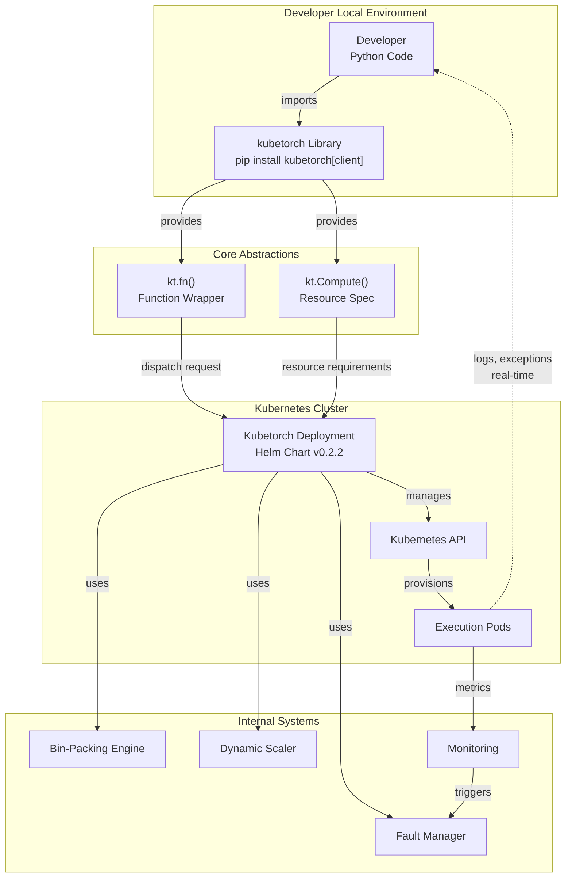
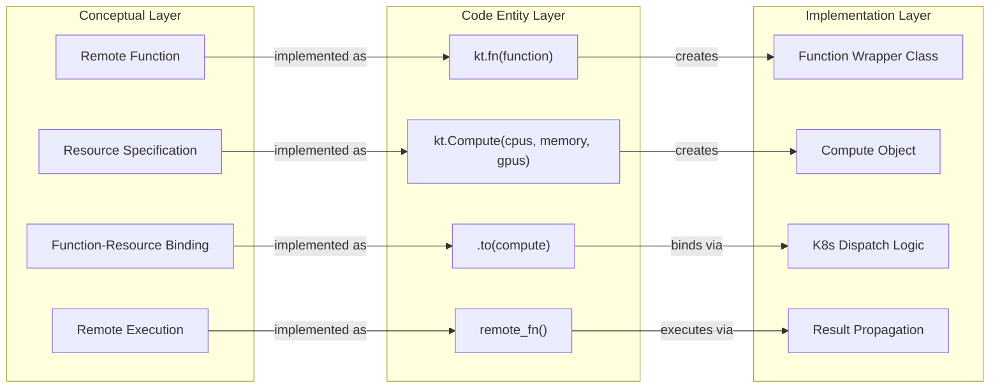
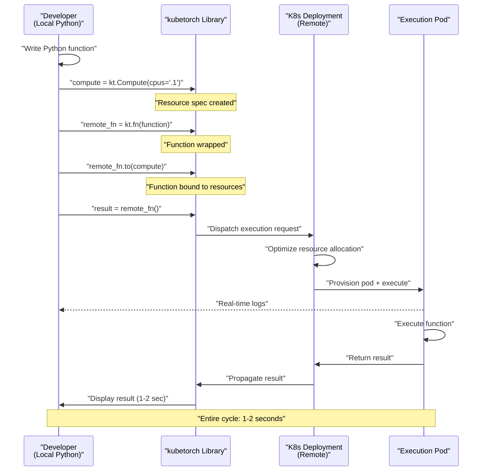
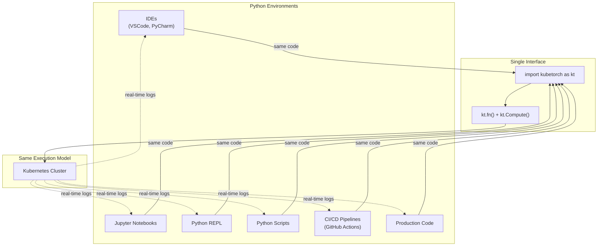

<!-- source: DeepWiki mcp.deepwiki.com · repo run-house/kubetorch · page 1 Overview · fetched 2026-10-21 -->

# Overview

<details>
<summary>Relevant source files</summary>

The following files were used as context for generating this wiki page:

- [README.md](README.md)

</details>


## Purpose and Scope

This page provides a high-level introduction to Kubetorch, explaining its purpose, architecture, and core value propositions. It covers what Kubetorch is, the problems it solves, and how its major components interact to deliver serverless ML compute on Kubernetes.

For detailed information about specific components, see:
- Core abstractions and concepts: [Core Concepts](#2)
- Installation and setup procedures: [Getting Started](#3)
- Internal architecture and design: [Architecture Deep Dive](#4)
- Deployment and operations: [Deployment and Operations](#7)

**Sources:** [README.md:1-75]()

---

## What is Kubetorch

Kubetorch is a Python library that provides a "serverless" interface for running ML workloads on Kubernetes clusters. It enables developers to execute code remotely on Kubernetes directly from their local Python environment without writing Dockerfiles, YAML manifests, or managing deployment pipelines.

The system abstracts Kubernetes complexity behind two primary Python constructs:
- `kt.fn`: Wraps local Python functions for remote execution [README.md:24]()
- `kt.Compute`: Specifies compute resources (CPUs, memory, GPUs) [README.md:21]()

**Key Characteristics:**
- **No local runtime**: No daemon or background process required on developer machine [README.md:9]()
- **No code serialization**: Developers do not explicitly pickle or serialize their code [README.md:9]()
- **Real-time feedback**: Logs, exceptions, and hardware faults propagate back immediately [README.md:7]()
- **Universal access**: Works identically in IDEs, notebooks, REPL, CI/CD, and production [README.md:9]()

**Sources:** [README.md:1-10](), [README.md:13-29]()

---

## Core Value Propositions

Kubetorch delivers three primary technical benefits, each backed by specific architectural mechanisms:

| Value Proposition | Claim | Technical Mechanism |
|------------------|-------|-------------------|
| **Iteration Speed** | 100x faster (10+ minutes → 1-3 seconds) | Direct function dispatch to K8s, no container build/push cycle |
| **Cost Optimization** | 50%+ compute cost savings | Bin-packing, dynamic scaling, resource right-sizing |
| **Reliability** | 95% fewer production faults | Automated fault detection, programmatic recovery, resource adjustment |

### Iteration Speed: 1-2 Second Cycles

Traditional Kubernetes workflows require:
1. Writing Dockerfile
2. Building container image (minutes)
3. Pushing to registry (minutes)
4. Writing K8s YAML
5. Applying manifests
6. Waiting for pod startup
7. Checking logs manually

Kubetorch reduces this to:
1. Call remote function: `remote_fn()` [README.md:27]()
2. Result returns in 1-2 seconds [README.md:7]()

This explains the "100x faster iteration" claim for complex ML workloads like RL training and distributed training [README.md:33]().

### Cost Optimization: 50%+ Savings

Achieved through three mechanisms (detailed in [Optimization Engine](#4.4)):
- **Bin-packing**: Efficiently packs multiple jobs onto fewer nodes
- **Dynamic scaling**: Adjusts cluster size based on actual demand
- **Resource right-sizing**: Learns optimal allocations from execution history

**Sources:** [README.md:33-35]()

### Reliability: 95% Fewer Faults

Achieved through automated fault management (detailed in [Fault Tolerance System](#4.5)):
- **Programmatic error recovery**: Catches and handles failures automatically [README.md:35]()
- **Resource adjustment**: Modifies allocations based on fault patterns [README.md:35]()
- **Hardware fault detection**: Identifies and recovers from node-level issues [README.md:7]()

**Sources:** [README.md:33-35]()

---

## System Architecture at a Glance

The following diagram shows the major system components and their relationships:

**High-Level System Architecture**



**Architecture Layers:**

1. **Local Environment**: Developer writes Python code, imports `kubetorch` library installed via pip [README.md:42]()
2. **Core Abstractions**: `kt.fn` and `kt.Compute` provide the programming interface [README.md:21-24]()
3. **Kubernetes Cluster**: Helm-deployed Kubetorch system manages execution [README.md:48-54]()
4. **Internal Systems**: Optimization, scaling, and fault management operate transparently

The dashed line from pods back to developer represents real-time log and exception propagation [README.md:7]().

**Sources:** [README.md:1-75]()

---

## Core Abstractions and Code Entities

This diagram maps Kubetorch concepts to their actual code representations:

**Code Entity Mapping**



**Code Entity Reference:**

| Concept | Code Symbol | Example Usage | Documentation |
|---------|-------------|---------------|--------------|
| Function Wrapper | `kt.fn` | `kt.fn(hello_world)` [README.md:24]() | See [kt.fn](#2.1) |
| Resource Spec | `kt.Compute` | `kt.Compute(cpus=".1")` [README.md:21]() | See [kt.Compute](#2.2) |
| Binding Method | `.to()` | `kt.fn(func).to(compute)` [README.md:24]() | See [kt.fn](#5.1) |
| Remote Call | `remote_fn()` | `result = remote_fn()` [README.md:27]() | See [Execution Lifecycle](#4.2) |

**Sources:** [README.md:13-29]()

---

## Development Workflow

The following diagram illustrates the typical developer workflow from code writing to result retrieval:

**Execution Flow from Developer Perspective**



**Workflow Stages:**

1. **Function Definition**: Developer writes standard Python function locally [README.md:16-17]()
2. **Resource Specification**: Create `kt.Compute` with resource requirements [README.md:21]()
3. **Function Wrapping**: Wrap function with `kt.fn` [README.md:24]()
4. **Resource Binding**: Bind to compute with `.to()` method [README.md:24]()
5. **Remote Execution**: Call function normally, executes on cluster [README.md:27]()
6. **Result Return**: Result and logs return in 1-2 seconds [README.md:7](), [README.md:33]()

**Sources:** [README.md:13-29]()

---

## Hello World Example

The canonical Kubetorch example demonstrates the complete workflow:

```python
import kubetorch as kt

def hello_world():
    return "Hello from Kubetorch!"

if __name__ == "__main__":
    # Define your compute
    compute = kt.Compute(cpus=".1")

    # Send local function to freshly launched remote compute
    remote_hello = kt.fn(hello_world).to(compute)

    # Runs remotely on your Kubernetes cluster
    result = remote_hello()
    print(result)  # "Hello from Kubetorch!"
```
*From [README.md:13-29]()*

**Code Breakdown:**

| Line(s) | Code Element | Purpose |
|---------|--------------|---------|
| 1 | `import kubetorch as kt` | Import library (installed via `pip install kubetorch[client]`) |
| 3-4 | `def hello_world()` | Standard Python function - no special annotations required |
| 8 | `kt.Compute(cpus=".1")` | Request 0.1 CPU cores for execution |
| 11 | `kt.fn(hello_world)` | Wrap function for remote execution |
| 11 | `.to(compute)` | Bind function to specific compute resources |
| 14 | `remote_hello()` | Call function - executes on Kubernetes cluster |

**Key Observations:**
- No Dockerfile required
- No container image build/push
- No YAML manifests
- No manual log inspection
- Function executes remotely but feels local

For detailed explanation of `kt.fn`, see [Functions (kt.fn)](#2.1). For `kt.Compute`, see [Compute Resources (kt.Compute)](#2.2).

**Sources:** [README.md:11-29]()

---

## Installation Overview

Kubetorch has two installation components:

**Client-Side Installation:**
```bash
pip install "kubetorch[client]"
```
*From [README.md:42]()*

Installs the Python library to local environment (any Python 3.x environment supported).

**Server-Side Deployment:**

Two Helm chart deployment options:

```bash
# Option 1: Direct OCI install
helm upgrade --install kubetorch oci://ghcr.io/run-house/charts/kubetorch \
  --version 0.2.2 -n kubetorch --create-namespace

# Option 2: Local chart install
helm pull oci://ghcr.io/run-house/charts/kubetorch --version 0.2.2 --untar
helm upgrade --install kubetorch ./kubetorch -n kubetorch --create-namespace
```
*From [README.md:48-54]()*

The Helm chart deploys the Kubetorch backend to a Kubernetes cluster. Current version: **0.2.2** [README.md:50](), [README.md:53]().

For complete installation procedures, see [Installation](#3.1) and [Helm Installation](#7.2).

**Sources:** [README.md:37-56]()

---

## Alternative: Kubetorch Serverless

For users who prefer not to manage their own Kubernetes cluster, Kubetorch offers a fully managed serverless platform [README.md:60-62]().

**Contact Information:**
- Email: hello@run.house [README.md:62]()
- Slack: [Join Kubetorch Slack](https://join.slack.com/t/kubetorch/shared_invite/zt-3g76q5i4j-uP60AdydxnAmjGVAQhtALA) [README.md:62]()

For more details, see [Kubetorch Serverless](#7.5).

**Sources:** [README.md:60-62]()

---

## Multi-Environment Support

Kubetorch works identically across all Python environments without requiring environment-specific configuration:



**Universal Access Enabled By:**
- No local runtime required [README.md:9]()
- No code serialization step [README.md:9]()
- Direct cluster communication from any Python process
- Identical API across all contexts

For environment-specific patterns, see [Multi-Environment Integration](#6.1).

**Sources:** [README.md:9]()

---

## Additional Resources

**Documentation:**
- [Full Documentation](https://www.run.house/kubetorch/introduction) [README.md:66]()
- [Examples and Tutorials](https://www.run.house/examples) [README.md:67]()

**Community:**
- [Slack Community](https://join.slack.com/t/kubetorch/shared_invite/zt-3g76q5i4j-uP60AdydxnAmjGVAQhtALA) [README.md:68]()

**Project Information:**
- License: Apache 2.0 [README.md:72]()
- Maintained by: [Runhouse](https://www.run.house) [README.md:74]()

**Sources:** [README.md:64-74]()

---

## Next Steps

To continue learning about Kubetorch:

1. **Understand Core Concepts**: See [Core Concepts](#2) for detailed explanations of `kt.fn`, `kt.Compute`, and the execution model
2. **Get Started**: Follow [Getting Started](#3) for installation and your first workload
3. **Architecture Details**: Explore [Architecture Deep Dive](#4) for internal system design
4. **Advanced Usage**: See [Advanced Usage](#6) for complex ML workloads and optimization patterns
5. **Deployment**: Consult [Deployment and Operations](#7) for production deployment guidance

**Sources:** [README.md:1-75]()

---

