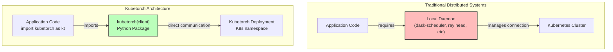
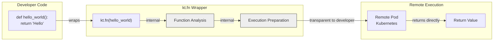
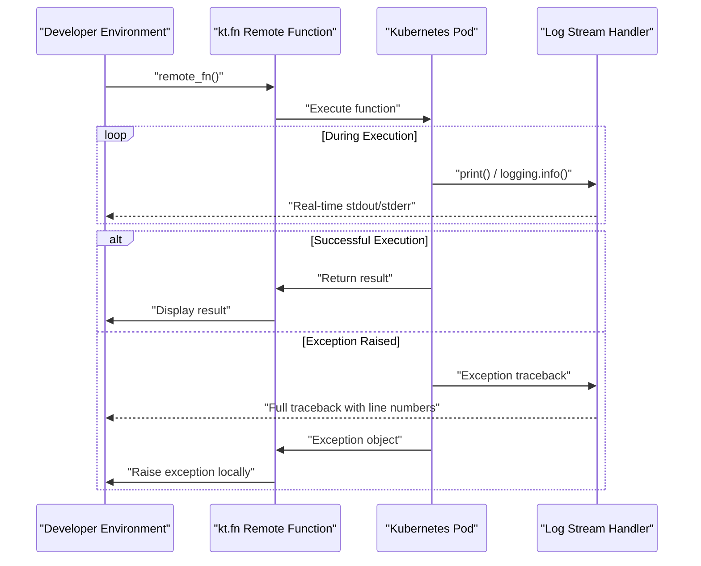
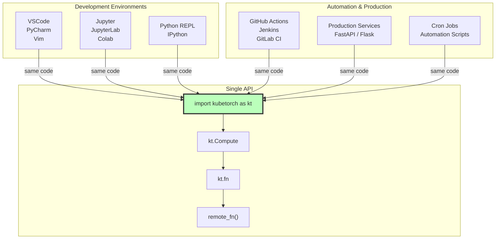
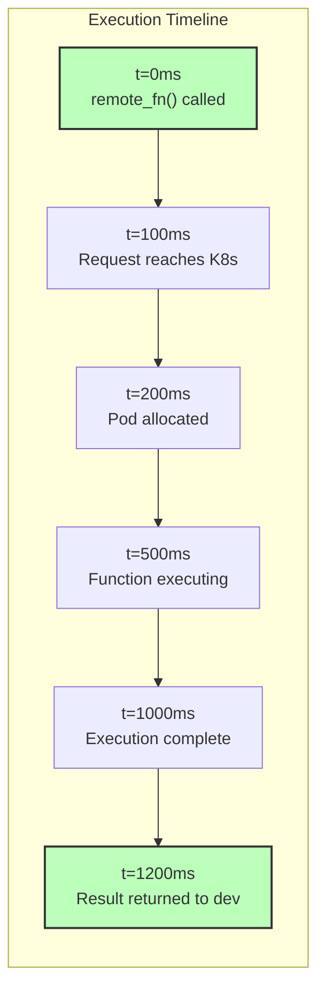
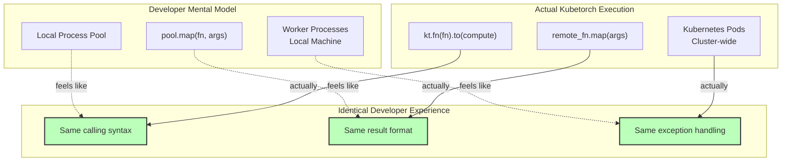
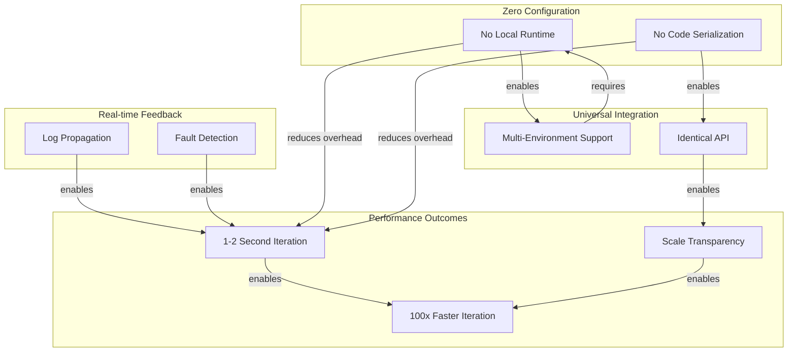

<!-- source: DeepWiki mcp.deepwiki.com · repo run-house/kubetorch · page 1.1 Key Features · fetched 2026-10-21 -->

# Key Features

<details>
<summary>Relevant source files</summary>

The following files were used as context for generating this wiki page:

- [README.md](README.md)

</details>


This page documents the core features that distinguish Kubetorch's architecture and enable its performance characteristics. These features work together to provide a seamless development experience while maintaining production-grade scalability and reliability.

For architectural details on how these features are implemented, see [System Components](#4.1). For usage patterns, see [Multi-Environment Integration](#6.1).

---

## Feature Overview

Kubetorch's design centers on five fundamental capabilities that enable serverless-style ML workloads on Kubernetes:

| Feature | Capability | Impact |
|---------|-----------|---------|
| **Zero-Configuration Local Development** | No local runtime or code serialization required | Works in any Python environment without setup |
| **Real-time Feedback Loop** | Logs, exceptions, and hardware faults propagated in real-time | Immediate debugging without manual log inspection |
| **Universal Python Integration** | Single API across all Python environments | Identical code from IDE to production |
| **Fast Iteration Cycle** | 1-2 second execution from invocation to result | 100x faster than traditional Kubernetes workflows |
| **Transparent Remote Execution** | Local-feeling interface with cluster-scale compute | Process pool semantics with Kubernetes power |

Sources: [README.md:3-9](), [README.md:33-35]()

---

## Zero-Configuration Local Development

### No Local Runtime

Kubetorch operates without any local daemon, server process, or background service. The Python client library communicates directly with the Kubernetes deployment without intermediary runtime components.



**Technical Implementation:**

The client package (`kubetorch[client]`) contains all necessary communication logic within the Python library itself. When functions are wrapped with `kt.fn` [README.md:24]() and bound to compute resources with `.to(compute)` [README.md:24](), the client establishes direct connections to the Kubernetes deployment without local process management.

**Code Entities:**
- `kt.fn`: Function wrapper that prepares local functions for remote execution
- `kt.Compute`: Resource specification object that defines execution requirements
- `.to()`: Method binding functions to compute resources

Sources: [README.md:9](), [README.md:13-29]()

---

### No Code Serialization

Developers never explicitly serialize their code. Functions passed to `kt.fn` are automatically prepared for remote execution without requiring pickle, cloudpickle, or manual serialization logic.



**Example Pattern:**

[README.md:16-24]() demonstrates the zero-serialization pattern:
```python
def hello_world():
    return "Hello from Kubetorch!"

remote_hello = kt.fn(hello_world).to(compute)
```

No explicit serialization calls are required. The function is passed directly to `kt.fn`, which handles all execution preparation internally.

Sources: [README.md:16-29]()

---

## Real-time Feedback Loop

### Automatic Log Propagation

Stdout, stderr, and all logging output from remote execution appears in the local developer environment in real-time, without manual log retrieval or cluster access.



**Propagated Information:**
- Standard output (`print()` statements)
- Standard error (warnings, debug messages)
- Full exception tracebacks with line numbers
- Hardware fault notifications (OOM, GPU errors, node failures)

The propagation happens during execution, not after completion, enabling real-time monitoring of long-running workloads.

Sources: [README.md:7-8]()

---

### Hardware Fault Detection

Hardware-level issues are detected and reported back to the developer environment automatically:

| Fault Type | Detection | Developer Notification |
|-----------|-----------|----------------------|
| Out of Memory (OOM) | Pod memory limits exceeded | Real-time exception with memory usage |
| GPU Errors | CUDA/driver failures | Hardware error traceback |
| Node Failures | Kubernetes node eviction | Automatic retry notification |
| Timeout Exceeded | Execution time limits | Timeout exception with elapsed time |

These faults trigger the fault tolerance system (see [Fault Tolerance System](#4.5)) for automatic recovery, but developers receive immediate notification regardless of recovery outcome.

Sources: [README.md:7-8](), [README.md:35]()

---

## Universal Python Integration

Kubetorch provides identical functionality across all Python execution environments without environment-specific configuration:



**Environment-Agnostic Design:**

The same three-line pattern works identically everywhere:
1. Define compute requirements with `kt.Compute` [README.md:21]()
2. Wrap function with `kt.fn` [README.md:24]()
3. Execute remotely with standard Python call syntax [README.md:27-28]()

No environment-specific imports, configuration files, or initialization code is required. The same script runs unchanged from a Jupyter notebook during development to a production microservice.

Sources: [README.md:9]()

---

## Fast Iteration Cycle

### 1-2 Second Execution

Kubetorch achieves 1-3 second latency from local function invocation to result return, enabling interactive development workflows at cluster scale:



**Performance Breakdown:**

| Phase | Duration | Description |
|-------|----------|-------------|
| **Client → K8s** | ~100ms | Network latency and request processing |
| **Pod Allocation** | ~100-200ms | Kubernetes scheduler assigns resources |
| **Function Execution** | Variable | Actual computation time |
| **Result Return** | ~100ms | Result serialization and network transfer |
| **Total Overhead** | ~300-400ms | Non-execution overhead |

This overhead is negligible compared to traditional Kubernetes workflows requiring container builds (minutes) and manual deployments (minutes to hours).

**Comparison to Traditional Workflows:**

Traditional Kubernetes iteration:
1. Modify code → 10s
2. Build container → 2-5 minutes
3. Push to registry → 30s - 2 minutes
4. Deploy to cluster → 1-3 minutes
5. Retrieve logs → 30s
6. **Total: 5-10+ minutes**

Kubetorch iteration:
1. Modify code → 10s
2. Execute `remote_fn()` → 1-2 seconds
3. **Total: ~12 seconds**

**100x faster** claim derives from this comparison: 10 minutes vs. 12 seconds = ~50x, with complex ML workloads (RL environments, distributed training) seeing even larger improvements.

Sources: [README.md:7](), [README.md:33]()

---

## Transparent Remote Execution

### Process Pool Semantics

Kubetorch's API mimics Python's standard `multiprocessing.Pool` interface, making distributed Kubernetes execution feel like local concurrency:



**Code Pattern Comparison:**

Standard multiprocessing:
```python
from multiprocessing import Pool

def task(x):
    return x ** 2

with Pool(4) as pool:
    results = pool.map(task, [1, 2, 3, 4])
```

Kubetorch equivalent [README.md:13-29]():
```python
import kubetorch as kt

def task(x):
    return x ** 2

compute = kt.Compute(cpus=".1")
remote_task = kt.fn(task).to(compute)
results = remote_task.map([1, 2, 3, 4])
```

The calling pattern is nearly identical, but `remote_task` executes on Kubernetes pods instead of local processes.

Sources: [README.md:9]()

---

### Scale Transparency

The same API scales from small experimental tasks to large production workloads without code changes:

| Workload Size | Resource Specification | Execution Environment |
|--------------|----------------------|---------------------|
| **Small Experiment** | `kt.Compute(cpus=".1")` | Shared pod, minimal resources |
| **Medium Task** | `kt.Compute(cpus="4", memory="16Gi")` | Dedicated pod with guaranteed resources |
| **Large ML Workload** | `kt.Compute(gpus=8, memory="128Gi")` | Multi-GPU pod or distributed pods |

All three use identical `kt.fn` wrapping and execution syntax. Resource scaling is purely a configuration change in `kt.Compute`, not a code restructuring.

**Example Progression:**

Development phase with minimal resources:
```python
compute = kt.Compute(cpus=".1")  # Minimal cost for testing
train_fn = kt.fn(train_model).to(compute)
train_fn(small_dataset)
```

Production phase with full resources:
```python
compute = kt.Compute(cpus="32", memory="128Gi", gpus=4)  # Full scale
train_fn = kt.fn(train_model).to(compute)  # Same function
train_fn(production_dataset)  # Same calling pattern
```

The function definition (`train_model`) and execution pattern (`train_fn()`) remain unchanged.

Sources: [README.md:33]()

---

## Feature Interactions

The key features work synergistically to enable Kubetorch's performance characteristics:



**Dependency Analysis:**

1. **Zero Configuration → Universal Integration**: Absence of local runtime and serialization requirements allows the same code to run in any Python environment without setup.

2. **Real-time Feedback → Fast Iteration**: Immediate log/error propagation eliminates manual debugging steps, reducing total iteration time.

3. **Universal Integration → Scale Transparency**: Single API enables resource scaling through configuration rather than code rewriting.

4. **Combined Effect → 100x Faster Iteration**: All features together eliminate traditional Kubernetes workflow overhead (container builds, deployments, log retrieval, manual scaling).

Sources: [README.md:3-35]()

---

## Summary Table

| Feature | Key Component | Developer Benefit | Technical Implementation |
|---------|--------------|-------------------|------------------------|
| **No Local Runtime** | Direct client-to-cluster communication | Works in any Python environment | Client library handles communication |
| **No Code Serialization** | `kt.fn` wrapper | No pickle/cloudpickle code | Automatic function preparation |
| **Real-time Logs** | Streaming log handler | Immediate debugging feedback | Bidirectional pod communication |
| **Hardware Fault Detection** | Monitoring system | Automatic error notification | Pod-level fault detection |
| **Universal API** | Single import pattern | Same code everywhere | Environment-agnostic design |
| **Fast Iteration** | Optimized execution path | 1-2 second cycles | Minimal overhead architecture |
| **Scale Transparency** | `kt.Compute` abstraction | Configuration-based scaling | Same code, different resources |

Sources: [README.md:3-35]()

---

