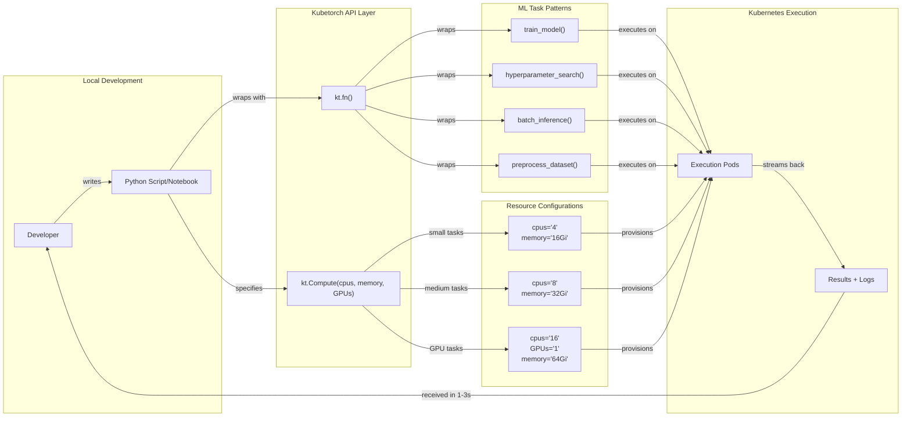
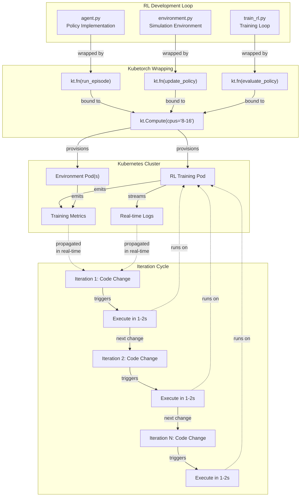
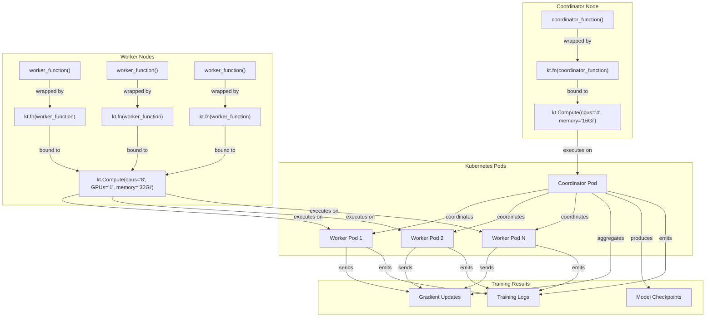
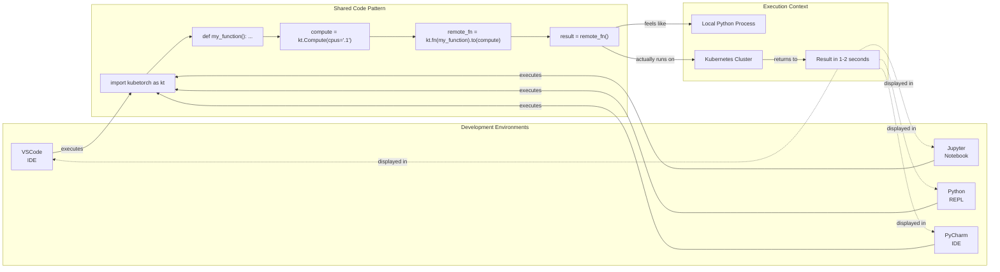
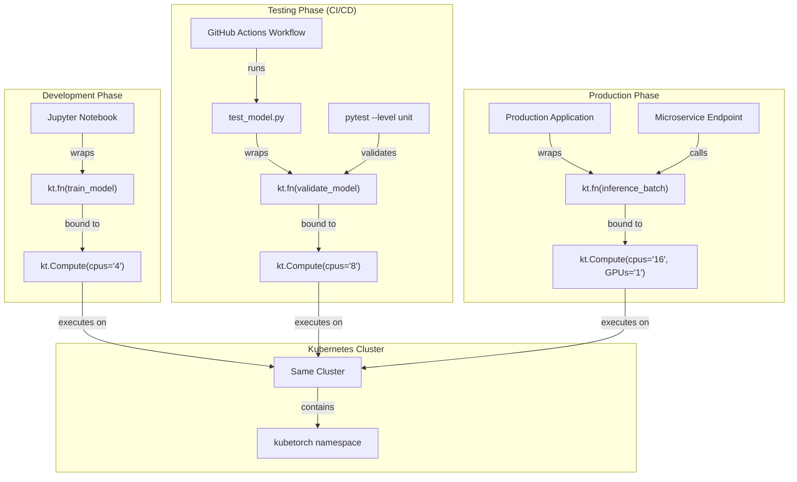
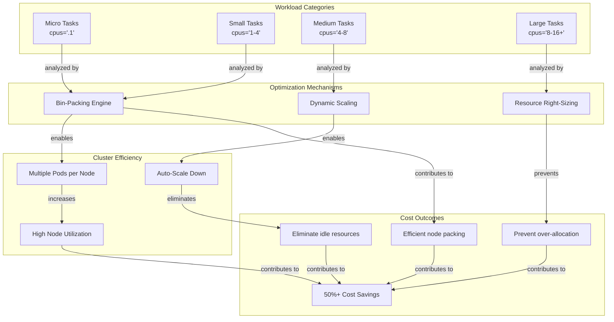

<!-- source: DeepWiki mcp.deepwiki.com · repo run-house/kubetorch · page 1.2 Use Cases · fetched 2026-10-21 -->

# Use Cases

<details>
<summary>Relevant source files</summary>

The following files were used as context for generating this wiki page:

- [README.md](README.md)

</details>


This document describes the target use cases and scenarios where Kubetorch provides value. It covers how different types of ML workloads, development workflows, and operational patterns map to Kubetorch's API constructs and resource specifications.

For information about the underlying technical concepts and abstractions, see [Core Concepts](#2). For detailed API documentation, see [API Reference](#5). For operational deployment patterns, see [Deployment and Operations](#7).

---

## Purpose and Scope

Kubetorch is designed for executing Python-based ML workloads on Kubernetes clusters with minimal overhead. This page documents the primary use cases, showing how different workload types map to specific resource configurations and API usage patterns. Each use case demonstrates how Kubetorch's abstractions (`kt.fn`, `kt.Compute`) adapt to different computational requirements.

**Sources:** [README.md:1-75]()

---

## Use Case Categories

Kubetorch supports workloads across a spectrum of computational scales and development contexts. The following table categorizes the primary use cases by their resource requirements and typical execution environments:

| Use Case Category | Typical Resources | Iteration Speed | Primary Environment | Code Pattern |
|-------------------|-------------------|-----------------|---------------------|--------------|
| Rapid Prototyping | `cpus=".1"` to `cpus="1"` | 1-2 seconds | IDE, Notebooks, REPL | Single function with `kt.fn` |
| ML Training (Small) | `cpus="4"`, `memory="16Gi"` | 1-3 seconds | Notebooks, Scripts | Function with dataset loading |
| RL Training | `cpus="8-16"`, GPUs optional | 1-3 seconds (10+ min → 1-3s) | CI/CD, Production | Multi-function with environment setup |
| Distributed Training | Multi-node, GPUs | 1-3 seconds | Production, Automation | Coordinated function groups |
| CI/CD Integration | Variable (task-dependent) | 1-2 seconds | GitHub Actions, Jenkins | Scripted function calls |
| Production Applications | Variable (workload-dependent) | Real-time | Microservices, Applications | Long-running or batch functions |

**Sources:** [README.md:21-35]()

---

## Machine Learning Workloads

### General ML Training and Inference

ML workloads encompass model training, hyperparameter tuning, inference tasks, and batch processing. These workloads typically require moderate CPU and memory resources, with optional GPU acceleration for larger models.



**Typical Pattern:**

A function representing an ML task is wrapped with `kt.fn()` and bound to a `kt.Compute` instance specifying the required resources. The function executes on a Kubernetes pod with the specified resources, and results stream back in 1-3 seconds.

**Resource Mapping:**

- **Small training jobs**: `kt.Compute(cpus="4", memory="16Gi")`
- **Medium training jobs**: `kt.Compute(cpus="8", memory="32Gi")`
- **GPU-accelerated tasks**: `kt.Compute(cpus="16", GPUs="1", memory="64Gi")`

**Sources:** [README.md:3-9](), [README.md:33-35]()

---

## Reinforcement Learning (RL) Training

RL training represents one of Kubetorch's most impactful use cases, where iteration speed is critical. Traditional Kubernetes workflows for RL require 10+ minutes per iteration (container build, push, pod deployment). Kubetorch reduces this to 1-3 seconds by eliminating code serialization and container rebuilds.



**Performance Characteristics:**

- **Traditional Kubernetes**: 10+ minutes per iteration (container build, push, deployment)
- **With Kubetorch**: 1-3 seconds per iteration (no container rebuild)
- **Speedup**: 100x faster iteration

**Typical Resource Configuration:**

```python
# RL training typically requires moderate CPU allocation
rl_compute = kt.Compute(cpus="8", memory="32Gi")

# Optionally, GPU-accelerated RL
rl_gpu_compute = kt.Compute(cpus="16", GPUs="1", memory="64Gi")
```

**Sources:** [README.md:33]()

---

## Distributed Training

Distributed training workloads coordinate multiple nodes for parallel model training. Kubetorch enables rapid iteration on distributed training setups without requiring explicit container orchestration or custom Kubernetes manifests.

### Multi-Node Coordination Pattern



**Resource Configuration for Distributed Training:**

| Node Type | CPU | Memory | GPUs | Purpose |
|-----------|-----|--------|------|---------|
| Coordinator | 4 cores | 16Gi | 0 | Gradient aggregation, model updates |
| Worker | 8-16 cores | 32-64Gi | 1-4 | Forward/backward passes, gradient computation |
| Parameter Server (if used) | 8 cores | 64Gi | 0 | Parameter storage and synchronization |

**Sources:** [README.md:33]()

---

## Rapid Prototyping and Development

### Interactive Development Pattern

Rapid prototyping is enabled by Kubetorch's integration with interactive Python environments (IDEs, notebooks, REPL). Developers can execute cluster-scale workloads directly from their local environment without context switching.



**Key Characteristics:**

- **No local runtime required**: No daemon processes or background services
- **No code serialization**: Functions are not pickled or explicitly serialized by developers
- **Environment universality**: Same code works in VSCode, Jupyter, REPL, PyCharm
- **Iteration speed**: 1-2 seconds from code change to result

**Typical Resource Configuration:**

For prototyping and experimentation, lightweight resource allocations suffice:

```python
# Minimal resources for quick experiments
prototype_compute = kt.Compute(cpus=".1")

# Slightly larger for realistic testing
test_compute = kt.Compute(cpus="1", memory="4Gi")
```

**Sources:** [README.md:9-10](), [README.md:13-29]()

---

## Multi-Environment Integration

### CI/CD and Production Patterns

Kubetorch's "no local runtime" architecture enables seamless integration across development, testing, and production environments. The same code that runs in a Jupyter notebook can execute in GitHub Actions or production microservices.



**Environment-Specific Patterns:**

| Environment | Import Context | Execution Context | Resource Configuration |
|-------------|----------------|-------------------|------------------------|
| Jupyter Notebook | Interactive cell | Ad-hoc exploration | Small to medium (`cpus=".1"` to `cpus="4"`) |
| Python REPL | Interactive shell | Rapid testing | Minimal (`cpus=".1"`) |
| VSCode/PyCharm | Script/debugger | Development iterations | Medium (`cpus="1"` to `cpus="4"`) |
| GitHub Actions | CI pipeline script | Automated testing | Task-dependent (`cpus="4"` to `cpus="8"`) |
| Production App | Service initialization | Batch/real-time workloads | Large (`cpus="16"`, GPUs) |
| Microservice | Request handler | On-demand execution | Variable (auto-scaled) |

**Sources:** [README.md:9]()

---

## Resource Scaling Patterns

### Small to Large Workload Spectrum

Kubetorch supports workloads across a wide resource spectrum using a consistent API. The following table maps workload types to their typical resource configurations:

| Workload Type | CPU Range | Memory Range | GPU Range | Example `kt.Compute` Configuration |
|---------------|-----------|--------------|-----------|-------------------------------------|
| Quick experiments | 0.1 - 1 cores | 1-4 Gi | 0 | `kt.Compute(cpus=".1")` |
| Data preprocessing | 2 - 4 cores | 8-16 Gi | 0 | `kt.Compute(cpus="4", memory="16Gi")` |
| Model training (small) | 4 - 8 cores | 16-32 Gi | 0-1 | `kt.Compute(cpus="4", memory="16Gi")` |
| Model training (large) | 8 - 16 cores | 32-64 Gi | 1-2 | `kt.Compute(cpus="16", GPUs="1", memory="64Gi")` |
| RL training | 8 - 16 cores | 32-64 Gi | 0-1 | `kt.Compute(cpus="8", memory="32Gi")` |
| Distributed training | 16+ cores per node | 64+ Gi per node | 1-4 per node | `kt.Compute(cpus="16", GPUs="2", memory="64Gi")` |
| Batch inference | 4 - 8 cores | 16-32 Gi | 1 | `kt.Compute(cpus="8", GPUs="1", memory="32Gi")` |
| Hyperparameter search | 1 - 4 cores per trial | 4-16 Gi per trial | 0-1 per trial | `kt.Compute(cpus="2", memory="8Gi")` |

### Cost Optimization by Use Case

Kubetorch's resource allocation and bin-packing optimizations provide cost savings across different workload patterns:



**Sources:** [README.md:34-35]()

---

## Use Case Summary

The following table summarizes the primary use cases, their technical characteristics, and mapping to Kubetorch constructs:

| Use Case | Iteration Speed | Primary API Pattern | Typical Resource Range | Key Benefit |
|----------|----------------|---------------------|------------------------|-------------|
| Rapid Prototyping | 1-2 seconds | `kt.fn(func).to(kt.Compute(cpus=".1"))` | 0.1 - 1 CPU | Fast iteration in IDE/notebook |
| ML Training | 1-3 seconds | `kt.fn(train).to(kt.Compute(cpus="4", memory="16Gi"))` | 4-16 CPUs, 16-64 Gi memory | Production-scale training from local env |
| RL Training | 1-3 seconds (100x faster) | `kt.fn(run_episode).to(kt.Compute(cpus="8"))` | 8-16 CPUs | Eliminate 10+ min container rebuilds |
| Distributed Training | 1-3 seconds | Multiple `kt.fn` instances coordinated | 16+ CPUs, GPUs per node | Multi-node without manual orchestration |
| CI/CD Integration | 1-2 seconds | `kt.fn(test_func).to(kt.Compute(cpus="4"))` | Task-dependent | Same code in dev and CI |
| Production Batch | Real-time | `kt.fn(inference).to(kt.Compute(cpus="16", GPUs="1"))` | 16+ CPUs, GPUs | Serverless batch processing |

**Sources:** [README.md:1-75]()

---

