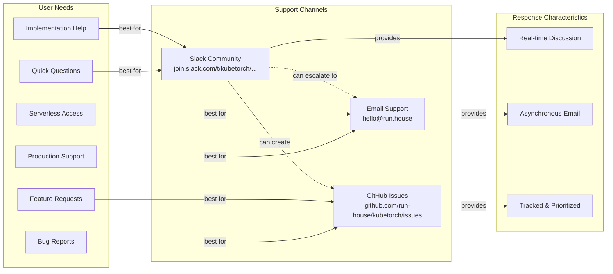

<!-- source: DeepWiki mcp.deepwiki.com · repo run-house/kubetorch · page 10 Community and Resources · fetched 2026-10-21 -->

# Community and Resources

<details>
<summary>Relevant source files</summary>

The following files were used as context for generating this wiki page:

- [README.md](README.md)

</details>


This document provides a comprehensive guide to external resources, support channels, and community engagement opportunities for Kubetorch users. It covers official documentation, example repositories, community forums, and contact information for getting help or contributing to the project.

For detailed information about specific documentation topics, see [External Documentation](#10.1). For support options and communication channels, see [Support Channels](#10.2).

---

## Overview

Kubetorch maintains several external resources to support users at different stages of adoption, from initial learning to production deployment. These resources are organized into three primary categories:

| Resource Type | Purpose | Primary Audience |
|--------------|---------|------------------|
| **Official Documentation** | Comprehensive technical reference and guides | All users |
| **Example Repository** | Real-world usage patterns and tutorials | New users, use case exploration |
| **Community Channels** | Direct support, discussions, and collaboration | All users seeking help or contributing |

**Sources:** [README.md:64-68]()

---

## Resource Ecosystem

The following diagram shows the complete Kubetorch resource ecosystem and how different resources serve user needs throughout the adoption journey.

```mermaid
graph TB
    subgraph "User Journey Stages"
        DISCOVER["Discovery<br/>(Initial Interest)"]
        LEARN["Learning<br/>(Getting Started)"]
        IMPLEMENT["Implementation<br/>(Building Applications)"]
        DEPLOY["Deployment<br/>(Production)"]
        CONTRIBUTE["Contribution<br/>(Community Engagement)"]
    end
    
    subgraph "Primary Resources"
        GITHUB["GitHub Repository<br/>github.com/run-house/kubetorch"]
        DOCS["Documentation Site<br/>run.house/kubetorch"]
        EXAMPLES["Examples Repository<br/>run.house/examples"]
        SLACK["Slack Community<br/>kubetorch.slack.com"]
        EMAIL["Email Support<br/>hello@run.house"]
    end
    
    subgraph "Documentation Sections"
        INTRO["Introduction"]
        INSTALL["Installation Guide"]
        API_REF["API Reference"]
        CONCEPTS["Concepts"]
        GUIDES["Guides"]
    end
    
    subgraph "Example Categories"
        HELLO["Hello World"]
        RL_EX["RL Training Examples"]
        DIST_EX["Distributed Training"]
        PATTERNS["Usage Patterns"]
    end
    
    subgraph "Support Channels"
        SLACK_HELP["Slack #help"]
        SLACK_GEN["Slack #general"]
        EMAIL_SUP["Email Support"]
        ISSUES["GitHub Issues"]
    end
    
    subgraph "Managed Services"
        SERVERLESS["Kubetorch Serverless<br/>Managed Platform"]
        CONTACT["Contact for Access<br/>email or Slack"]
    end
    
    DISCOVER -->|"reads"| GITHUB
    DISCOVER -->|"browses"| DOCS
    
    LEARN -->|"follows"| INSTALL
    LEARN -->|"studies"| INTRO
    LEARN -->|"tries"| HELLO
    
    IMPLEMENT -->|"references"| API_REF
    IMPLEMENT -->|"understands"| CONCEPTS
    IMPLEMENT -->|"follows"| PATTERNS
    IMPLEMENT -->|"adapts"| RL_EX
    IMPLEMENT -->|"adapts"| DIST_EX
    
    DEPLOY -->|"consults"| GUIDES
    DEPLOY -->|"considers"| SERVERLESS
    
    CONTRIBUTE -->|"joins"| SLACK
    CONTRIBUTE -->|"reports"| ISSUES
    
    GITHUB -->|"links to"| DOCS
    GITHUB -->|"links to"| EXAMPLES
    GITHUB -->|"links to"| SLACK
    
    DOCS -->|"contains"| INTRO
    DOCS -->|"contains"| INSTALL
    DOCS -->|"contains"| API_REF
    DOCS -->|"contains"| CONCEPTS
    DOCS -->|"contains"| GUIDES
    
    EXAMPLES -->|"provides"| HELLO
    EXAMPLES -->|"provides"| RL_EX
    EXAMPLES -->|"provides"| DIST_EX
    EXAMPLES -->|"provides"| PATTERNS
    
    SLACK -->|"includes"| SLACK_HELP
    SLACK -->|"includes"| SLACK_GEN
    
    EMAIL -->|"provides"| EMAIL_SUP
    
    SERVERLESS -->|"accessed via"| CONTACT
    CONTACT -->|"uses"| EMAIL
    CONTACT -->|"uses"| SLACK
    
    LEARN -.->|"needs help"| SLACK_HELP
    IMPLEMENT -.->|"needs help"| SLACK_HELP
    IMPLEMENT -.->|"reports bug"| ISSUES
    DEPLOY -.->|"needs support"| EMAIL_SUP
    DEPLOY -.->|"explores"| SERVERLESS
```



**Diagram: Kubetorch Resource Ecosystem**

This diagram illustrates how users progress through different stages of adoption and which resources serve each stage. Solid lines indicate primary navigation paths, while dashed lines show support interactions.

**Sources:** [README.md:57-68]()

---

## Official Documentation

The primary documentation site is hosted at `run.house/kubetorch` and provides comprehensive coverage of all Kubetorch features.

### Documentation Structure

| Section | URL Path | Content Focus |
|---------|----------|---------------|
| Introduction | `/kubetorch/introduction` | Overview, value propositions, core concepts |
| Installation | `/kubetorch/installation` | Detailed setup instructions for client and server |
| API Reference | `/kubetorch/api` | Complete API documentation |
| Concepts | `/kubetorch/concepts` | Fundamental concepts and abstractions |
| Guides | `/kubetorch/guides` | Step-by-step tutorials and best practices |

The installation guide referenced in [README.md:57]() provides detailed setup instructions beyond the quick start shown in [README.md:45-55]().

**Sources:** [README.md:57-58](), [README.md:66]()

---

## Example Repository

The examples repository at `run.house/examples` provides real-world usage patterns and tutorials demonstrating Kubetorch capabilities.

### Example Categories

**Hello World:**
- Basic function execution demonstrating `kt.fn` and `kt.Compute` usage
- Equivalent to the quick start in [README.md:13-29]()

**RL Training:**
- Reinforcement learning environment examples
- Demonstrates parallel environment execution
- Shows how to achieve "100x faster iteration" for RL workloads (as claimed in [README.md:33]())

**Distributed Training:**
- Multi-node training examples
- GPU resource allocation patterns
- Large-scale ML workload patterns

**Usage Patterns:**
- Multi-environment integration (IDE, notebooks, CI/CD)
- Async execution patterns
- Docker workflow examples

**Sources:** [README.md:67]()

---

## Community Support Channels

The following diagram maps specific user needs to appropriate support channels.



**Diagram: Support Channel Decision Tree**

**Sources:** [README.md:62](), [README.md:68]()

---

## Slack Community

The Kubetorch Slack workspace is the primary real-time community channel for users to connect, ask questions, and share experiences.

### Joining the Community

**Invitation Link:**
```
https://join.slack.com/t/kubetorch/shared_invite/zt-3g76q5i4j-uP60AdydxnAmjGVAQhtALA
```

Referenced in [README.md:62]() and [README.md:68]().

### Slack Workspace Structure

| Channel | Purpose |
|---------|---------|
| `#general` | General discussions, announcements, community engagement |
| `#help` | Technical support, implementation questions, troubleshooting |
| `#examples` | Sharing and discussing usage patterns and example code |
| `#features` | Feature requests and roadmap discussions |

### When to Use Slack

- **Quick questions** about usage or API behavior
- **Implementation help** when building applications
- **Real-time discussion** with maintainers and community members
- **Sharing experiences** and best practices
- **Networking** with other Kubetorch users

**Sources:** [README.md:62](), [README.md:68]()

---

## Email Support

Email support is available at `hello@run.house` for issues requiring private communication or production-level support.

### Email Use Cases

| Use Case | When to Email |
|----------|---------------|
| **Kubetorch Serverless Access** | Requesting access to managed platform ([README.md:62]()) |
| **Production Support** | Critical issues affecting production deployments |
| **Private Discussions** | Security concerns, private deployment questions |
| **Partnership Inquiries** | Commercial licensing, enterprise support |
| **Detailed Technical Issues** | Complex problems requiring extensive context |

### Expected Response Time

Email support is asynchronous and typically responds within 24-48 hours during business days. For urgent issues, consider using Slack for real-time assistance.

**Sources:** [README.md:62]()

---

## Kubetorch Serverless

Kubetorch Serverless is a fully managed platform that eliminates the need for self-hosted Kubernetes cluster setup.

### Accessing Kubetorch Serverless

To try Kubetorch Serverless:

1. **Contact via Email:** Send a request to `hello@run.house` with:
   - Brief description of your use case
   - Expected workload characteristics (compute requirements, scale)
   - Timeline for evaluation

2. **Contact via Slack:** Join the Slack community and message in `#general` or direct message maintainers

### Serverless vs Self-Hosted

| Aspect | Self-Hosted | Serverless |
|--------|-------------|------------|
| **Setup** | Requires Kubernetes cluster and Helm deployment ([README.md:45-55]()) | No setup required |
| **Management** | User manages cluster, upgrades, scaling | Fully managed by Runhouse |
| **Cost Model** | Pay for cluster resources | Pay per usage |
| **Control** | Full control over infrastructure | Limited infrastructure control |
| **Suitable For** | Organizations with existing K8s infrastructure | Quick evaluation, no K8s expertise |

**Sources:** [README.md:60-62]()

---

## GitHub Repository

The primary codebase is hosted at `github.com/run-house/kubetorch` and serves as the central hub for development activity.

### Repository Usage

**For Users:**
- Browse source code for implementation details
- Review recent changes and release notes
- Star the repository to track project activity

**For Contributors:**
- Fork the repository to contribute changes
- Submit pull requests for bug fixes or features
- Report issues via GitHub Issues

### GitHub Issue Tracking

Create issues for:
- **Bug Reports:** Reproducible problems with Kubetorch functionality
- **Feature Requests:** Suggestions for new capabilities
- **Documentation Improvements:** Errors or gaps in documentation

When creating an issue, include:
- Kubetorch version (`pip show kubetorch`)
- Python version and environment details
- Minimal reproducible example
- Expected vs. actual behavior

**Sources:** [README.md:1](), [README.md:64-68]()

---

## License and Attribution

Kubetorch is licensed under the Apache 2.0 License, which permits:
- Commercial use
- Modification and distribution
- Patent use
- Private use

Subject to:
- License and copyright notice inclusion
- State changes documentation

The full license text is available in the `LICENSE` file in the repository root.

### Project Attribution

Kubetorch is built and maintained by **Runhouse** (`run.house`), as noted in [README.md:74]().

**Sources:** [README.md:72](), [README.md:74]()

---

## Quick Reference Table

This table provides quick access to all community resources with their specific URLs and use cases.

| Resource | URL/Contact | Primary Use Case | Access Method |
|----------|-------------|------------------|---------------|
| **Documentation** | `run.house/kubetorch/introduction` | Learning, API reference | Web browser |
| **Installation Guide** | `run.house/kubetorch/installation` | Setup instructions | Web browser |
| **Examples** | `run.house/examples` | Usage patterns, tutorials | Web browser |
| **Slack Community** | `join.slack.com/t/kubetorch/shared_invite/zt-3g76q5i4j-uP60AdydxnAmjGVAQhtALA` | Real-time support, discussions | Slack app |
| **Email Support** | `hello@run.house` | Private support, serverless access | Email client |
| **GitHub Repository** | `github.com/run-house/kubetorch` | Source code, issue tracking | Web browser, Git |
| **Runhouse** | `run.house` | Company information, related products | Web browser |

**Sources:** [README.md:57-68](), [README.md:74]()

---

## Related Pages

For specific topics within community and resources:
- **External Documentation** - See [External Documentation](#10.1) for detailed documentation structure and content organization
- **Support Channels** - See [Support Channels](#10.2) for in-depth support workflows and communication guidelines

For related technical topics:
- **Installation** - See [Installation](#3.1) for client and server setup procedures
- **Getting Started** - See [Getting Started](#3) for initial onboarding steps
- **Troubleshooting** - See [Troubleshooting](#9) for common issues and solutions

---

