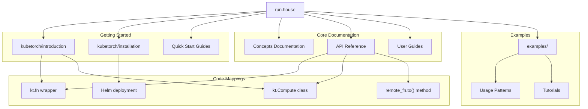
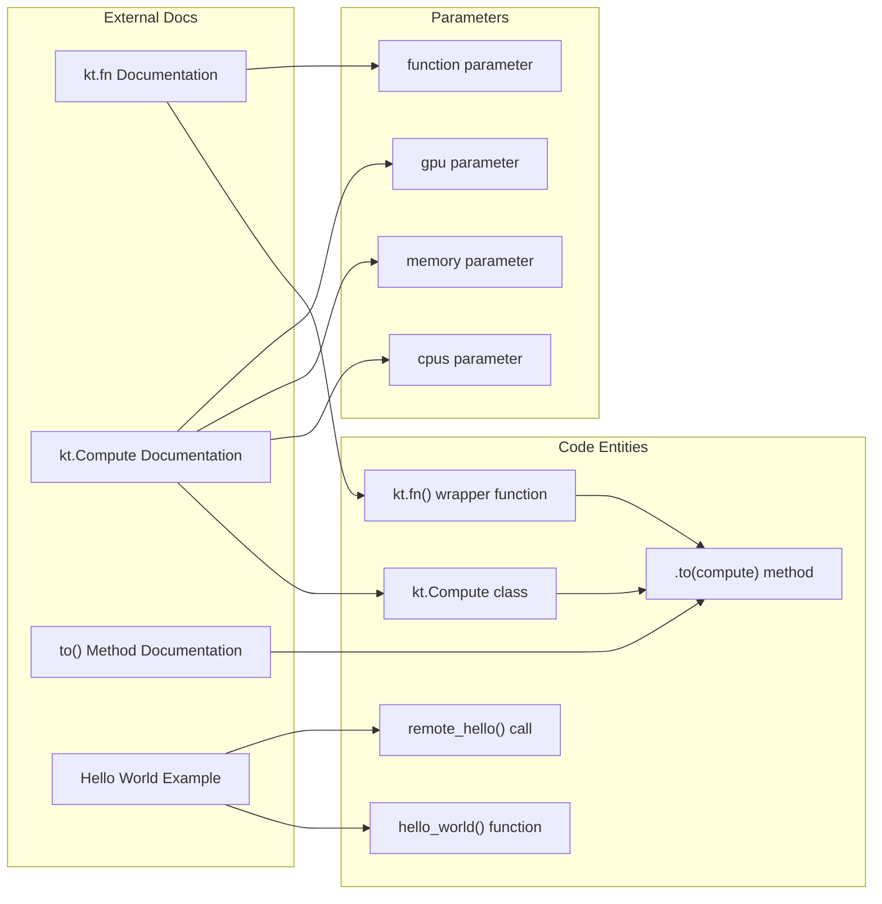
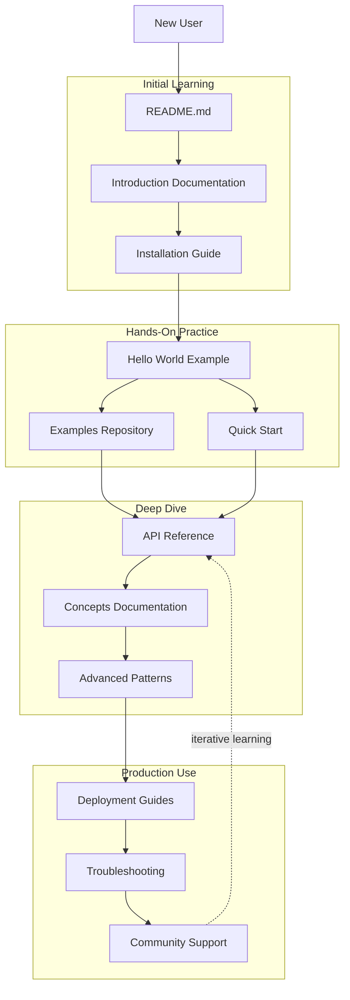

<!-- source: DeepWiki mcp.deepwiki.com · repo run-house/kubetorch · page 10.1 External Documentation · fetched 2026-10-21 -->

# External Documentation

<details>
<summary>Relevant source files</summary>

The following files were used as context for generating this wiki page:

- [README.md](README.md)

</details>


This page provides a comprehensive index of external documentation resources for Kubetorch, including the official documentation site, API references, tutorials, and community channels. This supplements the internal wiki with user-facing guides and examples.

For information about internal testing infrastructure and development workflows, see [Testing Infrastructure](#8.1) and [CI/CD Pipeline](#8.2). For troubleshooting guidance based on external resources, see [Common Issues](#9.1).

## Official Documentation Portal

The primary external documentation is hosted at **run.house**, providing user-facing guides, API references, and conceptual overviews.

### Documentation Structure



**Sources:** [README.md:57-68]()

### Available Documentation Resources

| Resource URL | Content Type | Coverage |
|--------------|-------------|----------|
| `run.house/kubetorch/introduction` | Conceptual Overview | System architecture, value propositions, serverless model |
| `run.house/kubetorch/installation` | Installation Guide | Client installation via pip, server deployment via Helm |
| `run.house/examples` | Code Examples | Real-world patterns, RL training, distributed training |
| `run.house` (API Reference section) | API Documentation | `kt.fn`, `kt.Compute`, CLI commands, method signatures |

**Sources:** [README.md:57-68]()

## Getting Started Resources

### Introduction Page

**URL:** `https://www.run.house/kubetorch/introduction`

The introduction page provides conceptual documentation covering:

- **System Overview**: Serverless interface for ML workloads on Kubernetes
- **Core Abstractions**: `kt.fn` function wrapping and `kt.Compute` resource specification
- **Key Features**: No local runtime, no code serialization, real-time log propagation
- **Performance Claims**: 100x faster iteration, 50%+ cost savings, 95% fewer faults

This corresponds to internal wiki sections [Overview](#1) and [Core Concepts](#2).

**Sources:** [README.md:1-9, 31-35]()

### Installation Guide

**URL:** `https://www.run.house/kubetorch/installation`

The installation guide provides step-by-step instructions for:

**Client Installation:**
```bash
pip install "kubetorch[client]"
```

**Server Deployment (Helm):**
- **Option 1 (Direct OCI):**
  ```bash
  helm upgrade --install kubetorch oci://ghcr.io/run-house/charts/kubetorch \
    --version 0.2.2 -n kubetorch --create-namespace
  ```
- **Option 2 (Local Chart):**
  ```bash
  helm pull oci://ghcr.io/run-house/charts/kubetorch --version 0.2.2 --untar
  helm upgrade --install kubetorch ./kubetorch -n kubetorch --create-namespace
  ```

This corresponds to [Installation](#3.1) and [Helm Installation](#7.2) in the internal wiki.

**Sources:** [README.md:37-56]()

## API Reference Documentation

### Code Entity Mapping

The external API reference documents user-facing interfaces and their usage patterns. The following diagram maps documentation sections to actual code entities:



**Sources:** [README.md:13-29]()

### Primary API Endpoints

The external documentation covers these key interfaces:

#### `kt.fn()`
Wraps Python functions for remote execution without explicit serialization. Documentation should cover:
- Function parameter accepting any Python callable
- Return value (wrapped function object)
- `.to(compute)` method for resource binding
- Execution behavior and result handling

Reference: [README.md:24]()

#### `kt.Compute()`
Specifies resource requirements for remote execution. Documentation should cover:
- `cpus` parameter (string format, e.g., `".1"`, `"4"`)
- `memory` parameter (e.g., `"16Gi"`)
- GPU specifications
- Node selection and constraints

Reference: [README.md:21]()

**Sources:** [README.md:13-29]()

## Examples and Tutorials

### Examples Repository

**URL:** `https://www.run.house/examples`

The examples repository provides production-ready patterns for:

| Example Category | Use Cases | Code Entities |
|-----------------|-----------|---------------|
| Basic Execution | Simple remote function calls | `kt.fn()`, `kt.Compute(cpus=".1")` |
| Resource Scaling | CPU/memory/GPU variations | `kt.Compute(cpus="4", memory="16Gi")` |
| ML Workloads | RL training, distributed training | Multi-node configurations |
| CI/CD Integration | GitHub Actions, Jenkins | Programmatic execution patterns |
| Production Patterns | Error handling, monitoring | Fault tolerance APIs |

**Sources:** [README.md:67]()

### Hello World Example

The canonical "Hello World" example demonstrates the complete execution flow:

```python
import kubetorch as kt

def hello_world():
    return "Hello from Kubetorch!"

if __name__ == "__main__":
    # Define your compute
    compute = kt.Compute(cpus=".1")
    
    # Send local function to freshly launched remote compute
    remote_hello = kt.fn(hello_world).to(compute)
    
    # Runs remotely on your Kubernetes cluster
    result = remote_hello()
    print(result)  # "Hello from Kubetorch!"
```

This example maps to:
- [README.md:13-29]() - Full code listing
- [Hello World Example](#3.2) - Internal wiki walkthrough
- Function definition: [README.md:16-17]()
- Resource specification: [README.md:21]()
- Function wrapping: [README.md:24]()
- Remote execution: [README.md:27]()

**Sources:** [README.md:13-29]()

## Documentation Navigation Flow



**Sources:** [README.md:1-72]()

## Community and Support Resources

### Slack Community

**URL:** `https://join.slack.com/t/kubetorch/shared_invite/zt-3g76q5i4j-uP60AdydxnAmjGVAQhtALA`

The Slack workspace provides:
- Real-time community support
- Direct communication with maintainers
- Discussion of usage patterns
- Feature requests and feedback

Reference: [README.md:62, 68]()

### Contact Methods

| Channel | Purpose | URL/Contact |
|---------|---------|-------------|
| Slack | Community support, discussions | Invite link in README |
| Email | Kubetorch Serverless inquiries, private support | `hello@run.house` |
| Documentation | Self-service learning | `run.house/kubetorch/introduction` |
| Examples | Code patterns | `run.house/examples` |

**Sources:** [README.md:62-68]()

## Kubetorch Serverless

**Contact:** `hello@run.house` or via Slack

Kubetorch Serverless is the fully managed platform alternative to self-hosted deployment. External documentation for serverless access:

- **Access Model**: Managed platform (no self-deployment required)
- **Contact Required**: Email or Slack to request access
- **Use Case**: Users who prefer managed infrastructure over Helm deployment

This corresponds to [Kubetorch Serverless](#7.5) in the internal wiki.

**Sources:** [README.md:60-62]()

## Version-Specific Documentation

### Current Version: 0.2.2

The Helm chart version `0.2.2` is referenced in both OCI registry URLs:
```bash
oci://ghcr.io/run-house/charts/kubetorch --version 0.2.2
```

Users should ensure external documentation matches their deployed version. Version-specific considerations:

| Component | Version Reference | Documentation Location |
|-----------|------------------|------------------------|
| Helm Chart | `0.2.2` | OCI registry, installation guide |
| Python Client | PyPI latest | `pip install kubetorch[client]` |
| API Compatibility | Chart version-dependent | API reference docs |

**Sources:** [README.md:49, 53]()

## Documentation Cross-Reference

### Mapping External to Internal Documentation

| External Resource | Internal Wiki Section | Content Overlap |
|-------------------|----------------------|-----------------|
| Introduction | [Overview](#1) | System purpose, value propositions |
| Installation Guide | [Installation](#3.1), [Helm Installation](#7.2) | Setup procedures |
| API Reference | [API Reference](#5), [kt.fn](#5.1), [kt.Compute](#5.2) | Interface specifications |
| Examples | [Hello World](#3.2), [Advanced Usage](#6) | Usage patterns |
| Concepts | [Core Concepts](#2) | Abstractions and models |
| Deployment Guides | [Deployment and Operations](#7) | Operational procedures |

**Sources:** [README.md:1-72]()

## License and Attribution

**License:** Apache 2.0  
**Source:** [LICENSE]() file  
**Organization:** Built by Runhouse (`run.house`)

Reference: [README.md:72-74]()

---

**Note:** All URLs and links in this document reference external resources hosted at `run.house`. For internal system documentation, refer to the corresponding numbered wiki sections in this documentation system.

---

