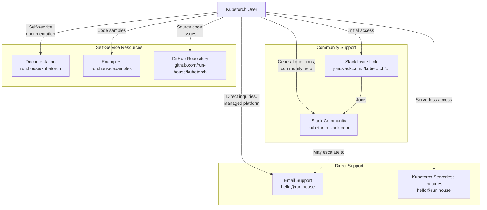
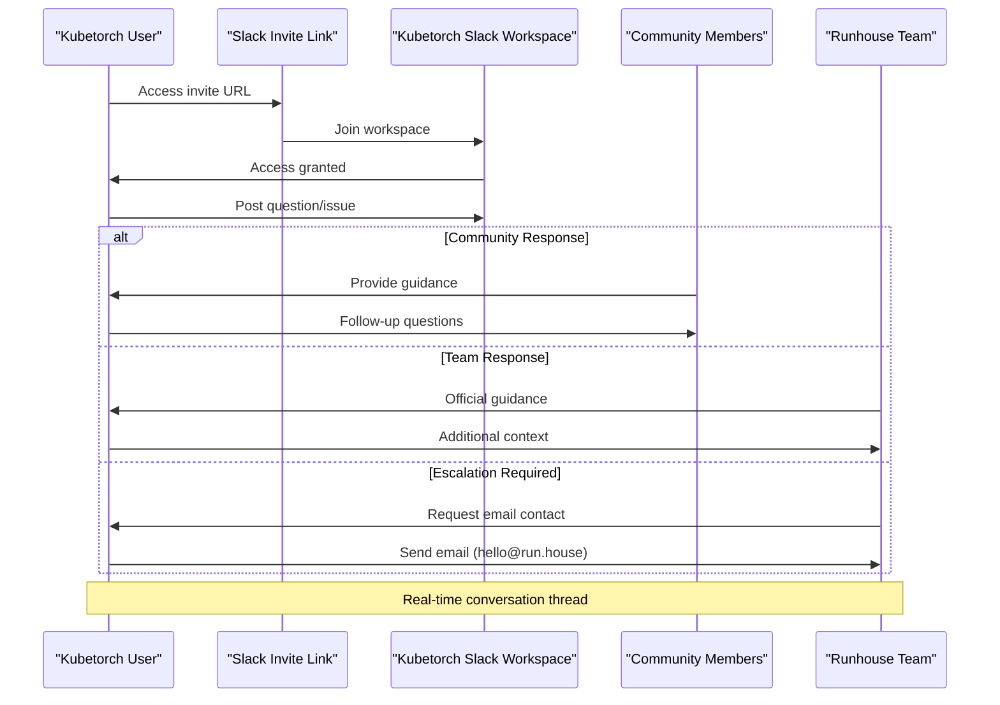
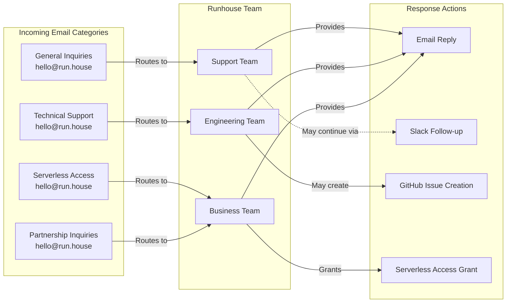
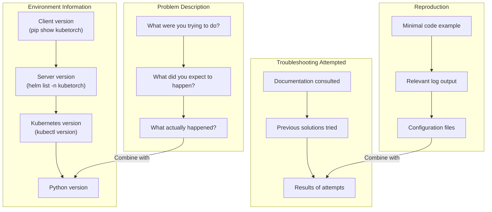
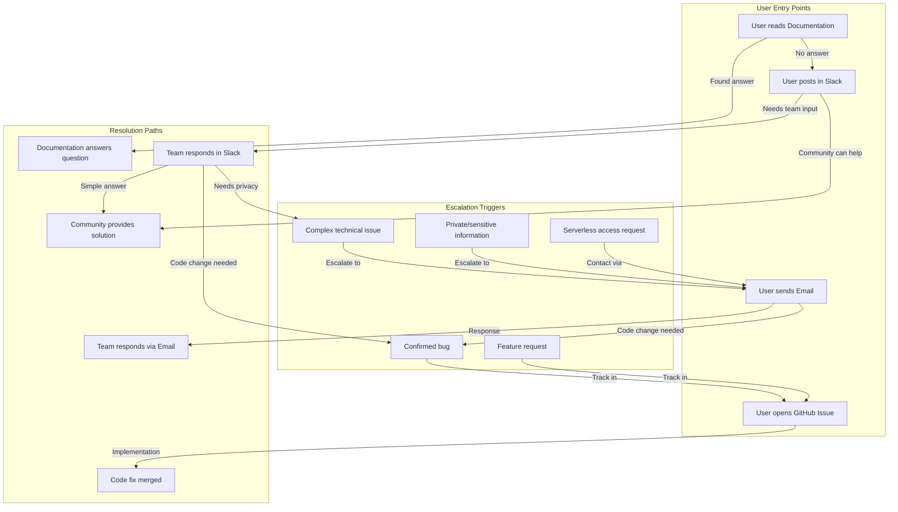
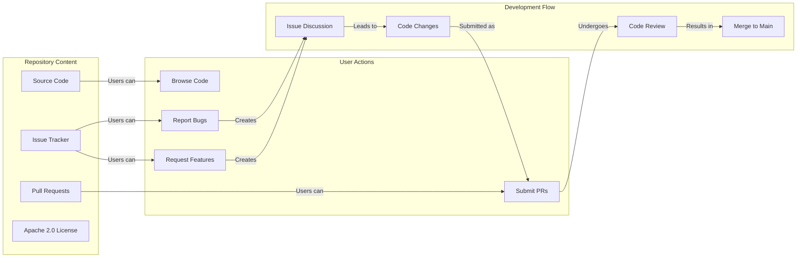
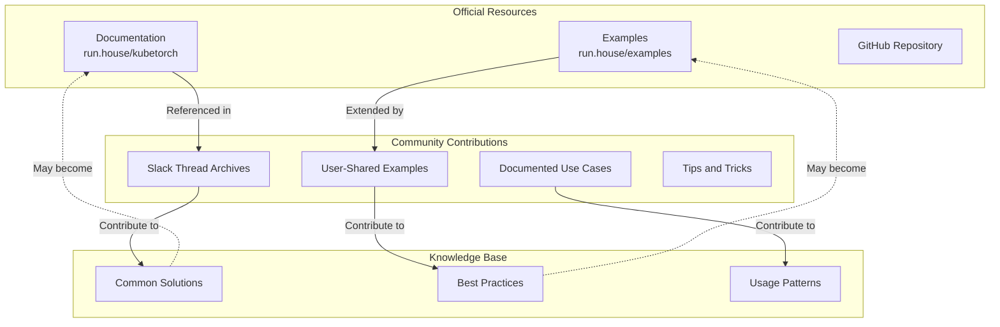

<!-- source: DeepWiki mcp.deepwiki.com · repo run-house/kubetorch · page 10.2 Support Channels · fetched 2026-10-21 -->

# Support Channels

<details>
<summary>Relevant source files</summary>

The following files were used as context for generating this wiki page:

- [README.md](README.md)

</details>


This document outlines the available support channels for Kubetorch users, including community forums, direct communication methods, and how to effectively seek help with issues, questions, or feature requests. For technical troubleshooting procedures and common problem resolution, see [Common Issues](#9.1) and [Debugging and Logging](#9.2). For links to official documentation and tutorials, see [External Documentation](#10.1).

## Overview

Kubetorch provides multiple support channels to accommodate different types of inquiries and user preferences. The support infrastructure is designed to facilitate both community-driven assistance and direct communication with the Kubetorch team at Runhouse.

### Available Support Channels



**Support Channel Selection Guide**

| Channel | Best For | Response Time |
|---------|----------|---------------|
| Slack Community | General questions, usage patterns, community discussions, troubleshooting | Real-time (community-driven) |
| Email | Direct support, serverless platform access, partnership inquiries | 1-2 business days |
| Documentation | Self-service learning, API reference, setup guides | Immediate |
| GitHub Issues | Bug reports, feature requests, technical discussions | Varies (tracked publicly) |

**Sources:** [README.md:62-68]()

## Slack Community

The Kubetorch Slack workspace serves as the primary community support channel where users can interact with other Kubetorch users, share usage patterns, and receive assistance from both community members and the Runhouse team.

### Joining the Slack Community

The Slack workspace is accessible via a permanent invite link referenced in [README.md:62]() and [README.md:68]():

```
https://join.slack.com/t/kubetorch/shared_invite/zt-3g76q5i4j-uP60AdydxnAmjGVAQhtALA
```

This invite link provides immediate access to the Kubetorch Slack workspace without requiring approval.

### Slack Communication Flow



### Recommended Usage Patterns

**Appropriate for Slack:**
- General usage questions (e.g., "How do I configure GPU resources?")
- Troubleshooting common issues (e.g., "Connection timeout to cluster")
- Sharing usage patterns and examples
- Community discussions about best practices
- Quick clarifications on documentation
- Performance optimization questions

**Better suited for Email:**
- Kubetorch Serverless access requests
- Partnership or commercial inquiries
- Sensitive information that should not be public
- Detailed technical issues requiring private debugging

**Sources:** [README.md:62](), [README.md:68]()

## Email Support

Direct email support is available through the Runhouse team at `hello@run.house`. This channel is referenced in [README.md:62]() as the primary contact method for specific inquiries.

### Email Support Structure



### Email Contact Information

The email address `hello@run.house` is documented in [README.md:62]() and serves multiple purposes:

| Purpose | Email Address | Context |
|---------|---------------|---------|
| General Support | hello@run.house | Any questions or issues |
| Serverless Platform Access | hello@run.house | Requesting access to managed platform |
| Bug Reports | hello@run.house | Alternative to GitHub Issues |
| Partnership Inquiries | hello@run.house | Commercial discussions |

### Kubetorch Serverless Access

As documented in [README.md:60-62](), users interested in the fully managed Kubetorch Serverless platform should contact the Runhouse team via email or Slack:

> "Contact us (email, Slack) to try out Kubetorch on our fully managed serverless platform."

The Kubetorch Serverless platform is an alternative to self-hosted deployment, managed entirely by Runhouse. Access requests should include:
- Use case description
- Expected workload characteristics
- Resource requirements
- Timeline for evaluation

**Sources:** [README.md:62]()

## Effective Support Requests

When seeking support through any channel, providing structured information accelerates resolution.

### Support Request Template



### Version Information Retrieval

When reporting issues, include version information:

**Client Version:**
```bash
pip show kubetorch
```

**Server Version:**
```bash
helm list -n kubetorch
```

The Helm deployment uses version `0.2.2` as referenced in [README.md:50]() and [README.md:53]().

**Kubernetes Version:**
```bash
kubectl version
```

### Log Collection

For execution issues, collect logs as documented in [Debugging and Logging](#9.2):

**Pod Logs:**
```bash
kubectl logs -n kubetorch <pod-name>
```

**Deployment Logs:**
```bash
kubectl logs -n kubetorch -l app=kubetorch
```

Since Kubetorch provides real-time log propagation to the local environment as noted in [README.md:7](), execution logs are typically available directly in the Python console output.

**Sources:** [README.md:50](), [README.md:53](), [README.md:7]()

## Support Channel Integration

The different support channels are designed to work together, with escalation paths between them.

### Multi-Channel Support Workflow



### Escalation Criteria

| From Channel | To Channel | Trigger Condition |
|--------------|------------|-------------------|
| Documentation | Slack | Information not found in docs |
| Slack | Email | Issue requires private discussion |
| Slack | GitHub | Bug identified, reproducible |
| Email | GitHub | Feature request with technical specification |
| Any | Email | Serverless platform inquiry |

**Sources:** [README.md:60-68]()

## GitHub Repository

The Kubetorch GitHub repository at `https://github.com/run-house/kubetorch` serves as the canonical location for source code, issue tracking, and open development.

### GitHub Usage



**GitHub Issue Guidelines:**
- Search existing issues before creating new ones
- Provide minimal reproducible examples
- Include environment details (versions, configuration)
- Tag issues appropriately (bug, enhancement, question)
- Reference related issues or pull requests

**Sources:** Repository URL is implicit from context, License referenced in [README.md:72]()

## Response Time Expectations

Support response times vary by channel and issue complexity.

### Expected Response Times

| Channel | Initial Response | Resolution Time |
|---------|------------------|-----------------|
| Slack Community | Minutes to hours (community-driven) | Varies |
| Slack (Team Response) | Within 1 business day | 1-3 business days |
| Email | 1-2 business days | 3-5 business days |
| GitHub Issues | 2-3 business days | Varies by complexity |

**Factors Affecting Resolution Time:**
- Issue complexity and reproducibility
- Required information completeness
- Need for code changes vs. configuration guidance
- Current team workload and priorities
- Whether issue affects multiple users

**Sources:** Response time expectations are standard practice, not explicitly documented in provided files.

## Community Resources

Beyond direct support channels, the Kubetorch community provides additional resources.

### Community-Maintained Resources



**Community Contribution Opportunities:**
- Share working examples in Slack
- Document novel use cases
- Answer questions from other users
- Report bugs with detailed reproduction steps
- Suggest documentation improvements
- Contribute code via pull requests

**Sources:** [README.md:64-68]()

## Contact Summary

### Quick Reference

All contact information for Kubetorch support:

| Purpose | Method | Contact Information |
|---------|--------|---------------------|
| Community Discussion | Slack | https://join.slack.com/t/kubetorch/shared_invite/zt-3g76q5i4j-uP60AdydxnAmjGVAQhtALA |
| Direct Support | Email | hello@run.house |
| Serverless Platform | Email/Slack | hello@run.house or Slack |
| Bug Reports | GitHub | https://github.com/run-house/kubetorch/issues |
| Documentation | Website | https://www.run.house/kubetorch/introduction |
| Examples | Website | https://www.run.house/examples |

### Built by Runhouse

Kubetorch is built and maintained by Runhouse, as noted in [README.md:74](). The Runhouse team actively monitors all support channels and is committed to helping users successfully deploy and operate Kubetorch.

**Sources:** [README.md:60-74]()