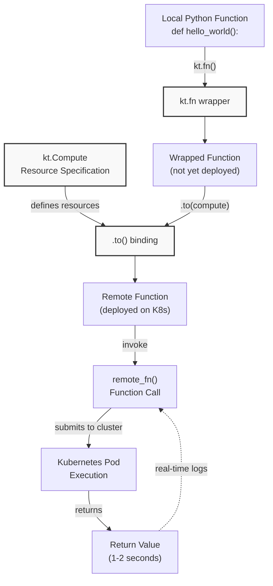
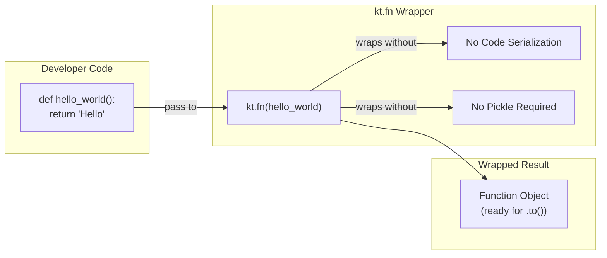
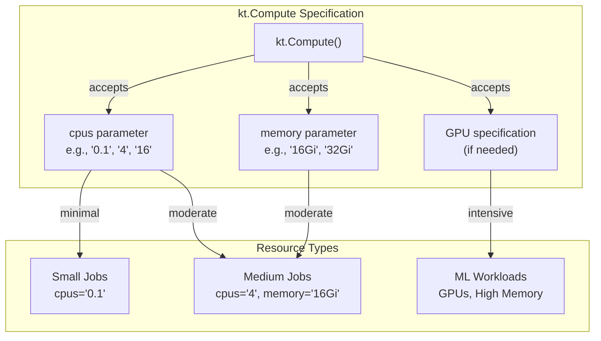
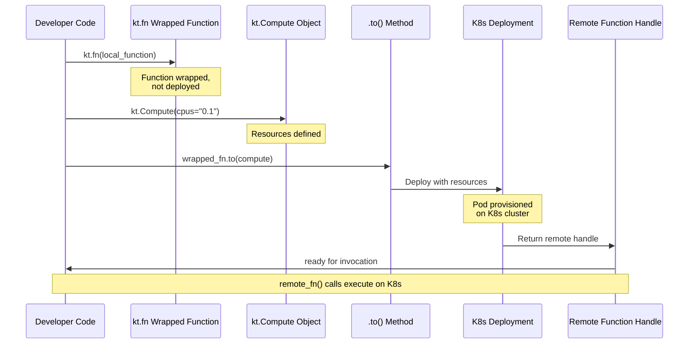
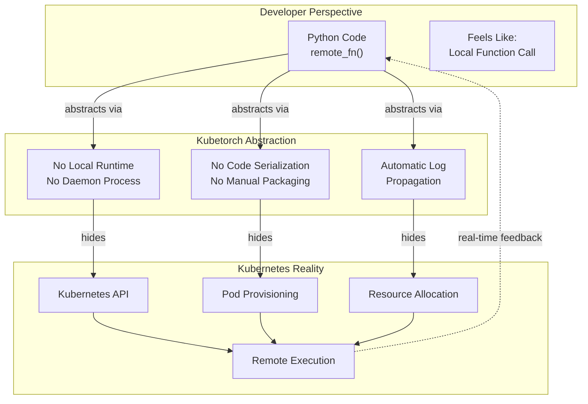
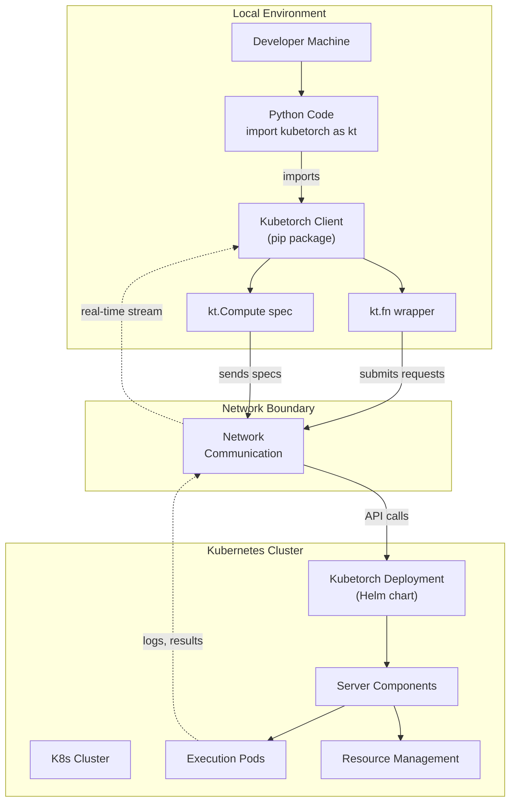
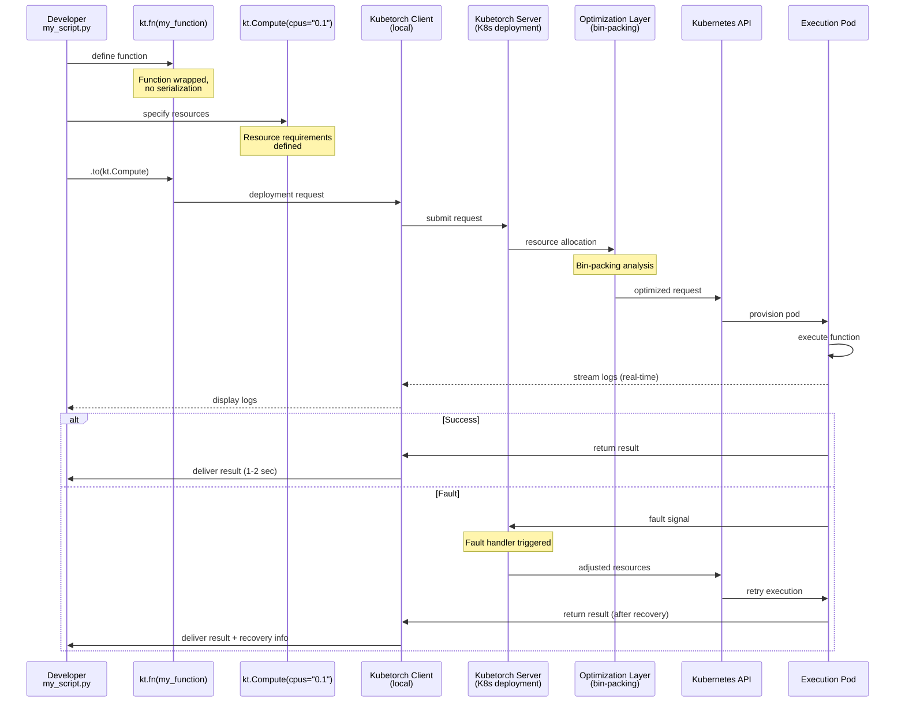

<!-- source: DeepWiki mcp.deepwiki.com · repo run-house/kubetorch · page 2 Core Concepts · fetched 2026-10-21 -->

# Core Concepts

<details>
<summary>Relevant source files</summary>

The following files were used as context for generating this wiki page:

- [README.md](README.md)

</details>


This page explains the fundamental concepts and abstractions in Kubetorch that developers interact with. It covers the core programming model, including `kt.fn` for function wrapping, `kt.Compute` for resource specification, the serverless execution paradigm, and the client-server architecture.

For installation instructions, see [Installation](#3.1). For detailed API documentation, see [API Reference](#5). For advanced usage patterns, see [Advanced Usage](#6).

---

## Overview of Core Abstractions

Kubetorch provides three primary abstractions for distributed computing on Kubernetes:

| Abstraction | Purpose | Example Usage |
|-------------|---------|---------------|
| `kt.fn` | Wraps local Python functions for remote execution | `kt.fn(my_function)` |
| `kt.Compute` | Specifies resource requirements (CPUs, memory, GPUs) | `kt.Compute(cpus="4", memory="16Gi")` |
| `.to()` | Binds a wrapped function to compute resources | `remote_fn = kt.fn(local_fn).to(compute)` |

These abstractions work together to enable a serverless execution model where Kubernetes complexity is hidden behind a Pythonic interface.

### Conceptual Relationship Diagram



**Sources:** [README.md:13-29]()

---

## Functions (kt.fn)

The `kt.fn` wrapper transforms local Python functions into remotely executable units without requiring explicit code serialization or containerization.

### Function Wrapping Mechanism



### Key Characteristics

The `kt.fn` wrapper has the following properties:

- **No Explicit Serialization**: Developers do not need to pickle, serialize, or otherwise package their code manually [README.md:9]()
- **Deferred Deployment**: Wrapping a function with `kt.fn` does not immediately deploy it to Kubernetes. Deployment occurs when `.to()` is called [README.md:24]()
- **Transparent Execution**: Once deployed, calling the remote function feels identical to calling the local version [README.md:27-28]()
- **Real-Time Communication**: Logs and exceptions from remote execution propagate back immediately [README.md:7-8]()

### Usage Pattern

```python
# Local function definition
def hello_world():
    return "Hello from Kubetorch!"

# Wrap with kt.fn
wrapped_fn = kt.fn(hello_world)  # Not yet deployed

# Function remains local until bound to compute
```

**Sources:** [README.md:13-24]()

---

## Compute Resources (kt.Compute)

The `kt.Compute` class specifies resource requirements for remote function execution. It defines the computational resources that Kubernetes will allocate when the function runs.

### Resource Specification



### Resource Parameters

| Parameter | Type | Purpose | Example |
|-----------|------|---------|---------|
| `cpus` | String | CPU allocation | `"0.1"`, `"4"`, `"16"` |
| `memory` | String | Memory allocation | `"16Gi"`, `"32Gi"` |
| GPUs | (varies) | GPU requirements | Configuration depends on cluster setup |

### Example Specifications

```python
# Minimal resources for lightweight tasks
small_compute = kt.Compute(cpus="0.1")

# Medium resources for standard ML training
medium_compute = kt.Compute(cpus="4", memory="16Gi")

# Large resources for distributed training
large_compute = kt.Compute(cpus="16", memory="64Gi")
```

The resource specification determines how Kubetorch's bin-packing and optimization systems allocate cluster resources (see [Resource Management](#4.3) and [Optimization Engine](#4.4)).

**Sources:** [README.md:21]()

---

## The Binding Mechanism (.to())

The `.to()` method binds a wrapped function to compute resources, creating a deployed remote function ready for execution on Kubernetes.

### Binding Process Flow



### Two-Stage Deployment Model

Kubetorch uses a two-stage model separating function definition from deployment:

**Stage 1: Function Wrapping**
```python
wrapped_fn = kt.fn(hello_world)  # No deployment yet
```

**Stage 2: Resource Binding and Deployment**
```python
remote_fn = wrapped_fn.to(compute)  # Deployed to K8s
```

This separation allows:
- Functions to be defined once and deployed with different resource configurations
- Resource specifications to be reused across multiple functions
- Lazy deployment that occurs only when `.to()` is called

### Complete Example from Hello World

[README.md:13-29]() demonstrates the full binding pattern:

```python
import kubetorch as kt

def hello_world():
    return "Hello from Kubetorch!"

if __name__ == "__main__":
    # Define compute resources
    compute = kt.Compute(cpus=".1")
    
    # Wrap and bind in one statement
    remote_hello = kt.fn(hello_world).to(compute)
    
    # Execute remotely
    result = remote_hello()  # Runs on K8s cluster
    print(result)  # "Hello from Kubetorch!"
```

**Sources:** [README.md:20-28]()

---

## Serverless Execution Model

Kubetorch implements a serverless paradigm where Kubernetes infrastructure is abstracted away, presenting developers with a simple function-call interface.

### Abstraction Layers



### Serverless Characteristics

The serverless model provides the following properties:

| Characteristic | Traditional Kubernetes | Kubetorch Serverless |
|----------------|----------------------|---------------------|
| Container Building | Manual Dockerfile creation | Automatic |
| Code Packaging | Manual serialization/packaging | No serialization needed |
| Deployment | Manual YAML files, kubectl commands | Single `.to()` call |
| Iteration Speed | 10+ minutes | 1-2 seconds |
| Log Access | Manual kubectl logs commands | Real-time propagation |
| Environment Support | Limited to containerized environments | Any Python environment |

### No Local Runtime Requirement

Unlike traditional distributed computing frameworks, Kubetorch requires no local daemon or server process [README.md:9](). This enables usage from:

- IDEs (VSCode, PyCharm)
- Jupyter Notebooks
- Python REPL
- CI/CD pipelines
- Production applications
- Any environment with Python installed

### Fast Iteration Cycles

The serverless model enables 1-2 second iteration cycles [README.md:7]() by:

1. Eliminating container rebuild steps
2. Avoiding manual deployment processes
3. Maintaining persistent cluster connections
4. Streaming logs in real-time rather than polling

For more on iteration speed, see [Execution Lifecycle](#4.2).

**Sources:** [README.md:7-9](), [README.md:33]()

---

## Client-Server Architecture

Kubetorch implements a split architecture with a Python client library running locally and a Kubernetes deployment managing remote execution.

### Component Separation



### Client Responsibilities

The local Python client (`kubetorch[client]` package) handles:

- **Function Wrapping**: Applying `kt.fn` to local functions
- **Resource Specification**: Creating `kt.Compute` objects
- **Request Submission**: Sending execution requests to the cluster
- **Result Reception**: Receiving return values from remote execution
- **Log Streaming**: Displaying real-time logs and exceptions

Installation: `pip install "kubetorch[client]"` [README.md:42]()

### Server Responsibilities

The Kubernetes deployment (Helm chart v0.2.2) handles:

- **Request Processing**: Accepting execution requests from clients
- **Pod Provisioning**: Creating Kubernetes pods for function execution
- **Resource Allocation**: Implementing bin-packing and optimization
- **Execution Management**: Running functions and capturing output
- **Fault Handling**: Detecting and recovering from failures
- **Monitoring**: Tracking execution metrics and cluster state

Installation: See [Helm Installation](#7.2)

### Communication Protocol

The client and server communicate through a network protocol that supports:

- **Bidirectional Communication**: Client sends requests, server streams logs [README.md:7]()
- **Real-Time Updates**: Logs, exceptions, and hardware faults propagate immediately [README.md:7-8]()
- **Result Delivery**: Function return values transmitted back to client [README.md:28]()
- **1-2 Second Latency**: End-to-end request/response cycle [README.md:7]()

### Distribution Model

| Component | Distribution Channel | Version |
|-----------|---------------------|---------|
| Client Library | PyPI (`pip install`) | Follows Python package versioning |
| Server Deployment | OCI Registry (Helm) | v0.2.2 [README.md:50]() |

This split distribution allows independent versioning and deployment of client and server components.

**Sources:** [README.md:39-55]()

---

## Execution Flow: From Local Code to Remote Execution

The following diagram shows the complete execution lifecycle, bridging developer code entities to cluster execution:



### Execution Stages

**Stage 1: Function Definition and Wrapping**
- Developer defines local Python function [README.md:16-17]()
- `kt.fn()` wraps function without serialization [README.md:24]()

**Stage 2: Resource Specification**
- Developer creates `kt.Compute` with resource requirements [README.md:21]()

**Stage 3: Binding and Deployment**
- `.to()` method binds function to compute [README.md:24]()
- Client submits deployment request to server

**Stage 4: Optimization and Provisioning**
- Server optimization layer analyzes resource requirements
- Kubernetes provisions pod with allocated resources

**Stage 5: Execution and Monitoring**
- Function executes in remote pod
- Logs stream back to client in real-time [README.md:7]()

**Stage 6: Result Delivery**
- Return value transmitted to client
- Total time: 1-2 seconds [README.md:7]()

### Hello World Execution Trace

Using the example from [README.md:13-29]():

```
my_script.py:
  line 16-17: def hello_world() definition
  line 21:    kt.Compute(cpus=".1") → resource spec
  line 24:    kt.fn(hello_world).to(compute) → deployment
  line 27:    remote_hello() → execution request
  
Kubernetes Cluster:
  Pod created with 0.1 CPU allocation
  Function executes: return "Hello from Kubetorch!"
  
Result:
  line 28:    print(result) → "Hello from Kubetorch!"
  Total time: 1-2 seconds
```

**Sources:** [README.md:13-29](), [README.md:7]()

---

## Summary

The core concepts in Kubetorch provide a clean abstraction over Kubernetes:

- **`kt.fn`** wraps local functions without serialization
- **`kt.Compute`** specifies resource requirements
- **`.to()`** binds functions to compute and deploys to Kubernetes
- **Serverless model** hides infrastructure complexity
- **Client-server architecture** splits concerns between local and remote
- **1-2 second execution** enables rapid iteration

For detailed API documentation, see [kt.fn](#5.1) and [kt.Compute](#5.2). For deployment instructions, see [Getting Started](#3).

---

