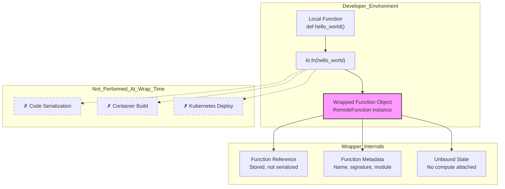
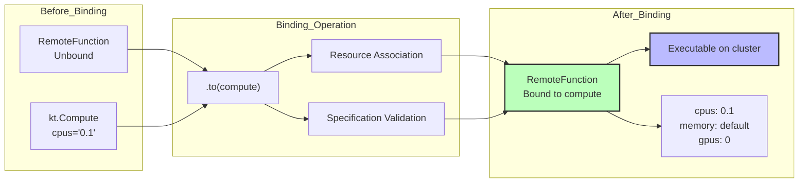
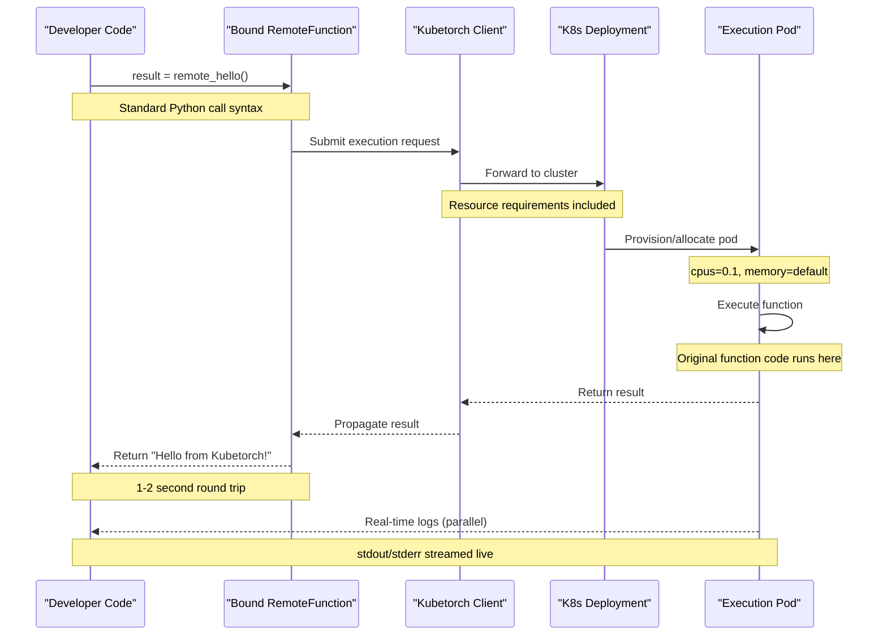
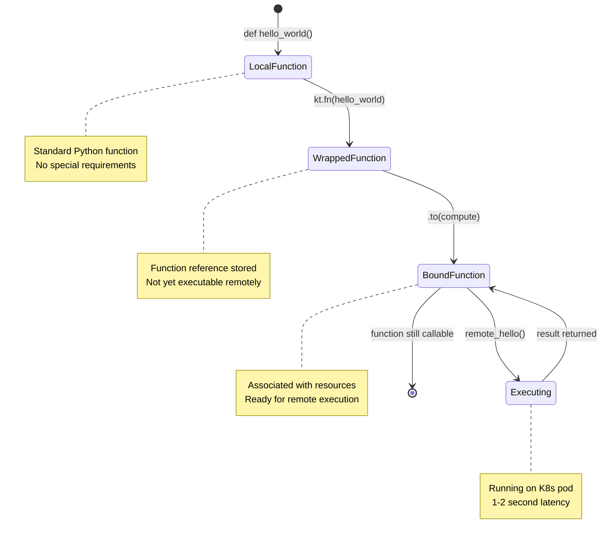

<!-- source: DeepWiki mcp.deepwiki.com · repo run-house/kubetorch · page 2.1 Functions (kt.fn) · fetched 2026-10-21 -->

# Functions (kt.fn)

<details>
<summary>Relevant source files</summary>

The following files were used as context for generating this wiki page:

- [README.md](README.md)

</details>


## Purpose and Scope

This page explains the `kt.fn` function wrapper, which is the primary abstraction for converting local Python functions into remotely executable Kubetorch functions. It covers the wrapping mechanism, resource binding via `.to()`, and the execution model.

For information about specifying compute resources, see [Compute Resources (kt.Compute)](#2.2). For the complete API reference, see [kt.fn API Reference](#5.1). For the broader execution lifecycle and infrastructure, see [Execution Lifecycle](#4.2).

## Overview

`kt.fn` is a function decorator/wrapper that transforms ordinary Python functions into Kubetorch remote functions without requiring explicit code serialization, container building, or Kubernetes manifest creation. It provides a local-to-remote execution abstraction where function calls feel local but execute on cluster resources.

The core design principle is **zero boilerplate**: developers write standard Python functions and wrap them with `kt.fn`, eliminating the traditional distributed computing workflow of serializing code, building containers, deploying to clusters, and managing execution infrastructure.

**Sources:** [README.md:1-29]()

## Function Wrapping Mechanism

### Basic Wrapping Pattern

The `kt.fn` wrapper converts a local function into a remote function object:

```python
# Local function definition
def hello_world():
    return "Hello from Kubetorch!"

# Wrap with kt.fn
remote_hello = kt.fn(hello_world)
```

At this stage, the function is wrapped but not yet bound to compute resources. The wrapper stores a reference to the original function without performing serialization or code transformation.

### No Code Serialization

Unlike traditional distributed computing frameworks (e.g., `pickle`, `dill`, `cloudpickle`), `kt.fn` does not serialize the function bytecode or closure at wrap time. This design choice enables:

- **IDE compatibility**: Functions remain debuggable in local environments
- **Dynamic code updates**: Changes to the function definition propagate to remote execution
- **Environment consistency**: The same Python environment is available locally and remotely

The actual code execution happens within the Kubernetes cluster, where the function definition is accessed directly from the deployment environment rather than being reconstructed from serialized bytecode.

**Sources:** [README.md:9](), Architecture Diagram 1 (Kubetorch Client Layer), Architecture Diagram 2 (Function Execution Lifecycle)

### Wrapping Mechanism Architecture



**Diagram:** `kt.fn` wrapping mechanism showing what is stored vs. what is deferred

**Sources:** [README.md:9](), [README.md:24](), Architecture Diagram 2 (Wrapper stage)

## Binding to Compute Resources

### The `.to()` Method

The `.to(compute)` method binds a wrapped function to a `kt.Compute` resource specification, creating a deployment-ready remote function:

```python
compute = kt.Compute(cpus=".1")
remote_hello = kt.fn(hello_world).to(compute)
```

The binding operation:
1. Associates the function with specific resource requirements
2. Prepares the function for remote execution
3. Returns a callable remote function object

The binding is declarative rather than imperative—it specifies *what* resources are needed, not *how* to provision them. The actual resource provisioning happens at execution time.

**Sources:** [README.md:21-24]()

### Binding State Transition

The function object transitions through three states:

| State | Description | Can Execute? | Has Compute? |
|-------|-------------|--------------|--------------|
| **Local** | Original Python function | Yes (locally) | No |
| **Wrapped** | After `kt.fn()` call | No | No |
| **Bound** | After `.to(compute)` call | Yes (remotely) | Yes |

Only bound functions can be executed remotely on the Kubernetes cluster.

**Sources:** [README.md:24](), Architecture Diagram 2 (Function Preparation Phase)

### Binding Architecture



**Diagram:** Resource binding via `.to()` method showing state transition

**Sources:** [README.md:24](), Architecture Diagram 2 (Function bound to resources)

## Execution Model

### Local Invocation, Remote Execution

Once bound, a remote function is invoked using standard Python call syntax:

```python
result = remote_hello()
```

This invocation:
1. Appears local (standard function call syntax)
2. Executes remotely (on Kubernetes cluster)
3. Returns results synchronously (1-2 second latency)

The execution model provides synchronous semantics by default, blocking until the remote execution completes and returns a result. This makes remote functions behave like local process pool workers.

**Sources:** [README.md:27-28](), Architecture Diagram 1 (Execution flow)

### Execution Flow



**Diagram:** Execution flow from local invocation to remote execution and result return

**Sources:** [README.md:27-28](), [README.md:7](), Architecture Diagram 2 (Execution and Optimization Phase)

### Execution Characteristics

| Aspect | Behavior | Implication |
|--------|----------|-------------|
| **Invocation Syntax** | Standard Python call | No special syntax required |
| **Execution Location** | Kubernetes pod | Access to cluster resources |
| **Blocking Behavior** | Synchronous by default | Blocks until completion |
| **Return Latency** | 1-2 seconds | Fast enough for interactive workflows |
| **Log Propagation** | Real-time streaming | Immediate visibility into execution |
| **Exception Handling** | Propagated to caller | Local try/except works |

**Sources:** [README.md:7](), [README.md:33](), Architecture Diagram 2

## Function Lifecycle Summary

The complete lifecycle from definition to execution:



**Diagram:** Complete function lifecycle showing state transitions

**Sources:** [README.md:14-28](), Architecture Diagram 2 (Function Execution Lifecycle)

## Comparison with Traditional Approaches

The `kt.fn` approach differs fundamentally from traditional distributed computing patterns:

| Aspect | Traditional Approach | kt.fn Approach |
|--------|---------------------|----------------|
| **Code Packaging** | Manual serialization/pickling | Automatic, no serialization |
| **Container Build** | Required (Dockerfile, build time) | Not required |
| **Deployment** | Manual K8s manifests | Automatic on first call |
| **Resource Spec** | YAML configuration | Python object (`kt.Compute`) |
| **Invocation** | REST API / message queue | Standard function call |
| **Iteration Time** | 10+ minutes | 1-2 seconds |
| **Environment Sync** | Manual (pip freeze, etc.) | Automatic |

This architectural decision enables the claimed "100x faster iteration" by eliminating the container build and deployment cycle.

**Sources:** [README.md:33](), Architecture Diagram 1 (Developer Workspace to Execution), Architecture Diagram 3 (No Code Serialization)

## Usage Patterns

### Basic Pattern

The minimal usage pattern from the Hello World example:

```python
import kubetorch as kt

def hello_world():
    return "Hello from Kubetorch!"

compute = kt.Compute(cpus=".1")
remote_hello = kt.fn(hello_world).to(compute)
result = remote_hello()
```

**Sources:** [README.md:13-29]()

### Pattern with Return Values

Functions can return arbitrary Python objects:

```python
def compute_sum(a, b):
    return a + b

remote_sum = kt.fn(compute_sum).to(kt.Compute(cpus=".1"))
result = remote_sum(5, 3)  # Returns 8
```

The return value is transmitted from the remote pod back to the local environment.

**Sources:** [README.md:27-28]() (return value pattern)

### Pattern with Dependencies

Functions can use imported libraries and modules:

```python
def train_model():
    import numpy as np
    import torch
    
    data = np.random.randn(100, 10)
    # ... training logic ...
    return model

remote_train = kt.fn(train_model).to(kt.Compute(cpus="4", memory="16Gi"))
model = remote_train()
```

The remote execution environment must have the required dependencies installed.

**Sources:** Architecture Diagram 1 (Execution Pods with Resources), [README.md:5]() (ML workloads context)

## Key Design Principles

The `kt.fn` wrapper embodies three core design principles:

1. **Zero Serialization**: Functions are not pickled, serialized, or transformed at wrap time
2. **Native Python Syntax**: Remote functions use standard call syntax (`remote_fn()`)
3. **Declarative Binding**: The `.to()` method declaratively specifies resources without imperative provisioning

These principles enable the "no local runtime, no code serialization" claim while providing access to cluster compute from any Python environment.

**Sources:** [README.md:9](), Architecture Diagram 3 (No Code Serialization, No Local Runtime)

---

**Complete Section Sources:**
- [README.md:1-75]()
- Architecture Diagram 1: Complete System Ecosystem
- Architecture Diagram 2: Function Execution Lifecycle and Data Flow
- Architecture Diagram 3: Multi-Environment Integration and Development Patterns

---

