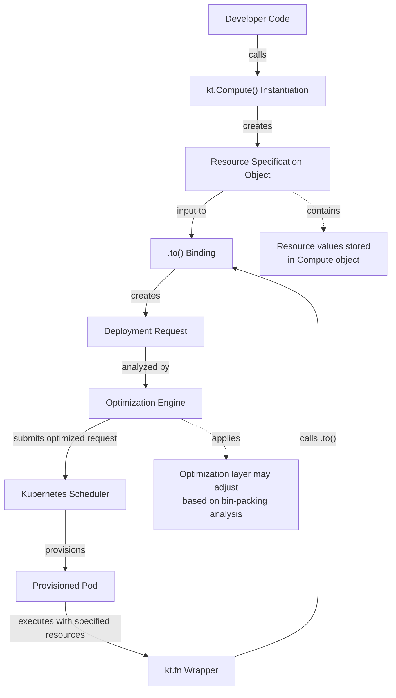
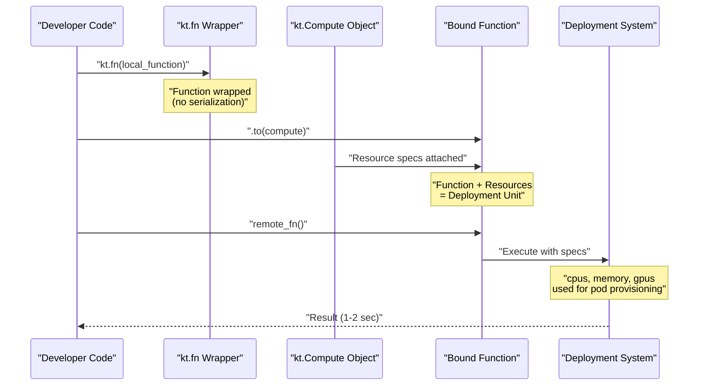
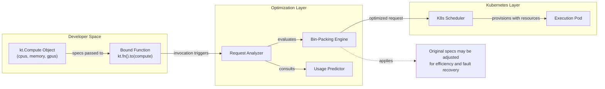
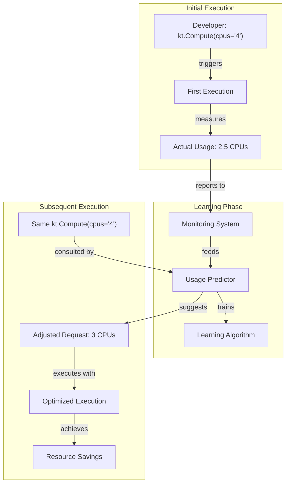
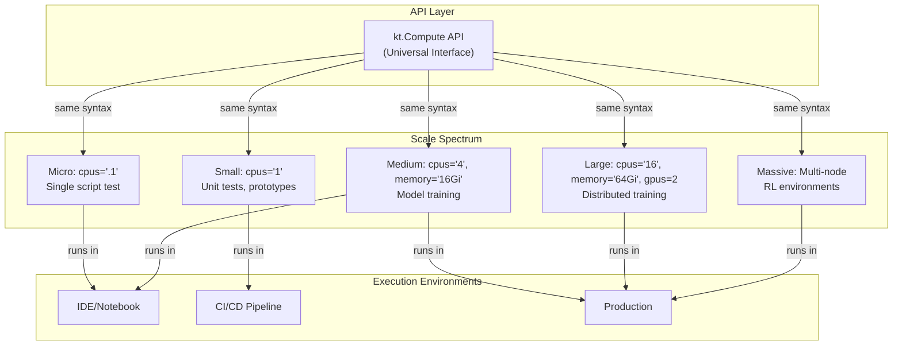

<!-- source: DeepWiki mcp.deepwiki.com · repo run-house/kubetorch · page 2.2 Compute Resources (kt.Compute) · fetched 2026-10-21 -->

# Compute Resources (kt.Compute)

<details>
<summary>Relevant source files</summary>

The following files were used as context for generating this wiki page:

- [README.md](README.md)

</details>


## Purpose and Scope

This document explains the `kt.Compute` class, which provides the resource specification abstraction in Kubetorch. `kt.Compute` defines the computational resources (CPUs, memory, GPUs) required for executing functions on the Kubernetes cluster. It serves as the bridge between developer intent ("I need 4 CPUs") and Kubernetes resource allocation.

For information about wrapping functions for remote execution, see [Functions (kt.fn)](#2.1). For details on how compute resources are optimized and allocated by the system, see [Resource Management](#4.3) and [Optimization Engine](#4.4).

**Sources:** [README.md:1-75]()

---

## Resource Specification Overview

`kt.Compute` objects encapsulate resource requirements that are later translated into Kubernetes resource requests and limits. When a function is bound to a `kt.Compute` instance using the `.to()` method, the system uses these specifications to provision appropriate pods in the cluster.

The resource specification model supports three primary resource types:
- **CPUs**: Compute cores allocated to the execution pod
- **Memory**: RAM allocated to the execution pod  
- **GPUs**: Graphics processing units for accelerated compute

**Sources:** [README.md:20-21](), Diagram 5 from high-level architecture

---

## Creating Compute Resources

### Basic Instantiation

The simplest way to create a compute resource is to instantiate `kt.Compute` with resource parameters:

```python
import kubetorch as kt

# Small compute for lightweight tasks
small_compute = kt.Compute(cpus=".1")

# Medium compute with explicit memory
medium_compute = kt.Compute(cpus="4", memory="16Gi")

# GPU-enabled compute (inferred from diagrams)
gpu_compute = kt.Compute(gpus=1, memory="32Gi")
```

**Sources:** [README.md:21](), Diagram 5 (Resource Patterns)

### Compute Resource Lifecycle



**Diagram: Compute Resource Lifecycle from Instantiation to Pod Provisioning**

**Sources:** [README.md:20-24](), Diagram 2 (Execution Lifecycle), Diagram 5 (Optimization Engine)

---

## Resource Types and Parameters

### CPU Allocation

CPU resources are specified as string values representing CPU cores. Fractional CPU values are supported:

| CPU Value | Interpretation | Use Case |
|-----------|---------------|----------|
| `".1"` | 0.1 CPU cores | Lightweight I/O tasks, small scripts |
| `"1"` | 1 CPU core | Standard single-threaded computation |
| `"4"` | 4 CPU cores | Parallel processing, multi-threaded workloads |
| `"8"` or higher | 8+ CPU cores | Compute-intensive ML training, data processing |

CPU specifications are passed to the underlying Kubernetes resource request system. The optimization engine may adjust actual allocations based on cluster availability and bin-packing efficiency.

**Sources:** [README.md:21](), Diagram 5 (Resource Patterns: REQ_SMALL, REQ_MEDIUM, REQ_LARGE)

### Memory Allocation

Memory is specified using Kubernetes resource notation (e.g., `"16Gi"`, `"32Gi"`). Common patterns:

| Memory Value | Use Case |
|--------------|----------|
| Default (if unspecified) | Small Python scripts, minimal memory requirements |
| `"8Gi"` | Medium data processing tasks |
| `"16Gi"` | Standard ML model training |
| `"32Gi"` or higher | Large model training, high-memory workloads |

Memory specifications help the fault tolerance system detect and recover from out-of-memory (OOM) errors by adjusting allocations during retry attempts.

**Sources:** Diagram 5 (Medium Request: cpus=4, memory=16Gi), Diagram 2 (Fault handling with resource adjustment)

### GPU Allocation

GPU resources enable hardware-accelerated computing for ML workloads. While not explicitly shown in the available code, the architecture diagrams indicate GPU support:

```python
# Inferred GPU compute pattern
gpu_compute = kt.Compute(
    gpus=1,        # Number of GPUs
    memory="32Gi"  # GPUs typically require more memory
)
```

GPU-enabled compute is particularly relevant for large-scale ML workloads like distributed training and RL environments.

**Sources:** Diagram 5 (Large Request: GPUs, High Memory), [README.md:33]() (distributed training use case)

---

## Binding Functions to Compute Resources

### The `.to()` Method

The `.to()` method binds a wrapped function to a compute resource specification. This creates a deployment-ready unit that can be executed remotely:

```python
def hello_world():
    return "Hello from Kubetorch!"

# Create compute specification
compute = kt.Compute(cpus=".1")

# Wrap function and bind to compute
remote_hello = kt.fn(hello_world).to(compute)

# Execute remotely
result = remote_hello()
```

**Sources:** [README.md:20-28]()

### Binding Mechanism Flow



**Diagram: Function-to-Compute Binding via .to() Method**

The `.to()` method is declarative: it associates the function with resource requirements without immediately triggering execution. Execution begins only when the bound function is called.

**Sources:** [README.md:24](), Diagram 2 (Execution Lifecycle sequence)

---

## Resource Allocation in the Execution Pipeline

When a bound function is invoked, the `kt.Compute` specifications flow through multiple system layers before reaching the Kubernetes scheduler:



**Diagram: Compute Resource Flow Through System Layers**

**Key transformation points:**

1. **Request Analyzer**: Interprets developer-specified resources and validates them against cluster constraints
2. **Bin-Packing Engine**: Determines optimal pod placement to maximize node utilization (contributes to 50%+ cost savings)
3. **Usage Predictor**: May adjust allocations based on historical execution patterns
4. **Kubernetes Scheduler**: Receives optimized resource request and provisions actual pod

**Sources:** Diagram 5 (Optimization Engine flow), Diagram 2 (Execution Lifecycle)

---

## Resource Specification Patterns

### Pattern 1: Small Compute for Rapid Iteration

For quick experiments and lightweight tasks:

```python
small_compute = kt.Compute(cpus=".1")
```

**Use case:** Script testing, I/O-bound operations, parameter sweeps
**Cluster impact:** High bin-packing efficiency, multiple jobs per node

**Sources:** [README.md:21](), Diagram 5 (REQ_SMALL node)

### Pattern 2: Medium Compute for Standard Workloads

For typical ML training and data processing:

```python
medium_compute = kt.Compute(cpus="4", memory="16Gi")
```

**Use case:** Model training, batch inference, data preprocessing
**Cluster impact:** Balanced resource utilization

**Sources:** Diagram 5 (REQ_MEDIUM node)

### Pattern 3: Large Compute for Intensive Workloads

For distributed training, RL environments, and GPU workloads:

```python
large_compute = kt.Compute(
    cpus="8",
    memory="32Gi",
    gpus=1
)
```

**Use case:** Large model training, distributed systems, hardware-accelerated compute
**Cluster impact:** May receive isolated node allocation

**Sources:** Diagram 5 (REQ_LARGE node, Large ML Workloads), [README.md:33]()

---

## Resource Right-Sizing and Optimization

The system automatically optimizes resource allocations through several mechanisms:

### Automatic Adjustment Based on Execution History



**Diagram: Resource Right-Sizing Through Execution Learning**

The optimization engine learns from actual resource consumption and adjusts future allocations to prevent over-provisioning while maintaining performance guarantees.

**Sources:** Diagram 5 (Usage Predictor, Resource Right-Sizing)

### Fault-Driven Resource Adjustment

When execution failures occur due to resource constraints (e.g., OOM errors), the system automatically adjusts specifications for retry attempts:

| Fault Type | Adjustment Strategy |
|------------|---------------------|
| Out of Memory (OOM) | Increase memory allocation by 50-100% |
| Timeout | Increase CPU allocation to speed execution |
| Hardware Fault | Retry on different node, same resources |
| Resource Contention | Adjust to isolated execution mode |

This fault-driven optimization contributes to both reliability (95% fewer production faults) and cost efficiency (prevents persistent over-allocation).

**Sources:** Diagram 5 (Fault Management Pipeline: DETECTION → CLASSIFICATION → RECOVERY_STRAT → RESOURCE_MOD), Diagram 2 (Fault handling sequence)

---

## Compute Resources in Multi-Scale Scenarios

The same `kt.Compute` API handles workloads across vastly different scales:



**Diagram: Universal kt.Compute Interface Across Scale Spectrum**

This scale transparency enables the "100x faster iteration" claim: developers can prototype with small compute resources in their IDE, then scale to production-size resources without code changes.

**Sources:** [README.md:33]() (100x faster iteration, RL and distributed training), Diagram 3 (Scale Transparency: LOCAL_EQUIV → ACTUAL → SCALE)

---

## Summary Table: kt.Compute Characteristics

| Aspect | Details |
|--------|---------|
| **Primary Purpose** | Specify resource requirements for remote function execution |
| **Resource Types** | CPUs (string), Memory (Kubernetes notation), GPUs (integer) |
| **Binding Mechanism** | `.to()` method attaches specs to `kt.fn` wrapper |
| **Optimization** | Bin-packing, dynamic scaling, usage prediction, fault-driven adjustment |
| **Execution Flow** | Developer spec → Optimization layer → Kubernetes scheduler → Pod |
| **Scale Range** | From `cpus=".1"` (micro-tasks) to multi-GPU distributed workloads |
| **Environment Support** | IDE, notebooks, REPL, CI/CD, production (universal API) |
| **Cost Impact** | Contributes to 50%+ savings via right-sizing and bin-packing |
| **Reliability Impact** | Enables fault recovery through resource adjustment (95% fewer faults) |

**Sources:** [README.md:1-75](), All system diagrams

---

