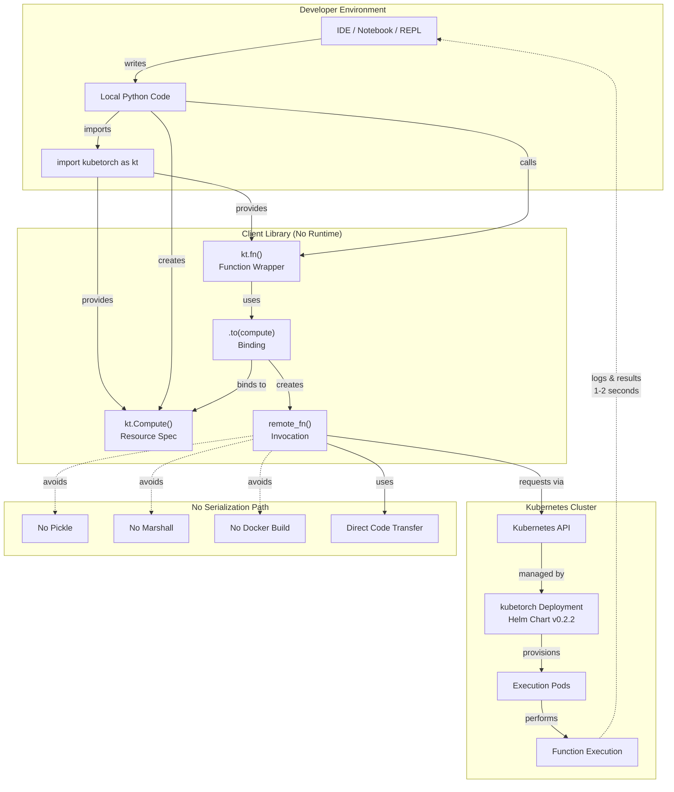
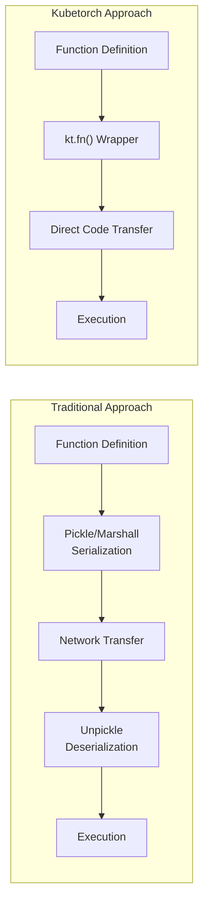
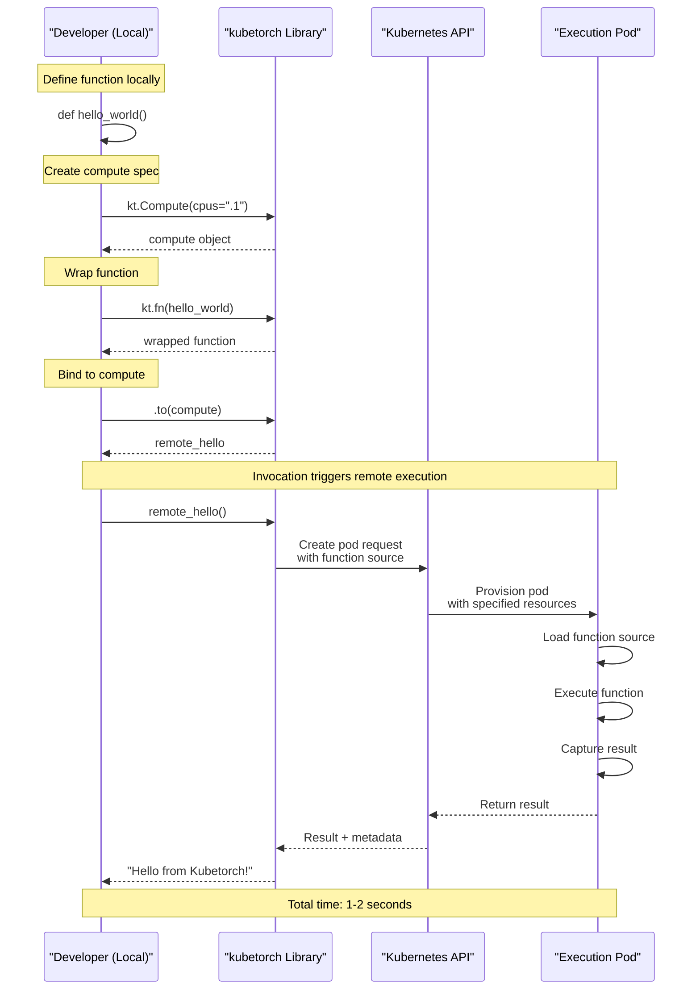
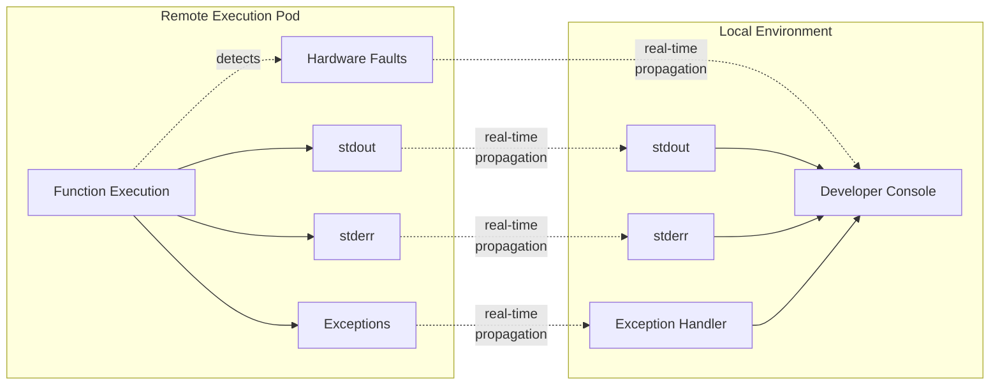

<!-- source: DeepWiki mcp.deepwiki.com · repo run-house/kubetorch · page 2.3 Serverless Execution Model · fetched 2026-10-21 -->

# Serverless Execution Model

<details>
<summary>Relevant source files</summary>

The following files were used as context for generating this wiki page:

- [README.md](README.md)

</details>


## Purpose and Scope

This page describes Kubetorch's serverless execution paradigm, explaining how it abstracts Kubernetes complexity to provide a simple local-to-remote execution model. It covers the architectural decisions that enable direct cluster access from any Python environment without requiring local daemons or code serialization.

For details on wrapping functions for remote execution, see [Functions (kt.fn)](#2.1). For resource specification mechanisms, see [Compute Resources (kt.Compute)](#2.2). For the complete client-server split and communication architecture, see [Client-Server Architecture](#2.4).

## The Serverless Paradigm

Kubetorch implements a "serverless" model where developers interact with cluster compute as if it were a local resource, without managing servers, containers, or Kubernetes manifests. The term "serverless" in Kubetorch refers to three key architectural properties:

1. **No Local Runtime**: No daemon process, local server, or background service runs on the developer's machine
2. **No Code Serialization**: Functions are executed remotely without explicit pickling, marshalling, or code packaging by the developer
3. **Direct Kubernetes Access**: Cluster resources are accessible directly from any Python environment (IDEs, notebooks, REPL, CI/CD, production)

This design enables developers to treat a Kubernetes cluster as if it were a local process pool, with the same simplicity but with massive scale and compute power.

**Sources:** [README.md:3-9]()

## Serverless Execution Components



**Diagram: Serverless Execution Components and Data Flow**

This diagram shows the serverless architecture from developer code to cluster execution. Key elements:

- **Client Library Components**: `kt.fn()`, `kt.Compute()`, and `.to()` method provide the complete execution interface
- **No Local Runtime**: No daemon or background process exists between the IDE and cluster
- **No Serialization Layer**: Direct code transfer mechanism bypasses pickle, marshall, and Docker build steps
- **Direct Kubernetes Integration**: Client communicates directly with Kubernetes API via the deployed Helm chart

**Sources:** [README.md:1-29]()

## No Local Runtime Architecture

Traditional distributed computing frameworks (Ray, Dask, Celery) require a local daemon or server process that manages job submission, monitors execution, and coordinates resources. Kubetorch eliminates this requirement entirely.

### Architecture Comparison

| Aspect | Traditional Frameworks | Kubetorch Serverless |
|--------|----------------------|---------------------|
| **Local Process** | Daemon required (e.g., `ray start`) | None - pure Python library |
| **Background Services** | Persistent local server | No local services |
| **Resource Management** | Local scheduler coordinates | Direct Kubernetes API calls |
| **Connection Maintenance** | Long-lived connections | On-demand API requests |
| **Environment Constraints** | Must run daemon-compatible OS | Any Python environment |

### How It Works Without a Runtime

Kubetorch achieves runtime-less execution through:

1. **Direct Kubernetes API Communication**: The client library communicates directly with the Kubernetes API server, bypassing any local intermediary
2. **Stateless Client Design**: Each function invocation is self-contained; no persistent client state is maintained
3. **Server-Side Execution Management**: All scheduling, monitoring, and resource coordination happens server-side in the Kubernetes cluster
4. **Standard Python Imports**: The library is loaded as a standard Python module, requiring no initialization or startup sequence

This architecture enables developers to use Kubetorch from:
- IDEs (VSCode, PyCharm, Jupyter)
- Python REPL sessions
- CI/CD pipelines (GitHub Actions, Jenkins)
- Production applications
- Docker containers
- Serverless functions (Lambda, Cloud Functions)

**Sources:** [README.md:9]()

## No Code Serialization Model

Most distributed computing systems require explicit code serialization (pickling, marshalling, or containerization) before remote execution. Kubetorch avoids this through a direct code transfer mechanism.

### Serialization Comparison



**Diagram: Code Transfer Mechanisms**

### How Direct Transfer Works

When a function is wrapped with `kt.fn()` and invoked remotely:

1. **Function Reference Capture**: `kt.fn(hello_world)` captures a reference to the local function object [README.md:24]()
2. **Binding Phase**: `.to(compute)` associates the function with resource requirements without moving code [README.md:24]()
3. **Invocation Time Transfer**: Upon calling `remote_hello()`, the function's source code is extracted and transferred to the cluster [README.md:27]()
4. **Remote Execution Environment**: The cluster receives the raw Python source and executes it in a fresh interpreter

This approach provides several advantages:
- **No Pickling Overhead**: Avoids serialization size limits and compatibility issues
- **No Dependency on Serialization Format**: Functions work regardless of Python version differences
- **No Pre-Deployment Required**: Code doesn't need to be containerized or deployed in advance
- **Interactive Development Friendly**: Changes to local functions are immediately reflected remotely

**Sources:** [README.md:9](), [README.md:13-29]()

## Local-to-Remote Execution Flow



**Diagram: Complete Local-to-Remote Execution Sequence**

The execution flow demonstrates the serverless model:

1. **Local Definition Phase** (lines 16-24 in Hello World example): Developer defines function, compute spec, and performs wrapping - all local operations
2. **Invocation Phase** (line 27): Single function call `remote_hello()` triggers entire remote execution pipeline
3. **Cluster Execution Phase**: Kubernetes API provisions pod, executes function, captures result
4. **Result Return Phase**: Result propagates back through API to client library to developer
5. **Time Characteristics**: Complete round-trip completes in 1-2 seconds [README.md:7]()

**Sources:** [README.md:13-29]()

## Kubernetes Abstraction Layer

The serverless model completely abstracts Kubernetes concepts that developers would normally need to understand and manage.

### Abstracted Kubernetes Concepts

| Kubernetes Concept | Developer Sees | Kubetorch Handles |
|--------------------|---------------|-------------------|
| **Pod Specifications** | `kt.Compute(cpus=".1")` | Pod manifest generation |
| **Container Images** | Local function definition | Image selection and pulling |
| **Deployments** | `kt.fn()` wrapper | Deployment creation |
| **Services** | Direct function calls | Service routing |
| **ConfigMaps** | Function parameters | Configuration injection |
| **Resource Limits** | Simple CPU/memory specs | LimitRange and ResourceQuota |
| **Namespaces** | (implicit) | `kubetorch` namespace [README.md:50]() |
| **YAML Manifests** | None | Complete manifest generation |

### What Developers Don't Need to Know

The serverless abstraction eliminates the need for developers to understand:

- **kubectl commands**: No `kubectl apply`, `kubectl get pods`, `kubectl logs` required
- **Container registries**: No Docker Hub, ECR, or GCR configuration
- **Helm charts**: Users never interact with Helm except for initial cluster setup
- **Kubernetes networking**: No LoadBalancers, Ingress, or Service configuration
- **RBAC policies**: No Role or RoleBinding management
- **Pod lifecycle**: No manual monitoring of Pending → Running → Completed states

Instead, developers work with three simple Python constructs:
1. `kt.Compute()` - resource specification
2. `kt.fn()` - function wrapping
3. `.to()` and function invocation - execution

**Sources:** [README.md:13-29](), [README.md:45-55]()

## Process Pool Mental Model

Kubetorch presents a mental model similar to Python's `multiprocessing.Pool` or `concurrent.futures.ProcessPoolExecutor`, making cluster compute feel like local concurrency.

### Code Comparison

```python
# Traditional multiprocessing.Pool
from multiprocessing import Pool

def compute_task(x):
    return x ** 2

if __name__ == "__main__":
    with Pool(processes=4) as pool:
        results = pool.map(compute_task, range(10))
    print(results)

# Kubetorch equivalent
import kubetorch as kt

def compute_task(x):
    return x ** 2

if __name__ == "__main__":
    compute = kt.Compute(cpus="4")
    remote_task = kt.fn(compute_task).to(compute)
    results = [remote_task(i) for i in range(10)]
    print(results)
```

### Mental Model Mapping

| Local Concept | Kubetorch Equivalent | Actual Implementation |
|--------------|---------------------|----------------------|
| Process pool | `kt.Compute()` | Kubernetes pod pool |
| Process count | `cpus` parameter | CPU resource request |
| Task submission | `remote_fn()` call | Pod provisioning + execution |
| Result retrieval | Function return value | API response |
| Pool cleanup | (automatic) | Automatic pod termination |

### Scale Transparency

The process pool model scales transparently:

- **Small tasks**: `kt.Compute(cpus=".1")` - fractional CPU for lightweight workloads [README.md:21]()
- **Medium tasks**: `kt.Compute(cpus="4", memory="16Gi")` - multi-core with significant memory
- **Large tasks**: `kt.Compute(gpus="A100", num_gpus=8)` - multi-GPU training workloads

Developers use the same API regardless of scale, with Kubernetes handling the underlying complexity.

**Sources:** [README.md:13-29]()

## Real-Time Feedback Loop

The serverless model includes real-time bidirectional communication between local environment and remote execution.

### Feedback Mechanisms



**Diagram: Real-Time Feedback Propagation**

The serverless model provides immediate feedback:

- **Logs**: Stdout/stderr from remote execution stream to local console in real-time [README.md:7]()
- **Exceptions**: Python exceptions raised remotely propagate to local exception handlers [README.md:7]()
- **Hardware Faults**: GPU errors, OOM conditions, node failures are detected and reported [README.md:7]()
- **Execution Status**: Progress updates, completion notifications arrive without polling

This eliminates the traditional workflow of:
1. Submit job to cluster
2. Wait for completion
3. SSH into node or use `kubectl logs`
4. Manually inspect output

Instead, remote execution feels indistinguishable from local execution in terms of observability.

**Sources:** [README.md:7-8]()

## Performance Characteristics

The serverless execution model delivers specific performance metrics:

### Iteration Speed

| Operation | Time | Context |
|-----------|------|---------|
| Function invocation to result | 1-2 seconds | Simple compute tasks [README.md:7]() |
| Code change to execution | 1-2 seconds | No rebuild/redeploy cycle |
| Traditional K8s workflow | 10+ minutes | Includes containerization, deployment, monitoring |
| **Speedup** | **100x faster** | For complex ML applications [README.md:33]() |

### Why It's Fast

1. **No Container Build**: Functions execute without building Docker images
2. **No Registry Push**: No need to push/pull from container registry
3. **No Manifest Apply**: No `kubectl apply` workflow
4. **Immediate Code Transfer**: Source code moves directly to execution environment
5. **Pre-Warmed Infrastructure**: Kubernetes deployment is already running

The 1-2 second iteration time includes:
- Code transfer from local to cluster
- Pod provisioning (or reuse)
- Function execution
- Result return
- Log streaming

This enables interactive development workflows where cluster compute feels as responsive as local execution.

**Sources:** [README.md:7](), [README.md:33]()

## Serverless Platform Option

Kubetorch also offers a fully managed serverless platform that eliminates the need for Kubernetes cluster management entirely.

### Deployment Models

| Model | User Manages | Kubetorch Provides |
|-------|-------------|-------------------|
| **Self-Hosted** | Kubernetes cluster, Helm deployment | Client library, server deployment |
| **Serverless Platform** | Nothing - just Python code | Complete infrastructure |

For information on the managed serverless platform option, see [Kubetorch Serverless](#7.5). Contact information is available at [README.md:62]().

**Sources:** [README.md:60-62]()

---

