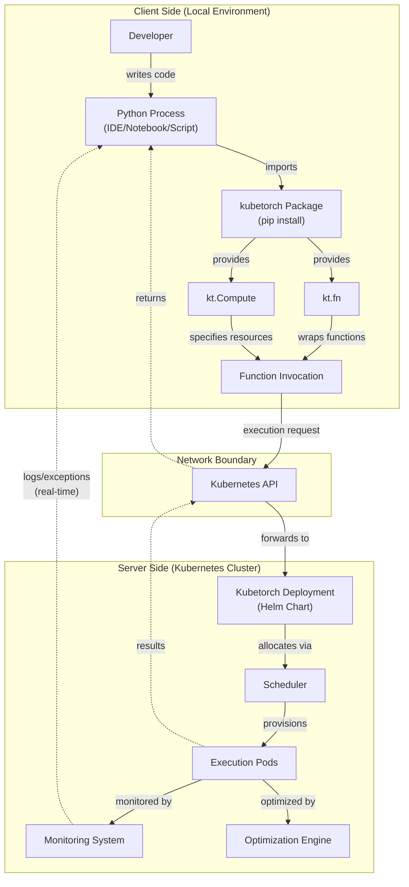
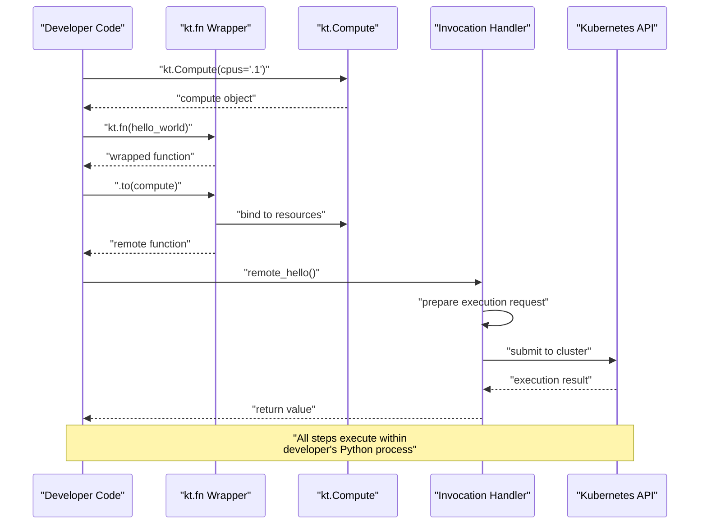
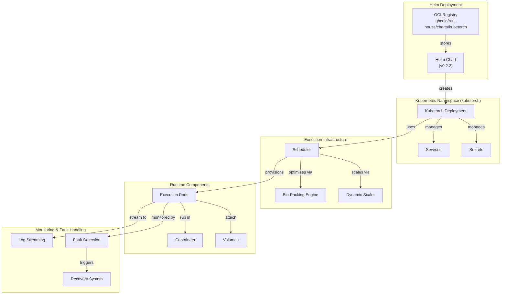
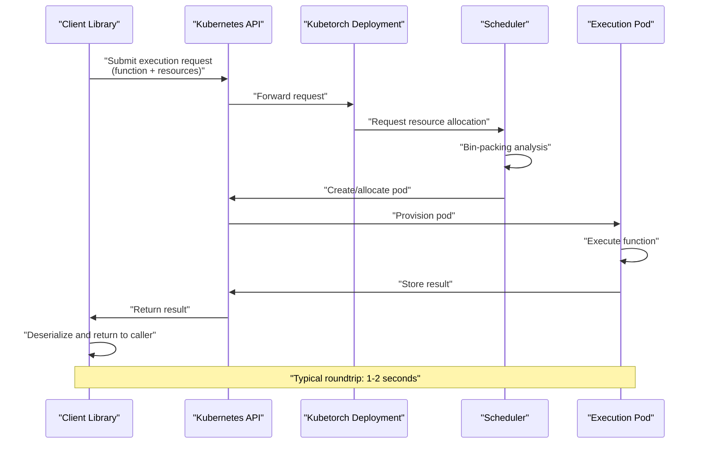
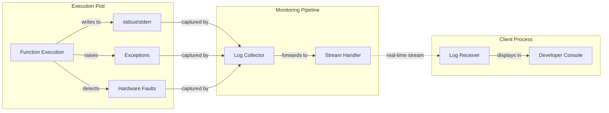
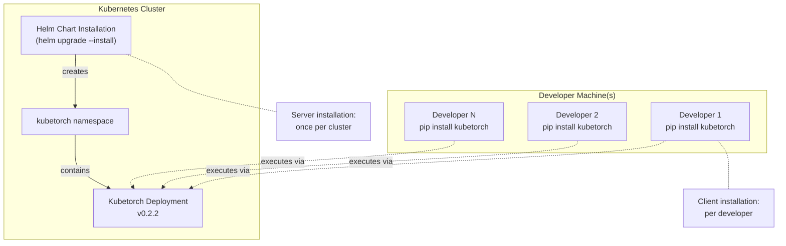
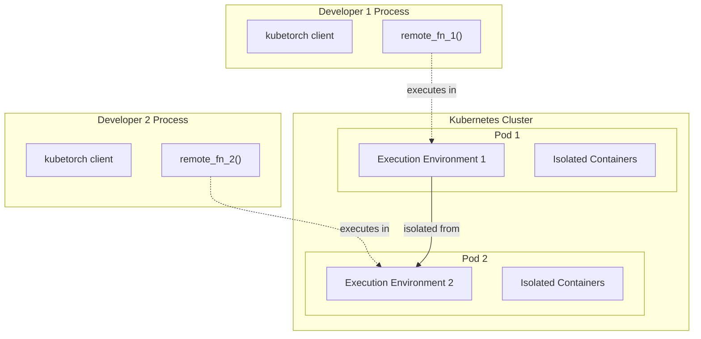

<!-- source: DeepWiki mcp.deepwiki.com · repo run-house/kubetorch · page 2.4 Client-Server Architecture · fetched 2026-10-21 -->

# Client-Server Architecture

Relevant source files

The following files were used as context for generating this wiki page:

- [README.md](README.md)

## Purpose and Scope

This page documents the architectural split between Kubetorch's Python client (running in the developer's local environment) and its Kubernetes deployment (running on the remote cluster). It covers the responsibilities of each component, their communication mechanisms, and the "no local runtime" design principle.

For implementation details of the execution lifecycle, see [Execution Lifecycle](#4.2). For deployment procedures, see [Kubernetes Deployment](#7.1) and [Helm Installation](#7.2).

---

## Overview

Kubetorch employs a client-server architecture that cleanly separates the developer's local Python environment from the remote Kubernetes execution environment. This separation enables the system to provide cluster-scale compute power without requiring local daemons, containers, or code serialization infrastructure.

### Architectural Split

**Sources:** [README.md:1-75]()

---

## Client-Side Architecture

The client side consists of a lightweight Python library with no local runtime dependencies. It runs within the developer's existing Python process, whether that's an IDE, Jupyter notebook, REPL, or production application.

### Components and Responsibilities

| Component | Location | Responsibilities |
|-----------|----------|------------------|
| `kt.fn` | [README.md:24]() | Wraps Python functions for remote execution |
| `kt.Compute` | [README.md:21]() | Specifies resource requirements (CPUs, memory, GPUs) |
| `.to()` method | [README.md:24]() | Binds functions to compute resources |
| Invocation handler | Client library | Serializes invocation, sends to cluster, receives results |

### No Local Runtime Design

The client has **no local daemon, server process, or container runtime**. This design choice has several architectural implications:

1. **Process Integration**: The client library runs entirely within the developer's Python process. There is no separate service to manage, start, or stop.

2. **No Code Serialization**: Functions are not pickled or serialized by the developer. The wrapping mechanism in `kt.fn` handles code transmission without explicit developer action.

3. **Lightweight Footprint**: The client package is a pure Python dependency installed via `pip install kubetorch[client]` [README.md:42]().

4. **Universal Compatibility**: The same client library works identically across IDEs, notebooks, scripts, and production environments because it imposes no runtime requirements.

### Client-Side Data Flow

**Sources:** [README.md:13-29]()

---

## Server-Side Architecture

The server side is a Kubernetes deployment that manages execution, resource allocation, monitoring, and optimization. It is installed via Helm and runs independently of client versions.

### Deployment Structure

**Sources:** [README.md:45-55]()

### Server-Side Responsibilities

| Component | Responsibility |
|-----------|----------------|
| **Scheduler** | Receives execution requests, allocates pods |
| **Bin-Packing Engine** | Optimizes resource utilization across nodes |
| **Dynamic Scaler** | Adjusts cluster capacity based on demand |
| **Execution Pods** | Run developer functions in isolated environments |
| **Monitoring System** | Captures logs, metrics, and fault signals |
| **Fault Handler** | Detects failures, adjusts resources, retries execution |

### Resource Management Layer

The server implements several optimization systems that operate transparently:

- **Bin-Packing**: Multiple functions with compatible resource requirements are co-located on single nodes to maximize utilization
- **Dynamic Scaling**: Cluster capacity adjusts based on request volume and predicted demand
- **Resource Right-Sizing**: Historical execution data informs future resource allocations
- **Fault-Driven Optimization**: Failures trigger resource adjustments (e.g., increase memory for OOM errors)

**Sources:** [README.md:34-35]()

---

## Communication Protocol

Client and server communicate through the Kubernetes API, with no direct network connection between the developer's machine and execution pods.

### Request-Response Flow

**Sources:** [README.md:7]()

### Real-Time Log Propagation

A distinguishing architectural feature is the real-time streaming of logs and exceptions from execution pods back to the client:

This mechanism enables developers to see remote execution output immediately in their local environment, as if the function were running locally.

**Sources:** [README.md:7]()

---

## Independence and Versioning

The client-server architecture enables independent evolution of the two components:

### Distribution Channels

| Component | Distribution | Installation Command | Version |
|-----------|-------------|---------------------|---------|
| **Client** | PyPI | `pip install kubetorch[client]` | Specified by pip |
| **Server** | OCI Registry | `helm upgrade --install ... --version 0.2.2` | Specified by Helm |

**Sources:** [README.md:42](), [README.md:48-50]()

### Version Compatibility

The server deployment [README.md:50]() is currently pinned to version `0.2.2`. Client and server communicate through a stable Kubernetes API contract, allowing:

- **Client updates** without redeploying the cluster
- **Server updates** without requiring client reinstallation (within API compatibility)
- **Multiple client versions** connecting to the same cluster deployment

### Deployment Topology

The typical deployment topology separates installation concerns:

**Implications:**
- A single cluster deployment serves multiple developers
- Client installation is per-developer (local pip install)
- Server installation is once per cluster (Helm deploy)
- No coordination required between client and server installations beyond API compatibility

**Sources:** [README.md:42](), [README.md:47-55]()

---

## Execution Isolation

While the client and server are architecturally separated, execution isolation is maintained at the pod level:

### Isolation Boundaries

Each function execution receives its own isolated pod environment, ensuring:
- **Resource isolation**: One function's memory/CPU usage doesn't affect others
- **Security isolation**: Functions run in separate Kubernetes pods with their own security contexts
- **Failure isolation**: One function's crash doesn't impact other executions

**Sources:** [README.md:24-28]()

---

## Summary

The client-server architecture achieves Kubetorch's design goals through clear separation of concerns:

| Aspect | Client Responsibility | Server Responsibility |
|--------|----------------------|----------------------|
| **Runtime** | None (runs in existing Python process) | Manages Kubernetes pods and containers |
| **Code** | Function wrapping via `kt.fn` | Function execution in isolated environments |
| **Resources** | Specification via `kt.Compute` | Allocation, optimization, and scheduling |
| **Results** | Receiving and displaying to developer | Computing and streaming back |
| **Logs** | Displaying in local console | Capturing and streaming in real-time |
| **Faults** | Exception propagation to developer | Detection, recovery, and resource adjustment |

This architecture enables the "1-2 second iteration" [README.md:7]() by eliminating container build steps, manual deployment workflows, and complex orchestration that developers would otherwise manage manually.

**Sources:** [README.md:1-75]()

---

