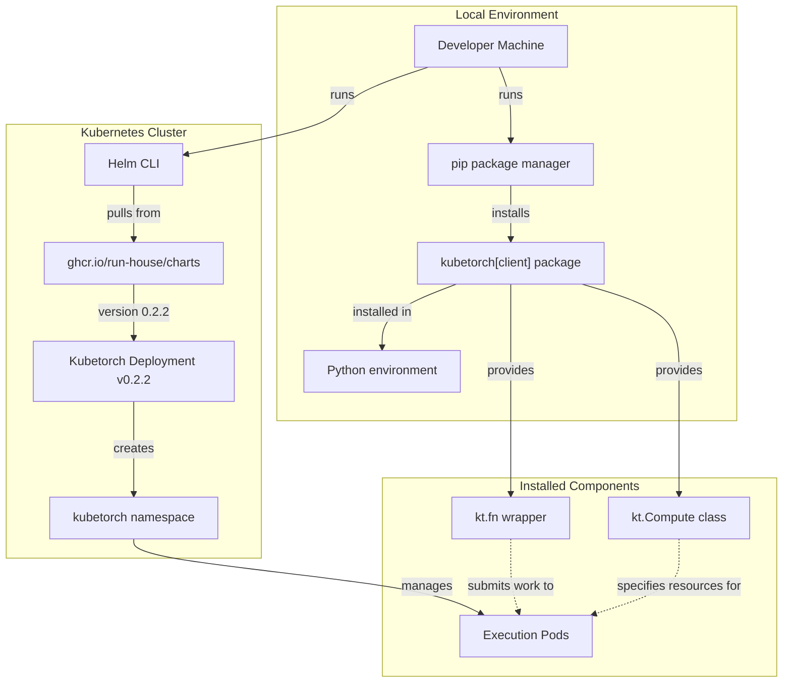
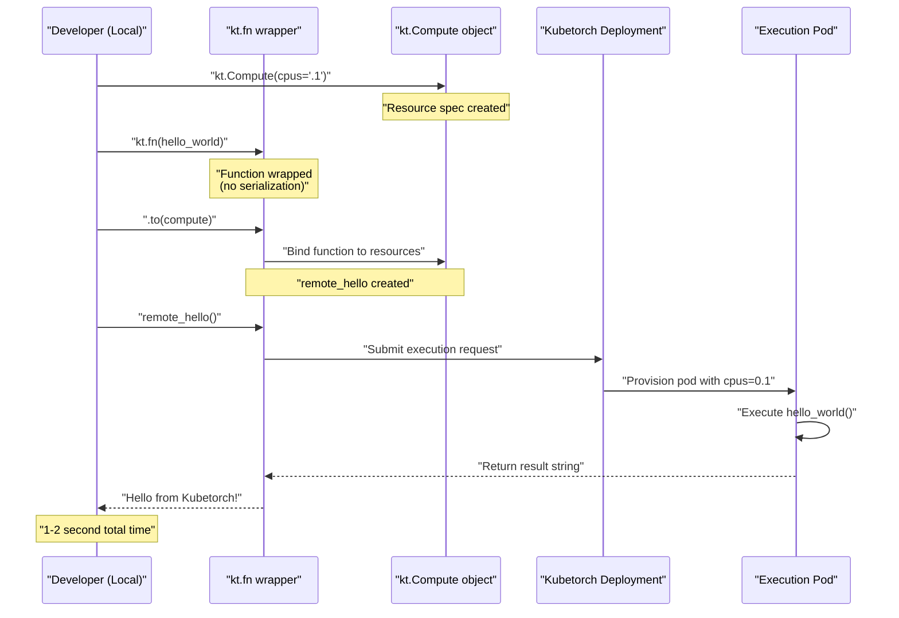

<!-- source: DeepWiki mcp.deepwiki.com · repo run-house/kubetorch · page 3 Getting Started · fetched 2026-10-21 -->

# Getting Started

<details>
<summary>Relevant source files</summary>

The following files were used as context for generating this wiki page:

- [README.md](README.md)

</details>


This document provides step-by-step instructions for installing Kubetorch and running your first workloads. It covers client installation, server deployment, and walks through the Hello World example to demonstrate core functionality.

For conceptual information about `kt.fn` and `kt.Compute`, see [Core Concepts](#2). For detailed API documentation, see [API Reference](#5). For production deployment configurations, see [Deployment and Operations](#7).

## Prerequisites

Before installing Kubetorch, ensure you have:

- **Python**: Version 3.8 or higher
- **pip**: Python package manager
- **Kubernetes Cluster**: Access to a running Kubernetes cluster with `kubectl` configured
- **Helm**: Version 3.x installed (for server deployment)
- **Cluster Permissions**: Ability to create namespaces and deploy applications

## Installation Overview

Kubetorch uses a split distribution model with two independent components:

| Component | Distribution | Installation Method | Purpose |
|-----------|--------------|---------------------|---------|
| Client | PyPI | `pip install` | Local Python library providing `kt.fn` and `kt.Compute` |
| Server | OCI Registry | `helm upgrade --install` | Kubernetes deployment handling remote execution |



**Installation Flow Diagram**: Shows the two-part installation process with client-side and server-side components

**Sources:** [README.md:39-55]()

## Client Installation

Install the Python client library using pip:

```bash
pip install "kubetorch[client]"
```

This installs the `kubetorch` package with client-only dependencies. The `[client]` extra ensures you get the minimal installation without server-side dependencies.

After installation, verify by importing:

```python
import kubetorch as kt
print(kt.__version__)
```

The client provides two primary classes:
- `kt.fn`: Function wrapper for remote execution
- `kt.Compute`: Resource specification class

**Sources:** [README.md:39-43]()

## Server Deployment

Deploy the Kubetorch server to your Kubernetes cluster using Helm. Two installation methods are available:

### Option 1: Direct OCI Install

Install directly from the OCI registry in a single command:

```bash
helm upgrade --install kubetorch oci://ghcr.io/run-house/charts/kubetorch \
  --version 0.2.2 -n kubetorch --create-namespace
```

Parameters:
- `--version 0.2.2`: Specifies the chart version
- `-n kubetorch`: Creates and uses the `kubetorch` namespace
- `--create-namespace`: Automatically creates the namespace if it doesn't exist

### Option 2: Local Chart Install

Download the chart locally before installation:

```bash
# Pull chart from OCI registry
helm pull oci://ghcr.io/run-house/charts/kubetorch --version 0.2.2 --untar

# Install from local chart
helm upgrade --install kubetorch ./kubetorch -n kubetorch --create-namespace
```

This method is useful for:
- Reviewing chart contents before deployment
- Customizing values files
- Offline or air-gapped environments

Verify the deployment:

```bash
kubectl get pods -n kubetorch
```

Expected output shows running pods in the `kubetorch` namespace.

**Sources:** [README.md:45-55]()

## Hello World Example

The Hello World example demonstrates the complete workflow from function definition to remote execution.

### Step-by-Step Walkthrough

```python
import kubetorch as kt

def hello_world():
    return "Hello from Kubetorch!"

if __name__ == "__main__":
    # Step 1: Define compute resources
    compute = kt.Compute(cpus=".1")
    
    # Step 2: Wrap function and bind to compute
    remote_hello = kt.fn(hello_world).to(compute)
    
    # Step 3: Execute remotely
    result = remote_hello()
    print(result)  # "Hello from Kubetorch!"
```

### Execution Flow



**Hello World Execution Sequence**: Shows the interaction between local code entities (`kt.fn`, `kt.Compute`) and remote execution components

### Code Entity Breakdown

| Code Entity | Type | Location | Purpose |
|-------------|------|----------|---------|
| `hello_world` | Function | User code | The function to execute remotely |
| `kt.Compute` | Class | kubetorch.Compute | Defines resource requirements |
| `cpus=".1"` | Parameter | kt.Compute constructor | Specifies 0.1 CPU cores |
| `kt.fn` | Function | kubetorch.fn | Wraps local function for remote execution |
| `.to()` | Method | kt.fn result | Binds wrapped function to compute resources |
| `remote_hello` | Variable | User code | Callable reference to remote function |
| `remote_hello()` | Call | User code | Triggers remote execution |

**Sources:** [README.md:11-29]()

## Quick Start Guide

This section provides a condensed workflow for getting a simple workload running end-to-end.

### 5-Minute Quick Start

```mermaid
graph LR
    START["Start"] --> INSTALL["Install Client<br/>pip install kubetorch[client]"]
    INSTALL --> DEPLOY["Deploy Server<br/>helm upgrade --install"]
    DEPLOY --> VERIFY["Verify Deployment<br/>kubectl get pods -n kubetorch"]
    VERIFY --> CODE["Write Function<br/>def my_function()"]
    CODE --> WRAP["Wrap with kt.fn<br/>remote_fn = kt.fn(my_function)"]
    WRAP --> COMPUTE["Define Resources<br/>compute = kt.Compute(cpus='1')"]
    COMPUTE --> BIND["Bind to Compute<br/>.to(compute)"]
    BIND --> EXECUTE["Execute<br/>remote_fn()"]
    EXECUTE --> RESULT["Receive Result<br/>1-2 seconds"]
    RESULT --> END["Done"]
    
    style INSTALL fill:#f9f9f9
    style DEPLOY fill:#f9f9f9
    style WRAP fill:#f9f9f9
    style BIND fill:#f9f9f9
    style EXECUTE fill:#f9f9f9
```



**Quick Start Workflow**: End-to-end steps from installation to first result

### Complete Minimal Example

```python
# 1. Import kubetorch
import kubetorch as kt

# 2. Define a function
def add_numbers(a, b):
    return a + b

# 3. Create compute specification
compute = kt.Compute(cpus="1", memory="2Gi")

# 4. Wrap and bind function
remote_add = kt.fn(add_numbers).to(compute)

# 5. Execute remotely
result = remote_add(5, 3)
print(f"Result: {result}")  # Result: 8
```

### Common Resource Specifications

| Use Case | Compute Specification | Example Code |
|----------|----------------------|--------------|
| Small task | 0.1 CPU | `kt.Compute(cpus=".1")` |
| Medium task | 4 CPUs, 16GB RAM | `kt.Compute(cpus="4", memory="16Gi")` |
| GPU workload | 1 GPU, 8 CPUs | `kt.Compute(gpus="1", cpus="8")` |

### Verification Steps

After completing the quick start:

1. **Check pod status:**
   ```bash
   kubectl get pods -n kubetorch
   ```

2. **View execution logs:**
   ```bash
   kubectl logs -n kubetorch -l app=kubetorch --tail=50
   ```

3. **Test with different resource sizes:**
   ```python
   # Small
   small_compute = kt.Compute(cpus=".1")
   
   # Medium
   medium_compute = kt.Compute(cpus="4", memory="16Gi")
   
   # Apply to same function
   small_fn = kt.fn(add_numbers).to(small_compute)
   medium_fn = kt.fn(add_numbers).to(medium_compute)
   ```

**Sources:** [README.md:11-29]()

## Next Steps

After completing the Getting Started guide:

- **Learn Core Concepts**: Read about [kt.fn](#2.1) and [kt.Compute](#2.2) in detail
- **Explore Advanced Usage**: See [Multi-Environment Integration](#6.1) and [Async Execution Patterns](#6.2)
- **Review Examples**: Check [external examples](https://www.run.house/examples) for real-world patterns
- **Try Kubetorch Serverless**: Contact via [email](mailto:hello@run.house) or [Slack](https://join.slack.com/t/kubetorch/shared_invite/zt-3g76q5i4j-uP60AdydxnAmjGVAQhtALA) to use the managed platform

**Sources:** [README.md:60-68]()

## Troubleshooting Installation

### Client Installation Issues

If `pip install "kubetorch[client]"` fails:
- Verify Python version: `python --version` (requires 3.8+)
- Update pip: `pip install --upgrade pip`
- Check network connectivity to PyPI

### Server Deployment Issues

If Helm installation fails:
- Verify Helm version: `helm version` (requires 3.x)
- Check cluster connectivity: `kubectl cluster-info`
- Ensure namespace permissions: `kubectl auth can-i create namespace`
- Verify OCI registry access: `helm pull oci://ghcr.io/run-house/charts/kubetorch --version 0.2.2`

### Execution Issues

If `remote_hello()` fails:
- Verify server deployment: `kubectl get pods -n kubetorch`
- Check client-server version compatibility
- Review pod logs: `kubectl logs -n kubetorch -l app=kubetorch`

For detailed troubleshooting, see [Troubleshooting](#9) and [Common Issues](#9.1).

**Sources:** [README.md:1-75]()

---

