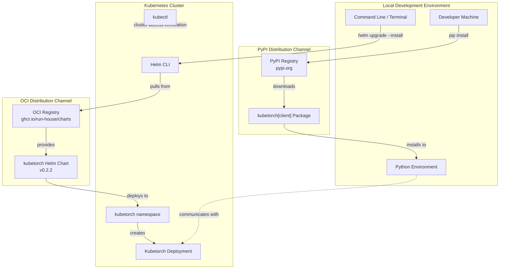
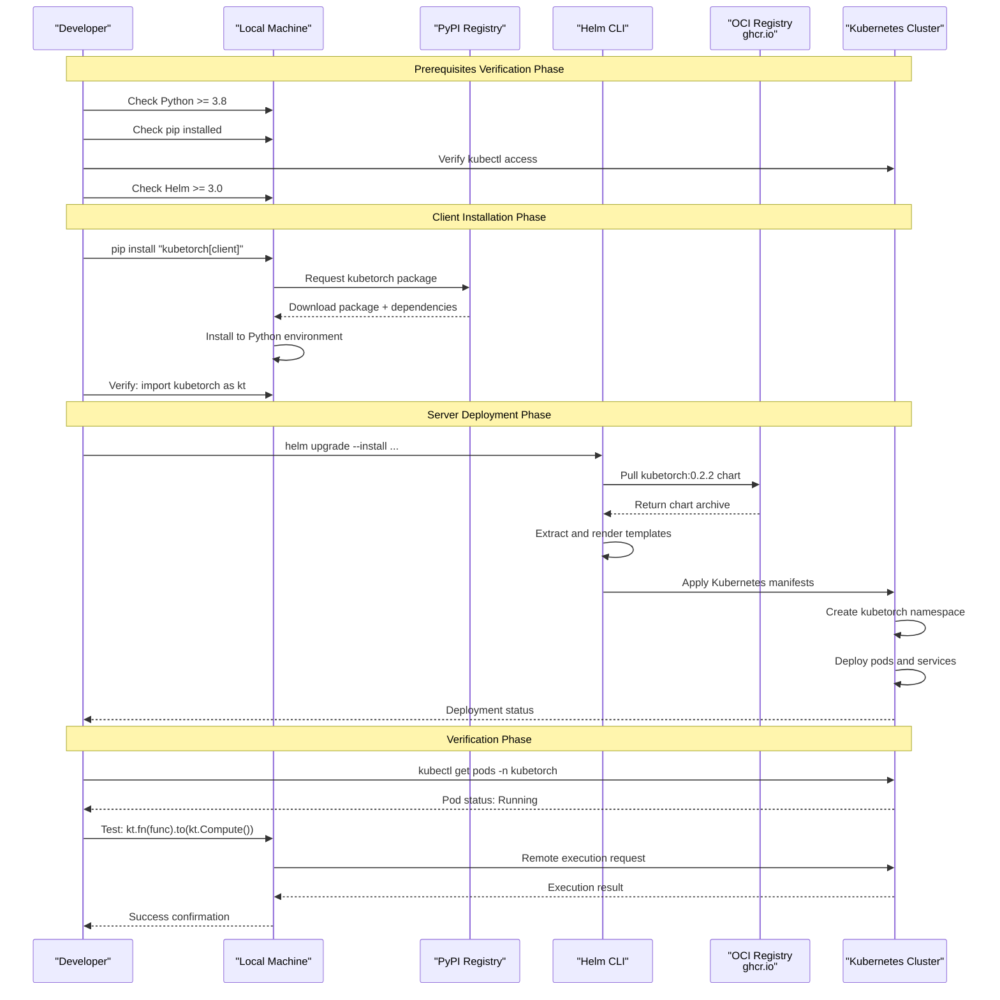
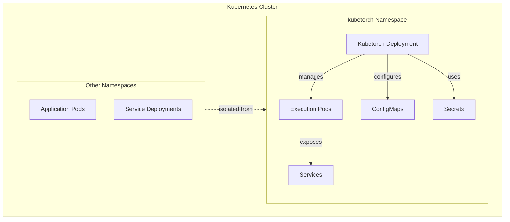

<!-- source: DeepWiki mcp.deepwiki.com · repo run-house/kubetorch · page 3.1 Installation · fetched 2026-10-21 -->

# Installation

<details>
<summary>Relevant source files</summary>

The following files were used as context for generating this wiki page:

- [README.md](README.md)

</details>


This page documents the installation process for Kubetorch's client and server components. Kubetorch uses a split distribution model: the Python client is installed locally via pip, while the server is deployed to a Kubernetes cluster using Helm charts. For information about configuring and operating the deployed server, see [Kubernetes Deployment](#7.1) and [Helm Installation](#7.2).

---

## Prerequisites

Before installing Kubetorch, ensure the following requirements are met:

### Client Requirements

| Component | Requirement | Notes |
|-----------|-------------|-------|
| Python | 3.8+ | Required for kubetorch client library |
| pip | Latest stable | Package manager for Python dependencies |
| Network Access | HTTPS to PyPI | For downloading kubetorch package |

### Server Requirements

| Component | Requirement | Notes |
|-----------|-------------|-------|
| Kubernetes Cluster | 1.19+ | Target cluster for deployment |
| Helm | 3.0+ | Package manager for Kubernetes |
| kubectl | Matching cluster version | Kubernetes CLI tool |
| Cluster Access | Admin or namespace-level | Permissions to create namespaces and deployments |
| Network Access | HTTPS to ghcr.io | For pulling OCI charts |

**Sources:** [README.md:39-55]()

---

## Installation Architecture

The installation process involves two independent distribution channels that must both be configured for Kubetorch to function:



**Sources:** [README.md:39-55]()

---

## Client Installation

The Kubetorch Python client is distributed via PyPI and should be installed in your local development environment.

### Standard Installation

```bash
pip install "kubetorch[client]"
```

The `[client]` extra installs the minimal client dependencies required for local development. This installation provides:

- The `kubetorch` Python package importable as `import kubetorch as kt`
- Client-side function wrapping via `kt.fn`
- Resource specification via `kt.Compute`
- Communication primitives for remote execution

### Installation Verification

Verify the client installation by checking the installed version:

```python
import kubetorch as kt
print(kt.__version__)
```

If the import succeeds without errors, the client is correctly installed.

### Package Structure

The installed client package provides the following core interfaces:

| Module/Function | Purpose | Reference |
|-----------------|---------|-----------|
| `kt.fn` | Function wrapper for remote execution | [kt.fn API](#5.1) |
| `kt.Compute` | Resource specification class | [kt.Compute API](#5.2) |
| CLI commands | Operational utilities (e.g., `kt secrets delete`) | [CLI Commands](#5.3) |

**Sources:** [README.md:39-43]()

---

## Server Deployment

The Kubetorch server must be deployed to a Kubernetes cluster using Helm. Two installation methods are supported, both producing identical deployments.

### Deployment Methods Comparison

| Method | Command Count | Use Case | Offline Support |
|--------|---------------|----------|-----------------|
| Direct OCI Install | 1 | Standard deployments, CI/CD pipelines | No |
| Local Chart Install | 2 | Customization, security review, air-gapped environments | Yes |

### Method 1: Direct OCI Install

This method installs directly from the OCI registry in a single command:

```bash
helm upgrade --install kubetorch oci://ghcr.io/run-house/charts/kubetorch \
  --version 0.2.2 -n kubetorch --create-namespace
```

**Command breakdown:**
- `helm upgrade --install`: Install or upgrade if already exists
- `kubetorch`: Release name in the cluster
- `oci://ghcr.io/run-house/charts/kubetorch`: OCI registry path
- `--version 0.2.2`: Pin to specific chart version
- `-n kubetorch`: Target namespace for deployment
- `--create-namespace`: Create namespace if it doesn't exist

### Method 2: Local Chart Install

This method downloads the chart locally before installation, enabling inspection or customization:

```bash
# Step 1: Download and extract chart
helm pull oci://ghcr.io/run-house/charts/kubetorch --version 0.2.2 --untar

# Step 2: Install from local chart directory
helm upgrade --install kubetorch ./kubetorch -n kubetorch --create-namespace
```

After Step 1, the chart is extracted to `./kubetorch/` directory, where you can:
- Inspect `values.yaml` for configuration options
- Review templates in `templates/` directory
- Modify default configurations before installation
- Version control the chart for reproducible deployments

### Deployment Verification

After deployment, verify the server is running:

```bash
# Check deployment status
kubectl get deployment -n kubetorch

# Check pod status
kubectl get pods -n kubetorch

# Check service endpoints
kubectl get services -n kubetorch
```

Expected output should show pods in `Running` state and services with allocated cluster IPs.

**Sources:** [README.md:45-55]()

---

## Installation Workflow

The complete installation process follows this sequence:



**Sources:** [README.md:39-55]()

---

## Version Requirements

### Current Version

| Component | Version | Distribution |
|-----------|---------|--------------|
| Helm Chart | 0.2.2 | ghcr.io/run-house/charts/kubetorch |
| Python Client | Latest | PyPI (kubetorch[client]) |

### Version Compatibility

The client and server versions are not strictly coupled but should be kept reasonably synchronized:

- **Client ahead of server**: Generally safe; new client features may not work with older servers
- **Server ahead of client**: Client may miss new server capabilities
- **Recommended practice**: Update both components together during planned maintenance windows

To check deployed server version:

```bash
helm list -n kubetorch
```

**Sources:** [README.md:48-54]()

---

## Namespace Configuration

Kubetorch deploys to a dedicated `kubetorch` namespace by default. This namespace isolation provides:



**Namespace benefits:**
- **Resource isolation**: Kubetorch resources are separate from other cluster workloads
- **Access control**: RBAC policies can be scoped to the namespace
- **Resource quotas**: Cluster admins can limit Kubetorch resource consumption
- **Cleanup simplification**: Delete namespace to remove all Kubetorch resources

To use a different namespace, replace `kubetorch` in the Helm commands:

```bash
helm upgrade --install kubetorch oci://ghcr.io/run-house/charts/kubetorch \
  --version 0.2.2 -n my-custom-namespace --create-namespace
```

**Sources:** [README.md:48-54]()

---

## Post-Installation Setup

After successful installation, configure client-server communication:

### 1. Kubernetes Context

Ensure your local kubectl is configured to access the target cluster:

```bash
# View current context
kubectl config current-context

# View available contexts
kubectl config get-contexts

# Switch context if needed
kubectl config use-context <context-name>
```

The Kubetorch client uses your active kubectl context to communicate with the server.

### 2. Test Connection

Verify end-to-end functionality with a minimal test:

```python
import kubetorch as kt

def test_function():
    return "Installation successful"

# Define minimal compute
compute = kt.Compute(cpus=".1")

# Execute remotely
remote_fn = kt.fn(test_function).to(compute)
result = remote_fn()

print(result)  # Should print: "Installation successful"
```

If this executes without errors and returns the expected result, your installation is complete and functional.

### 3. Next Steps

- Review [Core Concepts](#2) to understand kt.fn and kt.Compute
- Follow [Hello World Example](#3.2) for a guided walkthrough
- Explore [Multi-Environment Integration](#6.1) for advanced setups

**Sources:** [README.md:11-29]()

---

## Troubleshooting Installation

Common installation issues and resolutions:

| Issue | Cause | Resolution |
|-------|-------|------------|
| `pip install` fails | Network connectivity or Python version | Verify Python >= 3.8, check PyPI access |
| `helm pull` fails | OCI registry access blocked | Check firewall rules for ghcr.io, verify Helm >= 3.0 |
| Pods not starting | Insufficient cluster resources | Check node resources with `kubectl describe nodes` |
| Client cannot connect | kubectl context misconfigured | Verify `kubectl config current-context` points to correct cluster |
| Version mismatch warnings | Client and server versions differ | Update both components to matching versions |

For detailed troubleshooting, see [Common Issues](#9.1).

**Sources:** [README.md:39-55]()

---

## Alternative Installation: Kubetorch Serverless

For users who prefer a managed solution without self-hosting the Kubernetes server, Kubetorch Serverless provides a fully managed platform. Contact the Kubetorch team via:

- **Email**: hello@run.house
- **Slack**: [Join the Kubetorch community](https://join.slack.com/t/kubetorch/shared_invite/zt-3g76q5i4j-uP60AdydxnAmjGVAQhtALA)

Kubetorch Serverless eliminates the need for server deployment while providing identical client-side interfaces. See [Kubetorch Serverless](#7.5) for details.

**Sources:** [README.md:60-62]()

---

