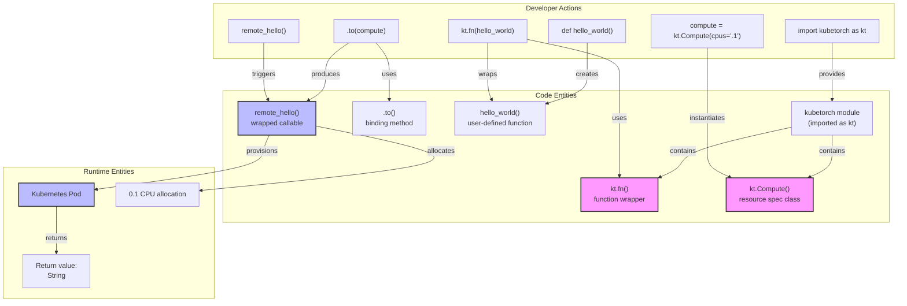
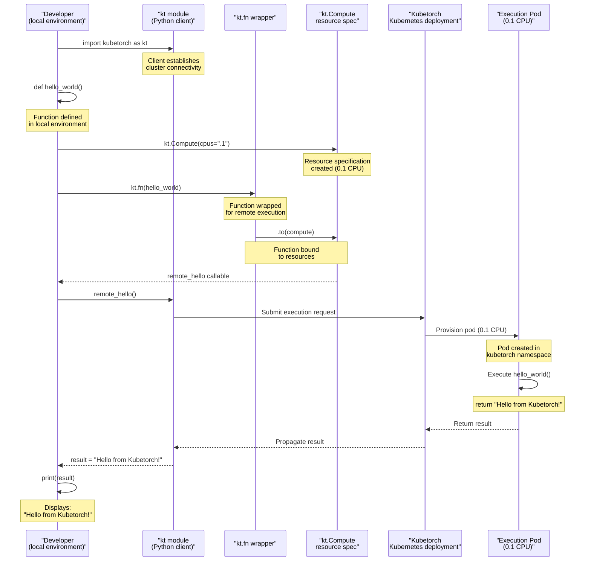

<!-- source: DeepWiki mcp.deepwiki.com · repo run-house/kubetorch · page 3.2 Hello World Example · fetched 2026-10-21 -->

# Hello World Example

<details>
<summary>Relevant source files</summary>

The following files were used as context for generating this wiki page:

- [README.md](README.md)

</details>


This page provides a detailed walkthrough of the basic Hello World example for Kubetorch, demonstrating the minimal code required to execute a Python function remotely on a Kubernetes cluster. This example illustrates the fundamental pattern of defining compute resources, wrapping functions, and executing them remotely.

For installation instructions before running this example, see [Installation](#3.1). For detailed API reference on `kt.fn`, see [kt.fn](#5.1). For compute resource specifications, see [kt.Compute](#5.2).

## Prerequisites

Before running the Hello World example, ensure:

| Requirement | Description |
|------------|-------------|
| **Client installation** | `kubetorch[client]` package installed via pip |
| **Server deployment** | Kubetorch deployed to Kubernetes cluster via Helm |
| **Cluster access** | Valid kubeconfig with access to the kubetorch namespace |
| **Python version** | Python 3.7 or higher |

## The Complete Example

The Hello World example demonstrates the core Kubetorch workflow in seven lines of executable code:

[README.md:13-29]()

```python
import kubetorch as kt

def hello_world():
    return "Hello from Kubetorch!"

if __name__ == "__main__":
    # Define your compute
    compute = kt.Compute(cpus=".1")

    # Send local function to freshly launched remote compute
    remote_hello = kt.fn(hello_world).to(compute)

    # Runs remotely on your Kubernetes cluster
    result = remote_hello()
    print(result)  # "Hello from Kubetorch!"
```

**Sources:** [README.md:13-29]()

## Code Walkthrough

### Step 1: Import Kubetorch

```python
import kubetorch as kt
```

This imports the kubetorch Python client library, providing access to the `kt.fn()` function wrapper and `kt.Compute()` resource specification class. The import establishes connectivity with the Kubetorch deployment in your Kubernetes cluster.

### Step 2: Define Local Function

```python
def hello_world():
    return "Hello from Kubetorch!"
```

This defines a standard Python function that will be executed remotely. The function can be defined in your local environment (IDE, notebook, REPL, or script) without any special annotations or modifications. Kubetorch does not require explicit serialization or pickling of the function code.

### Step 3: Specify Compute Resources

```python
compute = kt.Compute(cpus=".1")
```

The `kt.Compute` constructor creates a resource specification object. The `cpus=".1"` parameter requests 0.1 CPU cores (100 millicores in Kubernetes terminology), which is sufficient for lightweight demonstration workloads. This minimal allocation demonstrates Kubetorch's support for fine-grained resource specifications.

### Step 4: Wrap and Bind Function

```python
remote_hello = kt.fn(hello_world).to(compute)
```

This statement performs two operations:
1. **`kt.fn(hello_world)`**: Wraps the local function, preparing it for remote execution
2. **`.to(compute)`**: Binds the wrapped function to the specified compute resources

The result is a callable `remote_hello` object that, when invoked, will execute `hello_world()` on the Kubernetes cluster with the specified resource allocation.

### Step 5: Execute Remotely

```python
result = remote_hello()
```

Invoking `remote_hello()` triggers remote execution. This call:
- Submits the function to the Kubetorch deployment
- Provisions a Kubernetes pod with 0.1 CPU cores
- Executes the function in the pod
- Returns the result to the local environment

The execution typically completes in 1-2 seconds for simple functions.

### Step 6: Display Result

```python
print(result)  # "Hello from Kubetorch!"
```

The result is a standard Python string returned from the remote execution, identical to what would be returned by local execution. Logs, stdout, and exceptions are propagated in real-time during execution.

**Sources:** [README.md:13-29]()

## Code Entity Mapping



**Sources:** [README.md:13-29]()

## Execution Flow



**Sources:** [README.md:13-29]()

## Expected Output

When the Hello World example executes successfully, you will see:

```
Hello from Kubetorch!
```

The execution typically completes in **1-2 seconds** from invocation to result display. During execution, any logs or print statements within the `hello_world()` function would be streamed in real-time to your local environment.

**Sources:** [README.md:7](), [README.md:28]()

## Behind the Scenes

The following table describes what happens at each stage of execution:

| Stage | Local Activity | Remote Activity | Duration |
|-------|---------------|-----------------|----------|
| **Import** | Load kubetorch client | Client connects to cluster | <100ms |
| **Function definition** | Define function in local scope | None | Instant |
| **Compute specification** | Create resource spec object | None | Instant |
| **Function wrapping** | Wrap function without serialization | None | <10ms |
| **Invocation** | Submit execution request | Request queued | <100ms |
| **Pod provisioning** | Wait for provisioning | Create pod with 0.1 CPU | ~500ms |
| **Execution** | Receive real-time logs | Execute function code | <100ms |
| **Result return** | Receive and display result | Serialize and return result | <100ms |
| **Total** | - | - | **~1-2 seconds** |

### No Code Serialization

Unlike traditional distributed computing frameworks, Kubetorch does not require explicit serialization (pickling) of function code. The `kt.fn()` wrapper handles code transfer transparently without requiring developers to manage serialization concerns.

### Resource Allocation

The `cpus=".1"` specification requests 100 millicores, demonstrating Kubetorch's support for fractional CPU allocations. This enables efficient bin-packing of multiple small workloads onto single nodes, contributing to the 50%+ cost savings claim.

### Pod Lifecycle

When `remote_hello()` is invoked:
1. Kubetorch deployment receives the execution request
2. Kubernetes API provisions a pod in the `kubetorch` namespace
3. The pod executes the function with allocated resources
4. Result is returned and pod is cleaned up

**Sources:** [README.md:7](), [README.md:9](), [README.md:21](), [README.md:34]()

## Variations and Extensions

The basic pattern can be extended with additional parameters:

### Memory Specification

```python
compute = kt.Compute(cpus=".1", memory="256Mi")
```

Adds explicit memory allocation (256 megabytes).

### Multiple Functions

```python
compute = kt.Compute(cpus="4")

remote_fn1 = kt.fn(function1).to(compute)
remote_fn2 = kt.fn(function2).to(compute)

result1 = remote_fn1()
result2 = remote_fn2()
```

Multiple functions can be wrapped and bound to the same or different compute specifications.

### Parameterized Functions

```python
def greet(name):
    return f"Hello, {name}!"

remote_greet = kt.fn(greet).to(compute)
result = remote_greet("Kubetorch")  # "Hello, Kubetorch!"
```

Functions can accept parameters, which are passed during remote invocation.

**Sources:** [README.md:13-29]()

## Common Issues

### Import Error

**Symptom:** `ModuleNotFoundError: No module named 'kubetorch'`

**Solution:** Install the client package: `pip install "kubetorch[client]"`

### Connection Error

**Symptom:** Unable to connect to Kubetorch deployment

**Solution:** Verify:
- Kubetorch is deployed to your cluster (see [Kubernetes Deployment](#7.1))
- Your kubeconfig has access to the cluster
- The `kubetorch` namespace exists

### Resource Allocation Error

**Symptom:** Pod provisioning fails due to insufficient resources

**Solution:** Reduce resource requirements (e.g., `cpus=".05"`) or scale your cluster to provide more capacity

**Sources:** [README.md:42]()

## Next Steps

After successfully running the Hello World example:

1. **Explore compute specifications:** See [kt.Compute](#5.2) for GPU allocation, memory limits, and advanced resource options
2. **Understand the execution model:** See [Execution Lifecycle](#4.2) for details on request processing, optimization, and fault handling
3. **Try advanced patterns:** See [Quick Start Guide](#3.3) for more complex examples including asynchronous execution and multi-node workloads
4. **Review the API:** See [API Reference](#5) for complete documentation of all methods and parameters

**Sources:** [README.md:13-29]()

---

