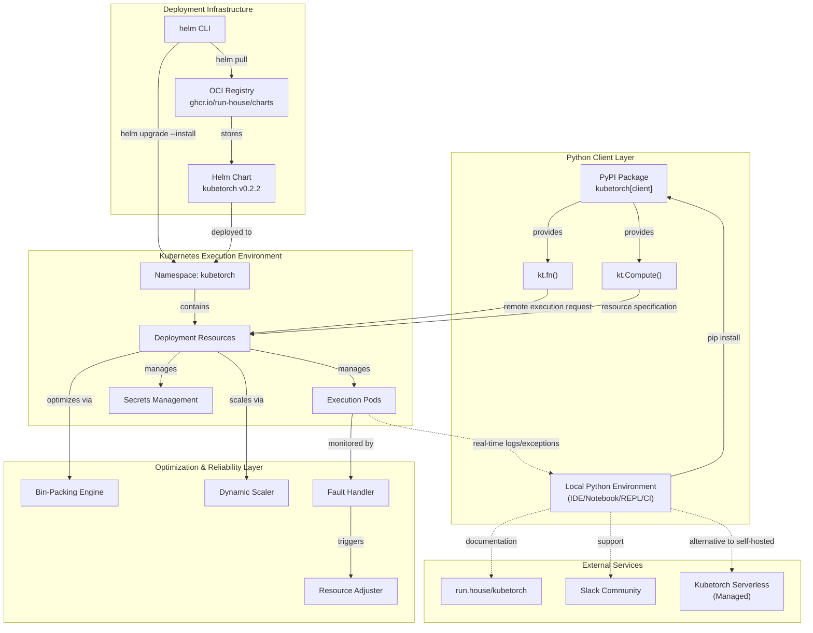
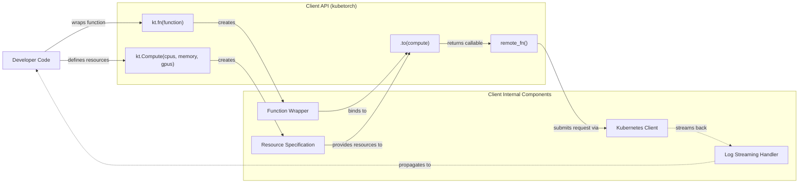
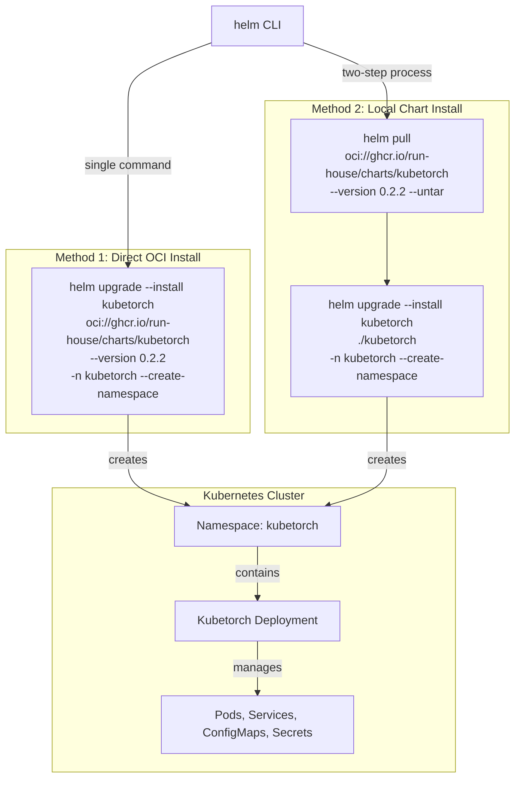
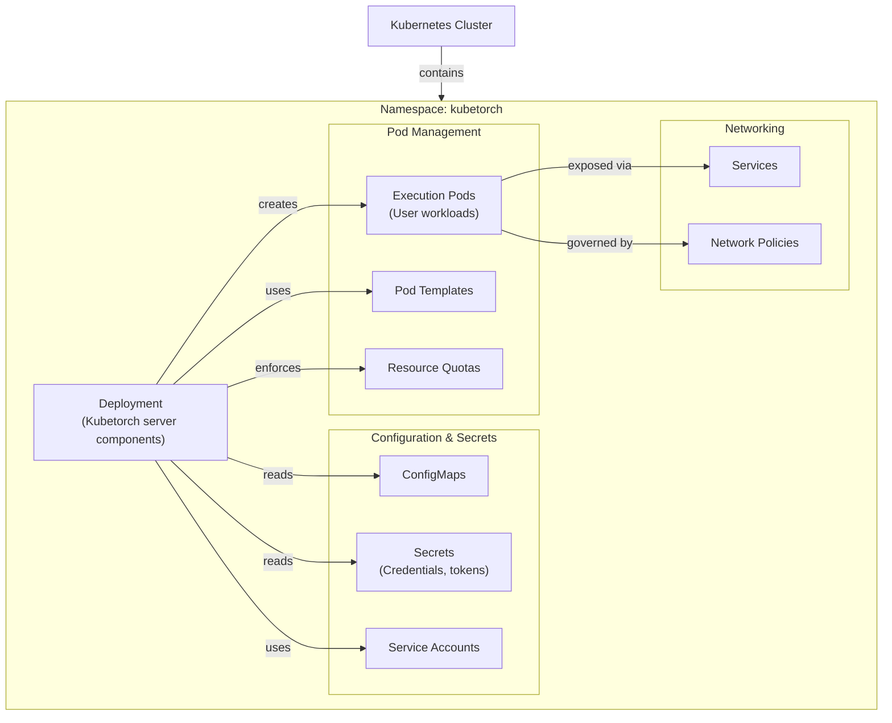
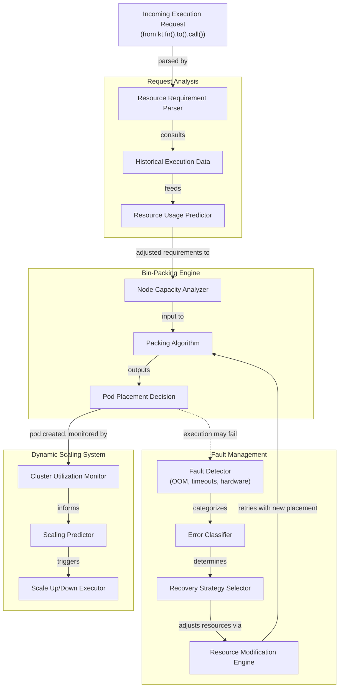
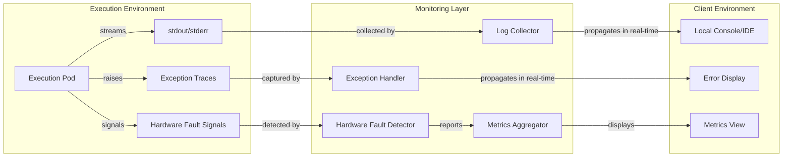
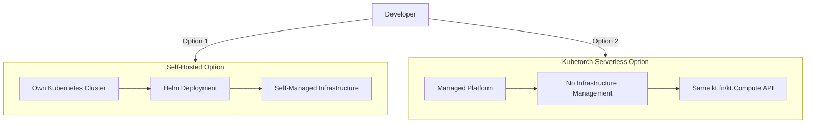

<!-- source: DeepWiki mcp.deepwiki.com · repo run-house/kubetorch · page 4.1 System Components · fetched 2026-10-21 -->

# System Components

<details>
<summary>Relevant source files</summary>

The following files were used as context for generating this wiki page:

- [README.md](README.md)

</details>


## Purpose and Scope

This document provides a comprehensive technical overview of the major system components that comprise Kubetorch and their interactions. It covers the Python client library, Kubernetes deployment infrastructure, execution environment, optimization systems, and external services.

For information about the execution lifecycle and data flow through these components, see [Execution Lifecycle](#4.2). For details on specific optimization algorithms and resource management strategies, see [Resource Management](#4.3) and [Optimization Engine](#4.4).

---

## Component Architecture Overview

Kubetorch's architecture separates into five primary subsystems, each with distinct responsibilities. The following diagram maps these subsystems to their concrete implementation artifacts:



**Sources:** [README.md:1-75]()

---

## Python Client Layer

The Python client layer provides the developer-facing API and abstracts all Kubernetes complexity. It consists of a single PyPI package with minimal local dependencies.

### Package Structure

| Component | Installation Command | Purpose |
|-----------|---------------------|---------|
| `kubetorch[client]` | `pip install "kubetorch[client]"` | Full client package with all dependencies |
| Core API | `import kubetorch as kt` | Primary namespace for all user-facing APIs |

### Core API Interfaces

The client exposes two primary interfaces that developers use to interact with the system:



### Client Characteristics

The client layer has several architectural properties that distinguish it from traditional distributed computing frameworks:

| Characteristic | Implementation | Benefit |
|----------------|----------------|---------|
| **No Local Runtime** | No daemon process required | Works in any Python environment |
| **No Code Serialization** | Functions are not explicitly pickled by developer | Simplified development workflow |
| **No Container Building** | Container management handled server-side | Eliminates Docker build steps |
| **Real-time Communication** | Bidirectional streaming between pods and client | 1-2 second iteration cycles |

**Sources:** [README.md:1-29](), [README.md:39-43]()

---

## Deployment Infrastructure

The deployment infrastructure manages the server-side Kubetorch components that run within the Kubernetes cluster.

### OCI Registry Distribution

Kubetorch server components are distributed as Helm charts stored in an OCI-compliant registry:

| Component | Location | Current Version |
|-----------|----------|-----------------|
| Helm Chart | `oci://ghcr.io/run-house/charts/kubetorch` | `0.2.2` |
| Registry Type | GitHub Container Registry (GHCR) | OCI-compliant |
| Organization | `run-house` | Charts namespace |

### Deployment Methods

Two Helm installation methods are supported, each with specific use cases:



### Method Comparison

| Aspect | Direct OCI Install | Local Chart Install |
|--------|-------------------|---------------------|
| **Command Count** | Single command | Two commands |
| **Use Case** | Standard deployments | Customization, offline, security review |
| **Network Requirements** | Internet access during install | Internet access for pull only |
| **Customization** | Limited to `--set` flags | Full chart modification possible |

**Sources:** [README.md:45-55]()

---

## Kubernetes Execution Environment

The Kubernetes execution environment consists of the resources deployed within the `kubetorch` namespace that handle actual workload execution.

### Namespace Organization

All Kubetorch resources are isolated within a dedicated namespace:



### Execution Pod Lifecycle

Execution pods are ephemeral resources created for each remote function invocation:

| Phase | Resource State | Duration |
|-------|----------------|----------|
| **Provisioning** | Pod created, container image pulled | Variable (first-time: seconds to minutes) |
| **Execution** | Function runs, logs stream | Based on workload |
| **Completion** | Results returned, pod terminated | Immediate after completion |
| **Fault Recovery** | Pod recreated with adjusted resources | Triggered on failures |

**Sources:** [README.md:45-55]()

---

## Optimization and Reliability Layer

The optimization and reliability layer operates transparently to developers, improving resource utilization and handling failures automatically.

### Optimization Components



### Optimization Impact Metrics

The optimization layer contributes to Kubetorch's claimed performance improvements:

| Optimization Component | Contribution | Metric |
|------------------------|--------------|--------|
| **Bin-Packing Engine** | Resource utilization | 50%+ cost savings |
| **Dynamic Scaling** | Elastic capacity | Reduces idle resources |
| **Resource Predictor** | Right-sizing | Prevents over-allocation |
| **Fault-Driven Learning** | Iterative improvement | 95% fewer production faults |

**Sources:** [README.md:31-35]()

---

## Monitoring and Observability

The monitoring system provides real-time visibility into execution state, propagating logs and exceptions back to the local development environment.

### Monitoring Architecture



### Observable Events

| Event Type | Source | Propagation | Latency |
|------------|--------|-------------|---------|
| **Standard Output** | Pod stdout | Real-time stream | < 1 second |
| **Standard Error** | Pod stderr | Real-time stream | < 1 second |
| **Python Exceptions** | Exception handler | Real-time with full traceback | < 1 second |
| **Hardware Faults** | Node monitoring | Detected and reported | Variable |
| **Resource Metrics** | Pod resource usage | Periodic aggregation | Seconds |

**Sources:** [README.md:6-8]()

---

## External Services and Integrations

Kubetorch integrates with several external services to provide documentation, support, and managed deployment options.

### Service Ecosystem

| Service | URL/Access | Purpose | Target Users |
|---------|-----------|---------|--------------|
| **Documentation** | `run.house/kubetorch` | API reference, guides, tutorials | All developers |
| **Examples** | `run.house/examples` | Real-world usage patterns | New users, ML practitioners |
| **Slack Community** | Invitation-based | Community support, discussions | All users |
| **Kubetorch Serverless** | Managed platform (contact required) | Fully managed alternative to self-hosted | Teams preferring managed services |

### Kubetorch Serverless Platform

The Kubetorch Serverless platform is a managed service alternative to self-hosted deployment:



**Access:** Contact via [email](mailto:hello@run.house) or [Slack](https://join.slack.com/t/kubetorch/shared_invite/zt-3g76q5i4j-uP60AdydxnAmjGVAQhtALA)

**Sources:** [README.md:60-68]()

---

## Component Communication Patterns

The following diagram illustrates the complete communication flow between all major system components:

```mermaid
sequenceDiagram
    participant Dev as Developer<br/>(Local Environment)
    participant PyPI as PyPI Registry
    participant Client as Kubetorch Client<br/>(kt.fn, kt.Compute)
    participant OCI as OCI Registry<br/>(ghcr.io)
    participant Helm as Helm
    participant K8sNS as Kubernetes Namespace<br/>(kubetorch)
    participant Opt as Optimization Layer
    participant Pod as Execution Pod
    participant Mon as Monitoring System
    
    Note over Dev,PyPI: Client Installation
    Dev->>PyPI: pip install kubetorch[client]
    PyPI-->>Dev: Package installed
    
    Note over Helm,K8sNS: Server Deployment
    Helm->>OCI: helm pull/install from oci://ghcr.io/.../kubetorch:0.2.2
    OCI-->>Helm: Chart retrieved
    Helm->>K8sNS: Deploy to kubetorch namespace
    K8sNS-->>Helm: Deployment created
    
    Note over Dev,Pod: Function Execution
    Dev->>Client: kt.Compute(cpus=".1")
    Dev->>Client: kt.fn(function).to(compute)
    Dev->>Client: remote_fn()
    
    Client->>K8sNS: Submit execution request
    K8sNS->>Opt: Route to optimization layer
    Opt->>Opt: Bin-packing + scaling analysis
    Opt->>K8sNS: Optimized pod spec
    K8sNS->>Pod: Create execution pod
    
    Pod->>Mon: Start streaming logs/metrics
    Mon-->>Dev: Real-time logs to console
    
    Pod->>Pod: Execute function
    
    alt Success
        Pod-->>Client: Return result
        Client-->>Dev: Display result (1-2 sec total)
    else Failure
        Pod->>Mon: Fault detected
        Mon->>Opt: Trigger fault handler
        Opt->>Opt: Determine recovery strategy
        Opt->>K8sNS: Adjusted pod spec
        K8sNS->>Pod: Recreate pod
        Pod-->>Client: Return result after recovery
        Client-->>Dev: Display result + recovery info
    end
    
    Pod->>K8sNS: Pod terminated
```

**Sources:** [README.md:1-75]()

---

## Summary of Component Responsibilities

| Component | Key Responsibilities | Code Artifacts |
|-----------|----------------------|----------------|
| **Python Client** | API abstraction, function wrapping, resource specification | `kt.fn()`, `kt.Compute()`, `.to()` method |
| **Deployment Infrastructure** | Server-side deployment, versioning, distribution | Helm chart v0.2.2, `oci://ghcr.io/run-house/charts/kubetorch` |
| **Kubernetes Environment** | Workload execution, resource isolation, secret management | Namespace `kubetorch`, execution pods |
| **Optimization Layer** | Bin-packing, dynamic scaling, resource prediction | Internal to Kubernetes deployment |
| **Monitoring System** | Log streaming, exception propagation, fault detection | Real-time streaming to client |
| **External Services** | Documentation, support, managed platform | `run.house/kubetorch`, Slack, Serverless platform |

These components work together to provide the 1-2 second iteration cycles, 50%+ cost savings, and 95% fewer production faults that characterize the Kubetorch system.

**Sources:** [README.md:1-75]()

---

