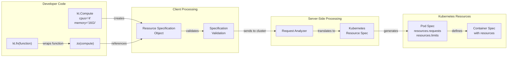
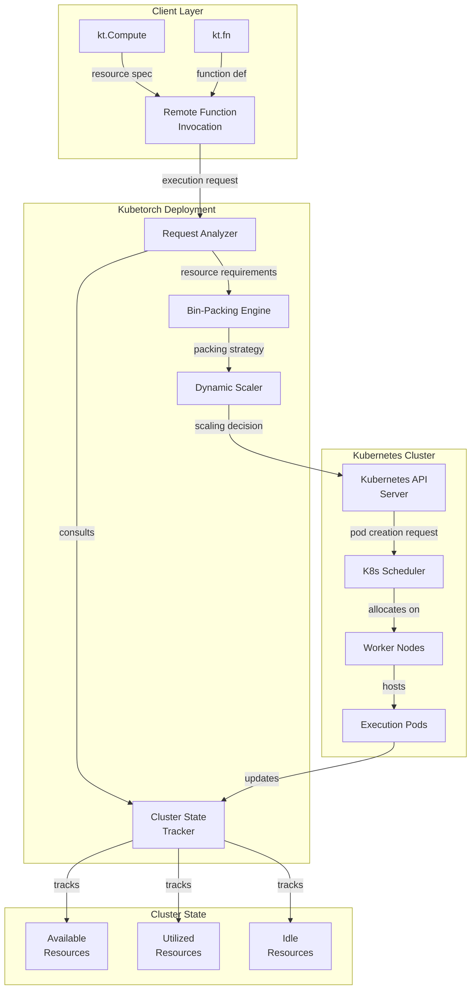
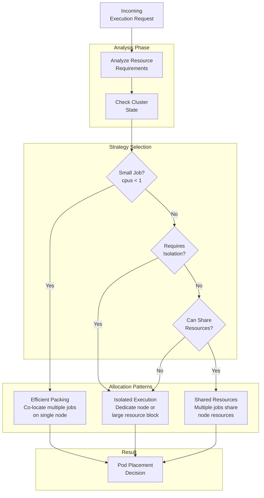
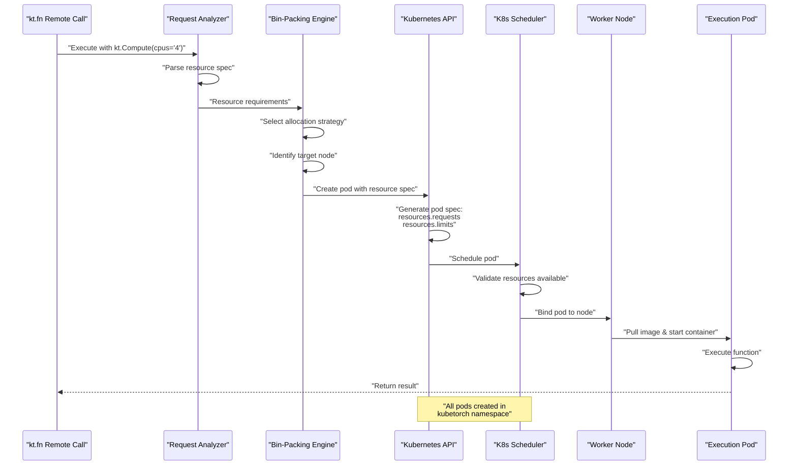
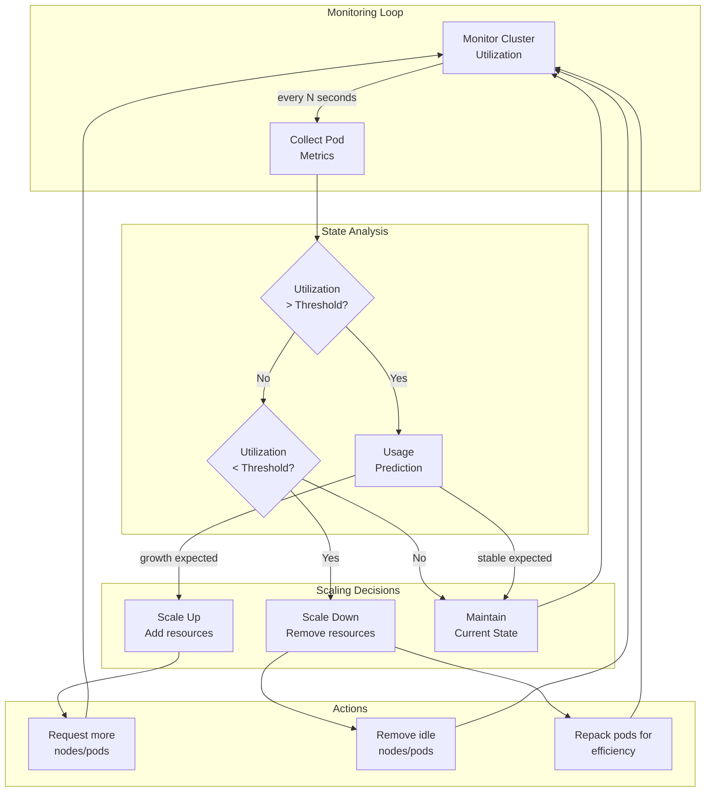

<!-- source: DeepWiki mcp.deepwiki.com · repo run-house/kubetorch · page 4.3 Resource Management · fetched 2026-10-21 -->

# Resource Management

Relevant source files

The following files were used as context for generating this wiki page:

- [README.md](README.md)

## Purpose and Scope

This document details the technical mechanisms by which Kubetorch manages Kubernetes resources to execute remote functions. It covers how resource specifications flow from `kt.Compute` definitions to Kubernetes pod allocations, the architecture of resource management components, allocation strategies, and the pod provisioning lifecycle.

For information about the optimization algorithms that leverage these mechanisms to achieve cost savings, see [Optimization Engine](#4.4). For details on how resources are adjusted in response to faults, see [Fault Tolerance System](#4.5).

---

## Resource Specification Flow

Kubetorch translates high-level Python resource specifications into Kubernetes resource requests and limits. The flow begins when a developer creates a `kt.Compute` object and ends when a Kubernetes pod is provisioned with appropriate resources.

### Diagram: Resource Specification Translation

**Sources:** [README.md:14-28]()

### Supported Resource Types

| Resource Type | `kt.Compute` Parameter | Kubernetes Mapping | Example Values |
|--------------|------------------------|-------------------|----------------|
| CPU | `cpus` | `resources.requests.cpu` / `resources.limits.cpu` | `"0.1"`, `"4"`, `"16"` |
| Memory | `memory` | `resources.requests.memory` / `resources.limits.memory` | `"512Mi"`, `"16Gi"`, `"64Gi"` |
| GPU | `gpus` | `resources.limits.nvidia.com/gpu` | `1`, `2`, `4` |

The specification syntax in `kt.Compute` accepts string values for CPUs (fractional cores supported) and memory (standard Kubernetes units: Ki, Mi, Gi). GPU counts are integers.

**Sources:** [README.md:21]()

---

## Resource Management Architecture

The resource management system consists of multiple components that coordinate to allocate cluster resources efficiently while satisfying developer-specified requirements.

### Diagram: Resource Management Components

**Sources:** [README.md:33-35]()

### Component Responsibilities

| Component | Responsibility | Location |
|-----------|----------------|----------|
| Request Analyzer | Parses `kt.Compute` specifications, validates requirements, converts to internal format | Kubetorch Deployment |
| Bin-Packing Engine | Determines optimal pod placement across nodes to maximize resource utilization | Kubetorch Deployment |
| Dynamic Scaler | Monitors cluster load and makes scaling decisions (scale up/down nodes or pods) | Kubetorch Deployment |
| Cluster State Tracker | Maintains real-time view of available, utilized, and idle resources across all nodes | Kubetorch Deployment |
| Kubernetes Scheduler | Final arbiter of pod placement; receives optimized requests from Kubetorch | Kubernetes Control Plane |

The Kubetorch Deployment operates within the `kubetorch` namespace ([README.md:50]()), providing a logical boundary for all Kubetorch-managed resources.

**Sources:** [README.md:48-54]()

---

## Resource Allocation Strategies

Kubetorch employs three primary allocation strategies based on workload characteristics and cluster state. The Bin-Packing Engine selects the appropriate strategy for each execution request.

### Diagram: Allocation Strategy Selection

**Sources:** [README.md:34]()

### Efficient Packing Pattern

Used for small jobs with fractional CPU requirements (e.g., `cpus="0.1"` from [README.md:21]()). Multiple execution pods are co-located on a single node to maximize resource utilization.

**Characteristics:**
- Multiple pods per node (10+ pods on a single node possible for very small jobs)
- Reduced node count requirements
- Lower infrastructure costs
- Suitable for short-lived, lightweight functions

### Isolated Execution Pattern

Used for large ML workloads requiring substantial resources or guaranteed performance isolation.

**Characteristics:**
- Single pod per node (or dedicated resource block)
- No resource contention
- Predictable performance
- Suitable for GPU workloads, distributed training, RL environments

### Shared Resources Pattern

Used when multiple moderate-sized jobs can safely share node resources without performance degradation.

**Characteristics:**
- 2-5 pods per node typically
- Balance between utilization and isolation
- Kubernetes resource limits prevent interference
- Suitable for standard ML inference or training tasks

**Sources:** [README.md:33-35]()

---

## Pod Lifecycle and Provisioning

When a remote function is invoked, Kubetorch creates a Kubernetes pod with appropriate resource specifications. The pod lifecycle involves multiple stages from request to execution.

### Diagram: Pod Provisioning Flow

**Sources:** [README.md:48-54]()

### Kubernetes Resource Specification

Each execution pod receives a Kubernetes resource specification with both `requests` and `limits`:

| Field | Purpose | Set By | Example |
|-------|---------|--------|---------|
| `resources.requests.cpu` | Minimum CPU guarantee | Request Analyzer from `kt.Compute.cpus` | `"4"` |
| `resources.requests.memory` | Minimum memory guarantee | Request Analyzer from `kt.Compute.memory` | `"16Gi"` |
| `resources.limits.cpu` | Maximum CPU allowed | Request Analyzer (may differ from requests) | `"4"` |
| `resources.limits.memory` | Maximum memory allowed | Request Analyzer (may differ from requests) | `"16Gi"` |
| `resources.limits.nvidia.com/gpu` | GPU allocation | Request Analyzer from `kt.Compute.gpus` | `1` |

The distinction between requests and limits allows Kubernetes to overcommit node resources when safe, improving cluster utilization.

**Sources:** [README.md:21]()

### Namespace Isolation

All Kubetorch-managed pods are created in the `kubetorch` namespace. This provides:

- **Logical separation** from other cluster workloads
- **Resource quota enforcement** at the namespace level
- **RBAC boundary** for access control
- **Simplified cleanup** via namespace-scoped operations

The namespace is created during Helm installation ([README.md:50]()) using the `--create-namespace` flag.

**Sources:** [README.md:50]()

---

## Dynamic Resource Management

Resource management is not static; Kubetorch continuously monitors cluster state and adjusts resource allocations dynamically.

### Diagram: Dynamic Resource Adjustment

**Sources:** [README.md:34]()

### Scaling Triggers

| Trigger | Condition | Action | Outcome |
|---------|-----------|--------|---------|
| High utilization | >80% cluster resources used | Scale up: add nodes or pods | Prevent resource exhaustion |
| Low utilization | <30% cluster resources used | Scale down: remove idle resources | Reduce infrastructure costs |
| Predicted growth | Historical patterns suggest load increase | Proactive scale up | Prevent future bottlenecks |
| Fault recovery | Pod failure requires resource adjustment | Modify resource allocation | See [Fault Tolerance System](#4.5) |

### Cluster Capacity Management

The Dynamic Scaler maintains cluster capacity within operational bounds:

- **Minimum capacity**: Ensures baseline resources available for rapid function execution (1-2 second iteration cycle from [README.md:7]())
- **Maximum capacity**: Prevents runaway resource consumption
- **Utilization target**: Aims for 60-80% utilization for optimal cost/performance balance

Scaling decisions are made continuously but actions are rate-limited to prevent thrashing.

**Sources:** [README.md:7](), [README.md:34]()

---

## Integration with Optimization and Fault Tolerance

Resource management provides the foundational infrastructure that enables:

- **Cost optimization**: Bin-packing and dynamic scaling mechanisms reduce resource waste (see [Optimization Engine](#4.4))
- **Fault recovery**: Resource adjustment in response to OOM errors, timeouts, and hardware faults (see [Fault Tolerance System](#4.5))
- **Performance monitoring**: Real-time tracking of resource utilization feeds into observability systems (see [Monitoring and Observability](#4.6))

The resource management layer operates transparently to developers, who only interact with `kt.Compute` specifications.

**Sources:** [README.md:33-35]()

---

