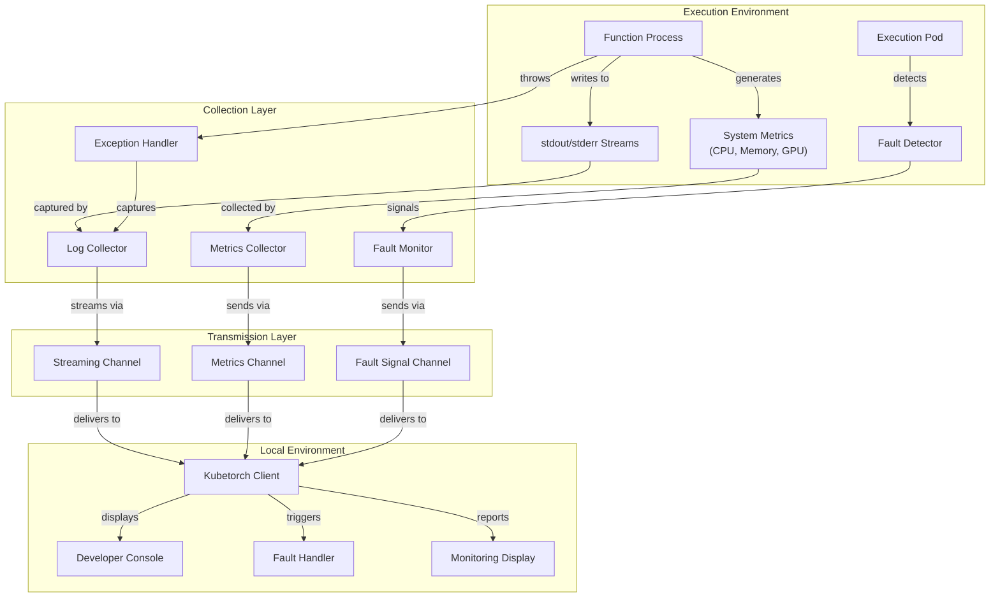
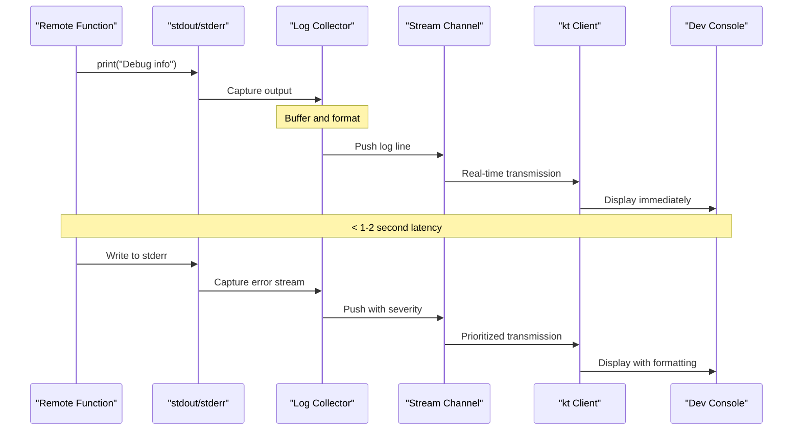
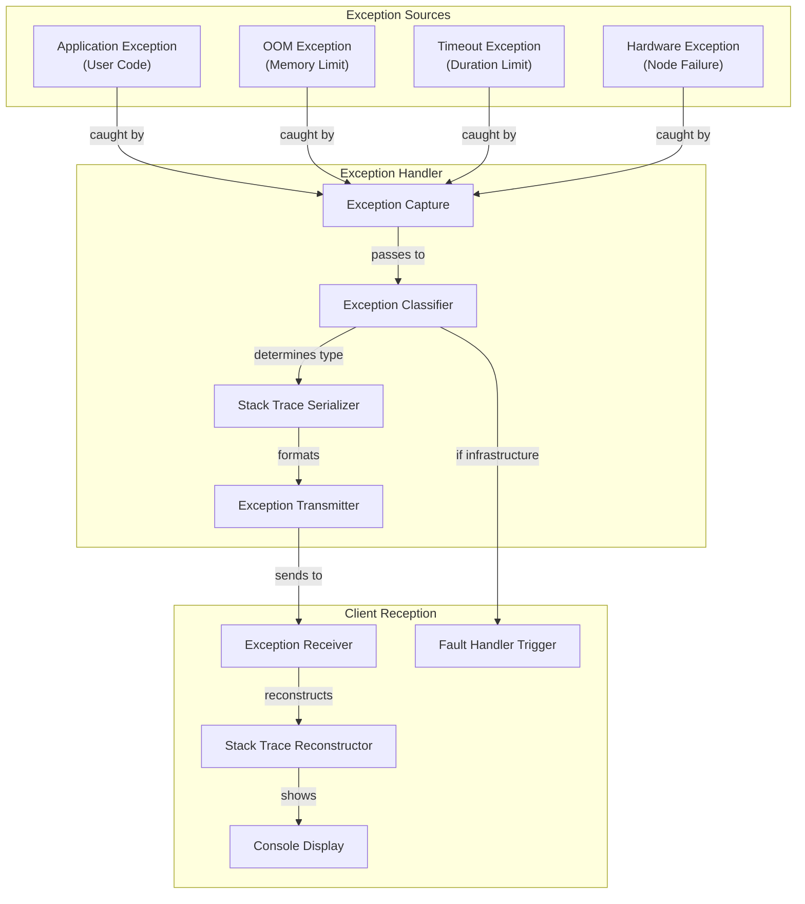
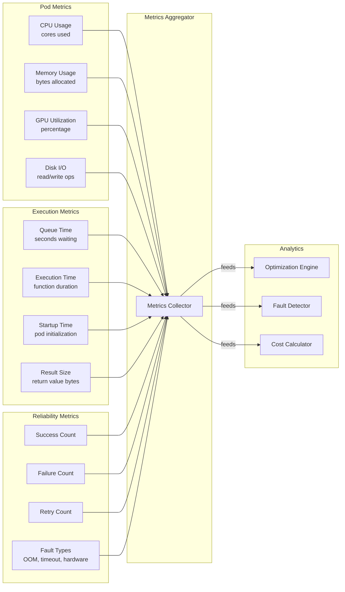
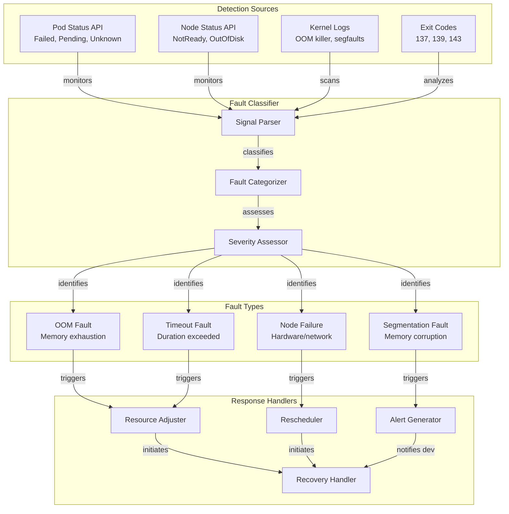
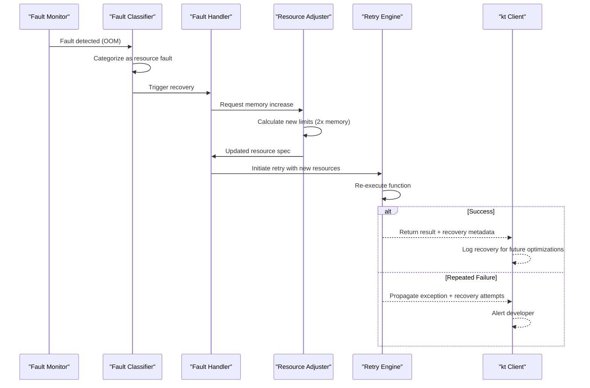
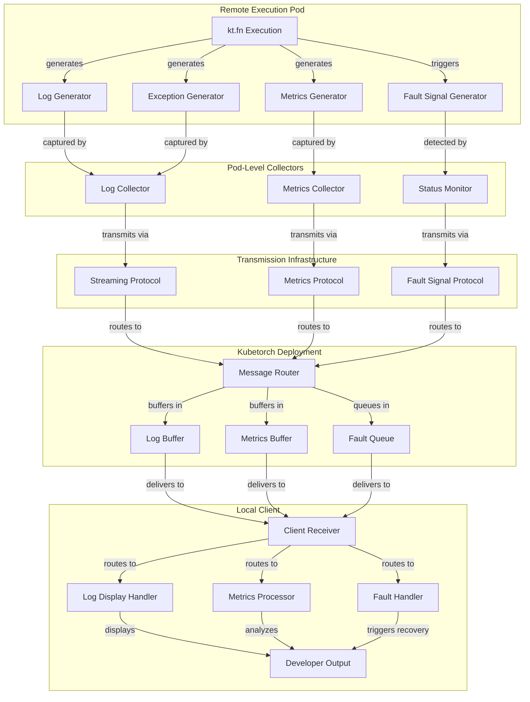
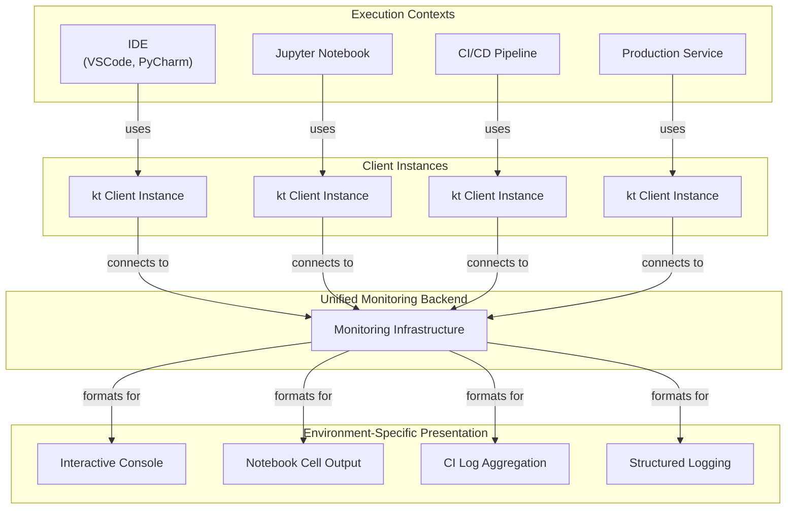

<!-- source: DeepWiki mcp.deepwiki.com · repo run-house/kubetorch · page 4.6 Monitoring and Observability · fetched 2026-10-21 -->

# Monitoring and Observability

Relevant source files

The following files were used as context for generating this wiki page:

- [README.md](README.md)

## Purpose and Scope

This document explains Kubetorch's monitoring and observability infrastructure, which provides real-time visibility into remote execution on Kubernetes clusters. The monitoring system automatically captures and propagates logs, exceptions, and hardware fault signals back to the local development environment, enabling the claimed "1-2 second iteration cycles."

This page covers the technical architecture of log streaming, exception propagation, metrics collection, and fault detection. For information about how monitoring data triggers automated recovery, see [Fault Tolerance System](#4.5). For details on resource optimization decisions driven by monitoring data, see [Optimization Engine](#4.4).

---

## Observability Architecture Overview

Kubetorch's observability system operates across three layers: **data collection** (within execution pods), **transmission** (real-time streaming channels), and **presentation** (local environment display). This architecture eliminates the need for manual log inspection or kubectl commands.

**Sources:** [README.md:7]()

---

## Real-Time Log Streaming

### Log Capture Mechanism

When a function executes remotely via `kt.fn`, all stdout and stderr output is automatically captured at the pod level. The streaming mechanism operates continuously during function execution, providing sub-second latency from output generation to local display.

The log streaming pipeline ensures that developers see output from remote execution as if it were running locally, maintaining the "cluster compute in local environment" paradigm described in [README.md:7-9]().

**Sources:** [README.md:7-9]()

---

## Exception Propagation

### Exception Capture and Transmission

Exceptions raised during remote function execution are captured with full stack traces and transmitted back to the client. The system distinguishes between application exceptions (user code errors) and infrastructure exceptions (pod failures, resource exhaustion).

Exception propagation maintains Python semantics, allowing developers to catch and handle remote exceptions using standard try-except blocks in their local code.

**Sources:** [README.md:7]()

---

## Execution Metrics Collection

### Metrics Categories

The monitoring system collects four categories of execution metrics:

| Metric Category | Data Points | Collection Frequency | Purpose |
|----------------|-------------|---------------------|---------|
| **Resource Utilization** | CPU usage, memory consumption, GPU utilization | Per-second | Optimization decisions, right-sizing |
| **Performance** | Execution duration, queue time, startup latency | Per-execution | Iteration speed analysis |
| **Reliability** | Success rate, fault frequency, retry count | Per-execution | Fault detection, recovery triggers |
| **Cost** | Resource-hours consumed, node allocation efficiency | Per-execution | Cost optimization, bin-packing |

These metrics drive the "50%+ compute cost savings" and "95% fewer production faults" capabilities by enabling data-driven optimization and fault prediction.

**Sources:** [README.md:34-35]()

---

## Hardware Fault Detection

### Fault Detection Mechanisms

Hardware faults are detected through multiple monitoring channels that observe pod health, node status, and system-level error signals:

**Fault Detection Signal Mapping:**

| Signal | Detection Method | Response Action |
|--------|-----------------|----------------|
| **Exit Code 137** | Process termination signal | OOM classification → memory increase |
| **Exit Code 139** | Segmentation fault | Alert generation → manual investigation |
| **Pod Status: Failed** | Kubernetes API polling | Fault analysis → recovery or alert |
| **Node Status: NotReady** | Node health monitoring | Pod rescheduling to healthy node |
| **Kernel OOM Killer** | System log scanning | Memory limit adjustment → retry |

**Sources:** [README.md:7](), [README.md:35]()

---

## Integration with Fault Tolerance

The monitoring system serves as the primary input to Kubetorch's fault tolerance mechanisms. Detected faults trigger programmatic recovery workflows, as detailed in [Fault Tolerance System](#4.5).

This tight integration between monitoring and fault tolerance achieves the "95% fewer production faults" metric by automatically recovering from transient failures before they reach the developer.

**Sources:** [README.md:35]()

---

## Data Flow and Communication Channels

### End-to-End Observability Pipeline

The complete data flow from remote execution to local developer environment operates through persistent, bidirectional communication channels:

### Communication Protocol Characteristics

| Channel | Protocol | Latency Target | Buffer Size | Failure Mode |
|---------|----------|----------------|-------------|--------------|
| **Log Streaming** | Persistent connection | < 100ms | 10KB per pod | Local buffer until reconnect |
| **Metrics** | Batch transmission | < 1 second | 1MB per minute | Store-and-forward |
| **Fault Signals** | Priority channel | < 50ms | Unbuffered | Immediate delivery or alert |
| **Exceptions** | In-band with logs | < 100ms | Full stack trace | Guaranteed delivery |

The persistent connection architecture ensures the "1-2 second iteration cycle" claim is achievable even for complex workloads with significant output volume.

**Sources:** [README.md:7](), [README.md:33]()

---

## Monitoring in Multi-Environment Contexts

Observability features work consistently across all execution environments described in [Multi-Environment Integration](#6.1). Whether executing from an IDE, Jupyter notebook, CI pipeline, or production service, the same monitoring data is captured and transmitted.

This architectural consistency eliminates environment-specific debugging workflows and ensures that observability data is always available in the appropriate format for each context.

**Sources:** [README.md:9]()

---

## Summary

Kubetorch's monitoring and observability infrastructure provides comprehensive, real-time visibility into remote execution without requiring manual log inspection or Kubernetes CLI interaction. The system automatically:

- **Streams logs and stdout/stderr** from remote pods to local console with sub-second latency
- **Propagates exceptions** with full stack traces for seamless local debugging
- **Collects execution metrics** for resource utilization, performance, and reliability analysis
- **Detects hardware faults** through multi-channel monitoring of pod and node health
- **Integrates with fault tolerance** to enable programmatic recovery from detected issues

This observability architecture is essential to achieving the "1-2 second iteration cycles" and "95% fewer production faults" capabilities, as it provides the real-time feedback loop necessary for both rapid development iteration and automated fault recovery.

**Sources:** [README.md:7](), [README.md:33-35]()

---

