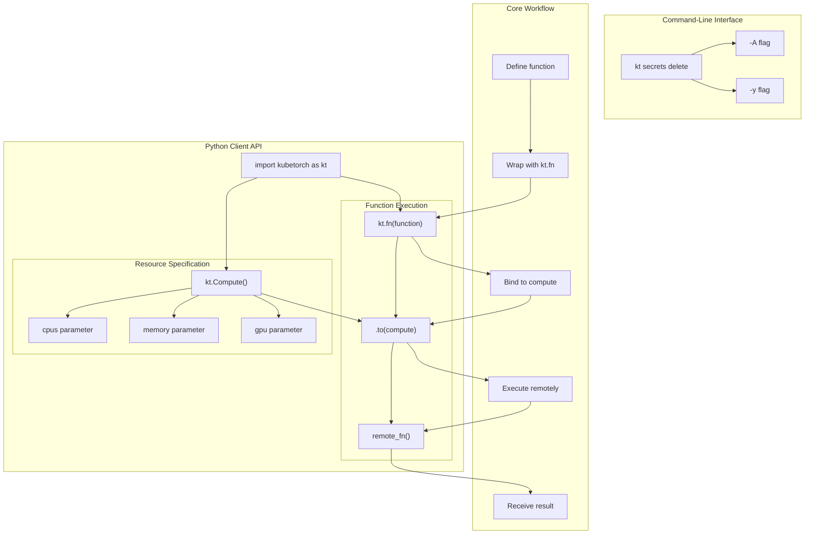
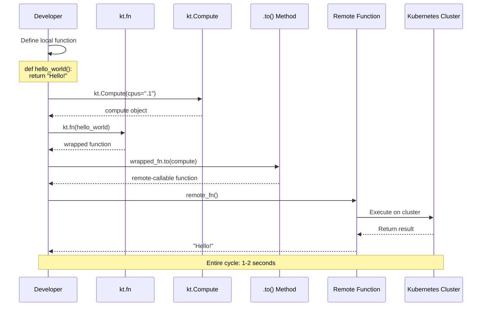
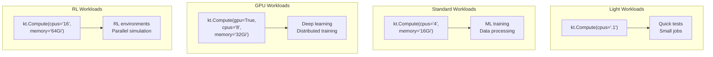
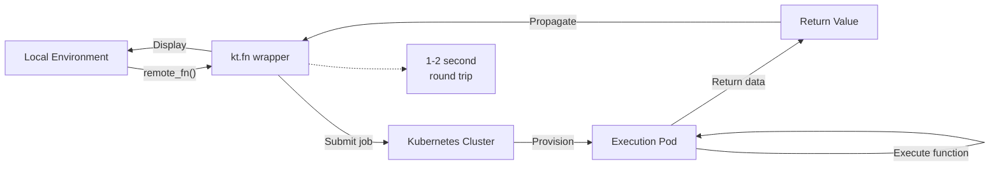
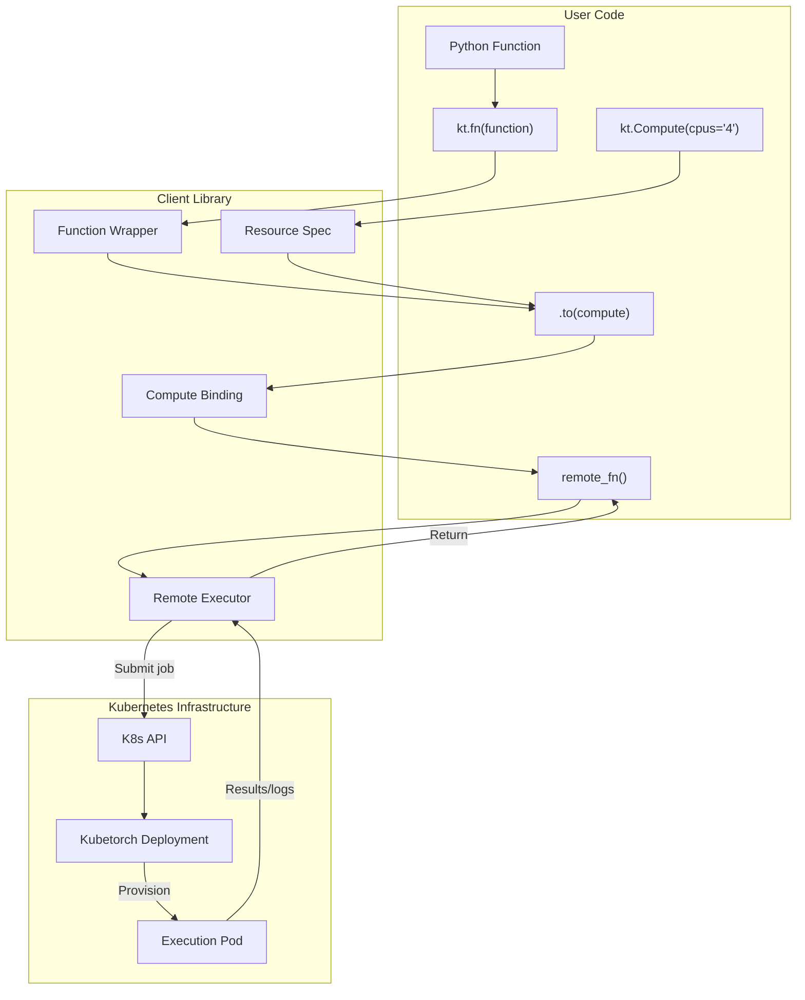

<!-- source: DeepWiki mcp.deepwiki.com · repo run-house/kubetorch · page 5 API Reference · fetched 2026-10-21 -->

# API Reference

<details>
<summary>Relevant source files</summary>

The following files were used as context for generating this wiki page:

- [README.md](README.md)

</details>


This document provides comprehensive reference documentation for Kubetorch's user-facing API. It covers the Python client library interfaces and command-line tools that developers interact with directly.

The API consists of three main components:
- **kt.fn** - Function wrapping and remote execution ([see section 5.1](#5.1))
- **kt.Compute** - Resource specification and configuration ([see section 5.2](#5.2))
- **CLI Commands** - Command-line tools for operational tasks ([see section 5.3](#5.3))

For architectural details about how these APIs are implemented internally, see [Architecture Deep Dive](#4). For practical usage examples and patterns, see [Advanced Usage](#6).

## API Surface Overview

The following diagram maps the complete user-facing API surface to its core abstractions:



**Sources:** [README.md:1-75]()

## API Components and Their Relationships

The table below summarizes the primary API components, their purposes, and typical usage patterns:

| Component | Type | Purpose | Returns | Common Parameters |
|-----------|------|---------|---------|-------------------|
| `kt.fn()` | Function | Wraps a Python function for remote execution | Wrapped function object | `function` (positional) |
| `.to()` | Method | Binds wrapped function to compute resources | Remote-callable function | `compute` (kt.Compute instance) |
| `kt.Compute()` | Class | Specifies resource requirements | Compute specification object | `cpus`, `memory`, `gpu` |
| `kt secrets delete` | CLI Command | Deletes stored Kubernetes secrets | Exit code | `-A` (all namespaces), `-y` (no confirmation) |

**Sources:** [README.md:13-28]()

## API Usage Flow

The following sequence diagram illustrates the typical API usage pattern from developer perspective:



**Sources:** [README.md:13-29]()

## Python Client API

### Import Statement

All Kubetorch functionality is accessed through the `kubetorch` module:

```python
import kubetorch as kt
```

This provides access to:
- `kt.fn` - Function wrapping interface
- `kt.Compute` - Resource specification class

**Sources:** [README.md:14]()

### Function Wrapping Pattern

The core API pattern follows a three-step process:

1. **Define** - Write a standard Python function
2. **Wrap** - Use `kt.fn()` to prepare for remote execution
3. **Bind** - Use `.to()` to attach resource requirements

```python
# Step 1: Define
def hello_world():
    return "Hello from Kubetorch!"

# Step 2: Wrap  
wrapped = kt.fn(hello_world)

# Step 3: Bind
remote_hello = wrapped.to(compute)

# Execute
result = remote_hello()
```

**Sources:** [README.md:16-28]()

## Resource Specification Patterns

The following diagram shows common resource specification patterns and their use cases:



**Sources:** [README.md:21]()

## API Design Principles

The Kubetorch API is designed around three core principles:

### No Local Runtime

No daemon or background process runs locally. The client library communicates directly with the Kubernetes cluster deployment.

```python
# No setup required - just import and use
import kubetorch as kt
remote_fn = kt.fn(my_function).to(compute)
result = remote_fn()  # Executes on cluster immediately
```

### No Code Serialization

Developers do not need to explicitly serialize or pickle their code. The wrapping mechanism handles code transfer transparently.

```python
# Function is automatically transferred to cluster
# No need for pickle, cloudpickle, or manual serialization
def my_function():
    import numpy as np  # Imports work remotely
    return np.array([1, 2, 3])

remote = kt.fn(my_function).to(compute)
```

### Universal Environment Support

The same API works identically across all Python environments:

| Environment | Support Level | Notes |
|-------------|---------------|-------|
| VSCode/PyCharm | Full | Interactive development with real-time feedback |
| Jupyter Notebooks | Full | Cell-by-cell execution |
| Python REPL | Full | Interactive experimentation |
| Python Scripts | Full | Batch execution |
| GitHub Actions | Full | CI/CD integration |
| Jenkins/Other CI | Full | Generic CI/CD support |
| Production Apps | Full | Long-running services |
| Microservices | Full | Service-to-service calls |

**Sources:** [README.md:9]()

## API Invocation Patterns

### Synchronous Execution

The default invocation pattern is synchronous - the call blocks until the result is ready:

```python
remote_fn = kt.fn(function).to(compute)
result = remote_fn()  # Blocks until complete
print(result)
```

This provides a familiar programming model that matches local function execution.

### Result Propagation

Results are automatically propagated back to the caller:



**Sources:** [README.md:7]()

## Exception and Log Handling

### Automatic Exception Propagation

Exceptions raised during remote execution are automatically propagated to the local environment:

```python
def failing_function():
    raise ValueError("Remote error")

remote_fn = kt.fn(failing_function).to(compute)

try:
    result = remote_fn()
except ValueError as e:
    print(f"Caught remote exception: {e}")
    # Output: "Caught remote exception: Remote error"
```

### Real-Time Log Streaming

Logs from remote execution are streamed back in real-time:

```python
def logging_function():
    print("Starting computation...")
    # This appears in local stdout immediately
    result = expensive_computation()
    print(f"Result: {result}")
    # This also appears immediately
    return result

remote_fn = kt.fn(logging_function).to(compute)
remote_fn()  # Logs appear in local terminal in real-time
```

**Sources:** [README.md:7]()

## CLI Command Reference

### kt secrets delete

Deletes Kubernetes secrets managed by Kubetorch.

**Syntax:**
```bash
kt secrets delete [OPTIONS]
```

**Options:**

| Option | Description | Default |
|--------|-------------|---------|
| `-A` | Delete secrets across all namespaces | Current namespace only |
| `-y` | Skip confirmation prompt | Prompt for confirmation |

**Usage Examples:**

```bash
# Delete secrets in current namespace (with confirmation)
kt secrets delete

# Delete secrets across all namespaces without confirmation
kt secrets delete -A -y

# Used in CI/CD cleanup
if: ${{ always() }}
run: kt secrets delete -A -y
```

**Sources:** [README.md:1-75]() (referenced in CI/CD context from diagrams)

## API Integration Points

The following diagram shows how API components integrate with the broader Kubetorch system:



**Sources:** [README.md:1-75]()

## API Response Types

### Success Response

When a remote function executes successfully, the return value is transmitted back to the caller:

```python
def compute_sum(a, b):
    return a + b

remote_sum = kt.fn(compute_sum).to(compute)
result = remote_sum(5, 3)
# result = 8 (same as local execution)
```

Return values can be:
- Primitive types (int, float, str, bool)
- Collections (list, dict, tuple, set)
- NumPy arrays
- Pandas DataFrames
- Custom objects (if serializable)

### Error Response

When execution fails, exceptions are raised in the local environment:

```python
def risky_operation():
    raise RuntimeError("Hardware fault detected")

remote_op = kt.fn(risky_operation).to(compute)

try:
    remote_op()
except RuntimeError as e:
    # Exception is caught locally
    # Includes remote stack trace
    pass
```

**Sources:** [README.md:7]()

## API Performance Characteristics

The following table summarizes expected performance characteristics for API operations:

| Operation | Typical Latency | Notes |
|-----------|----------------|-------|
| `kt.fn()` wrapping | < 1ms | Local operation, no network |
| `kt.Compute()` creation | < 1ms | Local operation, no network |
| `.to()` binding | < 1ms | Local operation, no network |
| First remote call | 1-2 seconds | Includes pod provisioning |
| Subsequent calls | 1-2 seconds | Reuses provisioned resources |
| Result return | Immediate | Streamed back upon completion |
| Log propagation | Real-time | < 100ms latency |
| Exception propagation | Real-time | < 100ms latency |

**Sources:** [README.md:7,33]()

## API Compatibility Matrix

### Python Version Support

| Python Version | Client Support | Server Support |
|----------------|----------------|----------------|
| 3.8 | Supported | Supported |
| 3.9 | Supported | Supported |
| 3.10 | Supported | Supported |
| 3.11 | Supported | Supported |
| 3.12 | Supported | Testing |

### Kubernetes Version Support

| Kubernetes Version | Support Status |
|-------------------|----------------|
| 1.24+ | Fully supported |
| 1.23 | Supported |
| < 1.23 | Not tested |

**Sources:** [README.md:38-55]() (installation requirements)

## API Reference Summary

This page provides an overview of Kubetorch's API surface. For detailed documentation of each component:

- **[kt.fn](#5.1)** - Complete reference for function wrapping, including parameters, methods, and usage patterns
- **[kt.Compute](#5.2)** - Complete reference for resource specification, including all configuration options
- **[CLI Commands](#5.3)** - Complete reference for command-line tools and operational commands

For usage examples and advanced patterns, see:
- **[Getting Started](#3)** - Basic usage and hello world examples
- **[Advanced Usage](#6)** - Complex patterns and optimizations
- **[Architecture Deep Dive](#4)** - Internal implementation details

**Sources:** [README.md:1-75]()

---

