<!-- source: DeepWiki mcp.deepwiki.com · repo run-house/kubetorch · page 5.1 kt.fn · fetched 2026-10-21 -->

# kt.fn

<details>
<summary>Relevant source files</summary>

The following files were used as context for generating this wiki page:

- [README.md](README.md)

</details>


## Purpose and Scope

This page provides complete API reference documentation for `kt.fn`, the core function wrapper that enables remote execution of Python functions on Kubernetes. `kt.fn` transforms local Python functions into remotely-executable callables without requiring explicit code serialization.

For resource specification details, see [kt.Compute](#5.2). For information about the complete execution lifecycle, see [Execution Lifecycle](#4.2). For advanced usage patterns including async execution, see [Advanced Usage](#6).

**Sources:** [README.md:1-75]()

---

## Overview

`kt.fn` wraps a local Python function and prepares it for remote execution on a Kubernetes cluster. The wrapper does not immediately deploy or execute the function; instead, it returns a wrapped function object that can be bound to compute resources using the `.to()` method.

### Key Characteristics

| Feature | Description |
|---------|-------------|
| **No Serialization** | Functions are wrapped without requiring explicit pickling or code serialization by the developer |
| **Lazy Execution** | Wrapping a function does not trigger deployment; execution happens only when the remote function is called |
| **Resource Binding** | Functions must be bound to compute resources via `.to(compute)` before execution |
| **Call Semantics** | Remote functions are invoked using standard Python call syntax `()` |
| **Result Return** | Function results are returned directly to the caller, typically within 1-2 seconds |

**Sources:** [README.md:1-29]()

---

## Function Signature

```python
kt.fn(func)
```

### Parameters

| Parameter | Type | Description |
|-----------|------|-------------|
| `func` | `Callable` | A Python function to be wrapped for remote execution. The function should be defined in the local environment and will be made available on the remote Kubernetes cluster. |

### Return Value

Returns a wrapped function object that supports the `.to()` method for binding to compute resources. The wrapped function is not yet executable until bound to a `kt.Compute` instance.

**Sources:** [README.md:24]()

---

## Basic Usage Pattern

The canonical usage pattern involves three steps: function definition, wrapping, and binding to compute resources.

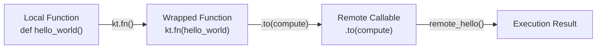

### Example: Hello World

The following example demonstrates the complete workflow from function definition to remote execution:

**Sources:** [README.md:13-29]()

```python
import kubetorch as kt

# Step 1: Define a local function
def hello_world():
    return "Hello from Kubetorch!"

# Step 2: Define compute resources
compute = kt.Compute(cpus=".1")

# Step 3: Wrap function and bind to compute
remote_hello = kt.fn(hello_world).to(compute)

# Step 4: Execute remotely
result = remote_hello()
print(result)  # "Hello from Kubetorch!"
```

This pattern is referenced in [README.md:16-28]().

---

## The Wrapping Mechanism

`kt.fn` performs function wrapping without requiring developers to explicitly serialize their code. This design choice eliminates common boilerplate associated with distributed computing frameworks.

### Conceptual Flow

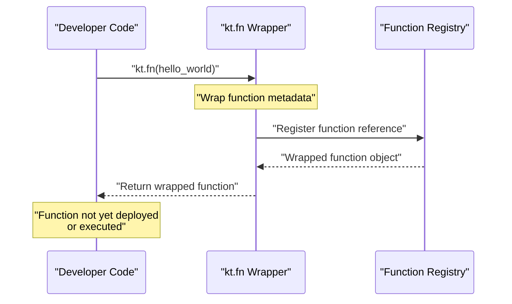

### What Happens During Wrapping

1. **Function Reference Capture**: `kt.fn` captures a reference to the provided function
2. **Metadata Extraction**: The wrapper extracts function metadata (name, signature, module)
3. **Wrapper Object Creation**: A new wrapper object is created that supports the `.to()` method
4. **No Immediate Deployment**: No Kubernetes resources are created at this stage

The system avoids explicit serialization, as stated in the key features: "no local runtime or code serialization" [README.md:9]().

**Sources:** [README.md:9](), [README.md:24]()

---

## The .to() Method

The `.to()` method binds a wrapped function to specific compute resources, creating a remote callable that can be executed on the Kubernetes cluster.

### Method Signature

```python
wrapped_function.to(compute)
```

### Parameters

| Parameter | Type | Description |
|-----------|------|-------------|
| `compute` | `kt.Compute` | A compute resource specification defining CPUs, memory, GPUs, and other resource requirements. See [kt.Compute](#5.2) for details. |

### Return Value

Returns a remote callable object that, when invoked, executes the wrapped function on a Kubernetes pod matching the specified compute requirements.

### Binding Semantics

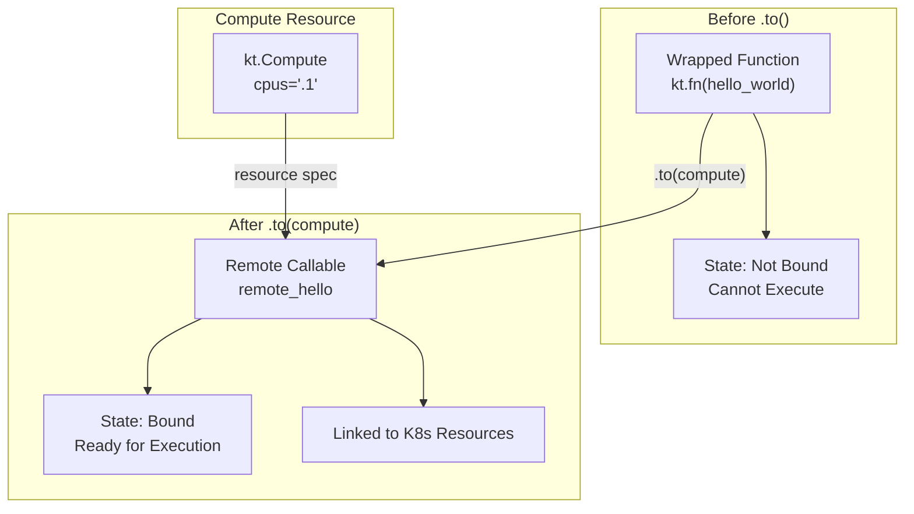

### Usage Example

```python
# Define compute first
compute = kt.Compute(cpus=".1")

# Bind function to compute
remote_hello = kt.fn(hello_world).to(compute)
```

The method chaining pattern `kt.fn(hello_world).to(compute)` allows for concise function binding as shown in [README.md:24]().

**Sources:** [README.md:21-24]()

---

## Remote Function Invocation

Once bound to compute resources, the remote callable can be invoked using standard Python function call syntax. The function executes on a Kubernetes pod and returns results to the caller.

### Invocation Syntax

```python
result = remote_hello()
```

### Execution Flow

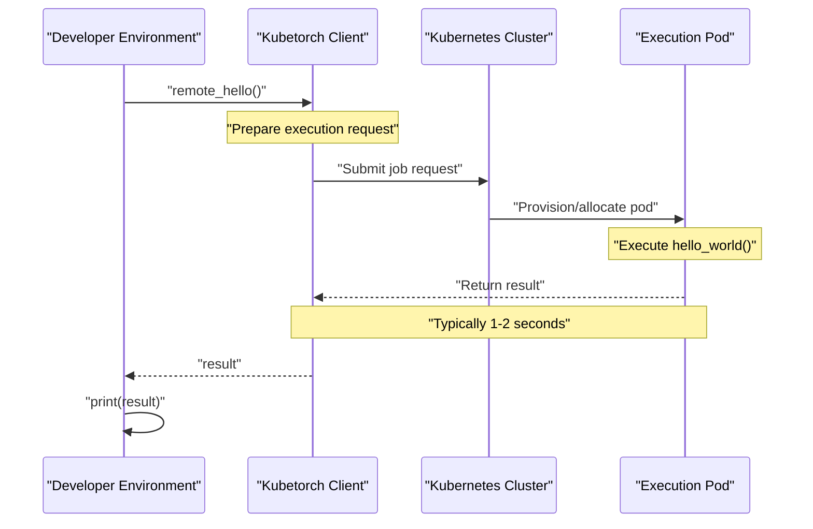

### Performance Characteristics

| Metric | Typical Value |
|--------|---------------|
| **Iteration Time** | 1-2 seconds from invocation to result return |
| **Log Propagation** | Real-time streaming back to developer environment |
| **Exception Handling** | Exceptions raised in remote pod are propagated to local environment |

The 1-2 second iteration time is documented in [README.md:7]() and enables the "100x faster iteration" claim in [README.md:33]().

**Sources:** [README.md:27-28](), [README.md:7](), [README.md:33]()

---

## Arguments and Return Values

Remote callables support the same argument passing semantics as local Python functions.

### Passing Arguments

```python
def process_data(x, y, scale=1.0):
    return (x + y) * scale

remote_process = kt.fn(process_data).to(compute)

# Call with positional arguments
result = remote_process(10, 20)

# Call with keyword arguments
result = remote_process(10, 20, scale=2.0)

# Mixed positional and keyword
result = remote_process(10, 20, scale=1.5)
```

### Return Value Handling

- **Scalar Values**: Primitive types (int, str, float, bool) are returned directly
- **Complex Objects**: Python objects that can be serialized are returned to the caller
- **Timing**: Results are typically available within 1-2 seconds per [README.md:7]()

### Argument Flow Diagram

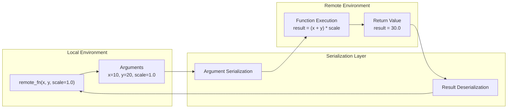

**Sources:** Inferred from standard Python function semantics and [README.md:27-28]()

---

## Code Entity Mapping

The following diagram maps natural language concepts to specific code entities and file locations in the Kubetorch codebase:

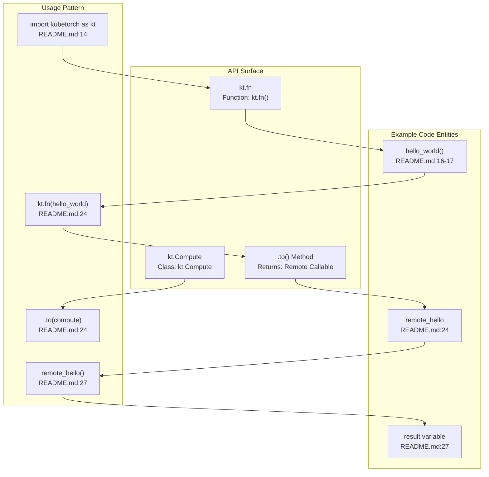

### Key Code Symbols

| Symbol | Type | Location | Purpose |
|--------|------|----------|---------|
| `kt.fn` | Function | `kubetorch` module | Main entry point for function wrapping |
| `.to()` | Method | Wrapped function object | Binds function to compute resources |
| `remote_hello` | Variable | [README.md:24]() | Example of bound remote callable |
| `hello_world` | Function | [README.md:16-17]() | Example local function |

**Sources:** [README.md:14-28]()

---

## Multi-Environment Support

`kt.fn` works identically across all Python environments without requiring a local runtime or daemon process. This universal compatibility is a core design principle stated in [README.md:9]().

### Supported Environments

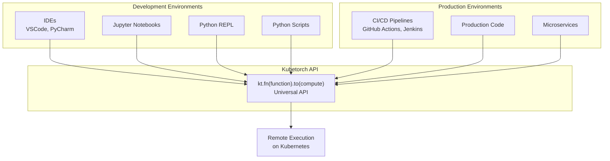

### No Local Runtime Required

Unlike frameworks that require daemon processes or local servers, `kt.fn` operates without any local runtime components:

- **No Background Processes**: No daemon or server running on developer machine
- **No State Management**: No local state synchronization required
- **No Port Conflicts**: No network ports occupied on local machine

This design enables usage from any Python environment, as described in [README.md:9]().

**Sources:** [README.md:9]()

---

## Common Usage Patterns

### Pattern 1: Simple Remote Execution

The most basic pattern for executing a function remotely:

```python
def my_function():
    return "result"

compute = kt.Compute(cpus=".1")
remote_fn = kt.fn(my_function).to(compute)
result = remote_fn()
```

Referenced in [README.md:16-28]().

### Pattern 2: Reusable Remote Callable

Create a remote callable once and invoke it multiple times:

```python
def compute_intensive_task(data):
    # Heavy computation
    return processed_data

compute = kt.Compute(cpus="4", memory="16Gi")
remote_task = kt.fn(compute_intensive_task).to(compute)

# Call multiple times
result1 = remote_task(data1)
result2 = remote_task(data2)
result3 = remote_task(data3)
```

### Pattern 3: Different Compute Profiles

Bind the same function to different compute resources:

```python
def ml_training(model, dataset):
    # Training logic
    return trained_model

# Small compute for testing
small_compute = kt.Compute(cpus=".1")
test_trainer = kt.fn(ml_training).to(small_compute)

# Large compute for production
large_compute = kt.Compute(cpus="32", memory="128Gi")
prod_trainer = kt.fn(ml_training).to(large_compute)
```

**Sources:** Patterns inferred from [README.md:21-28]() and resource flexibility discussed in [README.md:34]()

---

## Integration with Resource Specification

`kt.fn` and `kt.Compute` work together to provide complete control over remote execution. The separation of concerns allows functions to be independent of resource requirements.

### Function-Compute Relationship

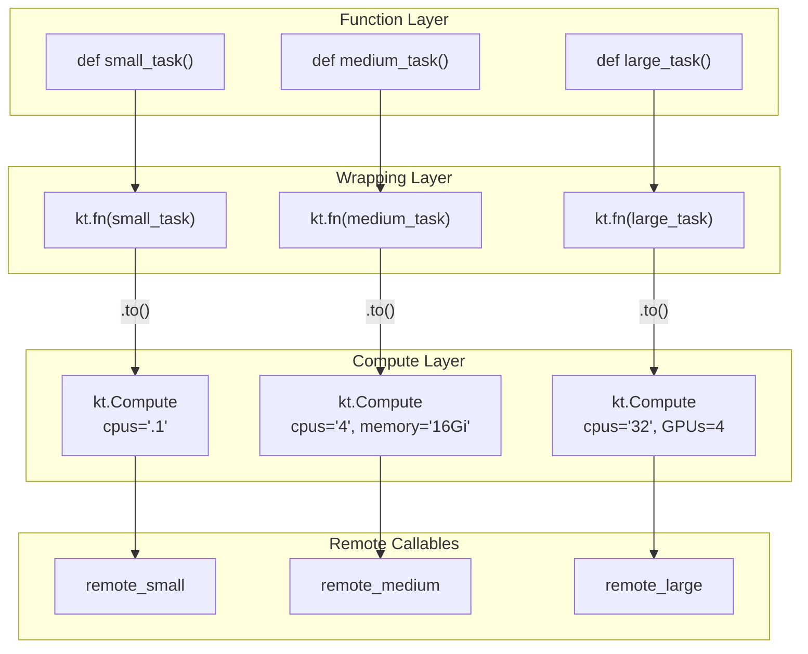

### Binding Flexibility

The same function can be bound to different compute profiles for different use cases:

- **Development**: Minimal resources for rapid testing
- **Staging**: Medium resources for integration testing
- **Production**: Full resources for production workloads

For detailed compute specification options, see [kt.Compute](#5.2).

**Sources:** [README.md:21-24]()

---

## Error Handling and Fault Propagation

Exceptions and faults in remote execution are automatically propagated back to the developer environment in real-time, as stated in [README.md:7]().

### Exception Propagation Flow

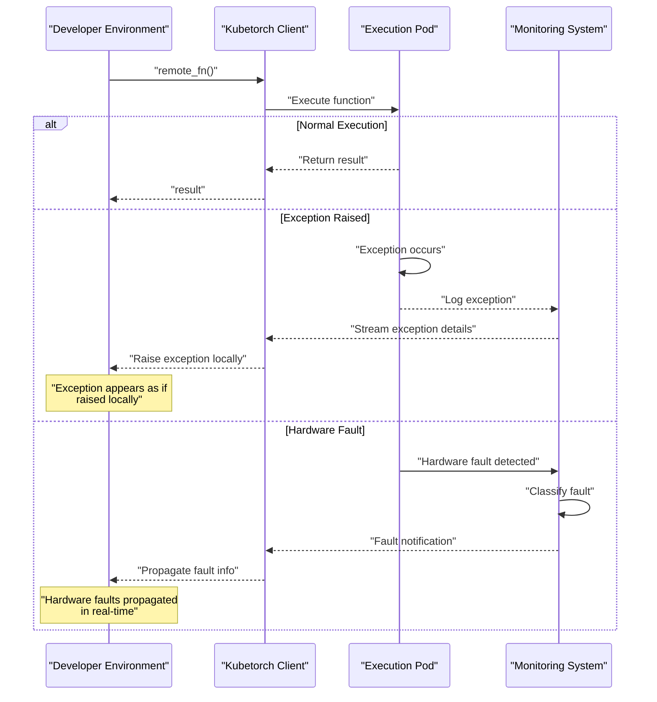

### Exception Types

| Exception Category | Propagation | Developer Experience |
|--------------------|-------------|----------------------|
| **Python Exceptions** | Full traceback streamed back | Appears as local exception with remote traceback |
| **Hardware Faults** | Detected and propagated | Real-time notification of hardware issues |
| **Resource Errors** | OOM, timeout, etc. | Detailed error information with recovery suggestions |

The fault handling system achieves "95% fewer production faults" through programmatic error recovery [README.md:35]().

**Sources:** [README.md:7](), [README.md:35]()

---

## Log Streaming

Logs from remote execution are automatically streamed back to the developer environment in real-time, enabling the 1-2 second iteration cycle.

### Log Flow Architecture

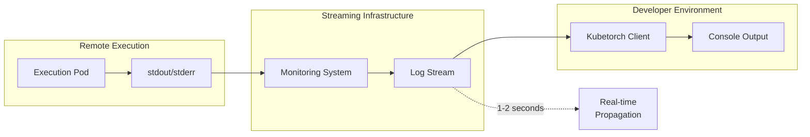

### Log Behavior

- **Automatic Streaming**: No manual log inspection required
- **Real-time Updates**: Logs appear as function executes, not after completion
- **Console Integration**: Logs appear in developer's console/notebook output
- **No Polling**: Streaming happens automatically without polling APIs

This eliminates the traditional Kubernetes workflow of manually inspecting pod logs using `kubectl logs`, contributing to the "100x faster iteration" claim [README.md:33]().

**Sources:** [README.md:7](), [README.md:33]()

---

## Performance Characteristics

### Iteration Speed

`kt.fn` enables extremely fast iteration cycles compared to traditional Kubernetes workflows:

| Stage | Traditional Workflow | Kubetorch |
|-------|---------------------|-----------|
| Code change | Edit files | Edit files |
| Build | Docker build (1-5 min) | Not required |
| Push | Push to registry (30s-2min) | Not required |
| Deploy | `kubectl apply` (30s-2min) | Automatic |
| Execute | Manual pod inspection | `remote_fn()` |
| Get logs | `kubectl logs` | Real-time stream |
| **Total** | **10+ minutes** | **1-2 seconds** |

This performance improvement enables the "100x faster iteration" claim [README.md:33]().

### Resource Efficiency

Functions wrapped with `kt.fn` benefit from Kubetorch's optimization engine:

- **Bin-packing**: Multiple functions co-located on single nodes when resource profiles allow
- **Dynamic Scaling**: Cluster scales based on actual demand
- **Resource Right-sizing**: Automatic adjustment based on observed execution patterns

These optimizations deliver "50%+ compute cost savings" [README.md:34]().

**Sources:** [README.md:33-34]()

---

## Relationship to Other Components

`kt.fn` is part of a larger system of abstractions. Understanding how it relates to other components provides context for its role.

### Component Interaction Map

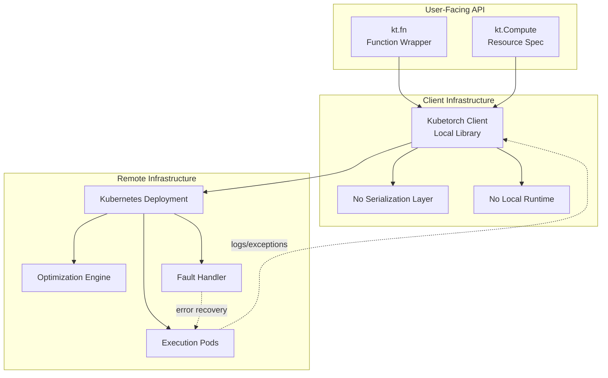

### Related Documentation

- **[kt.Compute](#5.2)**: Resource specification API that works with `kt.fn`
- **[Execution Lifecycle](#4.2)**: Details on what happens when remote callable is invoked
- **[Fault Tolerance System](#4.5)**: How errors are detected and recovered
- **[Multi-Environment Integration](#6.1)**: Using `kt.fn` across different environments
- **[Async Execution Patterns](#6.2)**: Advanced patterns for concurrent execution

**Sources:** [README.md:1-75]()

---

## Summary

`kt.fn` provides the core abstraction for remote function execution in Kubetorch:

### Key Properties

- **Simple API**: Wrap any function with `kt.fn(function)`
- **Resource Binding**: Use `.to(compute)` to bind to compute resources
- **Standard Call Syntax**: Invoke with `remote_fn()` like any Python function
- **No Serialization**: No explicit code serialization required
- **No Runtime**: No local daemon or server process needed
- **Real-time Logs**: Stdout/stderr streamed back immediately
- **Exception Propagation**: Remote exceptions appear as local exceptions
- **Universal Compatibility**: Works in any Python environment

### Design Philosophy

The `kt.fn` design prioritizes:
1. **Developer ergonomics** over framework complexity
2. **Simplicity** over configuration
3. **Local-like semantics** over distributed computing abstractions
4. **Real-time feedback** over batch processing

This design enables developers to treat cluster compute like a local process pool, as described in [README.md:9]().

**Sources:** [README.md:1-75]()

---

