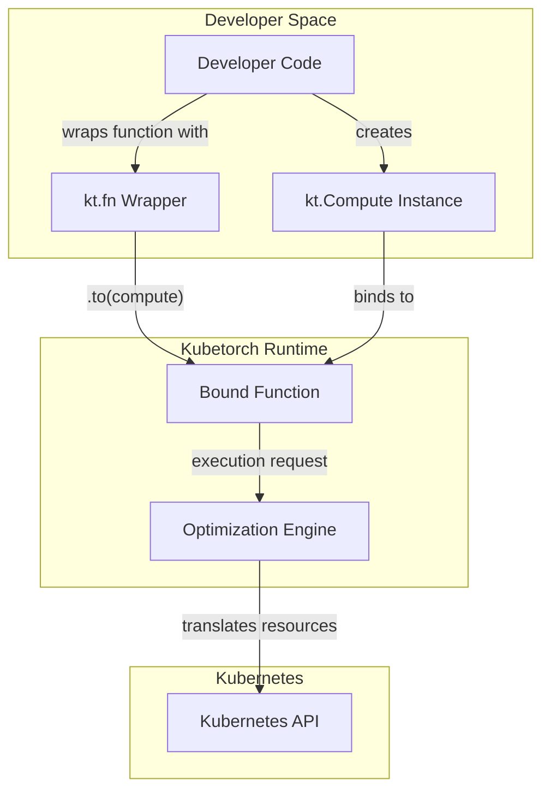
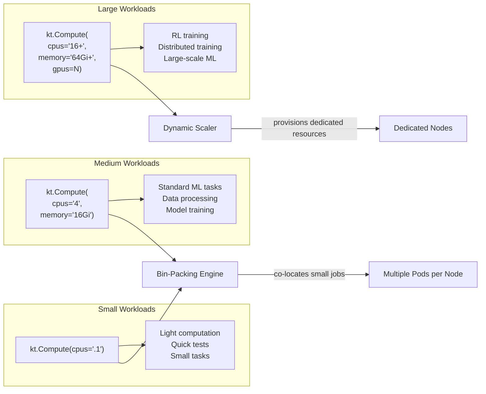
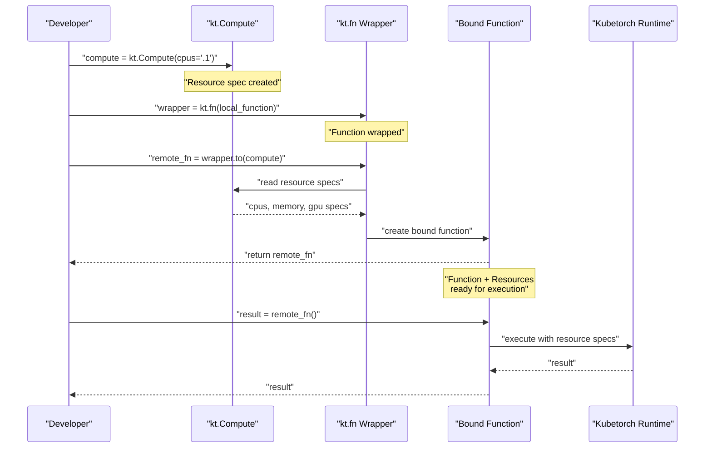
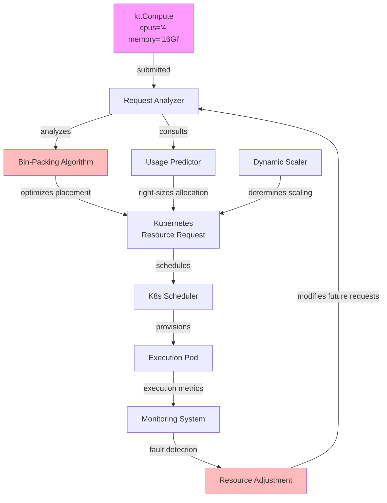
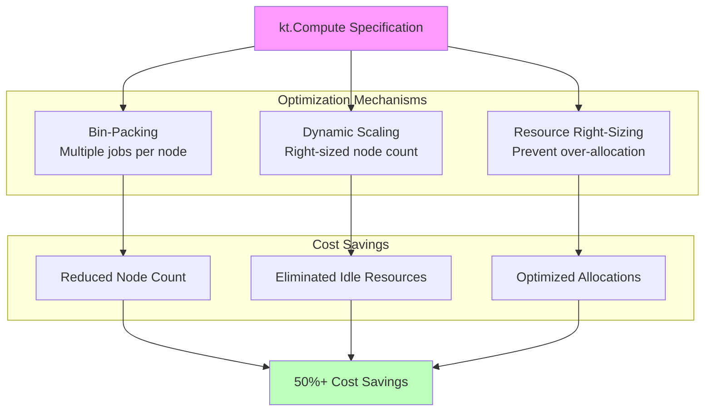
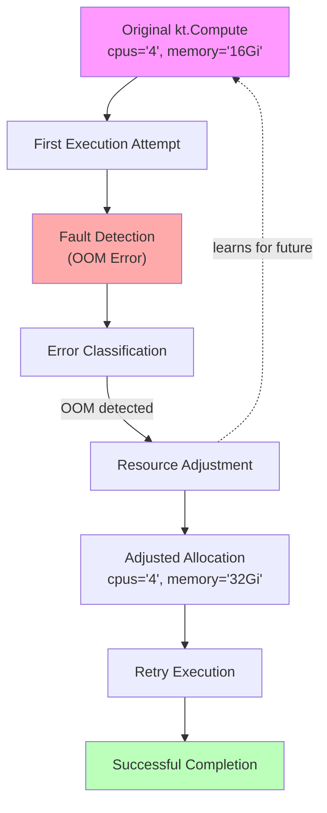
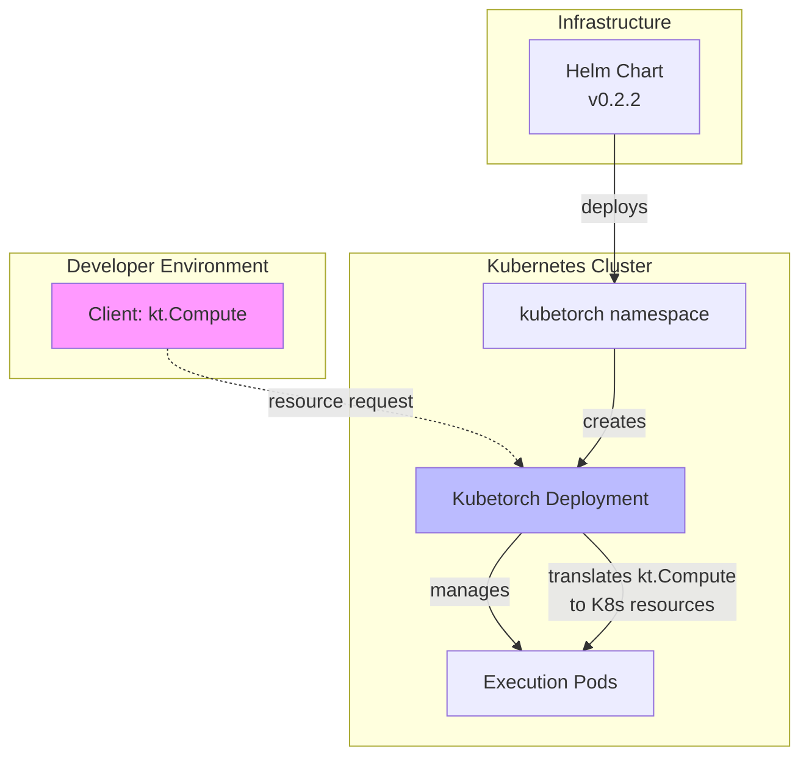

<!-- source: DeepWiki mcp.deepwiki.com · repo run-house/kubetorch · page 5.2 kt.Compute · fetched 2026-10-21 -->

# kt.Compute

<details>
<summary>Relevant source files</summary>

The following files were used as context for generating this wiki page:

- [README.md](README.md)

</details>


## Purpose and Scope

This document provides complete API reference documentation for the `kt.Compute` class, which specifies resource requirements for remote function execution in Kubetorch. It covers resource specification parameters (CPUs, memory, GPUs), instance creation, the binding mechanism via `.to()`, and how `kt.Compute` instances interact with Kubetorch's optimization and scheduling systems.

For information about wrapping functions for remote execution, see [kt.fn](#5.1). For details on the broader execution lifecycle, see [Execution Lifecycle](#4.2). For information on how resources are managed and optimized, see [Resource Management](#4.3) and [Optimization Engine](#4.4).

**Sources:** [README.md:1-75]()

---

## Overview

The `kt.Compute` class is a resource specification abstraction that defines the computational requirements for remote function execution. It serves as the intermediary between developer-specified resource needs and Kubetorch's internal optimization and scheduling systems.

When a developer creates a `kt.Compute` instance, they declare resource requirements in a Pythonic interface without directly interacting with Kubernetes resource specifications. The `kt.Compute` object is then bound to a function wrapper using the `.to()` method, creating a deployment-ready execution unit.

### Role in the Architecture



**Diagram: kt.Compute in System Architecture**

The `kt.Compute` instance captures resource requirements in developer-friendly terms (e.g., `cpus=".1"`), which the optimization engine translates to Kubernetes resource requests and limits. This abstraction enables Kubetorch's bin-packing and dynamic scaling features to operate transparently.

**Sources:** [README.md:14-29]()

---

## Creating kt.Compute Instances

### Basic Instantiation

A `kt.Compute` instance is created by calling the constructor with resource specification parameters:

```python
import kubetorch as kt

# Minimal compute specification
compute = kt.Compute(cpus=".1")
```

This example from the Hello World demonstrates the minimal required specification. The `cpus` parameter accepts string values to support fractional CPU allocations.

**Sources:** [README.md:19-21]()

### Resource Specification Parameters

The `kt.Compute` constructor accepts the following resource parameters:

| Parameter | Type | Description | Example Values |
|-----------|------|-------------|----------------|
| `cpus` | `str` | CPU allocation in cores | `".1"`, `"4"`, `"16"` |
| `memory` | `str` (optional) | Memory allocation | `"16Gi"`, `"32Gi"` |
| `gpus` | `int` or `str` (optional) | GPU count or type | `1`, `"nvidia-tesla-v100"` |

The string-based specification for CPUs allows fractional allocations (e.g., `"0.1"` for one-tenth of a CPU core), which supports efficient bin-packing for small workloads.

---

## Resource Specification Patterns

Kubetorch supports a wide range of resource specifications to accommodate different workload types. The following diagram illustrates common patterns observed in the codebase and documentation:

### Resource Allocation Patterns



**Diagram: Resource Specification Patterns and Optimization**

The resource specification determines how the optimization engine handles workload placement:

- **Small workloads** (`cpus=".1"`): Aggressively bin-packed onto shared nodes to maximize utilization
- **Medium workloads** (`cpus="4", memory="16Gi"`): Balanced packing with isolation guarantees
- **Large workloads** (GPUs, high memory): Dedicated node provisioning with dynamic scaling

**Sources:** [README.md:21](), [README.md:33-35]()

---

## The `.to()` Binding Mechanism

The `kt.Compute` instance is bound to a function wrapper via the `.to()` method on the `kt.fn` wrapper. This binding operation associates resource requirements with a specific function, creating an executable remote function.

### Binding Workflow



**Diagram: kt.Compute Binding Sequence**

The `.to()` operation is lazy - it does not provision resources or deploy code. Resource provisioning occurs only when the bound function is invoked.

### Code Reference

```python
# Create compute specification
compute = kt.Compute(cpus=".1")

# Wrap local function
wrapper = kt.fn(hello_world)

# Bind function to compute
remote_hello = wrapper.to(compute)

# Execution triggers resource provisioning
result = remote_hello()
```

This pattern from [README.md:19-28]() demonstrates the three-step workflow: specify resources, wrap function, bind and execute.

**Sources:** [README.md:19-28]()

---

## Interaction with Optimization Systems

The `kt.Compute` specification feeds into multiple optimization systems that operate transparently to maximize efficiency and reliability.

### Resource Request Flow



**Diagram: kt.Compute Resource Request Flow**

The `kt.Compute` specification undergoes several transformations:

1. **Request Analysis**: The analyzer interprets the developer's resource specification and evaluates current cluster state
2. **Bin-Packing Optimization**: The bin-packing algorithm determines optimal pod placement to maximize node utilization (contributing to 50%+ cost savings)
3. **Usage Prediction**: Historical execution data informs resource right-sizing to prevent over-allocation
4. **Dynamic Scaling**: The scaler determines if new nodes need to be provisioned or if existing capacity suffices
5. **Resource Adjustment**: Monitoring data from previous executions feeds back to improve future allocations

This feedback loop explains how Kubetorch achieves both cost efficiency (intelligent allocation) and reliability (fault-driven optimization).

**Sources:** [README.md:33-35]()

---

## Resource Specification Considerations

### String-Based CPU Specification

CPUs are specified as strings rather than numbers to support fractional allocations:

```python
# Fractional CPU for lightweight tasks
kt.Compute(cpus=".1")   # One-tenth of a CPU core

# Whole number CPU for compute tasks  
kt.Compute(cpus="4")    # Four CPU cores

# High CPU for intensive workloads
kt.Compute(cpus="16")   # Sixteen CPU cores
```

The string format allows precise fractional specifications, which is critical for bin-packing small workloads efficiently. A `cpus=".1"` specification enables ten small jobs to be co-located on a single CPU core.

### Memory Specification Format

Memory uses Kubernetes resource quantity format:

```python
# Gigabytes
kt.Compute(cpus="4", memory="16Gi")

# For larger workloads
kt.Compute(cpus="8", memory="32Gi")
```

The `Gi` suffix indicates binary gigabytes (gibibytes). Alternative suffixes like `G` (decimal gigabytes) or `Mi` (mebibytes) are also supported.

### GPU Specification

GPU specification can be count-based or type-based:

```python
# Request any available GPU
kt.Compute(cpus="8", memory="32Gi", gpus=1)

# Request specific GPU type (if supported by cluster)
kt.Compute(cpus="8", memory="32Gi", gpus="nvidia-tesla-v100")
```

GPU-enabled workloads typically require proportional CPU and memory allocations to prevent resource bottlenecks.

**Sources:** [README.md:21]()

---

## Multi-Environment Compatibility

The `kt.Compute` API is identical across all Python environments, supporting the "universal compute abstraction" design principle:

### Environment Support Matrix

| Environment | kt.Compute Usage | Notes |
|-------------|------------------|-------|
| **IDE** (VSCode, PyCharm) | `import kubetorch as kt`<br/>`compute = kt.Compute(cpus="4")` | Interactive development with code completion |
| **Jupyter Notebooks** | `import kubetorch as kt`<br/>`compute = kt.Compute(cpus="4")` | Cell-by-cell execution, real-time results |
| **Python REPL** | `import kubetorch as kt`<br/>`compute = kt.Compute(cpus="4")` | Interactive exploration and testing |
| **Python Scripts** | `import kubetorch as kt`<br/>`compute = kt.Compute(cpus="4")` | Batch processing and automation |
| **CI/CD Pipelines** | `import kubetorch as kt`<br/>`compute = kt.Compute(cpus="4")` | Automated testing and deployment |
| **Production Apps** | `import kubetorch as kt`<br/>`compute = kt.Compute(cpus="4")` | Production workload execution |

This universality enables the "100x faster iteration" claim by allowing developers to run production-scale workloads directly from their development environment without architectural changes.

**Sources:** [README.md:9]()

---

## Relationship to Cost Optimization

The `kt.Compute` specification directly influences the three cost optimization mechanisms that deliver "50%+ compute cost savings":

### Cost Optimization Mechanisms



**Diagram: kt.Compute and Cost Optimization**

1. **Bin-Packing**: Small `kt.Compute` specs (e.g., `cpus=".1"`) enable aggressive co-location, reducing total node count
2. **Dynamic Scaling**: The optimizer uses `kt.Compute` specs to predict resource demand and scale clusters efficiently
3. **Resource Right-Sizing**: Historical execution data adjusts future allocations to prevent over-requesting resources

The developer specifies requirements via `kt.Compute`, and the optimization systems operate transparently to minimize cost.

**Sources:** [README.md:34]()

---

## Relationship to Fault Tolerance

The `kt.Compute` specification also participates in fault management systems that achieve "95% fewer production faults":

### Fault-Driven Resource Adjustment

When a fault occurs during execution (e.g., out-of-memory error, timeout), the fault handler may adjust the effective resource allocation for retries:



**Diagram: Fault-Driven Resource Adjustment**

The fault management system operates as follows:

1. **Fault Detection**: Monitor detects execution failure (OOM, hardware fault, timeout)
2. **Classification**: System categorizes the failure type
3. **Resource Adjustment**: For resource-related faults, allocations are modified (e.g., double memory for OOM)
4. **Automatic Retry**: Execution retries with adjusted resources
5. **Learning**: Successful adjustments inform future default allocations

This feedback mechanism allows `kt.Compute` specifications to improve over time, reducing the need for manual resource tuning and contributing to the 95% fault reduction.

**Sources:** [README.md:35]()

---

## Usage Patterns

### Pattern 1: Iterative Development

For rapid prototyping and iteration:

```python
import kubetorch as kt

# Start with minimal resources for fast iteration
compute = kt.Compute(cpus=".1")

def experimental_function():
    # Development code
    return "result"

remote_fn = kt.fn(experimental_function).to(compute)
result = remote_fn()  # 1-2 second iteration cycle
```

The minimal resource specification enables the "1-2 second iteration" cycle by reducing scheduling overhead and allowing aggressive bin-packing.

### Pattern 2: Production Workloads

For production-ready ML workloads:

```python
import kubetorch as kt

# Specify production resource requirements
compute = kt.Compute(
    cpus="16",
    memory="64Gi",
    gpus=4
)

def training_function():
    # Production ML training code
    return model

remote_training = kt.fn(training_function).to(compute)
result = remote_training()
```

Production specifications should account for actual workload requirements. The optimization engine will still apply bin-packing and dynamic scaling where possible.

### Pattern 3: Heterogeneous Workloads

When running multiple workload types:

```python
import kubetorch as kt

# Different compute specs for different functions
lightweight_compute = kt.Compute(cpus=".1")
standard_compute = kt.Compute(cpus="4", memory="16Gi")
intensive_compute = kt.Compute(cpus="16", memory="64Gi", gpus=2)

# Bind different functions to appropriate compute
data_loader = kt.fn(load_data).to(lightweight_compute)
preprocessor = kt.fn(preprocess).to(standard_compute)
trainer = kt.fn(train_model).to(intensive_compute)

# Execute with appropriate resources for each stage
data = data_loader()
processed = preprocessor(data)
model = trainer(processed)
```

This pattern demonstrates how `kt.Compute` enables resource differentiation within a single application, allowing the bin-packing engine to optimize placement across heterogeneous workloads.

**Sources:** [README.md:13-29]()

---

## API Summary

### Constructor

```python
kt.Compute(cpus, memory=None, gpus=None, **kwargs)
```

**Parameters:**
- `cpus` (str, required): CPU allocation in cores (supports fractional values)
- `memory` (str, optional): Memory allocation in Kubernetes resource quantity format (e.g., `"16Gi"`)
- `gpus` (int or str, optional): GPU count or type specification
- `**kwargs`: Additional configuration parameters (implementation-specific)

**Returns:**
- `kt.Compute`: Resource specification instance

### Instance Methods

The `kt.Compute` instance is used primarily through the `.to()` method on `kt.fn` wrappers:

```python
wrapper = kt.fn(function)
bound_function = wrapper.to(compute_instance)
```

The binding operation associates the resource specification with the function wrapper, creating an executable remote function.

**Sources:** [README.md:19-24]()

---

## Integration with Deployment Infrastructure

The `kt.Compute` specification integrates with the Helm-deployed Kubetorch server infrastructure:



**Diagram: kt.Compute Integration with Deployment**

The Kubetorch deployment (installed via Helm charts at version 0.2.2) receives `kt.Compute` specifications from client code and translates them to Kubernetes pod specifications. This translation layer enables the optimization and fault tolerance features to operate transparently.

**Sources:** [README.md:45-55]()

---

## Performance Characteristics

### Iteration Speed

The `kt.Compute` specification impacts iteration speed:

| Resource Size | Typical Iteration Time | Optimization Applied |
|---------------|------------------------|----------------------|
| Small (`cpus=".1"`) | 1-2 seconds | Aggressive bin-packing, fast scheduling |
| Medium (`cpus="4"`) | 2-3 seconds | Balanced packing, moderate scheduling |
| Large (GPUs) | 3-5 seconds | Dedicated provisioning, potential node spin-up |

The "1-2 second iteration" claim applies primarily to small resource specifications where pods can be scheduled on existing, underutilized nodes.

### Execution Overhead

The `kt.Compute` abstraction adds minimal overhead:

1. **Client-side**: Negligible - specification is a simple object construction
2. **Optimization layer**: Sub-second analysis for resource placement
3. **Scheduling**: Dependent on cluster state and resource availability

The optimization layer's analysis time is included in the overall 1-2 second iteration cycle.

**Sources:** [README.md:7](), [README.md:33]()

---

## Comparison to Raw Kubernetes

### Traditional Kubernetes Approach

```yaml
apiVersion: v1
kind: Pod
metadata:
  name: ml-workload
spec:
  containers:
  - name: training
    image: custom-ml-image:latest
    resources:
      requests:
        cpu: "4"
        memory: "16Gi"
      limits:
        cpu: "4"
        memory: "16Gi"
```

This requires:
- YAML configuration
- Container image building and pushing
- Manual pod deployment via `kubectl apply`
- Manual log inspection via `kubectl logs`
- Manual fault diagnosis and recovery

### Kubetorch Approach

```python
compute = kt.Compute(cpus="4", memory="16Gi")
remote_fn = kt.fn(training_function).to(compute)
result = remote_fn()  # Logs stream in real-time
```

The `kt.Compute` abstraction eliminates:
- YAML configuration files
- Explicit container builds (handled transparently)
- Manual deployment commands
- Manual log inspection (automatic propagation)
- Manual fault handling (automatic recovery)

This comparison illustrates how `kt.Compute` enables the "100x faster iteration" claim by abstracting away Kubernetes complexity.

**Sources:** [README.md:33]()

---

## Best Practices

### Right-Sizing Resources

Start with conservative estimates and let the fault-driven optimization learn:

```python
# Start conservatively
compute = kt.Compute(cpus="4", memory="16Gi")

# The system will adjust if OOM occurs
remote_fn = kt.fn(memory_intensive_task).to(compute)
result = remote_fn()  # May trigger automatic resource adjustment
```

Over-specifying resources reduces bin-packing efficiency and increases costs. Under-specifying triggers automatic adjustment with minimal developer intervention.

### Reusing Compute Specifications

For workloads with similar requirements:

```python
# Define once, reuse for similar workloads
standard_compute = kt.Compute(cpus="4", memory="16Gi")

task1 = kt.fn(function1).to(standard_compute)
task2 = kt.fn(function2).to(standard_compute)
task3 = kt.fn(function3).to(standard_compute)
```

This pattern enables the bin-packing engine to co-locate similar workloads efficiently.

### GPU Workload Specification

For GPU workloads, ensure proportional CPU/memory:

```python
# Balanced GPU specification
gpu_compute = kt.Compute(
    cpus="16",      # Proportional to GPU count
    memory="64Gi",  # Adequate for GPU workloads
    gpus=4
)
```

GPU workloads benefit from higher CPU and memory allocations to prevent bottlenecks during data loading and preprocessing.

**Sources:** [README.md:21]()

---

## Related Concepts

- **[kt.fn](#5.1)**: Function wrapper that binds to `kt.Compute` via `.to()` method
- **[Execution Lifecycle](#4.2)**: How `kt.Compute` specifications flow through the execution pipeline
- **[Resource Management](#4.3)**: How Kubetorch manages resources specified by `kt.Compute`
- **[Optimization Engine](#4.4)**: How bin-packing and scaling optimize `kt.Compute` allocations
- **[Fault Tolerance System](#4.5)**: How faults trigger resource adjustments to `kt.Compute` specs

**Sources:** [README.md:1-75]()

---

