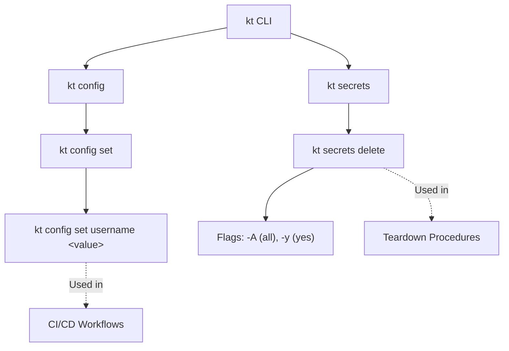
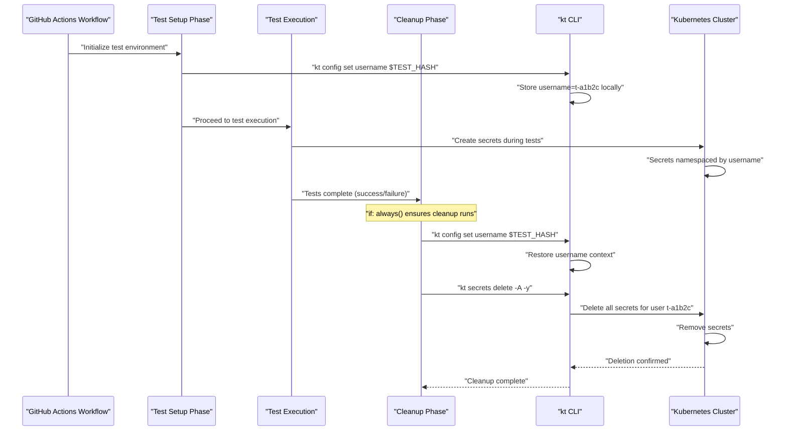
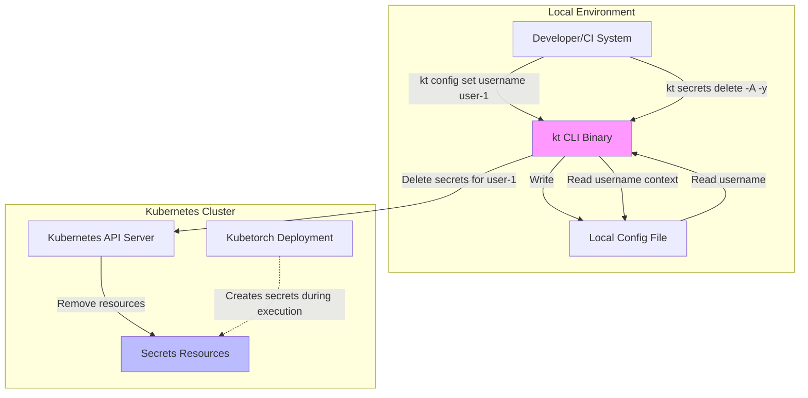

<!-- source: DeepWiki mcp.deepwiki.com · repo run-house/kubetorch · page 5.3 CLI Commands · fetched 2026-10-21 -->

# CLI Commands

<details>
<summary>Relevant source files</summary>

The following files were used as context for generating this wiki page:

- [.github/workflows/unit_tests.yaml](.github/workflows/unit_tests.yaml)
- [README.md](README.md)

</details>


## Purpose and Scope

This document describes the command-line interface (CLI) commands provided by the Kubetorch client. These commands are primarily used for operational tasks such as configuration management and resource cleanup. For programmatic API usage of functions and compute resources, see [kt.fn](#5.1) and [kt.Compute](#5.2). For deployment procedures, see [Kubernetes Deployment](#7.1).

The `kt` CLI is installed automatically when you install the Kubetorch client package via `pip install "kubetorch[client]"`.

---

## Command Overview

The Kubetorch CLI provides commands for managing configuration and secrets in your Kubernetes cluster. These commands are essential for operational workflows, particularly in CI/CD pipelines and cleanup procedures.

### Available Commands

| Command | Purpose | Primary Use Case |
|---------|---------|------------------|
| `kt config` | Manage client configuration | Set user identity, configure cluster connection |
| `kt secrets delete` | Remove secrets from cluster | Cleanup after tests, deprovisioning resources |

**Sources:** [.github/workflows/unit_tests.yaml:87-93]()

---

## Command Structure

The following diagram illustrates the hierarchical structure of CLI commands and their common usage patterns:



**Diagram: CLI Command Hierarchy and Usage Contexts**

**Sources:** [.github/workflows/unit_tests.yaml:87-93]()

---

## kt config

The `kt config` command manages client-side configuration settings that affect how the CLI interacts with the Kubetorch deployment.

### kt config set

**Syntax:**
```bash
kt config set <key> <value>
```

**Description:**  
Sets a configuration value for the specified key. Configuration is stored locally and affects subsequent CLI operations.

**Parameters:**

| Parameter | Description | Example |
|-----------|-------------|---------|
| `key` | Configuration parameter name | `username` |
| `value` | Value to assign to the parameter | `t-a1b2c` |

### Configuration Keys

#### username

Sets the username identity for Kubetorch operations. This is used to namespace resources and secrets within the cluster.

**Example:**
```bash
kt config set username my-user-id
```

**Common Pattern:**  
In CI/CD workflows, the username is often set to a test-specific hash to isolate test resources:

```bash
TEST_HASH="t-$(echo $GITHUB_SHA | cut -c1-5)"
kt config set username $TEST_HASH
```

**Sources:** [.github/workflows/unit_tests.yaml:77-79](), [.github/workflows/unit_tests.yaml:91]()

---

## kt secrets delete

The `kt secrets delete` command removes secrets from the Kubernetes cluster. This is a critical cleanup command used to prevent resource accumulation and ensure proper teardown of test environments.

### Syntax

```bash
kt secrets delete [FLAGS]
```

### Flags

| Flag | Long Form | Description | Default |
|------|-----------|-------------|---------|
| `-A` | `--all` | Delete all secrets for the current user | Required when deleting all secrets |
| `-y` | `--yes` | Skip confirmation prompt | Interactive confirmation |

### Behavior

The command deletes secrets associated with the currently configured username (set via `kt config set username`). When the `-A` flag is provided, all secrets belonging to that user are removed.

### Examples

#### Delete All Secrets with Confirmation Skip

```bash
kt secrets delete -A -y
```

This is the standard cleanup command used in CI/CD pipelines. It:
1. Targets all secrets (`-A`)
2. Skips the interactive confirmation prompt (`-y`)
3. Uses the currently configured username for scoping

#### Interactive Delete (Confirmation Required)

```bash
kt secrets delete -A
```

Without the `-y` flag, the command prompts for confirmation before deleting secrets.

**Sources:** [.github/workflows/unit_tests.yaml:87-93]()

---

## CI/CD Integration

The CLI commands are designed for automated workflows and integrate seamlessly with CI/CD pipelines. The following diagram shows how CLI commands fit into the GitHub Actions testing lifecycle:



**Diagram: CLI Command Usage in CI/CD Lifecycle**

**Sources:** [.github/workflows/unit_tests.yaml:76-93]()

### GitHub Actions Workflow Example

The unit test workflow demonstrates the standard pattern for CLI usage in automated environments:

```yaml
# Set unique test identifier
- name: Set Test Hash
  run: |
    TEST_HASH="t-$(echo $GITHUB_SHA | cut -c1-5)"
    echo "TEST_HASH=$TEST_HASH" >> $GITHUB_ENV

# Execute tests (creates secrets)
- name: Run tests with level unit
  run: |
    cd python_client
    pytest -v --level unit --detached
  timeout-minutes: 60

# Always cleanup, even if tests fail
- name: secrets cleanup
  if: ${{ always() }}
  run: |
    echo "Running teardown command: kt secrets delete -A -y for username ${TEST_HASH}"
    kt config set username $TEST_HASH
    kt secrets delete -A -y
  timeout-minutes: 60
```

**Key Integration Points:**

1. **Test Isolation**: Each test run uses a unique username (derived from commit SHA) to prevent conflicts between concurrent test runs
2. **Guaranteed Cleanup**: The `if: ${{ always() }}` condition ensures secrets are deleted even when tests fail
3. **Timeout Protection**: Cleanup operations have a 60-minute timeout to prevent hanging workflows

**Sources:** [.github/workflows/unit_tests.yaml:76-93]()

---

## Common Usage Patterns

### Pattern 1: Test Environment Cleanup

```bash
# Set test-specific username
TEST_ID="test-$(date +%s)"
kt config set username $TEST_ID

# Run tests that create resources
pytest tests/

# Clean up all secrets created during tests
kt secrets delete -A -y
```

**Use Case:** Ensuring clean state between test runs, preventing resource leaks.

### Pattern 2: User-Specific Resource Isolation

```bash
# Set developer username
kt config set username dev-alice

# Deploy functions (creates secrets)
python my_app.py

# Later: Remove all secrets for this developer
kt secrets delete -A -y
```

**Use Case:** Multiple developers working on the same cluster without resource conflicts.

### Pattern 3: CI/CD Pipeline Teardown

```bash
# Configure for pipeline run
kt config set username "ci-${BUILD_ID}"

# Ensure cleanup happens even if pipeline fails
trap "kt secrets delete -A -y" EXIT

# Run pipeline steps
./run_deployment.sh
```

**Use Case:** Automatic cleanup in shell-based CI/CD systems.

**Sources:** [.github/workflows/unit_tests.yaml:87-93]()

---

## Command Execution Context

The following diagram maps CLI commands to their operational context within the Kubetorch system:



**Diagram: CLI Command Execution Flow and System Integration**

This diagram illustrates how:
- Configuration commands modify local state
- Delete commands operate on remote Kubernetes resources
- Username configuration scopes operations to specific user contexts
- The CLI acts as a bridge between local development and cluster state

**Sources:** [.github/workflows/unit_tests.yaml:87-93]()

---

## Error Handling and Timeouts

### Timeout Configuration

CLI commands in automated environments should include timeout protection to prevent indefinite hangs:

```yaml
- name: secrets cleanup
  run: kt secrets delete -A -y
  timeout-minutes: 60
```

The 60-minute timeout provides sufficient time for cleanup operations while preventing workflow deadlock.

**Sources:** [.github/workflows/unit_tests.yaml:93]()

### Exit Conditions

The `kt secrets delete` command returns:
- **Exit code 0**: Successful deletion of secrets
- **Non-zero exit code**: Failure (authentication issues, network errors, or insufficient permissions)

In CI/CD pipelines, use the `if: ${{ always() }}` condition to ensure cleanup runs regardless of test outcomes:

```yaml
if: ${{ always() }}
```

This guarantees resource cleanup even when preceding steps fail.

**Sources:** [.github/workflows/unit_tests.yaml:88]()

---

## Relationship to Other Components

The CLI commands complement the programmatic API:

| Component | Purpose | Related Documentation |
|-----------|---------|----------------------|
| `kt.fn` | Function execution API | [kt.fn](#5.1) |
| `kt.Compute` | Resource specification API | [kt.Compute](#5.2) |
| `kt` CLI | Operational commands | This page |
| Helm | Deployment management | [Helm Installation](#7.2) |

The CLI is not used for function execution or compute resource definition—those operations use the Python API. The CLI focuses on configuration and cleanup operations that support the development lifecycle.

**Sources:** [README.md:1-75](), [.github/workflows/unit_tests.yaml:87-93]()

---

## Installation and Availability

The `kt` CLI is installed as part of the client package:

```bash
pip install "kubetorch[client]"
```

After installation, the `kt` command is available in your shell environment. Verify installation:

```bash
kt --version
```

**Sources:** [README.md:39-43]()

---

