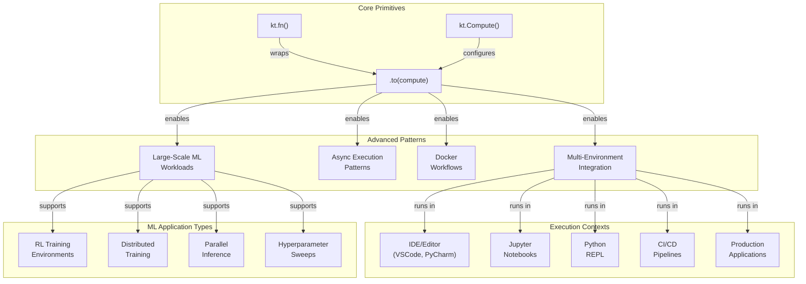
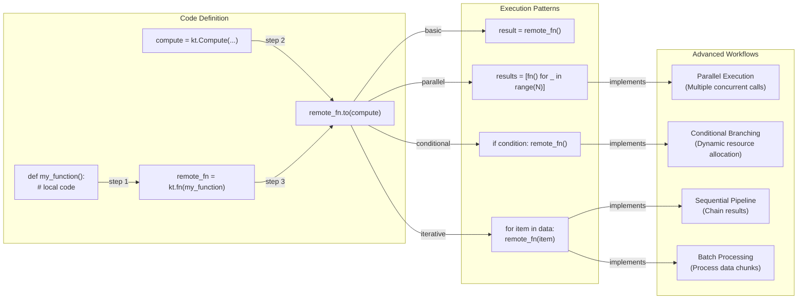
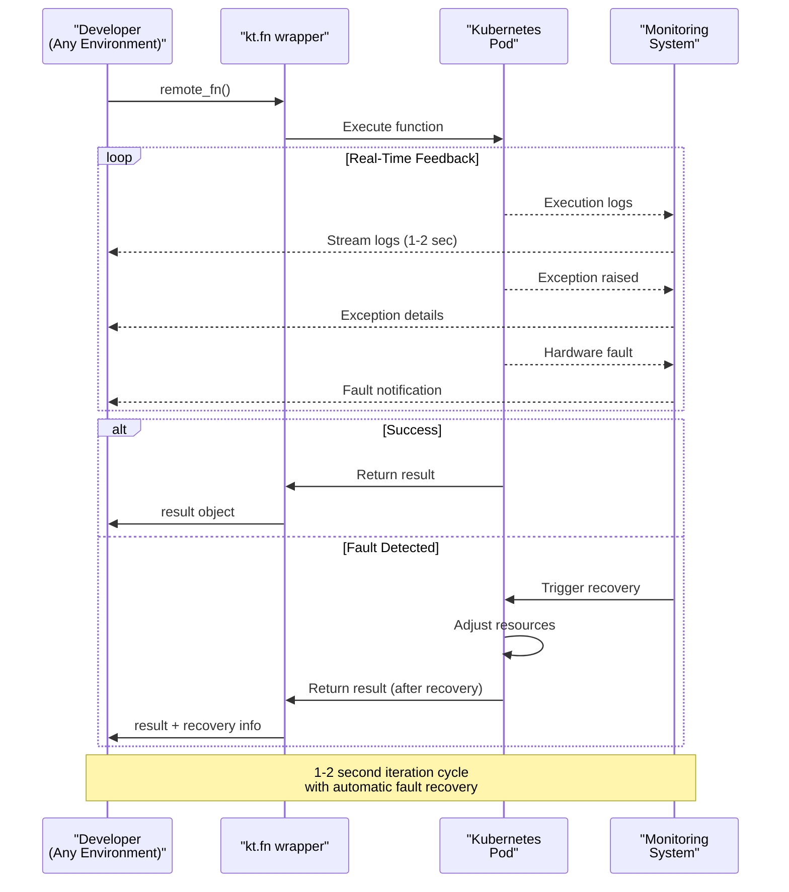

<!-- source: DeepWiki mcp.deepwiki.com · repo run-house/kubetorch · page 6 Advanced Usage · fetched 2026-10-21 -->

# Advanced Usage

Relevant source files

The following files were used as context for generating this wiki page:

- [README.md](README.md)

## Purpose and Scope

This document covers advanced patterns, optimizations, and specialized use cases for experienced Kubetorch users. It provides guidance on leveraging Kubetorch's full capabilities for complex workflows, multi-environment integration, asynchronous execution, custom container workflows, and large-scale ML applications.

For basic usage and core concepts, see [Core Concepts](#2). For API details, see [API Reference](#5). For deployment configuration, see [Deployment and Operations](#7).

## Overview

Kubetorch's design as a universal compute abstraction enables advanced patterns that go beyond simple function execution. The same `kt.fn` and `kt.Compute` interfaces [README.md:13-29]() support sophisticated workflows including:

- **Multi-environment deployment** - Run identical code across IDEs, notebooks, REPL sessions, CI/CD pipelines, and production applications
- **Asynchronous patterns** - Execute multiple functions concurrently with proper resource management
- **Custom containerization** - Integrate Docker workflows for complex dependencies
- **Large-scale ML applications** - Build RL training pipelines, distributed training systems, and other compute-intensive workloads

The key architectural principle is that Kubetorch has **no local runtime or code serialization** [README.md:9](), enabling cluster compute access from any Python environment with the simplicity of a local process pool.

## Advanced Pattern Categories

### Pattern Hierarchy

The following diagram shows how advanced patterns build upon Kubetorch's core primitives:

**Sources:** [README.md:1-75]()

### Resource Specification Patterns

Advanced usage requires understanding how resource specifications scale from development to production:

| Pattern | Resource Example | Use Case | Iteration Speed |
|---------|-----------------|----------|-----------------|
| Development | `kt.Compute(cpus=".1")` | Quick prototyping, testing | 1-2 seconds |
| Medium Workload | `kt.Compute(cpus="4", memory="16Gi")` | Standard training jobs | 1-3 seconds |
| GPU Workload | `kt.Compute(gpus="1", memory="32Gi")` | Deep learning training | 2-4 seconds |
| Multi-Node | `kt.Compute(cpus="16", memory="64Gi", num_nodes="4")` | Distributed training | 3-5 seconds |
| RL Environment | `kt.Compute(cpus="8", memory="32Gi")` | Reinforcement learning | 1-3 seconds |

The same API handles all scales [README.md:13-29](), enabling progressive optimization from prototype to production without code changes.

**Sources:** [README.md:20-21](), [README.md:33-35]()

## Execution Pattern Workflows

### From Local Function to Advanced Execution

The following diagram maps code constructs to their execution patterns:

**Sources:** [README.md:13-29]()

### Environment Integration Pattern

Each Python environment accesses the same cluster compute through identical code:

```mermaid
graph TB
    subgraph "Shared Code Pattern"
        IMPORT["import kubetorch as kt"]
        DEFINE["def my_function(): ..."]
        COMPUTE["compute = kt.Compute(cpus='4')"]
        REMOTE["remote_fn = kt.fn(my_function).to(compute)"]
        EXECUTE["result = remote_fn()"]
    end
    
    subgraph "IDE Execution"
        VSCODE["VSCode Terminal"]
        PYCHARM["PyCharm Console"]
    end
    
    subgraph "Interactive Execution"
        JUPYTER_NB["Jupyter Notebook<br/>Cell"]
        IPYTHON["IPython<br/>REPL"]
    end
    
    subgraph "Automated Execution"
        GH_ACTIONS["GitHub Actions<br/>Workflow"]
        JENKINS_PIPE["Jenkins<br/>Pipeline"]
        CRON_SCRIPT["Cron Job<br/>Script"]
    end
    
    subgraph "Production Execution"
        WEBAPP["Web Application<br/>Backend"]
        MICROSERVICE["Microservice<br/>Handler"]
        API_ENDPOINT["API Endpoint<br/>Function"]
    end
    
    IMPORT -.->|runs in| VSCODE
    IMPORT -.->|runs in| PYCHARM
    IMPORT -.->|runs in| JUPYTER_NB
    IMPORT -.->|runs in| IPYTHON
    IMPORT -.->|runs in| GH_ACTIONS
    IMPORT -.->|runs in| JENKINS_PIPE
    IMPORT -.->|runs in| CRON_SCRIPT
    IMPORT -.->|runs in| WEBAPP
    IMPORT -.->|runs in| MICROSERVICE
    IMPORT -.->|runs in| API_ENDPOINT
    
    EXECUTE -->|1-3 sec iteration| VSCODE
    EXECUTE -->|1-3 sec iteration| JUPYTER_NB
    EXECUTE -->|automated| GH_ACTIONS
    EXECUTE -->|production| WEBAPP
```

This universal interface eliminates environment-specific adaptations and enables the **100x faster iteration** claim [README.md:33]() by removing container build and deployment steps.

**Sources:** [README.md:9](), [README.md:33]()

## Real-Time Feedback Loop

A distinguishing feature for advanced usage is automatic propagation of logs, exceptions, and hardware faults [README.md:7]():

This feedback loop supports rapid iteration even for complex workloads, contributing to the **95% fewer production faults** metric [README.md:35]() by catching issues during development.

**Sources:** [README.md:7](), [README.md:33](), [README.md:35]()

## Cost and Performance Optimization

Advanced users can leverage optimization features transparently:

| Optimization | How It Works | Benefit | User Action Required |
|--------------|--------------|---------|---------------------|
| Bin-Packing | Multiple small jobs co-located on nodes | 50%+ cost reduction | None - automatic |
| Dynamic Scaling | Resources scale with demand | Eliminate idle cost | None - automatic |
| Fault Recovery | Automatic retry with adjusted resources | 95% fewer faults | None - automatic |
| Resource Right-Sizing | Historical data predicts optimal allocation | Prevent over-provisioning | None - automatic |

These optimizations operate without code changes, enabling users to focus on application logic rather than infrastructure management [README.md:34-35]().

**Sources:** [README.md:34-35]()

## Advanced Subsections

The following pages provide detailed guidance for specific advanced patterns:

- **[Multi-Environment Integration](#6.1)** - Using Kubetorch across IDEs, notebooks, REPL, CI/CD, and production environments with identical code
- **[Async Execution Patterns](#6.2)** - Concurrent function execution, parallel workflows, and resource management for asynchronous operations
- **[Docker Workflows](#6.3)** - Custom container images, dependency management, and Docker integration for specialized environments
- **[Large-Scale ML Workloads](#6.4)** - RL training environments, distributed training, and compute-intensive ML applications

Each subsection includes code patterns, best practices, and optimization strategies for its domain.

## Getting Support

For advanced usage support:
- **Documentation**: [https://www.run.house/kubetorch/introduction](https://www.run.house/kubetorch/introduction) [README.md:66]()
- **Examples**: [https://www.run.house/examples](https://www.run.house/examples) [README.md:67]()
- **Community**: [Slack community](https://join.slack.com/t/kubetorch/shared_invite/zt-3g76q5i4j-uP60AdydxnAmjGVAQhtALA) [README.md:68]()
- **Managed Platform**: Kubetorch Serverless - contact [hello@run.house](mailto:hello@run.house) [README.md:62]()

**Sources:** [README.md:60-68]()

---

