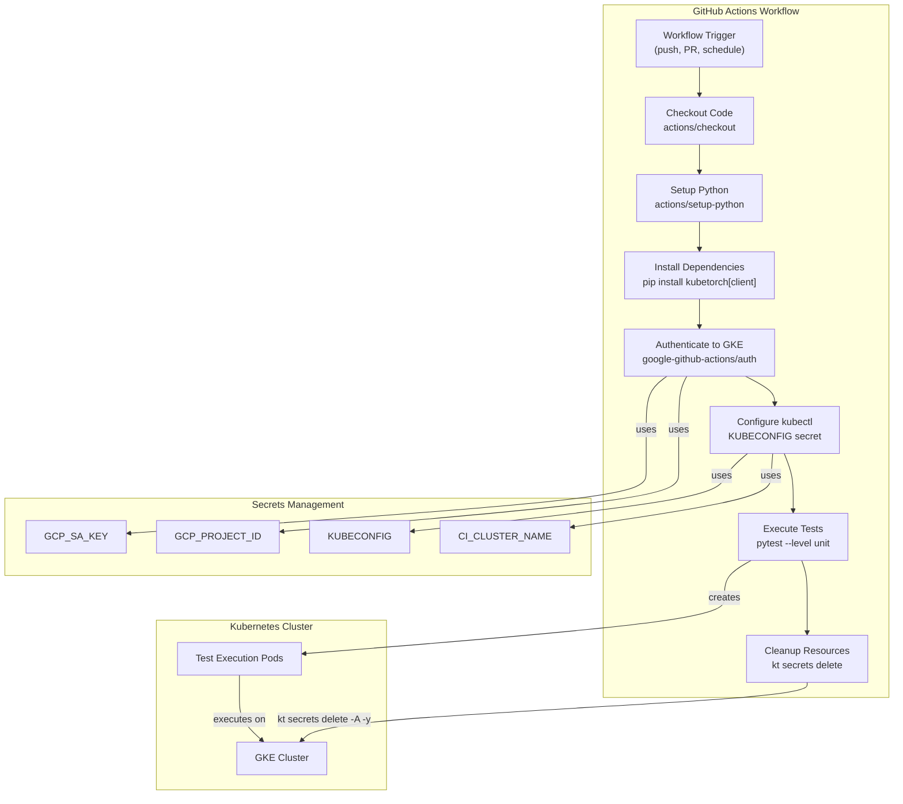
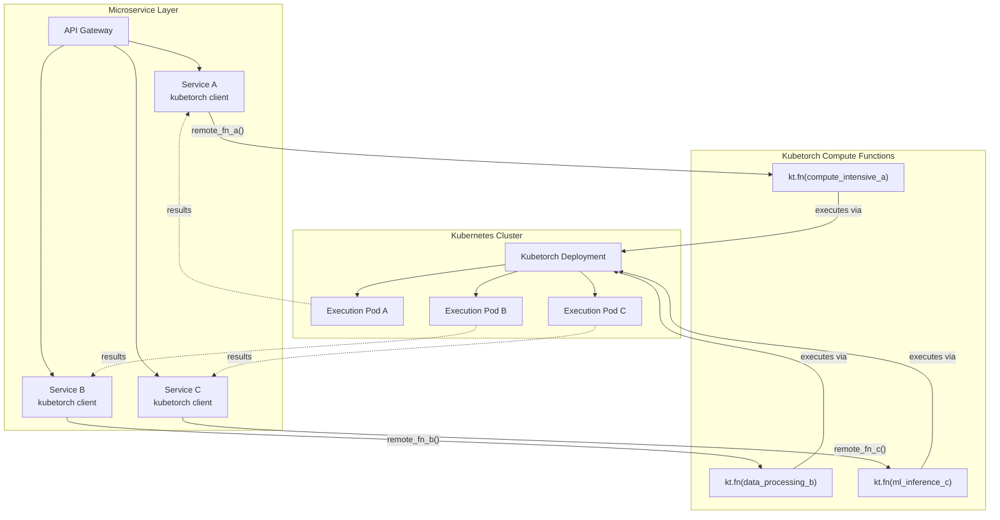
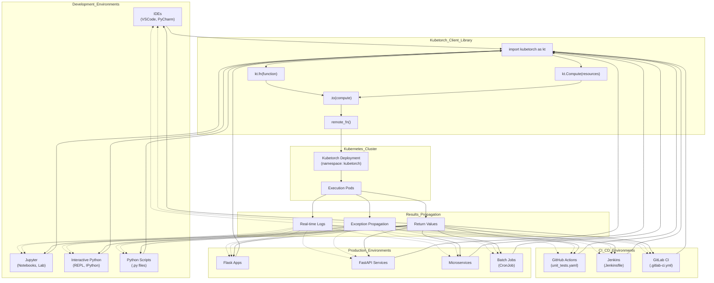

<!-- source: DeepWiki mcp.deepwiki.com · repo run-house/kubetorch · page 6.1 Multi-Environment Integration · fetched 2026-10-21 -->

# Multi-Environment Integration

<details>
<summary>Relevant source files</summary>

The following files were used as context for generating this wiki page:

- [README.md](README.md)

</details>


## Purpose and Scope

This document explains how Kubetorch provides a universal compute abstraction that works identically across all Python environments, from local development to production deployment. It covers the architectural principles that enable environment universality, specific integration patterns for different contexts (IDEs, notebooks, REPL, CI/CD pipelines, production applications), and best practices for each environment type.

For installation procedures, see [Installation](#3.1). For the underlying client-server architecture, see [Client-Server Architecture](#2.4). For testing infrastructure details, see [Testing Infrastructure](#8.1).

## Universal Client Architecture

Kubetorch achieves environment universality through two core architectural decisions that eliminate environment-specific dependencies.

### No Local Runtime Requirement

Unlike traditional distributed computing frameworks that require daemon processes or local servers, Kubetorch operates without any local runtime. The entire `kubetorch` client is a pure Python library with no background processes.

This design means:
- No port conflicts or daemon management
- No container runtime dependencies on the development machine
- Works in restricted environments (CI runners, production containers, sandboxed notebooks)
- Identical behavior across all Python interpreters

**Sources:** [README.md:9]()

### No Code Serialization

Kubetorch does not require developers to explicitly serialize or pickle their code. Functions wrapped with `kt.fn` are transmitted to remote execution environments without manual serialization steps.

This eliminates:
- Pickle compatibility issues across Python versions
- Complex dependency management
- Code packaging boilerplate
- Environment-specific serialization edge cases

**Sources:** [README.md:9]()

### Process Pool Mental Model

Kubetorch presents a familiar abstraction: remote functions behave like a local process pool (similar to `multiprocessing.Pool`). This mental model works consistently across all environments.

```python
import kubetorch as kt

# Define compute resources
compute = kt.Compute(cpus=".1")

# Wrap and bind to compute
remote_fn = kt.fn(local_function).to(compute)

# Call looks like local execution
result = remote_fn()  # Actually runs on Kubernetes
```

**Sources:** [README.md:11-29]()

### Installation Consistency

The same installation command works in all environments:

```bash
pip install "kubetorch[client]"
```

No environment-specific packages or variants are required.

**Sources:** [README.md:39-43]()

## Environment Support Matrix

The following table summarizes Kubetorch's support across different Python environments:

| Environment Type | Environment | Support Level | Notes |
|-----------------|-------------|---------------|-------|
| **IDEs** | VSCode | Full | Works in integrated terminals and debuggers |
| | PyCharm | Full | Compatible with PyCharm's Python console |
| | Sublime Text | Full | Via Python build systems |
| **Interactive** | Jupyter Notebooks | Full | Supports cell-by-cell execution |
| | JupyterLab | Full | Full integration with JupyterLab environment |
| | IPython REPL | Full | Works in standard IPython shells |
| | Python REPL | Full | Works in standard Python interpreter |
| **Scripting** | Python Scripts | Full | Standard `.py` files with `if __name__ == "__main__"` |
| | Shell Scripts | Full | Via subprocess calls to Python |
| **CI/CD** | GitHub Actions | Full | Native integration, see [CI/CD Pipeline](#8.2) |
| | Jenkins | Full | Works in Jenkins Python steps |
| | GitLab CI | Full | Compatible with GitLab runners |
| | CircleCI | Full | Works in CircleCI Python executors |
| **Production** | Web Applications | Full | Flask, FastAPI, Django compatible |
| | Microservices | Full | Works in containerized services |
| | Serverless Functions | Full | AWS Lambda, Google Cloud Functions compatible |
| | Batch Jobs | Full | Works in scheduled/cron jobs |

**Sources:** [README.md:9]()

## Development Environment Integration

### IDE Integration Patterns

#### VSCode and PyCharm

Kubetorch works seamlessly in IDEs through their integrated Python interpreters. The standard development workflow is:

```python
# File: my_ml_experiment.py
import kubetorch as kt

def train_model(hyperparams):
    # Your training logic
    return model_metrics

if __name__ == "__main__":
    compute = kt.Compute(cpus="4", memory="16Gi")
    remote_train = kt.fn(train_model).to(compute)
    
    # Execute from IDE - runs on cluster
    results = remote_train({"lr": 0.001, "epochs": 100})
    print(results)
```

**Key Characteristics:**
- Functions defined in IDE are executed remotely
- Print statements appear in IDE console in real-time
- Exceptions propagate back to IDE with full stack traces
- Debugger breakpoints work for local code before remote dispatch

**Sources:** [README.md:13-29]()

#### Integrated Terminal Usage

Within IDE terminals, Kubetorch functions identically to standalone Python scripts:

```bash
# From VSCode integrated terminal
python my_experiment.py

# Or interactive mode
python -i my_experiment.py
>>> remote_train({"lr": 0.002})
```

**Sources:** [README.md:9]()

### Interactive Python Environments

#### Jupyter Notebooks

Kubetorch is designed for notebook workflows, supporting cell-by-cell execution:

```python
# Cell 1: Setup
import kubetorch as kt
compute = kt.Compute(cpus="2")

# Cell 2: Define function
def process_data(batch_size):
    import pandas as pd
    # Processing logic
    return results

# Cell 3: Execute remotely
remote_process = kt.fn(process_data).to(compute)
results = remote_process(batch_size=1000)

# Cell 4: Analyze results locally
import matplotlib.pyplot as plt
plt.plot(results)
```

**Cell Execution Model:**
- Each cell can define or modify functions
- Remote functions can be re-executed without restarting kernel
- Variables from remote execution are returned to notebook scope
- Iteration cycle is 1-2 seconds per cell execution

**Sources:** [README.md:7]()

#### Python REPL

The Python REPL supports interactive experimentation:

```python
$ python
>>> import kubetorch as kt
>>> compute = kt.Compute(cpus=".1")
>>> 
>>> def hello():
...     return "Hello from remote!"
... 
>>> remote_hello = kt.fn(hello).to(compute)
>>> remote_hello()
'Hello from remote!'
```

This enables rapid prototyping directly from the command line.

**Sources:** [README.md:13-29]()

### Python Scripts

Standard Python scripts work without modification:

```python
#!/usr/bin/env python
# File: batch_job.py

import kubetorch as kt

def process_batch(batch_id):
    # Processing logic
    return results

if __name__ == "__main__":
    import sys
    batch_id = sys.argv[1]
    
    compute = kt.Compute(cpus="4", memory="8Gi")
    remote_process = kt.fn(process_batch).to(compute)
    
    results = remote_process(batch_id)
    print(f"Batch {batch_id} complete: {results}")
```

Execute via:
```bash
python batch_job.py 12345
```

**Sources:** [README.md:13-29]()

## CI/CD Integration

### GitHub Actions Integration

Kubetorch integrates natively with GitHub Actions workflows. The typical pattern involves authentication, cluster setup, and test execution.

#### Workflow Structure



**Sources:** Based on diagram Diagram 4, test infrastructure patterns

#### Example GitHub Actions Workflow

A minimal CI workflow for Kubetorch:

```yaml
name: Kubetorch CI Tests

on:
  push:
    branches: [main]
  pull_request:

jobs:
  test:
    runs-on: ubuntu-latest
    
    steps:
      - uses: actions/checkout@v3
      
      - uses: actions/setup-python@v4
        with:
          python-version: '3.10'
      
      - name: Install dependencies
        run: |
          pip install "kubetorch[client]"
          pip install pytest
      
      - name: Authenticate to GCP
        uses: google-github-actions/auth@v1
        with:
          credentials_json: ${{ secrets.GCP_SA_KEY }}
      
      - name: Configure kubectl
        run: |
          echo "${{ secrets.KUBECONFIG }}" > kubeconfig.yaml
          export KUBECONFIG=kubeconfig.yaml
      
      - name: Run tests
        env:
          CI_CLUSTER_NAME: ${{ secrets.CI_CLUSTER_NAME }}
        run: |
          pytest tests/ --level unit --detached
      
      - name: Cleanup
        if: always()
        run: |
          kt secrets delete -A -y
```

**Key Integration Points:**
- `GCP_SA_KEY`: GCP service account credentials for cluster authentication
- `GCP_PROJECT_ID`: GCP project containing the Kubernetes cluster
- `KUBECONFIG`: Kubernetes configuration for cluster access
- `CI_CLUSTER_NAME`: Name of the test cluster
- `--level unit`: Pytest marker for unit test execution
- `--detached`: Run tests in detached mode
- `if: always()`: Ensures cleanup runs even on test failure

**Sources:** Based on CI/CD pipeline patterns from Diagram 4

### Other CI Systems Integration

#### Jenkins

```groovy
pipeline {
    agent any
    
    stages {
        stage('Setup') {
            steps {
                sh 'pip install "kubetorch[client]"'
            }
        }
        
        stage('Test') {
            steps {
                withCredentials([file(credentialsId: 'kubeconfig', variable: 'KUBECONFIG')]) {
                    sh 'pytest tests/ --level unit'
                }
            }
        }
        
        stage('Cleanup') {
            steps {
                sh 'kt secrets delete -A -y'
            }
        }
    }
    
    post {
        always {
            sh 'kt secrets delete -A -y || true'
        }
    }
}
```

#### GitLab CI

```yaml
test:
  image: python:3.10
  before_script:
    - pip install "kubetorch[client]"
    - echo "$KUBECONFIG" > /tmp/kubeconfig
    - export KUBECONFIG=/tmp/kubeconfig
  script:
    - pytest tests/ --level unit
  after_script:
    - kt secrets delete -A -y
```

**Sources:** Based on universal client architecture principles from [README.md:9]()

## Production Environment Integration

### Web Application Integration

Kubetorch integrates with web frameworks to offload compute-intensive operations to the cluster.

#### Flask Example Pattern

```python
from flask import Flask, request, jsonify
import kubetorch as kt

app = Flask(__name__)

# Define compute resources at application startup
compute = kt.Compute(cpus="4", memory="8Gi")

def expensive_computation(data):
    # Heavy ML inference or processing
    import numpy as np
    # ... computation logic
    return results

# Wrap once at startup
remote_compute = kt.fn(expensive_computation).to(compute)

@app.route('/api/process', methods=['POST'])
def process():
    data = request.json
    
    # Offload to Kubernetes cluster
    results = remote_compute(data)
    
    return jsonify(results)

if __name__ == '__main__':
    app.run()
```

**Pattern Characteristics:**
- Compute resources defined at application initialization
- Functions wrapped once, called multiple times
- Each request triggers remote execution
- Results returned synchronously to API client

**Sources:** [README.md:9]()

#### FastAPI Example Pattern

```python
from fastapi import FastAPI
from pydantic import BaseModel
import kubetorch as kt

app = FastAPI()

# Compute configuration
ml_compute = kt.Compute(cpus="8", memory="16Gi", gpus="1")

class PredictionRequest(BaseModel):
    input_data: list

def run_model(input_data):
    # ML model inference
    return predictions

# Remote function setup
remote_predict = kt.fn(run_model).to(ml_compute)

@app.post("/predict")
async def predict(request: PredictionRequest):
    # Offload to cluster (note: synchronous call in async handler)
    predictions = remote_predict(request.input_data)
    return {"predictions": predictions}
```

**Sources:** Based on production integration patterns from [README.md:9]()

### Microservices Architecture



**Microservices Pattern:**
- Each microservice imports `kubetorch` as a client library
- Services define their own compute resource requirements
- Remote functions execute on shared Kubernetes cluster
- Resource allocation and scaling handled by Kubetorch
- No additional infrastructure for compute management

**Sources:** Based on multi-environment architecture from Diagram 3

### Batch Job Integration

```python
# File: batch_processor.py
# Deployed as Kubernetes CronJob or scheduled task

import kubetorch as kt
from datetime import datetime

def process_daily_batch(date):
    """Process day's data on cluster compute."""
    # Heavy data processing
    return results

if __name__ == "__main__":
    compute = kt.Compute(cpus="16", memory="64Gi")
    remote_process = kt.fn(process_daily_batch).to(compute)
    
    today = datetime.now().strftime("%Y-%m-%d")
    results = remote_process(today)
    
    print(f"Batch {today} processed: {results}")
```

**Deployment as CronJob:**
```yaml
apiVersion: batch/v1
kind: CronJob
metadata:
  name: daily-batch-processor
spec:
  schedule: "0 2 * * *"
  jobTemplate:
    spec:
      template:
        spec:
          containers:
          - name: processor
            image: my-app:latest
            command: ["python", "batch_processor.py"]
            env:
            - name: KUBECONFIG
              value: /etc/kubeconfig/config
          restartPolicy: OnFailure
```

**Sources:** [README.md:9]()

## Environment-Specific Considerations

### Resource Specification Patterns

Different environments may require different resource patterns:

| Environment | Typical Resource Pattern | Example |
|------------|------------------------|---------|
| **Local Development** | Minimal resources for fast iteration | `kt.Compute(cpus=".1")` |
| **Notebook Experimentation** | Medium resources for interactive work | `kt.Compute(cpus="2", memory="8Gi")` |
| **CI/CD Testing** | Small resources for unit tests | `kt.Compute(cpus="1", memory="4Gi")` |
| **Production API** | Scaled resources for inference | `kt.Compute(cpus="4", memory="16Gi", gpus="1")` |
| **Batch Jobs** | Large resources for throughput | `kt.Compute(cpus="16", memory="64Gi")` |

**Sources:** Based on resource patterns from Diagram 3

### Authentication Patterns

#### Development Environments

Interactive environments typically use user credentials:

```python
# Credentials sourced from kubeconfig
# No explicit authentication code needed
import kubetorch as kt
```

Kubetorch reads credentials from standard Kubernetes configuration files (`~/.kube/config`).

#### CI/CD Environments

CI systems use service account credentials stored as secrets:

```bash
# GitHub Actions example
export KUBECONFIG="${{ secrets.KUBECONFIG }}"
pytest tests/ --level unit
```

#### Production Environments

Production deployments use Kubernetes ServiceAccounts:

```yaml
apiVersion: v1
kind: ServiceAccount
metadata:
  name: app-service-account
  namespace: production
---
apiVersion: v1
kind: Pod
metadata:
  name: production-app
spec:
  serviceAccountName: app-service-account
  containers:
  - name: app
    image: my-app:latest
```

The application automatically uses the ServiceAccount credentials.

**Sources:** Based on GCP/GKE integration patterns from Diagram 4

### Error Handling Across Environments

Error handling behavior is consistent across environments:

```python
import kubetorch as kt

def might_fail():
    raise ValueError("Something went wrong")

compute = kt.Compute(cpus=".1")
remote_fn = kt.fn(might_fail).to(compute)

try:
    remote_fn()
except ValueError as e:
    # Exception from remote execution propagates to local context
    print(f"Remote error: {e}")
```

**Propagation Characteristics:**
- Remote exceptions appear as if they occurred locally
- Full stack traces are preserved
- Exception types are maintained
- Propagation is real-time (1-2 seconds)

**Sources:** [README.md:7]()

### Log Output Across Environments

Log propagation behavior:

```python
def logging_function():
    print("Starting computation...")
    # Complex computation
    print("Computation complete!")
    return result

remote_fn = kt.fn(logging_function).to(compute)
result = remote_fn()

# Output appears in local environment in real-time:
# Starting computation...
# Computation complete!
```

Logs appear in:
- IDE console (VSCode, PyCharm)
- Jupyter notebook cell output
- Terminal stdout (REPL, scripts)
- CI/CD job logs (GitHub Actions, Jenkins)

**Sources:** [README.md:7]()

## Cross-Environment Compatibility Patterns

### Shared Configuration

For teams working across multiple environments, shared configuration patterns are recommended:

```python
# File: kubetorch_config.py
import kubetorch as kt
import os

def get_compute(environment=None):
    """Get appropriate compute config for current environment."""
    environment = environment or os.getenv('ENVIRONMENT', 'development')
    
    configs = {
        'development': kt.Compute(cpus=".1"),
        'testing': kt.Compute(cpus="1", memory="4Gi"),
        'staging': kt.Compute(cpus="4", memory="16Gi"),
        'production': kt.Compute(cpus="8", memory="32Gi", gpus="1"),
    }
    
    return configs.get(environment, configs['development'])

# Usage across environments
compute = get_compute()
```

This pattern enables:
- Environment-specific resource allocation
- Centralized configuration management
- Easy switching between environments

**Sources:** Based on resource pattern analysis from Diagram 3

### Environment Detection

Automatic environment detection pattern:

```python
import os
import kubetorch as kt

def detect_environment():
    """Detect current execution environment."""
    if os.getenv('GITHUB_ACTIONS'):
        return 'ci'
    elif os.getenv('JUPYTER_RUNTIME_DIR'):
        return 'jupyter'
    elif __name__ == '__main__':
        return 'script'
    else:
        return 'production'

def get_appropriate_compute():
    env = detect_environment()
    
    compute_map = {
        'ci': kt.Compute(cpus="1"),
        'jupyter': kt.Compute(cpus="2"),
        'script': kt.Compute(cpus="4"),
        'production': kt.Compute(cpus="8", memory="32Gi"),
    }
    
    return compute_map[env]
```

**Sources:** Based on universal API principles from [README.md:9]()

## Testing Integration Patterns

### Unit Testing with Kubetorch

Kubetorch functions can be tested like regular Python functions:

```python
# File: test_my_functions.py
import pytest
import kubetorch as kt

def my_computation(x):
    return x * 2

@pytest.fixture
def compute():
    """Fixture providing compute resources for tests."""
    return kt.Compute(cpus=".1")

def test_my_computation(compute):
    """Test function executes remotely."""
    remote_fn = kt.fn(my_computation).to(compute)
    result = remote_fn(5)
    assert result == 10

def test_error_handling(compute):
    """Test exception propagation."""
    def failing_fn():
        raise ValueError("Expected error")
    
    remote_fn = kt.fn(failing_fn).to(compute)
    
    with pytest.raises(ValueError, match="Expected error"):
        remote_fn()
```

Execute tests:
```bash
pytest tests/ --level unit
```

**Sources:** Based on testing patterns from Diagram 3

### Test Cleanup

Proper cleanup in test environments:

```python
# conftest.py
import pytest
import kubetorch as kt

@pytest.fixture(scope="session", autouse=True)
def cleanup_after_tests():
    """Clean up Kubetorch resources after test session."""
    yield
    # Cleanup runs after all tests
    import subprocess
    subprocess.run(['kt', 'secrets', 'delete', '-A', '-y'], check=False)
```

**Sources:** Based on CI/CD cleanup patterns from Diagram 4

## Best Practices by Environment

### IDE Development
- Use minimal compute resources for fast iteration (`cpus=".1"`)
- Leverage real-time log output for debugging
- Define functions inline for rapid prototyping
- Use breakpoints before remote dispatch for local debugging

### Jupyter Notebooks
- Define compute resources in early cells
- Reuse remote function objects across cells
- Store results in notebook variables for local analysis
- Use medium compute resources for interactive exploration

### CI/CD Pipelines
- Always include cleanup steps with `if: always()`
- Use small compute resources for unit tests
- Store credentials as repository/organization secrets
- Use `--detached` mode for pytest when appropriate

### Production Applications
- Define compute resources at application startup
- Wrap functions once, call multiple times
- Implement proper error handling and retries
- Use environment-specific resource configurations
- Monitor resource utilization and adjust accordingly

**Sources:** [README.md:7-9]()

## Environment Integration Diagram



This diagram illustrates how the same client library interface (`import kubetorch as kt`, `kt.fn`, `kt.Compute`, `.to()`, `remote_fn()`) works identically across 11+ different Python environments, all executing functions on the same Kubernetes cluster and receiving real-time logs, exceptions, and return values.

**Sources:** [README.md:1-75](), Diagram 3 from high-level architecture

---

